# 第1章 绪论

> **本章导读**：本章是全书的总纲，回答三个问题——机器学习有哪些方法？用这些方法建模要经历哪些步骤？它们在地学中能解决什么问题？我们先把纷繁的机器学习方法放进一张"类别—功能"总表：同一张二维表格，"横着切"得到聚类，"竖着切"得到降维，"看着 Y 竖着切"得到特征选取，"由 X 预测 Y"得到分类与回归——四大功能由此而来。随后沿着数据、建模过程、数据集划分、方法选择、建模步骤与性能评估的主线，把一个完整建模项目的骨架搭起来；最后用暴雨预报、洪水预报、凌汛、空气质量、土壤水分反演与植被遥感分类六个地学问题，看这些方法如何落地。学完本章，读者应能在拿到一个实际问题时，迅速判断它属于哪类功能、需要什么数据、要走哪些步骤。

## 1.1 机器学习方法概述

### 1.1.1 什么是机器学习

先看机器学习的位置。人工智能（Artificial Intelligence，AI）是让机器模拟人类智能的大领域；机器学习（Machine Learning，ML）是实现人工智能的主流途径；深度学习（Deep Learning，DL）又是机器学习中以深层神经网络为核心的一个分支。三者是逐层包含的关系（图 1-1）。

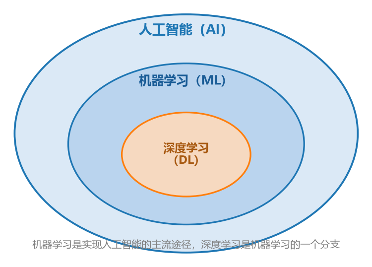

**图 1-1 人工智能、机器学习与深度学习的包含关系**

什么是机器学习？不同学科背景的人给出的定义侧重不同，表 1-1 汇总了四种有代表性的说法。

**表 1-1 机器学习的四种定义**

| 出处 | 定义 |
|------|------|
| 工程视角 | 教计算机执行人和动物与生俱来的活动：从经验中学习 |
| 计算机科学 | 如果一个程序可以在任务 $T$ 上，随着经验 $E$ 的增加，效果 $P$ 也可以随之增加，则称这个程序可以从经验中学习 |
| 统计学 | 一类从数据中自动分析获得规律，并利用规律对未知数据进行预测的算法；因涉及大量统计学理论，机器学习与统计推断联系尤为密切，也被称为统计学习理论 |
| 数学视角 | 构造一个实现特定功能、并且具有输入和输出的函数 |

四种定义说法不同，内核一致：**从数据中找规律，再用规律去预测未知**。本书采用一个便于操作的表述——机器学习就是构造一个"输入 → 模型 → 输出"的函数：

$$y = f(x,\;\theta) \tag{1-1}$$

其中 $x$ 是输入（自变量），$y$ 是输出（因变量），$f$ 是模型结构，$\theta$ 是模型参数。建模的过程，就是用数据把 $f$ 的结构和 $\theta$ 的取值确定下来。

还要强调一个方法论上的定位：**机器学习方法属于数据驱动方法，与之对应的是数值模拟方法**。数据驱动，指算法使用计算方法直接从数据中"学习"信息，而不依赖于预先设定的方程模型；当可用于学习的样本数量增加时，这些算法可自适应地提高性能。数值模拟方法（如水文模型、气象模式）则先写下描述物理过程的方程，再数值求解。两条路线各有所长，1.3 节会看到它们在地学预报中并行使用。

什么情况下适合用机器学习？**涉及大量数据和许多变量的复杂问题，但没有现成的处理公式或方程时**，可以考虑使用机器学习。反过来，如果问题有成熟的物理机理方程、参数也可率定，数值模拟往往更可解释。

### 1.1.2 机器学习的类别

机器学习可以按不同维度分类，最常用的是两个：按数据有无标注分，按模型深浅分。

**按数据是否有标签（因变量 Y）分：**

- **监督学习（Supervised Learning）**：从已标注的训练数据中学习判断数据特征，并将其用于对未标注数据的判断。
- **无监督学习（Unsupervised Learning）**：不同于监督学习，它的学习算法是从没有标注的训练数据中学习数据的特征。
- **半监督学习（Semi-supervised Learning）**：同时使用标记和未标记的数据，介于监督学习和无监督学习之间的混合技术。核心思想是根据数据是否有标签来区别处理：对于有标签的数据，算法使用传统的监督方式来更新模型权重；对于未标记的点，算法最小化其他类似训练示例之间的预测差异。半监督适合标注成本高、未标注数据又大量存在的领域，本书使用较少。

**按模型结构深浅分：**

- **浅层学习（Shallow Learning）**：有一层隐层节点或没有隐层节点等结构相对简单的机器学习方法，例如 SVM、ANN（浅层）、LR（Logistic 回归）。
- **深度学习（Deep Learning）**：基于海量数据，构建具有很多隐层的模型，实现逐层特征变换，提升分类或回归准确性的机器学习方法，通常指具有深层非线性网络结构的深度神经网络。

把各种分类维度放到一张图上（定义—结构—构建—评估的建模链条、五大功能、无监督/有监督的关系、浅层/深层），就得到机器学习方法的整体框架。这张框架图不必背下来，但随着本书章节推进，读者应能不断在图中"认领"新学到的方法。

### 1.1.3 机器学习的四大功能：横着切与竖着切

机器学习最常完成的功能是四类：**聚类、降维、特征选取、分类与回归**。这些名字大家在相关计算中或多或少会遇到。要快速抓住它们的区别，有一个好用的记忆法——想象手头只有最简单的**表格型数据**，看对这张表格做哪种"切割"。

设表格的列是 $X_1, X_2, \dots, X_n$（属性、变量），先看**只有 X、没有 Y** 的无监督情形（图 1-2）：

- **聚类——横着切**。每一行是一个数据点，把这些行放到属性空间里观察，有些数据点会自然而然聚在一起。聚类就是把表格**横着切割**，让被放进同一组的行（数据点）彼此更接近。若要求每个数据点只能属于一类，是**硬聚类**；若允许一个数据点以一定概率同时属于多类，是**软聚类**。
- **降维——竖着切**。换一个方向，把表格**竖向切割**：每一列是一个属性 $X$，若某几个 $X$ 之间非常相关（表达了近乎重复的信息），就只取其中一个，或把它们合并成一个新的综合变量。几个 $X$ 变成一个 $X$，列数变少，这就是降维。

再把因变量 **Y** 请进来。Y 又称标签、响应变量，通常是**比较难获得、又非常感兴趣、想要获得的量**——或在空间上稀疏、或在时间上滞后、或要花费很高成本才能采集，因而十分珍贵。有了 Y，又多出两类功能：

- **特征选取——看着 Y 竖着挑**。看着 Y 来挑选 X：把与 Y 关系不大的 X 去掉，把彼此太相似、信息重复的 X 合并精简。它与降维都是减少自变量个数，区别在于降维可以完全不看 Y，特征选取则要"看着 Y"来决定留谁删谁。
- **分类与回归——由 X 预测 Y**。两者的差别只在 Y 的类型：若 Y 是**类别**（二元如 0/1，多元如 1~5 的整数编码），叫**分类**；若 Y 是**实数**（浮点数），叫**回归**。例如想通过今天的天气情况预测未来一小时的降雨量，Y 可能是"10.5 毫米"这样一个具体实数，这是回归问题。

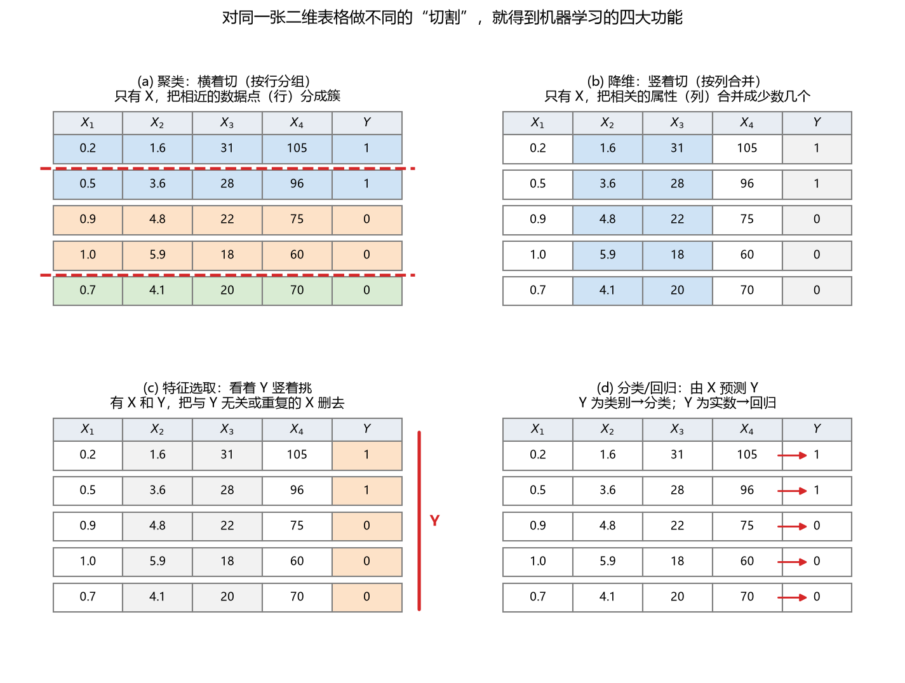

**图 1-2 对二维表格做不同"切割"得到四大功能**

分类和回归都有 Y 参与，都属于**有监督学习**；聚类和降维只基于 X，属于**无监督学习**。此外还有一大类**优化问题**，可以放在机器学习里也可以放在人工智能里（本书不展开）；其中现在广为人知的一类方法叫**强化学习**。近年大火的**生成**（文本生成图像、文本生成代码等生成式 AI）则是四大功能之外快速崛起的第五类功能，1.1.6 节再介绍。

### 1.1.4 方法总表：一图看尽本书方法

把"思想类别 × 功能"交叉排列，就得到表 1-2 这张方法总表。**建议读者每学一种新方法都回到这张表**，看看它处在哪一行哪一列——这是本书反复使用的一张"地图"。

**表 1-2 数据挖掘/机器学习的典型方法**

| 类别 | 聚类 | 降维 | 回归 | 分类 |
|------|------|------|------|------|
| 线性方法 | — | 相关性分析、主成分分析、因子分析 | 多元线性回归 | Logistic 回归、判别分析 |
| 最近邻 | k 均值聚类 | — | kNN | kNN |
| 树型 | 层次聚类 | — | 决策树（回归树） | 决策树（分类树） |
| 密度 | DBSCAN | — | — | — |
| 神经网络 | 自组织映射（SOM） | — | ANN | ANN |
| 核函数 | — | — | SVR | SVC |
| 图论 | 谱聚类 | — | 概率图模型 | 概率图模型 |
| 随机变量 | 高斯混合模型 | — | — | 贝叶斯分类 |
| 模糊数学 | 模糊 C 均值聚类 | — | 模糊逻辑模型、ANFIS | 模糊逻辑模型 |
| 深度学习 | — | — | CNN、LSTM | CNN |

读表 1-2 有三个要点。**第一，表的每一行是一种思想**：线性方法用加权叠加（相关性）说话，最近邻方法相信"物以类聚"，树型方法把判断过程画成一棵树，等等。同一种思想可以生成处理不同功能的方法。**第二，同一方法可以实现不同功能**：最典型的是神经网络，做分类、回归、聚类都可以；kNN 也是回归、分类通吃。**第三，每一列对应一大类功能**，后文的章节大体就按"先无监督（第 4、5 章：聚类、降维），再有监督（第 6~10 章：线性模型、kNN、决策树、神经网络、SVM），最后深度学习（第 11 章）"的顺序把表中的方法一一展开。需要说明的是，特征选取在表中没有单独成列：它可以看作"看着 Y 的降维"，所用方法与降维、回归两列高度重合（如逐步回归、正则化都属线性方法家族），因此不再单列。

### 1.1.5 各类功能下的常用方法速览

四大功能下面各有若干常用方法。这里按"工作原理 + 使用时机"做一次速览，给读者一个初步印象，具体原理与实现留待后续章节。

**无监督学习：聚类。**先看硬聚类（表 1-3），其特点是一个点只能属于一个类。

**表 1-3 无监督学习方法：硬聚类**

| 方法 | 工作原理 | 使用时机 |
|------|----------|----------|
| k-均值 | 将数据分割为 k 个相互排斥的类；点在多大程度上适合划入一个类由该点到类中心的距离决定（类中心与数据中的点可以不契合） | 聚类数量已知时；适用于大型数据集的快速聚类 |
| k-中心点 | 与 k-均值类似，选用类中离平均值最近的对象作为中心（类中心与数据中的点契合） | 聚类数量已知时；适用于分类数据的快速聚类；可扩展至大型数据集 |
| 层次聚类 | 通过分析成对点之间的相似度并将对象分组到一个二进制的层次结构树，产生聚类的嵌套集 | 不知道数据中有多少类时；想要可视化地指导数据选择 |
| 自组织映射（SOM） | 基于神经网络的聚类，将数据集变换为保留拓扑结构的 2D 图 | 采用 2D 或 3D 可视化高维数据；通过保留数据的拓扑结构（形状）降低数据维度 |

再看软聚类（表 1-4），其特点是一个点可能属于多个类。

**表 1-4 无监督学习方法：软聚类**

| 方法 | 工作原理 | 使用时机 |
|------|----------|----------|
| 模糊 C-均值 | 当数据点可能属于多个类时进行基于分割的聚类；输出一个点在一个类中的**隶属度**（聚类中心类似于 k-均值） | 聚类数量已知时；适用于模式识别；当聚类相互重叠时 |
| 高斯混合模型 | 基于分割的聚类，假设数据点来自具有一定概率的不同的多元正态分布；输出一个点属于一个类的**概率** | 数据点可能属于多个类时；聚类大小不一且含有相关结构时 |

**有监督学习：分类**（表 1-5），输出是类别、预测离散的响应。

**表 1-5 有监督学习方法：分类**

| 方法 | 工作原理 | 使用时机 |
|------|----------|----------|
| Logistic 回归 | 预测属于一个类或另一个类的二元响应概率的模型；比较简单，常用作二分类问题的起点 | 数据能由一个线性边界清晰划分时；作为评估更复杂分类方法的基准 |
| k 最近邻（kNN） | 根据数据集内类的最近邻关系划分对象的类别；预测假定相互靠近的对象是相似的；用距离量度（欧氏、绝对值、夹角余弦、Chebychev 等）查找最近邻 | 需要简单算法设立基准学习规则时；不太在意训练模型的内存与预测速度时 |
| 支持向量机（SVM） | 搜索能将全部数据点分割开的判别边界（超平面）；线性可分时找两个类之间**最大边距**的超平面；不可分时用损失函数惩罚错侧点，或用核变换把数据映射到可线性分割的高维空间 | 正好有两个类的数据（借助纠错输出码也可用于多类）；高维、非线性可分数据；需要简单、易解释、准确的分类器时 |
| 神经网络 | 由高度互连的神经元组成，将输入与所需输出相关联；通过反复修改连接强度训练网络 | 高度非线性系统建模；数据逐渐增多希望不断更新模型时；输入数据可能有意外变动时；模型可解释性不是主要考虑因素时 |
| 判别分析 | 发现特征的线性组合来分类；假定不同的类根据高斯分布生成数据，训练即求每个类的高斯分布参数，由分布参数计算线性或二次判别边界 | 需要易于解释的简单模型时；训练过程内存占用需要关注时；需要快速预测时 |
| 决策树 | 按照从根节点到叶节点自上而下的决策预测；树由分支条件组成，分支数量与权重在训练中确定，可通过剪枝简化 | 需要易于解释和快速拟合的算法时；最小化内存使用；不要求很高的预测准确性时 |

**有监督学习：回归**（表 1-6），输出是具体数值、预测连续的响应。

**表 1-6 有监督学习方法：回归**

| 方法 | 工作原理 | 使用时机 |
|------|----------|----------|
| 线性回归 | 描述作为一个或多个预测元变量的线性函数的连续因变量；解释简单、易于训练，通常是第一个与新数据集拟合的模型 | 需要易于解释和快速拟合的算法时；作为评估更复杂回归模型的基准 |
| 非线性回归 | 描述实验数据中非线性关系的统计建模技术；通常假设为参数模型，"非线性"指拟合函数是多个参数的非线性函数 | 数据有很强的非线性趋势、不易转化成线性空间时；自定义模型与数据拟合 |
| 广义线性模型 | 使用线性方法的非线性模型的特殊情况；由输入的线性组合与输出的非线性函数（连接函数）拟合 | 因变量有非正态分布时（如始终预期为正值的因变量） |
| SVM 回归（SVR） | 类似于 SVM 分类但能预测连续响应；查找一个偏离测量数据不超过一个小数额的模型，并采用尽可能小的参数值 | 高维数据（大量预测元变量） |
| 回归树 | 类似分类决策树但预测连续响应 | 预测元为无序类别（离散）或表现非线性时 |
| 神经网络/深度学习 | 神经元网络结构，利用特定算法训练获取权重和偏置等参数 | 低维数据用浅层神经网络；高维数据用深度学习 |

从表中可以看出方法选取的一个初步直觉：**要解释性先试线性方法和树型，要精度和 nonlinear 能力再上神经网络、SVM 与深度学习**。课程把每个方法都写成"黑箱调用"的形式，如"类别 = k 均值聚类(x)""类别 = SVM(X)""y = ANN(x)""y = Transformer(x)"——输出 = 方法(输入)，即式（1-1）的直观版本。

### 1.1.6 机器学习为何可以分类或预测

机器学习凭什么能对没见过的数据做预测？把无监督与有监督两种情形的数据流向整理成表 1-7。

**表 1-7 机器学习的数据性质与工作原则**

| 大类 | 数据情形 | 输入 | 输出 | 原则 |
|------|----------|------|------|------|
| 无监督学习 | 已知 | 未标记响应的输入数据（$X_1$ 观测值） | 不同类别/标记（$Y_1$ 模拟值） | 调整模型结构，使得**类间差异大、类内差异小** |
| | 未知 | 未标记响应的输入数据（$X_2$ 观测值） | 不同类别/标记（$Y_2$ 模拟值） | 用 $Y_2$ 模拟值来代替 $Y_2$ 观测值 |
| 有监督学习 | 已知 | 标记响应的输入数据（$X_1$、$Y_1$ 观测值） | 类别/数值的响应（$Y_1$ 模拟值） | 比较 $Y_1$ 观测值和 $Y_1$ 模拟值的差异，调整模型结构 |
| | 未知 | 标记响应的输入数据（$X_2$ 观测值） | 类别/数值的响应（$Y_2$ 模拟值） | 用 $Y_2$ 模拟值来代替 $Y_2$ 观测值 |

支撑这一切的是一个基本**假设：基于已知数据建立的聚类、分类或回归的关系，对于未知数据也是成立的**。这个假设不一定总对——数据分布变了（比如用 2000 年的降雨规律预测 2050 年的降雨），模型就会失灵。这也是后文反复强调数据集划分、交叉验证与假设检验的原因：我们只能在可用数据上尽可能严格地检验这个假设。

最后简单看看四大功能之外的"生成"。**生成式 AI 模型**学习数据的分布并创造新样本，近年形成了丰富的生态：文本转文本有 OpenAI 的 GPT/ChatGPT、Google 的 Gemini、Anthropic 的 Claude、清华大学的 ChatGLM 等；文本转图像有 DALLE-2、Stable Diffusion、Midjourney；文本转代码有 Codex、Copilot；文本转音频与音频转文本有 AudioLM、Whisper。其技术底座 Transformer、CNN、LSTM 等深度学习模型将在第 11 章展开。

> **知识拓展：从 ImageNet 到人工智能的第三次浪潮**
>
> 2012 年前后，斯坦福大学李飞飞教授建成的 ImageNet 大规模图像数据库及以此为基础的竞赛，改变了计算机视觉的走向：正是在千万量级标注图像的基础上，卷积神经网络（CNN）被证明是极好的模型架构，深度学习由此被"带火"。2015 年，微软团队的残差网络（ResNet）把竞赛精度提高到超过人类视觉；那篇论文的第一作者何恺明在广州长大，截至撰写本文引用已超过 15 万次——在"大神代购的地方读书"，同学们应当有信心。
>
> 随着互联网、大数据、硬件的发展和软件的优化，以及全社会的参与，人工智能在第三次浪潮中终于走出了实验室：从 Siri、指纹识别到人脸识别，从扫地机器人、陪伴机器人到智能家居，越来越多的人工智能技术得到应用。它们也促使我们反过来追问自己：一台会识别图片的机器、一个懂得语音交互的机器在"思考"吗？笛卡尔说"我思故我在"，若机器复活这场对话想必很精彩。科学家同时保持冷静：AI 还是 IA（智能增强）？从感知智能（perceptual AI）走向认知智能（cognitive AI）、再走向以人为中心的智能（human-centered AI），让人工智能造福更多的行业与普通人，而不是停留在少数有资源、有特权者手中——推动智能的普惠化，是这一代研究者对这门科学最大的期待。而在人类的各种能力中，或许"爱"是机器永远无法拷贝的部分。

## 1.2 机器学习建模过程概述

### 1.2.1 机器学习应用的数据类型

机器学习应用的数据类型理论上可以是任何类型，实践中常按结构化程度分两类：

- **结构化数据**：即关系数据库中的二维表格数据，是**本课程（本书）的主要研究对象**；
- **半结构化数据/异构性数据**：数据结构不规则或不完整，没有预定义的数据模型，不方便用二维表格表现，如文本、多媒体、空间数据、某些时序数据、Web 数据等。本书只涉及其中一小部分（如第 11 章的卷积神经网络处理图像）。

先看清研究对象的样子。二维表格（图 1-3）由行和列组成：

- **行**：数据对象、样本、样品、实例、数据点——每行记录一次观测、一个采样对象；
- **列**：数据属性、变量、特征、标签、字段——每列记录一个属性。其中容易获得的记作 $X_1, \dots, X_n$；难获得又想获得的记作 $Y_1, \dots, Y_m$，共 $n+m$ 列。

一个自然的问题是：**哪些列是 Y？X 和 Y 的区别是什么？**判据不在数学而在获取难度与研究兴趣：Y 是"珍贵"的量——或空间上难获得（如海上、无人区的观测），或时间上难获得（要等很久才知道结果），或要付出高成本才能获得（采样化验、人工标注）。图 1-3 的例子里，云量、温度、风速是 X，雨量是 Y。

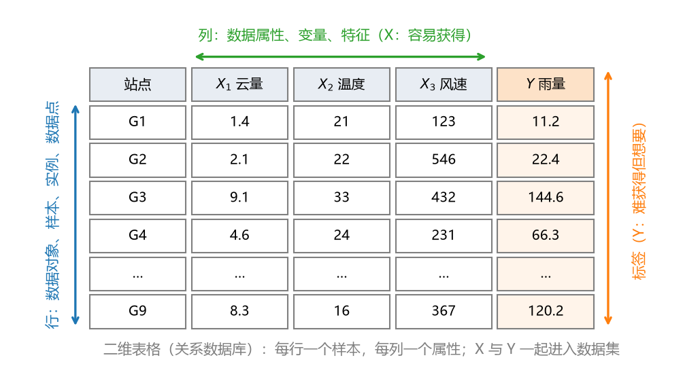

**图 1-3 二维表格数据的结构：行与列**

除表格外，本书还会接触**文本数据**：输入一段文字、输出一段文字（如大语言模型），或输入一段文字、输出一个类别（如情感分类）。它们同样可归结为"输入—输出"的框架，只是输入不再是数值表格。

### 1.2.2 数据属性的不确定性

表格单元格里通常填的是一个**确定的数**——整数、浮点数或类别值。但实际数据常常**不能完全确定**，至少有四种"不确定的数"值得认识（图 1-4）：

- **区间数（间隔数）**：只知道上下限，中间情况不清楚。最典型如"明天的温度是 20~35 $^\circ$C"。
- **模糊数**：基于模糊集，为范围内每个具体值赋予一个**隶属度**。例如一个模糊数支撑在 7 到 17 之间，其中 10 到 15 之间隶属度最大（取 1），7 到 10、15 到 17 两翼的隶属度逐渐下降。与只给上下限的区间数相比，模糊数携带的信息丰富得多。
- **粗糙数**：不仅整体有一个范围，**每个端点又各有一个范围**。比如"明天最低温度在 15~20 $^\circ$C、最高温度在 30~35 $^\circ$C"——下限和上限本身也不确定。
- **随机变量**：概率论与数理统计中描述不确定性的经典方法，把一个不确定的数视为随机变量，它取某个值的可能性用概率表达；很多模型最终输出的就是一个概率。

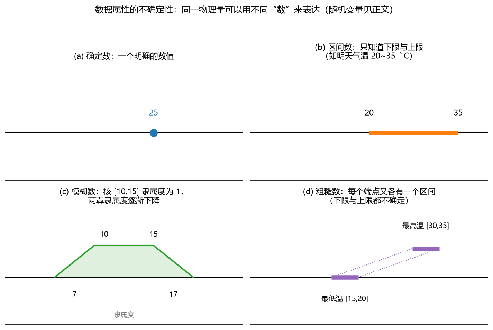

**图 1-4 数据属性的不确定性：不同类型的"不确定的数"**

大多数入门工作先处理确定数，但对不确定性感兴趣的同学要记得：这套思想几乎可以与本书所有方法结合，形成模糊聚类、模糊神经网络、概率图模型等分支（表 1-2 的"随机变量"行与"模糊数学"行正来源于此）。

### 1.2.3 建模过程的多种视角

有了数据，怎么建模？不同学者给出了不同的步骤划分，划分粗细不同、内核大同小异。看四种有代表性的视角。

**视角一：三大步骤**——**数据准备**（从相关数据源中选取所需数据，整合成用于数据挖掘的数据集）、**规律寻找**（用某种方法将数据集所含的规律找出来）、**规律表示**（尽可能以用户可理解的方式（如可视化）将找出的规律表示出来）。三步走完，还要强调一步"后手"：解决一个地学问题时，**建完模型远远不够**，要拿着模型去把具体问题中的规律尽可能揭示出来，机器学习才能与地理学或地球科学真正结合。

**视角二：数据挖掘（KDD）的角度**（图 1-5）。从原始数据出发：**数据筛选 → 数据预处理 → 数据变换 → 数据挖掘/机器学习 → 解释与评价 → 知识**。解释与评价不通过，就回到前面的步骤重新调整，形成一个带反馈的流水线。

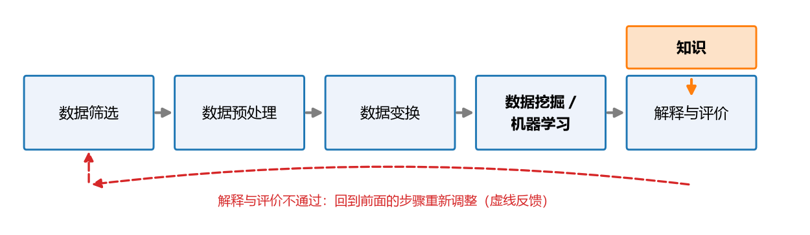

**图 1-5 建模过程：数据挖掘的角度**

**视角三：地理学的角度**（图 1-6）。传统地理学方法包括实地考察、收集资料，根据已有概念体系条理化、比较、归纳概括，再进行地理解释、建立理论与法则。**现代地理学方法**则构成"观察实践、发现先期模式 → 资料筛选 → 构造假设 → 建立模型 → 验证模型"的循环：验证不成立，回到构造假设一步重来；成立，才发展理论与法则。无论传统还是现代方法，每个步骤都离不开地理数据的收集、处理与分析。这个循环对建模的启发很直接：**建完模型评估不好，要回到模型前面去查假设、查数据，循环修正，而不是只在模型内部硬调**。

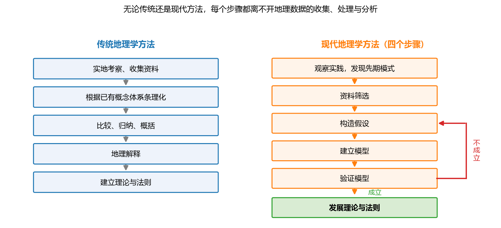

**图 1-6 建模过程：地理学的角度**

**视角四：模型对象与时间顺序的角度。**从模型对象看，机器学习以**输入数据**和**假设**为起点，输出**输出数据**，最终沉淀为**知识**或规律（图 1-5 的"知识"环节正是此意）。从时间顺序看（图 1-7），建模沿时间轴展开：**了解问题 →（数据：有无监督）→ 选择模型（浅层/深层）→ 构建模型（假设、结构、功能、问题类别）→ 后模型分析（性能达标？机理分析）**，不理想就回到数据与假设重新迭代。

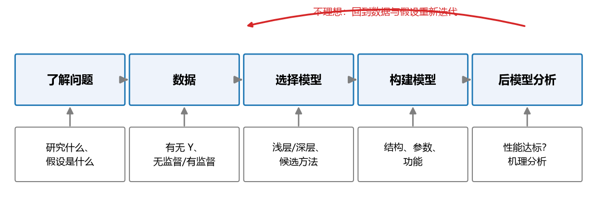

**图 1-7 建模过程：时间顺序的角度**

把四个视角"站远一点"看，会得到一个共同骨架：**模型前**要做数据的收集与处理，要对研究问题有基本了解并设定假设；**模型中**要确定结构、优化参数；**模型后**要评价模型是否达标，并最好结合特定领域的**机理分析**——拿着模型分析你的地学问题能得到什么启发。这一点常被初学者忽视：很多评审专家会问"你这个模型到底揭示了地理学的什么机理？"只把模型建完、指标算完是不够的。

### 1.2.4 数据集的划分：训练、验证、测试与未知

一个容易被忽视但要紧的操作：**建模不是把所有数据都拿去训练**。设想把全部数据用来建模，建完之后拿什么评估模型好坏？再拿原来那些数据来评吗——用参与建模的数据评估模型，通常无法得到客观的评估。因此要把整理好的表格**沿行方向分割**（图 1-8）：

- **训练集**（约 60%~80%）：用来训练模型，把模型的结构和参数定下来；
- **验证集**（约 15%~20%）：在训练过程中反复查看，评价训练结果；
- **测试集**（约 15%~20%）：模型完全定型、不再调整后，做最后一道独立的评估；
- **未知集/新数据**：模型投入使用后源源不断到来的新数据，只有 X 没有 Y，Y 待预测。实际问题的数据常会持续进来——明天又有新的监测数据，模型要能接得住。

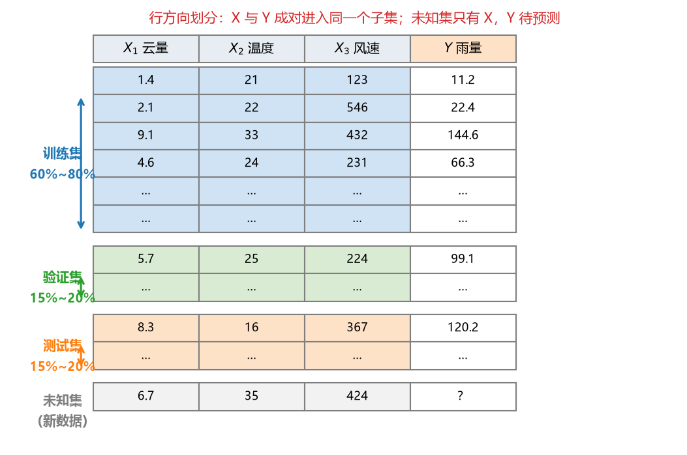

**图 1-8 表格数据的划分：训练集、验证集、测试集与未知集**

具体比例没有死规定，参考文献中同方向的常用比例即可。有两点特别提醒：

**其一，验证与测试的区别。**两个词在很多论文里被混用（有人干脆把验证叫测试），但严格说：**验证与训练结合紧密**——训练过程中反复用验证集对模型做评估、据此调整模型；**测试在模型完全定型之后**——"我不再动模型了"，此时再拿从未参与过的数据做一次独立评估，这部分数据才叫测试集。极端简化时可以只有训练集和验证集两部分；复杂场景（如在线学习、迁移学习）可能有四部分。

**其二，X 与 Y 必须成对划分。**数据集沿行方向划分时，每一行的 X 和 Y 的对应关系要**一起**进入同一个子集，不能 X 进了训练集、对应的 Y 却进了测试集——那样对应关系就断了。

### 1.2.5 数据集划分的方法

上面"留出几成"的做法适合数据较多的情形。数据太少（比如总共只有一两百个样本）时，再切三份模型就跑不动了，需要能把小数据集反复利用的特殊划分方法（表 1-8、图 1-9）。

**表 1-8 数据集划分方法**

| 方法 | 要点 | 适用性 |
|------|------|--------|
| 留出法 | 直接将数据集划分为两个互斥集合（训练/测试集）；划分要尽可能保持数据分布的一致性；一般若干次随机划分、重复实验取平均值；训练/测试样本比例通常为 2:1~4:1 | 适合大数据集 |
| 交叉验证法 | 将数据集分层采样划分为 k 个大小相似的互斥子集，每次用 k−1 个子集的并集作训练集、余下子集作测试集，最终返回 k 个测试结果的均值（k 最常用 10）；通常随机使用不同划分重复 p 次，称 p 次 k 折交叉验证 | 适合中等数据集或小数据集 |
| 留一法 | 数据集 D 包含 m 个样本，若令 k=m，则得到留一法 | 适合小数据集；不受随机样本划分方式影响，结果往往比较准确 |
| 自助法 | 以自助采样为基础，对数据集 D 有放回采样 m 次得到训练集；没被采到的样本作验证集（约 36.8% 的样本不会出现） | 数据集较小、难以有效划分训练/测试集时；因改变了数据分布可能引入估计偏差 |

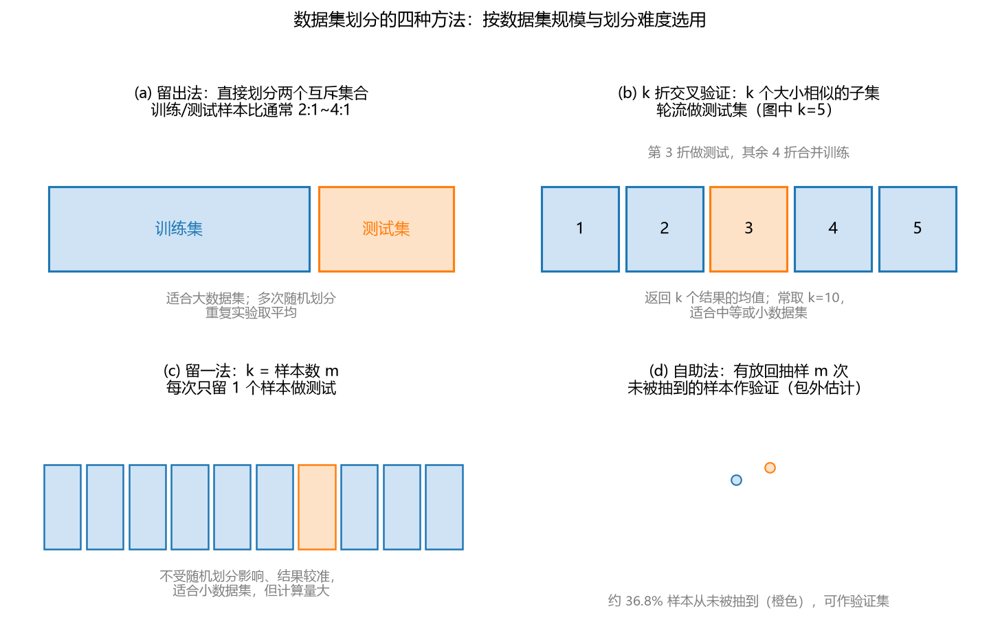

**图 1-9 数据集划分的四种方法示意**

这些方法的共同目的，是把有限的数据点反复利用、把模型反复验证，使评估更客观。它们在后续各章的案例中会反复出现。

### 1.2.6 如何选择机器学习方法

方法这么多，拿到问题怎么选？基本思路是**层层缩小范围：问题 → 功能 → 数据 → 方法**（图 1-10）。

第一层看**要实现的功能，也就是数据有没有 Y**。想探查数据、还没有特定目标，或想把维度降下来——只有 X，走向无监督学习，再分：每个数据点只属于一类用硬聚类，可属多类用软聚类，减少维度用降维。有 X 和 Y、想预测输出——走向有监督学习，再分：Y 是离散类别用分类，Y 是连续实数用回归。特别注意一个容易混淆的细节：**同样是"把列变少"，没有 Y 时叫降维，看着 Y 挑列时叫特征选取**——先弄清手里的表格有没有 Y。

第二层看**功能下的具体方法**，依据有二：一是**文献**——看同类问题别人常用什么方法、效果好在哪里；二是**自己的熟悉程度**——只会其中一种也不妨先用起来。通常可以并行尝试 1~3 种候选方法。

第三层看**数据规模与模型结构的匹配性**（浅层还是深层、简单还是复杂），并用验证集的性能最终拍板。方法选择本身就是建模中一个重要问题，选不好，后面再努力也事倍功半。

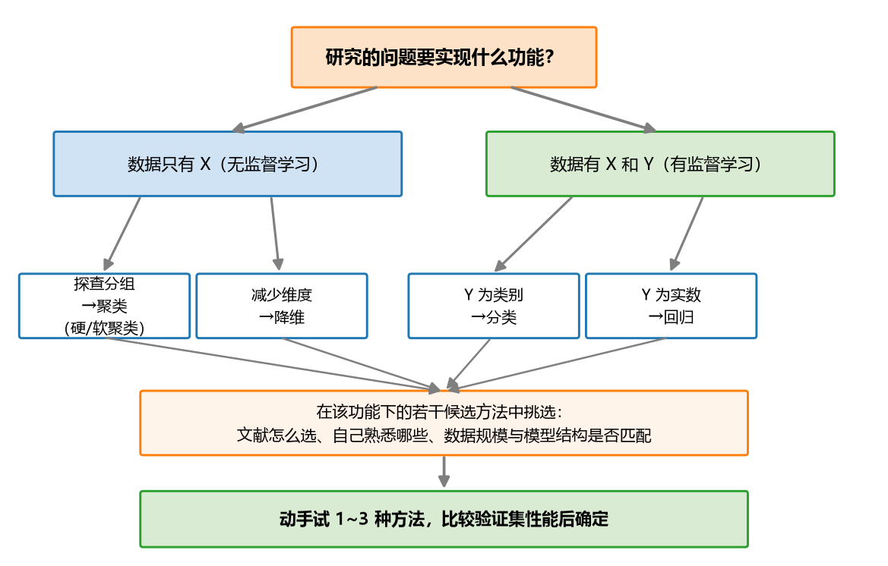

**图 1-10 机器学习方法的层层选择**

### 1.2.7 构建分类/回归预测模型的基本步骤

把前面的内容串起来，做一个分类或回归的预测模型，大致要经过表 1-9 的步骤（图 1-11）。

**表 1-9 构建分类/回归预测模型的基本步骤**

| 步骤 | 功能 |
|------|------|
| 数据预处理 | 自变量太多的问题 → 数据降维 / 输入变量选择；数据间数量级差别过大问题 → 数据标准化 |
| 数据分割 | 将原始数据分割成训练集 P 和验证集 Q，或者采用交叉检验/留一法/自助法 |
| 初始化模型 | 初始化模型结构 |
| 训练模型 | 制定特点，选择特定率定算法来训练模型、训练参数，获取最优参数值 |
| 预测 | 训练集预测；验证集预测 |
| 性能评估 | 训练集、验证集、测试集的预测性能评估；分类性能指数（错误率、精度）；回归性能指数（相关性指数、MSE、RMSE 等）；假设检验：残差的检验/性能指数差异的检验 |
| 数据后处理 | 把模型输出变换回原始数量级，与观测对比 |

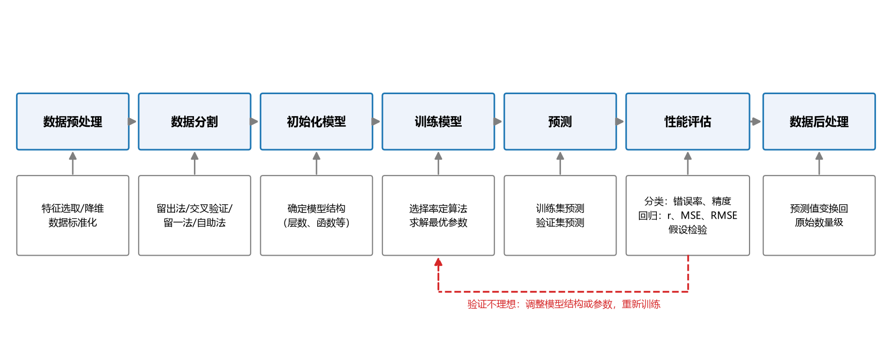

**图 1-11 构建分类/回归预测模型的基本步骤**

对其中的关键环节展开说明。

**（1）数据预处理中的两件事。**一是**变量太多**：用降维或特征选取把自变量数量降下来。这里有个"偷懒"技巧：即使数据里有 Y，也可以先不看 Y、直接对 X 做降维——X 之间本身有相关性，几个 X 高度相关时挑一个即可；降完之后再看着 Y 做特征选取。常用方法见表 1-10 与表 1-11（降维方法详见第 5 章，正则化等求解型方法详见第 6 章）。二是**数量级不一**：把各变量统一到如 0~1 或 −1~1 的范围，即**标准化**。最常用的最小—最大标准化为

$$x' = \frac{x - x_{\min}}{x_{\max} - x_{\min}} \tag{1-2}$$

为什么必须标准化？一些模型在建模中要计算导数或其他特殊分析，X 的数量级差别太大会影响求导与数值稳定性。很多商业软件内部会自动先做标准化，用户看不到而已；**拿不准的时候，自己先做一次标准化，总是没有错的**，模型运行起来结果也更平稳。

**表 1-10 输入变量选择（特征选取）方法**

| 方法 | 要点 |
|------|------|
| 排序过滤法（filter） | 根据线性相关系数或非线性相关系数对自变量进行排序，进而选择相关性较高的自变量 |
| 逐步回归 | 依次添加或移除特征，直到预测精度没有改进为止（前向法从一个 X 逐个加、后向法从全部 X 逐个扔） |
| 顺序特征选择 | 迭代地添加或移除自变量并评估每次变动对模型性能的影响 |
| 正则化 | 使用收缩估计量，通过将冗余特征权重（系数）减至零消除冗余特征 |
| 近邻元分析（NCA） | 查找每个特征在预测输出中的权重，以便丢弃权重较低的特征 |

**表 1-11 数据降维方法**

| 方法 | 要点 | 本质与特点 |
|------|------|------------|
| 主成分分析（PCA） | 对数据执行线性变换，使高维数据集中的绝大多数方差或信息被前几个主成分捕获；第一个主成分捕获最多的方差，其次第二个，以此类推 | 主成分是自变量的线性组合；各主成分互不相关，没有冗余信息 |
| 因子分析 | 识别数据集中各变量之间潜在的相关性，提供数量较少的潜在（公共）因子的一种表现方式 | 自变量是因子的线性组合；每个因子都可能影响多个变量 |
| 非负矩阵分解 | 当模型项必须代表非负数（比如物理量）时使用 | 原始输入矩阵分解成正交的矩阵 |

**（2）模型的确定与训练。**选好方法（比如神经网络）后，还要把**具体的结构**定下来——神经网络有很多种形式，有哪些层、层与层之间的函数怎么选，都要确定。好在常见问题多有一些公认适合的标准结构，参考标准代码或文献即可。结构定了，剩下的**参数**靠特定算法在数据上求解：让模型输出尽可能逼近训练数据，本质是一个**优化问题**。以 MATLAB 为例，一个"训练—预测—评估"的最小范式是：

```matlab
% 以 SVM 分类为例（数据 X、Y 已完成预处理与划分）
Mdl   = fitcsvm(Xtrain, Ytrain);            % 训练：确定结构与最优参数
Ypred = predict(Mdl, Xval);                 % 预测：对验证集逐一预测
acc   = sum(Ypred == Yval) / numel(Yval);   % 评估：计算分类正确率
```

**（3）训练—验证的反复。**训练完看验证集：不好，就调整结构或参数重新训练；反复多轮直到验证集表现稳定、令人满意，再停下来用测试集做最后一道检验。**（4）后处理。**预处理时对 X、Y 做了标准化，模型的输出 Y 自然也在 0~1 之间；而原始的 Y 可能在 0~100 之间，因此要做**逆变换把预测值变换回原始数量级**，才能与观测直接比较。

### 1.2.8 模型性能的初步评估

预测值出来了，怎么判断它和观测值"吻合"？先看两个最直观的图（图 1-12）：

- **时间序列对比**：若数据随时间变化，把观测与预测两条曲线画在同一张图上，看是否贴合；
- **观测—预测散点图**：不管数据怎么变化，以观测值为横轴、预测值为纵轴画散点，看是否落在 45° 对角线附近——都压在线上说明预测与观测高度一致。

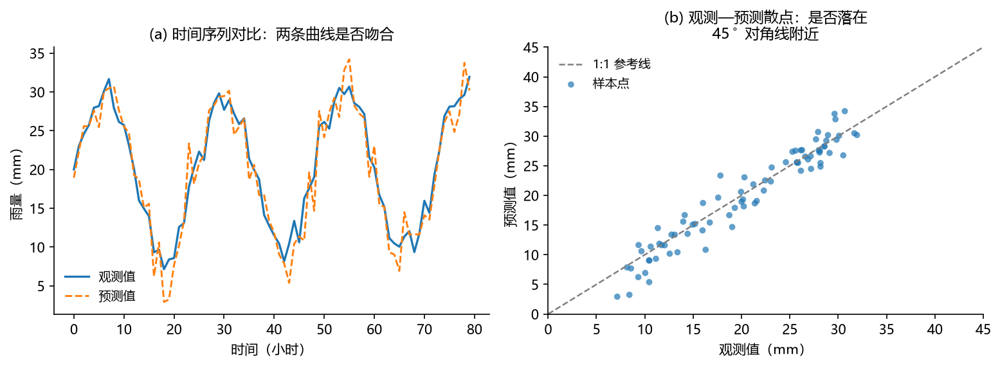

**图 1-12 模型评估的两种直观图示**

看图毕竟主观，"你觉得挺吻合、我觉得一般"没有说服力，需要**定量的性能指数**：比如相关性指数（0~1 之间，越接近 1 说明观测与预测的趋势越一致）、误差类指数（MSE、RMSE，越小越好）；分类问题则用错误率、精度等（详见第 6 章）。更进一步还可以做**假设检验**：检验两个序列是否属于同一分布、或残差是否服从正态分布等，把"预测得好"从主观印象升级为统计结论。日常工作中简单的评估有时可省略检验，但严肃的研究报告应当给出。

## 1.3 地学问题应用举例

理论框架有了，机器学习在地学中到底能做什么？这里选取几个与本书主线（预测问题）密切相关、也最贴近水文气象领域的例子。先看一个背景事件：2021 年 7 月河南暴雨——持续时间长（连续四天大范围强降水）、累计雨量大（全省平均降雨量 113.5 毫米）、强降水范围广（全省 4098 个雨量站降水量超过 50 毫米，大于 100 毫米的有 1923 个，大于 250 毫米的有 606 个）、强降水时段集中（主要从 18 日夜间开始）、具有极端性（降水量达到历史极值，"千年一遇"）。2022 年广东粤北的强降雨也引发了洪水。**从机器学习的角度看，"暴雨预报"是什么问题？**带着这个问题看下面六个典型应用（图 1-13、表 1-12）。

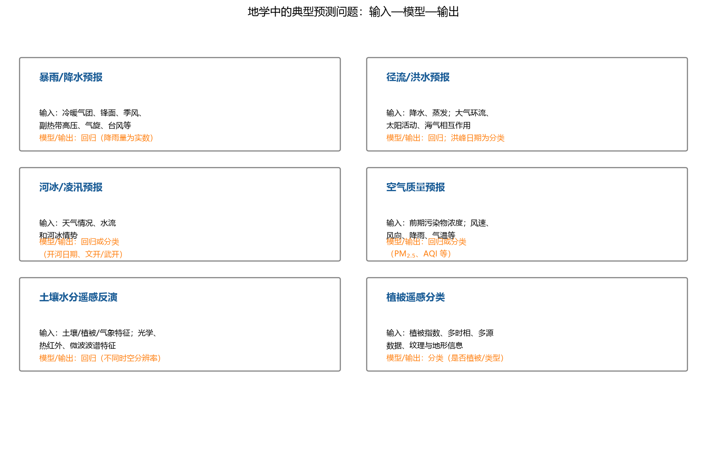

**图 1-13 地学中的典型预测问题：输入—模型—输出**

**表 1-12 地学中典型预测问题一览**

| 问题 | 输入（因素） | 输出 | 对应功能 |
|------|--------------|------|----------|
| 降水/暴雨预报 | 短期：冷暖气团、锋面、季风、副热带高压、气旋、台风；长期：大气环流、太阳活动、海气相互作用；过去数小时至数年的天气 | 某站点不同时间尺度的降雨量（小时/天/周/月/季/年/百年） | 回归 |
| 径流/洪水/水文中长期预报 | 直接因素：降水和蒸发；间接因素：大气环流、太阳活动、海气相互作用 | 重点断面的年度最高水位/流量；最高水位日期、入汛期等 | 回归（程度）；分类（时机） |
| 河冰/凌汛预报 | 天气情况、水流和河冰情势 | 特定河段的年度最高水位、开河日期、文开或武开 | 回归或分类 |
| 空气质量预报 | 污染因素：前期污染物浓度；气象因素：前期和预测的风速、风向、降雨、气温等 | 重点站点、不同时间尺度的污染物浓度或空气质量指数（PM10、PM2.5、臭氧、SO2 等） | 回归或分类 |
| 土壤水分遥感反演 | 土壤、植被、气象特征（降雨、风速、蒸散等）；光学反射率、热红外、微波后向散射系数、亮度温度等电磁波谱特征 | 不同时空分辨率下的土壤水分 | 回归 |
| 植被遥感分类 | 植被指数、多时相信息、综合多源遥感数据（光学与雷达）及纹理、地形、光谱等辅助信息、三维地形、混合像元 | 是否是植被或特定植被类型 | 分类 |

**（1）降水/暴雨预报。**因变量 Y 是某一位置的降雨量（浮点实数——回归问题），关心的站点可以是广州市的某个气象站，时间尺度可以从未来一小时、一天、一周直到百年气候尺度。可用的模型分三个层次：**统计方法**与**机器学习**（两者都属数据驱动方法）、**数值模拟**（气象模式，时间更长尺度则是气候模式）、以及**预报员经验**——预报员经长期学习培训形成的判断通常非常准，也是一种"人工模型"。输入不是凭空来的：短期因素有冷暖气团、锋面、季风、副热带高压、气旋、台风，以及过去数小时、数天乃至数周数年的天气实况；长期因素还有大气环流、太阳活动、海气相互作用。

**（2）径流/洪水/水文中长期预报。**与暴雨预报同构，只是在重点**断面**上预报水位或流量，时间尺度从逐小时、逐日到旬、月、季、年。特别值得一提的是**时机的预报**：若已知某条河常在 8 月 15 日前后发洪水，提前一两周通知沿岸群众做好准备，即使洪水很大也能把危害降到最小——"哪一天发生"本身就是一个可预报、也很有价值的分类问题。模型同样可以是数据驱动的（如机器学习的回归方法）或数值模拟的，加上预报员经验。

**（3）河冰/凌汛预报。**北方冬季河面结冰，开河时上游化冻的冰顺流而下，若下游尚未解冻，冰块会在特定河段聚集形成冰坝——时间非常快、力量非常大，可在几小时内把水位抬高数米，淹没整个堵塞区域（可能是一座小城），摧毁沿河房屋建筑。黄河、东北的黑龙江、松花江等都有凌汛；南方冬季气温在零度以上，没有这个问题。凌汛预报要输出特定河段/河交界处的年度最高水位、开河日期，以及**文开**（平稳解冻）还是**武开**（暴力开河）的类型——典型的回归加分类问题。

**（4）空气质量预报。**华北、西北一些区域的空气质量常年受多重因素影响。输入取前期污染物浓度与气象因素（风速、风向、降雨、气温等的前期值和预测值），输出重点站点不同时间尺度的 PM10、PM2.5、臭氧、SO2 浓度或空气质量指数。举办奥运会、大型商业活动时大家都希望当天是"蓝天"，这类预报的社会需求很大。

**（5）土壤水分的遥感反演。**一个区域干旱与否对农业影响极大，而空间上每个点都去采样不现实，于是用遥感数据做**空间预测**：以土壤特征、植被特征、气象特征（降雨、风速、蒸散等）以及光学反射率、热红外、微波后向散射系数、亮度温度等电磁波谱特征为输入，反演不同时空分辨率下的土壤水分——回归问题。

**（6）植被的遥感分类。**通过遥感影像判断一片区域是植被还是裸土、水泥地或建筑，或是哪种特定植被类型。输入包括植被指数、多时相信息、综合多源遥感数据（光学与雷达）及纹理、地形、光谱等辅助信息——分类问题。遥感与 GIS 方向的同学做这类问题的很多。

这六个问题覆盖了回归与分类两大有监督功能，输入—模型—输出的框架完全一致；聚类与降维则常作为它们的**前置步骤**（先压缩变量再建模）。至此，机器学习的简单介绍——数据、方法、建模过程及其在地理学中的应用——就完整了。

## 1.4 小结

本章围绕"方法—过程—应用"三条线展开。方法层面：机器学习是从数据中自动分析获得规律并利用规律预测未知的算法，属于数据驱动方法；按有无 Y 分为无监督与有监督学习，按结构深浅分为浅层与深度学习；四大功能可以用"横切竖切"记住——聚类横着切、降维竖着切、特征选取看着 Y 竖着切、分类回归由 X 预测 Y；一张"类别 × 功能"的方法总表（表 1-2）是全书的方法地图。过程层面：建模 = 模型前的数据准备与假设 + 模型中的结构与参数 + 模型后的评估与机理分析；数据沿行划分为训练集、验证集、测试集与未知集，X 与 Y 成对进入子集；小数据集用交叉验证、留一法、自助法；方法选择沿着"问题 → 功能 → 数据 → 方法"层层缩小；分类/回归建模走"预处理 → 分割 → 初始化 → 训练 → 预测 → 评估 → 后处理"七步。应用层面：暴雨、洪水、凌汛、空气质量、土壤水分、植被分类六个地学问题展示了同一框架的六种落地。

全书结构可以画成一张课程导图（图 1-14）：**地学问题**（水文/水资源、气象/气候、土地/土壤、植被/生态/环境、社会/城市/资源/灾害）借助**机器学习**（定义/分类、典型方法、结构特点评估）开展**数据挖掘与应用研究**。第 2 章先介绍编程环境和语言（Linux、编辑器、MATLAB 与 Python），打好动手基础；第 3 章数据预处理与可视化；第 4、5 章无监督的聚类与降维；第 6~10 章有监督的线性模型、kNN、决策树、人工神经网络与支持向量机；第 11 章深度学习收束全书。

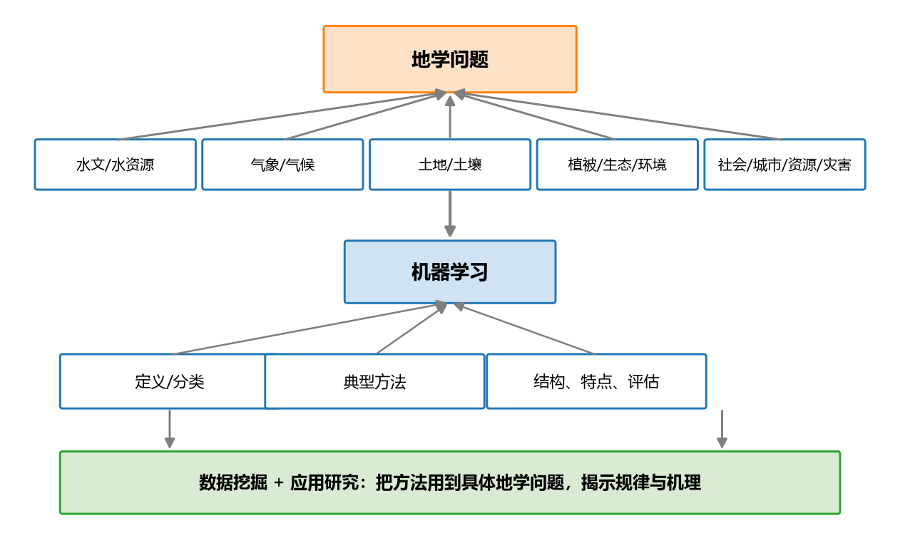

**图 1-14 课程导图**

## 思考题

1. 机器学习、数据挖掘、统计分析的区别是什么？
2. 机器学习模型的结构三要素是什么？自变量和因变量的关系怎么建立？线性关系和非线性关系分别指什么？
3. 机器学习的功能有哪些？除了聚类、分类和回归，机器学习方法还有哪些功能（提示：特征选取、生成、决策、强化学习）？
4. 评估机器学习方法的性能，看验证集还是训练集？机器学习怎么做统计检验？
5. 怎么选择机器学习方法？数据有没有 Y？看性能还是结构？数据集和模型怎么匹配？什么时候选浅层学习，什么时候选深度学习？
6. 机器学习方法的缺点是什么？机器学习怎么能够揭示或解释机理？与数值模拟模型相比，机器学习的优缺点是什么？
