# 第2章 编程环境与语言

> **本章导读**：工欲善其事，必先利其器。在学习具体的数据挖掘方法之前，本章把整套"武器库"一次备齐：操作系统层面，认识 Linux 的来龙去脉、文件系统与权限模型，学会用 Shell 命令远程使用课题组与超算中心的计算资源，并用 Git 管理代码版本；编辑器层面，掌握占据开发者调查榜首的 VS Code；语言层面，理解 Python 为什么需要隔离环境与 Anaconda，并系统比较本书的两大工具——MATLAB 与 Python——在历史、功能、书写格式、数据结构、流程控制上的异同，最后学会在两种语言之间互相调用。本章的目标不是让读者背诵命令，而是建立"遇到什么问题、用什么工具、到哪里查"的全局地图：从第 3 章的数据预处理开始，这些环境将天天打交道。

## 2.1 Linux 操作系统

### 2.1.1 从 UNIX 到 Linux：概念与人物

操作系统（Operating System，OS）是管理和控制计算机硬件与软件资源的计算机程序，任何其他软件都必须在操作系统的支持下才能运行。谈 Linux 之前，先要认识几个相关概念：

- **UNIX**：可移植的操作系统，能够运行在各种计算机上，是多用户、多任务操作系统，支持多种处理器架构。
- **POSIX**：UNIX 类型操作系统接口集合的国际标准。Linux 在该标准的指导下进行开发，能够与绝大多数 UNIX 系统兼容。

Linux 并不是某一个人灵光一现的产物，而是几代人接力积累的结果。课堂上老师常提醒学生：这段历史最大的启发是——**做一件事，首先要有一个宏伟的构想**。围绕这个构想，三位关键人物的贡献见表 2-1。

**表 2-1 Linux 相关的重要人物及其贡献**

| 人物 | 身份 | 年份 | 主要贡献 |
|------|------|------|----------|
| Richard Matthew Stallman | 美国程序员 | 1975 | 开发 Emacs 文字编辑器 |
| | | 20 世纪 70～80 年代 | 推动 GCC 编译器、GDB 调试器的开发 |
| | | 1985 | 创建 GNU 计划和自由软件基金会（FSF） |
| | | 1989 | 起草 GPL 条例 |
| Andrew S. Tanenbaum | 荷兰阿姆斯特丹自由大学计算机科学系教授 | 1984 | 开发 MINIX：用于教学的类 UNIX 小型操作系统，采用微内核架构 |
| Linus Torvalds | 芬兰赫尔辛基大学计算机专业本科生 | 1991 年底 | 在 MINIX 基础上开发并公开 Linux 内核源代码（与原始 UNIX 一样采用宏内核） |

这里有两个概念需要展开。**GNU 计划**的目标是开发一个完整且自由的操作系统，以解决 UNIX 版权以及软件源代码闭源的问题——构想虽然宏伟，但 Stallman 个人的能力终究有限，内核始终没有做出来；不过他领导完成的 Emacs、GCC、GDB 等软件，以及创建的基金会和协议，为后来者铺平了道路。**GPL**（通用公共许可）是最著名的开源许可协议，Linux 内核正是在 GPL 许可下发布的。

Tanenbaum 教授则是因为教学需要：他想给学生一个可以剖析的类 UNIX 系统，于是编写了小巧的 MINIX。1990 年，赫尔辛基大学的学生 Torvalds 首次接触 MINIX，次年（1991 年）开始在其上编写操作系统内核组件，年底公开了 Linux 内核源代码 0.02 版。内核加上 GNU 项目的编辑器、编译器以及其他第三方免费软件，打包之后才成为可以使用的免费操作系统——Linux 的本质，就是"Torvalds 的内核 + Stallman 的工具"这套组合。

### 2.1.2 Linux 的发展历程

把上述事件按时间排开，就是 Linux 的发展历程（图 2-1）：1993 年 Linux 1.0 发行并转向 GPL 版权协议；1994 年第一个商业发行版 Slackware 问世；1996 年美国国家标准技术局确认 Linux 1.2.13 版本符合 POSIX 标准；1999 年简体中文发行版问世；2000 年以后系统日趋成熟，大量基于 Linux 服务器平台的应用涌现，并广泛应用于 ARM 嵌入式系统。今天我们上网使用的各种网络服务，其背后服务器的大部分都运行着 Linux——学校的超算中心、高性能计算节点上安装的也是它。

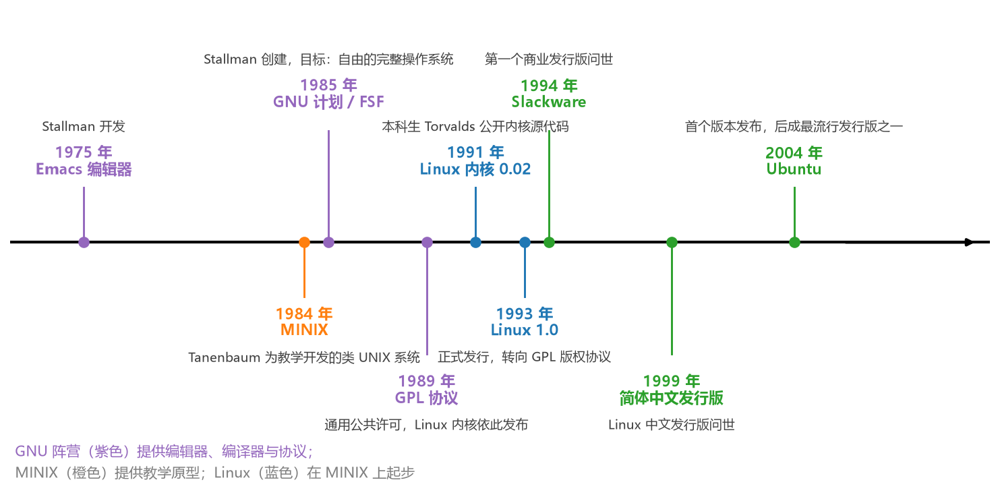

**图 2-1 Linux 发展时间线**

### 2.1.3 什么是 Linux：组成与主要特点

严格地说，**Linux 是一套免费使用和自由传播的类 UNIX 的多用户、多任务、支持多线程和多 CPU 的网络操作系统**。它的三部分组成及渊源见表 2-2。

**表 2-2 Linux 的组成**

| 组成 | 开发者 | 渊源 |
|------|--------|------|
| Linux 内核 | Linus Torvalds | 借鉴 MINIX 和 UNIX |
| GNU 组件（gcc、bash 等） | 项目发起人 Richard Stallman | 兼容 UNIX |
| 其他应用程序 | 程序员社区 | BSD UNIX、X Windows 等类 UNIX、自由和开源软件 |

Linux 的主要特点可以概括为六条：

1. **兼容 UNIX**：仿 UNIX 内核构建，同 UNIX 指令集向下几乎完全兼容。
2. **良好的可移植性**：适合 Intel 等 x86 CPU 系列架构的计算机。
3. **真正的多用户、多任务**：支持多进程、多 CPU 的系统。
4. **可靠安全的系统**：具有很高的稳定性、可靠性和安全性。
5. **丰富的网络功能和服务**：支持 HTTP、FTP、SMTP、POP、SAMBA、SNMP、DNS、DHCP、SSH、TELNET 等。
6. **开放性**：基于 GNU 许可自由开放，任何人可自由使用、修改和再发布所有底层源代码；大量第三方免费应用程序；众多业界厂商（IBM、Oracle、Intel、Google 等）支持；有完善的大型数据库平台（Oracle、DB2、Sybase、MySQL）、图形用户界面（GNOME、KDE）和开发平台（C/C++、Java、Perl，支持 GTK+、QT 等图形界面 API）。

免费是一把双刃剑：好处是谁都能用，坏处是"没什么人管"，做出来的东西未必都经过精雕细琢。于是商业公司发现了其中的商机，把优秀的免费组件加以整合包装，衍生出大量"大部分开源 + 少量商业包装"的**发行版**，以便宜的价格提供好用的产品。

### 2.1.4 分层设计的体系结构

从体系结构上看，Linux 采用分层设计（图 2-2），自上而下分为四层：**用户应用程序**是整个系统的最顶层；**操作系统服务**为用户提供服务并执行操作系统部分功能，为应用程序提供系统内核的调用接口；**Linux 内核**是常驻内存的部分；**硬件系统**则是所使用的所有物理设备。

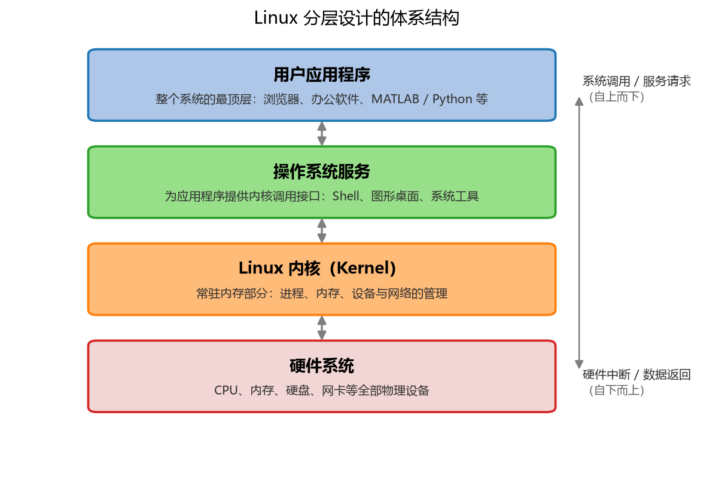

**图 2-2 Linux 分层设计的体系结构**

### 2.1.5 Linux 与 Windows 的比较

初学者最关心的问题莫过于"Linux 和 Windows 有什么不一样"。两者在界面、驱动、使用、学习、软件五个方面的比较见表 2-3。

**表 2-3 Linux 和 Windows 的比较**

| 特征 | Windows | Linux |
|------|---------|-------|
| 界面 | 界面统一，菜单几乎一致，快捷键也几乎相同 | 图形界面风格各发布版不同；基本命令和操作方法几乎一致 |
| 驱动程序 | 驱动丰富、更新频繁，一些老硬件很难支持 | 由志愿者开发、核心开发小组发布，安装相对复杂；许多老硬件容易找到驱动 |
| 使用 | 容易入门，图形化界面对一般用户十分有利 | 图形界面使用简单；终端命令行需要学习才能掌握 |
| 学习 | 系统构造复杂、变化频繁，知识技能淘汰快，深入学习困难 | 系统构造简单、稳定，知识技能传承性好，深入学习相对容易 |
| 软件 | 每种特定功能可能都需要商业软件支持，需购买授权 | 大部分软件可自由获取，同样功能的软件选择较少 |

一个常见的误解是"Linux 没有图形界面"。实际上它有两种操作方式：图形界面点一点，与 Windows 体验相近；终端命令行输入命令，则需要学习。后文会看到，Linux 的精髓恰恰在命令行。

### 2.1.6 主流发行版与 Ubuntu

Linux 的主流发行版见表 2-4。初学者最常接触的是 Ubuntu，其父版本 Debian 极为精简、操作环境干净、安装简易；Ubuntu 继承 Debian 的优点，集成在 Debian 下经过测试的优秀自由软件。Ubuntu 首个版本于 2004 年 10 月发布，每半年发行一个新版本，版本号由发布年月组成（如 24.04 表示 2024 年 4 月），旨在为用户提供最新又相当稳定的、主要由自由软件构建的操作系统。

**表 2-4 Linux 的主流发行版**

| 发行版家族 | 代表版本 |
|------------|----------|
| Debian | Debian 及派生版本 Ubuntu、Linux Mint |
| Fedora | Fedora 及 Red Hat Enterprise Linux（RHEL）、CentOS |
| SUSE | openSUSE |
| 其他 | EulerOS（华为欧拉）等 |

顺带一提发音：Linux 读"里呢克斯/里那克斯"，Ubuntu（国际音标 [uːˈbuːntuː]）读"乌班图"，意为非洲祖鲁语的"人性""群在故我在"。

### 2.1.7 文件系统与目录结构

**一切皆文件**是 Linux 最主要的特点。操作系统把它管理的所有东西——数据、进程、设备——都当作一个个可以处理的对象（文件），并在这一体系下建立了统一的文件系统。所谓文件系统，是在存储设备（硬盘、光盘等）上组织和管理数据的方法：通过对数据进行索引，可以方便地查找和定位到相应的数据，对其进行读取、修改或删除。

文件系统在逻辑上呈现为一棵倒挂的树：根目录 `/` 在顶端，向下分出若干二级目录，每个二级目录存放特定用途的文件（图 2-3、表 2-5）。例如设备文件集中在 `/dev`，系统配置集中在 `/etc`，每个普通用户在 `/home` 下有自己的主目录，第三方应用一般安装在 `/opt` 或 `/usr`。记住这棵树的大致形状，以后在任何一台 Linux 机器上都能马上找到方向。

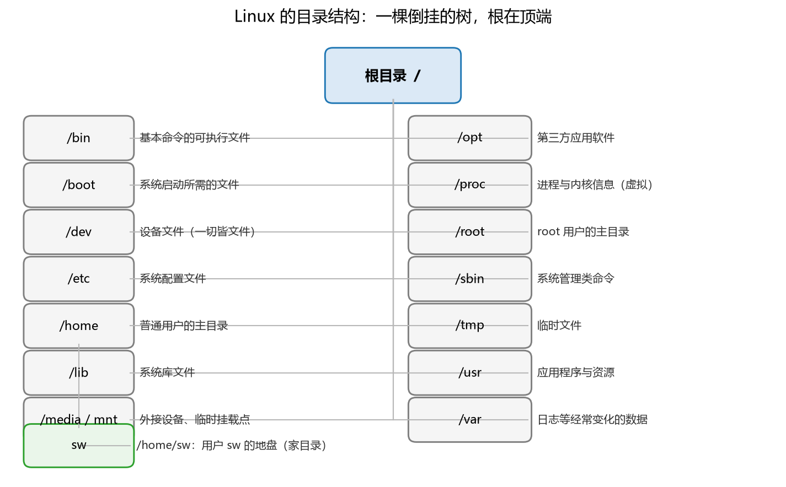

**图 2-3 Linux 的目录结构：一棵倒挂的树**

**表 2-5 Linux 主要二级目录及含义**

| 目录 | 存放内容 |
|------|----------|
| /bin | 基本命令的可执行文件 |
| /boot | 系统启动所需的文件（内核、引导程序等） |
| /dev | 设备文件（"一切皆文件"的直接体现） |
| /etc | 系统及应用的配置文件 |
| /home | 普通用户的主目录（如 /home/sw） |
| /lib | 系统库文件 |
| /media、/mnt | 外接设备与临时挂载点 |
| /opt | 第三方应用软件 |
| /proc | 进程与内核信息（虚拟文件系统，不占磁盘） |
| /root | root 用户（管理员）的主目录 |
| /sbin | 系统管理类命令 |
| /tmp | 临时文件 |
| /usr | 应用程序与资源（用户安装的软件多在此） |
| /var | 日志等经常变化的数据 |

与目录相关的还有两个概念。**文件**是存储数据的基本结构，每个文件都有一个文件名作为标识，由字母、数字、下划线、圆点组成，字母区分大小写；文件名可包含扩展名，中间用 `.` 隔开，便于识别和管理。**目录**用来管理和组织大量的文件，方便归类和查找，目录里面可以包含文件和其他目录，其本质上也是文件。

### 2.1.8 用户、用户组与文件权限

Linux 是真正意义上的多用户操作系统：系统中可以建立多个用户账号，这些用户可以通过远程登录的方式**同时**登录同一个操作系统并同时运行程序。**用户组**是具有相同特征的用户的集合——比如要让同一个单位的用户具有相同的权限，只需将这些用户定义到同一个用户组；用户自动继承其所属用户组的权限。通过"用户—用户组"的分组方式，多用户、多种权限在同一台电脑上共存的问题就解决了。

在终端里最常做的一件事，就是把某个目录下的文件信息列出来看看。`ls -l` 命令用长列表展示文件信息，作用类似 Windows 文件管理器里"查看 → 详细信息"，但把权限分得特别清楚（图 2-4）。以天河超算上的一条真实输出为例：

```
[nscc-gz_sw@ln1%tianhe2-C test]$ ls -l
total 36
drwxr-xr-x 2 nscc-gz_sw nscc-gz  4096 Apr 15 11:23 sun_paper
-rw-r--r-- 1 nscc-gz_sw nscc-gz     4 Apr 15 11:23 x
lrwxrwxrwx 1 nscc-gz_sw nscc-gz     1 Apr 15 11:25 y -> x
```

每行从左到右依次为八个字段：**第一字段**是文件种类和权限；**第二字段**是指向这个文件的硬链接个数；**第三字段**是文件归哪个用户所有；**第四字段**是归哪个用户组所有；**第五字段**是文件或目录的大小；**第六、七字段**是最后访问或修改的时间；**第八字段**是文件或目录名。第一列的首字符区分文件类型（表 2-6）：`-` 是普通文件，`l` 是链接文件（有点像 Windows 的快捷方式，如上面的 `y -> x`），`d` 是目录文件。

**表 2-6 ls -l 展示的三类文件**

| 类型 | 首字符 | 示例 |
|------|--------|------|
| 普通文件 | `-` | `-rw-r--r-- 1 nscc-gz_sw nscc-gz 4 Apr 15 11:23 x` |
| 链接文件 | `l` | `lrwxrwxrwx 1 nscc-gz_sw nscc-gz 1 Apr 15 11:25 y -> x` |
| 目录文件 | `d` | `drwxr-xr-x 2 nscc-gz_sw nscc-gz 4096 Apr 15 11:23 dir` |

首字符之后的**九个权限位**是理解 Linux 权限模型的钥匙：每三位一组，分别规定**文件所有者**、**文件所属用户组**和**其他用户**对该文件的读（r）、写（w）、执行（x）权限。以 `drwxr-xr-x` 为例：所有者可读可写可进入，同组用户可读可进入，其他用户同样只读可进入。如果某个文件的权限是 `rwxrwxrwx`，则所有用户都能看到并修改它——为了数据安全，强烈建议把其他用户的权限位设置为 `---`。这九个字母是 Linux 安全体系的缩影：谁能读、谁能写、谁能执行，写得清清楚楚。

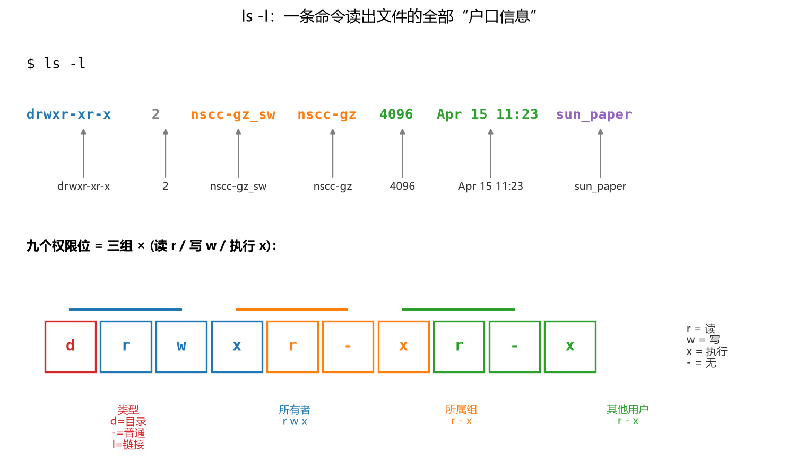

**图 2-4 ls -l 的文件属性与九个权限位**

## 2.2 Shell 与常用命令

### 2.2.1 Shell 是什么

Shell 的字面意思是"壳"，它是**用户与内核交互的接口、命令解释器**。内核负责与硬件打交道（多任务、内存管理、网络协议等），Shell 则把用户敲的命令"翻译"给内核执行，再把结果送回来，三者关系见表 2-7 和图 2-5。

**表 2-7 Shell 与 Linux 的分层关系**

| 分层 | 功能 | 举例 |
|------|------|------|
| Kernel（内核） | 系统启动时将内核装入内存，用于管理系统各种资源 | 多任务、内存管理；网络协议；服务 |
| Shell（壳） | 用户界面：用户与内核交互处理接口；命令解释器 | bash、csh、ash、pdksh、tcsh、ksh、zsh 等 |
| Utility（应用） | 提供各种管理工具、应用程序 | MATLAB、Python 等 |

Shell 有很多种，最常用的是 **bash**；也有人把 shell 改造成自己觉得更顺手的形式，于是有了 csh、zsh 等。它们大同小异，**掌握一种，其余的有了必要就很容易上手**。在 Shell 之上还可以安装第三方应用程序（如 VS Code、办公软件等）。

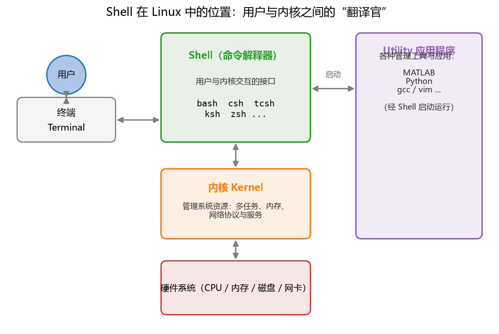

**图 2-5 Shell 在 Linux 中的位置：用户与内核之间的"翻译官"**

为什么要学命令行？因为**Linux 下的日常操作都可以用命令完成**，而命令可以写进一个文件里依次执行——把经常要做的一串操作做成脚本文件，以后运行一次就全部完成，还可以设定"在特定条件下执行"，从而实现自动化。这是点鼠标做不到的。

### 2.2.2 终端使用技巧

使用命令行的入口是**终端**（Terminal），几个基本技巧如下：

- `Ctrl + Alt + T` 打开终端（Ubuntu 默认快捷键）；
- 在终端输入命令后按**回车**执行；
- 输入命令或路径时按 **Tab** 键可自动补齐——命令名、文件名都只需敲前几个字母；
- 查看命令的说明及可用参数：`命令 -h`、`命令 --help`，或 `man 命令`（manual 的缩写，翻开厚厚的英文手册）；
- 实在不行就搜索：把命令名加问题描述输入搜索引擎，通常都有现成答案。

### 2.2.3 常用命令一览

命令虽多，但按功能分类后并不吓人（表 2-8）——浏览目录、浏览文件、文件操作、编辑文件、目录操作、查看系统信息、网络通信、进程管理、开关机，这些工作你在 Windows 下同样天天做，只不过那边是点一点，这边是敲命令。

**表 2-8 Linux 常用命令按功能分类**

| 功能 | 命令举例 |
|------|----------|
| 浏览目录 | ls、pwd、cd |
| 浏览文件 | cat、more、less、head、tail |
| 文件操作 | chmod、vi、rm、mv、cp、ln、find、grep、tar、gzip |
| 编辑文件 | vi、vim、nano |
| 目录操作 | chmod、mkdir、rm、mv、cp、find |
| 查看系统信息 | uname、cat、free、df、history、module |
| 网络通信 | ssh、scp、rsync、ping |
| 进程管理 | ps、kill、top |
| 开关机 | reboot、shutdown、halt、poweroff |

最常用的其实只有两条：`ls` 列出目录内容，`cd` 切换当前目录（表 2-9）。每个命令后面还有许多参数，先把不带参数的基本用法用熟，需要时再查帮助或搜索，用多了自然觉得方便。

**表 2-9 浏览目录的常用命令**

| 命令 | 功能 | 格式 |
|------|------|------|
| ls | 显示目录的内容 | `ls [参数] [目录名或文件名]` |
| pwd | 显示当前所在目录的绝对路径 | `pwd` |
| cd | 切换当前工作目录 | `cd [目录名]` |
| cd .. | 切换到当前目录的上一层目录 | `cd ..` |
| cd - | 切换回此前所在的目录 | `cd -` |
| cd ~ | 切换到当前用户的 home 目录 | `cd ~` |

课堂演示可以直观感受这些命令的组合：登录一台远程 Linux 机器后，先 `ls` 粗略看一下当前目录有哪些杂乱文件；再 `ls -l` 用长列表看清类型、权限、大小与时间；对某个目录 `cd` 进入去看；`top` 实时观察系统里正在运行哪些进程、占用多少资源，必要时把卡住的进程找出来结束掉。浏览—进入—查看—管理，这就是命令行使用的日常节奏。

## 2.3 使用 Linux 的几种典型场景

### 2.3.1 安装并使用 Linux 的几种方式

对多数同学来说 Linux 似乎有点遥远，"我是不是必须装一个？"其实从"完全不安装"到"完整安装"有一整条光谱（表 2-10、图 2-6）。想深入理解的同学，建议用第四、第五种方式亲手装一个进去看一看；跑深度学习的同学，第一种（远程登录）几乎必然要用。

**表 2-10 安装并使用 Linux 的几种方式**

| 方式 | 做法 | 适用性 |
|------|------|--------|
| 不安装：终端远程访问 | 本地电脑装 ssh 客户端（终端软件），连接远程服务器上的 Linux | 多用户；ssh 协议，访问超算中心或课题组计算资源 |
| 不安装：远程桌面 | 使用 RDP 协议、TeamViewer、向日葵等远程桌面软件 | 临时访问服务器的图形环境 |
| 安装真实系统 | 用光驱或 U 盘引导，安装到单独硬盘分区，多系统启动 | 高级学习者（有一定风险，初学者不建议） |
| 安装虚拟机 | 在 Windows 下装 VMware 等虚拟机软件，再在虚拟机里装 Linux | 适合初学者学习 |
| 安装 WSL 子系统 | Win10 及以上系统从应用商店直接安装 Linux 子系统 | 适合初学者学习 |
| Agent | 由 AI 代理自动维护 ssh 连接与环境 | 适合希望了解 AI 能力边界的使用者 |

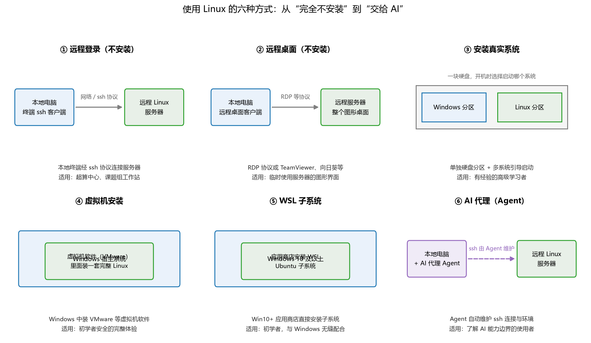

**图 2-6 使用 Linux 的六种方式**

### 2.3.2 SSH：远程登录与文件传输

远程登录最常用的协议是 **SSH**（Secure Shell）：在不安全的网络上安全访问远程计算机的协议。SSH 是一种加密方法，通过不安全的网络安全地远程登录（ssh）和传输文件（scp/sftp）；它提供完整的 Linux Shell 支持，协议开源可信、安全漏洞较少，被广泛使用。80% 的情况下用法就一句：

```
ssh username@remote_host          # 例：ssh root@example.com 或 ssh 192.168.1.105
```

服务器若使用非默认端口，要加 `-p` 指定端口号。这里有几个非常容易踩的坑，值得专门记下：

```
ssh -p 2222 root@example.com            # OK：ssh 的端口是小写 p
ssh root@example.com -p 2222            # OK：选项放在后面也可以
scp example.com:~/file ./ -p 22222      # Fail
scp example.com:~/file ./ -P 22222      # Fail：scp 的端口是大写 P，且必须放在文件名之前
scp -P 22222 example.com:~/file ./      # OK
sftp -P 22222 example.com               # OK：sftp 的端口同样是大写 P、同样要在前
```

在 Windows 本地与 Linux 服务器之间上传下载文件，可以用 FTP 客户端或支持远程连接的 IDE，也可以直接用 sftp 命令行：登录后 `ls` 看远程有什么、`cd` 进入远程目录、`get` 下载、`put` 上传、`lcd` 切换本地目录、`bye` 退出——一套小命令搞定双向传输。

### 2.3.3 遇到问题怎么办

命令行初学时碰壁是常态，通用的解法是与 AI 助手走"**问题—反馈—尝试**"循环：描述现象、贴上报错、按建议修改、再反馈。常见问题与对策如下：

- **命令没安装**：用 `apt`、`apt-get` 安装；
- **参数记不清**：`-h`、`--help` 看帮助，`man`、`tldr` 查手册；
- **权限不足**：`sudo` 提权，或请管理员设置/免密安装；
- **环境问题**：`echo $PATH`、`env`、`--version` 检查路径与版本；
- **要改配置文件**：`vi`、`nano` 编辑纯文本；
- **格式乱码**：`vim`、`nvim` 处理；
- **网络不通**：检查 proxy、`ping`、`curl`；
- **密码与免密登录**：配置公钥和私钥。

### 2.3.4 退出登录后让程序继续运行

另一个高频问题：ssh 一断，正在跑的程序就死了怎么办？最简单的办法是命令后加 `&` 放到后台；更专业的做法是用终端复用器 **tmux**——把会话寄存在服务器上，随时重新接上（表 2-11）。断线后重连，`tmux attach -t 会话名` 即可回到原来的工作现场；用 `top` 可以确认进程是否还在运行。

**表 2-11 tmux 常用命令**

| 命令 | 功能 |
|------|------|
| `tmux new -s 会话名` | 新建一个指定名称的会话 |
| `tmux new` 或 `tmux` | 新建一个未命名会话 |
| `tmux ls` | 列出所有会话 |
| `tmux attach -t 会话名` | 重新连接到指定会话 |
| `tmux detach` 或 `<prefix> d` | 脱离当前会话，会话在后台继续运行 |
| `tmux kill-session -t 会话名` | 杀死指定会话 |
| `tmux kill-server` | 杀死所有会话并关闭 tmux |

## 2.4 Git 版本控制

### 2.4.1 什么是 Git

写论文时大概都经历过"论文\_终版\_真的终版\_再也不改了.docx"式的文件管理灾难。**Git 是由 Linus Torvalds（Linux 内核的作者）为了帮助管理 Linux 内核开发而编写的开源版本控制软件，并逐渐成为行业标准**，被认为是目前世界上最先进的分布式版本控制系统（官网 <https://git-scm.com/>）。代码文件每改一步就"存档"（提交）一次，随时可以回到任意历史版本，也可以看到每一步改了什么、为什么改。

### 2.4.2 分支管理与分布式版本控制

Git 的用法可以概括为"三个区 + 一个远程仓库"（图 2-7 左）：在工作区编辑代码，`git add` 把修改放入暂存区，`git commit` 把暂存区的内容存入本地仓库——**这两步只在本地完成，断网也能提交**；`git push` 把本地仓库的更改推送到远程仓库，`git pull`/`git fetch` 把远程仓库的更改拉回本地。每个人的电脑上都有完整的版本库，这就是"分布式"的含义。

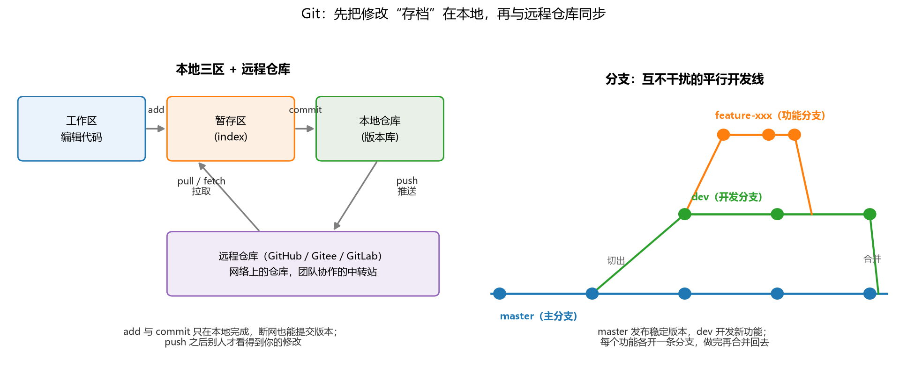

**图 2-7 Git 的本地三区、远程仓库与分支管理**

**分支管理**是 Git 最大的特色之一：你可以在不同的分支上开发不同的功能，互不干扰（图 2-7 右）。比如 `master`（或 `main`）分支是主分支，用于发布稳定版本；`dev` 分支是开发分支，用于开发新功能和测试不太稳定的版本；其他分支用于开发特定功能，如 `feature-xxx` 分支。假设你在 a 分支上开发 A 功能，同事在 b 分支上开发 B 功能，同时你在 fix_c 分支上修复 C 功能的 Bug——理想情况下三个任务互不干扰、同时进行，做完各自合并回主线。

### 2.4.3 远程仓库与协作

远程仓库是网络上的仓库：可以从远程仓库拉取代码，也可以将本地仓库的更改推送到远程仓库。远程仓库的地址一般是一个 URL，常用命令见表 2-12。远程仓库的访问方式一般有 HTTPS 和 SSH 两种：HTTPS 方式通常要求输入邮箱和 Personal Access Token（PAT），SSH 方式则需要配置 SSH Key（与 2.3.2 节的免密登录是同一套公私钥机制）。

**表 2-12 Git 远程仓库常用命令**

| 命令 | 功能 |
|------|------|
| `git remote add <名称> <URL>` | 添加远程仓库 |
| `git push` | 推送更改到远程仓库 |
| `git pull` | 拉取远程仓库的更改并合并到本地 |
| `git fetch` | 获取远程仓库的更改但不合并到本地 |

### 2.4.4 现代 Git 平台与协作开发流程

以 GitHub 为代表的现代平台在版本控制之上叠加了一整套协作功能（表 2-13），如今还包括与 AI 编程代理（coding agent）协同工作。

**表 2-13 现代 Git 平台的主要功能**

| 功能 | 用途 |
|------|------|
| Issue / Project | 管理需求、Bug、任务进度 |
| Pull Request | 代码审核、讨论、合并前检查 |
| Actions / CI | 自动运行测试、格式检查、构建 |
| CD | 自动部署到测试环境或生产环境 |
| Release / Tag | 标记版本，生成发布记录 |
| Wiki / Discussions | 沉淀文档、方案讨论和常见问题 |

一个典型的 GitHub 协作开发流程是这样的：根据 Issue 反馈或设计文档明确需求 → 本地 `fetch origin` 同步远程仓库状态 → 从最新 dev 分支切出 feature/fix 分支 → 完成开发并进行一次或多次 commit → push 分支到远程仓库 → 发起 Pull Request → 根据审核人的 Review 修改代码 → 通过后 merge PR → 关闭对应 Issue 并记录变更。本书各章的配套代码就采用类似的方式管理。

## 2.5 Visual Studio Code

### 2.5.1 为什么推荐 VS Code

写代码总得有个趁手的编辑器。国外知名开发者社区 Stack Overflow（类似国内 CSDN，但更专注于编程问答）每年的开发者调查报告中，**Visual Studio Code 连续多年位列"最受欢迎开发环境"第一名，使用率领先第二名一倍以上**。它是一个**轻量级但功能强大的源代码编辑器**，可在个人电脑上运行，适用于 Windows、macOS 和 Linux；内置对 JavaScript、TypeScript 和 Node.js 的支持，并为其他语言（C++、C#、Java、Python、PHP、Go 等）和运行环境（.NET、Unity 等）提供了丰富的扩展插件。软件由微软开发，免费，官网 <https://code.visualstudio.com/>。

### 2.5.2 主要特点

1. **免费、开源且跨平台**：它的开源做得非常彻底——不仅代码开源，**整个产品生命周期都是开放的**：开发计划、设计、发布管理全部放在网上，用户可以提问题、发评论，参与到每个功能的设计中。
2. **速度快**：秒开一般项目，打开很大的文件也非常快——打开含大量数据的文本也不卡。
3. **学习曲线平缓**：帮助文档完善，有快速入门和 PDF 版快捷键参考表，容易上手。
4. **轻量级编辑器 + IDE 重要功能**：内置 Terminal，可以直接在编辑器里运行脚本，不必与系统终端来回切换；内置调试器，断点、调用栈、交互式调试控制台一应俱全；开箱即用的 Git 版本控制，方便比较更改、管理源代码。它像一个"综合编辑器"——MATLAB 把文件夹浏览、命令行、工具箱都放在一个界面里，VS Code 也是同样的思路。
5. **支持的编程语言非常多，智能提示出色**：默认对 Web 前端、Node.js、PHP 等有良好支持；装扩展即可支持 Java、Python、Go、Ruby、C#、C/C++ 等；语法提示、高亮、自定义代码片段一应俱全——敲一个函数名，括号、参数马上蹦出来。
6. **插件生态丰富**：扩展插件数以万计，很多重要扩展由微软、谷歌等公司维护，绝大多数装完即生效、无需重启。微软把 VS Code 做成一个**平台**：自己负责平台，第三方（包括各大商业软件公司）在上面做插件——开放、自由、包容。
7. **无缝远程开发**：只要装几个简单的插件，就能连接容器、远程计算机或 Windows 的 WSL 子系统作为完整的开发环境。为什么需要它？比如做深度学习要用 GPU，而本地电脑只有 CPU——你可以在本地编辑代码，同时在远端有 GPU 的服务器上运行，用起来就像在本地一样流畅。这一条对后面章节的实验至关重要。

### 2.5.3 界面布局：五个部分

VS Code 的界面是经典布局（图 2-8），从左到右、从上到下共五部分：

1. **活动栏（Activity Bar）**：最左边一竖排按钮，相当于"一级菜单"——文件浏览、搜索、源代码控制、调试、插件、远程连接等；
2. **侧边栏（Side Bar）**：点中某个一级菜单后展开的区域，显示对应的"二级菜单"详细内容；
3. **编辑器（Editor）**：右侧占据空间最大的窗口，编写代码的主战场；
4. **面板（Panels）**：编辑器下方的区域，包含问题、输出、调试控制台、终端四个面板，负责与系统交互；
5. **状态栏（Status Bar）**：最底部的彩色横条，动态显示当前文件的信息——行列位置、语言、编码、解释器版本等。

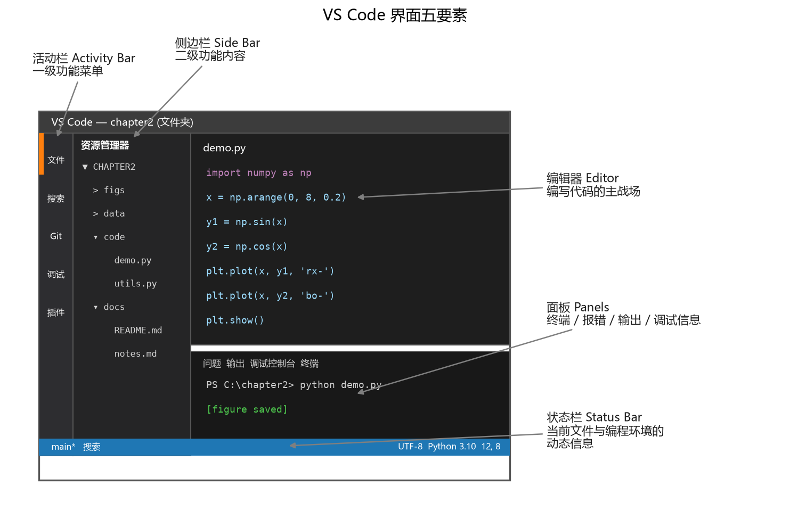

**图 2-8 VS Code 界面五要素**

这个界面其实大家早就见过——打开电脑上的微信看看：最左边一竖排是几个按钮（用户、朋友圈等），点开之后出来好友列表，右上角是与对方的聊天窗口，最下面是输入框。是不是非常像？

### 2.5.4 怎么定位一个文件和文件内的位置

打开 VS Code 后最常做的第一件事，是"找到我要编辑的文件"。定位分三个层次（图 2-9）：

- **文件夹 → 文件**：活动栏最上面的"资源管理器"，在侧边栏中以树状结构浏览文件夹，点开代码所在的文件夹，找到某个文件打开；
- **文件内部的结构**：打开文件后，侧边栏的"大纲"会解析文件内部的层级——比如 Markdown 文件的一个井号是一级标题、两个井号是二级标题，大纲里自动生成目录；Python 文件则列出主要变量与函数定义，还能直接运行，运行结果与反馈信息显示在右下方的面板；
- **光标所在的精确位置**：编辑区最上方的定位条（面包屑）显示"文件夹 › 文件 › 标题"的路径，标明当前光标停在文件内部结构中的哪一处。

此外还有两个好用的小功能：**并排编辑**（一个窗口里同时看两个文件对照着改）与**微缩图**（代码文件很长时，右侧缩略图上标出当前可视窗口的位置）。晚上和白天写代码喜欢不同的背景颜色？大量自带和第三方**换肤主题**任选。

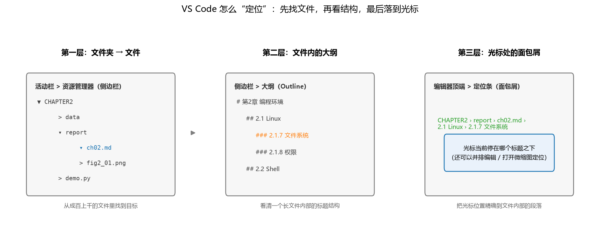

**图 2-9 VS Code 文件定位的三个层次**

VS Code 对开源语言（如 Python、Markdown）的支持非常好；MATLAB 也有人做了插件，但体验一般——所以本书的 MATLAB 代码建议还是用官方环境运行。更多内容可看官网帮助，或配套的中文视频入门教程（见本章延伸阅读）。

### 2.5.5 上手练习

**练习 2-1：用 VS Code 编辑 Markdown。**（1）打开 VS Code，对照 2.5.3 节认识界面五要素；（2）新建一个文件夹并用 VS Code 打开；（3）新建 Markdown 文件"学号.md"；（4）输入一段文字，例如 `# 姓名`、`## 本科成绩`；（5）保存并预览（Markdown 是一种轻量标记语言，背后对应简单的 HTML，用井号数目表示标题级别）。

**练习 2-2：用 VS Code 编辑并运行 Python 文件。**（1）新建 Python 程序"学号.py"；（2）输入两行代码 `print('学号')` 和 `print('姓名')`；（3）保存并运行，查看面板中的输出结果。

**练习 2-3（可选）：远程调试体验。** 在 Win10 系统下安装 WSL 与 Ubuntu（见 2.3.1 节方式五），再在 Windows 安装 VS Code，用其远程扩展调试 WSL 下的 Python 程序，参考官方教程 <https://code.visualstudio.com/docs/remote/wsl-tutorial>。

## 2.6 Python 的隔离环境

### 2.6.1 为什么需要隔离

用 Python 的同学可能直接从官网下载安装，但常常会遇到各种问题。问题的根源有两个：一是 **Python 有大量标准库和第三方库，库之间的依赖关系高度复杂**，直接装某个库时可能因其依赖的另一个库没装或版本不对而报错；二是 **Python 2 与 Python 3 不兼容**，很多较老的论文代码用 Python 2 写成，与现在的 Python 3 环境混在一起极易出错。先看两个典型场景：

**场景 1：版本打架。** TensorFlow（tf）是一个十分流行的 Python 机器学习库。你手里有两个 tf 项目，项目 A 需要 python2.7 + tf1.2，项目 B 需要 python2.7 + tf1.6，两个项目得同时进行，怎么办？不隔离的笨办法是：跑项目 A 时把 tf1.6 卸掉装 tf1.2，跑项目 B 时再反过来。单个模块还好，问题是 tf 的不同版本又依赖于其他已安装模块，且 tf1.2 和 tf1.6 对依赖模块的版本要求不同——切换一次得卸载安装好几个模块。

**场景 2：多人共用一台服务器。** 课题组几个同门共用一台服务器，每人一个系统账户但只有一个人有 root 权限，每个人都用 Python 跑程序，而各自需要的 Python 及模块版本不同，多数人又没有 root 权限，怎么办？不隔离的土办法是"人人都开 root"或"多人共用一个 root 账号"，安全与管理都是灾难。

解决之道就是**隔离环境**：在同一台机器上创建若干相互独立的虚拟环境，每个环境有自己的 Python 版本和包，互不干扰、随时切换（图 2-10）。复现一篇论文时，论文里写明了"Python 3.7、TensorFlow 1.14、NumPy 1.18"，就为它单建一个环境，把版本一一对应装上，跑论文代码的错误最少；换一篇文章，再建一个新环境。论文之间、项目之间互不影响。

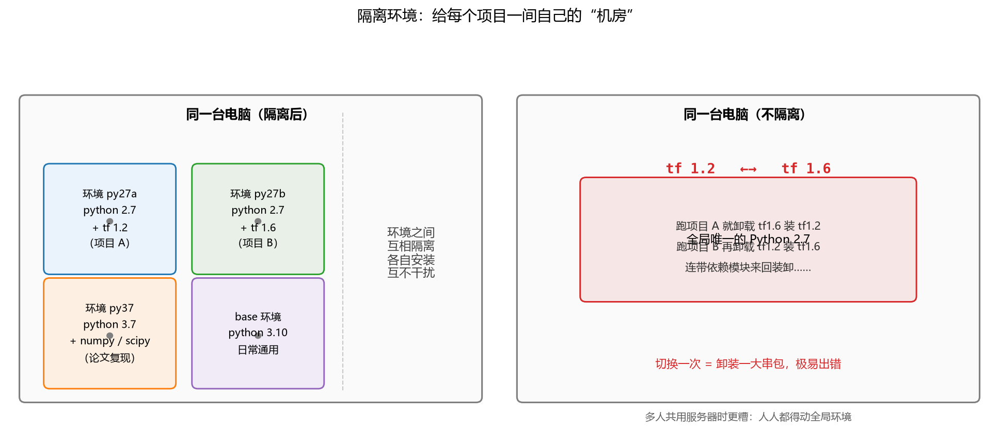

**图 2-10 隔离环境：给每个项目一间自己的"机房"**

### 2.6.2 关键术语

先熟悉几个术语（表 2-14），后面各小节的命令都围绕它们展开。

**表 2-14 Python 隔离环境的关键术语**

| 术语 | 解释 |
|------|------|
| pip | 首选的包安装程序，从 Python 3.4 开始默认包含在 Python 安装程序中 |
| 虚拟环境 | 一种半隔离的 Python 环境，允许为特定应用安装各自的包，而不是安装到整个系统 |
| venv | 创建虚拟环境的标准工具，从 Python 3.3 起成为 Python 的组成部分，3.4 起自动在所建环境中安装 pip |
| virtualenv | venv 的第三方替代（及其前身），允许在 Python 3.4 之前的版本使用虚拟环境 |
| Python Package Index（PyPI） | 开源许可的软件包公共存储库，供所有 Python 用户使用 |

### 2.6.3 构建隔离环境的方法比较

构建隔离环境的工具很多，各有优劣，分三组比较（表 2-15、表 2-16、表 2-17）。

**表 2-15 构建隔离环境的方法（一）：Python 自家工具**

| 方法 | 优点 | 缺点 |
|------|------|------|
| pyenv | 管理多个 Python 版本；容易切换版本；支持插件扩展 | 不提供虚拟环境管理功能；只适用于 Python 版本管理，不能隔离其他依赖项 |
| venv | Python 标准库一部分；轻量级、简单易用；隔离 Python 环境和依赖项 | 支持 Python 3.3+；Python 3.6 后不推荐旧用法 |
| Pipenv | 集成虚拟环境和包管理；自动锁定依赖项版本；支持环境变量管理 | 引入了更多概念和复杂性；有些项目可能不兼容 |
| Virtualenv | 创建独立 Python 环境；管理多个 Python 版本；灵活性高 | 需要手动安装和配置；没有自动化的包管理功能；支持 Python 2.7 和 3.3+ |

**表 2-16 构建隔离环境的方法（二）：conda 系与新工具**

| 方法 | 优点 | 缺点 |
|------|------|------|
| Conda | 可以创建虚拟环境并管理 Python 和非 Python 包；跨平台；自带包管理工具 | 安装的软件包相对较大；与 pip 库不完全兼容；可能出现环境变量冲突 |
| UV | 新兴的 Python 包安装和依赖管理工具，用 Rust 编写，速度快、资源占用低；支持快速创建虚拟环境、并行下载和编译依赖包；提供项目初始化和依赖锁定 | 有的安装需要科学上网 |
| Poetry | 针对具体 Python 项目，精确管理"这个项目需要哪些包、什么版本范围"；生成 lock 文件保证任何人安装结果完全一致 | 常与 Conda 配合：先用 Conda 建环境解决 Python 版本和系统库问题，再在环境里用 Poetry 精确管理项目依赖 |

**表 2-17 构建隔离环境的方法（三）：更重的隔离与更省心的方式**

| 方法 | 优点 | 缺点 |
|------|------|------|
| Docker | 把应用程序和依赖打包为独立容器；运行环境隔离性好；可在不同平台上运行 | 需要学习 Docker 的使用；资源消耗较大，小规模项目可能过于复杂 |
| VS Code | 通过界面智能提示或选择，和 Conda、UV、pip 等结合使用（跨平台） | 必须安装 VS Code |
| Agent | 由 AI 代理来创建、激活和关闭环境 | 完成程度取决于模型智能；提示词要写清楚用户需求 |

选择的原则是**按项目需求来**：只需隔离 Python 版本，pyenv、venv、virtualenv 是简单常见的选择（只用 Python 2 和 3 建环境用 virtualenv；只在 Python 3.3+ 建环境用 `python3 -m venv`）；同时还要管理包依赖，Pipenv 和 Conda 功能更多；需要隔离整个应用程序及其依赖并跨平台运行，Docker 更合适。

### 2.6.4 venv 的基本用法与部署

Python 3.3 及以上版本自带的 venv 用法见表 2-18。创建环境后，在环境文件夹下激活（Windows 运行 `Scripts\activate`，Ubuntu 用 `source bin/activate`），激活成功后命令提示符前会出现环境名；`pip3 list` 查看安装的包；不再使用时直接删除环境文件夹即可。

**表 2-18 venv 常用操作**

| 功能 | 例子 | 备注 |
|------|------|------|
| 查看虚拟环境 | 系统下搜索或查看子文件夹名 | |
| 创建新环境 | `python -m venv 环境名` | 环境名自定义 |
| 激活该环境 | Ubuntu：`source bin/activate`；Windows：`bin\activate` | 在虚拟环境文件夹下执行 |
| 查看安装包 | `pip3 list` | |
| 用列表安装包 | `pip install -r requirements.txt` | |
| 导出安装包列表 | `pip freeze > requirements.txt` | |
| 退出该环境 | `deactivate` | |
| 删除该环境 | 直接删除虚拟环境文件夹 | 以后不用了 |

其中"导出—安装"这对命令是**部署虚拟环境**的标准流程：开发完成后用 `pip freeze > requirements.txt` 把项目的库依赖导出，作为代码的一部分；将代码上传到服务器或其他电脑；在那里创建并激活一个虚拟环境，执行 `pip install -r requirements.txt`，一键装齐全部依赖。

### 2.6.5 UV：新一代工具

**UV 是新兴的 Python 包安装和依赖管理工具**，用 Rust 编写的高效实现，在速度和资源占用方面显著优于传统的 pip 和 virtualenv；支持快速创建虚拟环境、并行下载和编译依赖包，提供项目初始化和依赖锁定。源代码在 <https://github.com/astral-sh/uv>，文档见 <https://docs.astral.sh/uv/>（含安装 Python 的指南）。常用命令见表 2-19。

**表 2-19 UV 常用命令**

| 命令 | 含义 |
|------|------|
| `pip install uv` | 安装 UV |
| `uv --version` | 检查当前安装的 uv 版本 |
| `uv venv xxxname` | 创建虚拟环境 xxxname |
| `xxxname\Scripts\activate` | 激活虚拟环境 xxxname |
| `deactivate` | 停用虚拟环境 |
| `uv init` | 初始化项目，生成 pyproject.toml |
| `uv run example.py` | 运行代码 |
| `uv help` | 查看帮助 |
| `uv add -r requirements.txt` | 把 requirements.txt 里的依赖加入 pyproject.toml，生成/更新 uv.lock 并自动安装 |
| `uv add pandas airtest` | 添加一个或多个依赖 |
| `uv remove requests` | 移除依赖包 |
| `uv pip list` | 查看已安装的包 |
| `uv pip freeze > requirements.txt` | 生成 requirements.txt |

## 2.7 Anaconda

### 2.7.1 Conda、Anaconda 与 Miniconda

科学计算领域最常用的方案是 Anaconda，先厘清三个易混的概念（图 2-11）：

- **Conda**：一个跨平台、开源的**包管理和环境管理系统**（2.6.3 节表 2-16 中的方法之一）；
- **Anaconda**：一个用于科学计算的开源**软件包发行版**，包括 conda、图形界面的 Anaconda Navigator 和大量科学计算包（NumPy、Matplotlib 等），并关联了 Jupyter Notebook、Spyder、VS Code、RStudio 等软件；
- **Miniconda**：Anaconda 的精简版，只保留 conda 与少量必备组件，适合嫌 Anaconda 过于臃肿的用户。

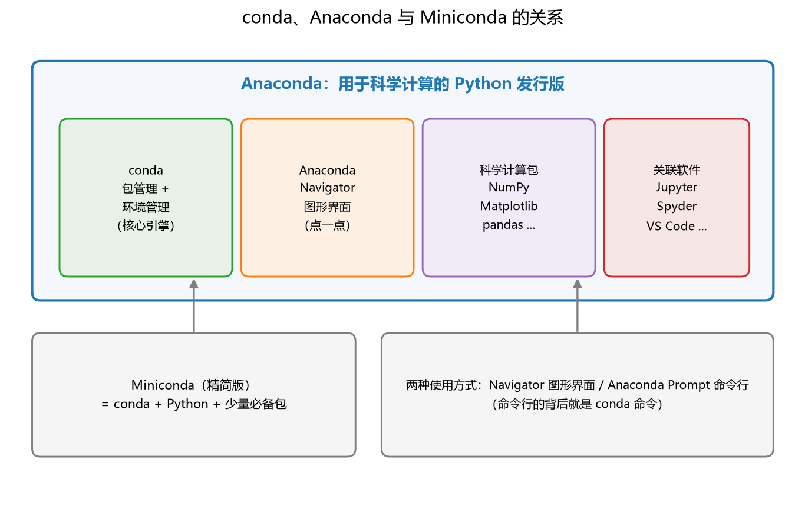

**图 2-11 conda、Anaconda 与 Miniconda 的关系**

### 2.7.2 主要运行方式与关联软件

Anaconda 有两种运行方式（表 2-20）：一是**图形界面**——Anaconda Navigator，把 Anaconda 集成的所有软件、环境和包管理都做成"点一点"的操作，适合不喜欢命令行的用户；二是**命令行**——Windows 下原有 cmd，后又推出 Anaconda PowerShell Prompt（可在开始菜单里点开，调出终端），在里面敲 conda 命令；VS Code 内置的终端同样可以充当 Anaconda 的命令行入口。

**表 2-20 Anaconda 的主要运行方式**

| 软件 | 功能 | 备注 |
|------|------|------|
| Anaconda Navigator | 启动应用程序，管理 conda 环境和 Python 模块包 | 桌面图形用户界面 |
| Anaconda Prompt | Anaconda 的命令行终端 | 命令行界面 |
| Anaconda PowerShell Prompt | Windows 下较新的命令行终端 | 命令行界面 |
| VS Code | 包含命令行终端 | 命令行界面 |

Anaconda 关联的主要软件见表 2-21——它不只是装个 Python，而是把一套科学计算工作台整体搬进来。

**表 2-21 Anaconda 关联的主要软件**

| 软件 | 功能 | 语言 |
|------|------|------|
| Jupyter Notebook | 基于网页的交互式程序编辑工具 | Python（适合初学者） |
| JupyterLab | Jupyter 的拓展，提供更好的用户体验 | Python |
| PyCharm | Python 语言的集成开发环境 | Python |
| Spyder | 一个集成的 Python 开发环境 | Python |
| Qt Console | 可执行 IPython 的仿终端图形界面程序，可直接显示代码生成的图形，支持多行输入 | Python |
| Glue | 用于探索相关数据集内部和之间的关系 | Python 库 |
| Datalore | 面向机器学习的云端开发环境 | Python |
| RStudio | R 语言的集成开发环境 | R |
| Orange | 交互式数据可视化软件 | Python |

### 2.7.3 Anaconda 的特点

1. **强大的包管理**：安装、更新、卸载工具包；安装工具包时自动安装相应的依赖包——2.6.1 节"依赖关系复杂"的痛点由此解决。
2. **强大的环境管理**：可以在同一台机器上创建几个相互独立的虚拟环境；隔离不同项目所需的不同版本的工具包；不同环境之间可以快速切换。
3. **开源和跨平台**：支持 Windows、macOS、Linux，覆盖 Intel/AMD x86、x86-64、AWS Graviton 2/ARM 64、IBM Z、IBM Power 等多种 CPU 架构。
4. **支持多种开源编程语言**：Python、R 和其他语言。
5. **两种操作方式**：图形化界面（Navigator）与命令行（Anaconda Prompt 和 conda 命令）。
6. **集成了多个软件包**：JupyterLab、Jupyter Notebook、Spyder、PyCharm、VS Code、Glueviz、Orange、RStudio 等。
7. **多版本发行**：个人免费版和多个商业版——开发团队投入了巨大精力，希望获得商业支持，付费专业版的服务更好，但一般科研使用免费版已经足够。

### 2.7.4 Anaconda 与 Python 的关系

对 Python 用户而言，**Anaconda 是用于科学计算的 Python 发行版**：它预安装了 NumPy、Matplotlib 等成熟的开源包；Navigator 提供图形界面的科学计算工具；conda 用环境管理快速切换不同的 Python 版本，并智能安装和管理各种库的依赖关系。有了它，在一台电脑上管理多个 Python 版本容易得多，大量高度优化的常用数据科学库也帮用户更快入门。所以本课程的推荐是：**主打语言为 Python 或需要跑别人代码的同学，直接安装 Anaconda**（而不是从 Python 官网安装裸 Python）；即使主打 MATLAB，将来要用到深度学习框架或特定统计包时，了解 Anaconda 也很有必要。

### 2.7.5 下载、安装与换源

- Anaconda 官网：<https://www.anaconda.com/>（国外源，速度较慢）；
- 清华镜像：<https://mirrors.tuna.tsinghua.edu.cn/anaconda/archive/>（国内大厂与高校普遍提供镜像）；
- 中山大学镜像：<https://mirror.sysu.edu.cn/anaconda/>（校园网内速度更佳；miniconda 在 `/anaconda/miniconda/`，Ubuntu 镜像在 `/ubuntu/`）；
- 官方帮助：<https://docs.anaconda.com/>；conda 官方入门：<https://conda.io/projects/conda/en/latest/user-guide/getting-started.html>。

安装包只是第一步——**下载包的速度取决于"源"**。conda 的默认源在国外服务器上，装很多包时从国外下载会非常慢，所以装好后的第一件事通常是把源换成国内的（清华、阿里等），命令见 2.7.6 节表 2-23 最后一行。

### 2.7.6 conda 常用命令

环境管理命令见表 2-22，包管理命令见表 2-23。第一次看会觉得有点繁杂，用一下就会发现设计得相当精妙，没有想的那么难。

**表 2-22 conda 常用命令：虚拟环境管理**

| 功能 | 例子 | 备注 |
|------|------|------|
| 查看当前信息 | `conda info` | 显示版本、当前环境、安装路径与源地址 |
| 查看虚拟环境 | `conda info --envs` 或 `conda info -e` | 列出本机已建的所有环境 |
| 创建新环境 | `conda create -n ENVNAME` | 环境名自定义（用户好记即可） |
| 创建新环境并装指定版本 Python | `conda create --name ENVNAME python=3.6` | 建环境时顺带锁定 Python 版本 |
| 激活该环境 | `conda activate ENVNAME` | 提示符前的环境名随之改变 |
| 查看当前环境安装包 | `conda list` | 包名 + 版本号 |
| 退出该环境 | `conda deactivate` | 从当前环境退回 base |
| 删除该环境 | `conda remove --name ENVNAME --all` | 以后不用了，或环境太占硬盘 |

**表 2-23 conda 常用命令：包管理**

| 功能 | 例子 | 备注 |
|------|------|------|
| 查询某安装包 | `conda search xxx` | xxx 为搜索关键字，列出可选版本 |
| 安装当前环境下的包 | `conda install PKGNAME` | |
| 安装指定版本 | `conda install PKGNAME==3.1.4` | 3.1.4 是版本号 |
| 卸载当前环境下的包 | `conda uninstall PKGNAME` | |
| 卸载某环境下的包 | `conda uninstall PKGNAME --name ENVNAME` | |
| 更新当前环境下的包 | `conda update PKGNAME` | |
| 更新某环境下的所有包 | `conda update --all --name ENVNAME` | |
| 添加清华镜像源 | `conda config --add channels https://mirrors.tuna.tsinghua.edu.cn/anaconda/pkgs/free/` | 加快下载速度 |

这些命令串起来就是一套完整的工作流，不妨跟着课堂演示在脑中过一遍：打开 Anaconda Prompt，提示符前有 `(base)`，说明当前在基础环境。敲 `conda info`，可以看到 conda 的基本信息、当前激活的环境和路径——注意其中安装源地址还是 anaconda.com，没换源之前装包会很慢。敲 `conda info --envs`（简写 `conda info -e`），看到目前只有 base 一个环境。现在建一个新环境：`conda create -n py2`（`-n` 后面是自己起的名字）；如果建环境时什么包都不指定，得到的是一个空环境，只建几个基本文件夹，速度很快。再敲 `conda info -e`，列表里多出了 py2，而星号 `*` 仍在 base 一行——星号标的是**当前**所在环境。要进入新环境就激活它：`conda activate py2`，提示符前的 `(base)` 变成了 `(py2)`；此时 `conda list` 发现里面几乎什么都没装。退出来用 `conda deactivate`（不用指明退到哪，从当前环境退出即可），回到 base 再 `conda list`，常用包都在。在任一环境下都可以 `conda install numpy==1.18` 这样装指定版本的包，装错了 `conda uninstall` 卸掉重装，或 `conda update` 升级。

**练习 2-4：建立并管理一个 conda 虚拟环境。**（1）打开 Anaconda Prompt；（2）新建一个环境（如 py）；（3）激活该环境；（4）查看所安装的软件包列表；（5）退出该环境；（6）查看当前系统还有哪些虚拟环境。

**练习 2-5：把 conda 源改成清华镜像并安装 Python 3.7 环境。**（1）访问清华镜像的 Anaconda 使用帮助 <https://mirrors.tuna.tsinghua.edu.cn/help/anaconda/>；（2A）用 `conda config --add channels https://XXX` 命令把对应频道加入；或（2B）先执行 `conda config --set show_channel_urls yes` 生成 `.condarc` 文件再修改；（3）新建一个安装 python 3.7 的环境 py37；（4）查看该环境下所安装的软件包列表。

## 2.8 MATLAB 与 Python 的比较

### 2.8.1 为什么要比较、比较什么

本课程的主打计算语言是 MATLAB，但现在很多同学做深度学习要用 Python——两种语言混合使用已成为常态。当下的趋势是"**混搭**"：你可能学过 C、C++、MATLAB、Python 好几种语言，有一种主打即可；别人开发的软件包，你未必有精力了解其语言的所有细节，但至少要能把它运行起来，当成一个函数在你的主打语言里调用（或者反过来）。为此，有必要对两种语言做一个系统的比较。比较的框架有七个维度：**发展历史、主要功能、书写形式、数据结构、流程控制、函数、对象**。下面逐项展开，先看历史。

### 2.8.2 发展历史

MATLAB 与 Python 的身世对照见图 2-12。

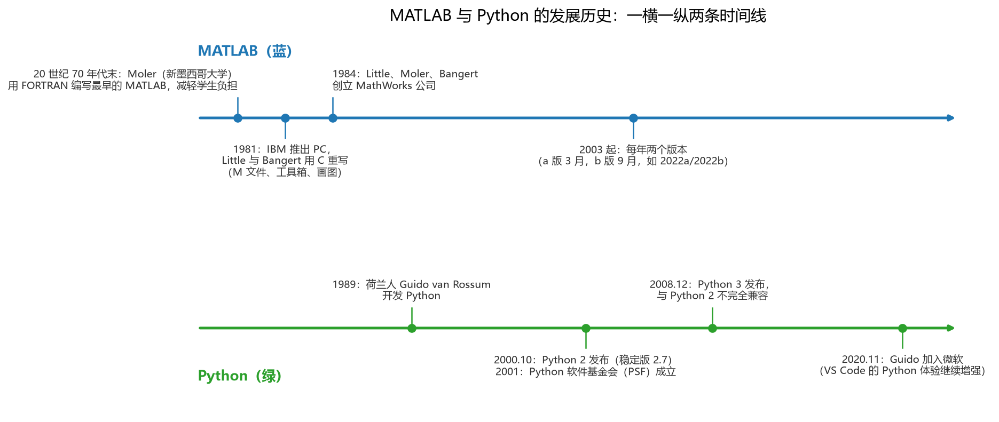

**图 2-12 MATLAB 与 Python 的发展历史**

**MATLAB**诞生于教学：20 世纪 70 年代，美国新墨西哥大学计算机科学系主任 Cleve Moler 为了减轻学生编程负担，用 FORTRAN 编写了最早的 MATLAB——当时教矩阵运算只能用低级语言，细节太麻烦，与学生对该课程的直观理解差距很大，于是他写了一个"矩阵实验室"，让矩阵运算变得非常方便。1981 年 IBM 推出个人电脑后，Jack Little 和 Steve Bangert 用 C 语言重写了 MATLAB，加入 M 文件、工具箱和画图功能；1984 年三人（Little、Moler、Bangert）合作创立 **MathWorks** 公司，把 MATLAB 推向市场——注意公司名与产品名可以不一样，就像苹果公司的手机叫 iPhone。2003 年开始 MATLAB 每年发布两个版本，以年份加 a/b 命名（a 版 3 月、b 版 9 月，如 2022a、2022b），版本升级非常规律。

**Python**则始于一个人的业余项目：1989 年圣诞节期间，荷兰人 Guido van Rossum 开发了 Python（社区流行语"人生苦短，我用 Python"由此而来）。2000 年 10 月 Python 2 发布（长期停留在稳定版本 2.7）；2001 年 Python 软件基金会（PSF）成立；2008 年 12 月 Python 3 发布，但与 Python 2 **不完全兼容**——这正是 2.6.1 节"需要隔离环境"的历史原因；2020 年 11 月，Guido 加入微软。

### 2.8.3 主要功能与生态

两种语言的定位差异（表 2-24）可以概括成两句话：**MATLAB 一切皆矩阵，Python 一切皆对象**。MATLAB 是跨平台的商业软件，设计目的就是科学计算，对数据的操作非常专注、直接、快；Python 是跨平台的开源自由软件，是通用编程语言，什么都能处理——数据、文本、字符串一起操作时，因为要照顾的数据格式不一样，有时反而慢一点。好在 Python 生态后来出现了专做数据分析的第三方库（NumPy、pandas 等），把这块短板补上了。

**表 2-24 MATLAB 与 Python 的主要功能对比**

| 维度 | MATLAB | Python |
|------|--------|--------|
| 性质 | 跨平台、商业软件；解释性语言 | 跨平台、开源和自由软件；基于字节码的解释性语言 |
| 设计目的 | 科学计算 | 通用编程语言 |
| 数据对象 | 一切皆矩阵 | 一切皆对象 |
| 数据操作 | 矩阵操作（内置） | NumPy 数据分析 |
| 数据读取、信号处理 | 内置：数据读取、信号处理、小波分析、最优化 | Scipy、pandas |
| 机器学习 | 统计工具箱（Statistics Toolbox） | scikit-learn |
| 深度学习 | 深度学习工具箱（Deep Learning Toolbox，原名神经网络工具箱，因深度学习兴起而更名，包含浅层网络）、文字处理、图像处理工具箱 | TensorFlow、Keras、PyTorch |
| 画图 | 各种常见图形（内置函数） | Matplotlib、Seaborn |
| 扩展 | 各种工具箱统一的数据格式，详细文档；官方找领域专家与工程师共同开发，质量高且持续修正 | 各个包由不同团队独立开发，难以做到格式统一，质量参差不齐 |
| 扩展使用 | 安装官方或第三方工具箱 | 导入第三方的包来扩展功能 |

有几个生态细节值得记：机器学习课最常用的 Python 包是 scikit-learn；谷歌开发的 TensorFlow 与 PyTorch 是深度学习两大主流框架——因为深度学习火，反过来把 Python 也带火了；画图方面 MATLAB 自带函数一应俱全，Python 的 Matplotlib 这个名字就来自 MATLAB 的 plot 命令——两种语言相互借鉴（说好听点是借鉴）。工具箱或包的具体资源可到官网查询：MATLAB 见 mathworks.com 或中文站 ww2.mathworks.cn；Python 见 python.org、numpy.org、matplotlib.org、tensorflow.google.cn。

### 2.8.4 书写格式

两种语言书写格式的对比见表 2-25。

**表 2-25 MATLAB 与 Python 的书写格式对比**

| 维度 | MATLAB | Python |
|------|--------|--------|
| 逻辑行 | 多条语句可用分号"；"隔开；行尾分号还兼"不输出"（抑制回显） | 多条语句可用分号"；"隔开（无抑制输出作用，输出靠 print） |
| 缩进 | 无强制要求，但为逻辑清晰最好有缩进，同一层次用相同缩进数目；全选后 `Ctrl + I` 智能缩进 | **强制缩进**：用缩进表示程序逻辑，同一层次代码必须有相同缩进空白数，否则报错 |
| 注释 | `%`（单行注释）；`%%`（分段注释，配合单元格模式运行） | `#` |
| 续行 | `…` | `\`（也可用一对括号跨行） |
| 标识符 | 大小写敏感；变量名以字母开头（不能以数字开头） | 同左 |
| 风格 | 表达方式自由灵活，写法多样 | 相当规范 |

```matlab
% MATLAB：行尾分号抑制输出
disp('hello');
disp('yes')
```

```python
# Python：print 输出，分号只用来分隔语句
print("no"); print("yes")
```

缩进是两者最大的格式差别：MATLAB 不强制缩进（但有智能缩进帮你排版），Python 用缩进表达程序结构——缩进不一样，程序结构就不一样。如果你先学的是 Python，一上手就养成了缩进的好习惯，回头写 MATLAB 反而受益。

### 2.8.5 基本数据结构

数据结构的对比分基本与高级两档（表 2-26、表 2-27）。基本原则是：**MATLAB 做纯数值计算时可以不太关心类型**（反正一切都是矩阵），**Python 必须时刻注意类型**（`type(a)` 随时查）。

**表 2-26 MATLAB 与 Python 的基本数据结构对比**

| 维度 | MATLAB | Python |
|------|--------|--------|
| 数据类型 | 数字、字符串、矩阵、cell；不怎么关心 | 数字、字符串、列表、元组、字典、集合；必须注意，`type(a)` 查看 |
| 数字 | 是 1×1 的矩阵，`size(data)` 查看形状 | 是标量，不具有形状，是 0 维的数值；`len(数字)` 报错 |
| 字符串 | 单引号或双引号表示；用 `( )` 索引，第一索引位置从 1 开始 | 单引号或双引号表示；用 `[ ]` 索引和切片 |
| 混合型 | cell（可容纳混合内容的矩阵） | 列表、元组（混合长度与类型的数组） |
| 数组 | 矩阵的点操作（`.*`、`.^` 等逐元素运算） | NumPy 库的 array 类 |
| 矩阵 | 默认是矩阵操作，遵循线性代数 | NumPy 库的 array 类、matrix 类 |

一个典型的差异：在 MATLAB 里一个数字也是 1×1 的矩阵，`size(3)` 返回 `1 1`；在 Python 里数字是零维标量，`len(3)` 直接报错——因为它没有"长度"这个概念。字符串两者都可用单双引号，但索引方式不同：MATLAB 用圆括号且从 1 开始，Python 用方括号且从 0 开始。

### 2.8.6 高级数据结构、索引与切片

**表 2-27 MATLAB 与 Python 的高级数据结构与索引、切片对比**

| 维度 | MATLAB | Python |
|------|--------|--------|
| "标签—值"结构 | 结构体 struct：用"点号+字段"赋值，如 `patient.name = 'John Doe'`、`patient.test = [79, 75, 73; 180, 178, 177.5]` | 字典 dict：通过 key 访问，如 `ab = {'Swaroop': 'swaroop@byteofpython.info', ...}` |
| 不等长字符串"数组" | 元胞数组 cell：`mylist = {'apple', 'mango', 'carrot', 'banana'}` | 列表 list：通过索引号访问变量，`mylist = ['apple', 'mango', 'carrot', 'banana']` |
| "常量"序列 | 不区分变量和常量 | 元组 tuple：通过索引号访问常量，`zoo = ('wolf', 'elephant', 'pen')` |
| 索引起点 | 开始：1；结束可用 end | 正序开始：0；倒序开始：−1 |
| 切片 | `a(1:10)` **前闭后闭**，取第 1 到第 10 个 | `a[0:10]` **前闭后开**，取下标 0 到 9 的前 10 个 |

索引与切片的差别最容易踩坑，用图 2-13 把两套约定摆在同一个序列上看：MATLAB 从 1 数、含头含尾；Python 从 0 数、含头不含尾，且末元素可用 −1 倒着数。同一个序列里取第 2~5 个值，MATLAB 写 `a(2:5)`，Python 写 `a[1:5]`——形式相近、结果相同，但"起点差 1、终点规则不同"这两条区别必须刻在脑子里。

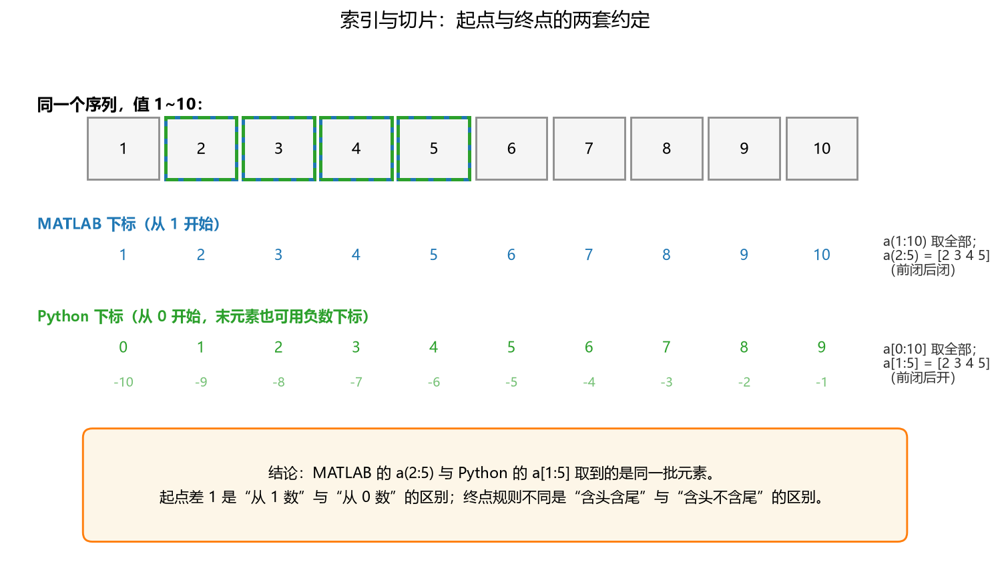

**图 2-13 索引与切片：起点与终点的两套约定**

### 2.8.7 运算符

常规的加减乘除两种语言都有，差别集中在幂、逻辑与整除（表 2-28）。

**表 2-28 MATLAB 与 Python 的运算符对比**

| 维度 | MATLAB | Python |
|------|--------|--------|
| 幂运算 | `^`（矩阵幂；逐元素幂 `.^`） | `**` |
| 逻辑运算 | `>  <  >=  <=  ==  ~=` | `>  <  >=  <=  ==  !=` |
| 布尔运算 | `&  &&  \|  \|\|  ~` | `and  or  not` |
| 除法 | `/` 直接取得准确结果，如 `5/3` 结果是 1.6667 | `/` 真除法（Python 3）；`//` 强行整除 |
| 取余/取整 | `mod(a, b)`、`floor`、`round` 等 | `%` 取余 |
| 位元运算 | `^`（xor）、`&`（and）、`\|`（or） | 同左 |
| 注释/续行 | `%` 注释符、`%%` 分段符 | `%` 取余、`\` 续行、`/` 除法、`//` 整除 |

需要特别提醒的是"不等于"的写法（MATLAB 用波浪号 `~=`，Python 用感叹号 `!=`）和布尔运算（MATLAB 用符号 `&`、`|`、`~`，Python 用单词 `and`、`or`、`not`）。整除的历史差异也值得知道：Python 2 中 `/` 对两个整数做整除（`5/3` 得 1），Python 3 改为真除法（`5/3` 得 1.6667），整除改由 `//` 承担——读旧代码时务必留意。

### 2.8.8 循环与控制语句

程序的控制结构无非顺序、选择（分支）、循环三种，两种语言的对照见表 2-29。`for` 循环 MATLAB 是 `for i = 1:n`，Python 是 `for i in range(1, n)`；条件语句 MATLAB 用 `elseif`，Python 用 `elif`——这些都是小差别。**最大的差别还是"块"的表示**：MATLAB 每个结构必须以 `end` 收尾，否则解释器不知道后面的语句是否还属于这个块；Python 靠强制缩进表达块的归属，不需要也不允许 `end`。

**表 2-29 MATLAB 与 Python 的循环和控制语句对比**

| 结构 | MATLAB | Python |
|------|--------|--------|
| for 循环 | `for number = 1:n`，循环体写在中间，以 `end` 收尾 | `for number in range(1, n):`，循环体靠缩进表示 |
| while 循环 | `while condition` … `end` | `while condition:`，循环体靠缩进表示 |
| 跳出循环 | `break` 跳出整个循环；`continue` 跳出该次循环 | 同左 |
| 条件语句 | `if condition` / `elseif condition` / `else` / `end` | `if condition:` / `elif condition:` / `else:` |

### 2.8.9 函数

函数的对照见表 2-30：MATLAB 用 `function` 定义、必须有 `end`；Python 用 `def` 定义、用 `return` 返回。调用时，MATLAB 与 Python 都可以直接 `name(paras)`；Python 还多了一种面向对象的调用方式——对象的方法 `obj.name()`，写过面向对象的同学会很适应。查帮助则分别是 `help xxx` 与 `help(xxx)`。

**表 2-30 MATLAB 与 Python 的函数使用对比**

| 维度 | MATLAB | Python |
|------|--------|--------|
| 函数定义 | `function [output] = name(paras)`，函数体写在中间，以 `end` 收尾 | `def name(paras):`，函数体靠缩进，用 `return output` 返回 |
| 函数使用 | `name(paras)` | `name(paras)`；或对象方法 `paras.name()` |
| 帮助语句 | `help xxx` | `help(xxx)` |

### 2.8.10 两个经典对照实验

学了这么多条对比，来做两个"看上去差别很小、结果差别很大"的经典实验。

**实验一：一句 `z = x + y` 的两种结局**（图 2-14）。MATLAB 里一切皆矩阵，`x + y` 就是逐元素相加；Python 里列表是一切皆对象，`+` 是把两个对象"接龙"：

```matlab
% MATLAB：数组逐元素相加
x = [1, 2, 3];
y = [4, 5, 6];
z = x + y        % z = 5 7 9
```

```python
# Python：列表相加是拼接
x = [1, 2, 3]
y = [4, 5, 6]
z = x + y        # z = [1, 2, 3, 4, 5, 6]
# 想要逐元素相加，需要 NumPy 数组：
import numpy as np
z = np.array(x) + np.array(y)    # array([5, 7, 9])
```

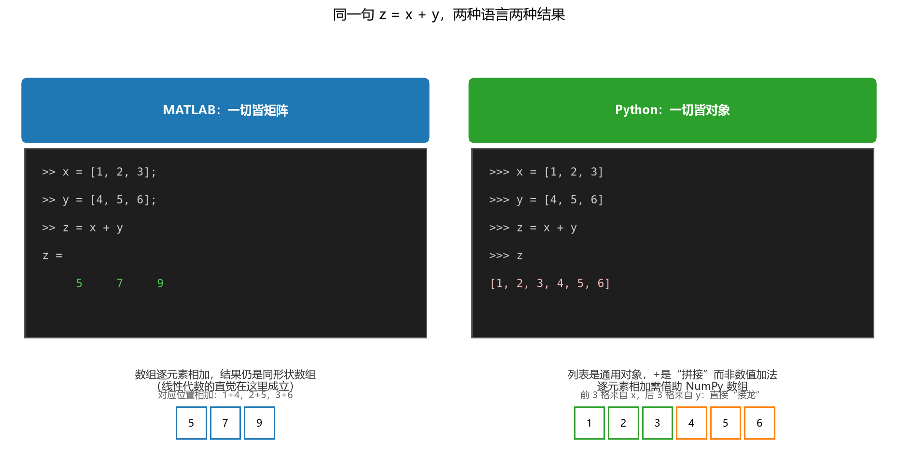

**图 2-14 同一句 z = x + y，两种语言两种结果**

**实验二：一行缩进的距离。**下面两段 Python 代码只差最后一行的缩进，左边的 `print('end')` 顶格，不属于循环体，循环结束后才执行一次；右边缩进了，成了循环体的一部分，每轮都打印。形式上只差几个空格，程序结构完全不同：

```python
for i in range(5):
    print(i)
print('end')      # 循环外：输出 0 1 2 3 4 后才打印一次 end
```

```python
for i in range(5):
    print(i)
    print('end')  # 循环内：每轮都打印，end 出现 5 次
```

MATLAB 里这类归属关系由 `end` 明确标出，不存在这种"一念之差"。

**实验三：吃透 range 与切片。**配合 2.8.6 节的切片规则，把 Python 的 `range` 函数彻底弄清楚（`range` 返回的是一个整数序列对象而非列表，用 `list()` 展开看）：

```python
a = range(5)            # 默认从 0 开始，到不了 5
print(list(a))          # [0, 1, 2, 3, 4]
a = range(1, 5)         # 给出起点、终点（到不了的）
print(list(a))          # [1, 2, 3, 4]
a = range(1, 11, 2)     # 起点、终点、步长（正整数或负整数）
print(list(a))          # [1, 3, 5, 7, 9]
a = range(2, 2468, 2)   # 最大下标用 len(a)-1 获得
print(a[0], a[1], a[2], a[len(a)-1])   # 2 4 6 2466
a = range(100, 80, -2)  # 前大后小时，步长应为负数
print(list(a))          # [100, 98, ..., 82]
```

有兴趣的同学可以用 MATLAB 重写这些操作（`1:5`、`1:2:11` 等），体会两种语言"生成整数序列"的约定差异。

### 2.8.11 MATLAB 与 NumPy

由于 Python 的数值计算几乎都落在 NumPy 上，值得把 MATLAB 矩阵与 NumPy 数组再单独对照一次（表 2-31）。最要紧的三条：其一，MATLAB 的基本数据对象是双精度浮点多维数组，基本类型按矩阵运算设计；NumPy 的基本类型是多维数组 array，**所有维度上的操作默认都是元素级操作**，真正的线性代数要用特定函数（矩阵乘法在 Python 3.5 及以上用 `@`）。其二，MATLAB 下标从 1 开始（`a(1)` 是第一个元素），NumPy 从 0 开始（`a[0]`）。其三，**内存语义不同**：MATLAB 数组按值传递、采用延迟的"写时复制"（copy-on-write），切片操作是复制数组的一部分；NumPy 数组按引用传递，切片是原数组的视图——改了切片，原数组跟着变，从 MATLAB 转 Python 的同学最容易在这里翻车。

**表 2-31 MATLAB 与 NumPy 的数组操作对比**

| 维度 | MATLAB | NumPy |
|------|--------|-------|
| 基本数据类型 | 双精度浮点数的多维数组；大多数表达式采用并返回这种类型 | 多维数组 array；在所有维度（包括 2D）上的操作都是元素级操作 |
| 矩阵运算 | 默认即线性代数中的矩阵运算 | 2-D 实例才像矩阵运算；矩阵乘法用 `@`（Python 3.5+）或特定函数 |
| 语法 | 为线性代数而设计，基本矩阵操作语法简洁（比 NumPy 紧凑） | Python 的附加组件；设计了独特的操作，如矩阵堆叠 |
| 内存语义 | 按值传递，写时复制（copy-on-write）；切片是复制 | 按引用传递；切片是数组的视图 |

最后用一个画图任务把两种语言"各写一遍"的感觉找齐——同一幅正弦/余弦曲线图，MATLAB 与 Python 的代码几乎逐行对应：

```matlab
x  = 0 : 0.2 : 8.0;          % 生成横坐标序列
y1 = sin(x);  y2 = cos(x);
figure(3);
plot(x, y1, 'rx-'); hold on  % 红色 x 标记实线
plot(x, y2, 'bo-'); hold off % 蓝色圆圈标记实线
title('Function', 'fontsize', 20);
legend({'sin', 'cos'}, 'fontsize', 15);
text(1.6, 0.5, 'y > 0', 'fontsize', 18); grid on
xlabel('x', 'fontsize', 18); ylabel('y', 'fontsize', 18);
xlim([0 6.3]); ylim([-1.2 1.2]);
```

```python
# -*- coding: utf-8 -*-
import numpy as np
import matplotlib.pyplot as plt
x = np.arange(0.0, 8.0, 0.2)     # 生成横坐标序列
y1, y2 = np.sin(x), np.cos(x)
plt.figure(3)
plt.plot(x, y1, 'rx-')           # 红色 x 标记实线
plt.plot(x, y2, 'bo-')           # 蓝色圆圈标记实线
plt.title('Function', fontsize=20)
plt.legend(['sin', 'cos'], fontsize=15)
plt.text(1.6, 0.5, 'y > 0', fontsize=18); plt.grid()
plt.xlabel('x', fontsize=18); plt.ylabel('y', fontsize=18)
plt.xlim(0, 6.3); plt.ylim(-1.2, 1.2)
plt.show()
```

写完这对代码再回头看表 2-24 的生态对比，两种语言相互借鉴的感觉会非常直观。

## 2.9 MATLAB 与 Python 互相调用

"混搭"不等于两种语言各干各的——很多时候需要在一个语言里调用另一个语言的函数。MATLAB 与 Python 官方都提供了双向接口，本节给出最小可用示例；更深入的数据类型转换、异常处理等主题，官网上有完整文档（见延伸阅读）。

### 2.9.1 MATLAB 调用 Python

MATLAB 从 R2021b 起提供 `pyrun`、`pyrunfile` 等命令，可以直接运行 Python 语句或脚本；Python 模块（如标准库 math）则以 `py.模块名.函数` 的方式调用，返回值用 `double()` 等转回 MATLAB 类型（表 2-32）。

**表 2-32 MATLAB 调用 Python 的主要命令**

| 命令 | 含义 |
|------|------|
| `pyenv` | 更改默认 Python 解释器环境（指定 Python 版本/路径） |
| `pyenv('Version', ...)` 查询 | PythonEnvironment，查看当前 Python 环境信息 |
| `pyrun` | 从 MATLAB 运行 Python 语句（R2021b 起） |
| `pyrunfile` | 从 MATLAB 运行 Python 脚本文件（R2021b 起） |
| `pyargs` | 为 Python 函数创建关键字参数 |
| `matlab.exception.PyException` | 捕获 Python 异常的错误信息 |

```matlab
% MATLAB 调用 Python 示例
pyenv('Version', 'C:\Anaconda3\envs\ml\python.exe')  % 指定解释器（装一次设一次）
pyrunfile('demo.py')                                 % 直接运行 Python 脚本
res = py.math.sqrt(2.0)                              % 调用 Python 标准库函数
double(res)                                          % 返回值转回 MATLAB 类型（ans = 1.4142）
```

使用中要注意两点：一是先用 `pyenv` 把解释器指向你想用的那个环境（比如 2.7 节 conda 建的环境），否则 MATLAB 找不到正确的 Python；二是错误排查时先分清报错来自 Python 还是 MATLAB——`matlab.exception.PyException` 会把 Python 抛出的异常完整带回 MATLAB 命令行。

### 2.9.2 Python 调用 MATLAB

反方向要靠 **MATLAB Engine API for Python**：安装后 Python 里多了一个 `matlab` 包，`start_matlab()` 启动一个 MATLAB 引擎（相当于在 Python 里开了一个 MATLAB 会话），之后就能像调用 Python 函数一样调用 MATLAB 函数，包括你自己写的 .m 文件（表 2-33）。

**表 2-33 Python 调用 MATLAB 的主要命令（MATLAB Engine API）**

| 类别 | 命令 | 含义 |
|------|------|------|
| Python 函数 | `matlab.engine.start_matlab` | 启动用于 Python 的 MATLAB 引擎 |
| | `matlab.engine.find_matlab` | 查找可连接的共享 MATLAB 会话 |
| | `matlab.engine.connect_matlab` | 连接共享 MATLAB 会话 |
| MATLAB 函数 | `matlab.engine.shareEngine` | 把运行中的 MATLAB 会话转为共享会话 |
| | `matlab.engine.engineName` | 返回共享会话名称 |
| | `matlab.engine.isEngineShared` | 判断会话是否共享 |
| Python 类 | `matlab.engine.MatlabEngine` | 在 Python 会话中以 MATLAB 为计算引擎的对象 |
| | `matlab.engine.FutureResult` | 存储异步调用结果的 Python 对象 |

```python
# Python 调用 MATLAB 示例
import matlab.engine
eng = matlab.engine.start_matlab()      # 启动 MATLAB 引擎（首次较慢）
eng.sqrt(4.0)                            # 调用 MATLAB 内置函数，返回 2.0
res = eng.triangleArea(3.0, 4.0)         # 调用自己写的 triangleArea.m
print(res)
eng.quit()                               # 关闭引擎
```

数据在两个语言之间自动转换：把 Python 数据作为输入参数传给 MATLAB 函数时，引擎 API 会将其转为等效的 MATLAB 类型；MATLAB 返回输出时再转回 Python 类型（MATLAB 默认数值是双精度浮点）。此外还支持异步调用（先发起 `eng.sqrt_async(4.0)`，稍后取结果）、把 MATLAB 会话共享给 Python 直接连接（避免每次重启引擎），以及把 MATLAB 的标准输出与错误重定向到 Python 对象。这一套接口的典型用途：主打 Python 的深度学习项目里，某个环节要用 MATLAB 特有的工具箱（如小波分析）——把 MATLAB 当成一个高性能函数库来调。

## 2.10 小结

本章围绕"编程环境与语言"这一讲展开，要点如下：

1. **Linux**：源自"GNU 构想 + MINIX 原型 + Torvalds 内核"的接力；一套免费使用和自由传播的类 UNIX 多用户、多任务操作系统；一切皆文件，目录结构是一棵倒挂的树；`ls -l` 的八个字段与九个权限位（所有者/组/其他 × rwx）是其安全模型的核心。
2. **Shell 与命令**：Shell 是用户与内核之间的命令解释器（bash 最常用，掌握一种即可触类旁通）；命令按功能分九类，最常用的是 `ls` 与 `cd`；`命令 -h`、`man` 查帮助，Tab 补齐提效率；命令可写成脚本实现自动化。
3. **使用场景**：从"不安装"（ssh 远程登录、远程桌面）到虚拟机、WSL 子系统，再到 AI 代理共六种方式；ssh 小写 `-p`、scp/sftp 大写 `-P` 且选项在前；断线后程序继续跑用 `&` 或 tmux；遇到问题走"问题—反馈—尝试"循环。
4. **Git**：分布式版本控制，工作区→暂存区→本地仓库（add、commit，断网可用）→远程仓库（push、pull、fetch）；分支让不同功能互不干扰地并行开发；现代平台提供 Issue、Pull Request、CI/CD 等协作功能。
5. **VS Code**：免费、开源、跨平台，开发者调查连续多年第一；界面五要素——活动栏、侧边栏、编辑器、面板、状态栏（布局神似微信）；定位文件的三层次——资源管理器（文件夹→文件）、大纲（文件内结构）、面包屑（光标位置）；远程开发让"本地编辑 + 远端 GPU 运行"如本地般流畅。
6. **隔离环境**：Python 库依赖复杂且 2/3 不兼容，"每项目一环境"是解药；工具谱系从 venv、virtualenv、Pipenv 到 Conda、UV、Poetry、Docker 乃至 AI 代理；`pip freeze`/`pip install -r requirements.txt` 是环境部署的标准流程。
7. **Anaconda**：conda（包管理+环境管理引擎）+ Navigator（图形界面）+ 大量科学计算包的科学计算发行版，Miniconda 是其精简版；`conda create -n 名字 python=x.y` 建环境、`activate`/`deactivate` 进出、`install/uninstall/update` 管包；换清华/中大镜像源提速。
8. **MATLAB vs Python**：一切皆矩阵（商业软件、专注科学计算）vs 一切皆对象（开源、通用编程）；书写上分号抑制输出 vs 强制缩进；索引从 1 起、前闭后闭 vs 从 0 起、前闭后开；`^` vs `**`、`~=` vs `!=`；块用 `end` 标注 vs 靠缩进；`z = x + y` 一个逐元素相加一个列表拼接；NumPy 数组元素级操作、切片是视图（MATLAB 是复制）。
9. **互相调用**：MATLAB 里 `pyenv` 定环境、`pyrun`/`pyrunfile`/`py.模块.函数` 用 Python；Python 里 `matlab.engine.start_matlab()` 把 MATLAB 当函数库调用，数据双向自动转换。

## 2.11 思考题

1. 什么是 Linux、GNU、GPL、UNIX、MINIX？它们之间是什么关系？
2. Linux 有哪些主要特点？它与 Windows 相比有哪些异同？
3. Linux 的文件系统、文件属性和权限是如何组织的？`drwxr-xr-x` 中每个字符各是什么含义？
4. Linux 的两种操作方式（图形界面与终端输入）各适用于什么场景？Shell 的常用命令有哪些？
5. Shell 与内核是什么关系？为什么说"命令写进文件"能实现自动化？
6. VS Code 怎么定位一个文件？又怎么定位文件内部的一个位置？
7. Anaconda 的使用方式有哪两种？Conda 的常用命令有哪些？
8. 为什么要为 Python 建立隔离环境？conda、venv、UV、Docker 各适用于什么情形？
9. MATLAB 和 Python 的区别有哪些？请从历史、功能、格式、数据结构、流程控制、函数等维度分别说明。
10. MATLAB 和 Python 的冒号在使用上有什么异同（如 `1:0.2:8` 与 `range`、切片）？
11. Python 列表的切片操作是什么规则？"前闭后开"如何理解？
12. MATLAB 矩阵、Python 列表和 NumPy 的 array 类操作有何对比？为什么说 NumPy 切片是"视图"？
13. MATLAB 常用的工具箱和 Python 常用的软件包各有哪些？分别对应什么功能？
14. （拓展）把 2.8.10 节实验一的代码在两种语言里各运行一遍；再用 MATLAB 重写 range 的五个例子。

## 2.12 延伸阅读

1. Git 官网与官方教程：<https://git-scm.com/>
2. VS Code 官网（下载与帮助）：<https://code.visualstudio.com/>
3. VS Code 中文入门教程（视频）：<https://vscode.cool/>（B 站配套空间 <https://space.bilibili.com/30677217/>）
4. Python 官方文档：安装与 venv 虚拟环境：<https://docs.python.org/zh-cn/3/library/venv.html>
5. UV 官方文档与源代码：<https://docs.astral.sh/uv/>、<https://github.com/astral-sh/uv>
6. Anaconda 官网与帮助：<https://www.anaconda.com/>、<https://docs.anaconda.com/>
7. 清华大学开源软件镜像站（Anaconda 使用帮助）：<https://mirrors.tuna.tsinghua.edu.cn/help/anaconda/>
8. 中山大学开源软件镜像站：<https://mirror.sysu.edu.cn/>
9. conda 官方入门指南：<https://conda.io/projects/conda/en/latest/user-guide/getting-started.html>
10. MATLAB 官网与中文站（工具箱文档）：<https://www.mathworks.com/>、<https://ww2.mathworks.cn/>
11. 从 MATLAB 访问 Python 模块（MathWorks 官方文档）：<https://ww2.mathworks.cn/help/matlab/python-language.html>
12. MATLAB Engine API for Python（MathWorks 官方文档）：<https://ww2.mathworks.cn/help/matlab/matlab-engine-for-python.html>
13. NumPy 官网（含 "NumPy for MATLAB users" 对照表）：<https://www.numpy.org/>
14. Matplotlib 官网：<https://matplotlib.org/>；TensorFlow 中文站：<https://tensorflow.google.cn>

> 本章插图依据本讲课件《机器学习与地学应用·第二讲 编程环境和语言》（P1\_3、P4\_5）的内容重绘。
