# 第3章 数据预处理与可视化

> **本章导读**：从本章起，我们开始接触真实的数据分析流程。现实世界中获得的数据几乎从不满记载在教科书上的理想假设：它们缺值、含噪、彼此冲突、量纲混乱。数据预处理就是在正式建模之前，把这样的"毛坯数据"打磨成挖掘算法所要求的最低规范和标准的全部工作，通常归为四大任务——数据清洗（查漏补缺）、数据集成（加法）、数据缩减（减法）与数据变换（乘除法）。与预处理相辅相成的是可视化：拿到数据先画图了解其本来面貌，建模之后再画图检验结果，一幅好图还能大幅提升报告与论文的档次。本章最后以一个人工生成数据集的完整练习，把清洗、集成、缩减、变换与作图串成一条流水线。

## 3.1 数据预处理概述

### 3.1.1 什么是数据预处理

数据预处理是指在数据挖掘的主要处理以前，先对原始数据进行必要的清理、集成、转换、离散和归约等一系列处理工作，以达到挖掘算法进行知识获取所要求的最低规范和标准。这里"数据挖掘"与"机器学习"含义相近，读者可以把定义中的表述理解为：在机器学习的主要处理以前，使数据达到算法进行知识获取所需的最低规范与标准。更简单地说，数据预处理是数据分析、数据挖掘或机器学习等工作的**前期准备**，用以确定数据挖掘（机器学习）的类型、提高算法的质量。

理解这个概念，关键在"预"字上。**预处理意味着一定还存在一个"最主要的处理"**——学习机器学习时，最主要的处理就是运行机器学习算法；在这之前，帮助后面算法更好、更顺利地计算的一切准备工作，统称为数据预处理。分清"预处理"与"主处理"，也就分清了数据分析工作中"准备数据"与"建模"两个阶段的关系。

### 3.1.2 为什么需要数据预处理

需要预处理的根源在于两点。其一是**数据质量**：由于现实生产和实际生活以及科学研究的多样性、不确定性、复杂性，采集到的原始数据比较散乱，不符合挖掘算法进行知识获取所要求的规范和标准。其二是**数据污染**：一种由人们故意的或偶然的行为造成的对原始数据的完整性和真实性的损害，是对真实数据的扭曲。数据常常通过仪器或其他设备获得，设备本身的问题、使用设备的操作不当等各种原因都会造成污染。

由这两点"前因"，得到的"后果"是：原始数据往往具有不完整、含噪声、杂乱（不一致）、重复冗余等特征，见表 3-1。

**表 3-1 原始数据的常见特征**

| 特性 | 含义 | 产生的原因 |
|------|------|------------|
| 不完整 | 有些数据属性的值丢失，还有可能缺失必需的数据 | 系统设计缺陷或使用过程中的人为因素：如输入时认为不重要、理解错误、设备故障导致删除、历史记录或修改的数据被忽略等 |
| 含噪声 | 数据具有不正确的属性值，包含错误或存在偏离期望的离群值 | 收集数据的设备故障、数据输入或传输中出现错误；命名约定或数据代码不一致、输入字段格式不一致；存在大量模糊或随机信息 |
| 杂乱/不一致 | 系统间数据存在较大的不一致性 | 原始数据从各个实际应用系统中获取，各应用系统的数据缺乏统一标准的定义，数据结构差异较大 |
| 重复和冗余 | 同一信息在数据中重复出现 | 合并来自不同应用系统中的数据 |

有两点值得补充。一是噪声未必都来自故障或错误：所研究的地理现象本身可能带有随机性。大家经常看天气预报——预报明天有雨而实际没有下，或者预报广州市有雨，结果南校区下雨、东校区没下，这类"预测不准"反映的正是大气过程固有的随机性，而非数据采集的过错。二是不一致常常出在设备与单位上：用不同设备测量同一个物理量，或者即使用同一设备、但单位或语言设定不同，对同一站点同一时刻的测量也会得到有差异的数值，背后指的却是同一个对象。

### 3.1.3 数据预处理的四大任务

为了处理具有上述特征的数据，数据预处理通常分为四个主要任务：**清洗（cleaning）、集成（integration）、缩减/归约（reduction）、变换（transformation）**，见表 3-2。真正做一个数据分析或机器学习项目时，会反复用到这几个词，读者应当对它们有清楚的了解。

**表 3-2 数据预处理的主要任务**

| 任务 | 含义与主要工作 |
|------|----------------|
| 数据清洗（Cleaning） | 填补遗漏的数据值、平滑有噪声数据、识别或除去异常值，以及解决不一致问题 |
| 数据集成（Integration） | 将不同数据库中的数据集成入一个数据仓库中存储；有时还需数据清理以消除数据冗余 |
| 数据缩减（Reduction） | 在不影响挖掘结果的前提下，通过数值聚集、删除冗余特性的办法压缩数据，提高挖掘模式的质量，降低时间复杂度 |
| 数据变换（Transformation） | 将数据转换成适合于挖掘的形式，如将属性数据按比例缩放，使之落入一个较小的特定区间（对基于距离的挖掘算法尤为重要）；具体包括平滑处理、聚集处理、数据泛化处理、规格化、属性构造等 |

对这四个任务，可以各用一句形象的话来概括（图 3-1）：

- **清洗是"查漏补缺"**。现实世界中拿到的数据十有八九有问题，把缺的补上、错的纠正、异常的处理掉，就是清洗。
- **集成是"加法"**。顾名思义，把多个数据集依据之间的某些关系放到一起，组成一个面向当前问题的特定数据集，由少变多。
- **缩减是"减法"**。集成之后常会发现数据规模与实际建模所需尚有差距，去掉一些变量、去掉一些样本，由多变少，达到一个最适合研究问题的规模。
- **变换是"乘除法"**。二维表格里各变量的数量级通常不一样，通过缩放、取对数等变换把它们统一到一个量级、一个更适合处理的范围（如 0 到 1 或 −1 到 1），相当于把数据"拉长、缩短或杂糅"。

变换为什么重要？举两个例子。做聚类要计算距离，如果不先把变量变换到统一的数量级，有些变量对距离的影响会大得不成比例；做神经网络要计算梯度、导数，数量级没处理好，对梯度的计算也会产生很大影响。后面学到这些模型时，读者会不断回想起这一条。

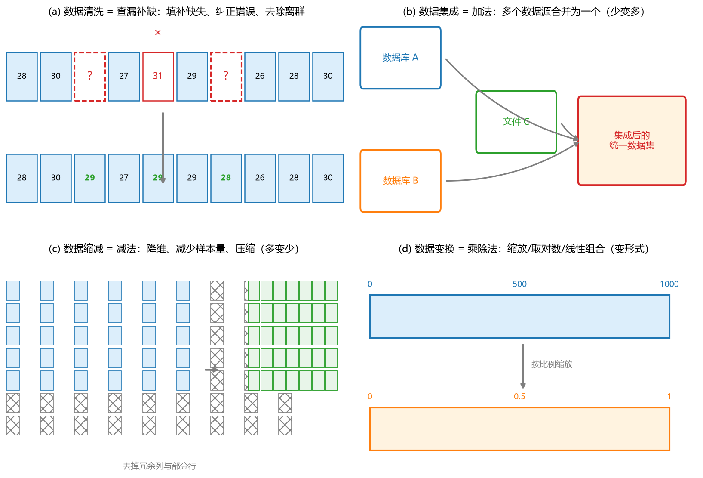

**图 3-1 数据预处理四大任务图例：清洗=查漏补缺，集成=加法，缩减=减法，变换=乘除法**

图 3-1 中还有一层引申：缩减与变换的边界并非泾渭分明。例如基于现有数据构造新特征，如果新特征的数目比原来少，既可视为一种变换（旧特征换成了新特征），也可视为一种缩减（用更少的变量代替了原来的变量）。四种任务是从"功能"上划分的，具体操作时常有交叉，叫法也可能不同，但绝大部分预处理工作都能归入这四类。

### 3.1.4 数据预处理的过程

把四个任务连起来，就得到数据预处理的一般过程：先清理，再集成，然后缩减，最后变换，得到满足要求的"干净数据"再送去建模；模型评估之后若效果不理想，还要回到数据这一头重新检查（图 3-2）。

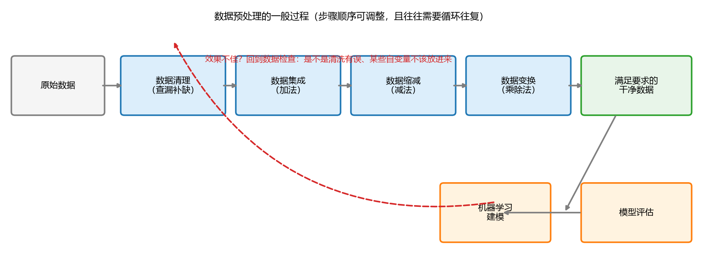

**图 3-2 数据预处理的一般过程（含建模评估的反馈回路）**

关于这个过程，有两个值得认真思考的问题。

**第一，四个任务按什么顺序完成？**图中画的是先清洗、再集成、再变换。就一般经验而言，清理放在前面的情况多一些——至少要先把错的、缺的数据补全；接下来由少变多做集成；再由多变少、达到合理规模做缩减；数据集基本定型、即将进入模型时做变换。但顺序并非教条：变换与缩减谁先谁后、甚至变换放在集成之前，都要看具体情况。读者在项目中应当有自己的判断，而不是机械照搬流程图。

**第二，这些步骤一次就能做完吗？**大概率不能，往往需要循环往复。预处理做完、模型构建并评估之后，常会发现结果达不到预期，这时就要回头看看是不是数据出了问题：是不是最初清洗的地方错了？是不是某些自变量根本就不该放进来？此外还有一层"研究现实"：有人发表的文章结果非常好，你复现时稍微变一点条件结果就不理想——那往往是因为作者在背后尝试了很多次，拿出来的只是最好的一次，其前期所做的数据工作远比论文里呈现的多。明白了这一点，也就明白了预处理为什么值得反复打磨。

## 3.2 数据清洗

### 3.2.1 需要清洗的三类数据

数据清洗要对付的，主要是三类问题。

**（1）不完整的数据**：缺少属性值、缺乏某些属性，或只包含总数据的一部分。例如某条风速记录的值为空白 `""`——属性在，个别值丢了。

**（2）含噪声与错误的数据**：物理量明显为正的却给出了负值，如降雨量 = −10 mm，一看就是错误；或者存在明显偏离期望的离群值。还有一种"错误"需要谨慎对待：数据与常识不符，未必真是数据错了。曾有同学对作业数据里"西藏平均工资为什么那么高"提出疑问，认为有误；查证之后发现确实高——连老师初看也觉得诧异。**与认知不一致时，先查证，再下结论**。

**（3）不一致的代码或名称**：同一数据点的多个属性之间对不上，如年龄 = 42 而生日 = 1997-03-07（2026 年时按生日应约 29 岁）；或者同一个等级，历史数据用 1、2、3 表示，新数据用 A、B、C 表示——两个 id 指同一等级，形式却不同。这类问题在进一步处理前需要统一。

### 3.2.2 缺失值的处理

缺失了怎么办？直观理解就是"想办法补上"，但具体策略分几种情形。

**（1）忽略该数据点。**特别适合"数据很多、缺失很少"的情形，干脆不要；在监督式学习中，若训练样本缺少类标签，通常也只能忽略。但要清醒地看到其局限：当某属性缺失值的比例非常大、而数据集本身又很小时，直接忽略会导致后续根本无法建模。

**（2）人工填写。**数据量不大时人工补录没有太大问题；数据量很大时工作量大到不现实，就需要编写程序自动填写。

**（3）自动填写。**对一个序列做补全，最常用的做法借鉴了插值思想：

- **相邻值填充**：昨天温度 25 ℃、前天 30 ℃、昨天缺测，则可用前天的 30 ℃或今天的 25 ℃来填；
- **相邻平均值填充**：取 30 与 25 的平均 27.5 ℃（图 3-3）；
- 也可以取多个邻居，如用前后共五天的数据来填——取几个、怎么取，取决于自己的偏好与该研究领域的惯例，多参考别人的文献即可。

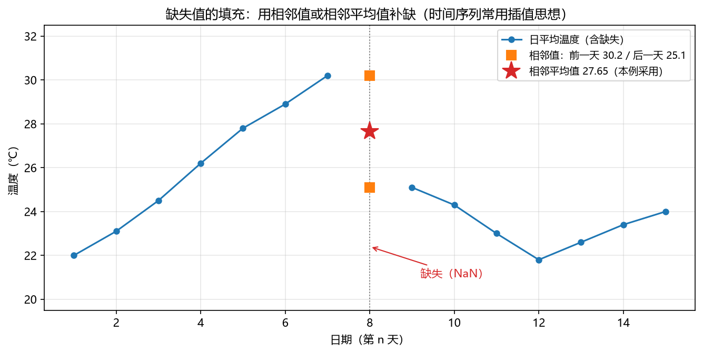

**图 3-3 缺失值的填充：用相邻值或相邻平均值补缺**

若不满足于这种"低级"的填法，想**猜测缺失位置最可能的值**来填，就要动用公式了。请想一想：猜测"昨天的温度最可能是什么"，本质上是什么问题？——正是我们在本书中反复面对的**预测问题**：因变量是连续的，就是回归问题；是类别型的，就是分类问题。所以可以训练一个预测模型（基于贝叶斯公式、决策树等推理）来填写缺失值，把"补缺"变成"预测"。可见预处理方法与建模方法之间并无鸿沟，前者随时可以把后者当作工具。

### 3.2.3 噪声数据与离群点的处理

对噪声数据，首先要**判断**哪些点可疑。简单而经典的做法是把该属性当作随机变量，画出**箱形图（盒须图）**观察其分布（图 3-4）：箱体上下边缘分别是上、下四分位数 Q3 与 Q1，箱内横线为中位数；从箱体向外延伸的"须"最长到 Q3 + 1.5×IQR 与 Q1 − 1.5×IQR（IQR = Q3 − Q1 为四分位距）；落在须以外的点即离群点。也可以按分位数把握，例如认为排序在后 10% 以前、前 90% 以后的数据是可疑的离群点。

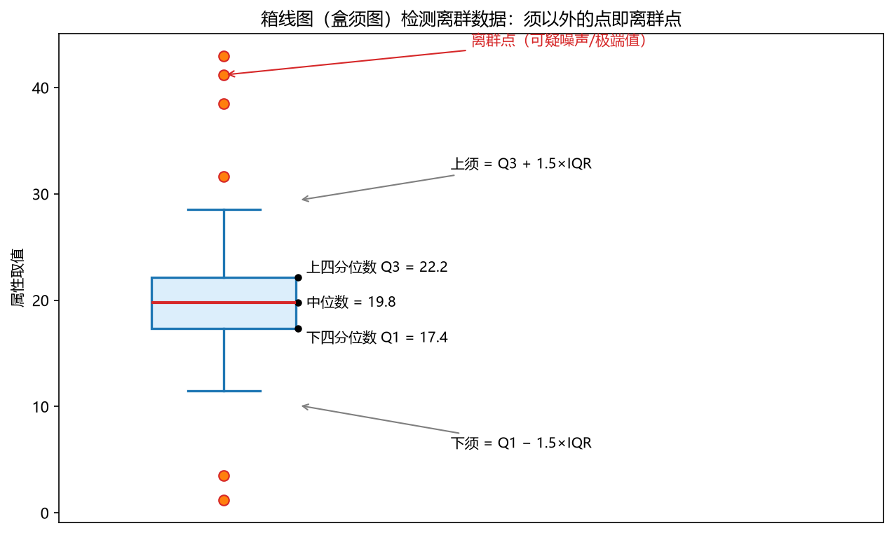

**图 3-4 箱线图（盒须图）检测离群数据**

判断出离群点之后**删不删，取决于研究问题**。如果所关心的就是中等范围的行为（例如排序在 10% 到 90% 之间的数据），删掉离群点可以让模型更关注主体规律。但如果研究的就是极端值——极端高温低温、最高最低水位、干旱、洪水——这些"离群点"恰恰是研究对象，轻易删除会毁掉整个研究。这一点在地学中尤其要牢记。

### 3.2.4 不一致数据的处理

处理不一致数据（如年龄与生日对不上）没有高深算法，思路是**"循环 + 属性关系判断"**：

- **计算推理**：对数据集里的数据点做循环，依次按特定属性之间的关系判断（如年龄是否等于当前年份减去出生年份），发现错误及时报错、画图让用户检验，或直接自动处理；
- **局部替换**：若有 20 年的数据、初步判断大概只有几年有问题，就把可疑的局部数据拿出来做一个**小循环**，在循环内完成数据替换；
- **全局替换**：比较保守的用户希望对所有数据都检查一遍，就做一个**大循环**。

规模可大可小，本质都是一个循环加上若干判断。这类工作琐碎但躲不开，编程熟练度直接决定它的痛苦程度。

## 3.3 数据集成

### 3.3.1 数据集成的三种形式

数据集成指将来自多个数据源的数据组合成一个连贯的数据源——由多个数据库变成一个数据库，由少变多。它通常有三种形式，见表 3-3。

**表 3-3 数据集成的三种形式**

| 形式 | 含义 | 举例/备注 |
|------|------|-----------|
| 模式集成 | 根据相同属性，整合来自不同来源的元数据（数据点/对象） | 具有相同 ID 的数据的不同属性进行合并 |
| 实体识别 | 识别来自多个数据源的同一真实世界的实体 | 中文名和英文名表达的是同一实体 |
| 数据冲突检测和解决 | 对同一个真实世界的实体，来自不同源的属性值可能冲突 | 可能的原因：不同的表述、不同的尺度，公制与英制单位不同，实际上是同一属性 |

三种形式一个比一个"隐蔽"。模式集成最简单：一个数据集里的 id 叫 Student，另一个叫别的名字，三个其实都指 id，发现后合并即可。实体识别更进一层：不仅名字不一样，**内容形式也不一样**——一个数据集的"名字"列存中文，另一个"Name"列存英文，它们仍是同一属性，需要建模者通过主观判断识别出来。数据冲突则发生在属性值层面：测水位用了两种仪器，国内仪器与国外仪器默认单位不同；测身高一个用米、一个用英制，数值对不上，指的却是同一物理量。这类冲突同样要靠建模者把它们逐一找出来、统一之后才能用。

### 3.3.2 冗余的检测与处理

把多个数据库集成起来之后，经常会发生**数据冗余**。一方面是对象层面的：相同的属性或对象可能在不同的数据库中拥有不同的名字（object identification 问题）；另一方面是派生数据：一个属性可能是从另一个表中的属性"派生"出来的（derivable data）。同一数据对象在不同表中拥有不同属性，合并时便可能重复带入。

如何发现冗余属性？做**相关性分析**：

- 两个属性都是**连续变量**（浮点数）时，用**相关分析或协方差分析**。看 $X_i$ 与 $X_j$ 之间的相关系数，若相关性非常大（图 3-5(a)），说明两个变量携带的信息高度重叠，通常只保留其中一个就足够了——这既是一种集成阶段的清洗，也正是第 5 章将要展开讲的"相关性分析降维"的雏形；
- 两个属性都是**离散变量**（整数、类别）时，相关分析效果不好，应改用**卡方检验**来检验两个离散变量之间的相关性，其计算也非常简单。

如果一列是浮点数、一列是整数，该怎么检验？这留给读者自己查阅。发现了冗余，处理办法很朴素：将来自多个数据源的冗余属性**用其一代替**即可。

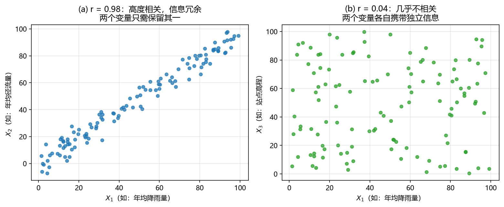

**图 3-5 冗余属性的判定：相关系数大说明信息重叠，只留其一即可**

从研究设计的角度看还有一个自然的问题：要分析影响降雨或水位的因素，把候选因素都收集进来之后，常会发现某些 $X_i$ 与 $X_j$ 对 Y 的作用非常类似——本质上是它们彼此相关性很大。这时同样可以先做相关分析，把"差不多"的自变量去掉，只留一个代表。第 6 章讲多元线性回归时，我们还会回到"先挑自变量、再做回归"这条实用原则。

## 3.4 数据缩减

### 3.4.1 为什么要缩减

数据缩减（也称归约）有三个动机：

1. **降低时间复杂度**。数据仓库可以存储 TB 级的数据，在一个完整数据集上运行复杂的分析可能需要很长时间；数据太多、模型算得太慢，就需要缩减。此外，自己调试模型的初期往往拿不准性能，先缩减数据、缩短运行时间，是熟悉模型的好策略。
2. **降低空间复杂度**。过多数据会造成信息收集困难、模型复杂程度增高，存储模型的代价也随数据规模上升。
3. **收集成本的现实约束**。"把天下的数据都收进来再做模型"听起来稳妥，实则意味着高昂的收集成本与人力物力投入，多数情况下并不现实。比较可行的策略是：由少到多收集，再由多到少精简，最终得到一个**最适合解决当前问题的有限规模数据集**。

缩减的形式有三种：**降维**（减少属性/特征）、**减少样本量**（减少数据对象/行）、**数据压缩**（重新编码）。下面分别看。

### 3.4.2 降维

降维的常见原因有：数据稀疏、维数高；采用基于规则的分类方法而属性过多；使用浅层模型但训练集属性较多、样本较少——以及一个非常实际的动机：**可视化**。二维可视化最清楚，三维加上颜色已经相当复杂，若能先把维数降到二三维（或稍多几维），进一步画图分析就方便得多。

降维有两条经典思路，都将在第 5 章详细展开，这里先建立直观印象：

- **直接扔掉相似的**：先考察这些 X 之间有没有相似的——相关性很大、距离很近的就认为"差不多"，把彼此非常相关的变量只留一个，其余扔掉。这是最经典、最容易实施的做法，也正是 3.3.2 节的相关分析。
- **构造新变量代替旧变量**：X 之间并不相似、但数目仍然太多时，可以构造一批更少的新变量 $Z_1, \dots, Z_m$（m < n）来代替原来的 $X_1, \dots, X_n$。有两种代表性做法：**主成分分析**把原来的 X "往后看"，用 X 的线性组合构造主成分，等价于坐标旋转、求解椭球体主轴的问题；**因子分析**把 X "往前看"，寻找是哪些背后的因子通过线性组合生成了眼前的这些 X。一个往后看组合、一个往前看溯源，得到的变量数目都比原来少，用它们再建模，就达到了降维的目的。

### 3.4.3 减少样本量：抽样

最直接的减行办法是**扔掉不想要的数据行**：有些年份的数据不完整，就扔掉那些年份，把重点放在连贯的时间段上。更讲究一点的办法是**抽样**：数据成千上万太多时，从中抽取一部分来建模。这就要求抽出来的样本**有较好的代表性**。常见的抽样方式有三种（图 3-6）：

- **简单随机抽样（simple random sampling）**：以相等的概率选择每个对象；
- **不放回抽样（sampling without replacement）**：对象一旦被选中即被移除，不会重复出现；
- **有放回抽样（sampling with replacement）**：被选中的对象不放回，同一个对象可能再次（甚至多次）被抽中；
- **分层抽样（stratified sampling）**：先把数据按某种规则分层，每层抽取相同个数。对偏斜数据尤为适用——可以先把数据排序、每隔若干抽一个，或者先估计数据分布、再从特定范围内各取若干，保证各部分在样本中都有代表。

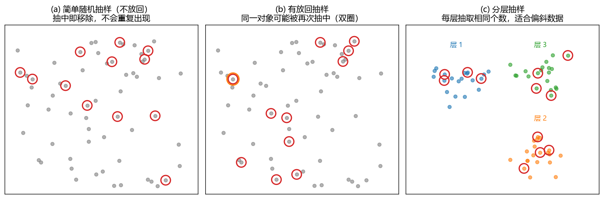

**图 3-6 三种常见抽样方式示意**

### 3.4.4 数据压缩

缩减还有一种特殊形式：**数据重新编码**。大家平时在电脑上压缩大文件，体积变小了，但使用时还得先解压才能得到原始数据——这是大家最熟悉的一种"压缩"。另一种更有意思的做法来自一个真实的观察：有人发现某数据集存储时按浮点数（16 或 32 位）保存，仔细观察后发觉其中绝大部分数值其实是整数，于是改成 8 位整数直接表示，数据体积一下缩到原来的二分之一到四分之一。这种编码式压缩需要对数据本身做细致的观察与了解，发现其特征后才能实施——又是一个"先看数据、再动手"的例子。

## 3.5 数据变换

清洗、集成、缩减都做完，数据规模、错误都处理妥当之后，还要把数据**转换成适合挖掘的形式**，这就是数据变换。典型的处理方法有三类：**规范化**（按比例缩放到一个具体区间，一般 0 到 1 之间）、**离散化**（连续型数据离散成类别）、**特征构造**（旧特征换成新特征）。

### 3.5.1 规范化

规范化的动因是**属性数量级对模型的影响**：计算距离、计算梯度时，若各 X 的数量级差别很大，数量级大的变量会主导这些计算。其定义是一种**函数映射**：给定的属性值更换一种新的表示，每个旧值与新的值一一对应、可以被识别，而新值落在一个合理的范围内。常用方法有三种。

**（1）最小-最大规范化。**公式为

$$v' = \frac{v - \min}{\max - \min} \times (\textit{new}_{\max} - \textit{new}_{\min}) + \textit{new}_{\min} \tag{3-1}$$

其中 min、max 为原属性的最小、最大值，new_min、new_max 为目标区间的端点。这个公式为什么会是这个样子？可以这样理解：把原来的 X 从小到大排序，变换后的新变量也从小到大排序，希望映射之后**两边保持同样的比例关系**——像把两条排好序的数据"对齐"，等比例的关系式（3-1）自然就出来了。若目标区间是 [0, 1]，则 new_min = 0、new_max = 1，公式退化为最简的 $(v-\min)/(\max-\min)$，这也是它最常用的形式。

**（2）Z 得分规范化（标准化）。**公式为

$$v' = \frac{v - \bar{v}}{\sigma_v} \tag{3-2}$$

即原值减去均值、除以标准差。读者在学正态分布时见过它——把一个随机变量化成标准随机变量（标准化）用的正是这个变换，两者一脉相承。

**（3）小数定标规范化。**公式为

$$v' = \frac{v}{10^{j}} \tag{3-3}$$

其中 j 是使 $\max|v'| < 1$ 成立的最小整数。用大白话说：看看数据的数量级在什么范围，除以对应的 10 的幂次就行。比如一列数据都在 8000 到 10000 之间，全都除以 $10^{4}$，就变成了 0.8 到 1.0 之间——观察一下数据，直接做除法，是最简单的一种变换。

式（3-1）～式（3-3）三种方法的效果对比见图 3-7：对同一份右偏的"降雨量"数据，最小-最大规范化把它压入 [0, 1]，Z 得分规范化把它变成均值 0、标准差 1 的形态，小数定标只是移动小数点。三者形状不变、尺度不同，按后续算法的需要选用即可。

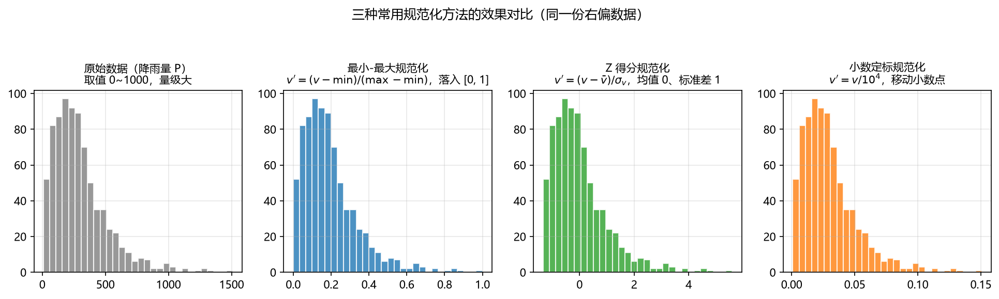

**图 3-7 三种常用规范化方法的效果对比（同一份右偏数据）**

**公式里藏着的问题。**式（3-1）与式（3-2）看上去简单完美，实际使用却有隐患：min、max（以及均值、标准差）都是**从手头这批历史数据估计出来的**，而现实问题中常常不断有新数据进来。举个具体例子：原来数据都在 1 到 100 之间，按 min = 1、max = 100 建立了到 [0, 1] 的映射；某天新来了一个 110，代入公式得到 1.09——跑出了 [0, 1]；更糟的是新来一个 0.2，$0.2 - 1 < 0$，变换结果成了负数，一些要求输入非负的算法立刻报错（图 3-8(a)）。Z 得分规范化同理：若变量的分布发生了变化，均值和标准差都会变。

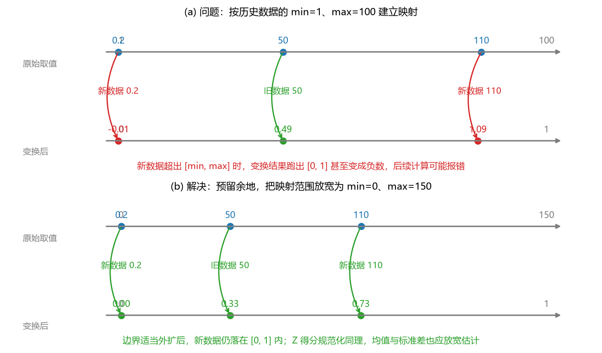

**图 3-8 规范化的越界问题与"预留余地"的解决办法**

**怎么解决？**思路朴素得很：既然原来的范围不够大，那就**把 min/max 扩大一点，留有余地**——min 取得更小一点、max 取得更大一点，再建立映射，新来的数据基本都能保证落在 [0, 1] 之内（图 3-8(b)）。Z 得分的均值与标准差同样可以把数据范围考虑得"更远一点"来估计。这一点在变化环境下尤其值得注意：自然地理问题中，一次火山爆发、一次甲烷云喷发都可能让气候环流完全改变，变量的取值范围与分布随之改变，原分布的均值、标准差便不再可靠——预留余地，是应对非平稳性最朴素的一道保险。

### 3.5.2 离散化

有些机器学习算法为了便于计算，要求输入是**类别型数据**；这就需要把连续型数据（浮点数）转化成离散的类别（整数），称为离散化。经典方法有三种，它们都**不使用 Y**（非监督离散化）：

- **等宽法**：根据属性的值域来划分，使每个区间的宽度相等。把一列 X 排序后放到一维数轴上，把轴分成若干等长的区间，落在同一区间里的数用同一个值（如区间中点或编号）表示（图 3-9(a)）。缺点是各区间的样本数可能悬殊——右偏数据在右端会很稀疏。
- **等频法**：根据取值出现的频数来划分，将值域分成若干小区间，要求落在每个区间的样本数目相等。例如 1000 个数分成五份，排序后第 1~200 个为第一类、201~400 为第二类……依此类推（图 3-9(b)）。区间宽度不再相等，但每类的样本量一样多。
- **聚类**：利用聚类把数据划分到不同的离散类别，聚成五类就用 1~5 表示每个数所属的类别。聚类的具体方法见第 4 章。

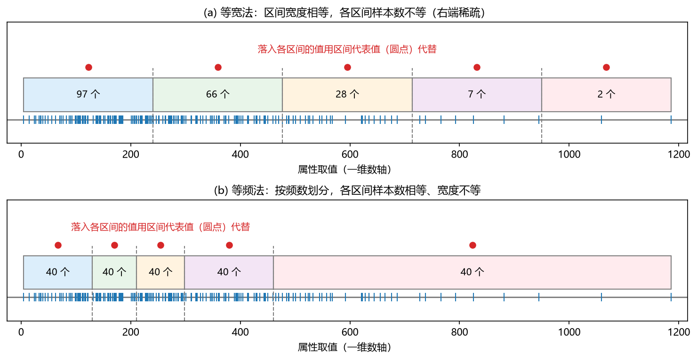

**图 3-9 等宽法与等频法离散化对比**

等宽、等频、聚类都只看 X 自身，属于非监督离散化；现实应用中还有借助 Y 的信息来划分类别的**有监督离散化**，有兴趣的读者可以自行查阅。

### 3.5.3 特征构造

第三类变换是**特征构造**：基于现有数据构造新的特征，用新特征代替旧特征。什么时候需要？当数据质量不高、特征信息不明显时，需要构造更有表达力的新特征；当数据中既有连续变量又有离散变量、想统一到一起时，需要做**哑编码**（dummy coding）——比如把类别型变量化成 0/1 指示变量。常见手法如下。

**（1）单调变换。**最典型的是对数变换、指数变换。地学中一个漂亮的例子：河流流量 Q 常随水深 x 近似呈三次方增长（$Q \propto x^{3}$），直接画 Q 与 x 是急剧上翘的曲线；两边取对数后，$\lg Q = \text{常数} + 3\lg x$，对数之间变成了漂亮的线性关系（图 3-10），指数式的巨变幅被"压"成了好处理的直线。反过来需要时也可以做指数变换。

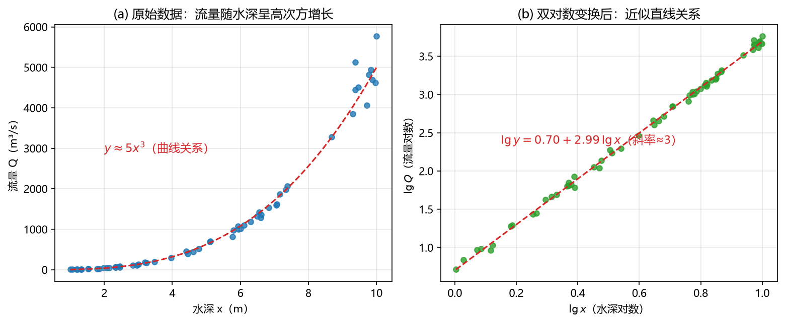

**图 3-10 对数变换化曲线为直线：流量-水深关系**

**（2）比例特征。**有时起作用的不是 $X_1$、$X_2$ 各自的大小，而是它们的比值 $X_1 / X_2$；把比值作为新的自变量，就是比例特征。

**（3）线性组合。**构造 $Z = a_1 X_1 + a_2 X_2$ 来代替原来的两个变量。别小看这个看似简单的加权求和：卷积神经网络里的卷积，本质上就是一种强化版的加权操作——把多个自变量通过加权、加和，变成一个更能代表原信息的**新特征**；还可以在加权的基础上再加权，这正是神经网络要做"深"的道理所在。

**（4）时间数据类型：季节与星期。**这是人文地理中常用的一招。例如预测某地铁口共享单车的借还数量：借车量显然受"工作日还是休息日"影响，若只把原始时间戳作为变量，这层信息没有表达出来；不如把时间转换成"星期几"（甚至进一步区分周一至周五、周六周日，把节假日也考虑进来）和"季节"（冬天寒冷骑行少，春夏秋适宜骑行）——把这样的时间因素构造进模型，预测质量会明显提高（图 3-11）。这些变换没有固定公式，需要结合专业知识、针对具体问题设计，并多参考文献中的做法。

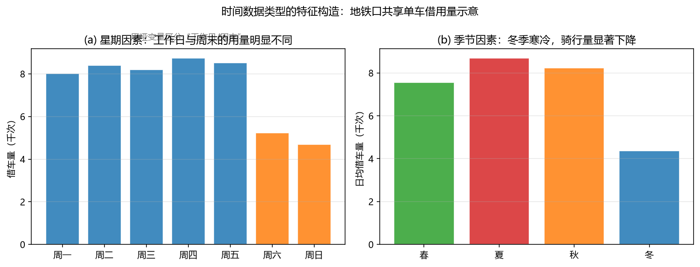

**图 3-11 时间数据类型的特征构造：地铁口共享单车借用量示意**

**（5）时间序列当作信号。**更复杂的一种变换，是把序列直接当成信号来处理——电子工程专业正是这样做的，信号处理的方法库非常丰富：小波分析、傅里叶分析等等。把数据当信号，可以用这些方法把它变换成另外的信号：变成更平滑的信号、分解成若干子信号，再拿子信号或平滑信号去建模，往往比拿原始信号直接算效果好很多。这是特征构造里内容最深的一支，有兴趣的读者可以深入研究。

数据预处理的内容到这里就介绍完了。这部分知识本身不难，有一定编程能力的读者稍加钻研都能处理好；**最重要的是从思想上重视预处理**——很多时候算法跑完、结果不好，回头一看，是数据本身没有处理好。预处理做好了，能把不好的结果变好、把好的结果变得更好。

## 3.6 图形画法及举例

### 3.6.1 为什么要学画图

图形画法与数据预处理放在一起讲，是有道理的。**拿到数据、不了解它时，往往无从下手**——最直接的办法就是把数据画成特定的图形，看看它们在最自然状态下是什么状况，然后再决定怎么做预处理。建模算完之后，要把模型的结果与实际观测值进行比较、验证，又需要画图。到最后写报告、发论文，画图更是一项关键功夫：**图画得好，很大程度上能提高论文和报告的档次**。可视化是一个非常广阔的题目，本节只能举例引导，更系统的内容有专门的研究生课程展开。

画图语言因人而异：MATLAB、Python、R 都能画得很好，最好是几种语言都了解、能为一种画法找到最精简的表达；若觉得掌握多种语言有困难，就先把一种用熟。本节先讲 MATLAB（课程演示以它为主），再简要介绍 Python。

### 3.6.2 MATLAB 基本二维绘图

MATLAB 的大部分基本绘图命令都集成在主程序里，**不需要另装工具箱**。最基本的二维绘图：用 `plot` 画出曲线或散点，用 `axis` 控制坐标轴范围，`grid on` 打开背景网格，`title`、`xlabel`、`ylabel` 标注图名与坐标轴，`legend` 加图例，`text` 在指定坐标处写文字；一张图太死板，就 `figure`/`subplot` 画多图，`plotyy` 画双坐标轴图，`hold on` 把多个序列叠画在同一坐标系里（重叠图）。这些命令汇总见表 3-4，效果示例见图 3-12。

**表 3-4 MATLAB 基本二维曲线绘图命令**

| 命令 | 图形/作用 | 备注 |
|------|-----------|------|
| `plot(t,y,str)` | 二维曲线图 | 散点图、曲线图 |
| `axis([xmin xmax ymin ymax])` | 坐标轴范围 | 控制画图区域 |
| `grid on`；`grid off` | 背景网格 | 便于位置对比 |
| `title('string')` | 图名标注 | 图上方写图名 |
| `xlabel('str')`；`ylabel('str')` | 坐标轴标注 | 横、纵坐标标注 |
| `legend('str1','str2',...)` | 图例标注 | 为不同图形添加图例 |
| `text(x,y,'string')` | 文字标注 | 在坐标 (x, y) 处写文字 |
| `figure`；`subplot(m,n,p)` | 多图 | 新开图窗；多个子图 |
| `plotyy(t1,y1,t2,y2)` | 双坐标轴图 | 两套量纲不同的序列 |
| `hold on`；`hold off` | 重叠图 | 经常使用 |

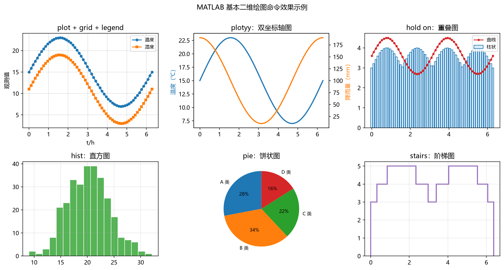

**图 3-12 MATLAB 基本二维绘图命令效果示例**

### 3.6.3 其他常用二维图

在基本图之外，MATLAB 还提供了一大批稍高级的二维图（表 3-5）：变量都取对数的对数图 `loglog`、只对一轴取对数的半对数图 `semilogx`/`semilogy`（做了对数变换后，指数关系会变成直线，正呼应 3.5.3 节的内容）；类似柱状图的阶梯图 `stairs`、火柴杆图 `stem`；表达百分比的填充绘图 `area`、饼状图 `pie`；描述统计特征的直方图 `hist`；排列图（Pareto 图）`pareto`；误差限图 `errorbar`；多维比较用的极坐标图 `polar`、罗盘图 `compass`；羽状图 `feather`、彗星状图 `comet`、稀疏模式图 `spy` 等。这些图用 Excel 也能画出不少，愿意精细调整都能画得好看。

**表 3-5 MATLAB 其他常用二维绘图命令**

| 命令 | 图形 | 备注 |
|------|------|------|
| `loglog(x1,y1,...)` | 对数图 | 两个轴都是对数 |
| `semilogx(y)`；`semilogy(...)` | 半对数图 | 只对一个轴取对数 |
| `stairs(x,y)` | 阶梯图 | 类似柱状图 |
| `area(x,y)` | 填充绘图 | 表达百分比 |
| `pie(x)` | 饼状图 | 随时间变化的百分比 |
| `feather(u,v)` | 羽状图 | — |
| `comet` | 彗星状图 | — |
| `bar(x,y)`，`barh(...)` | 二维条形图 | 柱状图 |
| `hist(y,x)` | 直方图 | 描述统计特征 |
| `pareto(y,x)` | Pareto 图 | 排列图 |
| `errorbar(x,y,l,u)` | 误差限图 | — |
| `stem(x,y)` | 火柴杆图 | 类似柱状图 |
| `polar(theta,rho)` | 极坐标图 | 多维比较图 |
| `compass(u,v)` | 罗盘图 | — |
| `spy(s)` | 稀疏模式图 | — |

### 3.6.4 三维绘图

很多二维图可以直接扩展为三维（图 3-13、表 3-6）：`plot3` 画三维曲线；`mesh` 画曲面的网格图，配合网格生成函数 `meshgrid` 使用；`surf` 画着色表面图，参数含义同 `mesh`；`sphere` 画单位球面；`colormap` 指定图形着色方案，可挑选夏季、冬季、秋季等不同色系让颜色更协调。知道有这些画法很重要，用到时查帮助或搜索即可，都能方便地找到案例。

**表 3-6 MATLAB 常用三维绘图命令**

| 命令 | 图形 | 备注 |
|------|------|------|
| `plot3(x,y,z)` | 三维曲线 | 类似于二维曲线 |
| `mesh(X,Y,Z)` | 曲面的网格图 | 由矩阵 X、Y、Z 确定的曲面网格 |
| `[X,Y]=meshgrid(x,y)` | 网格生成函数 | 配合 mesh 使用 |
| `surf(X,Y,Z)` | 着色表面图 | 参数含义同 mesh |
| `sphere(n)` | 单位球面 | n 代表网格的多少 |
| `colormap(s)` | 图形着色方案 | s 为字符串，表示所采用的色系 |

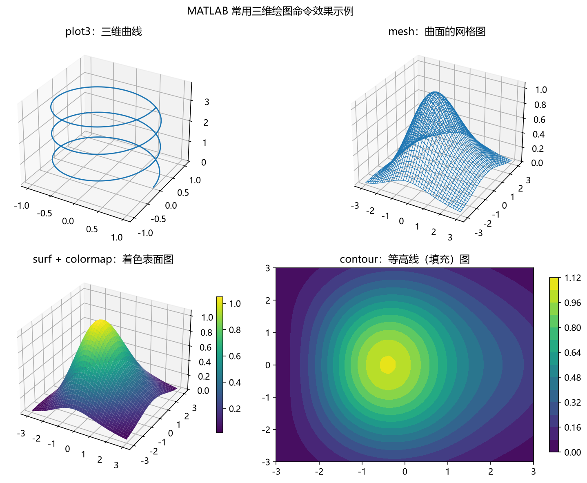

**图 3-13 MATLAB 常用三维绘图命令效果示例**

### 3.6.5 提高图形档次的技巧

上面的都是"基本款"。想把图画出档次，可以从下面这些方向努力。

**（1）善用速查表。**有人把 MATLAB 各类基本图形及其对应命令浓缩在一张 A4 纸上，做成了"速查表"（cheat sheet）——这个词源自国外考试中把要抄的东西尽可能浓缩到一张纸上的"作弊小抄"，后来引申为高浓缩版的参考卡。想画哪种图，在速查表上找到对应命令，再稍查用法就能画出来，非常方便（见延伸阅读 1）。

**（2）让散点图"升维"。**普通散点图把点画成一种颜色；若把点的颜色做成**渐变色**（按第三个变量着色），二维图就叠加了三维信息。进一步，还可在散点图两侧加上**边缘直方图/投影直方图**，看每个坐标轴上的分布；或画**散点密度图**（二维核密度），点的疏密一目了然。能画到这个程度，画图能力已经超过大多数人了。

**（3）相关系数矩阵图。**做数据分析经常要算两两变量之间的相关系数——比如有 8 个 X，要看 8×8 的相关矩阵。直接看数字很累，画成矩阵图：每个格子的数值配上颜色（表示 −1 到 1 中的位置），一眼看出谁与谁相关（图 3-14）；更讲究的版本把每个格子画成扇形，再配上颜色，观感更好。这类图在高档次论文里很常见。

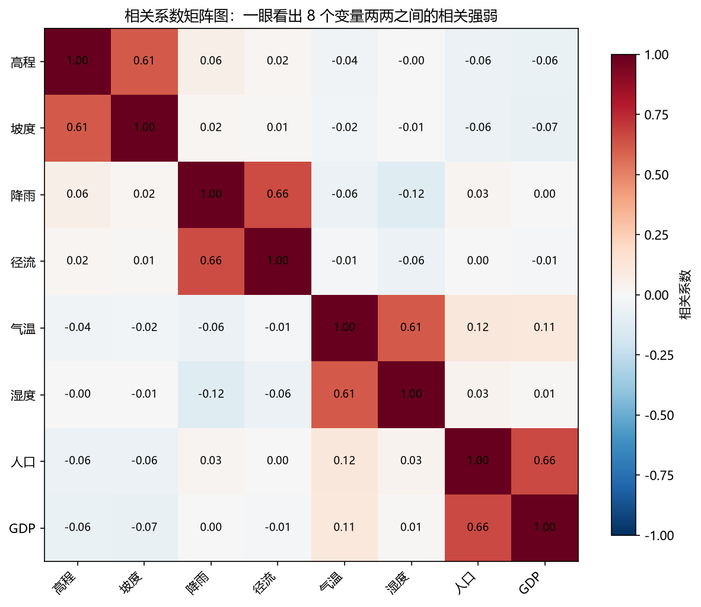

**图 3-14 相关系数矩阵图示例**

**（4）填充与置信区间。**一个普通的线性拟合，加上两条置信区间线，再把区间**填充上半透明的颜色**，图的档次立刻就上来了（图 3-15）。普通图与高档图之间，往往就差在背景色、填充色这些细节上。

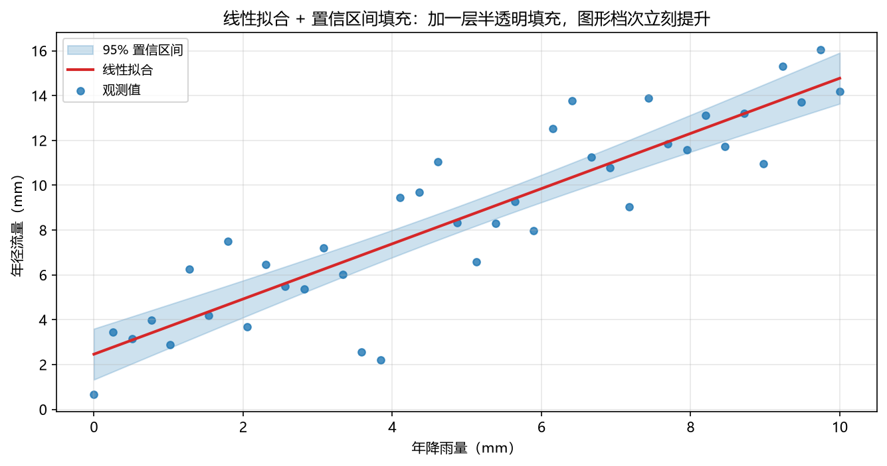

**图 3-15 线性拟合与置信区间填充示例**

**（5）极坐标堆叠柱状图（玫瑰图）。**在极坐标上画堆叠柱状图——每个方向上叠几根不同颜色的柱子，扩展成"玫瑰图"，很适合比较多属性的两个对象。这类图做出来也非常漂亮。

**（6）截断坐标轴。**两条曲线的取值范围间隔着一大段空白（例如纵轴 15 到 45 之间没有数据）时，可以把坐标轴"截断"——把空白段的长度压缩，让两条波形靠得更近便于比较。这是很实用的小技巧。

**（7）借鉴 ggplot2 风格。**R 语言有个著名的绘图包 ggplot2，画出的图特别漂亮，于是有人把这种风格移植到 MATLAB——先是有人手工模仿（背景色、点线配色、整体布局都比普通图讲究），后来干脆有了专门的工具箱 **gramm**（见延伸阅读 3），用它画出的图与 ggplot2 相差无几。ggplot2 风格图最大的特点就是配色、背景与布局一下拉开了档次。

**（8）配色。**网上曾有不少批评说"MATLAB 画的图很土"，主要就土在颜色。后来有人专门调整了配色，新版本 MATLAB 的默认颜色也不再是高饱和纯色，而是加了灰调的偏灰、偏绿的柔和色系，整体观感提升明显。自己画图时，配色值得单独花心思（见延伸阅读 4）。

### 3.6.6 基于地图的绘图

做地理数据的研究，最终几乎都要落到地图上。以 MATLAB 为例：可以读取 shp（shape）文件绘制中国地图，再在地图上叠加各种图形——

- **地图 + 散点图**：把站点位置直接标在地图上；
- **地图 + 泡泡图**：研究地理关系时，每个国家/站点对应一个数值，按数值大小画成半径不同的"泡泡"，再用不同颜色区分量级；泡泡圈还可以换成三角形、空心符号等其他形状；
- **地图 + 填色/插值图**：如青藏高原上某变量的空间分布，用连续颜色表达数值强弱；气象上常见的等值线图、Colorbar，以及区域降水插值图，都是"地图 + 插值"的组合；
- **世界地图上的站点与路径图**：把研究站点标在世界地图上，把点与点之间的路径关系画出来，做全球研究时这类图档次很高。

课件随堂提供了 `map1.m`、`map2.m`、`map3.m` 三个基于地图的散点图示例脚本，从中国地图叠加散点，到叠加不同大小、不同颜色的泡泡图，再到空心三角形符号的版本，读者可以直接运行、修改（这三个脚本依赖 shp 边界数据，请从课程课件获取）。另外推荐一个知乎专栏《基于 MATLAB 的地理数据处理》，作者是中山大学自然地理专业的本科毕业生，写了一组常用地理绘图与数据处理的教程（见延伸阅读 5）。

### 3.6.7 Python 绘图

Python 的绘图生态同样庞大——网上能数出 20 多个绘图库。最常用的几个见表 3-7。

**表 3-7 Python 常用绘图包**

| 包 | 功能 | 备注 |
|----|------|------|
| `matplotlib` | 二维绘图库：点线、散点、样式、坐标系、等高线、热力图、饼图、分图显示，以及 3D 曲面等 | 模仿 MATLAB 绘图 |
| `seaborn` | 制作有吸引力且信息丰富的统计图形 | 封装了 matplotlib |
| `pandas` | 最初作为金融数据分析工具开发，为时间序列分析提供很好的支持；名称来自面板数据（panel data）与 Python 数据分析（data analysis） | 封装了 matplotlib 的画图与 numpy 的计算 |
| `pandas_profiling` | 生成具有可视化功能的统计分析报告，快速了解数据 | — |
| `plotly` | 基于 plotly.js 的交互式网络可视化 | — |
| `missingno` | 基于 matplotlib 快速直观地总结数据集的完整性 | 特别适合查看缺失情况 |
| `ggplot` | 基于 R 的绘图系统 | ggplot2 的模仿 |

除表列之外还有 altair、bokeh、mayavi、PyQtGraph、VisPy、pyecharts 等各具特色的库，不再一一展开。最有心的读者甚至可以自己编一个包分享给大家。

用 Python 画地理数据也有成熟的方案。气象绘图与地理数据几乎同源：折线、散点、柱状图自不必说，还有等值线与 Colorbar 的添加、多样 Colorbar、三维地图、底图添加、白化（裁剪）、地理桑基图、子图坐标系等一整套技法（见延伸阅读 6"气象绘图加强版"）。其中 **Cartopy** 是气象领域 Python 制图的必学库，专门负责地图投影与地理要素（见延伸阅读 7）。世界地图叠加插值、地图上的散点与泡泡、极坐标投影的全球图，这些在 MATLAB 里能画的，Python 里同样都能画出来。

## 3.7 案例研究：一份随机表格数据的预处理与可视化

本章的练习把全部内容串成一条流水线：自己生成一份随机表格数据，人为把它"污染"，再依次做清洗、集成、缩减、变换与可视化。下面的 MATLAB 代码即该练习的完整实现（归档于本章配套代码 `exp03_preprocess_demo.m`）。

### 3.7.1 数据生成与污染

生成两个数据集：Data1 为 100×1 的站点编号 S1（1 到 10000 的整数、不重复）；Data2 为 100×4，第一列是站点编号 S2——与 S1 范围相同、但重新随机生成，因此与 S1 存在差异；其余三列是温度 T（−10 到 45 ℃）、降雨 P（0 到 1000 mm）和虚拟变量 Y = 10T + P。

```matlab
%% 1. 数据生成
clear; clc; rng(42);                         % 固定随机种子，结果可复现
Data1 = randperm(10000, 100)';               % 站点 S1：100×1，1~10000 不重复整数

idx  = randperm(100);                        % S2：60 个编号取自 S1（打乱顺序），
pool = setdiff(1:10000, Data1);              % 另 40 个为不与 S1 重叠的新编号，
S2   = [Data1(idx(1:60)); pool(randperm(numel(pool), 40))];   % 模拟“范围相同、
                                                              % 重新生成、存在差异”
T = -10 + 55*rand(100,1);                    % 温度 T ∈ (-10, 45) ℃
P = 1000*rand(100,1);                        % 降雨 P ∈ (0, 1000) mm
Y = 10*T + P;                                % 虚拟变量 Y = 10T + P
Data2 = [S2, T, P, Y];                       % 100×4
```

这里对练习设定做了一点实用化调整：若 S2 完全独立地在 1~10000 里随机生成，两个各 100 个编号的数据集期望只有约 1 个共同站点，后续"按共同站点合并"就无从做起。因此让 S2 的 100 个编号中 60 个取自 S1、40 个为新编号，既保留了"范围相同、重新随机生成、存在差异"的题设，又保证集成结果有可观的规模。

接下来人为制造污染：把 Data2 的 T 列 20 行、P 列 40 行、Y 列 60 行分别置为 NaN（not a number，非数）。

```matlab
%% 2. 数据污染
Data2(randperm(100,20), 2) = NaN;            % T 列 20 行置为 NaN
Data2(randperm(100,40), 3) = NaN;            % P 列 40 行置为 NaN
Data2(randperm(100,60), 4) = NaN;            % Y 列 60 行置为 NaN
```

### 3.7.2 数据清洗：定位空缺并填充

清洗的第一个动作一定是**先定位**——找到哪些位置缺了，再谈填充。T、P 两列按 3.2.2 节的"相邻值（前后均值）"填充；Y 列不用填，清洗完 T、P 后按公式重新计算即可。

```matlab
%% 3. 数据清洗
Data2(:,2) = fill_adjacent(Data2(:,2));      % T 列：相邻值（前后均值）填充
Data2(:,3) = fill_adjacent(Data2(:,3));      % P 列：相邻值填充
Data2(:,4) = 10*Data2(:,2) + Data2(:,3);     % Y 列：按公式重新计算
```

`fill_adjacent` 是一个"循环 + 判断"的小函数：对每个缺失位置，向左、向右分别找最近的非缺失值，取二者均值；缺失落在序列两端时退化为单侧取值。它的写法正是 3.2.4 节处理不一致数据时"循环 + 属性关系判断"的同款思路。

```matlab
function v = fill_adjacent(col)
% 用相邻的非缺失值（前后均值）填充缺失值
v = col;  n = numel(v);
for k = find(isnan(v))'
    lo = k;  while lo > 1 && isnan(v(lo)),  lo = lo - 1;  end   % 向左找非缺失
    hi = k;  while hi < n && isnan(v(hi)),  hi = hi + 1;  end   % 向右找非缺失
    if isnan(v(lo))
        v(k) = v(hi);                       % 左端缺失，用右邻
    elseif hi > n || isnan(v(hi))
        v(k) = v(lo);                       % 右端缺失，用左邻
    else
        v(k) = (v(lo) + v(hi)) / 2;         % 前后均值
    end
end
end
```

### 3.7.3 数据集成：按共同站点合并

Data1 与 Data2 都有站点编号这一列，它是两个数据集的**公共属性**；编号相同即代表同一站点。用 `intersect` 取出双方共有的站点，把 Data2 的其余三列带过来，合成 Data3——这就是表 3-3 中"模式集成"的标准操作。

```matlab
%% 4. 数据集成
[S3, ~, ib] = intersect(Data1, Data2(:,1)); % 共同站点（约 60 个）
Data3 = [S3, Data2(ib, 2:4)];               % 合并成 Data3：n×4（S、T、P、Y）
```

### 3.7.4 数据缩减：相关分析与抽样

对集成后的 Data3 做两件事：一是计算 T 列、P 列分别与 Y 列的相关系数，考察两个自变量与因变量的关系强弱（3.3.2 节的相关分析在此派上用场）；二是嫌样本太大，做**有放回抽样**抽出 40 个样本形成 Data4（3.4.3 节）。

```matlab
%% 5. 数据缩减
rT = corrcoef(Data3(:,2), Data3(:,4));  rT = rT(1,2);   % T 与 Y 的相关系数
rP = corrcoef(Data3(:,3), Data3(:,4));  rP = rP(1,2);   % P 与 Y 的相关系数
fprintf('r(T,Y) = %.3f,  r(P,Y) = %.3f\n', rT, rP);

idx4  = randi(size(Data3,1), 40, 1);        % 有放回抽样 40 个样本
Data4 = Data3(idx4, :);                     % 同一对象可能被重复抽中
```

运行后大致会得到 r(T,Y) ≈ 0.5、r(P,Y) ≈ 0.85（以实际输出为准）。道理不难解释：Y = 10T + P 中，T ∈ (−10, 45) 贡献的变动范围是 200，而 P ∈ (0, 1000) 贡献了 1000——P 的方差份额大得多，与 Y 的相关自然更强。两个自变量都与 Y 正相关、但强弱有别，这正是相关分析要告诉我们的事。

### 3.7.5 数据变换：按列最小-最大规范化

最后把 Data3 的 T、P、Y 三列按式（3-1）做最小-最大规范化，转换到 [0, 1]，得到 Data5。**特别要注意：min、max 是对本列计算的**——T 列用 T 列自己的最小最大值变换，P 列用 P 列的，两列的最小最大值并不相同，绝不能拿一列的 min/max 去变换另一列。

```matlab
%% 6. 数据变换
Data5 = Data3;
for j = 2:4                                 % 逐列做最小-最大规范化
    lo = min(Data3(:,j));  hi = max(Data3(:,j));
    Data5(:,j) = (Data3(:,j) - lo) / (hi - lo);
end
```

### 3.7.6 可视化

按练习要求画三组图：Data3 与 Data4 四列的分布图（各 2×2）与按 S 列排序后的序列图（各 2×2）；Data5 三列（规范化后）的分布图（3×1）。以 Data3 与 Data5 为例：

```matlab
%% 7. 可视化
labs = {'站点编号 S','温度 T/℃','降雨 P/mm','虚拟变量 Y'};
figure;                                     % Data3 四列分布图（2×2）
for k = 1:4
    subplot(2,2,k);  histogram(Data3(:,k), 12);
    title(['Data3：', labs{k}]);
end

[~, ord] = sort(Data3(:,1));  Data3s = Data3(ord,:);   % 按站点编号排序
figure;                                     % 排序后的序列图（2×2）
for k = 1:4
    subplot(2,2,k);  plot(Data3s(:,k), '.-');
    title(['Data3（按 S 排序）：', labs{k}]);
end

figure;                                     % Data5 三列分布图（3×1）
for k = 1:3
    subplot(3,1,k);  histogram(Data5(:,k+1), 12);
    title(['Data5：', labs{k+1}, '（规范化后 0~1）']);
end
```

分布图直观展示了各列的取值范围与形态：站点编号近似均匀散布在 1~10000，温度、降雨均为均匀分布，而 Y = 10T + P 是两个均匀分布的叠加，呈梯形；规范化之后（图 3-16 右），三列全部被压入 [0, 1]，数量级差异消失——这正是 3.5.1 节所说的"为基于距离的算法做准备"。对照 Data3 与 Data4 的分布图还能体会抽样的效果：40 个样本的分布形态与总体大体相仿，但随机起伏明显更大。

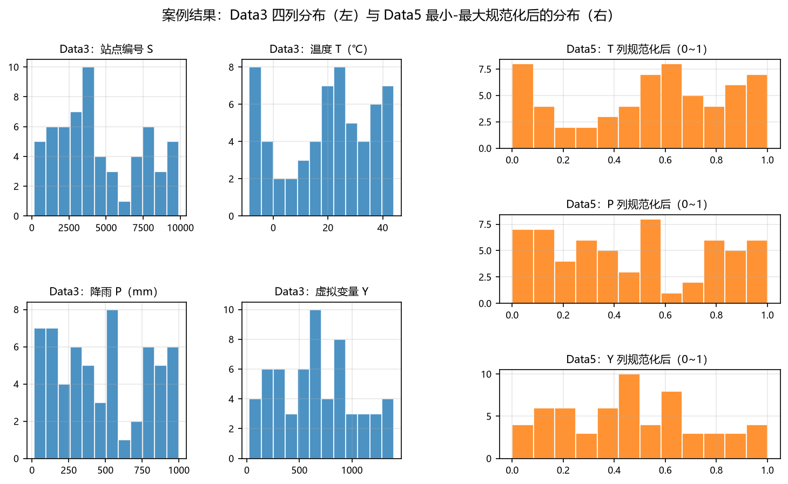

**图 3-16 案例结果：Data3 四列分布（左）与 Data5 规范化后的分布（右）**

这个练习对多数读者并不难。如果照着练习独立实现一遍觉得困难，说明编程基础还有较大的提升空间——网上有大量课程可以补课；做不出来时也要多与同学讨论。练习里的所有操作（生成、污染、定位、填充、合并、抽样、按列变换、批量出图）都是合格地走向机器学习建模所必需的语言熟练度。

## 3.8 小结

本章围绕机器学习流程中"建模之前"的一段展开，要点如下：

1. **定位**：数据预处理是数据挖掘/机器学习的前期准备，在"最主要的处理"（运行算法）之前，使数据达到知识获取所要求的最低规范和标准，用以确定挖掘类型、提高算法质量。
2. **动因**：数据质量不高与数据污染，使原始数据常具有不完整、含噪声、杂乱（不一致）、重复冗余等特征。
3. **四大任务**：清洗 = 查漏补缺（填补缺失、平滑噪声、处理离群与不一致）；集成 = 加法（多个数据源合并为一个）；缩减 = 减法（降维、减少样本量、数据压缩）；变换 = 乘除法（规范化、离散化、特征构造）。
4. **清洗**：缺失值可忽略、人工填写或自动填写（相邻值/平均值/最可能值——后者本质是把补缺变成预测问题）；离群点用箱线图检测，删不删取决于研究的是中等范围还是极端事件；不一致数据用"循环 + 属性关系判断"处理。
5. **集成**：模式集成、实体识别、数据冲突检测三种形式；集成后注意冗余——连续变量用相关（协方差）分析检测，离散变量用卡方检验，冗余属性留一即可。
6. **缩减**：为降低时间与空间复杂度、控制收集成本；降维可扔相似变量或构造新变量（主成分分析、因子分析，见第 5 章）；减样本量靠抽样（简单随机、放回/不放回、分层）；压缩靠重新编码。
7. **变换**：规范化三法（最小-最大、Z 得分、小数定标），注意公式里的 min/max 来自历史数据，新数据可能越界，宜预留余地；离散化三法（等宽、等频、聚类，均非监督）；特征构造包括对数/指数等单调变换、比例特征、线性组合、季节/星期时间特征，以及把序列当信号的小波/傅里叶处理。
8. **过程观**：四任务的顺序可依情况调整（清理在前、变换在后居多），且往往需要"建模—评估—回到数据"的循环往复；别人论文的漂亮结果背后常是多次尝试。
9. **可视化**：贯穿"了解数据—验证结果—呈现成果"全程；MATLAB 基本命令（plot 系列、subplot、plotyy、hold on，三维 plot3/mesh/surf 等）无需工具箱；提高档次靠渐变色、边缘直方图、相关系数矩阵图、置信区间填充、极坐标堆叠柱状图、截断坐标轴、ggplot2 风格（gramm）与配色；地理数据要落到地图上（shp + 散点/泡泡/插值）；Python 有 matplotlib、seaborn、pandas 等 20 余个绘图库，地理制图首推 Cartopy。

## 3.9 思考题

1. 为什么需要数据预处理？
2. 数据预处理的主要任务有哪些？各自的"算术记法"（加法、减法、乘除法）分别对应什么操作？
3. 缺失值的填充有哪几种方式？"用最可能的值填充"本质上转化成了什么问题？
4. 离群点什么时候该删、什么时候不该删？请结合地学中的极端事件举例。
5. 检测两个变量是否冗余时，连续变量与离散变量分别用什么方法？
6. 式（3-1）和式（3-2）在使用中可能出什么问题？如何解决？
7. MATLAB 画二维图和三维图的基本命令有哪些？
8. Python 画二维图和三维图常用哪些库？
9. （拓展）R 语言（如 ggplot2）画图有什么特点？试将本章案例的分布图用 R 语言重画一遍。

## 3.10 延伸阅读

1. MATLAB 画图速查表（将常用图形与命令浓缩在一页内）：
   <http://home.ustc.edu.cn/~pjer1316/matlabplot/>
2. MATLAB 官方画图示例库（Plot Gallery）：
   <https://ww2.mathworks.cn/products/matlab/plot-gallery.html>
3. gramm 工具箱（MATLAB 上的 ggplot2 风格完整数据可视化工具箱）：
   <https://github.com/piermorel/gramm>
4. MATLAB 绘图配色专题：
   <https://zhuanlan.zhihu.com/p/444970597>
5. 知乎专栏《基于 MATLAB 的地理数据处理》（中山大学自然地理专业毕业生撰写）：
   <https://www.zhihu.com/column/c_1500863916602871808>
6. "气象绘图加强版"（Python 地理/气象绘图技法合集）：
   <https://mp.weixin.qq.com/s/TSHselOjueB4eH8uWdFk9w>
7. Cartopy 官网（气象领域 Python 制图必学库）：
   <https://scitools.org.uk/cartopy/docs/latest/>
8. matplotlib 官网：
   <https://matplotlib.org/>

> 本章插图依据本讲课件《机器学习与地学应用·第三讲 数据预处理与可视化》的内容重绘。
