# 第4章 聚类分析

> **本章导读**：聚类分析是数据挖掘四类主要功能——聚类、降维、回归、分类——中的第一类，也是**无监督学习**的代表性功能：数据只有自变量 X 而没有类别标签 Y，任务是"把相似的对象放在一起"。本章从一组直观例子出发建立对聚类的感性认识，给出聚类的定义与优化目标，讨论相似性的度量方法（变量之间、样本点之间、类别之间的"距离"），然后依次讲解三种最常用的具体方法——**层次聚类**、**K-均值聚类**和基于密度的 **DBSCAN**，介绍它们的原理、步骤与 MATLAB 实现，接着讨论聚类效果的评估与优化（轮廓系数、SSE 与肘部法），最后通过"福冈甜橘引种地点选择"与"Fisher 鸢尾花数据"两个完整案例演示聚类分析的建模全过程。

## 4.1 聚类分析概述

### 4.1.1 方法体系中的聚类

本书按"思想出发点 × 解决功能"来组织各类机器学习方法，把数据挖掘/机器学习的典型方法整理成一张总表（表 4-1）。聚类分析是四类主要功能——聚类、降维、回归、分类——中的第一类，也是**无监督学习**的代表性功能。本章讲解的三种聚类方法在表中分属三行：层次聚类是"树型"思想的代表，K-均值是"最近邻"思想在聚类功能上的代表，DBSCAN 则独占"密度"一行；表中还能看到模糊 C 均值、谱聚类、自组织映射（SOM）等其他聚类方法的名字，先混个眼熟即可。

**表 4-1 数据挖掘/机器学习的典型方法**

| 类别 | 聚类 | 降维 | 回归 | 分类 |
|------|------|------|------|------|
| 线性方法 | — | 相关性分析、主成分分析、因子分析 | 多元线性回归 | Logistic 回归、判别分析 |
| 最近邻 | **k 均值聚类** | — | kNN | kNN |
| 树型 | **层次聚类** | — | 决策树（回归树） | 决策树（分类树） |
| 密度 | **DBSCAN** | — | — | — |
| 神经网络 | 自组织映射（SOM） | — | ANN | ANN |
| 核函数 | — | — | SVR | SVC |
| 图论 | 谱聚类 | — | 概率图模型 | 概率图模型 |
| 随机变量 | 高斯混合模型 | — | — | 贝叶斯分类 |
| 模糊数学 | 模糊 C 均值聚类 | — | 模糊逻辑模型、ANFIS | 模糊逻辑模型 |
| 深度学习 | — | — | CNN、LSTM | CNN |

三种方法各有分工：**层次聚类**事先不确定类数，适合"不知道有几类、想画图看看"的场合；**K-均值聚类**（又称快速聚类）要求事先指定类数，计算快，适合大数据集的快速聚类；**DBSCAN**（基于密度的含噪数据空间聚类）不需要类数先验，能发现任意形状的簇，还能识别噪音点。下面先通过直观例子建立对聚类的感性认识，再依次展开各方法。

### 4.1.2 从直观例子看聚类

在讲一般性的机器学习与数据挖掘方法时，本书反复强调"四类功能"的框架。现在回到数据本身，通过几个直观例子来理解"聚类"这一功能对应的一系列方法，会比从抽象定义入手更容易。

**例 1：这些点可以聚成几类？** 图 4-1 左是一幅普通的二维散点图。猛一看，并没有一个明显的答案：说三个类可以，说四个类似乎也行，甚至说"它们根本分不开、就是一类"也未尝不可。而如果强制按 $k=3$ 做 K-均值聚类，得到右图着色的结果，看上去"像三个类"；再回到原始数据去看，好像又觉得不那么确定。我们以后遇到的很多聚类问题都是这样：有时候类的结构很明显，有时候又不很明显。

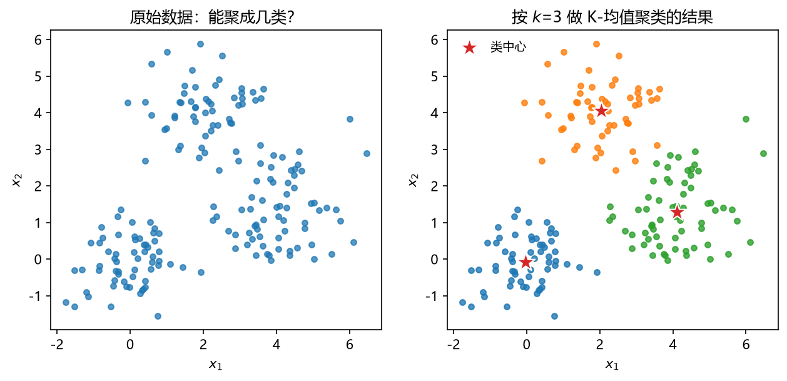

**图 4-1 二维散点数据：能聚成几类（左）与按 k=3 的 K-均值聚类结果（右）**

**例 2：层次聚类的直观过程。** 考察图 4-2 左侧的 8 个样本点：两两去看，总有一些点离得特别近——点 1 与点 2、点 3 与点 4、点 5 与点 6 都可以各自先归到一起。于是产生了一种"从细节做起"的思路：任取两个点，发现它们很近，就先把这两点看成一类；再找出下一对相对最近的点（或类），合并之后拿它们的**中心点**代表这一类，作为一个"虚拟点"继续与其他点比较；中心点的中心点还可以再往上合并……以此类推，就得到右侧那棵层次树。这种着眼于细节、逐层合并的方法就是层次聚类（也称系统聚类）——它是本章三种方法中的第一种。

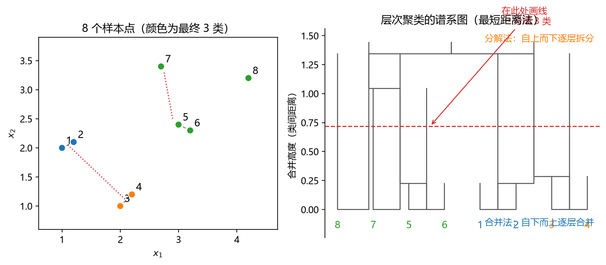

**图 4-2 8 个样本点（左）与层次聚类得到的谱系图（右）**

**例 3：硬聚类与软聚类。** 图 4-3 的数据用"非此即彼"的方式划分成两类的效果并不理想——两端的两团确实分属两大类，但中间过渡带上的点既像这一类、又像那一类。这时可以改用概率的语言来描述"属于某一类"的程度：先估计整个数据的概率密度（左图，这里用的是两个高斯分布混合而成的模型），再计算每个点属于各类的概率。按概率最大者归类，得到中图的**硬聚类**结果（每个点只属于一类）；若进一步用颜色深浅表示隶属概率（右图），过渡带上的点就呈现为介于两色之间的过渡色，这就是**软聚类**。可以看到，软聚类有时更符合我们实际看到的情况——中间那些点本来就不是"非此即彼"的。

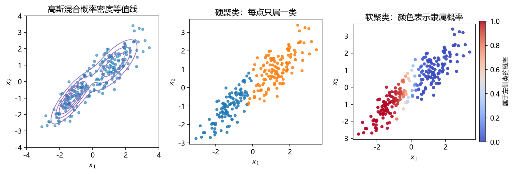

**图 4-3 高斯混合模型的概率密度等值线（左）、硬聚类结果（中）与软聚类结果（右）**

**例 4：不同方法对不同数据集的聚类结果。** 做聚类要把简单情况和复杂情况都考虑一下。图 4-4 把四种典型数据集（两同心圆、两半月、三团点、三条形）与三种方法（K-均值、层次聚类、DBSCAN）交叉组合：每一行是一种数据集，每一列是一种方法，小图中不同颜色代表该算法判定的类别，"×"代表 DBSCAN 认定为噪音的点。逐行扫一遍可以发现：对两个同心圆，最直观的判断是"内圈一类、外圈一类"，但 K-均值做不到——它把内外圈各切了一半，只有 DBSCAN 能顺着圆环把两类分开；对两半月、三条形这类"凹形"数据，K-均值同样只能按大致位置切开，而 DBSCAN 仍能沿着月牙和条形把它们连成整类；对最普通的三团点，三种方法都做得不错（各类颜色不同没有关系，颜色本来就可以变，只要"不同颜色代表不同类"即可）。

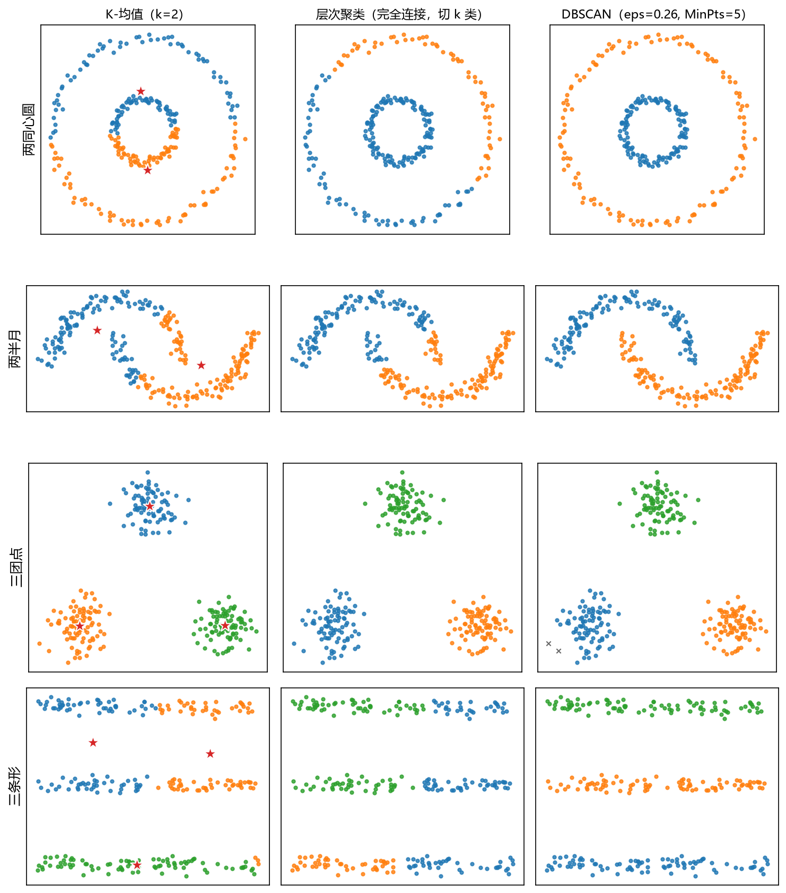

**图 4-4 不同聚类方法对不同数据集的聚类结果**

**例 5：同一方法、不同合并策略。** 即使是同一种方法，内部策略的细微差别也会改变结果。图 4-5 对同一个"两半月"数据集都用层次聚类，只是把类间距离换成最短距离、最长距离、组间平均、离差平方和四种不同的合并策略，得到的结果就有明显差异。这说明层次聚类内部的"策略旋钮"——类间距离怎么算、点间距离用什么函数——都会实质性地影响输出。

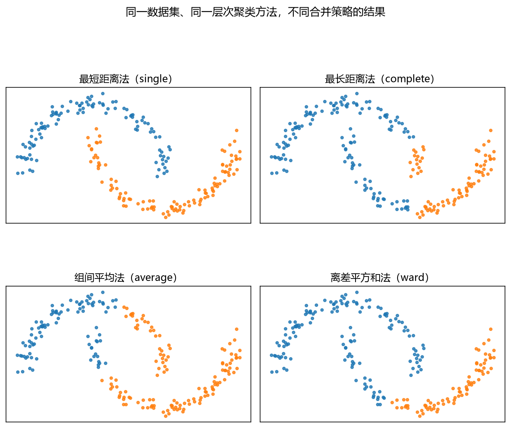

**图 4-5 同一数据集、同一层次聚类方法在不同合并策略下的结果**

把例 4、例 5 的观察归纳成三条，就是聚类的直观印象：

- **不同数据集，不同聚类方法**：不同方法对不同数据集的聚类结果不尽相同；特定方法可能对特定数据集效果较好。
- **相同数据集，不同聚类方法**：效果可能不同也可能相同；需要为数据集挑选合适的方法。
- **相同数据集，相同方法，不同合并策略**：结果可能相同也可能不同；选定方法后，还要深入到方法内部挑选距离函数、合并策略等具体环节。

因此，对于一个具体数据集，我们要做的是找到**最适合这个数据集的聚类方法**，并在方法内部进一步挑选**最合适的策略**（距离的选择、合并的方式等），才能找到最适合特定问题的聚类方案。

### 4.1.3 聚类的定义与优化目标

聚类分析（cluster analysis 或 clustering）有两种常用的定义：

**定义 1**：把"对象"分成不同的类别（簇、组、类）——这些类**不是事先给定的，而是直接根据数据的特征确定的**。把相似的东西放在一起（加标签），从而使得

- **类别内部的"差异"尽可能小**；
- **类别之间的"差异"尽可能大**。

**定义 2**：按照对象之间的"相似"程度，把对象划分成多个子集。

定义 1 的后半部分实际上给出了聚类的**优化目标**：这是一个双目标优化问题——类内差异要**最小化**，类间差异要**最大化**，而可以调节的决策变量就是"给每个数据点打什么标签"。学过优化的读者对此不会陌生：先把"差异"用数学式子定义出来（比如类内差异用各类内部点到中心的距离平方和表示，类间差异用类中心之间的距离表示），然后"最小化类内 + 最大化类间"，通过调整每个样本的类别归属来求解。各种具体聚类算法，本质上就是在用不同的方式近似求解这个双目标问题。

### 4.1.4 聚类的三个"不清楚"

拿到一个聚类问题，先要想清楚三件事，它们也正是聚类区别于后续各章分类方法的关键。

**第一，不清楚某个样本属于哪一类。** 也就是说，类别标签 Y 是我们想知道的量，开始计算时并不存在。样本数据只有 X；虽然我们最终会腾出一个向量 Y 来存储类别结果，但在开始时它是空的。**聚类分析属于无监督学习**——这一点请读者牢记，第 6 章以后的 Logistic 回归、判别分析、kNN 等都是有 Y 的有监督方法，性质完全不同。

**第二，不清楚两个样本是否属于同一类。** 要判断"是否同类"，必须先定义**两个样本之间的相似性**——通常就是算它们之间的距离。又因为优化目标里还有"类别之间的差异尽可能大"，所以除了样本与样本的距离，还要定义**类别与类别之间的距离**。聚类分析要处理"两个距离"。

**第三，不清楚所有样本一共有几类。** 怎么处理这个不确定？最朴素也最有效的办法是——**猜一猜**。当然，猜要有范围：类别数的两个极端情况，一是所有样本都属于一类，二是每个样本自成一类（$n$ 个样本就是 $n$ 类）。所以类别数的取值范围是 1 到 $n$。在这个范围内先假定一个值，用"类内距离最小、类间距离最大"的目标去算一算、评一评，不合适再换。这种"先猜一猜、算完再评判"的思路贯穿本章：K-均值要猜类数 K，DBSCAN 要猜邻域半径，猜不准就多试几种、用评估指标挑最好的。

### 4.1.5 相似性的度量（一）：变量之间

聚类分析用"距离"或"相似系数"来度量对象之间的相似性，然后按相似程度分类。度量可以从两个方向进行。

第一个方向：**根据样本测度变量之间的相似程度**。把每个变量在 $n$ 个样本上的取值看成一个有方向的向量，两个变量的相似程度可以用**夹角余弦**或**皮尔逊（Pearson）相关系数**来计算（表 4-2、图 4-6）：两个变量的夹角越小（余弦越接近 1）、相关系数越大，说明它们越相近。这类度量统称**相似系数**——相似系数越大越相似。

**表 4-2 变量之间相似性的度量方法**

| 中文 | 英文 | 公式 |
|------|------|------|
| 夹角余弦 | Cosine distance | $\cos\theta = \dfrac{\sum_{i=1}^{n} x_{i1} x_{i2}}{\sqrt{\sum_{i=1}^{n} x_{i1}^{2}} \sqrt{\sum_{i=1}^{n} x_{i2}^{2}}}$（4-1） |
| 皮尔逊相关系数 | Pearson correlation | $r = \dfrac{\sum_{i=1}^{n} (x_{i1}-\bar{x}_1)(x_{i2}-\bar{x}_2)}{\sqrt{\sum_{i=1}^{n} (x_{i1}-\bar{x}_1)^{2}} \sqrt{\sum_{i=1}^{n} (x_{i2}-\bar{x}_2)^{2}}}$（4-2） |

其中 $x_{i1}$、$x_{i2}$ 分别是变量 $x_1$、$x_2$ 在第 $i$ 个样本上的取值，$\bar{x}_1$、$\bar{x}_2$ 是它们的均值。几何上，夹角余弦把每个变量视为 $n$ 维空间中的一个向量（图 4-6）：夹角小，两条射线近乎重合，两变量取值"同起同落"，自然相似；夹角大，则两变量相去甚远。

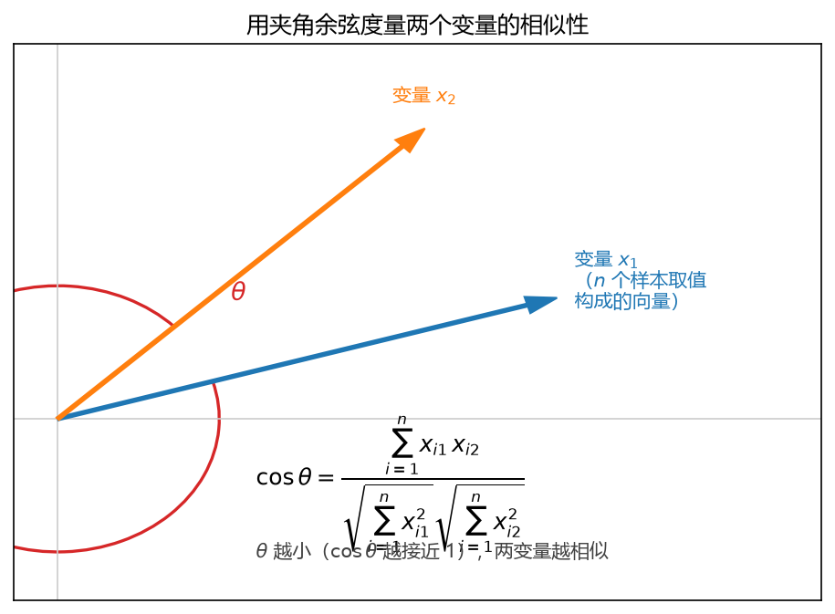

**图 4-6 用夹角余弦度量两个变量的相似性**

### 4.1.6 相似性的度量（二）：样本点之间

第二个方向：**根据变量来测度样本（或类）之间的相似程度**，使用的工具是**距离**——离得比较近的归为相同类，离得比较远的放在不同类。每个样本有 $p$ 个变量取值，把这些取值当作样本点在 $p$ 维空间中的坐标，样本之间的相似程度就转化为坐标之间的距离。常用距离见表 4-3。

**表 4-3 样本点之间距离的常用度量**

| 中文 | 英文 | 公式 |
|------|------|------|
| 欧氏距离 | Euclidean distance | $d_{12} = \sqrt{\sum_{k=1}^{p} (x_{1k}-x_{2k})^{2}}$（4-3） |
| 平方欧氏距离 | Squared Euclidean distance | $d_{12} = \sum_{k=1}^{p} (x_{1k}-x_{2k})^{2}$（4-4） |
| 街区距离 | City block distance | $d_{12} = \sum_{k=1}^{p} \lvert x_{1k}-x_{2k} \rvert$（4-5） |
| 切比雪夫距离 | Chebychev distance | $d_{12} = \max_{k} \lvert x_{1k}-x_{2k} \rvert$（4-6） |
| 马氏距离 | Mahalanobis distance | $D_{12} = \sqrt{(x_1-x_2)^{T} \Sigma^{-1} (x_1-x_2)}$（4-7） |
| 闵可夫斯基距离 | Minkowski distance | $d_{12} = \left( \sum_{k=1}^{p} \lvert x_{1k}-x_{2k} \rvert^{m} \right)^{1/m}$（4-8） |

这么多公式不必背，实际中要用时查一查、试一试即可——不同距离算出来的聚类效果可能不同，也可以查一查文献中对各距离适用情形的讨论，具体问题具体分析。**最常用的是（平方）欧氏距离**：平方欧氏距离省去了开方，计算更简便，K-均值默认使用的就是它。图 4-7 用"到原点距离相等的点的轨迹"（等距线）直观展示了几种距离的差别：欧氏距离的等距线是圆，街区距离是菱形，切比雪夫距离是方形；马氏距离则在各变量方差不同、存在相关时把"圆"拉成倾斜的椭圆——它把数据的协方差结构 $\Sigma$ 考虑了进来。

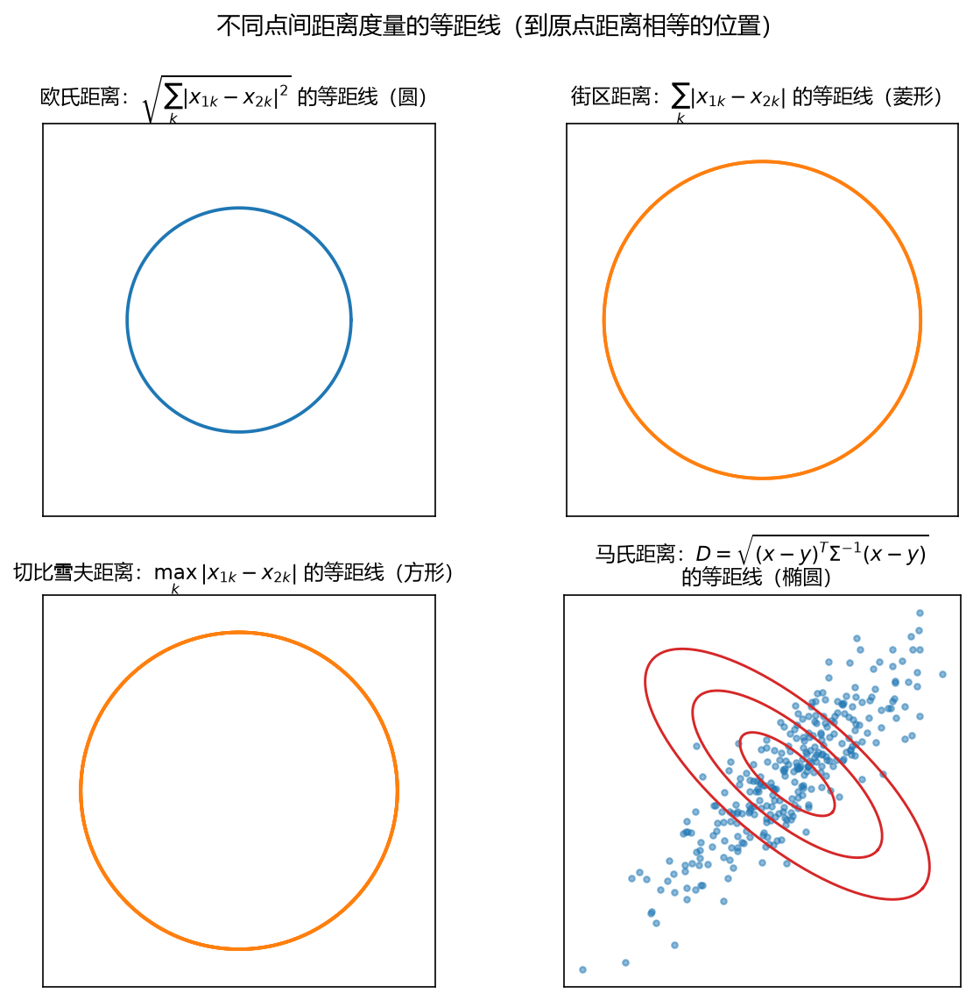

**图 4-7 不同点间距离度量的等距线（马氏距离考虑方差与相关性）**

还有一个值得思考的问题：**样本之间的相似性计算方法与变量之间的能否互换？** 把数据表格的行与列互换一下，本来算样本的距离就变成了算变量的距离。对计算机来说行列没有本质差别，只是我们看屏幕的习惯问题，所以两种方向的度量在很大程度上是相通的——算变量相似性用的夹角余弦、相关系数，MATLAB 的距离函数同样支持用来算样本（见表 4-8 中 `'cosine'`、`'correlation'` 参数）。

### 4.1.7 相似性的度量（三）：类别之间

聚类的双目标里"类间差异尽可能大"，要求我们计算**类别与类别之间的距离**。一个类里有若干个点，另一个类里也有若干个点，类间距离就是"多点与多点之间"的距离，同样有很多种定义（表 4-4）。

**表 4-4 类别之间距离的常用度量**

| 中文 | 英文 | 含义 |
|------|------|------|
| 最短距离法 | Nearest neighbor | 用两个类别中各数据点之间**最短**的那个距离表示两类之间的距离 |
| 最长距离法 | Furthest neighbor | 用两个类别中各数据点之间**最长**的那个距离表示两类之间的距离 |
| 中心法 | Centroid clustering | 用两个类别的**中心（质心/重心）**之间的距离表示两类之间的距离 |
| 组间平均距离 | Between-groups linkage | 用两个类别之间**所有点对距离的平均**表示两类之间的距离 |
| 离差平方和法 | Ward's method | 每次合并都使各类别内部的离差平方和**增量最小**、类间离差平方和尽量大（用递推公式计算） |

图 4-8 画出了前四种：绿色粗线是两类之间靠得最近的一对点（最短距离），红色粗线是离得最远的一对点（最长距离），紫色虚线连接两个"×"标出的类中心（中心法），灰色细线是所有点对的连线（其平均即组间平均距离）。以中心法的公式写出：

$$D(G_1, G_2) = \lVert \bar{x}_{1} - \bar{x}_{2} \rVert \tag{4-9}$$

其中 $\bar{x}_1$、$\bar{x}_2$ 是两类的均值向量。组间平均距离则写成：

$$D(G_1, G_2) = \frac{1}{n_1 n_2} \sum_{i \in G_1} \sum_{j \in G_2} d(x_i, x_j) \tag{4-10}$$

Ward 法没有直观的"连线"可画，它的想法是：如果把两个类合并成一个，类内离差平方和会增加，每次合并都选择**使增加量最小**的那两个类，从而保持"类内差异小、类间差异大"。这几种定义没有绝对优劣，4.2.5 节会结合实践经验给出选择建议。

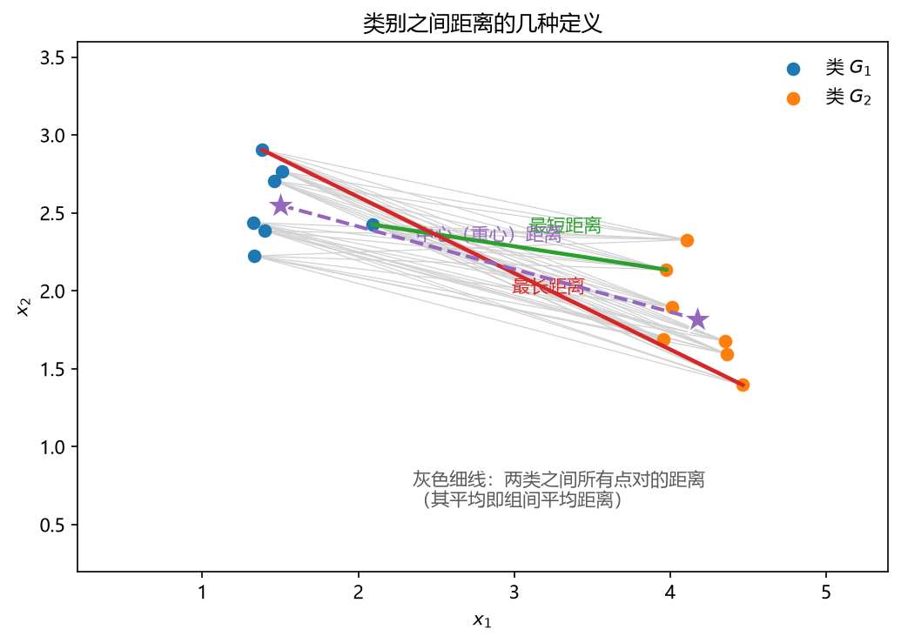

**图 4-8 类别之间距离的几种定义**

### 4.1.8 Q 型聚类与 R 型聚类

聚类分析的"对象"可以是所观察的多个**样本**，也可以是针对每个样本测得的多个**变量**：

- 按照变量对所观察的**样本**进行分类，称为 **Q 型聚类**。例如：按照多项经济指标（变量）对不同的地区（样本）进行分类。
- 按照**样本**对多个变量进行分类，称为 **R 型聚类**。例如：按照不同地区的样本数据对多个经济变量进行分类。

两种聚类没有本质区别——正如 4.1.6 节所说，行与列互换后计算是相通的。实际工作中人们**更感兴趣的通常是根据变量对样本进行分类（Q 型聚类）**，本章的方法与案例也以 Q 型聚类为主。

### 4.1.9 硬聚类与软聚类

按"一个点可以属于几个类"，聚类方法分为硬聚类与软聚类两大阵营。

**硬聚类**：一个点只能属于 1 个类。典型方法见表 4-5。

**表 4-5 典型硬聚类方法**

| 方法 | 工作原理 | 使用时机 |
|------|----------|----------|
| k-均值 | 把数据分割为 k 个相互排斥的类；点在多大程度上适合划入一个类，由该点到类中心的距离决定（类中心与数据中的点可以不契合） | 聚类数量已知时；适用于大型数据集的快速聚类 |
| k-中心点 | 与 k-均值类似，选用类中离平均值最近的对象作为中心（类中心与数据中的点契合） | 聚类数量已知时；适用于分类数据的快速聚类；可扩展至大型数据集 |
| 层次聚类 | 分析成对点之间的相似度并将对象分组到一个二进制的层次结构树，产生聚类的嵌套集 | 不知道数据中有多少类时；想要可视化地指导数据选择 |
| 自组织映射 | 基于神经网络的聚类，将数据集变换为保留拓扑结构的 2D 图 | 用 2D 或 3D 可视化高维数据；通过保留数据的拓扑结构降低维度 |

**软聚类**：一个点可能属于多个类。典型方法见表 4-6。

**表 4-6 典型软聚类方法**

| 方法 | 工作原理 | 使用时机 | 特点 |
|------|----------|----------|------|
| 模糊 c-均值 | 当数据点可能属于多个类时进行基于分割的聚类 | 聚类数量已知时；适用于模式识别；当聚类重叠时 | 类似 k-均值，但给出一个点在一个类中的**隶属度** |
| 高斯混合模型 | 基于分割的聚类，数据点来自具有一定概率的不同的多元正态分布 | 数据点可能属于多个类时；类的大小不同且含相关结构时 | 每类是一个高斯分布模型，给出一个点属于一个类的**概率** |

例 3（图 4-3）演示的就是高斯混合模型的软聚类。软聚类的原理讲起来要借助概率模型，本章不展开；把硬聚类搞明白了，软聚类也就容易理解，有兴趣的读者可以自行研究。

### 4.1.10 聚类方法的选择

面对这么多方法，到底怎么选？把下面五个问题回答一遍，选择范围就缩小了：

1. **对样本还是对变量聚类？**——Q 型（样本）还是 R 型（变量）？通常做 Q 型。
2. **样本属于单类还是多类？**——硬聚类，还是软聚类（模糊聚类、高斯混合模型）？
3. **类别个数已知还是未知？**——已知可用 K-均值（kmeans）；未知可用层次聚类。
4. **样本形状是凸形还是非凸形？**——凸形（球状）用 K-均值或层次聚类；非凸形用 DBSCAN 或谱聚类。
5. **距离能否直接计算？噪音干扰大不大？**——数据都是数值时基于距离即可；变量是文字、类别等不能直接算距离时，可采用基于众数的方法；噪音（离群点）干扰大时，用 k-中心点或 DBSCAN 这类对异常点不敏感的方法。

其中"噪音敏感"值得举个例子：本来看上去只有两团数据，很远处孤零零还有一个点。有的算法对这种异常点非常敏感——仅仅因为这一个点，它可能把离它较近的那一团数据再切出一部分来，硬做成"第三类"。遇到这类数据，就要挑选天生抗噪的方法。

## 4.2 层次聚类

### 4.2.1 基本原理：合并法与分解法

层次聚类（hierarchical clustering）又称系统聚类，其特点是**事先不确定要分多少类**，而是先把每一个对象作为一类，然后一层一层进行分类。根据运算方向的不同，层次聚类分为两种思路：

- **合并法**（凝聚法）：初始假设为 $n$ 类——每个对象自成一类，自下而上逐层合并；
- **分解法**：初始假设为 1 类——所有对象同属一大类，自上而下逐层拆分。

两种方法的运算原理一样，只是方向相反（见图 4-2 右侧谱系图上的两个箭头）。合并法"从两个点算起"，一上来不问类数；分解法则先把所有对象当作一大类，找差异最大的对象分离出去。实际中**通常使用合并法**，分解法原理类似，下面以合并法为主介绍。

### 4.2.2 合并法的步骤

1. 将每一个样本作为一类——$k$ 个样本就分成 $k$ 类；
2. 按照某种方法度量样本之间的距离，并把**距离最近的两个样本**合并为一个类别，从而形成 $k-1$ 个类别；
3. 再计算新产生的类别与其他各类别之间的距离，并把距离最近的两个类别合并为一类；
4. 如果类别的个数仍然大于 1，则重复第 3 步，直到所有类别都合并成 1 类为止。

"将距离最近的两个类合并"这句话说起来简单，背后却是实实在在的计算量：要找"最近"，必须先把当前所有类两两之间的距离全部算一遍，再取最小值——每合并一次就要重算一轮。这也是层次聚类计算量较大、对大批量数据效率不高的原因。

合并法有两个鲜明特点：**总是先把离得最近的两个类合并**，因此**合并越晚的类，距离越远**；同时它**事先并不指定最后要分成多少类**，而是把所有可能的分类都列出来（一棵完整的谱系图），再视具体情况选择一个合适的分类结果。换句话说，这个方法把"分几类"这个困难的决策留给了用户：算法负责算出树状图，用户拿到图后在合适的高度**画一道线**，线以下被切分成几支，数据就分成几类（图 4-2 右）。这个设计乍看有点"偷懒"，实则很合理——类数的取舍往往需要结合专业知识，交给熟悉问题的人做决定反而更稳妥。

### 4.2.3 分解法的步骤

分解法与合并法方向相反：先把所有对象（样本或变量）作为一大类；度量对象之间的距离或相似程度，把距离最远（最不相似）的对象分离出去，形成两大类（其中一类只有一个对象）；再度量类中剩余对象之间的距离，继续把最远的分离出去；不断重复，直到所有对象都自成一类为止。分解法同样事先不指定类数。

### 4.2.4 层次聚类的 MATLAB 实现

MATLAB 中层次聚类有两种实现方式（表 4-7）：**单函数法**用一个 `clusterdata` 命令把全过程一气呵成；**多函数法**把主要步骤拆成若干小函数，用户依次调用，逐步得到结果并观察中间量。

**表 4-7 层次聚类的 MATLAB 实现方法**

| No. | 方法 | 主要命令 | 含义 |
|-----|------|----------|------|
| 第 1 种 | 单函数法 | `clusterdata` | 根据不同样品距离、不同的类间距离综合求解层次聚类，内部包含了 `pdist`、`linkage` 和 `cluster` 函数 |
| 第 2 种 | 多函数法 | `pdist` | 计算样品之间的某种距离 |
| | | `squareform` | 排出距离矩阵 |
| | | `linkage` | 根据某种类间距离法进行聚类 |
| | | `dendrogram` | 画出聚类谱系图 |
| | | `cophenet` | 计算 Cophenetic 相关系数，判断聚类效果（越接近 1 越好） |
| | | `cluster` | 计算类别编号结果 |

**（1）单函数法：`clusterdata`。** 最主要的用法只需要两个输入——数据矩阵 X 与切割阈值 cutoff：

```matlab
T = clusterdata(X, cutoff)      % cutoff<2：不一致性指数临界值；cutoff>2：最大类别数
T = clusterdata(X, Name, Value) % 用名称-值参数指定距离、合并策略等更多选项
```

其中 X 是原始数据矩阵（行为样品、列为变量）。`clusterdata` 内部集成了 `pdist`、`linkage`、`cluster` 三步，适合快速得到结果；想控制和观察中间过程时，用多函数法。

**（2）多函数法的典型代码。** 下面以"最长距离法 + 欧氏距离"为例给出完整流程（数据为 4.6 节引种案例的 7 个城市 × 5 个气象指标矩阵，节选自课件）：

```matlab
% 层次聚类分析：最长距离法 & 欧式距离
X = [16.2  1492  2000  -8.2  6.2
     15.7   970  2209 -20.6  1.9
     ...
     16.3   976  1239  -4.6  5.6];
D  = pdist(X, 'euclid');        % 计算样品之间的欧式距离
M  = squareform(D);             % 排出距离矩阵
Z  = linkage(D, 'complete');    % 根据最长距离法聚类
H  = dendrogram(Z);             % 画出聚类谱系图
xlabel('City');                 % 谱系图的横轴标签
ylabel('Scale');                % 谱系图的纵轴标签
C  = cophenet(Z, D);            % 计算 Cophenetic 相关系数
T  = cluster(Z, 3);             % 指定类别数目，得到每个样品的类别编号
```

六个小函数各司其职：`pdist` 算点与点之间的距离（距离种类由 `'euclid'` 这类参数指定）；`squareform` 把 `pdist` 输出的压缩距离向量排成方阵，便于查看；`linkage` 按指定的类间距离（合并策略）逐层聚类，返回合并记录 Z；`dendrogram` 画谱系图；`cophenet` 算出 Cophenetic 相关系数用于评价效果；最后 `cluster` 在指定类数处"切树"，输出类别编号。

**（3）两个关键参数的选择。** `clusterdata`（以及 `pdist`、`linkage`）的参数就是 4.1.6、4.1.7 两节介绍的"两个距离"，常用的取值见表 4-8、表 4-9。

**表 4-8 `clusterdata`/`pdist` 的 'Distance' 参数（常用取值）**

| 取值 | 含义 |
|------|------|
| `'euclidean'` | 欧氏距离（默认） |
| `'squaredeuclidean'` | 平方欧氏距离 |
| `'seuclidean'` | 标准化欧氏距离（各坐标除以该变量标准差后再算欧氏距离） |
| `'mahalanobis'` | 马氏距离（用 X 的样本协方差） |
| `'cityblock'` | 街区距离 |
| `'minkowski'` | 闵可夫斯基距离（默认指数 2，可另指定正数 P） |
| `'chebychev'` | 切比雪夫距离 |
| `'cosine'` | 1 − 夹角余弦 |
| `'correlation'` | 1 − 样本相关系数 |
| `'hamming'`、`'jaccard'`、`'spearman'` | 其他相似性度量，详见帮助文档 |

可以看到，点间距离的清单里也包含 `cosine`、`correlation`——印证了 4.1.6 节的结论：变量相似性度量与样本距离度量可以互换使用。

**表 4-9 `clusterdata`/`linkage` 的 'Linkage' 参数**

| 取值 | 含义 |
|------|------|
| `'average'` | 组间平均距离（UPGMA） |
| `'centroid'` | 中心法（UPGMC），仅适用于欧氏距离 |
| `'complete'` | 最长距离法 |
| `'median'` | 加权重心法（WPGMC），仅适用于欧氏距离 |
| `'single'` | 最短距离法 |
| `'ward'` | 离差平方和法（最小方差算法），仅适用于欧氏距离 |
| `'weighted'` | 加权平均法（WPGMA） |

### 4.2.5 距离与合并策略的选择经验

参数这么多，具体怎么选？MATLAB 帮助文档与文献中的经验可以归纳为四条：

1. **点间距离**：标准化欧氏距离（或精度加权距离）是比较合适的选择；
2. **类间距离**：重心法、平均法和加权平均法是合适的选择——最短距离法容易使类"过度收缩"，最长距离法容易"过度扩展"；
3. **量纲要统一**：变量量纲差异较大时（如气温十几度、降水上千毫米），应先对数据做标准化，或直接采用带标准化的距离（标准化欧氏距离）——有些距离函数内部已考虑量纲，但很多没有，搞不清楚时统一做归一化最稳妥；
4. **变量存在相关性时**：可考虑马氏距离（它通过协方差矩阵处理相关性），或先做主成分变换、再基于主成分得分计算距离（4.6 节案例二就演示了这种做法）。

聚类算完后，可用 `cophenet` 计算 **Cophenetic 相关系数**作整体评价：它度量"谱系图所体现的两两距离"与"原始距离"的一致程度，取值在 [0, 1] 之间——**聚类效果越好，Cophenetic 值越高**；但要注意系数高不代表聚类结果一定最优，最终还应结合谱系图的形态与问题的实际意义来定。

## 4.3 K-均值聚类

### 4.3.1 为什么需要 K-均值

有了层次聚类，为什么还要 K-均值？两者的对比见表 4-10。

**表 4-10 层次聚类与 K-均值聚类的对比**

| 方法 | 类数 | 方向与过程 | 计算量 |
|------|------|------------|--------|
| 层次聚类 | 事先**不需要**确定，最后由用户看谱系图决定 | 一层一层由小到大进行，可绘制树状聚类图，直观方便 | 计算量较大，对大批量数据效率不高 |
| K-均值聚类 | 事先**需要**确定 K | 一上来就假定 K 个中心，从大到小动态调整 | 计算量小得多，效率高，又称**快速聚类** |

两者的关系恰好像运算方向相反的一对：层次聚类从每个点自成一类出发、自下而上合并；K-均值从"假定 K 个类中心在哪里"出发、自上而下地把点分配到中心周围。层次聚类胜在灵活直观，K-均值胜在快。

### 4.3.2 K-均值聚类的步骤

K-均值聚类的完整步骤如下（图 4-9）：

- **第 1 步：确定类别数目 K。** K 由研究者自己确定。给不出确切值时，先在 1 到 $n$ 的范围内猜一猜——有人也给出以样本数开根号为量级的经验公式，但更可靠的是结合对问题的了解（大概知道有几类）或通过画图观察数据形态，再反复尝试、比较不同 K 的结果。
- **第 2 步：确定 K 个初始聚类中心。** 在全部样本中选 K 个样本作为 K 个类的初始中心。选法有多种：直接取前 K 个样本；从样本中随机抽取 K 个；挑彼此距离最远的 K 个点（让初始中心尽量分开，分得更开）；SPSS 和 MATLAB 会自动指定初始中心。如果初始中心选得不好，还有一个看上去笨、却很有效的办法——**多算几遍**，取效果最好的一次。
- **第 3 步：根据 K 个中心进行分类。** 依次计算每个样本到 K 个中心的距离（中心也是样本空间中的一个点，所以这又回到了点与点的距离），按**距离最近原则**把所有样本分到 K 个类别中。
- **第 4 步：根据 K 个新中心重新分类。** 对分成的 K 个类别，计算各类别中每个变量的均值，以均值点作为新的 K 个中心；再按新中心重新计算每个样本的距离、重新分类。
- **第 5 步：重复第 4 步，直到满足终止条件。** 终止条件通常是：迭代次数达到事先指定的最大迭代次数（SPSS 隐含 10 次，MATLAB 默认 100 次）；或者新中心与上一次中心的最大偏移量小于指定的量（如 SPSS 隐含 0.02）——中心几乎不再移动，说明划分已达到平衡。

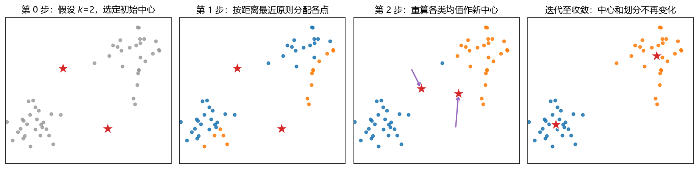

**图 4-9 K-均值聚类的迭代步骤**

K-均值的目标可以用簇内误差平方和（SSE）写成：

$$J = \sum_{j=1}^{K} \sum_{i \in C_j} \lVert x_i - \mu_j \rVert^{2} \tag{4-11}$$

其中 $\mu_j$ 是第 $j$ 类的均值向量（中心）。整个迭代过程就是"固定中心分点、固定点算中心"地交替最小化 $J$。

需要注意：K-均值一开始就要求用户指定类数，**这个要求有点高**，类别数的确定具有一定主观性——究竟分多少类合适，取决于研究者对问题的了解程度、相关知识和经验。实际应用中往往需要根据实际问题反复尝试，得到不同 K 下的分类并进行比较（4.5.3 节的肘部法就是常用的比较手段），才能得出最后要分的类别数量。

### 4.3.3 一维数据示例

对一维数据 $[2, 4, 10, 12, 3, 20, 30, 11, 25]$ 做 K-均值聚类（$k=2$，取前两个数据点 2 和 4 作为初始中心），迭代过程见表 4-11 与图 4-10。

**表 4-11 一维数据 K-均值聚类的迭代过程**

| 步骤 | $m_1$ | $m_2$ | $K_1$（聚簇 1） | $K_2$（聚簇 2） |
|------|-------|-------|----------------|-----------------|
| 1) | 2 | 4 | [2, 3] | [4, 10, 12, 20, 30, 11, 25] |
| 2) | 2.5 | 16 | [2, 3, 4] | [10, 12, 20, 30, 11, 25] |
| 3) | 3 | 18 | [2, 3, 4, 10] | [12, 20, 30, 11, 25] |
| 4) | 4.75 | 19.6 | [2, 3, 4, 10, 11, 12] | [20, 30, 25] |
| 5) | 7 | 25 | [2, 3, 4, 10, 11, 12] | [20, 30, 25] |

逐步看：初始中心 $m_1=2$、$m_2=4$，每个数据点与两个中心比距离——3 到 2 和 4 等距，归入前面一类，得到 $K_1=\{2,3\}$；第 2 步重算中心 $m_1=(2+3)/2=2.5$、$m_2=16$，重新分配得 $K_1=\{2,3,4\}$；第 3 步中心变为 3 和 18，10 离 3 更近（7 < 8），$K_1=\{2,3,4,10\}$；第 4 步中心 4.75 与 19.6，11 和 12 都被拉入前一类；第 5 步中心 7 与 25，分配不再变化——中心稳定，聚类收敛，最终 $K_1=\{2,3,4,10,11,12\}$、$K_2=\{20,30,25\}$。一维数据的迭代过程一目了然；图 4-10 画出了这五次迭代中中心线（虚线）与归属（颜色）的变化。

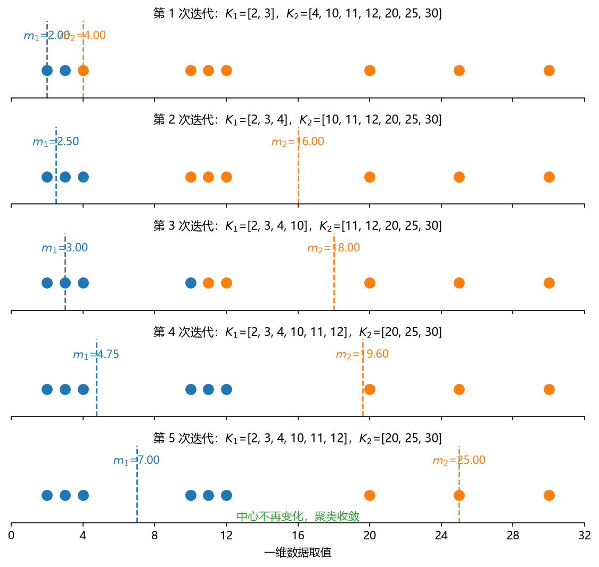

**图 4-10 一维数据 K-均值聚类的五次迭代**

### 4.3.4 二维数据示例

二维的例子只需给出数据：$x = [3, 3, 3, 4, 4, 5, 5, 7, 7, 8]$，$y = [4, 6, 8, 5, 7, 1, 5, 3, 4, 5]$，共 10 个点。把这 10 个点画在坐标图上，前六个点与后四个点大体分属两团；指定 $k=2$ 用 K-均值聚类，同样经历"选初始中心—按最近原则分配—重算中心—迭代"的过程，最后得到两个中心点和每个点的类别。配套代码 `脚本/Chapter4/CLUSTER_exp04_kmeans_1d_2d.m` 完整演示了一维数据的五次迭代与二维数据的聚类结果，读者可自行运行观察。

### 4.3.5 K-均值聚类的 MATLAB 实现

K-均值的 MATLAB 实现由 `kmeans` 与 `silhouette` 两个函数配合完成（表 4-12、表 4-13）。

**表 4-12 `kmeans` 函数的调用格式**

| 格式 | 用途 |
|------|------|
| `IDX = kmeans(X, k)` | 将 n 个点分为 k 类。X 为 n×p 矩阵（行=点，列=变量）；返回 n×1 向量 IDX，元素为每个点所属类的类序号 |
| `[IDX, C] = kmeans(X, k)` | 额外返回 k×p 的重心坐标矩阵 C，第 i 行为第 i 类的类重心坐标 |
| `[IDX, C, sumd] = kmeans(X, k)` | 额外返回类内距离（类内各点与类重心距离之和）向量 sumd，1×k |
| `[IDX, C, sumd, D] = kmeans(X, k)` | 额外返回 n×k 距离矩阵 D：第 i 行第 j 列为第 i 个点与第 j 类重心的距离 |
| `[...] = kmeans(..., param1, val1, param2, val2, ...)` | 名称-值参数控制迭代算法（如 `'Distance'`、`'Start'`、`'MaxIter'`、`'Replicates'` 等） |

`kmeans` 的聚类过程是动态的：通过迭代使每个点与所属类中心的距离之和达到最小；默认采用平方欧氏距离。最常用的调用只需 X 和 k 两个输入：

```matlab
[idx, C] = kmeans(X, 3);     % 分 3 类，返回类别号与类中心
s = silhouette(X, idx);      % 轮廓评价（见 4.5.2 节）
```

**表 4-13 `silhouette` 函数的调用格式**

| 格式 | 用途 |
|------|------|
| `silhouette(X, clust)` | 根据样本矩阵 X 与聚类结果 clust 绘制轮廓图 |
| `s = silhouette(X, clust)` | 返回 n×1 轮廓值向量 s，不绘图 |
| `[s, h] = silhouette(X, clust)` | 绘制轮廓图并返回轮廓值 s 与图形句柄 h |
| `[...] = silhouette(X, clust, metric)` | 用 metric 指定距离计算方法（或直接给距离矩阵） |

`silhouette`（轮廓）源自法语，其值的原理与解读见 4.5.2 节——这里先记住结论：轮廓值的范围是 [-1, 1]，**越大说明该点的分类越合理；若某些点的轮廓值小于 0，说明当前的聚类还不够理想**（这些点离别的类比离自己的类还近）。

## 4.4 DBSCAN：基于密度的含噪数据空间聚类

### 4.4.1 定义与基本思想

DBSCAN 的全名是**基于密度的含噪数据空间聚类**（Density-Based Spatial Clustering of Applications with Noise）。与划分方法（K-均值）和层次聚类都不同，它是基于密度的一类代表性算法，名字并不难记——其中的 scan（扫描）一词就提示了它逐点扫描、按邻域扩张的工作方式。

它的基本想法非常符合直觉：把所有点放到空间中去看**密度**——密度比较均匀、相互连成一片的点属于一类；中间出现空白或密度很稀疏的地方，类就在那里分开。据此，DBSCAN 把**簇定义为"密度相连"的点的最大集合**，能够把具有足够高密度的区域划分为簇，并可在含噪声的空间数据库中发现**任意形状**的簇。为什么对噪声天生稳健？因为噪音点一般离得比较远、周围没什么点，其邻域密度必然很小，算法自然不会把它们划进任何簇。

图 4-4 已展示了它的本领：两个同心圆、两条相交的弧（两半月）、三条长条形——这些让 K-均值和层次聚类头疼的"非凸"形状，DBSCAN 都能顺着密度的走向连成整类，还能顺手把噪音点（图中"×"）挑出来。

### 4.4.2 DBSCAN 的优缺点

**优点：**

- 计算量小于 K-均值和层次聚类；
- 不需要簇数的先验知识（不必事先猜 K）；
- 簇不一定是球状（凸形）的，任意形状都可以；
- 对基于密度的异常值检测非常有用，可以识别不属于任何簇的点。

**缺点：**

- 参数敏感且较难确定（特别是对高维数据）；
- 当数据密度不均匀时，全局统一的密度参数不能刻画内在的聚类结构。

### 4.4.3 邻域与三种点

为了把"密度"变成可计算的量，DBSCAN 定义了邻域与三种点（表 4-14、图 4-11）。**$Eps$ 邻域**：以样本点为球心、半径 $Eps$ 内的区域——计算密度要有一个范围，这个半径就是用户要指定的第一个参数（图中红圈的半径）。在 $Eps$ 邻域内至少包含最小数目 $MinPts$ 个对象（含自身）的点称为**核心点**；不是核心点、但落在某个核心点邻域内的点称为**边界点**；两者都不是的，就是**噪音点**。

**表 4-14 DBSCAN 的三种点**

| 概念 | 定义 | 图 4-11 中 |
|------|------|------------|
| $Eps$ 邻域 | 样本半径 $Eps$ 内的邻域 | 红圈的半径 |
| 核心点（core point） | 对象的 $Eps$ 邻域至少包含最小数目 $MinPts$ 个对象 | A 点 |
| 边界点（edge point） | 不是核心点，但落在某个核心点的邻域内 | B 点或 C 点 |
| 噪音点（outlier point） | 不是核心点也不是边界点的任何点 | N 点 |

用"圈圈画圈圈、手里数点个数"来记这三种点最直观：图 4-11 中（示意 $MinPts=5$），核心点 A 的圈内圈住了足够多的点，它是"密"的；边界点 B、C 自己的圈内点数不够，但它们被核心点（A、D）的圈扫中——它们贴着密集团的边缘；噪音点 N 自己的圈内空空如也，也没有任何核心点的圈能扫到它。注意一个细节：噪音点有时也能扫到一两个点，但扫到的不是核心点——如果扫到的是核心点，它就该叫边界点了。

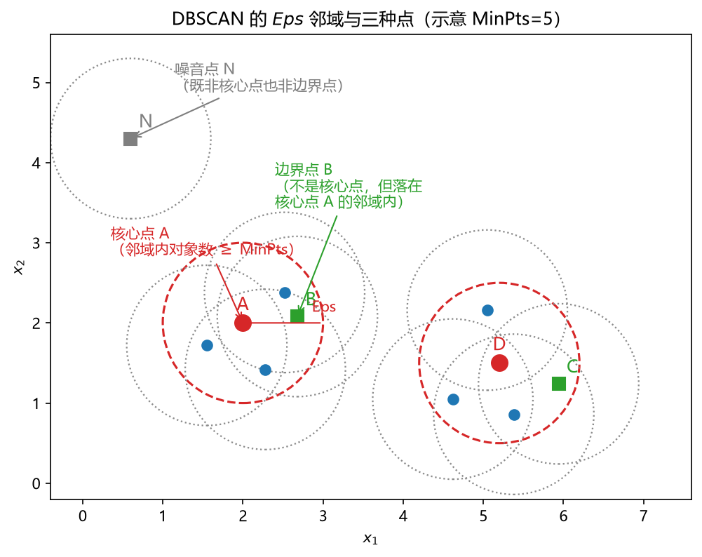

**图 4-11 DBSCAN 的 Eps 邻域与三种点**

### 4.4.4 密度可达与密度相连

有了三种点，还要定义点与点之间"通过密度发生联系"的三种关系（表 4-15、图 4-12），DBSCAN 最终靠"密度相连"把同一类的点连起来。

**表 4-15 密度可达与密度相连的定义**

| 概念 | 定义 | 性质 |
|------|------|------|
| 直接密度可达 | 对样本集 D，若样本点 q 在 p 的 $Eps$ 邻域内，且 p 为核心对象，则 q 从 p **直接密度可达** | 非对称（q 不必是核心点） |
| 密度可达 | 给定一串样本点 $p_1, p_2, \ldots, p_n$，$p=p_1$、$q=p_n$，若每个 $p_i$ 都从 $p_{i-1}$ 直接密度可达，则 q 从 p **密度可达**（直接密度可达的传递闭包） | 非对称 |
| 密度相连 | 若存在一点 o，o 到 p 和 q 都是密度可达的，则 p 与 q **密度相连** | 对称 |

直接密度可达的要求"很高"：从核心点 p 出发，q 只要在 p 的圈内即可（q 不要求是核心点），这是一步邻居的关系。密度可达把它传递下去：p 是核心点，画一个圈，圈里又有核心点，再画圈……一路画到 q，则 q 从 p 密度可达——它把"一系列能连起来的点"表述成链式关系，用密度把最远的点和最近的点联系起来。前两个关系都是**非对称**的（图 4-12 中 M 从 P 直接密度可达、Q 从 M 直接密度可达，于是 Q 从 P 密度可达；但反过来 P 从 Q 并不可达——Q 不是核心点，链条传不回去）。密度相连则补上了对称性：只要存在一个"中间人" o，p 和 q 都从 o 密度可达，则 p、q 密度相连——p 到 q 相连，q 到 p 也相连。DBSCAN 的目的就是**找到密度相连对象的最大集合**。

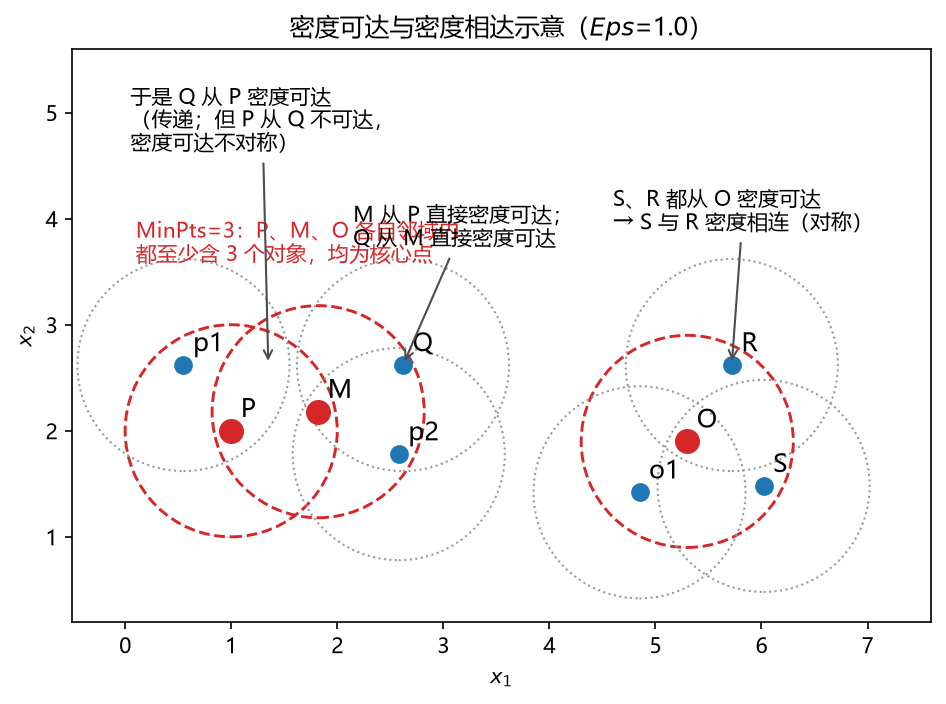

**图 4-12 密度可达与密度相达示意**

图 4-12 按 $Eps=1.0$、$MinPts=3$ 布置了六个点名点（与课件例题相同）：P、M、O 各自的 $Eps$ 邻域内都至少含 3 个对象，均为核心点。于是：M 从 P 直接密度可达；Q 从 M 直接密度可达（Q 不是核心点）；从而 Q 从 P 密度可达，但 P 从 Q 不密度可达（非对称）。S 与 R 都从 O 密度可达，因此 S 与 R 密度相连（对称）——虽然 S 和 R 互不在对方的邻域内，它们仍通过中间的核心点 O 连成一类。这三个概念背后的数学不必深究，理解"圈圈套圈圈把点连成片"的直觉即可。

### 4.4.5 算法描述

DBSCAN 的一种四步骤描述如下。**输入**：包含 n 个对象的数据库（数据矩阵 X）、半径 eps、最少数目 MinPts；**输出**：所有生成的簇。

1. 从数据库中抽出一个**未处理**的点；
2. 若抽出的点是**核心点**，则找出所有从该点**密度相连**的对象，形成一个簇（内部循环）；
3. 否则，抽出的点是边缘点（非核心对象），跳出本次循环，寻找下一个点；
4. 重复步骤 1~3，直到处理完所有的点。

注意算法总是"从核心点开始找类"：只有从核心点出发才能通过密度相连把一片点连起来，边缘点和其他噪音点都不作为起点。也有更细化的五步骤写法——从输入数据集 X 中选择第一个未标记的观测值作为当前点、聚类标签 C 初始化为 1；找当前点 eps 邻域内的邻居；邻居数小于 minpts 则标记为噪音点（若稍后满足其他点的约束则重新分配，通常是边界点）；否则标记当前点为属于簇 C 的核心点，迭代每个邻居（新的当前点）并重复，直到找不到可标记为当前簇 C 的新邻居；然后取下一个未标记点，C=C+1，重复直到标记完所有点。两种描述意思相同，细节上的差别不影响理解。

### 4.4.6 参数选择与 MATLAB 实现

**（1）两个参数怎么定。** DBSCAN 必须由用户给出两个参数，这又是"猜一猜"的环节。

- **MinPts（最小点数）**：经验要求**至少大于属性个数加 1**——若有 3 个变量（p=3），MinPts 一般取 4 以上。
- **Epsilon（邻域半径）**：可先画散点图估算点间距，把所有点两两距离都算一遍、取平均值作初始半径；更标准的做法是画 **k 距离图**（k-distance plot）：对每个点算它到第 k 近邻（k 取 MinPts−1 或相近值）的距离，把所有点的 k 距离从大到小（或从小到大）排序绘成曲线（图 4-13）。曲线在末端陡增的位置（拐点）对应"正常点与噪音点的分界"——噪音点孤悬远处，其第 k 近邻距离特别大。取拐点处的距离作为 Eps 初值，再多跑几次、慢慢调整即可。

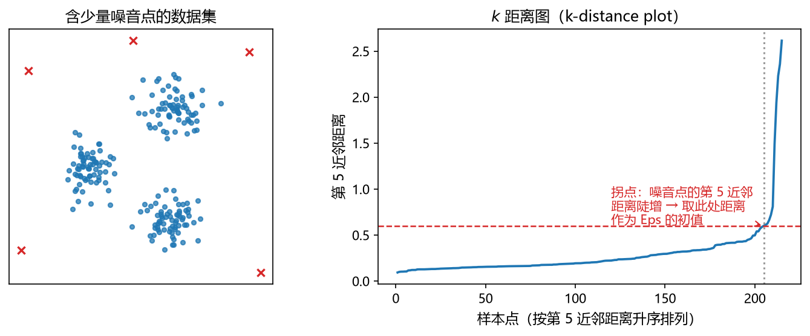

**图 4-13 用 k 距离图选择 DBSCAN 的邻域半径 Eps**

**（2）`dbscan` 函数。** MATLAB 中的实现是一个函数（表 4-16），最经典的调用只要三个输入——数据、半径、最小点数，其余参数都是进阶选项。

**表 4-16 `dbscan` 函数的调用格式**

| 格式 | 用途 |
|------|------|
| `idx = dbscan(X, epsilon, minpts)` | 对 n×p 的 X 聚类：根据邻域搜索半径阈值 epsilon 与识别核心点所需的最小邻居数 minpts 聚类，返回 n×1 向量 idx（每个观测的聚类索引，噪音点为 0） |
| `idx = dbscan(X, epsilon, minpts, Name, Value)` | 名称-值参数指定附加选项，如 `'Distance','minkowski','P',3` 表示用指数为 3 的闵可夫斯基距离 |
| `idx = dbscan(D, epsilon, minpts, 'Distance','precomputed')` | D 为 `pdist`/`pdist2` 格式的预计算成对距离，直接据此聚类 |

```matlab
idx = dbscan(X, epsilon, minpts);   % 记住这一句即可，其余用法用到再查
```

MATLAB 官网帮助文档中给出了含 k 距离图画法的完整示例（见本章延伸阅读），有兴趣的读者可对照练习。

## 4.5 聚类效果的评估与优化

聚类做完，效果好不好？没有 Y 的场合怎么评价？聚类评估方法分为两大阵营（表 4-17）：有"标准答案"可对照的**外部评估**，与只依靠数据自身的**内部评估**。

**表 4-17 聚类效果的评估方法**

| 方法 | 类别（Y）真实值 | 总体 | 单个数据点 | 备注 |
|------|----------------|------|------------|------|
| 外部评估 | 已知 | 纯度、正确率/准确率、错误率 | 单点类别比较 | 计算混淆矩阵 |
| 外部评估 | 未知（参考模型给出） | Jaccard 系数、FM 指数、Rand 指数 | — | 把参考模型的计算结果当成真值；计算混淆矩阵 |
| 内部评估 | 未知 | 轮廓系数（单点均值）、组内点到中心点 SSE、CH 指数（方差比）、DB 指数、Dunn 指数 | 单点轮廓值 | 簇内距离最小；簇间距离最大 |

（参考周志华《机器学习》第 9.3 节。）

外部评估用于"其实有真值、只是假装不知道"的场合——4.6 节的鸢尾花数据就是典型：标本采集时品种是已知的，聚类后可以拿真值来对照，统计混淆矩阵、算正确率。内部评估则是真正的无监督场景，只看数据内部的几何结构：类内距离小、类间距离大，就是好的聚类。本章重点讲最常用的两个内部指标：轮廓系数与 SSE。

### 4.5.1 轮廓系数

**单点轮廓（silhouette）值**以第 $i$ 个点（目标点）为对象计算（图 4-14 左）：

- $a(i)$：第 $i$ 个点与**同类**其他点之间的平均距离——它度量"自己类内抱得有多紧"；
- $b(i)$：第 $i$ 个点到**最近的其他类**、与该类各点间距离的均值——它度量"离最近的邻居类有多远"；
- 轮廓值：

$$S(i) = \frac{b(i) - a(i)}{\max\{a(i),\, b(i)\}} \tag{4-12}$$

$S(i)$ 的取值范围是 $[-1, 1]$：$a(i)$ 越小（类内越紧）、$b(i)$ 越大（离其他类越远），$S(i)$ 越接近 1，该点的分类越合理；$S(i)$ 接近 0 表示该点处在两类重叠的地带；$S(i)<0$ 说明该点离别的类比离自己所属的类还近，通常意味着它被分错了类。把所有点的轮廓值画成条形图（图 4-14 右，按类着色），就是 `silhouette` 函数输出的**轮廓图**；再取全体均值，就得到整个聚类方案的平均轮廓系数，用于横向比较不同的 K、不同的方法。

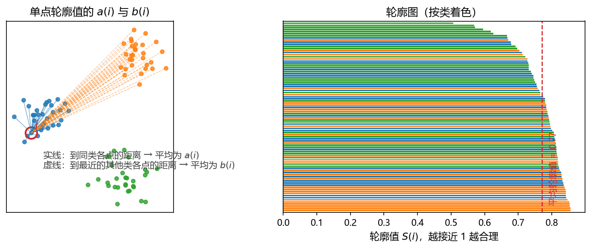

**图 4-14 单点轮廓值的 a(i) 与 b(i)（左）与轮廓图（右）**

### 4.5.2 SSE 与"肘部法"

簇内误差平方和（SSE）就是式（4-11）的目标函数：每个点到其所属类中心的距离平方求和。它衡量"类内差异小"做到了什么程度。显然 SSE 随类别数 K 的增大单调下降——K=n 时每个点自成一类，SSE 为 0；但类数太多聚类就失去了意义。把 SSE 随 K 变化的曲线画出来（图 4-15），曲线下降由快变慢的转折处像一只胳膊的**肘部**：肘部之前的每个新类都能大幅压缩类内差异，肘部之后再增加类数收益骤减。因此**取肘部对应的 K 作为建议类别数**——这就是选择 K 的"肘部法"，与平均轮廓系数并列为确定 K 的两大实用工具。

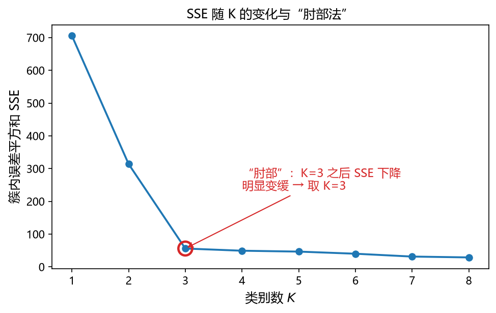

**图 4-15 SSE 随 K 的变化与肘部法**

## 4.6 案例研究

本章配套的 MATLAB 脚本与示例数据存放于本书配套代码库的 `脚本/Chapter4` 文件夹（文件清单与运行说明见其中的 `README.md`）。

### 4.6.1 案例一：找到适合甜橘引种的地点

**问题**：从日本引进福冈甜橘，候选地点是合肥、武汉、长沙、桂林、温州、成都，请根据气候条件找到与福冈最相似的、适合引种的地点。

这个案例的最大价值在于它的**"问题转化"**训练：实际遇到的问题不会自带"请用聚类分析"的标签——它只说"我有这样一个引种问题"，要由分析者把它转化成学过的问题。往下看：福冈与六个候选城市各有五个气象指标（年平均气温、年降水量、年日照时数、极端最低气温、一月平均气温），把每个城市的五个指标看成五维空间中的一个点，"找最相似的地点"就变成了"哪个点离福冈最近"——一个距离计算问题。而实践中往往还想知道第二近、第三近（比如最近的城市若有其他不适宜种植的因素，就要退而求其次），于是自然的做法是把福冈和六个城市放在一起做**聚类**：从谱系图与类属关系看哪些城市与福冈"抱团"，按距离远近排出次序。数据见表 4-18（其中福冈、合肥、成都三行取自课件，其余三行为按气候常年值整理的示例值，供读者练习复算）。

**表 4-18 引种案例的气象指标数据（示例）**

| 城市 | 年平均气温 (℃) | 年降水量 (mm) | 年日照时数 (h) | 极端最低气温 (℃) | 一月平均气温 (℃) |
|------|--------------|--------------|--------------|----------------|----------------|
| 福冈 | 16.2 | 1492 | 2000 | −8.2 | 6.2 |
| 合肥 | 15.7 | 970 | 2209 | −20.6 | 1.9 |
| 武汉 | 16.9 | 1250 | 1950 | −18.1 | 3.9 |
| 长沙 | 17.2 | 1400 | 1650 | −11.5 | 4.8 |
| 桂林 | 18.9 | 1900 | 1550 | −4.9 | 8.0 |
| 温州 | 17.9 | 1720 | 1750 | −4.5 | 7.7 |
| 成都 | 16.3 | 976 | 1239 | −4.6 | 5.6 |

课件用三种方案对同一数据做层次聚类与 K-均值聚类，结果对比见表 4-19。

**表 4-19 引种案例三种聚类方案的结果对比（据课件）**

| 方案 | 点间距离 | 类间距离 | 与福冈最接近的城市 |
|------|----------|----------|--------------------|
| 层次聚类 1 | 标准欧氏距离 | 中心法 | 长沙 |
| 层次聚类 2 | 基于主成分的标准欧氏距离 | 最短距离法 | 武汉 |
| K-均值聚类 | 平方欧氏距离（默认） | —（按中心分配） | 长沙 |

三个方案两种"投"长沙、一种"投"武汉——这种场合的通常做法是**投票**：两种方法都说长沙，就以长沙为首选；若长沙确有不宜种植的其他因素，再退而取武汉。图 4-16 是按表 4-18 的示例数据重算的结果：左图为层次聚类谱系图（组间平均法 + 标准欧氏距离），右图给出各候选城市与福冈的标准欧氏距离排序——**长沙最近（1.29）**，与课件结论一致；值得注意的是温州（1.43）与武汉（1.44）几乎并列第二，这解释了为什么换一种类间距离（最短距离法）或先做主成分变换，"第二名"就会在两者之间翻转：它们的差距本就在毫厘之间。这个案例再次印证了 4.1.2 节的直观印象——**聚类结果差异挺大时，需要用多种方法算多个结果，再综合比较**。

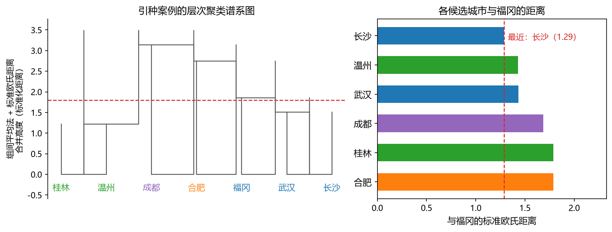

**图 4-16 引种案例：层次聚类谱系图（左）与各城市到福冈的标准欧氏距离（右）**

案例还有一个数据预处理的课堂问答值得记下：**福冈面板里的降水、气温要不要标准化？** 最好标准化。降水变化范围几百到上千毫米，气温只有十几度，量纲差异悬殊；不标准化的话，距离几乎被降水一列主导，相当于隐含地给了降水极大的权重。标准化不必复杂——用极差归一化（每列减去最小值、再除以极差）把各变量都压到 [0, 1] 即可。就本例的数据而言，做不做标准化结论可能差异不大（本例气温与降水的作用方向恰好一致），但这个检查步骤不应省略：先看量纲，再决定是否标准化。

### 4.6.2 案例二：Fisher 鸢尾花数据的聚类

**数据**：20 世纪 20 年代，植物学家收集了 150 个鸢尾花标本（三个品种各取 50 个）的**萼片长度、萼片宽度、花瓣长度、花瓣宽度**四个指标的测量值，即著名的 Fisher 鸢尾花数据集（MATLAB 内置 `fisheriris`）。

**问题**：忽略品种信息，仅使用四个指标的原始数据进行聚类（K-均值与层次聚类），再将聚类得到的簇与实际品种对照，考察三种鸢尾花是否具有不同的特性。

这个数据集的最大好处是：**采集时品种已经记录在案**——相当于真值 Y 已经存在，只是我们假装不知道、按无监督的方式去聚类；算完再拿真值一对，聚类效果立刻见分晓（4.5 节的外部评估）。图 4-17 用按品种统计特征模拟的数据示意了结果：K-均值（k=3）以花瓣长、宽两个维度观察，山鸢尾（蓝色）与其余两品种分得干干净净，变色鸢尾与维吉尼亚鸢尾在过渡带有少量混分，与真实品种的一致率约在九成以上——对完全不用标签的算法来说，这个成绩相当不错，也说明四个形态指标确实携带了足够的品种信息。

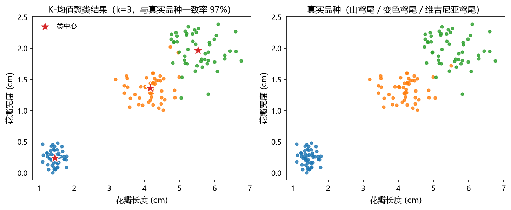

**图 4-17 鸢尾花数据的 K-均值聚类结果（左）与真实品种（右）**

MATLAB 实现的核心代码非常简短（完整脚本：`脚本/Chapter4/CLUSTER_exp02_iris_kmeans.m` 与 `CLUSTER_exp03_iris_hierarchical.m`）：

```matlab
load fisheriris                     % meas: 150×4 测量值；species: 品种名

% K-均值：k=3，并画轮廓图评价
idx = kmeans(meas, 3);
silhouette(meas, idx);              % 轮廓值均大于 0，聚类基本合理

% 与真实品种对照（外部评估：混淆矩阵）
crosstab(species, idx)              % 行=品种，列=聚类类别

% 层次聚类：谱系图 + 切 3 类
Z = linkage(meas, 'average', 'euclidean');
dendrogram(Z);                      % 从上往下看，可人工画线分 2、3、4 类
T = cluster(Z, 3);
```

层次聚类在这里还能发挥它"不预设类数"的长处：谱系图从上往下看，用户可以随意画线观察分成二类、三类、四类各是什么格局——这是 K-均值（必须先定死 k）做不到的，两个方法各有特色。MATLAB 官方的完整演示可用 `openExample('stats/clusterdemo')` 打开（见延伸阅读）。

### 4.6.3 上机练习：31 个省市区的聚类

作为本章的配套作业，请读者完成：根据 31 个省（市、区）的人均 GDP、财政收入等 8 个指标进行聚类分析。要求：

1. 至少采用 3 种聚类分析方法（如层次聚类、K-均值、DBSCAN）；
2. MATLAB 或 Python 代码要有注释；
3. 对聚类方法有一定优化（例如：先做量纲检查与标准化，尝试不同的距离与合并策略，用轮廓系数或肘部法确定类数，多方法结果投票比较）；
4. 结果图和处理说明写入文档，与方法选择、参数尝试的过程一起提交。

## 4.7 本章小结

聚类分析是数据挖掘四类功能中的第一类，也是无监督学习的代表。本章要点归纳如下：

1. **定义与目标**：聚类把对象分成事先未给定的类别，使**类别内部差异尽可能小、类别之间差异尽可能大**——一个"最小化 + 最大化"的双目标优化问题，决策变量是每个样本的类别标签。
2. **三个"不清楚"**：不清楚样本属于哪一类（无 Y，无监督学习）；不清楚两个样本是否同类（需定义样本间与类间**两个距离**）；不清楚共几类（在 1 到 n 范围内"猜一猜"，算完用指标评判）。
3. **相似性度量**：变量之间用夹角余弦、相关系数（相似系数，越大越相似）；样本点之间用距离（平方欧氏最常用，另有街区、切比雪夫、马氏、闵可夫斯基等）；类别之间用最短/最长距离、中心法、组间平均、离差平方和（Ward）法。变量与样本的度量可互换（行列置换）。
4. **Q 型与 R 型**：按变量对样本聚类为 Q 型（常用），按样本对变量聚类为 R 型，两者无本质区别。
5. **硬聚类与软聚类**：硬聚类每点只属一类（k-均值、k-中心点、层次聚类、自组织映射），软聚类以隶属度/概率属于多类（模糊 c-均值、高斯混合模型）。方法选择回答五个问题：对象（样本/变量）、归属（单类/多类）、类数（已知 kmeans/未知分层）、形状（凸形 kmeans/非凸 DBSCAN、谱聚类）、距离可算性与噪音（基于众数、k-中心点、DBSCAN）。
6. **层次聚类**：合并法自下而上（每个对象自成一类，逐层合并最近的类），分解法方向相反；谱系图把所有可能分类摆出来，由用户画线定类数；MATLAB 有 `clusterdata` 单函数法与 `pdist`/`squareform`/`linkage`/`dendrogram`/`cophenet`/`cluster` 多函数法；经验上点间用标准化欧氏距离、类间用重心/平均/加权平均法，量纲要统一、变量相关时用马氏距离或主成分；Cophenetic 相关系数越接近 1 聚类越好。
7. **K-均值聚类**：五步——定 K、定初始中心、按距离最近原则分配、按类重算中心、迭代至收敛（达最大迭代次数或中心偏移小于阈值）；两个假设（类数、初始中心）都有主观性，"多算几遍取最好"是朴素而有效的对策；目标函数是簇内误差平方和 SSE，默认平方欧氏距离；`kmeans` 配合 `silhouette` 评价。
8. **DBSCAN**：把簇定义为密度相连点的最大集合，能发现任意形状的簇、识别噪音点、不需要类数先验；两个参数为邻域半径 Eps 与最小点数 MinPts（≥ 变量数 + 1，Eps 可由 k 距离图拐点初选）；三种点为核心点、边界点、噪音点，三种关系为直接密度可达（非对称）、密度可达（非对称、可传递）、密度相连（对称）；`dbscan(X, epsilon, minpts)` 一句调用；密度不均匀时效果欠佳。
9. **评估与优化**：外部评估需真值或参考模型（混淆矩阵、纯度/正确率、Jaccard、FM、Rand 指数）；内部评估只靠数据自身——轮廓系数 S(i)=(b−a)/max{a,b}（单点与全体均值，[-1,1] 越大越好，负值提示错分）、SSE 随 K 的"肘部"定类数，另有 CH、DB、Dunn 指数。
10. **案例**：福冈甜橘引种把"找相似地点"转化为距离与聚类问题，三种方案两票长沙、一票武汉，投票综合并讨论了量纲标准化；鸢尾花数据"有真值装不知道"，聚类与品种对照一致率约九成以上，是外部评估的经典练习场。

## 思考题

1. 聚类的目的和特点是什么？
2. 有哪些常用的聚类方法？
3. 聚类之前是否要对数据进行标准化？什么情况下必须标准化？
4. 怎么选择点间和类间的距离？
5. 怎么评价和判断聚类的效果？
6. 除了本章讲的三种方法，还有其他聚类方法吗？（提示：谱聚类、模糊 C-均值、高斯混合模型、自组织映射……）
7. 聚类和分类的区别是什么？

## 延伸阅读

1. MATLAB 官网关于聚类分析的介绍：
   <https://ww2.mathworks.cn/help/stats/cluster-analysis.html>
2. Fisher 鸢尾花数据的聚类分析（MATLAB 官方示例）：
   <https://ww2.mathworks.cn/help/stats/cluster-analysis-example.html>
3. MATLAB 官网关于 DBSCAN 聚类与 k 距离图画法的示例：
   <https://ww2.mathworks.cn/help/stats/dbscan-clustering.html> 与
   <https://ww2.mathworks.cn/help/stats/dbscan.html>
4. Python 的 scikit-learn 包关于聚类分析的介绍（供使用 Python 的读者参考，其中有与本章图 4-4 类似的"不同方法 × 不同数据集"对比示例）：
   <https://scikit-learn.org/stable/modules/clustering.html>

> 本章插图取自本讲课件《机器学习与地学应用·第四讲 聚类分析》，由作者据课件与讲稿重绘。


