# 第5章 降维

> **本章导读**：在接触具体的预测模型之前，本书先补齐数据挖掘四类功能中的另一类——**降维**。前面几章解决的都是"有多少个变量就用多少个变量"的问题，本章要回答的是相反的问题：当自变量太多、而且彼此相关（存在共线性）时，怎样用**更少的变量**去描述原始问题。降维有两大思路：一是**不构造新特征**，直接分析原变量之间的相似性，把高度相似的特征去掉；二是**构造新特征**，把 $n$ 维特征重新映射到 $k$ 维（$k<n$）的新空间中。第二条思路最经典的两个方法是**主成分分析**（PCA）与**因子分析**（FA）——一个"往后推"，用原变量的线性组合综合出主成分；一个"往前推"，把原变量分解为少数潜在因子。本章以较大篇幅讲透这两个方法的原理、求解与 MATLAB 实现，最后用 31 个省市区 8 项经济指标的因子分析案例收尾。学完本章，"聚类 + 降维"这两类无监督功能就都齐备了。

## 5.1 降维方法概述

### 5.1.1 从方法体系看降维

按照本书的惯例，先回到"数据挖掘/机器学习的典型方法"总表，看看本章方法所处的位置（表 5-1 中加粗部分）。

**表 5-1 数据挖掘/机器学习的典型方法**

| 类别 | 聚类 | 降维 | 回归 | 分类 |
|------|------|------|------|------|
| 线性方法 | — | **相关性分析、主成分分析、因子分析** | 多元线性回归 | Logistic 回归、判别分析 |
| 最近邻 | k 均值聚类 | — | kNN | kNN |
| 树型 | 层次聚类 | — | 决策树（回归树） | 决策树（分类树） |
| 密度 | DBSCAN | — | — | — |
| 神经网络 | 自组织映射（SOM） | — | ANN | ANN |
| 核函数 | — | — | SVR | SVC |
| 图论 | 谱聚类 | — | 概率图模型 | 概率图模型 |
| 随机变量 | 高斯混合模型 | — | — | 贝叶斯分类 |
| 模糊数学 | 模糊 C 均值聚类 | — | 模糊逻辑模型、ANFIS | 模糊逻辑模型 |
| 深度学习 | — | — | CNN、LSTM | CNN |

可以看到，总表中"降维"这一列目前只有线性方法一行有内容——相关性分析、主成分分析、因子分析，它们正是本章的主角。深度学习中的自动编码器（autoencoder）也能通过"压缩—重构"学习低维表示（见第 11 章），但经典、常用、入门必学的降维方法，仍然首推本章的两个。

### 5.1.2 降维的定义与必要性

**降维**（dimension reduction）的定义：通过某种数学变换，将原始**高维属性空间**转变为一个**低维"子空间"**（subspace）。

为什么需要降维？第一个要面对的问题通常是：数据中存在**多个自变量**，而且某些自变量之间存在**线性相关**（共线性）。既然有些变量之间是相关的——换句话说，它们携带的信息有重叠——我们就有可能只保留其中一个来代替与它高度相关的一批变量，从而**用更少的变量去描述原始问题**。回顾前面讲过的距离概念：有些自变量与另外一些自变量"距离"非常近，近到可以用一组中的一个代替其他与它相近的变量。

顺着这个想法，把问题稍微扩展一下就会发现另一个维度：本章讨论来讨论去，看的都只是自变量 $X$，没有考虑 $Y$。而实际问题中 $Y$（因变量）常常是存在的——本书前面讲过，按有没有 $Y$，数据挖掘与机器学习方法分成**有监督学习**与**无监督学习**两大类。带着 $Y$ 对自变量降维，这类问题有一个专门的名字：**特征选取**（feature selection）。特征选取与我们本章的方法关系密切：它有一个"退而求其次"的做法——虽然有 $Y$，也可以不看 $Y$，直接对 $X$ 做无监督降维。所以广义地说，特征选取里也可以包含本章的无监督降维方法；反过来，无监督降维是特征选取的一个特例。两者的最大差别就在于：特征选取是"看着 $Y$"来挑选 $X$，而降维不看 $Y$。

### 5.1.3 怎么降维：两大思路

既然需要降维，那怎么降？总体上有两大思路（表 5-2）。

**表 5-2 降维的两大思路**

| 思路 | 原理 | 方法 | 步骤 |
|------|------|------|------|
| **不构造新的特征** | 从 $n$ 维特征中去除其余 $n-k$ 个特征，保留 $k$ 个特征 | 相似性分析、R 型聚类，或其他统计检验 | 1）根据某种指数，描述 $n$ 维特征两两之间的相似性；2）过于相似的特征只保留其中一个 |
| **构造新的特征** | 将 $n$ 维特征映射到 $k$ 维上（$k<n$），重新构造出全新的 $k$ 维特征 | 主成分分析（PCA）或因子分析（FA） | 1）构造 $n$ 个正交的特征；2）将 $n$ 个新特征按某种性能指数排序；3）量化每个特征的描述能力；4）选取足够描述数据的前面 $k$ 个新特征 |

第一种思路比较"偷懒"：不造新变量，只在原有特征里挑挑拣拣，把相似的扔掉。这需要做**相似性分析**——考察 $X$ 与 $X$ 之间是否相似。上一章讲层次聚类时，是在**样本（行）之间**两两算距离看相似；这里只需把表格**转置一下**，对**属性（列）**做同样的聚类，就是所谓的 **R 型聚类**。对计算机来说，行和列没有本质区别，转置一下重新算即可。除聚类外，也可以用相关系数等其他统计检验方法，本质上都是计算某种**相似性指数**来量化特征之间的相关程度：如果几个自变量两两都相关，挑一个出来就行——两个高度相关，二取一即可。

第二种思路则承认原有特征"不完美"，干脆**重新构造一批新自变量**：让它们尽可能表达原来 $X$ 的信息，同时又满足一些好性质（比如相互正交），并且数量比原来少——这就是降维的含义。构造新特征时要回答两个问题：**多少个 $k$ 合适？**（太少信息损失大，太多起不到降维作用）**新特征之间要不要正交？**通常是要的：正交的轴在矩阵运算中有很多优良性质，方便证明与计算；现实数据放到多维空间中观察，大多数情况下轴与轴之间也是正交的。本章的主角——主成分分析与因子分析——就属于这条思路。

### 5.1.4 降维以后能做什么

降维不是为降而降，降完之后至少可以做四件事：

1. **观察样本分布**。把数据投影到新轴（更少的原自变量或新自变量）组成的空间上，在 2~3 维新空间中画散点图，观察样本的分布。比如原来有 10 个 $X$ 没法画图，降到 2~3 个新变量之后就可以画出来看了——虽然不完美（不能把 100% 的信息都反映出来），但通常 80% 以上的信息都反映出来了，已经能看出数据的主要结构。
2. **观察变量关系**。把旧轴（原自变量）投影到新轴组成的空间上，在 2~3 维空间中画成射线，观察原变量的分布与相互关系。
3. **分析新旧变量关系**。构造新特征会得到载荷矩阵，据此分析新旧自变量之间的关系，进而**推测新自变量的含义**。
4. **进一步建模**。用更少的原自变量或新自变量建立后续模型，可以减少噪声数据、节省数据存储、缩小模型体积、缩短训练时间。

### 5.1.5 不构造新特征：相关性分析

**（1）度量单个特征的相关性：F 检验与互信息**

要判断两个变量之间有没有关系，散点图最直观，但定量的判断需要指数。图 5-1 展示了同一个因变量 $y$ 与三个自变量的关系：$x_1$ 与 $y$ 线性相关，$x_2$ 与 $y$ 是非线性（正弦形）相关，$x_3$ 与 $y$ 无关。

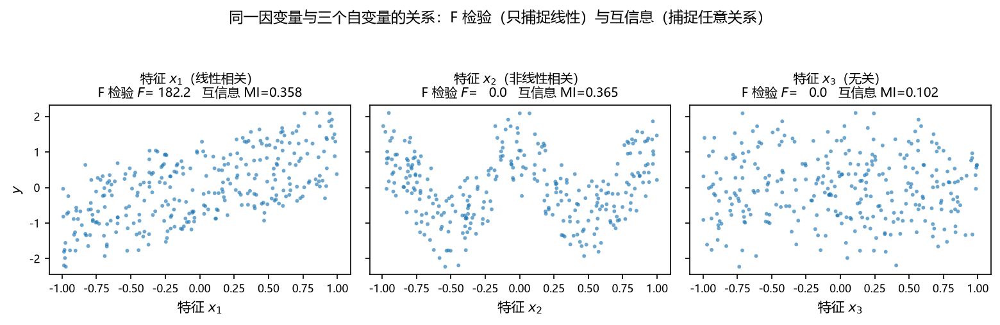

**图 5-1 F检验与互信息对三种关系的识别能力对比**

- **F 检验**：检验两组数据（$X$ 和 $Y$）之间的**线性关系**，原假设是"$X$ 和 $Y$ 不存在显著的线性关系"，返回 $F$ 值和 $p$ 值；$p$ 值小于 0.05 或 0.01 时，认为 $X$ 和 $Y$ 显著线性相关。
- **互信息法**（Mutual Information，MI）：检验特征与标签之间**任意关系**（包括线性和非线性关系）的过滤方法。

图 5-1 中 $F$ 值与 MI 值和实际散点图的对应关系很好地说明了两者的差别：$x_1$ 的线性关系两种指数都能识别（$F$ 值与 MI 都大）；$x_2$ 的非线性关系 F 检验几乎无能为力（$F$ 值很小），互信息却能识别出来（MI 明显偏大）；$x_3$ 与 $y$ 无关，两种指数都很小。选择度量时要注意这一差别——如果怀疑变量之间存在非线性关联，不要只依赖线性相关指标。

**（2）多变量两两相关：散点图矩阵**

实际数据中自变量往往不止两个。图 5-2 用一个地学示例展示四个自变量的**散点图矩阵**：对角线是每个变量自身的分布直方图，下三角是两两散点图，上三角标注对应的相关系数。四个变量两两组合，若某个变量与自身比较就是一条直线（自身分布），其他格子画的都是散点。

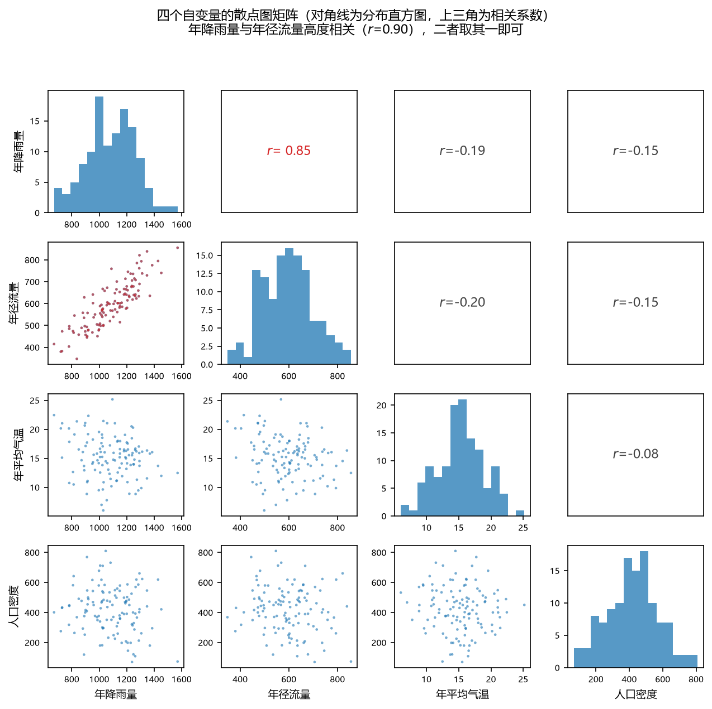

**图 5-2 四个自变量的散点图矩阵**

从图中一眼可以看出：**年降雨量与年径流量**高度相关（$r=0.90$），散点紧密分布在一条直线附近——这两个变量二取一即可；其余变量对之间相关性都不明显，可以保留。这就是"看散点图—算相关系数—去掉高度相关特征之一"的完整流程。

**（3）对属性聚类：R 型聚类**

图 5-3 是第三种做法，乍一看很像上一章讲层次聚类时的树状图，但聚类的对象不是**样本**而是**属性（变量）**——把数据表转置后对"列"做层次聚类，就是 R 型聚类。左图中两个变量的连线越低（距离越近），说明二者越相似：年降雨量、年径流量、相对湿度聚成紧密的一族，年平均气温、蒸发量聚成另一族，人口密度自成一类。在同一族里挑一个代表变量、扔掉其余，就完成了特征约减；右图的相关系数矩阵热力图从另一个角度印证了同样的结构。

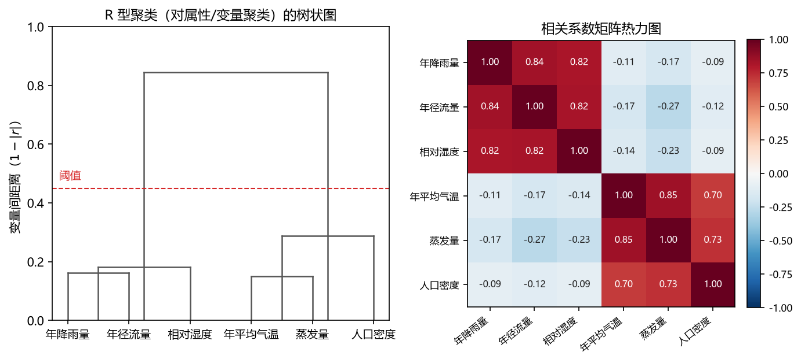

**图 5-3 R型聚类树状图（左）与相关系数矩阵热力图（右）**

以上三个例子都属于"不构造新 $X$"的降维：**从已有特征中考察相似性，把高度相似的特征剔除**。它们简单直接，但也有局限——每个保留下来的特征仍然是原来的变量，并没有产生新的综合信息。

**（4）无监督降维与有监督特征选取的方法一览**

构造新特征的无监督降维方法不止 PCA 与 FA 两种，表 5-3 列出常用的四种。除本章重点讲解的两种外，**非负矩阵分解**适合所有元素均非负的数据（如遥感影像反射率、光谱矩阵）；**独立成分分析**不要求自变量服从正态分布——主成分分析与因子分析的部分求解假设自变量正态，遇到非正态数据效果不好时，可以尝试 ICA。这些方法现在都有现成的软件包和函数，有兴趣的读者可以自学。

**表 5-3 常见的无监督降维方法**

| 方法 | 英文名 | 含义 | 适用条件 |
|------|--------|------|----------|
| 主成分分析 | Principal Component Analysis，PCA | 综合变量既要尽可能多地反映原来变量的信息，又要彼此互不相关（正交） | 部分求解要求自变量是正态分布；部分自变量存在多重共线性 |
| 因子分析 | Factor Analysis，FA | 将原始变量分解为少数几个因子，以再现原始变量与因子之间的关系；因子最好正交 | 部分求解要求自变量是正态分布；部分自变量存在多重共线性 |
| 非负矩阵分解 | Non-negative Matrix Factorization，NMF/NNMF | 找到非负矩阵 $W$ 与非负矩阵 $H$，使其乘积近似等于矩阵 $V$：$V_{n \times m}=W_{n \times k} \cdot H_{k \times m}$（非负矩阵 $V$ = 特征 $W$ × 系数 $H$） | 原始数据矩阵中所有元素均为非负数 |
| 独立成分分析 | Independent Component Analysis，ICA | 一组混合的观测信号中分离出独立信号；认为观测信号是若干统计独立分量的线性组合，要做的是解混过程 | 自变量可以是非正态分布，或至少不全是正态的 |

有监督的那一支——**特征选取**——也有成熟的方法体系（表 5-4）。**过滤法**（Filter）不依赖后续算法，直接用统计性能评估特征，速度快，但与后续学习算法的性能偏差可能较大；**封装法**（Wrapper）把后续学习算法的训练准确率作为特征子集的评价标准，偏差小、计算量大；**逐步回归分析**是最经典的封装式思路之一：将变量逐个引入模型，每引入一个变量做 F 检验/t 检验，保证回归方程中只包含显著性变量，反复迭代直到解释变量集最优——从一个变量开始慢慢往里添加，或从所有变量开始往外剔除，双向进行，始终盯着回归方程的效果。本章不展开特征选取，读者知道"带着 $Y$ 挑 $X$"这一支的存在即可。

**表 5-4 常见的有监督特征选取方法**

| 方法 | 英文名 | 含义 | 适用条件 |
|------|--------|------|----------|
| 过滤法 | Filter | 使用评价准则来增强特征与类的相关性、削减特征之间的相关性；评价函数分四类：距离度量、信息度量、依赖性度量、一致性度量 | 与后续算法无关，直接利用所有训练数据的统计性能评估特征，速度快，但评估与后续学习算法的性能偏差较大 |
| 封装法 | Wrapper | 通过搜索策略，获得使模型取得较高性能的特征子集 | 利用后续学习算法的训练准确率评估特征子集，偏差小，计算量大，不适合大数据集 |
| 逐步回归分析 | Stepwise Regression Analysis | 将变量逐个引入模型，进行 F 检验/t 检验，确保每次引入新变量之前回归方程中只包含显著性变量，反复迭代直到解释变量集最优 | 属于 Wrapper；自变量是正态分布；部分自变量存在多重共线性 |

### 5.1.6 构造新特征的直觉：投影到低维空间

"构造新 $X$"听起来抽象，先用两个直观的例子建立感觉。

图 5-4 中，粉橙色的数据点分布在一个三维空间里。拿一个二维平面"盖"在这些点上——但不是随便盖，而是找一个**让所有点投影上去之后损失最小**的平面；再把视角旋转到正对这个平面（右图），可以看到点与平面几乎重合，只有很少的一点信息没被包括。把所有点投影到这个二维平面上，平面上的两个坐标轴就是**新造的两个 $X$**——用两个新轴构成的空间代替原来的三维空间，至于垂直于平面的那一维（信息量很小）就扔掉了。以后想不起 PCA 是做什么的，回来看这张图：三维转二维，有损失，但损失很小。

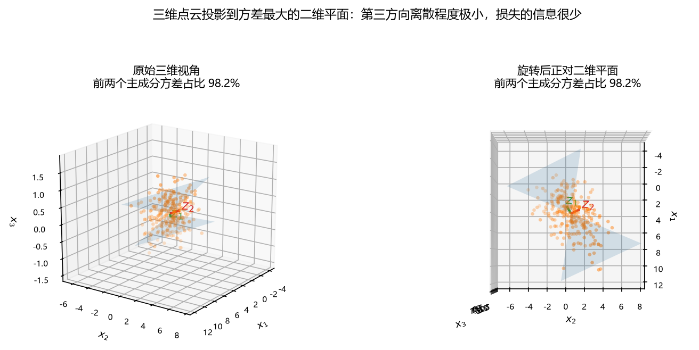

**图 5-4 三维点云投影到方差最大的二维平面**

再简单一点，二维的情形：图 5-5 左图中数据点在一个二维空间里呈**偏斜的椭圆**状分布。沿着椭圆的**长轴**画一条绿色的轴，再在垂直方向画一条红色的短轴。如果只用一个轴来表示这些点，沿着绿轴（长轴）表示基本就能解决问题——数据点在绿轴上的投影已经覆盖了绝大部分变化范围；红轴（短轴）上那些很小的变化就不要了。这是一个典型的**二维转一维**。

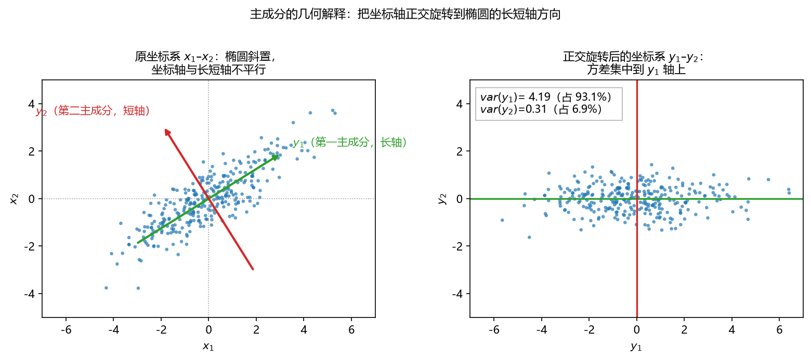

**图 5-5 二维椭圆点云与主成分坐标旋转**

这两张图把降维的基本思想都表达出来了：**具体计算可能稍复杂，但思想很简单，也非常有效**。下一节开始，我们把这两个例子背后的方法正式化——它就是主成分分析。

## 5.2 主成分分析

### 5.2.1 目的与基本思想

**主成分分析**（Principal Component Analysis，PCA）的目的：降低原变量**共线性**的消极影响，**约减变量**、系统降维、简化复杂的分析过程；对系统的发展进行综合评价，或者寻找某种隐含的因果关系、揭示自然规律。降维本身还附带一个好处：降到二维、三维之后，就可以把高维数据画成图来观察了。

PCA 的基本思想：**将原来的变量进行线性组合，作为新的综合变量**，要求新的综合变量尽可能多地代表原来变量的信息，并且彼此之间互不相关。这里有两个关键点。

**第一，"信息"用什么测量？——方差。** 大家在概率论与数理统计中学过：描述一个数据的离散程度用什么？方差；描述集中趋势用什么？均值。这两个概念非常基本。数据在某个轴上投影后方差越大，说明点在这个轴上被"拉得非常开"，每个数据点都有自己明确的位置、依次排开，这个轴就更好地表达了数据的信息；反之，投影后方差很小、点挤在一起，这个轴的表达能力就弱。所以 PCA 要求第一主成分 $F_1$ 的方差 $\mathrm{var}(F_1)$ 尽可能大。

**第二，第二个及之后的主成分要与前面的不相关。** 如果第一主成分不足以代表原来 $p$ 个变量的信息，再考虑选取第二个线性组合 $F_2$，要求 $\mathrm{cov}(F_1, F_2)=0$，即 $F_2$ 的信息不再重复 $F_1$ 已表达的部分，称 $F_2$ 为第二主成分，依此类推。$n$ 个变量最多可提取 $n$ 个主成分；为了简化数据，通常只保留少于 $n$ 个。最后一个（或几个）主成分的方差最小——数据投影上去都聚集在一个点附近，没什么表达力，自然可以舍弃。

还要注意一点：提取出的主成分能包含主要信息即可，**不一定非要有准确的实际含义**——主成分是抽象的综合变量，可解释性可能比原始变量低。这是它和因子分析的重要差别之一，后文详述。

### 5.2.2 几何解释：椭圆与坐标旋转

设有 $n$ 个样品、每个样品有两个变量，在二维空间中讨论主成分的几何意义。设 $n$ 个样品在二维空间中的分布大致为一个**椭圆**（图 5-5 左）。从图中可以看到两个性质：

1. 坐标轴 $x_1$、$x_2$ 与椭圆的长短轴**不平行**——数据的相关性体现在椭圆是"斜"的；
2. 我们完全可以把坐标系**正交旋转**一个角度 $\theta$，让新轴 $y_1$ 恰好沿椭圆**长轴**方向、新轴 $y_2$ 沿**短轴**方向（图 5-5 右）。

这就是线性代数课程中讲过的坐标旋转变换，旋转公式为：

$$\begin{cases} y_1 = x_1\cos\theta + x_2\sin\theta \\ y_2 = -x_1\sin\theta + x_2\cos\theta \end{cases} \tag{5-1}$$

写成矩阵形式：

$$\boldsymbol{y} = \boldsymbol{U}\boldsymbol{x} \tag{5-2}$$

式中 $\boldsymbol{U}$ 为坐标旋转变换矩阵，它是**正交矩阵**，满足 $\boldsymbol{U}^{T}\boldsymbol{U}=\boldsymbol{I}$（即各行元素的平方和为 1，如 $\sin^2\theta + \cos^2\theta = 1$）、$\boldsymbol{U}^{-1} = \boldsymbol{U}^{T}$。

旋转后的新坐标 $y_1$、$y_2$ 有如下性质：

1. $n$ 个点的坐标 $y_1$ 与 $y_2$ 的相关**几乎为零**——新变量互不相关；
2. 二维平面上 $n$ 个点的方差**大部分都归结到 $y_1$ 轴上**，$y_2$ 轴上的方差较小。

$y_1$、$y_2$ 称为原始变量 $x_1$、$x_2$ 的综合变量。由于 $n$ 个点在 $y_1$ 轴上的方差最大，用 $y_1$ 轴上的一维综合变量来代替二维空间的点，**所损失的信息量最小**，故称 $y_1$ 轴为**第一主成分**；$y_2$ 轴与 $y_1$ 轴正交、方差较小，称为**第二主成分**。当坐标轴与椭圆的长短轴平行时，代表长轴的变量描述了数据的主要变化，代表短轴的变量描述了次要变化。一个重要的经验规律：**椭圆（球）的长短轴相差得越大，降维越好**——短轴方向的信息越可以放心丢弃。

图 5-6 从"投影方差"的角度再演示一遍这个道理：同一组二维散点，沿方差大的方向（第一主成分方向）投影，点被拉开、依次排开，信息得以保留；沿方差小的方向投影，点挤在一起，几乎无法区分。

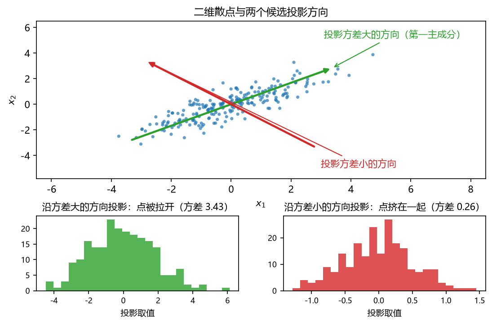

**图 5-6 不同投影方向上的方差对比**

### 5.2.3 数学表达与求解

**（1）元素形式**

主成分 $y$ 与原始变量 $x$ 之间的关系可写为：

$$y_i = a_{i1}x_1 + a_{i2}x_2 + \cdots + a_{ip}x_p, \qquad i = 1, 2, \cdots, p \tag{5-3}$$

即每个主成分都是原来 $p$ 个变量的线性组合（综合）。系数 $a_{ij}$ 为第 $i$ 个主成分 $y_i$ 与原来的第 $j$ 个变量 $x_j$ 之间的线性相关系数，称为**载荷**（loading）。理论上可以构造 $p$ 个新变量，构造完之后发现前几个已经包含了足够的信息，就把剩下的扔掉——这就是降维。有的书把新变量记作 $Y$、有的记作 $Z$，只是记号不同。

**（2）求解思路：从优化问题到特征值分解**

对于正交属性（新自变量/新轴）空间中的样本点，如何用一个超平面对所有样本进行恰当的表达？这个超平面应有两个性质：

- **最近重构性**：重构后的样本映射回原空间，与原样本的距离都足够近；
- **最大可分性**：样本在这个超平面上的投影尽可能分开。

从"最大可分性"出发：样本点在新空间超平面上的投影若能尽可能分开，则应使**投影后样本点的方差最大化**。写成优化问题：寻找单位方向 $\boldsymbol{w}$（$\boldsymbol{w}^{T}\boldsymbol{w}=1$），使投影方差

$$\max_{\boldsymbol{w}} \; \boldsymbol{w}^{T}\boldsymbol{\Sigma}\boldsymbol{w}, \qquad \mathrm{s.t.} \; \boldsymbol{w}^{T}\boldsymbol{w}=1 \tag{5-4}$$

式中 $\boldsymbol{\Sigma}$ 为样本协方差矩阵。约束条件保证了任意两个轴之间正交。用拉格朗日乘子法求解这个等式约束优化，得到的最优解条件恰好是**特征值方程**：

$$\boldsymbol{\Sigma}\boldsymbol{v}_i = \lambda_i \boldsymbol{v}_i \tag{5-5}$$

这是整个 PCA 中最巧妙的地方：表面上要求解一个复杂的约束优化问题，但数学上已经证明，它的解就是**对协方差矩阵做特征值分解**——把特征值从大到小排序，取前 $d$ 个特征值对应的特征向量构成投影矩阵，这就是主成分分析的解。

由此得到几组重要的对应关系（表 5-5）。

**表 5-5 PCA 求解中的几个对应关系**

| 概念 | 对应的计算 |
|------|-----------|
| 原始数据 $X$ | 原始数据或其标准化 |
| 协方差矩阵 $E$ | 计算 $E$ 的特征值和特征向量 |
| $E$ 第 $i$ 大的特征值 | 第 $i$ 个主成分的方差（投影方差与特征值相等） |
| 特征值的大小顺序 | 主成分的方差顺序 = 主成分顺序 |
| $E$ 第 $i$ 大特征值对应的特征向量 | 第 $i$ 个主成分的系数（载荷） |

注意一个很实用的推论：整个求解只依赖协方差矩阵 $E = X^{T}X/(n-1)$ 的特征值分解。因此**即使不掌握原始数据 $X$，只要给出协方差矩阵（或相关系数矩阵），同样可以完成主成分分析**——后面因子分析的 `factoran` 函数就支持直接从协方差矩阵出发求解。

**（3）求解的一般算法**

按定义法求解 PCA 的完整流程见图 5-7。第一步的标准化不可省略：求方差时若不做标准化，不同变量的数量级差异会对后面的计算产生很大影响（比如 GDP 以万亿元计、价格指数在 100 附近，前者的方差会完全淹没后者）。

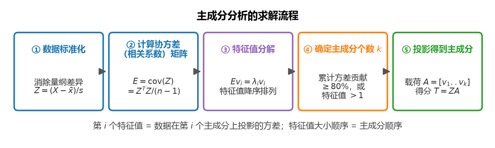

**图 5-7 主成分分析的求解流程**

### 5.2.4 主成分个数的确定

理论上，新轴的数量可以等于原来的 $n$ 个——相当于只把坐标轴旋转了一下。做完之后发现前 $k$ 个轴的信息已经足够，就把剩下的扔掉。一般按如下原则决定保留多少个主成分（表 5-6）。

**表 5-6 确定主成分数量的常用标准**

| 标准 | 说明 |
|------|------|
| 特征值大于 1 | 以协方差矩阵特征值（也是主成分得分的方差）大于 1 为标准，或根据特征值折线图上的明显**转折点**判断 |
| 累计方差贡献不低于 80% | 以累计方差贡献不低于 80% 为标准；有时可根据具体情况将标准降低到 70% |
| 公因子方差相差不大 | 以各变量被保留主成分解释的公因子方差相差不大为判据 |
| Bartlett 检验 | 借助 Bartlett 检验（一种卡方检验）进行统计判断 |

其中最常用的是第二条：计算每个主成分的方差贡献率（特征值占总方差之比）并累加，当前 $k$ 个主成分的累计方差贡献率超过 80% 时就停在那里。有的同学会问"为什么是 80%？有什么道理？"——这并没有严格的理论依据，它只是一个约定俗成的经验阈值，含义是"取到的这几个轴能解释总方差的八成以上即可"；实在找不到 80% 时可以放宽到 70%，特殊问题还可酌情处理。此外，观察**碎石图**（特征值折线图）上的转折点也是常用的辅助手段：前几个主成分的特征值相近且较大、后面突然变得特别小，那么转折点之后的都可以扔掉。不管采用何种标准，都可以将主成分残差分析、相关系数残差分析等作为辅助判据，并将两种乃至更多的标准结合起来使用。

### 5.2.5 MATLAB 实现

**（1）方法一：定义法**

按 5.2.3 节的求解思路，用基础命令分步实现（表 5-7）。

**表 5-7 MATLAB 实现PCA（方法一：定义法）**

| 步骤 | 命令 | 含义 |
|------|------|------|
| 1 | `mean` `std` | 将原始数据标准化 |
| 2 | `corrcoef` / `cov` | 计算协方差矩阵或相关系数矩阵 |
| 3 | `eig` | 计算协方差矩阵的特征值和特征向量 |
| 4 | `diag` `cumsum` | 计算主成分的累计方差贡献 |
| 5 | 开平方根、矩阵运算 | 计算主成分载荷和方差 |
| 6 | 矩阵运算 | 计算主成分得分，并将其标准化 |
| 7 | `plot` | 绘图：特征值折线图、主成分载荷图（特征向量图）、主成分得分图 |
| 8 | 矩阵 | 简单的检验 |

**（2）方法二：单命令法**

MATLAB 将上述流程封装成一条 `pca` 命令，配套的辅助命令见表 5-8。

**表 5-8 MATLAB 实现PCA（方法二：单命令法）**

| 命令 | 含义 |
|------|------|
| `pca` | 求出主成分（核心计算） |
| `pareto` | 得到特征值的百分比和累计百分比（主成分的排序关系和解释能力），用于选几个 PC |
| `gname` | 得到载荷图上的变量标识（主成分和原变量关系图）、主成分得分图上的样品标签（主成分和样本的关系图，即样本在主成分空间散点图），观察新坐标轴下的投影 |
| `pcacov` | 从协方差（相关系数）矩阵出发，求特征值、特征向量、方差贡献百分比 |
| `pcares` | 给定主成分数量下的残差分析 |
| `battest` | Bartlett 检验（一种卡方检验） |

其中 `pareto` 画出的图同时包含**柱形图**（各个主成分的方差贡献量）与**折线图**（提取若干个主成分后的方差累计贡献），正是 5.2.4 节确定主成分个数时最常用的可视化工具。`gname` 的用法：图上出现两条十字交叉的定位线，移动鼠标，定位线的交叉点跟着移动；选中需要给出标志的数据点点击，即可出现变量（或样品）标签；不想再标识散点时，连续按 Esc 键退出。

**（3）pca 函数的调用格式**

**表 5-9 pca 函数的主要语法**

| 格式 | 用途 |
|------|------|
| `coeff = pca(X)` | 返回 $n \times p$ 数据矩阵 $X$ 的主成分系数（也称为载荷）。$X$ 的行对应观测值，列对应变量；系数矩阵是 $p \times p$ 矩阵，`coeff` 的每列包含一个主成分的系数，列按成分方差的降序排列。默认情况下，`pca` 将数据中心化，并使用奇异值分解（SVD）算法 |
| `coeff = pca(X,Name,Value)` | 使用一个或多个"名称-值"对组参数指定附加选项后返回上述语法的结果，例如指定返回的主成分数或 SVD 以外的算法 |
| `[coeff,score,latent] = pca(___)` | 还在 `score` 中返回主成分分数（$X$ 在主成分空间中的表示，行对应观测值、列对应成分），在 `latent` 中返回主成分方差（$X$ 的协方差矩阵的特征值） |
| `[coeff,score,latent,tsquared] = pca(___)` | 返回 $X$ 中每个观测值的 Hotelling $T^2$ 统计量（标准化主成分得分到平均位置的距离平方） |
| `[coeff,score,latent,tsquared,explained,mu] = pca(___)` | 返回 `explained`（每个主成分解释的总方差的百分比）和 `mu`（$X$ 中每个变量的估计均值） |

`pca` 之外，`pcacov` 直接从协方差或相关系数矩阵出发：给出特征值、特征向量与方差贡献百分比；`pcares` 做给定主成分数量下的残差分析；`battest` 做 Bartlett 检验。用 `pca` 一条命令求出系数后，其余的辅助计算（每个主成分的方差、累计贡献、样本在新轴上的投影得分）都可以配合上述函数完成，具体参数请读者自行查阅 MATLAB 帮助文档。

## 5.3 因子分析

### 5.3.1 因子分析的概念与模型

**因子分析**（Factor Analysis，FA）的定义：**每个已测变量等于数量较少的未发现（潜在）因子的线性组合**；每个因子都可能影响多个变量，所以称为**公因子**。

先明确第一点：因子分析也是要构造新的自变量。它与主成分分析的方向恰好相反——主成分分析是**往后推**：拿原始数据 $X$ 做线性组合，综合出新的指标（主成分），找的是"**后果的指标**"；因子分析是**往前推**：找一些潜在的、未发现的因子，用它们的组合来表达原始数据 $X$，找的是"**前因的要素**"。有人认为因子分析是一种更普遍的降维方法，是主成分分析的推广和扩展。

一个贴近同学们的例子：期末拿到成绩单，语文、英语、写作、数学、物理、计算机……各门课的成绩五花八门。做分析时可能发现，很多门课的高分都源于同一个原因——**逻辑推理能力**强，它影响了数学、物理、计算机这些偏计算偏推理的课程；另一些课的高分源于**语言驾驭能力**强，它影响了英语、语文、写作这些语言相关的课程。"逻辑推理能力""语言驾驭能力"就是潜在的、不太好直接测量的**因子**；它们是综合的变量，各自与多个观测变量 $X$ 有关系。把"成绩 = 因子的组合"这层关系找到，新的（更少的）自变量就间接找到了。

因子分析的一般模型（元素形式）：设 $p$ 维总体 $\boldsymbol{x}=(x_1, x_2, \cdots, x_p)^{T}$，

$$x_i = a_{i1}f_1 + a_{i2}f_2 + \cdots + a_{im}f_m + \varepsilon_i, \qquad i = 1, 2, \cdots, p \tag{5-6}$$

式中：

- $f_1, f_2, \cdots, f_m$ 为 $m$ 个**公共因子**（因子出现在每个原始变量与因子的线性组合中，因此称为公因子）；
- $\varepsilon_i$ 是变量 $x_i$ 所**独有的特殊因子**，代表公因子以外的因素影响。上例中，某门课的成绩除了两大能力之外，还受一些不可量化因素的影响，把它们统统归入误差项——所以因子分析模型自带误差项，这一点与主成分分析不同（主成分的 $X$ 已经完全确定，相当于不带误差项）；
- 系数 $a_{ij}$（$p \times m$）为变量 $x_i$ 在公因子 $f_j$ 上的**载荷**（loading），它是第 $i$ 个变量与第 $j$ 个因子之间的线性相关系数，反映变量与因子的相关程度、公共因子对变量的重要程度，对解释公共因子具有重要作用。

它们都是**不可观测的隐变量**。写成矩阵形式：

$$\boldsymbol{x} = \boldsymbol{A}\boldsymbol{f} + \boldsymbol{\varepsilon} \tag{5-7}$$

其中 $\boldsymbol{A}=(a_{ij})$ 为 $p$ 行 $\times m$ 列的**因子载荷矩阵**；$\boldsymbol{f}=(f_1, f_2, \cdots, f_m)^{T}$ 为公共因子向量；$\boldsymbol{\varepsilon}=(\varepsilon_1, \varepsilon_2, \cdots, \varepsilon_p)^{T}$ 为特殊因子向量。式（5-7）与式（5-3）放在一起看非常清楚：**主成分是"综合"（$X$ 乘系数得 $Y$），因子分析是"分解"（因子乘系数得 $X$，再加误差）**——写法都很相似，方向正好掉了个头。图 5-8 用课程成绩的例子画出了这个模型的结构。

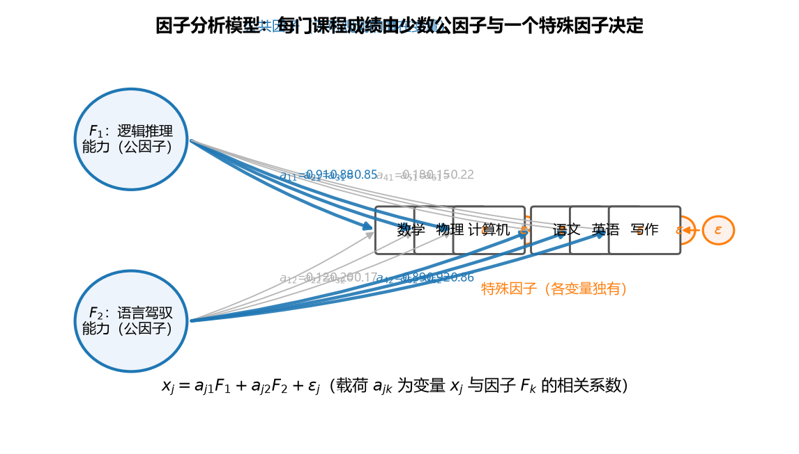

**图 5-8 因子分析模型路径图（课程成绩例子）**

### 5.3.2 因子分析的特点

1. **原已测变量包含重叠信息、相互依赖**——这是做因子分析的前提：各变量都要受某些公共因子的影响。你的逻辑推理能力同时影响数学、物理、计算机，这些成绩之间才会有重叠的信息。
2. **因子个数一般少于原始变量个数**。造新变量的目的就是降维，如果造出来和原来一样多，意义就不大了。
3. **因子并非原始变量的简单取舍，而是一种新的综合**。
4. **因子通常是未发现的、不容易测量的潜在变量**（如逻辑推理能力、语言驾驭能力）。
5. **因子之间一般没有线性关系（正交）**，也可以有线性关系（斜交）。正交时计算最方便；斜交（因子之间相关）背后计算更复杂，是一类特殊形式，知道有这个东西、将来用到再考虑即可。
6. **因子能够反映众多原始变量的主要信息**。
7. **因子具有明确解释性（专业分析）**——这需要建模的用户自己去考察：观察因子跟哪些原来的 $X$ 之间相关性较高，推测因子到底是什么。因子本来就不保证有唯一、明确的答案。

### 5.3.3 因子分析与主成分分析的异同

与主成分分析类似，因子分析也是要**找出少数几个新的变量来代替原始变量**——都是新造出来的、原来不存在的变量，都希望新变量的个数小于原来的个数。但两者差异同样明显（表 5-10、图 5-9）。

**表 5-10 主成分分析与因子分析的对比**

| 比较项 | 主成分分析（PCA） | 因子分析（FA） |
|--------|------------------|----------------|
| 优化方向 | 数据在每个主成分上的方差尽可能大（样本分得最开的投影轴） | 找到与原始变量最线性相关的公共因子 |
| 作用 | 通过综合指标解释样本之间的离散程度 | 通过公共因子解释原始变量间的相关性 |
| 模型 | 主成分为原始变量的线性组合，不考虑其他外在因素 | 原始变量为因子的线性组合，考虑特殊因子（误差项） |
| 解的唯一性 | 估计是唯一的 | 结果不唯一，可以通过因子旋转寻找最容易解释的公共因子 |
| 方向 | "往后推"：由 $X$ 综合出 $Z$，是**后果的指标** | "往前推"：把 $X$ 分解为 $F$，是**前因的要素** |
| 个数的确定 | 可以直接求解，求完后再根据方差挑选保留几个 | 需要事先确定要找几个因子，然后求解 |

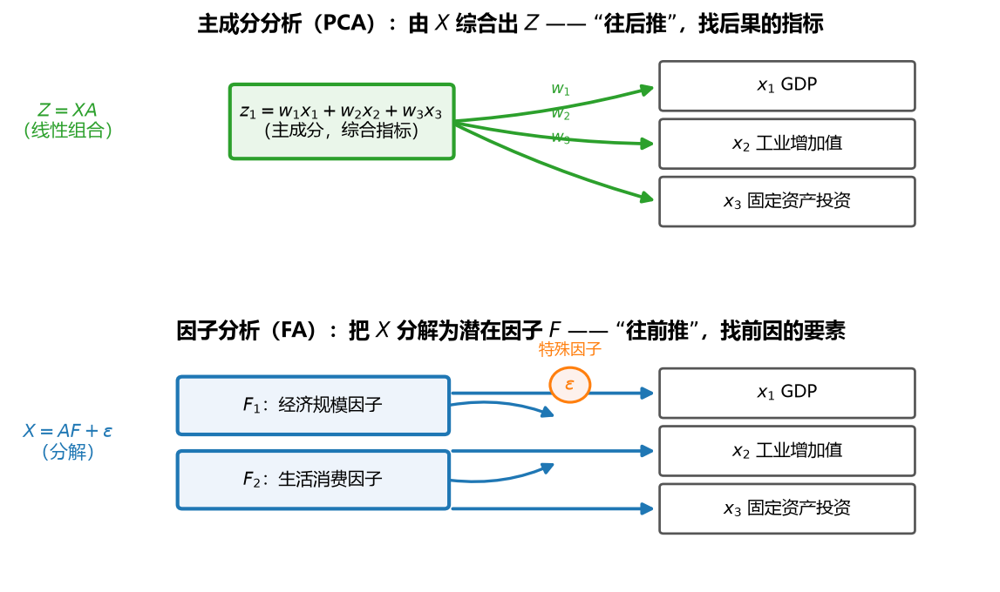

**图 5-9 主成分分析与因子分析的方向对比**

几点展开说明：

1. **模型方向不同**。主成分分析的公式是 $X$ 乘系数矩阵得到新主成分；因子分析的公式是因子乘系数矩阵（再加误差）得到原来的 $X$。"一个往前推找前因，一个往后推找结果"，这是两个方法最根本的差别。
2. **求解顺序不同**。主成分分析可以先全部求出来（个数与原始变量个数一样，有几个变量就有几个主成分），求完再根据方差贡献确定保留几个；因子分析则必须**事先告诉它要找几个因子**，才能求解。一开始不好定的话，可以先给个最大值再慢慢减，比较后调整。
3. **解的唯一性不同**。主成分分析的解是唯一的；因子分析的解**不唯一**——在 $F$ 与系数相乘的中间可以插入一个单位矩阵，单位矩阵在代数上表现为把因子整体**旋转**，因此不同的一族解之间可以通过旋转相互变换。这既是好处也是坏处：好处是既然有多个因子备选，选择余地就大了，可以通过因子旋转调整出最好解释的一套；坏处是使用者必须多做一步选择，增加了使用难度——不像主成分，一算完就完了。
4. **计算复杂度**。因变量个数与因子个数的不一致，使得不仅在数学模型上，而且在实际求解过程中，因子分析和主成分分析都有一定区别，**计算上因子分析更为复杂**。通常认为因子分析可以看作主成分分析的推广和扩展，对问题的研究更深入、更细致；反过来，主成分分析可以看作因子分析的一个特例。
5. **可解释性**。对主成分和原始变量之间的关系进行描述时，如果主成分的直观意义比较模糊、不易解释，主成分分析没有更好的改进方法；因子分析则额外提供了**因子旋转**这样一个步骤，可以使分析结果尽可能达到易于解释且更为合理的目的——这是因子分析可能的一个优点。

### 5.3.4 因子旋转

因子分析的主要目的是**对公共因子给出符合实际意义的合理解释**，解释的依据就是**因子载荷矩阵各列元素的取值**。当载荷阵某一列上各元素的绝对值差距较大、且绝对值大的元素较少时，该公共因子易于解释；反之，如果某一行或某一列上大量元素的绝对值都不小（如都大于 0.5），说明变量与多个因子都有较大的相关关系、因子对每个变量都只能解释少部分信息，因子的含义模糊不清——此时可以考虑对因子和因子载荷进行**旋转**。

因子旋转的直观理解：因子其实也是轴，轴就可以旋转；旋转之后因子载荷（系数）会变，我们要找一个**最佳的旋转角度**，让系数"**该大的尽可能大、该小的尽可能小**"——绝对值向 0 和 1 两极分化。这样，与某因子系数绝对值大的变量，就认为跟该因子关系紧密；系数接近 0 的，关系就弱，因子含义随之清晰（图 5-10）。

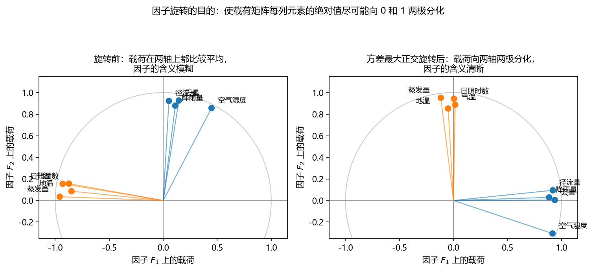

**图 5-10 因子旋转前后载荷的两极分化效果**

因子旋转方法分两大类：

- **正交旋转**：坐标轴始终保持垂直 90° 旋转，新生成的因子仍保持不相关；
- **斜交旋转**：坐标轴的夹角可以是任意的，新生成的因子不能保证不相关。

实际应用中更多使用正交旋转（计算方便、因子含义独立）。最常用的正交旋转是**最大方差旋转**（Varimax，方差最大正交旋转）：使因子载荷阵每列上各元素的绝对值（或平方值）尽可能地向两极分化——少数元素取尽可能大的值，其他元素尽量接近 0。SPSS 提供五种旋转方法（Varimax、Quartimax 四次方最大、Equamax 平方最大、Direct Oblimin 斜交、Promax）；MATLAB 的 `rotatefactors` 函数也提供多种旋转方法（`'varimax'`、`'quartimax'`、`'equamax'`、`'parsimax'`、`'promax'`、`'procrustes'` 等，默认即方差最大正交旋转法），按某种标准（方差极大、四次方最大、平均最大、最大节约）对主成分或因子载荷进行旋转。每个方法的背后原理，需要仔细阅读多元统计分析的教材，实际使用时可以多试几种，看哪种解释效果最好。

### 5.3.5 因子得分与综合评价

**因子得分**（factor score）是每个因子在每个样本上的具体取值，由**因子得分函数**给出——因子得分是各变量的线性组合。把式（5-7）做移项变换：原来是 $\boldsymbol{x} = \boldsymbol{A}\boldsymbol{f} + \boldsymbol{\varepsilon}$，把 $F$ 变到左边、$X$ 放到右边，得到另一个系数矩阵 $\boldsymbol{B}$：

$$\hat{\boldsymbol{f}} = \boldsymbol{B}^{T}\boldsymbol{x} \tag{5-8}$$

式中 $\boldsymbol{B}$ 称为**因子得分矩阵**。常用的求因子得分的方法有**加权最小二乘法**和**回归法**。

这里必须区分两个容易混淆的矩阵：

- **因子载荷矩阵** $\boldsymbol{A}$：各原始变量的因子表达式的系数（$x_1 = a_{11}F_1 + a_{12}F_2 + \cdots$），描述的是指标变量 $x$ 与公因子 $F$ 之间的关系；
- **因子得分矩阵** $\boldsymbol{B}$：公因子用原始变量表达的系数（$F_1 = b_{11}x_1 + b_{12}x_2 + \cdots$），在某一公因子上得分高，表明该指标与该公因子关系密切。有了 $\boldsymbol{B}$，每个数据点的 $x$ 已知，就能算出它在每个新因子轴上的取值，把所有数据点画到新的因子空间中——这与主成分分析里"把数据投影到新轴上"是同一个基本操作：不管用主成分、因子分析还是别的方法，只要新轴造出来了，把数据点投影上去看一看，都是最自然的下一步。

**单个/总因子得分**：每个样本在每个因子上有得分，可以对样本进行评价和排序；进一步，**用每个公因子的方差贡献率做权重，对每个因子加权后加总**，得到每个样本的**总因子得分**（综合得分）：

$$S = w_1 F_1 + w_2 F_2 + \cdots + w_m F_m \tag{5-9}$$

式中权重 $w_j$ 取第 $j$ 个因子的方差贡献率（占总贡献的比例）。怎么理解？比如 $F_1$ 是逻辑推理能力、$F_2$ 是语言驾驭能力，加权合成的一个综合得分，描述的就是这个学生"逻辑 + 语言"的**综合能力**。对样本做评价时，用综合得分往往比盯着一堆单项因子更方便。

### 5.3.6 共性方差、特殊方差与 Heywood 现象

根据因子分析的矩阵形式 $\boldsymbol{x} = \boldsymbol{A}\boldsymbol{f} + \boldsymbol{\varepsilon}$，每个变量 $x_i$ 的方差由两部分组成：

- 公共因子 $f$ 对 $x_i$ 方差的贡献，称为**共性方差**（communality），等于该变量在各公因子上载荷平方的加和；
- 特殊因子 $\varepsilon_i$ 对 $x_i$ 方差的贡献，称为**特殊方差**（每个 $x_i$ 都有一个独属于自己的特殊因子，类似回归中的误差项）。

每个原始变量的方差都被分成了共性方差与特殊方差两部分，计算时有时要考察这两部分各是多少。如果 $x$ 的各个分量都已经标准化，其方差 = 1，即**共性方差与特殊方差之和为 1**，二者均应大于 0 且小于 1。但实际进行参数估计时，共性方差的估计可能等于甚至超过 1：

- 共性方差估计**等于 1**：称为 **Heywood（海伍德）现象**；
- 共性方差估计**超过 1**：称为**超海伍德现象**。超海伍德现象意味着某些特殊因子的方差为负，**肯定存在问题**。

造成超海伍德现象的可能原因包括：共性方差本身的估计问题；共性因子太多，出现过拟合；共性因子太少，造成拟合不足；数据太少，不能提供稳定的估计；因子模型不适合这些数据。当出现（超）海伍德现象时，应对估计结果保持谨慎，可以尝试增加数据量，或在允许范围内改变公共因子数目、观察估计结果是否有改观，也可以尝试用其他多元统计方法（如主成分分析）进行分析。计算时粗略检查一下共性方差是否不超过 1，是判断因子分析求解有没有大问题的一个快速手段。

### 5.3.7 因子分析的主要步骤

因子分析的主要步骤为五步：**数据检验 → 因子提取 → 因子旋转 → 因子命名 → 因子得分**。

**（1）数据检验**

- **样本量要足够多**：一般要求样本个数至少是变量数的 **5 倍**以上，同时样本总量理论上应在 **100** 以上（这是统计学界给出的经验要求，多数实际数据都满足）。
- **变量必须是相关的**：如果原始变量都是独立的，意味着每个变量的作用都不可替代，则无法降维——做主成分分析同样有此要求。检验方法：计算各变量之间的相关矩阵，观察各相关系数，若相关矩阵中**大部分相关系数小于 0.3**，则不适合做因子分析；也可以使用 **KMO 检验**和 **Bartlett 球度检验**判断（SPSS 将两种检验统称为"KMO and Bartlett's test of sphericity"）。

两个检验的原理：**Bartlett 球度检验**以变量的相关系数矩阵为基础，原假设是相关系数矩阵为单位阵（对角线元素不为 0、非对角元素均为 0）；如果相关矩阵真是单位阵，各变量独立，无法进行因子分析。**KMO 检验**用于检验变量间的偏相关性，统计量取值在 0~1 之间：越接近 1，变量间的偏相关性越强，因子分析的效果越好；KMO 统计量在 **0.7 以上**时因子分析效果较好，**0.5 以下**时效果很差。

**（2）因子提取：载荷矩阵的求解方法**

求解载荷矩阵的方法有多种（表 5-11），它们从不同的原理出发，求得的结果有一定差异，但由于因子分析本身可以旋转，这些解进一步做相关性分析时结论大都相近。通常选第一种（主成分法）即可，用得也最多。

**表 5-11 因子载荷矩阵的求解方法**

| 方法 | 英文 | 含义 |
|------|------|------|
| 主成分法 | Principal components | 多数情况下可以使用该方法（SPSS 的默认选项）。通过主成分分析的思想提取公因子，假设变量是因子的线性组合 |
| 不加权最小平方法 | Unweighted Least Square | 使实际的相关矩阵和再生的相关矩阵之差的平方和达到最小 |
| 加权最小平方法 | Generalized Least Square | 用变量值进行加权，也是使实际的相关矩阵和再生的相关矩阵之差的平方和达到最小 |
| 最大似然法 | Maximum Likelihood | 不要求数据服从正态分布，在样本量较大时使用较好 |
| 主轴因子法 | Principal Axis Factoring | 从原始变量的相关性出发，使变量间的相关程度尽可能地被公因子解释 |

**（3）因子数量的确定**

与主成分分析类似：一是**累计方差贡献率**达到 80% 以上的前几个因子可以作为最后的公因子；二是**特征根大于 1**——特征根小于 1 说明该公因子的解释力度太弱，还不如直接使用一个原始变量（原始变量标准化后的方差为 1）。实际应用中，因子的提取要结合具体问题而定，在某种程度上取决于研究者自身的知识和经验。

**（4）因子命名**

因子命名是因子分析重要的一步。一个因子包含了多个原始变量的信息，它究竟反映了原始变量的哪些共同信息？因子分析得到的因子含义是模糊的，需要重新命名，以便对研究问题作出合理解释。命名通过**观察因子载荷矩阵并结合实际问题**完成——这不是统计问题，需要研究者自身的专业素质和对实际问题背景的了解。例如观察到数理化课程成绩都与某个因子高度相关，就把该因子命名为"数理逻辑推理能力"；语言类课程与另一个因子高度相关，就命名为"语言驾驭能力"。如果算出来的载荷规律不明显、系数都比较平均，就不太好命名，此时先做因子旋转再解释。

**（5）因子得分**

按 5.3.5 节求因子得分矩阵，把数据投影到因子轴上，必要时合成综合得分。

### 5.3.8 MATLAB 实现

MATLAB 中因子分析的实现方法有两类（表 5-12）。

**表 5-12 因子分析的 MATLAB 实现**

| 序号 | 方法 | 主要命令 | 含义 |
|------|------|----------|------|
| 第 1 种 | 正交变换法（对随机变量分布没有要求） | `pca` | 求得特征向量构成的正交矩阵 $E$，得到主成分载荷矩阵 $A$，$A$ 经过正交旋转后获得正交因子解 |
| 第 2 种 | 最大似然法（要求随机变量服从正态分布） | `factoran` | 基于原始数据或其协方差矩阵，进行最大似然公因子分析 |
| | | `rotatefactors` | 按照某种标准（方差极大、四次方最大、平均最大、最大节约）对主成分或因子载荷进行旋转 |
| | | `rotatefun` | 定义一种因子载荷矩阵的旋转方法 |

配套的 M 文件及求解方式对比见表 5-13。

**表 5-13 因子分析示例文件（求解方式对比）**

| M 文件 | 含义 | 主要语句 | 因子个数 |
|--------|------|----------|----------|
| `FA_01_PCA.m` | 通过 PCA 求因子分析解 | `[E,score,eigv,T] = pca(X); C = sqrtm(diag(eigv(1:2))); A = E(:,1:2)*C;` | 未定（求完再选） |
| `FA_02_2F.m` | 从原始数据矩阵出发，`factoran` 求最大似然解 | `[Lambda,Psi,T,Stats,F] = factoran(X,2,'Score','wls');` | 2 |
| `FA_02_3F.m` | 同上，取 3 个因子 | `[Lambda,Psi,T,Stats,F] = factoran(X,3,'Score','wls');` | 3 |
| `FA_03_COV.m` | 从协方差矩阵出发，`factoran` 求最大似然解 | `[Lambda,Psi,T,Stats] = factoran(cov(X),2,'Xtype','cov');` | 2 |

`factoran` 函数的主要调用格式见表 5-14。

**表 5-14 factoran 函数的主要语法**

| 格式 | 用途 |
|------|------|
| `lambda = factoran(X,m)` | 返回包含 $m$ 个公共因子模型的载荷矩阵 `lambda`。输入 `X` 是 $n$ 行 $d$ 列矩阵（行对应观测、列对应变量）；`m` 是正整数，表示公共因子个数；`lambda` 是 $d$ 行 $m$ 列矩阵，第 $i$ 行第 $j$ 列元素表示第 $i$ 个变量在第 $j$ 个公共因子上的载荷 |
| `[lambda,psi] = factoran(X,m)` | 返回特殊方差的最大似然估计 `psi`，是包含 $d$ 个元素的列向量，分别对应 $d$ 个变量的特殊方差 |
| `[lambda,psi,T] = factoran(X,m)` | 返回 $m$ 行 $m$ 列的载荷旋转矩阵 `T` |
| `[lambda,psi,T,stats] = factoran(X,m)` | 返回包含模型检验信息的结构体 `stats`。模型检验的原假设 $H_0$：因子数 = $m$。`stats.loglike` 为对数似然最大值，`stats.def` 为误差自由度，`stats.chisq` 为近似卡方检验统计量，`stats.p` 为检验的 $p$ 值。对给定显著性水平 $\alpha$，若 $p > \alpha$ 则接受 $H_0$，说明用含 $m$ 个公共因子的模型拟合原始数据是合适的，否则拟合不合适 |
| `[lambda,psi,T,stats,F] = factoran(X,m)` | 返回因子得分矩阵 `F`（$n$ 行 $m$ 列，每行为一个观测的 $m$ 个公共因子得分）。注意：如果 `X` 是协方差矩阵或相关系数矩阵，`factoran` 不能计算因子得分。`factoran` 用相同的旋转矩阵计算载荷阵 `lambda` 和因子得分 `F` |
| `[...] = factoran(...,param1,val1,param2,val2,...)` | 允许用户指定成对出现的参数名和参数值，控制模型的拟合和输出，可用的参数详见 `factoran` 的帮助文档 |

注意 `factoran` 使用的旋转方法与 `rotatefactors` 略有不同（如 `'parsimax'`、`'pattern'`、`'procrustes'` 等选项），不同软件（MATLAB、SPSS、Python）之间因子分析的结果有时存在一定差异——可能只是内部默认设定不同，遇到不一致时先检查是不是搞错了设定。

## 5.4 案例分析：中国省区市发展的因子分析

### 5.4.1 数据与研究思路

利用 **8 项经济指标**对 **2004 年中国 31 个省、自治区、直辖市**进行因子分析（变量数 $m=8$，样本数 $n=31$）。8 项指标可以分为两大类（表 5-15）：一是反映**生产情况**（投入和产出）方面的指标；二是反映**居民生活**方面的指标。

**表 5-15 案例使用的 8 项经济指标（2004 年）**

| 类别 | 指标 |
|------|------|
| 生产（投入产出）类 | GDP；工业增加值；全社会固定资产投资额 |
| 居民生活类 | 职工平均工资；城镇居民消费性支出；农村居民消费性支出；居民消费价格指数；商品零售价格指数 |

所有数据（城市名/样本名、变量名和八个指标）存储在数据文件 `Regions2004.m` 中，随本章配套代码提供。

为什么在这个数据上做因子分析？回忆聚类一章：31 个省市 8 个指标，直接在 8 维空间里考察它们的关系相当费事。先做因子分析（或主成分分析），把 8 个指标降到 2~3 个综合维度，再把数据点放到这 2~3 根新轴上画图，就能更清楚地看到哪些省市在空间中自然地聚在一起——**降维可以跟后面很多方法结合起来用**。本案例先只做因子分析本身。

### 5.4.2 主成分法求解

第一种做法：正交变换法（`pca` + 载荷 + 旋转），完整代码如下（`FA_01_PCA.m`）：

```matlab
%% FA_01_PCA.m —— 主成分法求因子分析解（对分布没有要求）
X = Regions2004;                          % 读取 31x8 数据矩阵
Xz = (X - mean(X)) ./ std(X);             % 1) 标准化，消除量纲影响

[coeff, score, eigv] = pca(Xz);           % 2) 主成分：特征向量与特征值
pareto(eigv / sum(eigv));                 % 3) 方差贡献率 pareto 图（选因子个数用）

C = diag(sqrt(eigv(1:2)));                % 4) 前两个特征值开平方
A = coeff(:,1:2) * C;                     %    未旋转的因子载荷矩阵（主成分法）
A = rotatefactors(A);                     % 5) 方差最大正交旋转

B = corr(Xz) \ A;                         % 6) 回归法因子得分系数 B = R^-1 * A
F = Xz * B;                               %    因子得分：样本在新因子轴上的投影
comm = sum(A .^ 2, 2);                    % 7) 各变量的共性方差（应小于 1）
```

运行第 3 步得到图 5-11：8 个特征值当中，第 1 个（贡献率 50.6%）、第 2 个（37.4%）远大于其余（第 3 个只有 8.7%，且从第 3 个起特征值均小于 1）；**前两个主成分的累计方差贡献率为 87.9%，超过 80% 的常用标准**（若按"特征值大于 1"的标准判断，同样是取前两个）。因此确定提取 **2 个公共因子**。

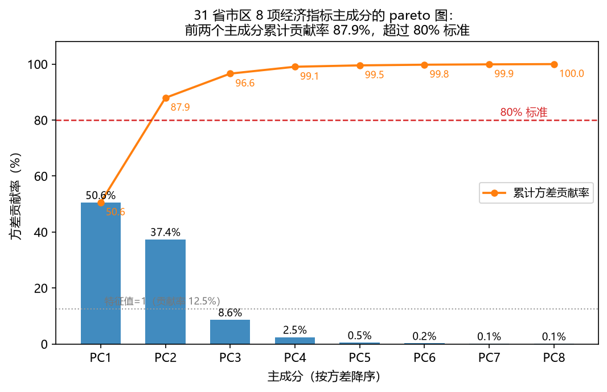

**图 5-11 案例主成分的pareto图**

旋转前后的因子载荷图见图 5-12。旋转前（左图），8 个变量在两根轴上的载荷都比较分散，因子含义不好说；方差最大正交旋转后（右图），载荷明显两极分化，因子的含义立刻清晰了：

- **因子 $F_1$（方差贡献率 45.8%）**：在**职工平均工资**（载荷 0.90）、**城镇居民消费**（0.88）、**农村居民消费**（0.73）上有很高的正载荷，而与**两个价格指数**呈较强负相关（居民消费价格指数 −0.88、商品零售价格指数 −0.87）——它综合反映各省的**居民生活水平与物价环境**，可命名为**生活消费因子**。价格指数的负载荷是一个有意思的发现：2004 年职工工资高、消费支出能力强的省市（京津沪等），物价反而相对平稳；而部分中西部省市工资不高、物价涨幅却偏大。
- **因子 $F_2$（方差贡献率 42.2%）**：在 **GDP**（0.99）、**工业增加值**（0.97）、**固定资产投资**（0.97）上有极高的正载荷——它反映各省的经济**生产规模**，可命名为**生产规模因子**。

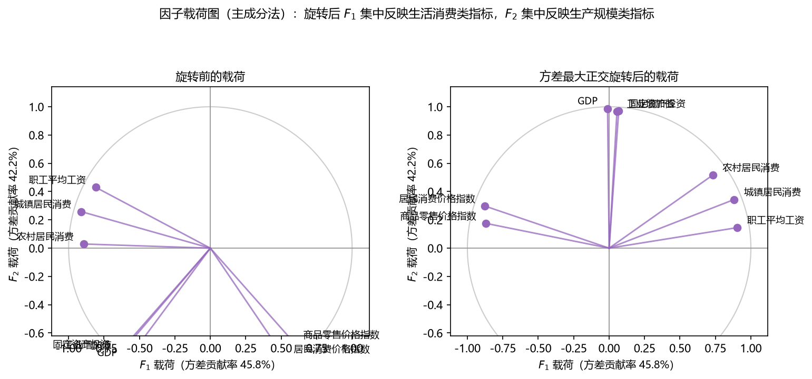

**图 5-12 案例的因子载荷图（旋转前后对比）**

再看共性方差：8 个变量的共性方差在 0.79~0.97 之间（如 GDP 为 0.97、商品零售价格指数为 0.79），全部小于 1，没有出现（超）海伍德现象，说明 2 因子模型的求解是稳定的；两个因子合计解释了总方差的 87.9%，仅从 8 个原始指标中丢失了约 12% 的信息。

### 5.4.3 最大似然解与因子得分

第二种做法：`factoran` 最大似然法。从原始数据矩阵出发取 2 个因子（`FA_02_2F.m`）、3 个因子（`FA_02_3F.m`），或从协方差矩阵出发取 2 个因子（`FA_03_COV.m`）：

```matlab
%% FA_02_2F.m —— factoran 最大似然解（2 因子，加权最小二乘得分）
X = Regions2004;
[Lambda, Psi, T, Stats, F] = factoran(X, 2, 'Score', 'wls');
% Lambda：8x2 旋转后载荷矩阵；Psi：8 个特殊方差；
% Stats.chisq / Stats.p：因子数=2 的卡方检验；F：31x2 因子得分

%% FA_03_COV.m —— 从协方差矩阵出发求最大似然解
[Lambda, Psi, T, Stats] = factoran(cov(X), 2, 'Xtype', 'cov');
% 注意：从协方差矩阵出发时不能计算因子得分
```

三种求解方式（PCA 法、最大似然法、协方差矩阵出发的最大似然法）得到的载荷结构是差不多的：前两者都收敛到"生产类 + 生活类"两个因子，只是个别变量的载荷数值略有差异。具体结果的对照分析，请读者运行配套代码自行比较。

按 5.3.5 节的方法计算因子得分，把 31 个省市投影到两个因子轴上（图 5-13）：京津沪在 $F_1$（生活消费）上得分高——工资高、消费能力强、物价平稳；粤、鲁、苏、浙在 $F_2$（生产规模）上得分高——经济总量大、投资规模大；而多数中西部省份两个得分都不高，集中在坐标原点附近。这张二维图就是 8 维数据"压扁"后的全貌——如果接下来做聚类，在这样清晰的二维空间里做，比在 8 维空间里直观得多。

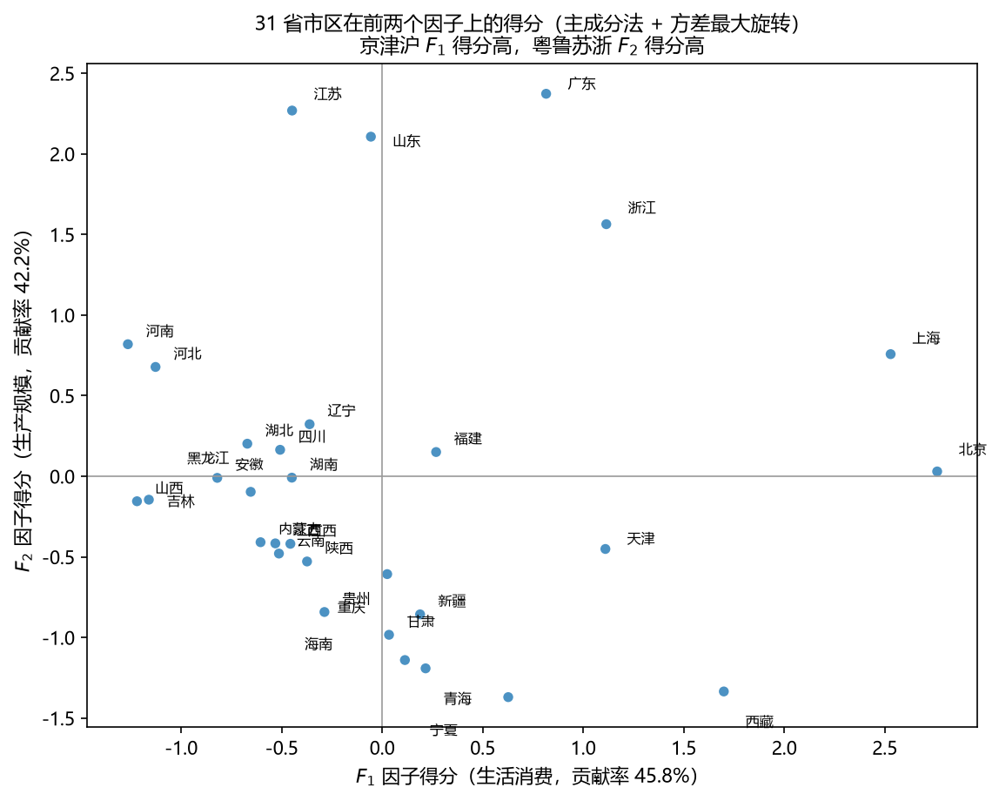

**图 5-13 31个省市区在两个因子上的得分**

### 5.4.4 综合评价

最后按方差贡献率加权合成综合得分：$S = 0.52 F_1 + 0.48 F_2$（权重为旋转后两因子方差贡献率 45.8% 与 42.2% 的占比），对 31 个省市区排序（图 5-14）。

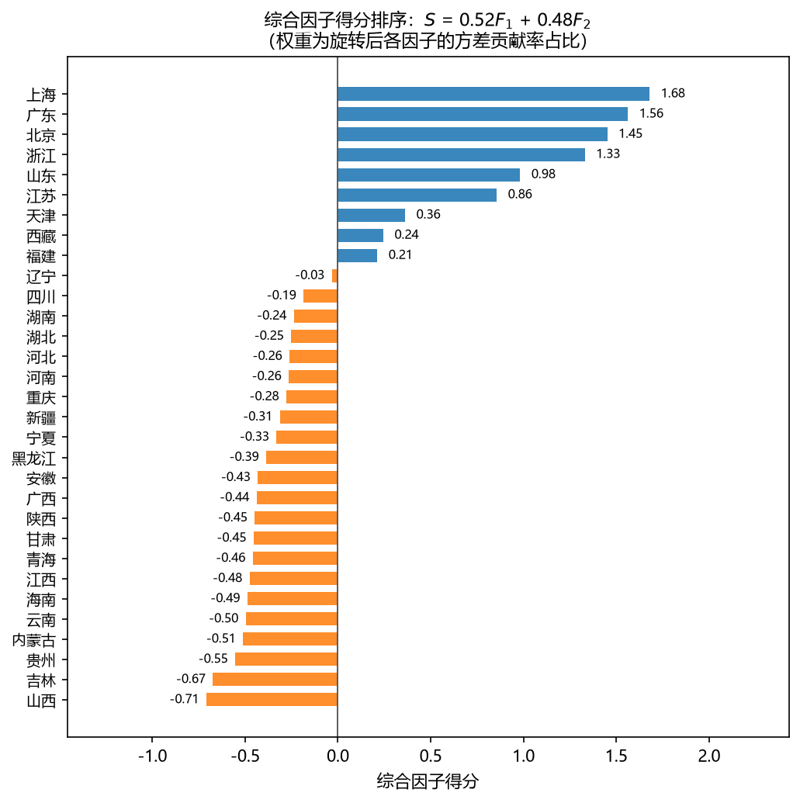

**图 5-14 综合因子得分排序**

排在最前面的是**上海（1.68）、广东（1.56）、北京（1.45）、浙江（1.33）**，其次是山东（0.98）、江苏（0.86）、天津（0.36）——这些省市或者在两个因子上都占优（上海、北京），或者以极大的生产规模优势取胜（广东、山东、江苏）；排在末尾的是山西（−0.71）、吉林（−0.67）、贵州（−0.55）等省份，2004 年这些省生活消费因子得分偏低（工资水平不高、物价涨幅偏大）拉低了综合评价。一个值得注意的细节是**西藏**的综合得分排在第 8 位（0.24）：其职工平均工资全国最高（含边远地区补贴）、物价平稳，在 $F_1$ 上的高得分弥补了生产规模的不足——这正体现了"**综合得分是高度抽象的量，运用它做评价、排序时要保持谨慎**"：它反映的是 8 项指标在两个维度上的加权综合，而不完全等同于"经济发达程度"。读者不妨对照 5.3.1 节的因子命名过程，体会因子含义的专业解释有多重要。

## 5.5 小结

本章系统介绍了降维方法，要点回顾如下。

**为什么降维、怎么降维。** 自变量之间存在共线性、信息重叠时，有必要用更少的变量描述原始问题。两大思路：一是**不构造新特征**——用 F 检验、互信息、散点图矩阵、R 型聚类等相似性分析考察特征之间的相关性，把高度相似的特征去掉；二是**构造新特征**——把 $n$ 维特征映射到 $k$ 维（$k<n$）新空间。带着 $Y$ 对自变量降维则称为**特征选取**（过滤法、封装法、逐步回归），它与无监督降维是"是否看 $Y$"的差别。

**主成分分析（PCA）——往后推，找后果的指标。** 把原来的变量线性组合成新的综合变量，用**方差**度量信息：第一主成分方差最大（数据投影上去"依次排开"），之后的主成分与前面的不相关（正交）、方差递减，最后一个主成分方差最小。几何解释是把坐标轴正交旋转到椭圆（数据云团）的长短轴方向，取长轴、舍短轴。求解看上去是一个复杂的约束优化问题，但已被证明**只需对协方差矩阵做特征值分解**：特征向量给出主成分系数（载荷），**特征值就是数据在该主成分上投影的方差**，甚至只要给出协方差矩阵、没有原始数据也能求解。保留个数按"累计方差贡献不低于 80%（或特征值大于 1）"等标准确定。MATLAB 一条 `pca` 命令完成核心计算，`pareto`、`gname`、`pcacov`、`pcares`、`battest` 辅助选型与诊断。

**因子分析（FA）——往前推，找前因的要素。** 每个已测变量等于少数潜在公因子的线性组合（再加各变量独有的特殊因子）：$\boldsymbol{x} = \boldsymbol{A}\boldsymbol{f} + \boldsymbol{\varepsilon}$，如"课程成绩 = 逻辑推理能力 + 语言驾驭能力 + 特殊因素"。因子个数少于原始变量个数、需事先确定；因子是不好直接测量的潜在变量，其**含义要靠观察载荷矩阵做专业解释（因子命名）**。因子分析的解**不唯一**，可以通过**因子旋转**（最常用方差最大正交旋转）让载荷"该大的尽可能大、该小的尽可能小"，找出最容易解释的一套解——这既是它比 PCA 灵活的地方，也增加了使用难度。求解载荷矩阵有主成分法、最大似然法等五种方法；因子得分用得分矩阵把样本投影到因子轴上，再按方差贡献率加权可得综合得分。做因子分析前要过数据检验关：样本量足够（变量数的 5 倍以上、总量 100 以上）、变量间确实相关（大部分相关系数大于 0.3，KMO 检验、Bartlett 球度检验）；求解后要检查共性方差不超过 1（Heywood 现象）。

**两个方法的关系。** 都是构造新变量的降维方法，都要求原始变量之间有较强的相关性（否则降维无从谈起）；一个往后推（综合）、一个往前推（分解），一个解唯一、一个解不唯一可旋转，一个不带误差项、一个带特殊因子。因子分析可以看作主成分分析的推广和扩展，主成分分析可以看作因子分析的特例。无论用哪种方法，得到的主成分/因子都是高度抽象的量，**含义不一定比原始变量清晰**，用于评价、排序时必须保持谨慎；选几个、怎么解释，在某种程度上取决于研究者的知识和经验，而不是方法本身。实际使用建议：自变量与因变量相关性调成一致；代码和统计软件（如 SPSS）同时使用、相互验证。

学完本章，数据挖掘四类功能中的"聚类"与"降维"都已齐备。下一章将进入有监督的世界，介绍线性模型——用线性方法做回归与分类。

## 思考题

1. 主成分分析和因子分析的异同点是什么？（提示：从模型方向、误差项、解的唯一性、个数的确定、计算复杂度等方面比较。）
2. 主成分分析和因子分析是否能和其他方法连用？试举出几种组合方式并说明各自的动机。（提示：降维后聚类、降维后回归/分类、逐步回归与因子分析的关系等。）
3. 什么情况下使用因子分析和主成分分析？不满足什么条件时不适合使用？
4. 为什么说"方差"可以度量一个主成分所包含的信息？第一主成分之后的主成分为什么要求与前面的主成分不相关？
5. PCA 的求解为什么等价于协方差矩阵的特征值分解？特征值与数据在主成分上的投影方差是什么关系？
6. 确定主成分（或因子）个数有哪些标准？"累计方差贡献不低于 80%"这个 80% 有严格的理论依据吗？
7. 什么是因子旋转？为什么因子分析的解不唯一，而主成分分析的解唯一？最大方差旋转的目标是什么？
8. 因子载荷矩阵与因子得分矩阵有什么区别？综合因子得分怎样计算、权重取什么？
9. 什么是共性方差、特殊方差和 Heywood 现象？出现超 Heywood 现象说明什么、该怎么办？
10. 做因子分析前需要做哪些数据检验？KMO 检验和 Bartlett 球度检验分别检验什么？

