# 第6章 线性模型

> **本章导读**：线性模型是机器学习中最简单、又最经常使用的一类模型，有些书上称之为"线性学习"。它包含两条主线：一是用线性方法解决**回归**问题，包括一元线性回归、多元线性回归，以及可以转化为线性形式的非线性回归；二是用线性方法（或与线性密切相关的广义线性方法）解决**分类**问题，其中最经典的是 Logistic 回归与线性判别分析（LDA）两类方法。学完本章后，加上前面几章的聚类与降维方法，数据挖掘的四类主要功能——聚类、降维、回归、分类——我们都已经拥有了两到三种可以使用的解决方法。本章最后还介绍回归与分类模型的评估标准，并给出一个国家发展水平判别的完整案例。

## 6.1 线性模型概述

### 6.1.1 从方法体系看线性模型

本书按"思想出发点 × 解决功能"来组织各类机器学习方法：每一种思想（如线性方法、最近邻、树型、密度等）可以引出一系列方法，而每一种方法又服务于聚类、降维、回归、分类四类功能中的某一类或几类，见表 6-1。

**表 6-1 数据挖掘/机器学习的典型方法**

| 类别 | 聚类 | 降维 | 回归 | 分类 |
|------|------|------|------|------|
| 线性方法 | — | 相关性分析、主成分分析、因子分析 | **多元线性回归** | **Logistic 回归、判别分析** |
| 最近邻 | k 均值聚类 | — | kNN | kNN |
| 树型 | 层次聚类 | — | 决策树（回归树） | 决策树（分类树） |
| 密度 | DBSCAN | — | — | — |
| 神经网络 | 自组织映射（SOM） | — | ANN | ANN |
| 核函数 | — | — | SVR | SVC |
| 图论 | 谱聚类 | — | 概率图模型 | 概率图模型 |
| 随机变量 | 高斯混合模型 | — | — | 贝叶斯分类 |
| 模糊数学 | 模糊 C 均值聚类 | — | 模糊逻辑模型、ANFIS | 模糊逻辑模型 |
| 深度学习 | — | — | CNN、LSTM | CNN |

在前面的章节里，我们学习了聚类（k 均值聚类、层次聚类）和降维（相关性分析、主成分分析、因子分析）。本章的线性方法将补齐另外两项功能：回归（多元线性回归）与分类（Logistic 回归、判别分析）。从此以后，无论面对什么问题，我们都有可以着手求解的方法了——至于某个方法解决某个具体问题时效果好不好，则是另一个层面的问题，需要通过本章 6.7 节的评估标准来衡量。

### 6.1.2 回归的基本思想：用直线、平面与超平面逼近数据

面对"给定 X，预测 Y"这样最常见的问题，最直觉的做法是建立一个 Y 与 X 之间的线性方程，也就是画一条直线来逼近这些数据点（图 6-1）。回想主成分分析的思路：那是在数据点旁边另画一条轴，让所有点向新轴投影；而回归的思路不同——**在数据点中间画一条线**，用 X 与 Y 之间的线性关系把它表达出来。

一元情形是一条直线；扩展到二元，就是一个二维平面在三维空间中尽可能逼近这些点；再扩展到 p 个自变量，就是用一个超平面去逼近高维空间中的数据（图 6-2）。从几何上看，一元、多元是一致的：都是寻找一个"低一维"的线性对象去拟合数据点。

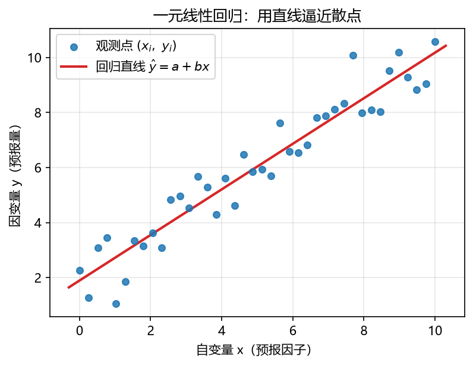

**图 6-1 一元线性回归：用直线逼近散点**

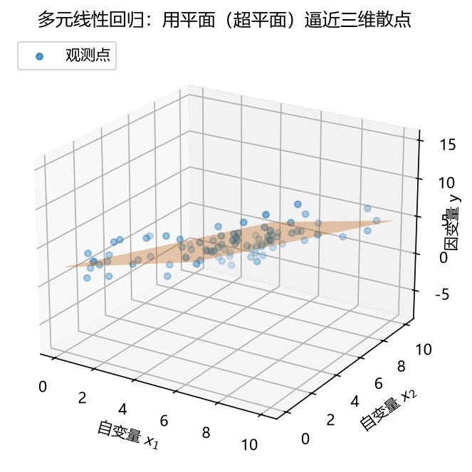

**图 6-2 多元线性回归：用平面（超平面）逼近三维散点**

### 6.1.3 残差：度量逼近程度

有了"逼近"的目标，就要回答"怎样算逼近得好"。最直观的想法是：从每个数据点向直线作垂线，把所有点到直线的（垂直）距离加起来并使之最小。但垂直距离在数学上处理起来比较麻烦，于是人们采用了一种"偷懒"的替代办法：对每个点，沿**平行于 y 轴**的方向到直线的偏差，即用观测值 $y_i$ 减去直线上对应的估计值 $\hat{y}_i$，这个差称为**残差**（residual，图 6-3 左）。把所有残差平方后加总得到残差平方和，让残差平方和最小，就可以找到那条最合适的直线——这就是后面要讲的最小二乘法。

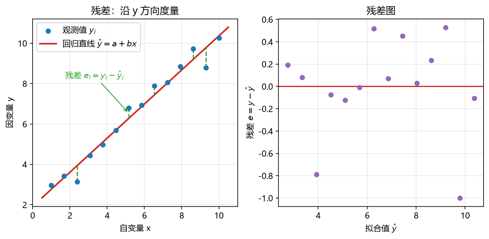

**图 6-3 残差的定义（左）与残差图（右）**

回归效果的好坏，也就是数据点与直线（平面）的逼近程度，可以用指标来刻画。最好的情形是所有数据点都恰好落在直线上；通常情况下，点与线之间总有一定的偏离，从完全拟合到几乎无关，逼近程度呈连续的谱系（图 6-4）。描述这种逼近程度最常用的指标是**可决系数** $R^2$（详见 6.7 节）：$R^2$ 越接近 1，说明自变量对因变量变动的解释程度越高、拟合越好。

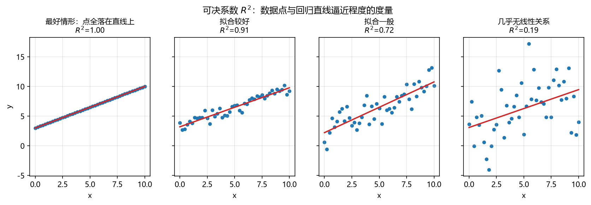

**图 6-4 拟合优度谱系：从完全拟合到几乎无关**

### 6.1.4 地学中的时间问题：序列与自相关

前面讨论的都是 X 与 Y 之间的关系，还有一个因素没有考虑——**时间**。地理学面对的变量大多是随时间变化的序列：降雨、水位、气温、径流……把时间考虑进来后，每个序列都可以派生出一系列"错时"序列：把 $y_t$ 往前推移若干个时间单位，得到 $y_{t-1}$、$y_{t-2}$、…、$y_{t-i}$，然后考察这些滞后序列与原序列之间有没有关系（图 6-5）。这种序列与自身滞后值之间的相关关系称为**自相关**（autocorrelation）。

自相关在地理数据中十分常见。最简单的例子：今天下了大雨，昨天往往也有降雨、前天天气也可能偏阴——降雨量序列在相邻时刻之间有明显的相关性；水位序列更是如此。认识到这一点，一方面提示我们在建模时可以把滞后变量作为自变量引入回归（这是时间序列分析的基本思路），另一方面也提醒我们：常规回归的统计检验要求残差相互独立，若数据存在自相关，就需要专门的检验（如 6.3 节的 DW 检验）。

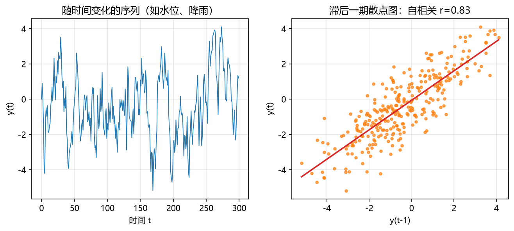

**图 6-5 时间序列（左）及其滞后一期自相关散点图（右）**

### 6.1.5 非线性与"先聚类后回归"

线性关系可以推广到非线性：在空间中找一条**曲线**去逼近数据点，同样用残差平方和最小化来求解。现实世界中严格意义的线性关系其实很少，人们见到的"线性"大多是对非线性的近似，或是非线性关系线性化的结果（详见 6.4 节）。

还有一种经常被忽略的情况：数据整体呈非线性、不好建模，但数据其实存在**类别结构**——不同类别内部各自近似线性。这时可以先聚类、后回归：先用聚类方法把总数据集分成若干类，再在每一类内部各建立一个线性回归模型（图 6-6）。整体上看是复杂的非线性关系，分类之后每类内部却可以很自然地建成线性模型，表达和求解都更容易。这种"先聚类后回归"的组合思路在地学问题中很常见，值得读者留意。

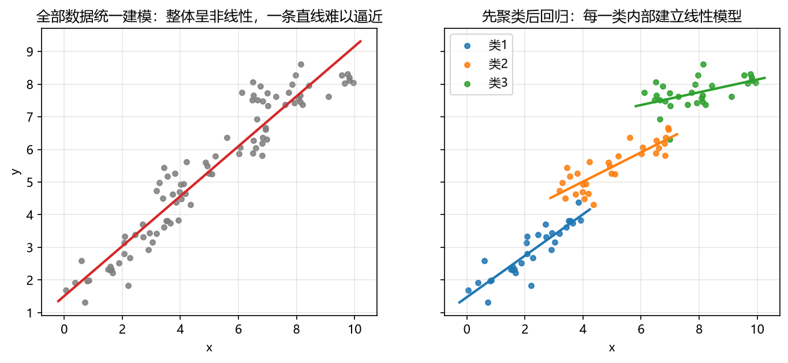

**图 6-6 先聚类后回归：整体非线性，分类后每类内部线性**

## 6.2 一元线性回归

### 6.2.1 回归分析的概念

**回归分析**是用来寻找若干变量之间**统计联系关系**的一种方法；利用找到的统计关系对某一变量作出未来时刻的估计，称为**预报**。按变量关系的形式与数目，回归分析包括线性回归与非线性回归、一元回归与多元回归。

在预报问题中，变量扮演的角色不同：

- **预报量** $Y$：难以控制和测量的要素，却是我们特别感兴趣的量，也称为**因变量**（dependent variable）、被解释变量（explained variable）、结果变量（effect variable）；
- **预报因子** $X$：易测易控的要素，作为预测的依据，也称为**自变量**（independent variable）、解释变量（explanatory variable）、原因变量（causal variable）。

回归分析的任务，就是建立预报因子与预报量之间的统计关系。

**表 6-2 回归模型的类型（自变量数目 × 关系形式）**

|  | 线性回归 | 非线性回归 |
|---|---|---|
| **一元回归** | 一元线性回归 | 一元非线性回归 |
| **多元回归** | 多元线性回归 | 多元非线性回归 |

### 6.2.2 模型结构

对样本数为 $n$ 的预报量 $y$ 与预报因子 $x$，若认为两者是统计线性关系，则预报量的估计量与 $x$ 有如下关系：

$$\hat{y} = a + bx \tag{6-1}$$

或写成一般的回归方程：

$$y = \alpha + \beta x + \varepsilon \tag{6-2}$$

式中 $a$ 是截距，$b$ 是斜率（$a$、$b$ 是 $\alpha$、$\beta$ 的估计值），$\varepsilon$ 是随机误差项。

这里需要区分两个容易混淆的概念：**误差**是观察值与真实值之差；**残差**是观察值与模型估计值之差。我们能够计算的只有残差，回归的求解也正是围绕残差展开的。

### 6.2.3 最小二乘法求解

对所有的 $x_i$，若观测值 $y_i$ 与估计值 $\hat{y}_i$ 的残差最小，就认为式（6-1）所确定的直线能最好地代表所有实测点的分布规律。为了消除残差符号的影响，用**残差的平方**来反映残差的绝对偏离情况。全部观测值与回归估计值的残差平方和记为 $Q$：

$$Q(a, b) = \sum_{t=1}^{n} (y_t - \hat{y}_t)^2 = \sum_{t=1}^{n} (y_t - a - b x_t)^2 \tag{6-3}$$

$Q$ 值刻画了全部观测值与回归直线的偏离程度，越小越好。$Q$ 中 $y_t$、$x_t$ 都是已知观测值，只有 $a$、$b$ 是可以调整的待定系数——用优化的语言说，$a$、$b$ 是决策变量，$Q$ 是目标函数。根据微积分学中的极值原理，令 $Q$ 对 $a$、$b$ 的偏导数等于零：

$$\frac{\partial Q}{\partial a} = 0, \qquad \frac{\partial Q}{\partial b} = 0$$

整理即得求解回归系数的**标准方程组**（正规方程组）：

$$\begin{cases} n\,a + b \sum x_t = \sum y_t \\[4pt] a \sum x_t + b \sum x_t^2 = \sum x_t y_t \end{cases} \tag{6-4}$$

解之，回归系数可直接表示为：

$$b = \frac{\sum_{t=1}^{n} (x_t - \bar{x})(y_t - \bar{y})}{\sum_{t=1}^{n} (x_t - \bar{x})^2}, \qquad a = \bar{y} - b\,\bar{x} \tag{6-5}$$

最小二乘法的这套"设定目标函数—求偏导—令导数为零—解方程"的求解思路，对其他模型同样适用，读者应当熟练掌握。就一元线性回归而言，计算部分非常简单，用软件实现也非常简单（如 MATLAB 中一句 `polyfit` 即可）；**重要的是如何对回归中的方差进行分析**——这关系到我们怎么解读回归计算的结果，也是回归显著性检验的基础（见 6.3.3 节）。

## 6.3 多元线性回归

### 6.3.1 从一元到多元

实际应用中更多面对的是多个自变量、一个因变量的情况。**多元线性回归**是一元线性回归的推广（一元线性回归是它的特例）。模型结构为：

$$y = w_0 + w_1 x_1 + w_2 x_2 + \cdots + w_p x_p \tag{6-6}$$

用矩阵形式写更简洁：$\boldsymbol{y} = \boldsymbol{X}\boldsymbol{w}$，其中 $\boldsymbol{X}$ 的第一列全为 1（对应截距 $w_0$）。求解仍遵照残差平方和最小化，对参数求偏导可得最小二乘解的矩阵表达式：

$$\boldsymbol{w} = (\boldsymbol{X}^T \boldsymbol{X})^{-1} \boldsymbol{X}^T \boldsymbol{y} \tag{6-7}$$

### 6.3.2 求解途径

多元线性回归在多元统计分析中研究得非常透彻，求解时有一些假定条件，需要通过统计检验确认这些假定成立，线性模型才可放心使用。因此，完整的多元回归分析采用**两步求解法**：第一步**参数估计**，第二步**统计检验**。

以 MATLAB 为例，回归参数估计有三种基本途径（表 6-3）。其中多项式拟合途径之所以可用于线性回归，是因为线性回归本身可以看作一次多项式拟合。

**表 6-3 MATLAB 中回归参数估计的三种求解途径**

| 求解途径 | 基本命令 | 适用范围 |
|---|---|---|
| 矩阵运算 | 左除 `\` 直接求解 $\boldsymbol{w} = \boldsymbol{X} \backslash \boldsymbol{y}$ | 一元、多元回归 |
| 多项式拟合 | `polyfit`（求参数）、`polyval`（求 y 预测值） | 一元回归 |
| 回归分析工具箱 | `regress` | 一元、多元回归 |

```matlab
% 途径一：矩阵运算（多元线性回归）
X = [ones(n,1), x1, x2];        % 设计矩阵，第一列对应截距
w = X \ y;                      % 最小二乘解

% 途径二：多项式拟合（一元线性回归）
p = polyfit(x, y, 1);           % 返回 [b, a]，一次多项式
yhat = polyval(p, x);           % 求预测值

% 途径三：回归分析工具箱
X = [ones(n,1), x1, x2];
[b, bint, r, rint, stats] = regress(y, X);
% b：回归系数；r：残差；stats：[R², F 统计量, p 值, 误差方差估计]
```

### 6.3.3 回归的统计检验

若要把一元、多元回归做得严谨，参数估计之后必须做统计检验；检验通不过，说明模型存在问题。多元回归的全部离差可以分解为：

$$\text{总离差平方和} = \text{回归平方和} + \text{残差平方和}, \qquad TSS = ESS + RSS$$

在这一分解基础上可以构造一系列统计量，常用的检验汇总于表 6-4。

**表 6-4 一元与多元回归的统计检验**

| 检验 | 一元回归检验含义 | 多元回归检验含义 |
|---|---|---|
| F 检验 | 方程的显著性检验 | 方程的显著性检验：被解释变量与全部解释变量之间的线性关系在总体上是否显著 |
| 相关系数检验 | 拟合优度（与 F、t 检验选一即可，完全等价） | 校正的相关系数：检验模型的整体拟合优度 |
| 偏相关系数检验 | — | 扣除其他变量间接影响后，揭示各自变量对因变量的直接影响程度或解释能力 |
| t 检验 | 自变量对因变量的解释程度 | 变量的显著性检验：每个解释变量对被解释变量的影响是否显著 |
| 标准误差检验 | 检验模型的预测精度 | 检验模型的预测精度 |
| DW 检验 | 样本属于有序的时间序列或空间序列时，检验残差序列是否为随机序列 | 同左 |

几点说明：一元回归做严谨检验大约是"四加一"项——F 检验、相关系数检验、t 检验、标准误差检验，再加针对时间序列的 DW 检验；其中 F、R、t 三种检验在一元情形下选一即可、完全等价。多元回归把相关系数检验拆成校正相关系数与偏相关系数两项。在开发新模型、与其他模型对比时，大家往往"偷懒"做得没那么细，但正式的应用研究应当把检验补齐。检验的具体算法属于多元统计分析的内容，本书配套代码提供了可直接运行的示例，读者可结合参考书自行练习。

### 6.3.4 多重共线性问题

多元回归有一个经典问题——**多重共线性**：自变量之间存在较强的相关关系。我们在讲主成分分析和因子分析时就利用过这一点——正因为 X 之间有共线性，才能组合出新变量。但对回归而言，共线性是麻烦。

以两个自变量为例，若 $x_1 \approx k x_2$，代入式（6-6）：

$$y = w_0 + w_1 x_1 + w_2 x_2 + \cdots = w_0 + (w_1 k + w_2)\, x_2 + \cdots$$

系数整体 $(w_1 k + w_2)$ 可以由多组不同的 $w_1$、$w_2$ 组合实现，即 $w$ 的取值不唯一。这会造成式（6-7）中 $(\boldsymbol{X}^T\boldsymbol{X})^{-1}$ 的求逆不稳定。更极端地，若 $\boldsymbol{X}^T\boldsymbol{X}$ 是**奇异矩阵**，回归或者无解、或者有无穷多解——两个极端，此时最小二乘法失效。

从数据预处理的角度，即使做最简单的多元线性回归，也应当先"挑一挑"自变量：把彼此相关性很大的冗余 X 先去掉，只保留其中一个，再在此基础上做多元回归。

### 6.3.5 正则化：Ridge、Lasso 与 Elastic-Net

针对共线性与奇异矩阵问题，数学家提出把**权重本身也放进目标函数**：在残差平方和之外，再加上权重的绝对值之和、或权重的平方和、或两者兼有，然后让总和最小化。这种方法称为**正则化**（regularization）。已经证明，加入权重项之后，即使是奇异矩阵的情形也能求出稳定的解，见表 6-5。

**表 6-5 多元回归求解的正则化方法**

| 求解途径 | 最小化的优化目标 | 特点 |
|---|---|---|
| 一般回归 | 残差平方和 | 若 $\boldsymbol{X}^T\boldsymbol{X}$ 奇异，回归无解或无穷多解 |
| Lasso | 残差平方和 + 系数 × 权重绝对值和（一阶范数） | 权重容易变成 0，可实现特征选择，求解速度较高 |
| Ridge（岭回归） | 残差平方和 + 系数 × 权重平方和（二阶范数） | 具有较高的准确性、鲁棒性与稳定性 |
| Elastic-Net | 残差平方和 + 系数₁ × 权重绝对值和 + 系数₂ × 权重平方和 | 一、二阶范数约束的组合 |

正则化的几何直观如图 6-7 所示：残差平方和的等值线是一簇同心椭圆，约束条件把解限制在一个区域内。Lasso 的一阶范数约束区域是**菱形**，其尖角容易与椭圆相交于坐标轴上，使某些权重恰为 0，从而实现特征选择；Ridge 的二阶范数约束区域是**圆**，与椭圆的交点一般不在坐标轴上，权重被压缩但不为 0，解更平稳。MATLAB 的 `lasso`、`ridge` 与 Python 的 scikit-learn 都提供了现成实现，有兴趣的读者可以进一步了解。

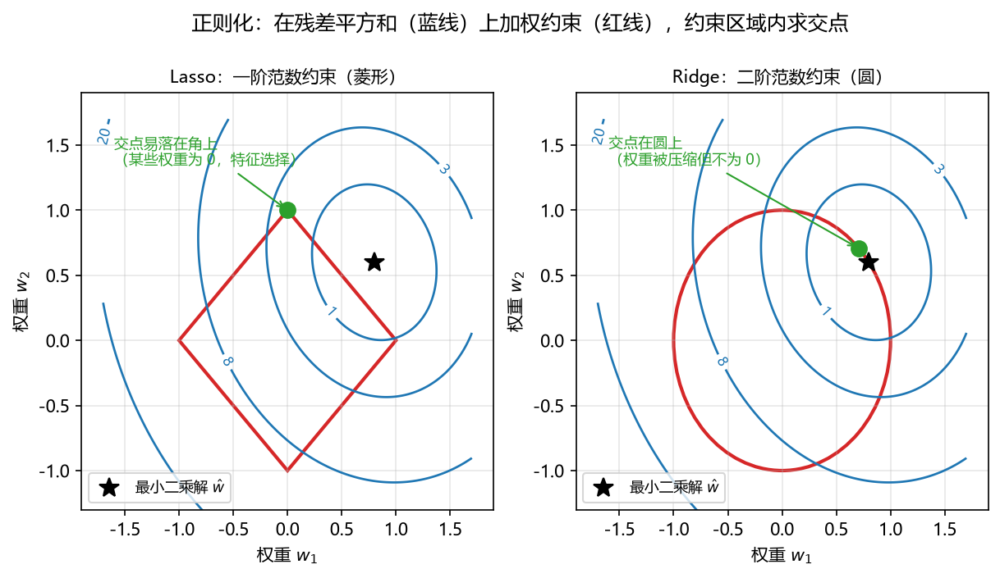

**图 6-7 正则化的几何直观：菱形（Lasso）与圆形（Ridge）约束下的解**

## 6.4 非线性回归

### 6.4.1 现实世界的非线性

现实世界中很少出现严格意义的线性关系，人们日常见到的线性模型都是对非线性的**近似**，或者某种**非线性关系线性化**的结果。线性回归模型的表达式比较单一，非线性回归模型的形式则千变万化，选择和构建不像线性模型那样有固定的套路，其参数估计也就成为一个单独的问题。好在大批常见的非线性模型可以通过变量代换转化为线性形式。

### 6.4.2 可线性化的非线性模型

表 6-6 和表 6-7 列出了常见的、可以线性化的非线性模型：对模型做适当的数学变形（取对数、取倒数、平方等），把 X 的某个函数当成新的自变量 $x'$、Y 的某个函数当成新的因变量 $y'$，在 $x'$ 与 $y'$ 之间就是线性关系，可直接用最小二乘法求解。

**表 6-6 常见的可线性化非线性模型（一）**

| 模型 | 数学方程 | 转化关系 | 线性表示 |
|---|---|---|---|
| 指数模型 | $y = a e^{bx}$ | $y' = \ln y$，$a' = \ln a$ | $y' = a' + bx$ |
| 对数模型 | $y = a + b \ln x$ | $x' = \ln x$ | $y = a + b x'$ |
| 幂指数模型 | $y = a x^{b}$ | $x' = \ln x$，$y' = \ln y$，$a' = \ln a$ | $y' = a' + b x'$ |
| 正态模型 | $y = a e^{b x^2}$ | $x' = x^2$，$y' = \ln y$，$a' = \ln a$ | $y' = a' + b x'$ |
| 对数正态模型 | $y = a e^{b (\ln x)^2}$ | $x' = (\ln x)^2$，$y' = \ln y$，$a' = \ln a$ | $y' = a' + b x'$ |

**表 6-7 常见的可线性化非线性模型（二）**

| 模型 | 转化关系 | 线性表示 |
|---|---|---|
| 双曲线模型 1 | 取倒数变换 | $y' = a + b x'$ |
| 双曲线模型 2 | 取倒数变换 | $y' = a + b x'$ |
| Logistic 模型 | 取对数几率变换 | $y' = a' - b x'$ |
| 抛物线模型 | $x' = x^2$ | $y = a + b x + c x'$ |
| 生产函数（C-D 型） | 取对数变换 | $y' = a' + b x' + c z'$ |
| Gamma 函数 | 取倒数/对数变换 | $y' = a' - b x' - c x''$ |

以指数模型为例（图 6-8）：对 $y = e^{w^T x + b}$ 两边取对数，右边就变成线性的 $\ln y = w^T x + b$——这正是下一小节广义线性模型最直接的例子。

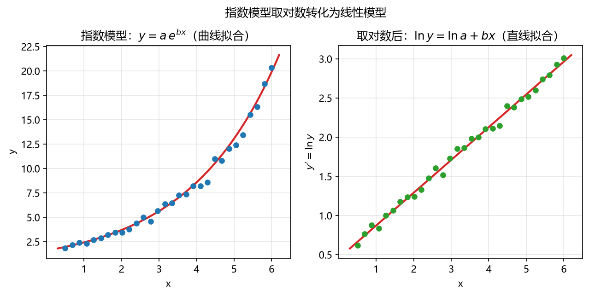

**图 6-8 指数模型取对数后转化为线性模型**

### 6.4.3 广义线性模型

把指数模型的思路推广，就有**广义线性回归**（generalized linear regression）：将线性回归的预测值做一个非线性函数变换去逼近真实值，

$$y = g^{-1}(w^T x + b) \tag{6-8}$$

其中 $g$ 称为**联系函数**（link function）。最典型的例子是**对数线性回归**：将真实值的对数作为线性回归逼近的目标，

$$\ln y = w^T x + b \tag{6-9}$$

即式（6-8）中 $g$ 取指数函数的情形。广义线性模型这个名称请读者务必记住——下一节要讲的 Logistic 回归，正是通过联系函数把分类问题纳入了广义线性框架，很多书因此把它归入"线性模型"来讲述。

### 6.4.4 非线性模型的求解

借助 MATLAB 估计非线性模型参数，主要有两条途径：

1. **基于线性化处理的最小二乘计算（直线拟合）**：先做变量代换转化成线性形式，再用最小二乘求解，全局效果更好；
2. **基于非线性方程的迭代算法（曲线拟合）**：直接对非线性方程用迭代法求解，迭代的目标同样是让残差平方和更小，其模型标准误差通常更低。

两者各有优劣，实际中可以都用、相互验证。对于无法线性化的非线性问题，迭代算法是主要的求解手段。

## 6.5 二元分类及其多元推广

### 6.5.1 从回归到分类

分类与回归的区别在本书开头就强调过：回归的输出是连续的浮点数，分类的输出是离散的类别。最简单的分类是**二元分类**：去医院化验，结果是阳性还是阴性；明天是下雨还是不下雨。反映到模型里，类别用两个整数表示，比如 0 和 1（或 1 和 2）。

线性回归模型 $y = w^T x + b$ 代入数据后输出的是浮点数；做分类时，我们希望模型最终只告诉我们两个整数。直观的想法是：在 $w^T x + b$ 之后再接一个函数，把连续输出映射到 0 或 1。这样"用线性方法解决分类问题"的模型结构就成形了：**线性加权 + 映射函数**。本节讲两种成熟方法中的第一种——Logistic 回归（第二种判别分析见 6.6 节），两者都可从二元推广到多元。

### 6.5.2 二元分类的多元推广

现实中的分类问题往往是多类的。既然二元可解，多元就可以通过**拆分与集成**转化为一系列二元问题。从计算角度有几种思路：

1. **逐级"一类对其余"拆分**：设有十类，先把第一类当成"1 类"、第二至第十类合并成"0 类"，分开后，再在剩余的大"0 类"里把第二类挑出来对其余，依次类推，逐级用二元分类把多类问题解决掉；
2. **分组二分递归**：从十类中随机挑出若干类（如三类）合并为一大类、其余合并为另一大类，先分开这两大类，再在每一大类内部继续二分，递归下去直至每类只剩一类；
3. **投影方法**：寻找分类函数或投影方向，最大化组间方差与组内方差之比（这是判别分析的思路，对二元、多元是统一适用的，见 6.6 节）。

### 6.5.3 单位阶跃函数与对数几率函数

理想的二元分类映射函数是**单位阶跃函数**（unit step function）：

$$y = \begin{cases} 1, & z > 0 \\ 0.5, & z = 0 \\ 0, & z < 0 \end{cases} \tag{6-10}$$

其中 $z = w^T x + b$。预测值大于 0 判为正例（1），小于 0 判为反例（0），恰好等于 0（临界值）则可任意判别。但这个函数有个很大的缺陷：在 $z = 0$ 处从 0 跳到 1，**不连续**，因而不可导——这给后续的数学处理（尤其是求导寻优）带来麻烦。

于是有人构造了它的替代函数——把跳跃的"台阶"换成一条平滑的 S 形曲线：

$$y = \frac{1}{1 + e^{-z}} \tag{6-11}$$

这个函数就比较"完美"了（图 6-9）：它单调、连续、任意阶可导；$z$ 大于 0 时输出大于 0.5 并趋于 1，$z$ 小于 0 时输出小于 0.5 并趋于 0，$z = 0$ 时输出恰为 0.5——与单位阶跃函数的判别行为完全对应，同时弥补了不连续的缺陷。用它对二元类别进行分类的方法，就是经典的 **Logistic 回归**。

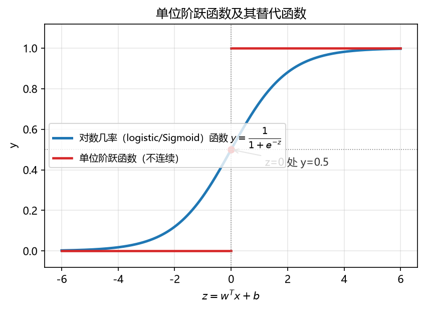

**图 6-9 单位阶跃函数（红）及其替代函数——对数几率函数（蓝）**

### 6.5.4 Logistic 回归的多种等价形式

Logistic 回归的名字有点"绕"：它名字叫回归，解决的却是二元分类问题。这个函数还有很多名字：对数几率函数、Sigmoid 函数；在深度学习里它就是经典的 Sigmoid 激活函数；在生态学中，它就是受资源限制的种群增长模型（Logistic 增长模型）——表达式都是同一个。

它有多种等价的公式形式（表 6-8），初学者看到不同书上的不同写法常以为不是同一个模型，其实稍作变形就能相互导出：第一、二种形式只需分子分母同乘 $e^x$；由于输出值在 0 到 1 之间，可把输出记为概率 $p$；$z$ 可以是多个自变量的线性组合 $a + b_1 x_1 + \cdots + b_p x_p$；再由 $p$ 变形出几率 $p/(1-p)$，取对数后指数消失，得到最后一种形式。

**表 6-8 Logistic 回归函数的五种等价形式**

| 序号 | 公式 | 说明 |
|---|---|---|
| 1 | $f(x) = \dfrac{1}{1 + e^{-x}}$ | 最简形式 |
| 2 | $f(x) = \dfrac{e^{x}}{1 + e^{x}}$ | 分子分母同乘 $e^x$ |
| 3 | $p = \dfrac{\exp(a + b_1 x_1 + \cdots + b_p x_p)}{1 + \exp(a + b_1 x_1 + \cdots + b_p x_p)}$ | 输出视为概率 $p$，$z$ 为多元线性组合 |
| 4 | $\dfrac{p}{1-p} = \exp(a + b_1 x_1 + \cdots + b_p x_p)$ | 几率（优势）形式 |
| 5 | $\ln\dfrac{p}{1-p} = a + b_1 x_1 + \cdots + b_p x_p$ | 对数几率形式 |

### 6.5.5 Logistic 回归的特点

**（1）概率形式的输出。** 输出值域为 $(0, 1)$，单调递增，可直接作为概率使用：$p$ 是 x 归为某一类别的概率大小；越接近 1，x 为类别 1 的可能性越大；越接近 0，不属于该类别的概率越大。介于两者之间时，需设定一个**阈值**（通常取 0.5）：大于阈值归到一个类别，小于阈值归到另一个类别。

**（2）对数几率（对数优势）的解释。** 把 $p$ 理解为 x 为正例的概率，$1-p$ 就是 x 为负例的概率。比值 $p/(1-p)$ 称为**几率**（odds，又译"优势"）——x 为正例相对于负例的相对优势。例如 $p=0.3$，则 $1-p=0.7$，几率 $0.3/0.7$ 表示正例相对于负例的可能性之比。对几率取对数 $\ln[p/(1-p)]$ 就是对数几率（log odds），这也是模型被叫作"对数几率模型""对数优势模型"（英文 logit 模型）的原因，见图 6-10。

**（3）广义线性模型。** 看表 6-8 的第 5 种形式：左边 $\ln[p/(1-p)]$ 是 y（概率）的函数，右边是线性组合——正是 6.4.3 节广义线性模型 $y = g^{-1}(w^T x + b)$ 的标准形式（联系函数取对数几率）。所以很多书说"Logistic 回归是线性模型"，指的是它是**广义线性模型**；它的曲线本身是非线性的。由此还得到一条清晰的判别链：x 属于正例，等价于 $p(y=1|x) > 0.5$，等价于 $p/(1-p) > 1$，等价于 $\ln[p/(1-p)] > 0$，也就是 $w^T x + b > 0$ 成立——预测时直接看线性部分的符号即可判类。

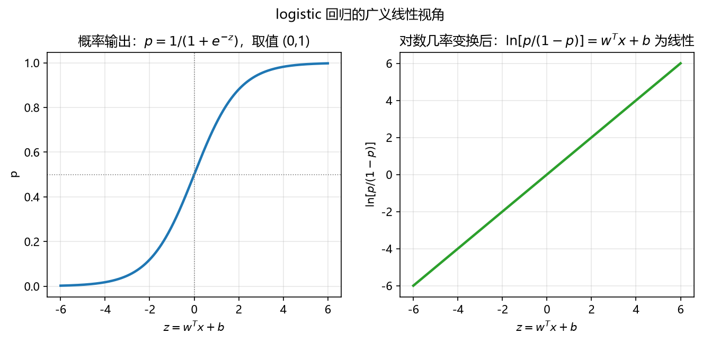

**图 6-10 Logistic 回归的广义线性视角：概率输出（左）与对数几率的线性关系（右）**

**（4）数据特征的加权累加。** $z$ 是输入数据 x 各维度与权重 w 相乘累加的结果（加上偏置 b），对 z 的取值范围没有限制；但当 z 大于一定数值后，函数输出无限趋近于 1，z 小于一定数值后无限趋近于 0，特别地 $z = 0$ 时输出为 0.5。

**（5）恰好人心的非线性变化。** 曲线在 $z = 0$ 附近变化幅度很大（陡峭），而在 z 很大或很小时几乎不变化（饱和、不敏感）。这与分类任务非常契合：在判别临界区域（决策边界附近），微小的差别需要引起输出的大幅改变以拉开区分度；而在远离边界的地方，输出已经很确定，对输入变化"不敏感"反而稳健。

### 6.5.6 Logistic 回归的求解

模型结构已知，求解就是参数估计，有两条基本途径：

1. **转换成线性回归求解**：利用广义线性关系，把 $\ln[p/(1-p)]$ 作为新因变量（大 Y），与右边的自变量做线性回归，直接套用多元线性回归的最小二乘解；
2. **构造损失函数，用迭代算法求解**：以对数似然的相反数构造损失函数（交叉熵损失），目标是最小化损失函数，用梯度下降等迭代算法估计参数。

第二种是更标准、更常用的做法，具体的推导与求解代码可参考配套程序和其他参考书。最后把 Logistic 回归的一般特点小结如下：公式形式多样（对数几率函数、Sigmoid 函数等）；单调可微、任意阶可导；无需事先假设数据分布；可得到"类别"的近似概率预测；可以转化成线性回归或构造损失函数进行求解；用回归的方法解决分类问题；通常解决二元分类，并可推广到多元分类。

## 6.6 判别分析

### 6.6.1 判别分析的思想：一个例子

线性方法解决二元分类的第二种经典方法是**判别分析**（discriminant analysis）。它的公式推导看起来复杂，但一张图就能把它的精髓表达出来（图 6-11）。

某健康调查记录了每个人的**运动频率**和**吸烟频率**两个指标，并根据健康状况把受调查者分成两类：容易患病（橘色点）与不易患病（蓝色点）。直接用这两个原始指标画散点，两类点混在一起，不太好区分。这时我们在平面上另外寻找一个**新轴**，把所有数据点向新轴**投影**——投影之后，两类点分别聚集在新轴的两侧，中间出现了明显的分界：蓝色点集中在一端，橘色点集中在另一端。两类投影的中心（均值）各有一个，把两个中心的**中点**作为阈值，落在阈值一侧判为一类，另一侧判为另一类，分类就实现了。

一句话概括判别分析的思想：**寻找一个恰当的投影方向（或投影超平面），使数据投影之后类与类尽可能分开，再用投影值离哪个类中心近来判类。**

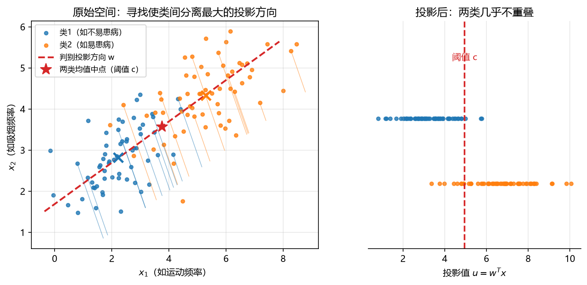

**图 6-11 判别分析的思想：寻找使两类分离最大的投影方向**

### 6.6.2 判别分析的定义

判别分析有两种常用的定义。

**定义 1**：在分类确定的条件下，根据某一研究对象的各种特征值判别其类型归属问题的一种**多变量统计分析方法**。注意两点：它是一种多元统计方法；"分类确定"意味着类别是事先给定的——从机器学习角度看，这是一种**有监督的分类方法**。

**定义 2**：判别分析可以分成两大步——**狭义判别分析**（找出判别规则：找规则）+ **分类分析**（给出分类结果：给结果）。狭义判别分析旨在寻找一种判别规则，利用变量的函数（**判别函数**）来描述和解释两组或多组群体间的区别；分类分析则是利用判别函数在新观测上的取值，找到该观测最有可能属于的类别，从而预测新观测对象的类别。在统计学术语中，"判别分析"狭义上只负责找规则，规则找到工作就完成了；把待判样本代入规则、给出类别，属于"分类分析"的工作。

### 6.6.3 判别分析的基本原理与类型

**基本原理**：按照一定的判别准则，建立一个或多个判别函数，用研究对象的大量资料确定判别函数中的待定系数，并计算判别指标，据此即可确定某一样本属于何类。其中，判别函数是**能够最大限度地区分因变量类别**的函数——虽然它区分的是因变量（类别），计算使用的却是自变量：考查自变量的组间差异是否显著、判断哪些自变量对组间差异贡献最大、评估分类的程度、根据自变量的值将样本归类。在机器学习的语境下，判别分析的因变量为类别数据（有多少类别就有多少个处理组），自变量通常为可度量的连续数据。

判别分析本身是一大类方法，可以从不同角度分类（表 6-9）。本章放在线性模型框架下，讲其中最简单、最经典的一支——Fisher 判别准则下的**线性判别分析**（Linear Discriminant Analysis，LDA）。

**表 6-9 判别分析的类型**

| 分类依据 | 类型 |
|---|---|
| 判别中的组数 | 两组判别、多组判别 |
| 判别函数的形式 | 线性判别、非线性判别 |
| 判别式处理变量的方法 | 逐步判别、序贯判别等 |
| 判别标准 | 距离判别、Fisher 判别、Bayes 判别等 |

### 6.6.4 Fisher 判别分析

**问题表述**：找到一系列向量（投影方向），**最大化多群体的组间方差（B）与组内方差（W）的比值**；新样本在这一系列向量对应的坐标轴下离哪个类中心距离近，即属于该类。直观地说：让投影后组内更聚集（组内方差小）、组与组之间离得更远（组间方差大），两者之比最大。

**模型假设**：对群体的分布没有要求；不同群体有相同的协方差矩阵（这是推导时需要的假设，大部分情况下基本满足）；判别函数是线性的。

**求解结果**：设 $\boldsymbol{S}_W$ 为组内离散度矩阵（ pooled 组内协方差），$\boldsymbol{S}_B$ 为组间离散度矩阵，最大化比值的问题最终归结为一个广义特征值问题，其解为矩阵 $\boldsymbol{S}_W^{-1}\boldsymbol{S}_B$ 的**非零特征值对应的特征向量**；特征值和特征向量的个数为**类别数减 1**（若有五类，判别方向一般取四个）。这与 PCA 的求解形式非常相似——都是求某个矩阵的特征向量，只是优化目标不同。

**等价形式**：可以证明，多群体 Fisher 判别等价于**比较新观测对象与各类中心之间的马氏距离**：不用先投影再算距离，直接在原始坐标下计算待判样本到各类中心的马氏距离，离哪个类的中心近就判给哪一类。讲这两种等价形式，是因为不同的程序实现走了不同的路子（见下一小节），了解等价性才能看懂各种代码。

### 6.6.5 LDA 的 MATLAB 实现

MATLAB 中实现 LDA 至少有四种方法（表 6-10）。

**表 6-10 LDA 的 MATLAB 实现方法**

| 方法 | 主要命令 | 含义 |
|---|---|---|
| 1 单函数法 | `classify` | 根据训练数据的属性数据（矩阵）和类别（向量），求出待判数据类别（向量） |
| 2 双函数法 | `fitcdiscr` + `predict` | `fitcdiscr` 拟合判别分析模型（找规则）；`predict` 根据拟合好的模型求出待判数据的类别（给结果） |
| 3 多步定义法 | `mean`、`cov`、矩阵运算 | 按定义分步实现：求样本均值 → 求样本协方差 → 求 LDA 函数 → 求样本得分；检验：F 检验（组间差异是否显著）、等方差性检验 |
| 4 回归分析法 | `regress` 等 | 判别函数的 X 是属性，Y 是马氏距离平方差，用回归分析求解 |

前两种是最常用的封装方法，正好对应定义 2 的两大步——单函数法一步到位；双函数法先"找规则"（`fitcdiscr`）再"给结果"（`predict`），规则可以复用，也更灵活。

```matlab
% 方法一：单函数法
class = classify(sample, training, group);
% sample：待判样本的属性矩阵（每行一个样本）
% training：训练样本的属性矩阵
% group：训练样本的类别向量
% 返回 class：sample 每一行被判入的类别

% 方法二：双函数法
Mdl = fitcdiscr(Tbl, Res);       % 拟合 LDA 模型：Tbl 为输入变量，Res 为类别
predicted = predict(Mdl, sample); % 对待判样本给出类别
```

`classify` 的完整调用格式还支持 `type`（判别函数类型，如线性、二次、马氏距离）与 `prior`（先验概率）参数，并可返回表观错误率、后验概率、边界曲线系数等；`fitcdiscr` 也支持名称-值参数指定误分类代价、先验概率、交叉验证等。配套代码提供了多种形式的调用示例，请读者自行运行体会。

### 6.6.6 LDA 与 PCA 的区别

初次接触这两个方法，很容易觉得它们相像——确实，两者都是**建一个新轴**（新变量是原始自变量的线性组合），都让原始数据向新轴投影，求解都是矩阵的特征值问题。但它们的目的、假设与优化目标都有本质区别（表 6-11、图 6-12）。

**表 6-11 LDA 与 PCA 的区别**

| 区别 | LDA | PCA |
|---|---|---|
| 目的 | 分类 | 降维 |
| 假设 | 类之间差异显著；不同类协方差相等 | 自变量之间共线性；群体差别大也可用 |
| 群体 | 多个（至少两个） | 单个（全部数据放在一起） |
| 新变量 | 原始自变量线性组合 | 原始自变量线性组合 |
| 优化目标 | 类别群体之间距离最大化（投影的组间方差最大化）、类内个体之间距离最小化（投影的组内方差最小化），即组间方差/组内方差最大化 | 投影的方差最大化（只有一个群体，只要方差最大即可） |

两者的关键差异在于：PCA 把全部数据当成一个群体，追求投影后**总方差最大**，但方差最大的方向未必是类别分得开的方向；LDA 有多个群体，追求投影后**组间方差与组内方差之比最大**，明确以"分开"为目标。图 6-12 中两类数据沿某个斜方向拉长，PCA 会选择方差最大的斜方向（投影后两类重叠较多），而 LDA 选择垂直于拉长方向的方向（投影后两类基本分开）——这正是"降维"与"分类"两种不同目的带来的差别。

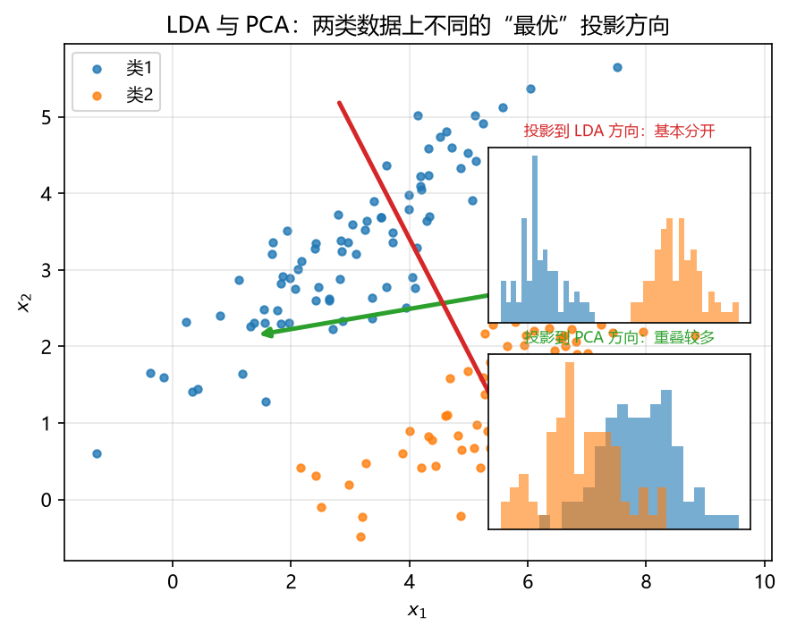

**图 6-12 LDA 与 PCA：两类数据上不同的"最优"投影方向**

## 6.7 模型评估标准

本章讲了一大类方法——有的解决回归问题，有的解决分类问题——怎么评估它们的好坏？回归与分类各有常用的评估标准，这些指标对训练集、验证集、测试集都可以单独计算。

### 6.7.1 回归模型的评价指标

回归评估主要围绕**误差（残差）**展开：模型的预测值与实际观测值之差，取平方、取绝对值、再除以真值、再开根号（为了让量纲与原值一致）……这样就延伸出一系列指标（表 6-12）。此外，也可以直接拿预测值与真实值计算**相关系数**（描述两者变化趋势的一致性）；水文领域则常用**纳什系数**。

**表 6-12 回归模型的评价指标**

| 指标 | 英文名 | 备注 |
|---|---|---|
| 平均绝对误差 | MAE, Mean Absolute Error | 绝对误差损失的期望值 |
| 平均绝对百分比误差 | MAPE, Mean Absolute Percentage Error | 相对误差损失的期望值；相对误差是绝对误差与真值的百分比 |
| 均方误差 | MSE, Mean Squared Error | 平方（二次）误差的期望 |
| 均方误差根 | RMSE, Root Mean Squared Error | 均方误差开根号，量纲与原值一致 |
| 可决系数（拟合优度） | R², coefficient of determination | 自变量 x 对因变量 y 变动的解释程度，越接近 1 拟合越好 |
| 纳什系数 | NSE, Nash–Sutcliffe efficiency coefficient | 水文模型的常用评估指标 |

几个主要指标的计算式为：

$$MAE = \frac{1}{n}\sum_{i=1}^{n} |y_i - \hat{y}_i|, \qquad MSE = \frac{1}{n}\sum_{i=1}^{n} (y_i - \hat{y}_i)^2, \qquad RMSE = \sqrt{MSE}$$

$$R^2 = 1 - \frac{\sum (y_i - \hat{y}_i)^2}{\sum (y_i - \bar{y})^2}, \qquad NSE = 1 - \frac{\sum (Q_i - \hat{Q}_i)^2}{\sum (Q_i - \bar{Q})^2}$$

方向上要记清楚：基于误差的指标（MAE、MAPE、MSE、RMSE）都是**越小越好**，趋近 0 最好；相关系数 R、可决系数 R² 与纳什系数都是**越大越好**，趋近 1 最好。各应用领域还有各自的领域指标，读者进入具体领域时应补充了解。

### 6.7.2 分类模型的评估：二分类混淆矩阵

分类模型的评估大多建立在**混淆矩阵**（confusion matrix）之上。以二分类为例：真实值要么正例（1）要么负例（0）；预测值同样要么正例要么负例。两种真实状态 × 两种预测结果，交叉出 2×2 的表格，就是混淆矩阵（图 6-13）。四个单元格各有专名，初学者必须熟悉：

- **真阳性**（True Positive，TP）：实际是正例，预测是正例；
- **真阴性**（True Negative，TN）：实际是负例，预测是负例；
- **假阳性**（False Positive，FP）：实际是负例，预测是正例；
- **假阴性**（False Negative，FN）：实际是正例，预测是负例。

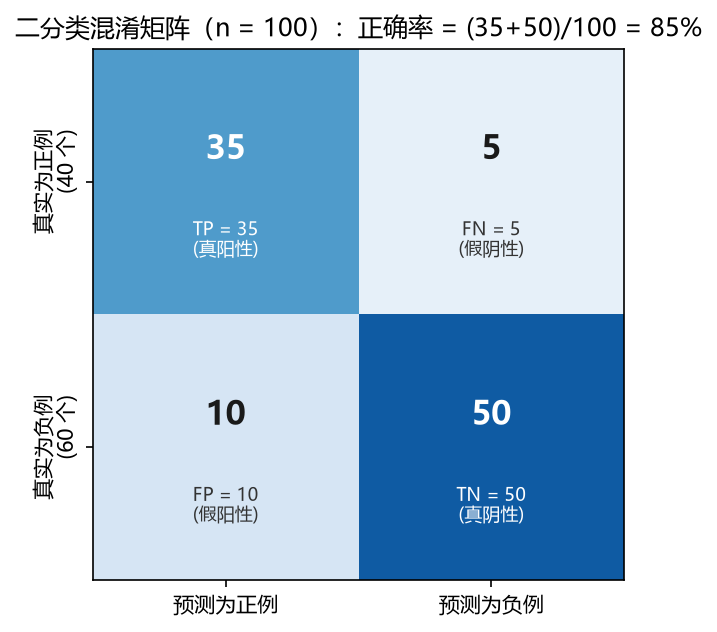

**图 6-13 二分类混淆矩阵示例（n = 100）**

在这四个数字的基础上可以派生出一批指标。以图 6-13 的例子（100 个样本，40 个正例、60 个负例，TP=35、FN=5、FP=10、TN=50）计算：

- **正确率**（Accuracy）：被正确分类的样本比例，$(TP+TN)/\text{Total} = (35+50)/100 = 85\%$；
- **错误率**（Misclassification/Error Rate）：被错误分类的样本比例，$(FP+FN)/\text{Total} = (5+10)/100 = 15\%$；
- **真阳率**（TPR，敏感度 sensitivity、召回率 recall）：预测为正例的样本占实际正例的比例，$TP/\text{实际正例数} = 35/40 = 87\%$，反映分类器对正例的敏感程度；
- **假阳率**（FPR）：预测为正例的样本占实际负例的比例，$FP/\text{实际负例数} = 10/60 = 17\%$；
- **特异性**（Specificity，真阴率 TNR）：预测为负例的样本占实际负例的比例，$TN/\text{实际负例数} = 50/60 = 83\%$；
- **精度**（Precision，阳性预测值）：判为正例的结果中真正正例所占的比例，$TP/\text{预测正例数} = 35/45 = 77\%$；
- **流行程度**（Prevalence）：正例在样本中所占比例，$40/100 = 40\%$。

这些指标不用死记硬背，有个简单的"算法几何"：混淆矩阵里有 TP、FN、FP、TN 四个数，每个数做比例时分母可以**横着除**（除以所在行的和，即真实类别总数）、**竖着除**（除以所在列的和，即预测类别总数）、**斜着除**（对角线相加或反对角线相加除以总数）——每种除法各对应一组指标名称，经常回来看一看、算一算就记住了。

### 6.7.3 多分类的混淆矩阵

多分类是更一般的情形。设三分类的混淆矩阵结构如表 6-13。

**表 6-13 多分类混淆矩阵的结构（以三分类为例）**

|  | 预测类别 1 | 预测类别 2 | 预测类别 3 |
|---|---|---|---|
| **真实类别 1** | a | b | c |
| **真实类别 2** | d | e | f |
| **真实类别 3** | g | h | i |

结构与指标的读法如下：

- **第 i 行第 j 列**的数字：真实值是类别 i 而预测为类别 j 的样本数；
- **每一行之和**：该类别的真实样本总数（如类别 2 的真实样本总数为 d+e+f）；
- **每一列之和**：被预测为该类别的样本总数（如被预测为类别 2 的样本总数为 b+e+h）；
- **对角线**（左上到右下）：预测正确的样本数；其余格子都是分错的。

每个类别都可以分别计算精确率与召回率：类别 1 的**精确率** = $a/(a+d+g)$（竖着除，列和为分母）；类别 1 的**召回率** = $a/(a+b+c)$（横着除，行和为分母）。

例如某三分类结果为：真实类别 1 一行是 (43, 2, 0)，类别 2 一行是 (5, 45, 1)，类别 3 一行是 (2, 3, 49)。则类别 2 的真实样本总数为 5+45+1=51，被预测为类别 2 的总数为 2+45+3=50；真实为类别 2 而被预测为类别 1 的有 5 个；类别 2 预测正确的有 45 个；实际为 1 类而被预测为 2 类的有 2 个。做分类时经常把混淆矩阵画成图作为结果展示，既直观又便于发现"哪些类容易互相混淆"。

### 6.7.4 误判误差率

多分类问题总体上常用**误判误差率**来衡量。其定义是：对各个类别分别计算"训练集中归类错误的样本数 × 该类别的先验概率值 ÷ 训练集样本数"，再对所有类别加和。每个类别的先验概率值默认取 1/类别数（等概率），也可取该类别样品数/总样品数。误判误差率越低，说明分类模型越好。

## 6.8 案例研究：UNDP 国家发展水平判别

### 6.8.1 问题背景

联合国开发计划署（UNDP）在《人类发展报告》中，按照**出生时预期寿命、成人识字率、人均地区生产总值（GDP）**等指标，将全世界的国家分为三类：高、中、低水平人类发展。原始数据集包含 174 个国家。这天然构成一个判别分析案例：指标是自变量（属性），发展水平类别是因变量（标签）。案例设计了两个层次的问题。

### 6.8.2 问题一：二分类判别

只考虑两类国家——高水平与中水平。数据集共 18 个国家：其中 14 个（6 个高水平和 8 个中水平）作为**训练集**，4 个国家作为**验证集**（待判国家）。选用**三个指标**：出生时预期寿命、成人识字率、人均 GDP。

用训练集拟合判别分析模型（找规则），再把 4 个待判国家的指标代入模型给出类别（给结果），并与 UNDP 的原始分类对照，检验判别正确率。图 6-14 以其中两个指标为例，展示了训练样本、待判样本与 Fisher 判别边界的关系：判别边界把指标空间分成两个区域，待判国家按其落点被判入相应类别。

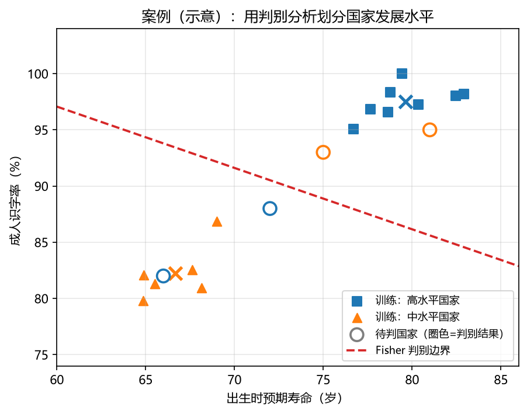

**图 6-14 案例示意：用判别分析划分国家发展水平**

### 6.8.3 问题二：三分类判别

考虑全部三类国家（174 个国家）。从高、中、低水平国家数据集中，按照每类 1/4 的比例抽取共 44 个国家作为**训练集**，按照每类 1/10 的比例抽取共 18 个国家作为**验证集**（待判国家）。选用**四个指标**：出生时预期寿命、成人识字率、人均 GDP、城镇人口比重——比二分类多了一个城镇化指标。

三分类时判别方向的个数为类别数减 1（即 2 个），可以在二维判别空间中绘制各类样本的投影与判别边界，直观展示三类的分布与混淆情况。

### 6.8.4 示例程序的结构

配套的 MATLAB 示例文件覆盖了 6.6.5 节介绍的多种求解方式（表 6-14），建议读者逐个运行、对比结果。

**表 6-14 案例示例文件的求解方式对比**

| M 文件 | 含义 | 因子个数 |
|---|---|---|
| DA2C_01.m、DA2C_02.m、DA2C_03.m | 分别利用线性、二次和马氏距离进行判别，二类分类 | 2 |
| DA_2C_04_Full.m | 多步定义法：F 检验（组间差异是否显著，F 值大于临界值）；等方差性检验（不同组协方差相同，卡方值小于临界值） | 2 |
| DA_2C_05_MLR.m | 回归分析法：判别函数的 X 是属性，Y 是马氏距离平方差，用回归分析求解 | 2 |
| DA_3C_01.m | 线性距离进行 3 类分类 | 3 |
| DA_3C_02_KC.m | k 均值与判别分析联用 | 3 |

以二分类为例，核心代码非常简短：

```matlab
% 读取训练数据：training 为 14×3 指标矩阵，group 为类别向量（'high'/'middle'）
% 待判数据：sample 为 4×3 指标矩阵

% 单函数法
class = classify(sample, training, group);

% 双函数法
Mdl  = fitcdiscr(training, group);
pred = predict(Mdl, sample);
```

运行后对照 4 个待判国家的真实类别即可统计判别正确率；三分类程序同理，可进一步绘制多分类混淆矩阵，用 6.7.3 节的指标评估效果。示例中还包含判别分析与其他方法（如 k 均值聚类）的联用：先用聚类把数据分组、再对组做判别，读者可体会不同方法组合的思路。

## 6.9 小结

本章系统介绍了线性模型（线性学习）方法，要点回顾如下。

**用线性方法做回归。** 最常用的是线性回归，包括一元与多元；线性回归并不是总能遇到的情形，很多情况是非线性的，其中相当一部分非线性模型可以通过变量代换**转化成线性**来求解；转化不成线性的，也可以用迭代等**非线性方法**求解。实际建模时还需注意多重共线性问题（必要时用 Lasso、Ridge 等正则化方法）、时间序列的自相关问题，以及"先聚类后回归"的组合思路。

**用线性方法做分类。** 分类问题最简单的是二元分类，而二元分类可以推广到多元（逐级拆分或分组递归）。解决二元分类的两种经典线性方法：

1. **Logistic 回归**。名字有点怪——名字叫回归，解决的却是分类问题；看上去是曲线，却是广义线性模型（对数几率形式是线性的）。它又名对数几率（对数优势）模型、Sigmoid 函数，与生态学中的种群 Logistic 增长模型同源；形式多样、单调可微、任意阶可导、无需分布假设，输出可直接作为概率使用，可以转化成线性回归或构造损失函数求解，是极为著名的方法。
2. **线性判别分析（LDA）**。具体定义不容易背全，但要记住那张图：用**投影**的方法找一个新轴（或新超平面），使原始数据投影后**组间方差与组内方差之比最大化**，从而把数据分开。找到投影方向（解为 $\boldsymbol{S}_W^{-1}\boldsymbol{S}_B$ 的非零特征向量，个数为类别数减 1）只是完成了"找规则"，还要把待判数据投影上去、比较离各类中心的距离（等价于比较马氏距离），完成"给结果"。它与新轴的构造方式与 PCA 相似，但目的（分类 vs 降维）与优化目标（组间/组内方差比最大化 vs 总方差最大化）不同。

**模型的评估。** 回归模型用 MAE、MAPE、MSE、RMSE 等误差指标（越小越好）与 R²、纳什系数（越大越好）评估；分类模型用混淆矩阵派生的指标族评估——二分类记 TP/TN/FP/FN 与精度、召回、特异度等（横着除、竖着除、斜着除各有含义），多分类看每类的精确率与召回率，总体可用误判误差率。

学完本章，机器学习四类主要功能（聚类、降维、回归、分类）我们都已经有了若干种可以动手的方法。下一章将介绍另一类直观的经典方法——k 最近邻（kNN）。

## 思考题

1. 常用的线性回归方法有哪些？一元与多元、线性与非线性给回归分析带来了哪些变化？
2. 聚类、回归和分类的区别是什么？
3. 怎么用 MATLAB 构建线性回归模型？怎么验证回归是否有统计意义（显著性检验）？
4. 多元回归为什么会出现多重共线性问题？Lasso、Ridge、Elastic-Net 各用什么方式缓解，各有什么特点？
5. Logistic 回归为什么叫"回归"？它有哪几种等价的公式形式？"广义线性"体现在哪里？
6. 常用的判别分析方法有哪些？Fisher 判别的优化目标是什么？它为什么与马氏距离判别等价？
7. LDA 与 PCA 有哪些区别与联系？
8. 若数据中存在异常点，有无统计方法剔除异常点？有无统计方法可以在异常点存在下建立回归模型？（提示：稳健回归，如 RANSAC、Theil–Sen 等）
9. 怎么评估本章介绍的这些线性学习方法？回归与分类各用哪些指标？

