# 第7章 k最近邻（kNN）模型

> **本章导读**：前几章介绍的多元线性回归、Logistic 回归与判别分析同属线性方法家族，它们都要用自变量 X 的显式表达式去计算因变量 Y。本章介绍一种思路完全不同的方法——k 最近邻（k-Nearest Neighbor，kNN）：它不写任何公式，而是"看看邻居是谁，就认为待测样本是谁"。本章从一组直观例子出发，逐步给出 kNN 的定义、算法步骤与特点，讨论 k 值选择、距离度量、决策规则、搜索效率及其与其他方法的结合等五个关键问题，讲解用于加速近邻搜索的 kd 树，给出 MATLAB 实现的常用函数与调用格式，最后通过"医院找相似病人"与"鸢尾花分类"两个案例完整演练 kNN 的建模过程。

## 7.1 方法体系中的 kNN

### 7.1.1 对上一章的简要回顾

上一章介绍了解决回归与分类问题的一大类**线性方法**：多元线性回归、Logistic 回归和判别分析。那里着重强调过模型评价问题，此处再作简要回顾，因为本章的案例仍要用到这些工具。

对于**回归问题**，可以用基于误差的指标（误差类指标越小越好）以及相关系数、纳什系数（Nash–Sutcliffe 效率系数，越大越好、越接近 1 越好，一般至少应大于 0.5）等来评价模型。

对于**分类问题**，常用**混淆矩阵**及其派生指标。二分类混淆矩阵用单元格记录"实际类别 × 预测类别"的组合：实际为正、预测为正或为负，实际为负、预测为正或为负；二元混淆矩阵可以推广到多分类情形，进而计算总体正确率、查准率、查全率等指标。

需要特别注意的是：**所有这些指标都是针对某个具体数据集计算的**。数据集通常划分为训练集、验证集与测试集，有时还有全新采集的数据集。于是模型评价自然变成"多个数据集 × 多个指标"的综合判断问题。通常以**验证集为主、训练集为辅**，测试集则作为另外一层检验。这一原则在本章选择 k 值时会反复用到。

### 7.1.2 方法总表中的位置

本书把数据挖掘/机器学习的典型方法按"类别—功能"整理成一张总表（表 7-1）。建议读者在学习每种新方法时都回到这张表，看看它处于什么位置，有利于理解和比较。

**表 7-1 数据挖掘/机器学习的典型方法**

| 类别 | 聚类 | 降维 | 回归 | 分类 |
|------|------|------|------|------|
| 线性方法 | — | 相关性分析、主成分分析、因子分析 | 多元线性回归 | Logistic 回归、判别分析 |
| 最近邻 | k 均值聚类 | — | **kNN** | **kNN** |
| 树型 | 层次聚类 | — | 决策树（回归树） | 决策树（分类树） |
| 密度 | DBSCAN | — | — | — |
| 神经网络 | 自组织映射（SOM） | — | ANN | ANN |
| 核函数 | — | — | SVR | SVC |
| 图论 | 谱聚类 | — | 概率图模型 | 概率图模型 |
| 随机变量 | 高斯混合模型 | — | — | 贝叶斯分类 |
| 模糊数学 | 模糊 C 均值聚类 | — | 模糊逻辑模型、ANFIS | 模糊逻辑模型 |
| 深度学习 | — | — | CNN、LSTM | CNN |

从表中可以看到，kNN 是一个非常通用的方法：它**至少能实现回归和分类两种功能**，稍加变化还可以做降维和聚类。从"距离/相似性"的角度看，k 均值聚类与 kNN 是同一思路的两种用法——前者用"到类中心的距离"划分类别，后者用"到训练样本的距离"寻找邻居。

## 7.2 kNN 的基本思想：从直观例子说起

### 7.2.1 分类的例子：物以类聚，少数服从多数

先看 kNN 做分类的例子（图 7-1）。图中方块和三角代表两类已知的训练样本，绿色圆点是待测样本，我们想知道它的类别。

做法非常直观：把训练样本和待测样本都画在由自变量 X 张成的空间里，观察待测样本与空间中各个训练样本的远近关系。离待测样本比较近的那些点——也就是它"最近的邻居"——的属性，就可以拿来代替待测样本的属性。当邻居有多个时，遵循**少数服从多数**的原则：k 个最近邻居中占多数的 Y 类别，就作为待测样本的类别。

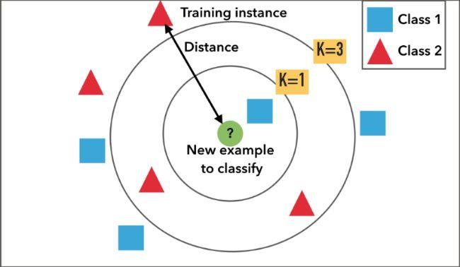

**图 7-1 根据邻居个数的分类结果（实线圆内取 k=3，虚线圆内取 k=5）**

在图 7-1 中，如果只选周围 3 个邻居，其中红色三角 2 个、蓝色方块 1 个，待测样本按多数票判为三角一类；如果把范围扩大到周围 5 个邻居（虚线圆），则变成 3 个方块对 2 个三角，待测样本就判为方块一类。这个简单例子给出三点启示：

1. **k 的取值对判别结果影响很大**，必须认真选择（见 7.5.1 节）；
2. 做分类时 k 通常**取奇数**，这样在"少数服从多数"表决时容易分出多数方，避免平票；
3. "数邻居个数"与"定邻域半径"是**两种等价**的近邻圈定方式：既可以规定"选最近的 k 个"，也可以规定"半径 r 的邻域内包含几个算几个"。

### 7.2.2 按邻域半径找邻居

图 7-2 与图 7-3 分别给出按个数（K=3）与按距离（邻域半径）圈定邻居的分类效果。

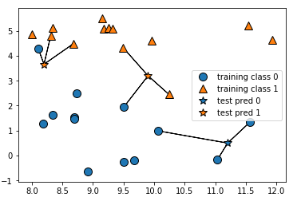

**图 7-2 K=3 时的 kNN 分类**

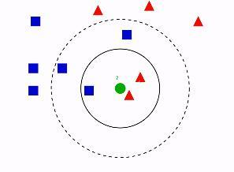

**图 7-3 根据邻域半径（距离）的分类结果**

用半径方式时，半径较小时圈进来的样本少，半径较大时圈进来的样本多。分类问题用半径方式会遇到一个细节问题：若圈定的邻域内两种类别的样本数**恰好相等**（例如 2 个圆圈对 2 个三角），该怎么判？一般来说：判为其中任意一类都是可以接受的，或者反过来认识到这个半径挑选得并不合适，需要调整半径。通常把邻居数选得多一些（k 取较大的奇数），就能避免这种持平的局面。

### 7.2.3 在带刻度的特征空间中看 kNN

图 7-4 把样本点画在带具体刻度的二维空间里：横轴、纵轴分别是两个自变量 $X_1$、$X_2$——它们正是建模数据中的两个 X。五角星是待测样本。

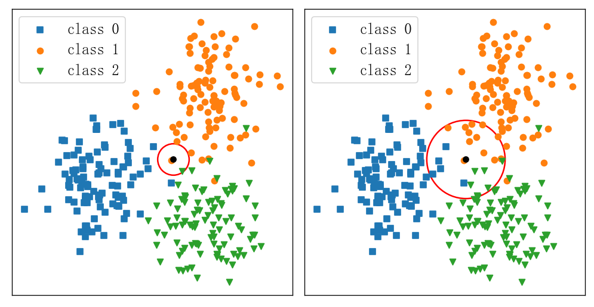

**图 7-4 在二维特征空间中选择 k 个最近邻或邻域半径**

对每个五角星，在二维空间里找最近的 3 个邻居，然后按少数服从多数表决：图中两个五角星的邻居以三角为主，判为三角类；右下角五角星的 3 个邻居都是圆圈，判为圆圈类。切换到半径形式也一样：左边用较小的半径、右边用稍大的半径，圈入的样本数不同，表决结果可能随之变化。**要提醒的是，所有"远近"的判断都发生在这个由 X 张成的空间里——这一点在 7.3 节给出定义时还会再次强调。**

### 7.2.4 kNN 如何做回归

kNN 做回归同样直观。看一个一元回归的例子：当自变量 X 取 9（或 9 点几）时，因变量 Y 是多少？做法是：在 X=9 的左右两侧挑选离它最近的若干个邻居，把邻居的 Y 值取**平均数**，作为待测样本的预测值。平均数的含义也可以理解成**等权重的加权和**。

$$\hat{y}_0=\frac{1}{k}\sum_{x_i\in N_k(x_0)} y_i$$

其中 $N_k(x_0)$ 表示与待测样本 $x_0$ 最近的 k 个邻居的集合。图 7-5 将 kNN 回归与线性回归做了对比，图 7-6 展示了 kNN 实现曲线拟合的效果。

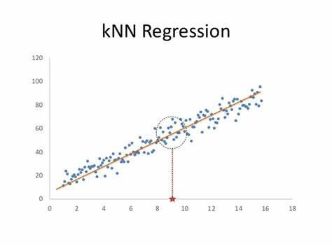

**图 7-5 kNN 回归和线性回归的比较**

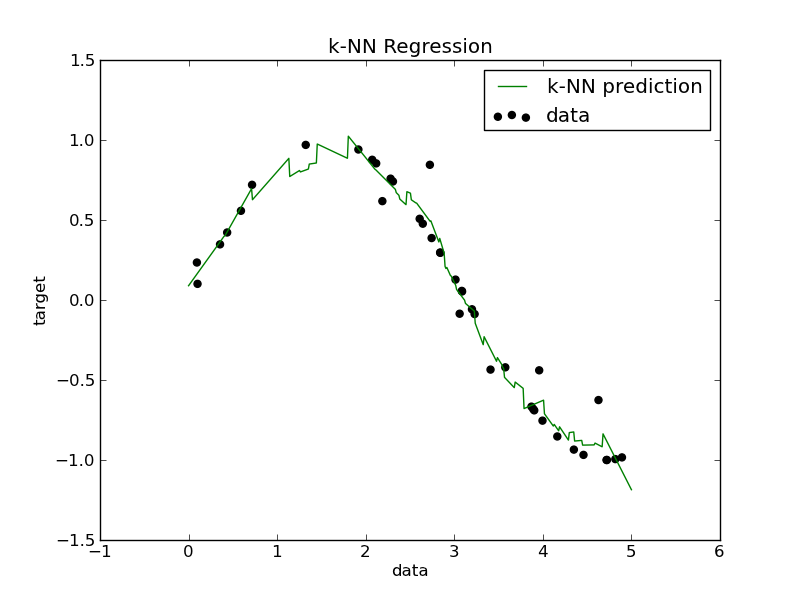

**图 7-6 kNN 回归实现曲线拟合（K=1 与 K=3 的对比）**

对 kNN 来说，待拟合的关系是直线还是曲线**没有本质区别**：都是在待测点附近找最近邻居、对邻居的 Y 取平均。于是 kNN 可以很轻松地实现线性回归和曲线回归。

### 7.2.5 k 的大小：在过拟合与"大势"之间

k 的取值对回归拟合形态影响显著（图 7-6、图 7-7）。

- **K=1** 时只能选中周围 1 个邻居，拟合曲线与实际数据点贴合得过于紧密，通常会导致**过拟合**——曲线把样本点的特殊波动也学了下来，而我们希望模型反映的是**一般规律和总体趋势**；
- **K=3** 时，曲线上每个点都是周围 3 个红点的平均，得到的绿色曲线既能反映原始数据的变化趋势，又不完全逼近每个点，这正是想要的效果；
- **K=10**、**K=70** 时（图 7-7），曲线越来越平缓，到 K=70 时只能反映一个大概的趋势，把许多有用的细节也抹掉了。

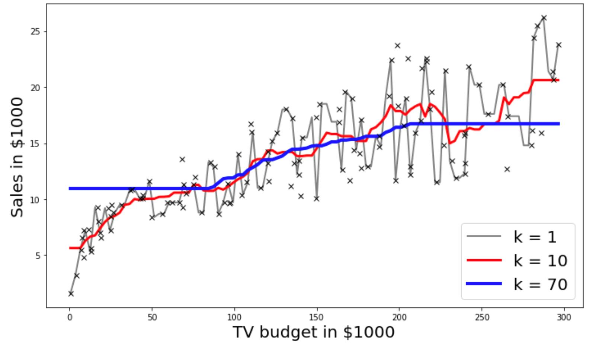

**图 7-7 k 对 kNN 回归的影响（黑色：K=1；红色：K=10；另一条为 K=70）**

可以想见，k 存在一个**较优的取值区间**：既反映数据点的变化规律，又不完全贴合，从而容易推广到一般情形。图 7-8 进一步把 K=1、6、16 三种情形在**两种数据集**（左列与右列，例如训练集与验证/测试集）上的拟合效果并列展示。做论文时建议大家也画出这类"两列图"：每一列对应一种数据集，逐行考察 k 增大时拟合形态的演变。

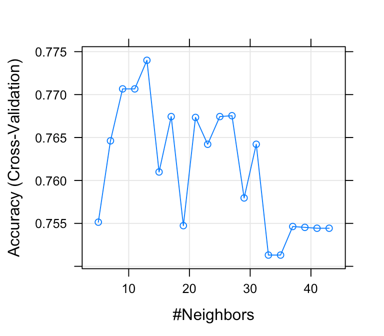

**图 7-8 k 对 kNN 回归的影响：K=1、6、16 在两种数据集上的拟合效果（三行两列）**

更一般的做法是画**性能曲线**：对一个数据集，把横轴设为 k（从 1 或 2 取到某个上限，例如 45），纵轴设为描述回归或分类效果的某个性能指数，观察 kNN 模型的性能随 k 从小到大如何变化。通常**对验证集来调 k**：找到验证集性能曲线的拐点对应的 k 作为最佳取值，同时保证训练集上的效果也不错，即"验证集最好、训练集不要太差"。

### 7.2.6 距离函数与加权方式的影响

还有两个因素会显著影响 kNN 模型。

**其一是距离函数。**kNN 的"最近"是基于某个距离函数计算的，距离函数不同，"最近的邻居"就可能不同，进而影响模型结果（图 7-9）。

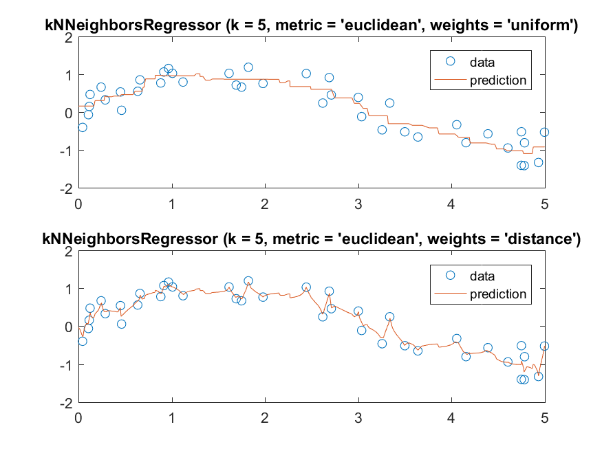

**图 7-9 不同距离函数对 kNN 回归的影响**

**其二是邻居的权重。**前面回归例子取邻居 Y 的平均值，是等权重（每个邻居权重 1/k）的加和。有研究者认为，等权重忽略了邻居与待测样本**远近差别**的影响：离待测样本更近的邻居，理应对预测产生更大的影响。于是可以把等权加和改为**加权加和**——给更近的邻居更大的权重（图 7-10）。最直观的权重是**距离的倒数**：距离越近，权重越大。权重该怎么选，由此成为 kNN 的一个衍生问题，详见 7.5.3 节。

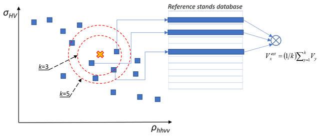

**图 7-10 kNN 回归的加权平均（等权与近邻加权对比）**

看完这些例子，读者对 kNN 应该已经建立了直观理解，下面进入正式的定义与算法描述。

## 7.3 kNN 的定义与算法

### 7.3.1 定义

**kNN 的含义。**中文称 **k 最近邻**（或 k 近邻，也有人省略 k 直接叫"最近邻"）；英文为 **k-Nearest Neighbor（kNN）**。名称里的 k 与前面学过的 k 均值聚类中的 k 含义类似：**需要用户显式给定**。成熟的软件包（如 MATLAB）在用户不给定时默认 k=1；也有人称其为"最近邻法"而省略 k，但真正计算时 k 是不能省的。

> **定义（k 最近邻）** 对于某个给定自变量的样本，找到训练集中距离最近的 k 个样本（即所谓的最近邻居），基于这些邻居的**因变量信息**来预测该样本的因变量。

这个定义初读容易忽视两个细节，请务必留意：

1. **算距离时只使用自变量 X，不使用因变量 Y。**"找到训练集中距离最近的 k 个样本"是对"某个给定自变量的样本"而言的，距离完全在 X 张成的空间中计算；
2. **预测 Y 时抛开 X，只用邻居的 Y。**邻居找完之后，X 的使命即告完成，待测样本的 Y 完全由 k 个邻居的 Y 决定（分类时投票、回归时平均或加权平均）。

也就是说，**X 用于找邻居，Y 用于算预测值，两个环节分开进行**。这与线性模型"用系数乘 X 直接算出 Y"的逻辑截然不同。

**kNN 的定位。**kNN 主要解决分类和回归问题，需要因变量 Y 的参与，因此属于**有监督学习**；同时它一般不需要显式的训练过程，属于**懒惰学习**（见 7.3.3 节）。

### 7.3.2 算法实现的两个阶段

**（1）训练阶段：保存样本。**kNN 的训练阶段非常简单——只是把每个训练样本保存起来，没有任何进一步的参数率定。回想多元线性回归或神经网络，它们都要在训练阶段把参数（回归系数、网络权重等）求出来；kNN 没有这个步骤，因为它的"参数"主要就是 k 值和距离函数的选择，而这些在训练前已经由用户确定。后面会讲到，训练阶段也可以做得稍复杂一点——让样本存储得更有效（例如组织成 kd 树），那是为提高搜索效率而做的扩展。

**（2）工作阶段：找邻居、算预测值。**

- **用 X 找最近邻**：给定一个待测样本，基于某种近邻索引方法，找出训练样本集中与其最靠近的 k 个样本；
- **用邻居的 Y 算预测值**：基于这 k 个训练样本（最近邻）的因变量，预测待测样本的 y 值。

再次强调：找邻居只用 X；算预测值只用邻居的 Y。

### 7.3.3 懒惰学习与急切学习

为了理解"懒惰学习"，把它与与之对应的"急切学习"作一对比（表 7-2）。

**表 7-2 懒惰学习与急切学习的对比**

| 项目 | 急切学习 | 懒惰学习 |
|------|----------|----------|
| 别名 | 积极学习 | 消极学习 |
| 英文 | eager learning | lazy learning |
| 含义 | 在训练阶段就对训练样本进行学习处理（训练模型、实现参数率定） | 没有显式的训练过程（例如训练阶段只是把训练样本保存起来），建模工作延迟到预测（工作）阶段才进行处理 |

两者的最大区别在于：懒惰学习没有显式的训练过程，训练可能只是保存样本，建模被推迟到预测阶段；急切学习则在训练阶段就要对样本做学习处理，通常需要求导或其他特殊计算把参数确定下来。多元线性回归、神经网络等属于急切学习，kNN 是典型的懒惰学习。

### 7.3.4 kNN 分类的三步与三要素

kNN 用于分类时，常规步骤可细化为三步：

1. **算距离**：给定待分类样本，计算它与已分类样本中每个样本的距离（只用 X）；
2. **找邻居**：圈定与待分类样本距离最近的 k 个已分类样本，作为该样本的近邻（仍在 X 空间中进行）；
3. **做分类**：根据这 k 个近邻中大部分样本所属的类别（邻居的 Y），决定待分类样本的类别。

注意前两步只使用 X，第三步则切换到 Y——邻居找到后，就"看邻居的 Y"来表决。

除了这三步，还要认识到 kNN 分类隐含的**三个要素**：

- **k 值的选择**；
- **距离的度量**（距离怎么算）；
- **分类的决策规则**（是不是只能少数服从多数？还有没有其他方法？）。

这三个要素在上面三步里并没有明显提出——kNN 的定义把"皮球踢给了用户"，但要把 kNN 用好，这三个问题必须认真考虑，详见 7.5 节。

## 7.4 kNN 的特点

### 7.4.1 基本假设：相近的样本有相似的 Y

kNN 成立的基础是一个看上去很自然的假设：

> **假设**：在输入空间上相近的样本点，具有相似的 Y。

这个假设合理吗？举一个生活中的例子。如果你某次看到刮很大的风、打很大的雷，过了一段时间就下了很大的雨；那么下一次再碰到类似程度的大风和电闪雷鸣，你很自然会推断：过一会儿也会下同样大的雨。用模型的语言说：$X_1$ 是刮风的程度，$X_2$ 是雷电的程度，Y 是降雨的情况——两个 X 的组合相近时，对应的 Y 也应当相近，于是待测样本（当前的 X）的 Y 可以参照"历史邻居"的 Y 来估计。

这个假设总体上是合理的，但现实中也可能出现不满足的情况：偶尔也会有"同样的风、同样的雷，结果没怎么下雨"。对建模而言，我们仍遵循这一基本假设，不去另做更复杂的高级假设。

> **地理视角**：kNN 的这条假设与地理学中的 Tobler 第一定律——"任何事物都与其他事物相关，但相近的事物关联更密切"——精神上一脉相承。在地理数据挖掘中，"邻近"既可以是属性空间中的邻近，也可以直接对应地理空间中的邻近，这正是 kNN 在地学应用中天然契合的原因。

### 7.4.2 优点

**（1）不用显式地描述 X 和 Y 的关系。**线性模型计算 Y 时，要写出 Y 关于 X 的显式表达式（如 $y=a_1x_1+a_2x_2+\cdots$），分类时也是先由 X 算出一个数值（或概率），再按阈值（如 0.5）判类。kNN 完全不同：只用 X 找邻居，找到邻居后用邻居的 Y 来评定待测样本的 Y，**全程没有用 X 直接计算 Y**。对一些特别复杂的问题——X 与 Y 之间不存在、也不容易找到一个直观表达式的时候——kNN 的优势就显现出来：只要 X 相似，直接借用邻居的 Y 即可。

**（2）原理简单，与人的直观思维接近。**"看看邻居是什么，我就是什么"，几乎不需要数学推导就能向非专业者解释清楚。

### 7.4.3 缺点

**（1）对大数据集计算量较大。**理论上，待测样本要与训练集中的**所有**样本都计算一遍距离，才能确定谁离自己最近。对中小规模数据集这没有太大问题；但当数据量很大、维数（X 的个数）较高，尤其是还需要反复查询最近邻时，逐个比较的计算量就相当可观。解决思路是**通过索引方法缩小搜索范围**：先用索引把搜索空间缩小，再在小的范围内找邻居，例如 7.6 节的 kd 树和基于聚类的搜索。

**（2）对不均衡数据或异常点敏感。**kNN 的预测值由邻居的 Y 决定，如果选中的邻居恰好是异常点，它对待测样本 Y 的评估就会受到很大影响；对一些极值（稀有类、极端数值）的预测效果就不一定好。使用时需要注意数据的均衡性，必要时先做处理。

## 7.5 kNN 的五个关键问题

把 7.3 节的"三要素"与 7.4 节的"缺点"综合起来，用好 kNN 需要回答五个问题：**怎么选 k？怎么选距离函数？邻居的 Y 怎么用来预报 Y？怎么提高搜索效率？kNN 怎么与其他方法结合？**下面逐一讨论。

### 7.5.1 问题 1：k 值怎么选

kNN 的定义假设 k 已由用户给出，但 k 的选择实际上绕不开。选择 k 有经验规则可循：

1. **不同 k 值可能导致不同的预测结果**——7.2 节的例子已经充分说明了这一点，k 必须认真选，不能只看 kNN 的定义；
2. **回归问题中，k=2 是一个很好的起点**，可以从 k=2 开始尝试、逐步挑选；
3. **分类问题中，k 通常取奇数**，以便"少数服从多数"表决时容易分出多数方。

系统的方法是**交叉检验法（试错法）**：同时分析训练集和验证集的性能随 k 的变化，画出 7.2.5 节所述的性能曲线，**找到验证集性能随 k 变化的拐点**，作为最佳 k。简单地说：k 要试一试，效果**主要看验证集**，同时保证训练集的效果不要太差——对应的 k 值就是比较理想的选择。

### 7.5.2 问题 2：距离函数怎么选

kNN 与 k 均值聚类、层次聚类一样是**基于距离**的方法，距离函数的选择对结果影响很大。选择距离要分两步：先确定**用哪一类距离**（取决于 X 的变量类型），再在同类距离中挑出**最佳的一个**。

**（1）连续变量之间的距离。**当 X 都是连续型（浮点数）变量时，常用的距离包括：

- **闵可夫斯基距离（Minkowski）**——统一框架：

$$d(\boldsymbol{x},\boldsymbol{z})=\left(\sum_{j=1}^{p}\left|x_j-z_j\right|^{m}\right)^{1/m}$$

- **街区距离**（曼哈顿距离，m=1）：$d(\boldsymbol{x},\boldsymbol{z})=\sum_{j=1}^{p}\left|x_j-z_j\right|$；
- **欧氏距离**（m=2）：$d(\boldsymbol{x},\boldsymbol{z})=\sqrt{\sum_{j=1}^{p}\left(x_j-z_j\right)^{2}}$；
- **平方欧氏距离**：$\sum_{j=1}^{p}\left(x_j-z_j\right)^{2}$（省去开方）；
- **切比雪夫距离**（m→∞）：$d(\boldsymbol{x},\boldsymbol{z})=\max_{j}\left|x_j-z_j\right|$；
- **马氏距离**：$d(\boldsymbol{x},\boldsymbol{z})=\sqrt{(\boldsymbol{x}-\boldsymbol{z})^{\mathsf{T}}\Sigma^{-1}(\boldsymbol{x}-\boldsymbol{z})}$，其中 $\Sigma$ 为协方差矩阵，它同时考虑了变量间的相关性与各自的数量级。

**（2）离散（类别）变量之间的距离。**当 X 全为类别型变量时，可使用 **Overlap Metric**、**Value Difference Metric** 等专门面向离散变量的距离（具体表达式请读者自行检索）。

**（3）混合变量的距离。**若 X 中一部分是连续变量（如 $X_1\sim X_3$）、一部分是离散变量（如 $X_4\sim X_5$），则不能简单套用上述任何一类，需要使用**复合的距离函数**——在连续部分与离散部分各自算法的基础上延伸出来的复合计算方法。

距离类型确定后，**具体选哪一个距离最好**，选择方法与选 k 类似：

- **经验法**：特定领域的研究者或文献中往往已经给出常用的、效果较好的距离，可以参考文献选择；
- **交叉检验法（试错法）**：分析训练集和验证集的性能随不同距离函数的变化，找到验证集最好、训练集也不差的那个距离函数。

### 7.5.3 问题 3：邻居的 Y 怎么用来预报 Y

找到 k 个邻居之后，如何用邻居的 Y 得到待测样本的 Y？

**分类问题**最直观的做法是**投票法**（少数服从多数）：

$$\hat{c}=\arg\max_{c}\ \sum_{x_i\in N_k(x_0)} \mathbb{I}(y_i=c)$$

但投票法是否是最佳方法，值得思考。例如：3 个最近邻居中，**离你最近**的 1 个邻居属于 A 类，稍远的 2 个邻居属于 B 类——按简单多数判为 B 类，但这未必合理（最近的邻居信息量可能更大）。这就给研究者留下了**改进投票法**（如加权投票）的空间。

**回归问题**有两种做法：

1. **平均法（等权重法）**：取邻居 Y 值的平均数作为待测样本的预测值；
2. **加权平均法**：若认为离待测样本近的邻居影响应更大，可以按距离远近加权——距离越近的邻居权重越大：

$$\hat{y}_0=\sum_{x_i\in N_k(x_0)} w_i\,y_i,\qquad w_i\ \text{随距离增大而减小}$$

最经典的权重取**距离的倒数** $w_i=1/d(x_0,x_i)$（或做归一化 $w_i=\dfrac{1/d_i}{\sum_{j}1/d_j}$）。注意简单的倒数会有一个隐患：**距离等于 0 时怎么办？**（两样本完全重合。）需要做适当处理，例如直接取该邻居的 Y 作为预测值，或给分母加上一个很小的正数。总体而言，加权加和是很有效的方法。

### 7.5.4 问题 4：怎么提高 kNN 的搜索效率

现在的数据量越来越大，简单套用原始 kNN（待测样本与全部训练样本逐一比较）在数据量大、维数高时会比较吃力。当然，**规模决定需求**：中小规模尤其是小数据集，一般不需要考虑搜索效率问题，多数情况下都能很快找到邻居；大数据集或高维数据则要认真考虑。经典方案有两种：

1. **kd 树法**：把训练样本存储在树的**叶子结点**上；寻找邻居时，待测样本顺着树找到对应的叶子结点，然后在叶子（对应的子空间）下面找邻居即可。树把整个空间划分成了若干子空间，搜索时只需在一个或若干个子空间里的有限样本中找 k 个最近邻，从而大幅节省计算量。树到底怎么构建？这引出 7.6 节的内容。
2. **基于聚类的 kNN**：先把所有训练样本聚成很多类；查找时不再逐点比较，而是先把待测样本与**每个类的中心点**比较，找到离它最近的类中心，进入该类后，再在类内样本中找 k 个最近邻。

这两种方法思想是相通的：都是把样本组织进若干**有限的子空间**（kd 树的叶子结点 ↔ 聚类的簇），查找时先定位子空间、再在子空间内部搜索；差别只在划分子空间的方式——一个按超平面递归切分，一个按聚类中心划分。

### 7.5.5 问题 5：kNN 与其他方法的结合

kNN 不仅**可以**与其他方法结合，在很多情况下是**需要**结合的。

**（1）变量选择是必要的。**kNN 的基础是算距离，而距离会被大量**不相关的属性**支配——不相关变量上的差异叠加起来，可能使真正相关的属性取值很接近的两个样本"相距很远"，导致最近邻选择错误。同时，X 与 Y 越相关，算出的距离就越"有效"。因此应挑选最相关的自变量进入模型（特征选择），冗余的 X 要去掉。

**（2）自变量归一化是必要的。**算距离时，如果 X 未经归一化，某些距离函数会对变量的数量级敏感：数量级大的 X 会主导距离的计算，同样可能导致最近邻选错。应先把各变量归一化到 $[-1,1]$ 或 $[0,1]$，再计算距离，这样找出的邻居才是"真正的最近邻"。

**（3）先聚类后 kNN。**面对大数据集，可以先用聚类把训练样本组织起来（7.5.4 节的方法二），再在类内做 kNN，这是大数据条件下 kNN 落地应用的常见组合。

**（4）kNN 的变形可以做聚类。**kNN 主打分类和回归，稍加修改也能做聚类：对数据点求其 k 最近邻，当邻居距离**小于设定阈值**时将这些点聚为一类，再基于每类的中心点进行迭代。这与层次聚类的思想类似。读者应记住：kNN 是一个很有特点、可塑性很强的方法。

## 7.6 基于 kd 树的 kNN

### 7.6.1 索引树与 kd 树的定义

**由来**：实际数据一般都会呈现**簇状的聚类形态**（自然聚团），因此可以建立数据索引，进行快速匹配。

**索引树**：对搜索空间进行**层次划分**的一种树结构索引方法。

**kd 树**（K-Dimensional Tree）：一种对 K 维空间中的实例点进行存储、以便对其进行**快速检索**的**二叉树**形式的数据结构。kd 树是索引树中的一种典型方法；除 kd 树外，还有其他索引方法。

图 7-11 给出一个二维 kd 树的例子：左边是空间不断被切分的过程，右边是对应的树状结构，两种表达形式不同，背后的原理是一样的——**树最终等价于对空间的一种划分**。

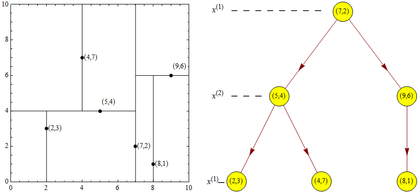

**图 7-11 提高搜索效率的二维 kd 树（左：空间切分；右：对应的树结构）**

### 7.6.2 kd 树的结构

构造 kd 树，就是**不断地用垂直于坐标轴的超平面将 k 维空间切分**，构成一系列的 k 维超矩形区域；kd 树的**每个结点对应于一个 k 维超矩形区域**。

样本集 E 由 kd 树所有结点组成的集合表示，**每个结点表示一个样本点**。结点的核心成员及含义见表 7-3。

**表 7-3 kd 树结点的结构**

| 成员 | 类型 | 描述 |
|------|------|------|
| dom_elt | 树节点 | k 维空间中的一个样本点 |
| split | 整数 | 分裂维的序号，即垂直于分割超平面的方向轴序号 |
| left | 左 kd 树 | 由位于该结点分割超平面**左子空间**内所有数据点构成的左 kd 树 |
| right | 右 kd 树 | 由位于该结点分割超平面**右子空间**内所有数据点构成的右 kd 树 |

具体地说：dom_elt 就是该结点对应的样本点；**分割超平面**是过点 dom_elt 并且垂直于 split 所指示方向轴的平面；该超平面把样本空间分为两个子空间，左子空间中的样本点集合由左子树 left 表示，右子空间中的样本点集合由右子树 right 表示。根结点和中间结点各对应一个实际样本点；最底层的叶子结点里可能有若干个样本点（个数由桶大小 BucketSize 控制），也可能只有一个样本点。

### 7.6.3 kd 树的生成步骤

① **确定分割轴（split 值）**：把数据在所有 X 轴上做投影，取**方差最大**（或最大值与最小值之差最大）的坐标轴作为 split；

② **确定分割结点（dom_elt）**：数据在 split 对应轴上**排序**，取**中位数**对应的样本点作为分割结点；

③ **划分左右子空间**：分割结点的超平面把（子）空间分为两部分，小于（或小于等于）中位数的进入左子空间，大于（或大于等于）的进入右子空间（取等号归属可视具体情况而定）；

④ **迭代**：分别对左右子空间中的数据点重复上述步骤，构建左右子树，直到划分后的子样本集为空，或子样本集的样本数小于桶大小（BucketSize）为止——此时剩下的结点即为叶子结点。

### 7.6.4 基于 kd 树的 kNN 搜索步骤

kd 树建好之后（用训练集/历史数据建立），对待测样本按以下步骤搜索最近邻：

① **搜索 kd 树**：比较待查样本与结点分裂维上的值，小（等）于进左树、大于进右树，沿树下行直到叶子结点；

② **找到候选 kNN**：计算与该叶子结点同一子空间内的样本和待查样本的距离，找出候选的 k 个最近邻；

③ **回溯搜索路径**：判断搜索路径上其他子结点对应的子空间中**是否可能有**距离查询点更近的数据点。如果有可能，则需要跳到那些子结点空间中去搜索（把其他子结点加入搜索路径）；

④ **重复这个过程**：直到搜索路径为空，或在搜索路径上找到 k 个最近邻为止。

关于**回溯**：很多情况下 k 较小时，在叶子结点内就能找够 k 个邻居，不需要回溯；但若 k 较大（要找的邻居多），就可能需要顺着树回溯、再检查若干个叶子或子结点，把它们空间中更近的样本也纳入 k 邻居。一般判断"要不要回溯到某个子空间"的依据是：该子空间对应的超矩形区域是否与"以待查点为球心、当前第 k 近邻距离为半径"的超球相交——相交则其中可能有更近的点，需要进入搜索。

### 7.6.5 基于聚类的搜索

另一种缩小搜索范围的思路是**聚类（向量量化）**：把训练样本用某种聚类方法聚成若干类，每个类有自己的**中心点**（图 7-12）。查找时，待测样本先与各类中心点比较距离，离哪个中心近就进入哪个类；然后在类内样本中与待测样本逐一比较，找出 k 个最近邻。不同的聚类方法得到的中心点位置不同、划分结果不同，搜索效果也会有差异，使用者可以进一步比较选择。

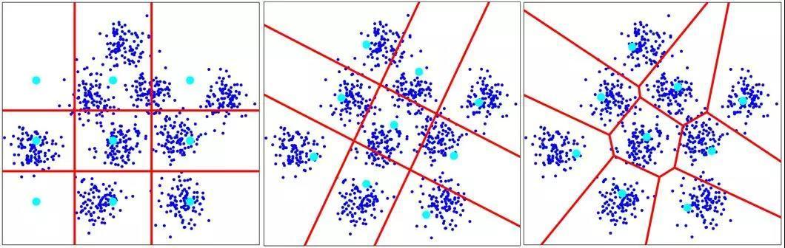

**图 7-12 基于聚类（向量量化）的近邻搜索**

它与 kd 树法的相似之处显而易见：都是把样本组织到若干**有限的子空间**里（叶子结点 ↔ 簇），先定位子空间、再在内部搜索，从而大幅节省计算量；只是划分空间所用的是两套不同的计算方法。

## 7.7 kNN 的 MATLAB 实现

### 7.7.1 两类实现途径

MATLAB 中实现 kNN 主要有两类方法（表 7-4）。

**表 7-4 kNN 的 MATLAB 实现方法**

| 方法 | 主要命令 | 含义 |
|------|----------|------|
| 1A | `knnsearch` 或 `rangesearch` | 直接接受训练数据集和查询数据集作为输入 |
| 1B | `ExhaustiveSearcher` 或 `KDTreeSearcher` 或 `createns`（二合一） | 穷举法或 KD 树法，基于训练数据集创建**搜索器对象**，存储这些数据集的共同信息（如 kd 树）；当有多个查询数据集时，最好先创建搜索器对象，再将对象和查询数据集传递给对象函数 |
| 2 | 矩阵运算（如 `mean`） | 根据找到的 k 个近邻进行投票或加权平均，获得预测的类别或具体数值 |

方法 1（A、B 两种形式）负责**找邻居**——`knnsearch` 按"个数 k"找，`rangesearch` 按"邻域半径 r"找，正对应 7.2 节介绍的两种等价方式。注意：找邻居只涉及 X、不涉及 Y，所以这两个函数的输入里**没有因变量**。找完邻居后还差一步——用邻居的 Y 算出待测样本的 Y 值。这一步是简单的矩阵运算（求均值、加权求和或统计票数），MATLAB 没有为它设专门命令，用 `mean` 等函数按定义自己计算即可。若用于大数据集，建议先走方法 1B：把训练数据组织成搜索器对象（一种更合理的数据结构），再调用 `knnsearch`，以提高效率。

### 7.7.2 knnsearch 的调用格式

**形式 1A：直接传入数据**

| 格式 | 用途 |
|------|------|
| `Idx = knnsearch(X,Y)` | 为 Y 中的每个查询点找到 X 中的最近邻，返回最近邻的索引列向量 Idx，其行数与 Y 相同 |
| `Idx = knnsearch(X,Y,Name,Value)` | 用一个或多个名称-值成对参数指定附加选项，例如要搜索的最近邻个数（'K'）和搜索使用的距离度量（'Distance'） |
| `[Idx,D] = knnsearch(___)` | D 包含 Y 中每个观测值与 X 中相应最近观测值之间的距离 |

> 注意：**Y 是待测样本的自变量，X 是（已知）训练样本的自变量，不涉及因变量**。不指定 'K' 时默认只找 1 个最近邻；指定 'K' 为 k 时，Idx 为 n×k 的索引矩阵（n 为待测样本数），每行对应一个待测样本的 k 个邻居在 X 中的行号。

**形式 1B：传入搜索器对象**

| 格式 | 用途 |
|------|------|
| `Idx = knnsearch(Mdl,Y)` | 使用穷举搜索或 kd 树，在 Mdl.X 中搜索查询数据 Y 中每个点的最近邻，返回索引列向量 |
| `Idx = knnsearch(Mdl,Y,Name,Value)` | 通过名称-值参数指定附加选项，例如最近邻个数、与存储在 Mdl.Distance 中不同的距离度量、距离相等时的处理方式等 |
| `[Idx,D] = knnsearch(___)` | 同时返回距离矩阵 D |

> 注意：Mdl 是采用穷举法或 KD 树法创建的**搜索器对象（其中已包含 X）**；Y 是待测样本的自变量。

### 7.7.3 rangesearch 的调用格式

| 格式 | 用途 |
|------|------|
| `Idx = rangesearch(X,Y,r)` | 找到所有与 Y 点距离在 r 以内的 X 点（X、Y 的行是观测值、列是变量），r 即邻域半径 |
| `[Idx,D] = rangesearch(X,Y)` | 返回距离 r 内的 Y 点和 X 点之间的距离 |
| `[Idx,D] = rangesearch(X,Y,r,Name,Value)` | 用名称-值成对参数指定其他选项，例如最近邻搜索方法和距离度量 |

半径 r 怎么选也需要在一定的范围内自行调整试验（类比 k 的选择）。

### 7.7.4 搜索器对象：ExhaustiveSearcher 与 KDTreeSearcher

**ExhaustiveSearcher（穷举搜索器）**：`Mdl = ExhaustiveSearcher(X)` 基于n×K 训练数据矩阵 X 创建穷举最近邻搜索器对象，存储穷举搜索所需的统计信息和选项；之后将查询数据与 Mdl 一起传递给 `knnsearch` 或 `rangesearch` 即可。可用 `ExhaustiveSearcher(X,Name,Value)` 指定距离度量等附加选项。

**KDTreeSearcher（kd 树搜索器）**：`Mdl = KDTreeSearcher(X)` 使用 n×K 训练数据矩阵 X 生成默认的 kd 树对象；`KDTreeSearcher(X,Name,Value)` 可指定每个叶节点的最大数据点数（桶大小 'BucketSize'）、距离度量（'Distance'）及距离度量参数（'DistParameter'）。例如：

```matlab
Mdl = KDTreeSearcher(X,'Distance','minkowski','BucketSize',10);
% 指定用闵可夫斯基距离搜索最近邻，叶节点最多容纳10个样本；
% 闵可夫斯基的指数用 'P' 参数指定
```

当 **K 很小（K≤10）**、训练集和查询集不稀疏、训练集和查询集观测值很多时，kd 树算法比穷举搜索效率更高。这里的 K 指自变量的个数（维数）。

### 7.7.5 用穷举法还是 kd 树法？

MATLAB 官方给出的选择建议如下：

- 数据有很多列（**超过 10 列**，即 X 多于 10 个）→ **穷举法**可能更好（kd 树此时不一定有效）；
- 数据**稀疏**（很多值是 0）→ 使用**穷举法**；
- 要用**特定距离**（'seuclidean'、'mahalanobis'、'cosine'、'correlation'、'spearman'、'hamming'、'jaccard' 或自定义距离）查找最近邻 → 使用**穷举法**；
- 数据集庞大、但**少于 10 列** → 使用 **KDTree**；
- 查询数据集庞大（**大量查询点**、反复查询）→ 使用 **KDTree**。

### 7.7.6 分类专用接口：fitcknn 与 predict

MATLAB 为了把 kNN 与其他分类器的使用方式统一起来，另提供了"两步法"的分类专用接口：

| 方法 | 主要命令 | 含义 |
|------|----------|------|
| 两步法 | `fitcknn` | 训练 k 最近邻模型，以预测标签或估计后验概率 |
| | `predict` | 对新的观测预测类别 |

`fitcknn` 的常用调用格式：

| 格式 | 用途 |
|------|------|
| `Mdl = fitcknn(Tbl,ResponseVarName)` | 基于表 Tbl 中的输入变量（预测变量、特征、属性）和响应变量 Tbl.ResponseVarName，返回 kNN 分类模型 Mdl |
| `Mdl = fitcknn(Tbl,formula)` | 基于表 Tbl 中由 formula 指定的预测变量子集和响应变量，返回 kNN 分类模型 |
| `Mdl = fitcknn(___,Name,Value)` | 在上述语法基础上用名称-值参数指定附加选项，例如距离度量、观测权重等 |

其中 **Mdl 是 kNN 分类模型；Tbl 是训练样本的自变量；ResponseVarName 是训练样本的因变量（标签）**。模型训练好后再用 `label = predict(Mdl,Xnew)` 对待测样本的自变量 Xnew 预测类别，用法与其他分类器完全一致。虽然 kNN 找邻居并不需要因变量，但为了与其他分类模型的接口统一，`fitcknn` 仍把因变量传了进去。

## 7.8 案例研究

本章配套的 MATLAB 脚本与示例数据存放于本书配套代码库的 `脚本/Chapter7` 文件夹（文件清单与运行说明见其中的 `README.md`）。

### 7.8.1 案例一：在医院里找最相似的病人

第一个例子非常简单：为医院的新病人寻找"最相似的历史病人"。使用 MATLAB 内置的 `hospital` 数据集（100 个病人的资料），取**年龄（Age）**和**体重（Weight）**两个属性作为自变量；另设 5 个新病人作为待测样本。程序清单如下（完整脚本：`脚本/Chapter7/kNN_exp01_hospital.m`；示例数据 `data/hospital_new_patients.csv`）：

```matlab
%% 案例1：为医院新病人寻找最相似的病人（kNN 近邻查询）
clear; clc;

load hospital                                  % 载入 MATLAB 内置医院数据（100 个病人）

% 训练样本的自变量：年龄与体重（100×2）
X = [hospital.Age  hospital.Weight];

% 5 个新病人的年龄与体重（待测样本的自变量，示例数值）
Y = [20 162;
     35 190;
     42 165;
     50 199;
     62 180];

% 为每个新病人找最近邻（不指定 'K' 时默认 k=1，返回 5×1 的邻居索引）
Idx = knnsearch(X, Y);

% 查看找到的 5 个邻居病人的年龄与体重
X(Idx, :)

% 可视化：蓝色 * 为 5 个新病人，红色 o 为查到的最近邻病人
figure; hold on;
plot(X(:,1), X(:,2), 'k.', 'MarkerSize', 10);         % 全部历史病人
plot(Y(:,1), Y(:,2), 'b*','MarkerSize', 12);          % 新病人（待测样本）
plot(X(Idx,1), X(Idx,2), 'ro','MarkerSize', 12, ...
     'LineWidth', 2);                                 % 最近邻
xlabel('年龄'); ylabel('体重'); hold off;
```

运行后 `Idx` 是 5×1 的索引（因为默认 k=1，每个新病人只找 1 个邻居）；`X(Idx,:)` 列出了这 5 个邻居病人的年龄和体重。图中可以看到：在"年龄—体重"二维空间里，新病人与其最近邻**并非个个都挨得特别近**——所谓"最近"只是在现有训练样本中相对最近的那一个。这正是 kNN 的现实：预测质量受训练样本分布密度的制约。

### 7.8.2 案例二：鸢尾花的 kNN 分类

**数据**：20 世纪 20 年代，植物学家收集了 150 个鸢尾花标本（三个品种各 50 个标本）的**萼片长度、萼片宽度、花瓣长度和花瓣宽度**4 个测量值，即著名的 **Fisher 鸢尾花数据集**（MATLAB 中为 `fisheriris`：`meas` 为 150×4 的测量值矩阵，`species` 为 150×1 的品种名元胞数组）。

**问题**：对给定的 1 个和 3 个新标本，基于**最后 2 个属性**（花瓣长度、花瓣宽度）进行鸢尾花分类——只用两个属性是为了便于在二维图中展示（想充分利用数据信息的读者可以在案例三中改用全部 4 个属性）。

```matlab
%% 案例2：鸢尾花的 kNN 分类（基于后两个属性）
clear; clc;

load fisheriris                       % meas：150×4；species：150×1（品种名）

% 训练样本的自变量：花瓣长度、花瓣宽度（150×2）
X = meas(:, 3:4);

% 3 朵新测量鸢尾花的花瓣长度与宽度（待测样本，示例数值）
Y = [6.0 2.5;                         % 待测样本1
     5.1 1.8;                         % 待测样本2
     2.7 0.9];                        % 待测样本3

% 用闵可夫斯基距离（P=2，即欧氏距离）为每朵新花找 10 个最近邻
Idx  = knnsearch(X, Y, 'K', 10, ...
                 'Distance', 'minkowski', 'P', 2);    % 返回 3×10 的索引矩阵

% 换用切比雪夫距离再找一次（选中的邻居会有所不同）
Idx2 = knnsearch(X, Y, 'K', 10, 'Distance', 'chebychev');

% 统计每朵新花 10 个邻居的品种构成，按“少数服从多数”定类
tabulate(species(Idx(1,:)))           % 样本1：全部为 virginica（表 7-5）
tabulate(species(Idx(2,:)))
tabulate(species(Idx(3,:)))

% 二维空间中可视化邻居选取（圆圈标出第 1 朵新花的邻居）
figure; hold on;
gscatter(X(:,1), X(:,2), species);                    % 训练样本按品种着色
plot(Y(:,1), Y(:,2), 'k*','MarkerSize', 12);          % 待测样本
plot(X(Idx(:,1),1), X(Idx(:,1),2), 'ko', ...
     'LineWidth', 2);
xlabel('花瓣长度 (cm)'); ylabel('花瓣宽度 (cm)'); hold off;
```

程序说明：

- `knnsearch(X, Y, 'K', 10, ...)` 中 `'K'` 指定每个待测样本找 10 个邻居，因此返回的 `Idx` 为 **3×10**（3 朵花 × 10 个邻居），`M` 输出则是对应的距离；
- `'Distance','minkowski'` 配合 `'P',2` 使用闵可夫斯基距离（此时即欧氏距离）；把距离换成 `'chebychev'`（切比雪夫）后再次搜索，两种距离选中的邻居集合不同，绘图对比即可看到差异（闵氏距离选中的邻居与切比雪夫距离选中的邻居分别标出）。

**一个待测样本的分类结果**：取 k=10，某新花的 10 个邻居中 **versicolor 8 个（80%）、virginica 2 个（20%）**，按 8∶2 的多数票判为 **versicolor**。看图时注意一个细节：versicolor 一类显示为 8 个点，是因为其中两个样本的两个属性取值完全相同、在二维图上**重叠**在了一起。

**三个待测样本的分类结果**（k=10）汇总于表 7-5。

**表 7-5 三个待测样本的 10 近邻品种构成与判定结果**

| 待测样本 | 10 个近邻的品种构成（Count / Percent） | 判定结果 |
|----------|----------------------------------------|----------|
| 1 | virginica × 10（100%） | virginica |
| 2 | virginica × 2（20%）、versicolor × 8（80%） | versicolor |
| 3 | versicolor × 7（70%）、setosa × 3（30%） | versicolor |

### 7.8.3 案例三：k 对模型性能的影响

第二个鸢尾花实验把**全部 4 个属性**都用上，以 150 个标本为训练集，考察 k 的取值对模型分类性能的影响（完整脚本：`脚本/Chapter7/kNN_exp03_iris_k_effect.m`；也可参考 MATLAB 官方示例 `openExample('stats/ClassifyingQueryDataUsingKnnsearchExample')`）。思路：对一系列 k 值分别训练 kNN 分类器，同时统计**训练集回代正确率**与**10 折交叉验证正确率**。

```matlab
%% 案例3：k 对鸢尾花分类性能的影响（全部 4 个属性）
load fisheriris

ks = (1:10)';
accTrain = zeros(size(ks));
accCV    = zeros(size(ks));
rng(1);                                       % 固定随机种子，结果可重复
for i = 1:numel(ks)
    Mdl  = fitcknn(meas, species, 'K', ks(i));% 以 150 个标本为训练集
    pred = predict(Mdl, meas);                % 在训练集上回代预测
    accTrain(i) = mean(strcmp(pred, species));% 训练集分类正确率

    CVModel = crossval(Mdl, 'KFold', 10);     % 10 折交叉验证（验证性能）
    accCV(i) = 1 - kfoldLoss(CVModel);
end
```

观察结果（图 7-13）：在训练集上，**k=1 和 k=2 时分类正确率都是 100%；k≥3 以后开始出现错分样本**。k=1 时"自己就是自己的最近邻"，训练集正确率必然是 100%，这并不代表泛化性能；按照 7.2.5 节的方法，应当再考察验证集/测试集上性能随 k 的变化曲线，找到拐点处的 k——脚本中的交叉验证正确率正是这条曲线。

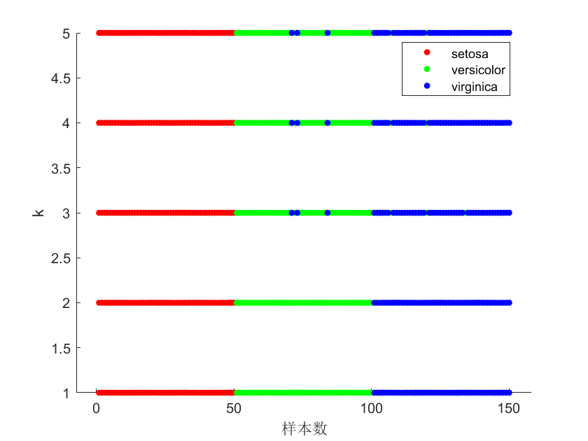

**图 7-13 鸢尾花案例中 k 对模型分类性能的影响**

## 7.9 本章小结

kNN 是一种**非常简单但有效、很有特点**的方法。本章要点归纳如下：

1. **基本思想与假设**：kNN 假设"输入空间上相近的样本点具有相似的 Y"，对给定自变量的待测样本，找到训练集中距离最近的 k 个样本（最近邻），**用邻居的因变量信息**预测待测样本的因变量——分类用投票、回归用平均或加权平均。这一假设与地理学第一定律的精神高度一致。
2. **定义中的两个细节**：算距离**只用 X**；找到邻居后预测 Y 时**抛开 X、只用邻居的 Y**。X 与 Y 在两个环节中各司其职。
3. **懒惰学习**：kNN 没有显式训练过程，训练阶段只是保存样本，建模延迟到预测（工作）阶段进行；与之相对的是急切学习。
4. **三要素与五个关键问题**：k 值选择（回归可从 k=2 起步、分类取奇数、交叉检验找验证集性能拐点）、距离度量（连续/离散/混合变量各有适用距离，经验法+试错法选择）、决策规则（等权投票/平均，距离加权——典型权重为距离倒数，注意 d=0 的处理）、搜索效率（kd 树、先聚类后 kNN）、与其他方法的结合（变量选择、归一化、聚类）。
5. **k 的影响规律**：k 过小易过拟合（k=1 时拟合曲线紧贴样本点），k 过大则过度平滑、只反映大势；应以验证集性能曲线的拐点附近取值为佳。
6. **kd 树**：以"方差最大轴 + 中位数"递归切分空间构建二叉树；搜索时顺树下行到叶子、找候选邻居、必要时回溯其他子空间。数据量大、维数不超过 10、查询点很多时用 kd 树；维数高、数据稀疏或使用特殊距离时用穷举法。
7. **MATLAB 实现**：`knnsearch`（按 k 找邻居）与 `rangesearch`（按半径找邻居）只负责找邻居、不涉及因变量；配合 `mean` 等矩阵运算完成预测；大数据用 `ExhaustiveSearcher`/`KDTreeSearcher`（或 `createns`）先建搜索器对象；分类也可用 `fitcknn` + `predict` 两步法，与其他分类器接口统一。
8. **案例**：医院数据为新病人查最近邻（默认 k=1）；Fisher 鸢尾花数据基于花瓣长宽的 kNN 分类（k=10，8∶2 多数票判 versicolor，更换距离函数邻居随之改变）；全部属性下 k=1、k=2 训练集正确率 100%，k≥3 出现错分。

对中小规模数据集，kNN 的计算量完全不成问题；数据特别大时，建议先用 kd 树（或聚类）把数据组织成更合理的数据结构再搜索，可大大节省计算量。

## 7.10 思考题

1. kNN 的功能有哪些？
2. kNN 的特点是什么？
3. 怎么选择 kNN 的搜索策略（穷举法还是 kd 树法）？
4. 怎么选择 kNN 的 k？
5. 用 k 还是邻域半径来选择最近邻？两种方式各有什么优缺点？

## 7.11 延伸阅读

1. MATLAB 官网关于 kNN 分类的介绍：
   <https://ww2.mathworks.cn/help/releases/R2021b/stats/classification-nearest-neighbors.html>
2. Fisher 鸢尾花数据的 kNN 分类（MATLAB 官方示例）：
   <https://ww2.mathworks.cn/help/releases/R2021b/stats/classification-using-nearest-neighbors.html>
3. Python 的 scikit-learn 包关于 kNN 的介绍（供使用 Python 的读者参考，其中有与本章类似的示例）：
   <https://scikit-learn.org/stable/modules/neighbors.html>

> 本章插图取自本讲课件《机器学习与地学应用·第七讲 k最近邻（kNN）模型》。
