# 第8章 决策树

> **本章导读**：上一章的 kNN 是"没有训练过程"的懒惰学习，本章介绍一个相反的典型——决策树（decision tree）：它在训练阶段就要把模型结构一字一句地"长"出来，属于急切学习。决策树是根据功能命名的一对模型：做回归叫回归树，做分类叫分类树。它的外形是一棵倒置的树，从根节点出发、每个节点做一次判断、层层分叉直到叶节点给出结论，因此天然具有可解释性，被形容为"看着树就明白了"。本章从挑西瓜与回归树的实例入手，给出决策树的定义、结构与"自顶向下、分而治之"的训练三步骤；核心内容是纯度的三种经典度量——信息增益（ID3）、增益率（C4.5）与基尼指数（CART），以及决策树特有的"剪枝"操作（预剪枝与后剪枝）；随后介绍多变量决策树与随机森林的改进思路；最后给出 fitctree、fitrtree、prune、view、predict 等 MATLAB 命令，并用鸢尾花分类与汽车油耗回归两个案例完整演练建模过程。

## 8.1 方法体系中的决策树

### 8.1.1 对上一章的简要回顾

上一章介绍的 kNN 属于**懒惰学习**：训练阶段只是把样本保存起来，建模延迟到预测阶段才进行。本章的决策树则是**急切学习**：训练阶段要通过一系列计算，把"每个节点放哪个自变量、和哪个临界值比较"全部求解出来，训练结束时模型结构（一棵树）已经完全确定。把这两章对照着学，可以体会"懒惰"与"急切"两种学习范式的差别。

另外回顾一条通用原则：分类模型的评估常用**混淆矩阵**及由它派生的正确率、查准率、查全率等指标，并且要以**验证集为主、训练集为辅**。这条原则在本章会反复用到——决策树特有的剪枝操作，正是靠预留的验证集来判断"该不该继续分支"。

### 8.1.2 方法总表中的位置

先回到本书的方法总表（表 8-1）。决策树处在"树型"一行，与层次聚类同属一个家族；它能同时实现回归与分类两种功能，因此在两列中各占一个位置。

**表 8-1 数据挖掘/机器学习的典型方法**

| 类别 | 聚类 | 降维 | 回归 | 分类 |
|------|------|------|------|------|
| 线性方法 | — | 相关性分析、主成分分析、因子分析 | 多元线性回归 | Logistic 回归、判别分析 |
| 最近邻 | k 均值聚类 | — | kNN | kNN |
| 树型 | 层次聚类 | — | **决策树（回归树）** | **决策树（分类树）** |
| 密度 | DBSCAN | — | — | — |
| 神经网络 | 自组织映射（SOM） | — | ANN | ANN |
| 核函数 | — | — | SVR | SVC |
| 图论 | 谱聚类 | — | 概率图模型 | 概率图模型 |
| 随机变量 | 高斯混合模型 | — | — | 贝叶斯分类 |
| 模糊数学 | 模糊 C 均值聚类 | — | 模糊逻辑模型、ANFIS | 模糊逻辑模型 |
| 深度学习 | — | — | CNN、LSTM | CNN |

从表中可以看到，决策树和 kNN 一样是"一法多能"的方法。但两者有个有趣的外观差异：决策树画出来的树状图，形式上有点像层次聚类得到的聚类图——都是一层层的分叉结构。区别在于层次聚类的分叉只反映样本之间的相似关系，而决策树的每个分叉都对应一次**有目的的判断**，并且有因变量 Y 的参与，属于有监督学习。

## 8.2 决策树的实例

与其他方法一样，先看几个实例，建立对决策树的直观认识。

### 8.2.1 分类树：挑西瓜

图 8-1 是用决策树做分类的例子——挑西瓜。这个例子出自南京大学周志华教授的《机器学习》（读者社区俗称"西瓜书"，书的封面就是西瓜图案），是决策树教学中最经典的案例。

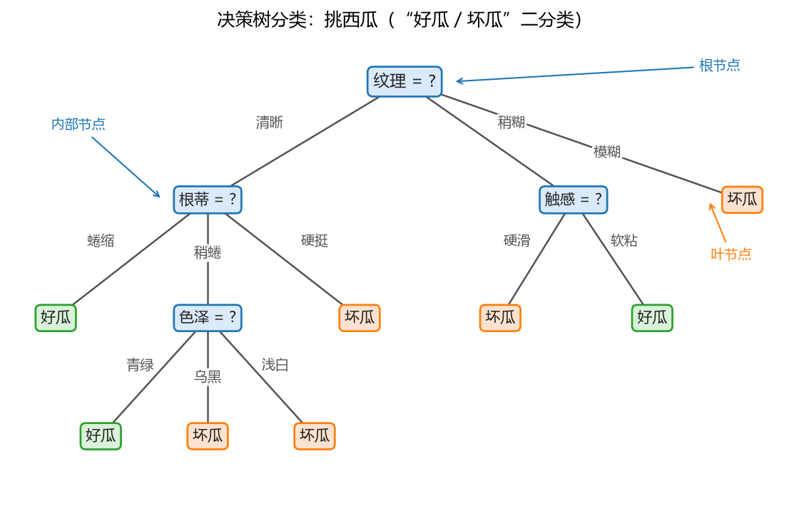

**图 8-1 决策树分类：挑西瓜（"好瓜 / 坏瓜"二分类）**

观察这棵树，可以得到几点直观印象：

1. **它是一棵"倒置的树"**。现实中的树从下往上长，决策树却从上往下长：最上面是**根节点**，往下是**内部节点**，最下面是**叶子节点**，分支到达叶节点即告终止。
2. **每个节点上有一个判断**。根节点判断"纹理 = ?"，按清晰、稍糊、模糊三种取值分成三支；内部节点再判断"根蒂 = ?""色泽 = ?""触感 = ?"。这个例子里的所有自变量 X 都是**类别型**（离散的），判断方式是"等于哪个类别就走哪条边"。
3. **叶子节点给出结论**。本例的 Y 只有两个类别——好瓜与坏瓜，每个叶子给出其一。一棵分得好的树，落在同一个叶子里的训练样本通常具有相同的标签。

请注意这个例子中 **X 是类别型的，Y 也是类别型的**——这代表了决策树分类问题的一种典型形态。

### 8.2.2 回归树

决策树做回归时叫**回归树**。图 8-2 是一个由 MATLAB 展示的回归树结构，它与分类树"形似而神不同"。

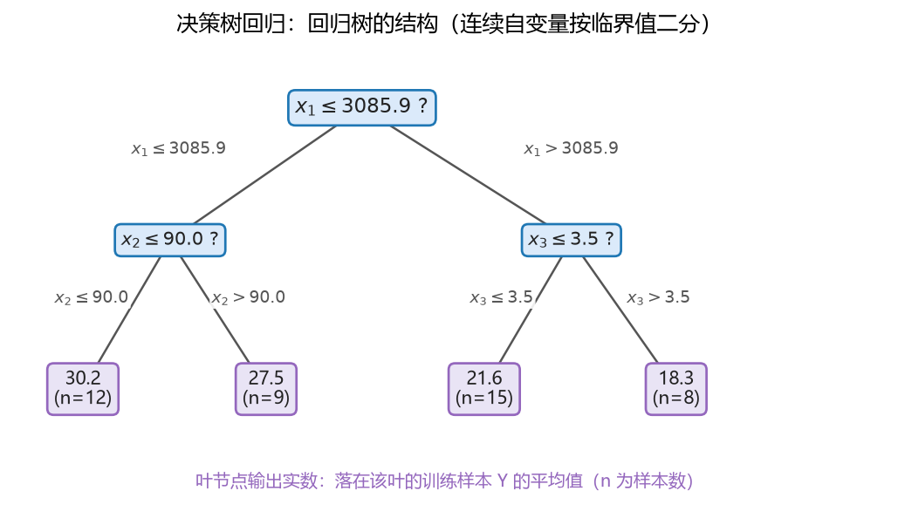

**图 8-2 决策树回归：回归树的结构（连续自变量按临界值二分）**

对比图 8-1，可以发现回归树的几个特点：

1. **每个节点仍然挂一个自变量**，但这里的 X 是**连续型**的，判断变成了与某个**临界值**（切分点）比较：小于等于临界值走左边，大于临界值走右边。
2. **所有节点都是二分**。类别型变量可以按取值多路分叉（如图 8-1 的三支），连续变量与临界值比较只有"是/否"两种结果，因此回归树是标准的二叉树。
3. **叶子节点输出的是实数**。每个叶子通常挂着若干个训练样本，叶子的取值是这些样本 Y 的**平均值**——它就是所有落到该叶子的待测样本共同的预测值。图 8-2 中每个叶框里标出了均值和样本数（如 30.2，n=12）。

于是形成了与图 8-1 的鲜明对照：那个例子 X 离散、Y 离散；这个例子 X 连续、Y 连续。现实中也不乏混合的情形——一棵树上有的节点用连续变量的临界值判断，有的节点用类别变量的取值判断，决策树都可以处理，这正是它的一大优势（见 8.5.2 节）。

### 8.2.3 树的复杂度对性能的影响：深度与叶子大小

任何模型都有需要调整的内部参数，决策树也不例外。已经反复强调过：拿到一个数据挖掘算法，模型的一些内部参数怎么挑，会对性能产生很大影响。对树形模型来说，最常用的两个"复杂度旋钮"是**树的深度**和**叶子的大小**。

**（1）树的深度。**从根节点到最深叶子节点的层数称为树的深度（见 8.3.3 节的正式定义）。图 8-3 用一组数据比较了深度为 2 与深度为 5 的两棵回归树的拟合效果：黑点是实际观测值；蓝色阶梯线是深度为 2 的树的预测，走势平缓，反映的是数据的一般规律；绿色阶梯线是深度为 5 的树的预测，台阶又多又陡，把训练数据里的细小波动也"学"了下来，明显更贴近训练点。

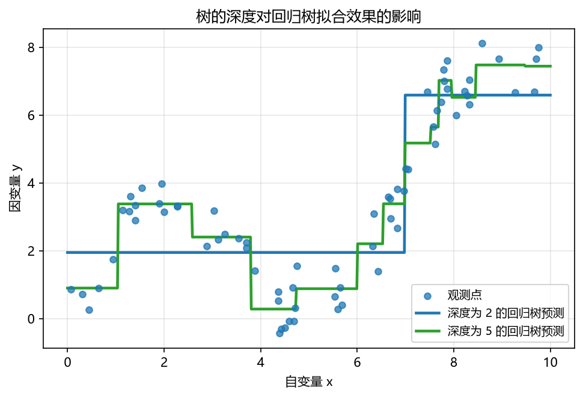

**图 8-3 树的深度对回归树拟合效果的影响**

这与 kNN 中 k 的大小（第 7 章图 7-7）的规律如出一辙：树越复杂（越深）越逼近训练数据，越简单（越浅）越反映一般规律。理想的树介于两者之间——既能较好地描述训练集的规律，又不失一般性。

**（2）叶子的大小。**叶子节点里最少要有多少个样本，也是常被拿来调优的参数。把"最小叶子大小"从较小值逐渐增大，对每个取值做交叉验证，观察验证误差的变化，即可找到最佳值。图 8-4 给出了一个示例：横轴是最小叶子大小（从 2 变到 100），纵轴是交叉验证误差。误差先随叶子变小（树变复杂）而下降，随后又因树过于简单而回升，在中间某个位置（本例约 10 附近）取得最小值——这个位置就是应当选择的叶子大小。

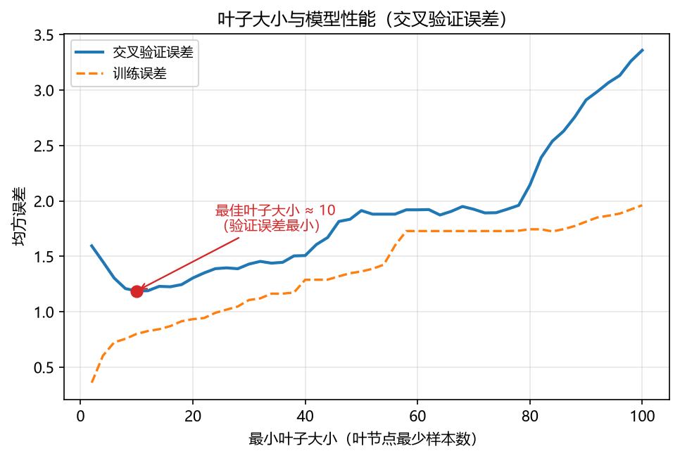

**图 8-4 叶子大小与模型性能（交叉验证误差）**

这套"让参数在一定范围内变化、观察验证集性能曲线的极值"的思路，读者应当已经非常熟悉——第 7 章选 k 值用的正是同样的办法。

### 8.2.4 剪枝的直观印象

树的深度、叶子大小这些参数，其实都指向同一个问题：**树长到多大规模才合适？**决策树对此有一个专门的操作——**剪枝**（pruning，也常称剪枝处理、裁剪）：让树先按某种策略生长，再把过细、过碎的分支修剪掉，使树达到一个合理的规模——既能表达训练数据的规律，又不至于过度逼近训练数据（图 8-5）。

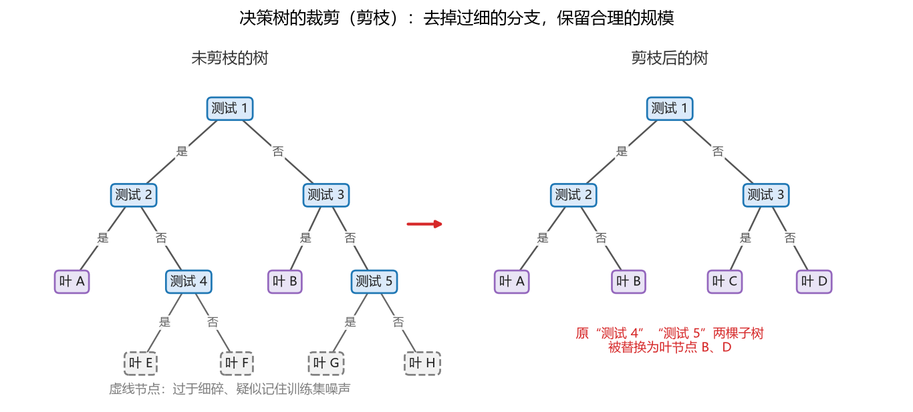

**图 8-5 决策树的裁剪（剪枝）：去掉过细的分支，保留合理的规模**

其他模型大多不需要这种"事后修剪"——它们在训练过程中就通过目标函数或正则化控制了复杂度；决策树则因为"贪心地不断划分"的天性，通常要先长再剪。剪枝是决策树流程中非常特殊、也非常关键的一步，8.8 节将专门展开。

### 8.2.5 分类树的评估：混淆矩阵

如果决策树用来做分类，评估方法与第 6 章、第 7 章完全一致：对训练集、验证集、测试集分别画出**混淆矩阵**，计算正确率、查准率、查全率等指标。混淆矩阵是**独立于具体方法**的一般性评估工具，决策树分类、kNN 分类、Logistic 回归分类都可以用，本章的案例研究会再次用到它。回归树的评估则用均方误差、相关系数等基于误差的指标，同样与前面章节一致。

## 8.3 决策树的定义与结构

### 8.3.1 定义

**决策树的含义。**中文称**决策树**，按功能可细分为**分类树**（用于分类）与**回归树**（用于回归）；英文为 **Decision Tree**（Classification Tree 与 Regression Tree）。

> **定义（决策树）** 学习用来做决策的树。或者说，运用于分类以及回归的一种树形结构模型。

- **功能**：分类或回归；
- **定位**：因变量 Y 参与建模，属于**有监督学习**；训练阶段要求解出完整的树结构，属于**急切学习**；
- **步骤**：两大主要阶段——**训练**与**预测**（工作）。

为什么训练是必须的？因为树上的每个节点都要回答两个问题："这个节点放哪个自变量 X？""X 与哪个临界值（或哪些类别）比较？"这些都必须通过对训练数据的计算才能确定，这正是"急切学习"的含义。

### 8.3.2 为什么叫"决策"树

这个名字初看抽象，其实非常直白。回看图 8-1 与图 8-2：无论是分类树还是回归树，**每个节点上都在做一次判断**——离散变量判断"等于哪个取值"，连续变量判断"是否小于等于某个临界值"。做了这次判断，就相当于做了一次**决策**：进入左边分支，或者进入右边（或中间）分支。到了下一个节点，又是一次判断、又一次决策……从根节点到某个叶节点的路径，就是**一个判定测试序列**；叶节点上的结论，正是这一系列决策的最终结果。

决策树因此还有一个很有用的性质：**每条"根→叶"路径都对应一条 if-then 形式的决策规则**。例如图 8-1 中最左边的路径可以读作："如果纹理清晰、根蒂蜷缩，那么是好瓜。"在 MATLAB 里用一个命令（`view`）就能把整棵树转写成若干条这样的规则，这是决策树可解释性的直观来源。

### 8.3.3 决策树的结构

严格地说，**决策树由节点和有向边组成，一般包含一个根节点、若干内部节点和若干叶子节点**（图 8-6）。所谓"有向"，指边只能自上而下走——样本一旦进入某条分支，不会再回到上层。

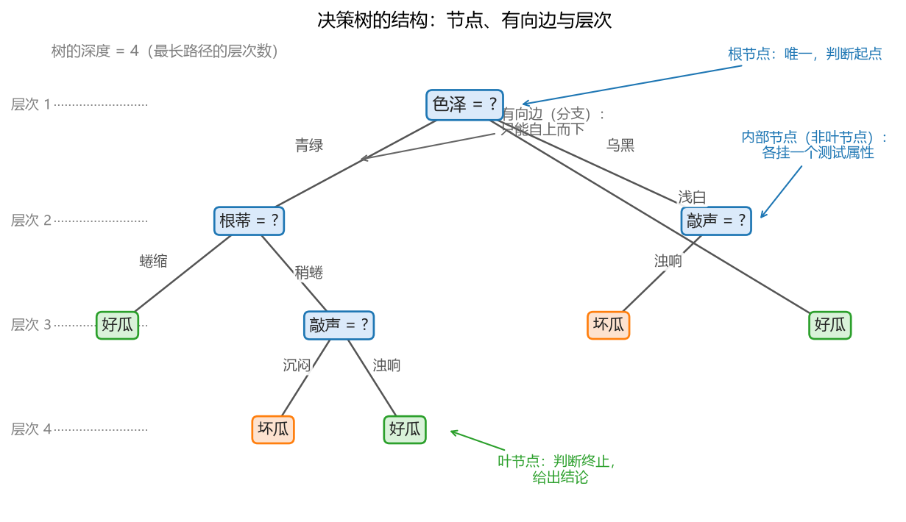

**图 8-6 决策树的结构：节点、有向边与层次**

各结构单元的特点与别名汇总于表 8-2。

**表 8-2 决策树结构单元的比较**

| 结构 | 特点 | 备注 |
|------|------|------|
| 根节点 | 决策判断的起始点；一棵树只有一个入口 | 唯一性 |
| 内部节点 | 表示某种作为判断条件的属性，每个节点上挂一个 X | 也叫条件属性、划分属性、测试属性、特征属性；节点也叫测试节点、非叶子节点 |
| 层次 | 根节点层次为 1，根节点的子女节点层次为 2，以此类推 | 最大层次数即树的深度 |
| 边 / 分支 | 根据条件属性的取值（或与临界值的比较结果）选择的路径 | 有向边；每条边对应一次测试的结果 |
| 叶子节点 | 使判断终止的结论，通常包含若干样本 | 也叫叶子、叶节点 |

对"层次"再作一点说明：树的高度（大小、复杂程度）有两种常用的刻画——**深度**（最长路径的层次数）与**叶子的大小**（叶子里容纳的样本数），8.2.3 节已经展示了它们对模型性能的影响。另外，一棵分得好的树，叶子里的样本应当尽量"纯"：分类树的叶子里 Y 大部分甚至全部相同，回归树的叶子里 Y 取值相近。

## 8.4 决策树的训练与预测

### 8.4.1 训练阶段：自顶向下、分而治之

**训练目的**：产生一棵泛化能力强——即处理未见示例（新样本、待测样本）能力强——的决策树。泛化能力是首要追求，但训练集上的表现也不能太差：一个对训练数据都描述不好的模型，即使泛化能力看起来不错，也给人"瞎猜"的感觉。理想的树是两者兼顾。

**训练策略**：**自顶向下、分而治之**。具体可写成三步：

（1）在根节点上，**遍历所有特征 A 和可能的切分点 a**，取使左右孩子节点**纯度之和最高**的特征与切分点对 {A\*, a\*}，把样本划分成两个子节点；

（2）检查划分结果是否满足**停止条件**（如叶子样本数已少于阈值、树已达到限定深度、数据已划分完毕等），满足则停止划分，当前节点记为叶节点；

（3）不满足停止条件时，**对两个子节点递归调用第（1）步**——把每个子节点当成新的"根节点"，再次遍历所有特征与切分点，继续往下划分。

这里的关键动作是"遍历所有、取最优"：在根节点上，把每个候选自变量都拿来试一遍，每个自变量的每个可能切分点也都试一遍；每试一次就得到一次划分，把分出的两个子节点的纯度加起来（通常还要按样本数加权）比较，纯度之和最大的那个"自变量 + 切分点"组合胜出。以一个生活化的例子理解"纯度"：袋子里有 100 个球，50 个黑球 50 个白球，若第一次划分就能让左边袋子全是黑球、右边袋子全是白球，这显然是一次非常好的划分——"分完后每袋都变纯"正是决策树划分的追求。纯度的严格定义与计算公式是 8.7 节的主题。

这套"三步走"本质上是一个**递归**过程，结构非常直观；真正的难点只有一个——**纯度到底怎么算**。纯度定义一旦确定，"选哪个 X、选哪个切分点、何时停止"就都有了明确依据。

### 8.4.2 预测阶段

树训练好之后，预测（工作）阶段非常简单。拿着训练好的树，对待测样本执行以下流程：

1. 从根节点开始，将待测样本的属性值依次与树中各节点的判断条件**比较**；
2. 按每次比较的结果选择下一分支，层层下行；
3. 最终落到某个**叶子节点**，以该叶节点的 Y 值作为待测样本的预测值。

注意最后一步"叶节点的 Y 值"是怎么来的——这与 kNN 的决策思想一致：

- **分类树：少数服从多数（投票法）**。叶子里的训练样本大多是同一类别，取占多数的类别作为预测类别；
- **回归树：取平均**。叶子里的 Y 值彼此接近，取其平均值作为预测值。

预测的效率也很高：树的每个节点上的判断条件在训练结束后都已固定，新样本进树后只需走有限的几步分支即可到达叶子，**比较次数不超过树的深度**。当待测样本量很大时，训练好的决策树做预测是相当快的。

## 8.5 决策树的特点

### 8.5.1 基本假设：X 与 Y 具有相关性

与绝大多数有监督方法一样，决策树成立的前提是**自变量 X 与因变量 Y 具有相关性**（一般性假设）。树上的每个节点都用某个 X 做判断，如果 X 与 Y 毫无关系，无论怎么选 X、怎么切分，Y 都不会因此变得更有规律，建出来的树效果必然很差。遇到这种情况，出路不是换更强的模型，而是**重新寻找与 Y 相关的自变量**再建模。

### 8.5.2 优点

**（1）结构容易理解，具有较好的解释性。**树形结构背后对应着一系列直观的判断（"纹理清晰吗？根蒂蜷缩吗？"），与人们日常做决策的方式高度一致，看着树就能明白模型在做什么；而且整棵树可以直接转写为多条 if-then 形式的决策规则。

**（2）具有一定的自变量选择能力。**训练时每个节点都把所有自变量"试了一遍"，只挑选让子节点纯度之和最大的那些进入树中；对 Y 没有明显贡献的自变量在挑选过程中被自然淘汰，根本进不了树。这个能力内嵌在训练过程里，是很多模型（如 kNN）不具备的。不过要注意：决策树只是"自带一定程度的"变量选择，并不能完全替代专门的特征选择方法。

**（3）能同时处理离散和连续性自变量。**X 无论是类别型（分几类都行）还是连续型，都可以直接放进树里。回忆多元线性回归：类别型变量取值 0、1、2 时直接代入并不好算，通常要额外做处理；决策树则没有这个限制。若问题中的 X 既有连续又有离散，决策树是很值得优先一试的方法。

**（4）运算速度较快。**训练主要是纯度的计算与比较，通常比其他分类方法快；预测时如前所述，比较次数不超过树的深度，效率高。

**（5）对异常点不敏感，鲁棒性较强。**只要树的规模设计得当（不要太深太碎），叶子节点的小空间里可以容纳个别异常样本，几个异常点不至于改变整体结构。

### 8.5.3 缺点与改进方向

**（1）性能对属性划分方法敏感。**每个节点选哪个 X、用哪个切分点、纯度怎么算，这些设计直接影响模型效果，选得不好结果会千差万别。改进方向：设计更好的划分准则（8.7 节的三种准则正是为此而生）。

**（2）Y 的类别太多时，树结构容易疯长。**类别一多，树倾向于长得很深很复杂来"分清"每个类别，从而**过于逼近训练集**；不做剪枝时树也容易疯长。结果是过拟合、泛化能力下降。改进方向：训练时在损失函数里增加正则项控制结构，或做前/后剪枝（8.8 节）。

**（3）叶子节点内对回归问题的区分度不够。**回归树把叶子里所有样本 Y 的平均值作为落进该叶的一切待测样本的预测值——这意味着**若干个不同的待测样本只要落进同一个叶子，预测值就完全相同**。做过决策树回归的读者常有体会：预测值成批重复，显得"不够细腻"。改进方向：在叶子节点内用样本构建小的叶子模型（而不只取平均）。

**（4）决策空间由单个属性的线性划分构成。**标准决策树每个节点只用**一个** X 判断，几何上相当于在某个坐标轴的垂直方向上切一刀，分类边界全部与轴平行（8.9 节图 8-12 左图）。有些数据用这种"阶梯边界"划分效率很低。改进方向：让非叶节点使用**多个属性的线性组合**（多变量决策树，8.9.1 节）。

**（5）单棵树的性能有限。**一棵树的能力终究有限，换个数据集效果可能明显下降。改进方向：把一棵树变成多棵树——**随机森林**（8.9.2 节）。

## 8.6 决策树的几个重要问题

把 8.4 节的算法框架与 8.5 节的优缺点综合起来，用好决策树需要回答以下五个问题。

**问题 1：生成——如何最佳地划分决策树？**包括：怎么处理连续和离散的属性？怎么选择最优划分属性？怎么选择划分属性的临界值？这三问归根结底是一问——**怎么定义节点的纯度**。纯度的定义是决策树最核心的计算问题，不同定义衍生出不同的经典算法（8.7 节）。

**问题 2：结束——生成决策树的结束条件是什么？**树不能无限生长，通常三种情形会把节点判定为叶子：

1. **空叶子**：当前节点中的样本集合为空，或样本数小于某个阈值（含"树深度已达到限制""叶子样本数已达标"等预设策略）；
2. **纯叶子**：当前节点中的所有样本 Y 全部属于同一类别——袋子里的球已经全是同一种颜色，无需再分；
3. **属性被测试完的叶子**：当前节点中的所有样本在所有属性上取值相同，但 Y 却不一样。请注意这种情形的含义：X 完全一样而 Y 不同，说明**数据本身有问题**——要么 Y 记录有误，要么还缺少能进一步区分它们的自变量，需要去收集新的 X。对模型而言，该做的已经做完，只能停止。

后两种情形的共同点是：最佳划分的纯度度量值为 0，已经不存在能带来纯度提升的划分。

**问题 3：怎么处理属性 X 的缺失值？**这本来属于数据预处理中"查漏补缺"的内容，并非决策树独有，此处一并说明。通常两个办法：

- **放弃缺失值的样本**，仅使用无缺失值的样本学习——简单，但浪费数据信息；
- **估计（填补）缺失值**：用当前节点所有样本中该属性**最常见的值**填补；或用**同类（同 Y）样本**中该属性最常见的值填补；更进一步，为含缺失值的属性的每个可能取值赋予一个概率，而不是简单填最常见的值——把不确定性也考虑进来。

**问题 4：叶子节点的 Y 怎么预报？**分类用投票、回归用平均，这是最简单的做法（8.4.2 节）。有没有更合理的方法——例如避免回归时"落进同叶预测值全同"的尴尬？这留下了一定的改进空间（叶子模型）。

**问题 5：怎么避免决策树过拟合（疯长）？**当训练集上的效果远远好于验证集/测试集时，树把训练集自身的特点当成了所有数据的一般性质。对策是**剪枝**，或在损失函数中加入关于树结构的正则项。这是 8.8 节的主题。

## 8.7 典型的决策树模型：纯度的三种度量

**典型决策树模型的由来只有一句话：纯度的计算方法不一样，模型就不一样。**划分前后的"纯度比较"（子节点加权纯度与父节点纯度之差）如何定义，决定了每个节点挑选 X 与切分点的准则，也就产生了不同的经典算法。最经典的有三种：**信息增益**、**增益率**与**基尼指数**，分别对应 ID3、C4.5 与 CART 三棵著名的树。三者的共同点是：都只对**类别型 Y** 计算（即主要服务于分类树）；CART 稍作修改（把基尼指数换成误差平方）即可做回归。其他指标（如分类错误率）也可以刻画纯度，但一般不如这三种敏感，用得较少。

### 8.7.1 信息熵：纯度的第一种度量

第一种思路用**信息论中的信息熵**来度量样本集合的纯度。信息熵是度量样本集合纯度最常用的指标之一。

设想样本集合 D 中有 K 类样本，第 k 类所占比例为 $p_k$（$k=1,2,\dots,K$）。先用一个例子建立直觉：袋子里有 100 个球，其中红球 20 个、白球 30 个、黑球 50 个，那么 $p_1=20/100$、$p_2=30/100$、$p_3=50/100$——某个类的比例，就相当于随机摸一个球（有放回）摸到该类的频率（概率）。

**第 k 类样本"携带的信息"**定义为

$$-\log_2 p_k \tag{8-1}$$

为什么信息量与 $p_k$ 成反比？想想现实生活：一个很难发生的事件突然发生了——很少地震的地方突然地震了——它的信息量是很大的；而"太阳从东边升起"几乎不含什么信息。**越是小概率的事件，发生时携带的信息越大**，所以信息量与概率成反比。式（8-1）再取对数、加负号，主要是为了让信息具有**可加性**：两个独立事件同时发生的概率相乘（$p_1p_2$），取对数后正好变成信息量相加（$\log_2 p_1 p_2=\log_2 p_1+\log_2 p_2$），加和时能保持良好的性质。至于底数为什么取 2——主要是习惯上的默认，取其他底数同样可行。

**样本集合 D 的信息熵**（entropy）定义为所有类别信息的**期望**：

$$\mathrm{Ent}(D)=-\sum_{k=1}^{K} p_k\log_2 p_k \tag{8-2}$$

以红白黑球为例：红球的信息 $-\log_2 0.2$ 乘以红球出现的比例 0.2，白球、黑球同理，三项相加即得整袋球的信息熵。信息熵的值可以理解为对这袋球"复杂程度"的度量：**熵越小，集合越纯；熵越大，集合越混杂**——它与纯度正好成反比。计算时约定：若 $p_k=0$，则 $p_k\log_2 p_k=0$。信息熵的最小值为 0（全部样本同类，纯度最高）；最大值为 $\log_2 K$（各类均匀分布，最不纯）。二分类时最大熵为 1，在 $p=0.5$ 处取得（图 8-7）。

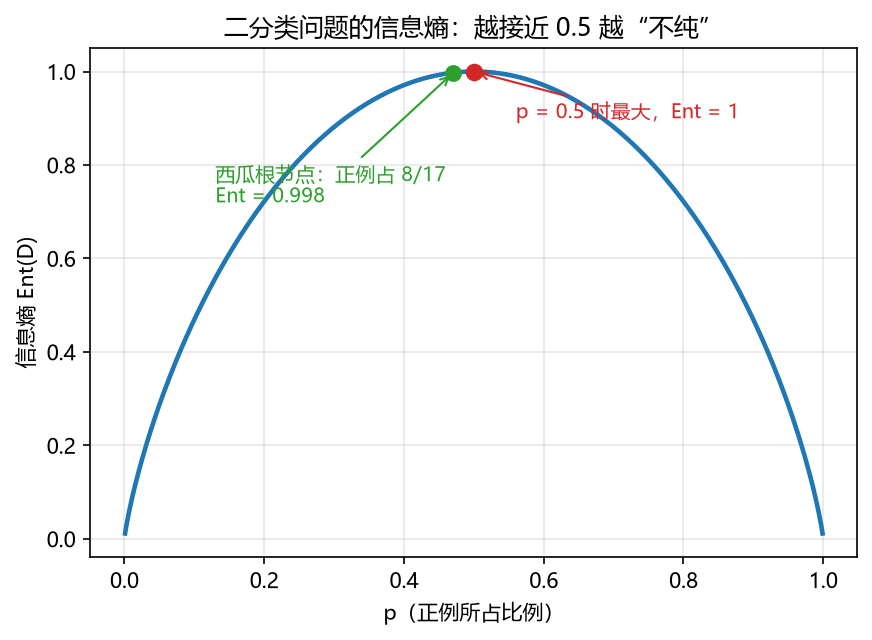

**图 8-7 二分类问题的信息熵：越接近 0.5 越"不纯"**

> **地学视角**：信息熵是刻画系统复杂性的通用公式。读者以后接触生态学时会遇到**香农–维纳（Shannon–Wiener）指数**——生物多样性最常用的度量之一，它与式（8-2）在形式上几乎一样：物种比例相当于这里的 $p_k$。同一把"熵"的尺子，既量物种多样性，也量样本集合的不纯度。

### 8.7.2 信息增益与 ID3

有了信息熵，"划分带来的纯度提升"就可以计算了。假定离散属性 $a$ 有 $V$ 个可能取值 $\{a^1,a^2,\dots,a^V\}$，用 $a$ 划分 D 会产生 $V$ 个分支节点，其中第 $v$ 个分支节点 $D^v$ 包含 D 中所有在属性 $a$ 上取值为 $a^v$ 的样本。由于各分支样本数不同，按样本数加权求和，得到**信息增益**（information gain）：

$$\mathrm{Gain}(D,a)=\mathrm{Ent}(D)-\sum_{v=1}^{V}\frac{|D^v|}{|D|}\mathrm{Ent}(D^v) \tag{8-3}$$

信息增益越大，意味着用属性 $a$ 划分所获得的"纯度提升"越大。**以信息增益为准则选择划分属性**的决策树学习算法就是经典的 **ID3**（Quinlan，1986）——它训练的是分类树。

用西瓜数据集完整演示这一计算。数据集共 17 个样例、6 个离散属性（色泽、根蒂、敲声、纹理、脐部、触感），好瓜为正例（8 个）、坏瓜为反例（9 个），完整数据见表 8-3。

**表 8-3 西瓜数据集（取自周志华《机器学习》"西瓜数据集 2.0"）**

| 编号 | 色泽 | 根蒂 | 敲声 | 纹理 | 脐部 | 触感 | 好瓜 |
|:--:|:--:|:--:|:--:|:--:|:--:|:--:|:--:|
| 1 | 青绿 | 蜷缩 | 浊响 | 清晰 | 凹陷 | 硬滑 | 是 |
| 2 | 乌黑 | 蜷缩 | 沉闷 | 清晰 | 凹陷 | 硬滑 | 是 |
| 3 | 乌黑 | 蜷缩 | 浊响 | 清晰 | 凹陷 | 硬滑 | 是 |
| 4 | 青绿 | 蜷缩 | 沉闷 | 清晰 | 凹陷 | 硬滑 | 是 |
| 5 | 浅白 | 蜷缩 | 浊响 | 清晰 | 凹陷 | 硬滑 | 是 |
| 6 | 青绿 | 稍蜷 | 浊响 | 清晰 | 稍凹 | 软粘 | 是 |
| 7 | 乌黑 | 稍蜷 | 浊响 | 稍糊 | 稍凹 | 软粘 | 是 |
| 8 | 乌黑 | 稍蜷 | 浊响 | 清晰 | 稍凹 | 硬滑 | 是 |
| 9 | 乌黑 | 稍蜷 | 沉闷 | 稍糊 | 稍凹 | 硬滑 | 否 |
| 10 | 青绿 | 硬挺 | 清脆 | 清晰 | 平坦 | 软粘 | 否 |
| 11 | 浅白 | 硬挺 | 清脆 | 模糊 | 平坦 | 硬滑 | 否 |
| 12 | 浅白 | 蜷缩 | 浊响 | 模糊 | 平坦 | 软粘 | 否 |
| 13 | 青绿 | 稍蜷 | 浊响 | 稍糊 | 凹陷 | 硬滑 | 否 |
| 14 | 浅白 | 稍蜷 | 沉闷 | 稍糊 | 凹陷 | 硬滑 | 否 |
| 15 | 乌黑 | 稍蜷 | 浊响 | 清晰 | 稍凹 | 软粘 | 否 |
| 16 | 浅白 | 蜷缩 | 浊响 | 模糊 | 平坦 | 硬滑 | 否 |
| 17 | 青绿 | 蜷缩 | 沉闷 | 稍糊 | 稍凹 | 硬滑 | 否 |

**第一步：根节点的信息熵。**根节点包含全部 17 个样例，正例（好瓜）占 $p_1=8/17$，反例占 $p_2=9/17$：

$$\mathrm{Ent}(D)=-\frac{8}{17}\log_2\frac{8}{17}-\frac{9}{17}\log_2\frac{9}{17}=0.998$$

正反例几乎对半，熵非常接近二分类的最大值 1，根节点相当"不纯"，确实需要划分。

**第二步：算某个属性的信息增益。**以"色泽"为例。色泽有三个取值，把 D 分成三个子集：$D^1$（青绿）含 $\{1,4,6,10,13,17\}$ 共 6 个样例（正 3 反 3），$D^2$（乌黑）含 $\{2,3,7,8,9,15\}$ 共 6 个样例（正 4 反 2），$D^3$（浅白）含 $\{5,11,12,14,16\}$ 共 5 个样例（正 1 反 4）。三个子节点的信息熵分别为 1.000、0.918、0.722（图 8-8）。

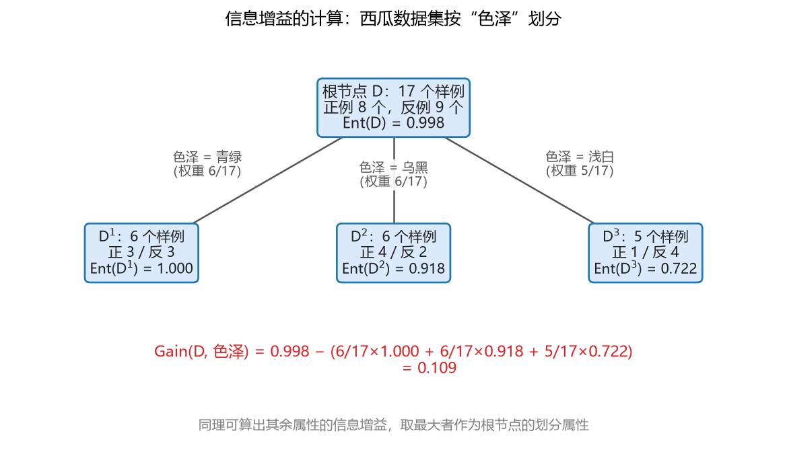

**图 8-8 信息增益的计算：西瓜数据集按"色泽"划分**

于是色泽的信息增益为

$$\mathrm{Gain}(D,\text{色泽})=0.998-\Big(\frac{6}{17}\times 1.000+\frac{6}{17}\times 0.918+\frac{5}{17}\times 0.722\Big)=0.109$$

**第三步：比较所有属性，取最大者。**同理可算出其余属性的信息增益（表 8-4）。

**表 8-4 西瓜数据集各属性的信息增益**

| 属性 | 色泽 | 根蒂 | 敲声 | 纹理 | 脐部 | 触感 |
|------|------|------|------|------|------|------|
| 信息增益 | 0.109 | 0.143 | 0.141 | **0.381** | 0.289 | 0.006 |

纹理的信息增益最大（0.381），因此**纹理被选为根节点的划分属性**。按纹理把 17 个样例分成清晰（$\{1,2,3,4,5,6,8,10,15\}$）、稍糊（$\{7,9,13,14,17\}$）、模糊（$\{11,12,16\}$）三个子节点后，对每个子节点照方抓药——把子节点当根节点，再算一遍各属性的信息增益、取最大者继续划分，不能划分的停止——最终就得到了 8.2.1 节的图 8-1 那棵决策树。

**信息增益的问题。**信息增益有一个明显偏好：**对可取值数目较多的属性有所偏好**。极端的例子：若把"编号"（1～17，每个样例一个不同取值）也作为候选属性，用它划分每个子节点都只有一个样例、纯度全高，信息增益远大于其他属性——但这样得到的树毫无泛化能力，无法预测任何新样本。因此信息增益需要改进。

### 8.7.3 增益率与 C4.5

改进的思路是给信息增益除以一个"惩罚项"，得到**增益率**（gain ratio）：

$$\mathrm{Gain\_ratio}(D,a)=\frac{\mathrm{Gain}(D,a)}{\mathrm{IV}(a)} \tag{8-4}$$

其中

$$\mathrm{IV}(a)=-\sum_{v=1}^{V}\frac{|D^v|}{|D|}\log_2\frac{|D^v|}{|D|} \tag{8-5}$$

称为属性 $a$ 的**固有值**（intrinsic value）。属性 $a$ 的可能取值数目越多（$V$ 越大），$\mathrm{IV}(a)$ 的值通常就越大——正好把"取值多的属性容易被选中"的效应抵消掉。基于增益率选择划分属性的算法是 **C4.5**（Quinlan，1993），同样用于训练分类树。

不过增益率也不是完美的：除以 $\mathrm{IV}(a)$ 之后，它又**对可取值数目较少的属性有所偏好**，走向了另一个极端。因此 C4.5 实际采用的是一种启发式策略：**先从候选属性中找出信息增益高于平均水平的那些属性，再从中选取增益率最高的**——用两道关卡平衡两种偏好。

### 8.7.4 基尼指数与 CART

第三种度量换了一个角度。**基尼值**（Gini index）定义为

$$\mathrm{Gini}(D)=1-\sum_{k=1}^{K}p_k^2 \tag{8-6}$$

它的直观含义是：**从数据集 D 中随机抽取两个样本，其类别标记不一致的概率**。概率论中常用"一减去一致的概率"来算不一致的概率：以红白黑球为例，有放回地连摸两次，两次都摸到红球的概率是 $0.2\times 0.2=p_k^2$；把"两次同为某一类"的概率全部加起来是 $\sum_k p_k^2$（一致的概率），一减就得到"两次类别不一致"的概率。集合越纯，随便抽两个越容易同类，基尼值越小——**Gini(D) 越小，数据集纯度越高**，方向与信息熵一致。从形式上看，把式（8-2）中的 $-\sum p_k\log_2 p_k$ 换成 $1-\sum p_k^2$（用 $p_k^2$ 代替 $p_k\log_2 p_k$，两者近似正比），两者对纯度的刻画行为几乎相同（图 8-9）。

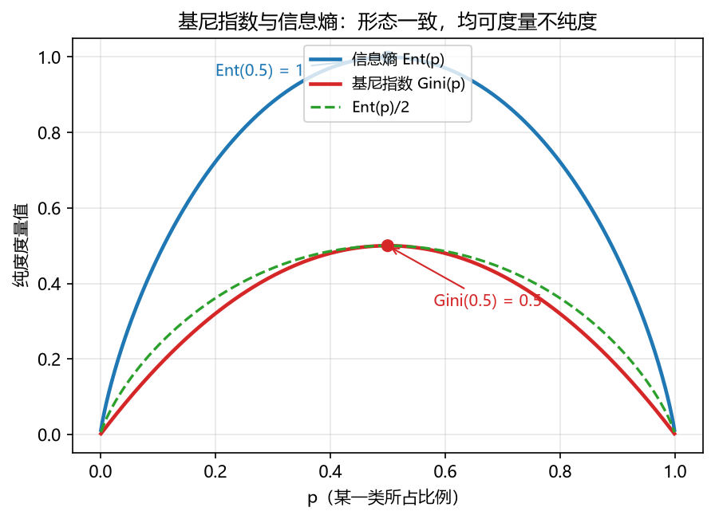

**图 8-9 基尼指数与信息熵：形态一致，均可度量不纯度**

属性 $a$ 的**基尼指数**定义为按 $a$ 划分后各子节点基尼值的加权平均：

$$\mathrm{Gini\_index}(D,a)=\sum_{v=1}^{V}\frac{|D^v|}{|D|}\mathrm{Gini}(D^v) \tag{8-7}$$

注意方向又变了回来：**应选择使划分后基尼指数最小的属性作为最优划分属性**——基尼指数最小，意味着划分后子节点的加权不纯度最低。

采用基尼指数选择划分属性的算法是 **CART**（Classification and Regression Tree，Breiman 等，1984）。它是三者中名气最大、软件里最常用的一个，有三个鲜明特点：

1. **构建的是二叉树**：每个节点只做一次二分（类别属性也拆成"=某取值 / ≠某取值"两支），多叉划分都可以转化为一系列二叉划分，因此二叉树不失一般性；
2. **既能分类也能回归**：分类用基尼指数，回归把准则换成**误差平方（均方误差）最小**，叶节点取均值——一套框架两种用途；
3. **配套完整的工程细节**：连续值处理、缺失值处理、剪枝都支持（表 8-5）。

MATLAB 的决策树函数内部使用的正是 CART。

### 8.7.5 三种经典模型的对比

三种准则与三棵树的差异汇总于表 8-5。

**表 8-5 三种经典的决策树模型**

| 算法 | 支持模型 | 树结构 | 特征选择准则 | X 连续值处理 | X 缺失值处理 | 剪枝 | 特征属性多次使用 |
|------|----------|--------|--------------|:--:|:--:|:--:|:--:|
| ID3（Quinlan，1986） | 分类 | 多叉树 | 信息增益 | 不支持 | 不支持 | 不支持 | 不支持 |
| C4.5（Quinlan，1993） | 分类 | 多叉树 | 信息增益率 | 支持 | 支持 | 支持 | 不支持 |
| CART（Breiman 等，1984） | 分类 / 回归 | 二叉树 | 基尼指数 / 误差 | 支持 | 支持 | 支持 | 支持 |

其中"特征属性多次使用"一栏值得留意：ID3 与 C4.5 规定某个属性一旦在上级节点用过，下级节点便不再使用；CART 没有这一限制，同一个属性可以在树的不同位置反复出现。三种算法细节上的这些差别了解即可，需要记住的是：**划分准则（纯度的定义）不同，是三棵树最本质的区别**。

### 8.7.6 CART 的算法框架

把 8.4 节的"三步走"与基尼指数结合起来，就得到 CART 用于分类的完整框架（伪代码）：

```text
输入：训练集 D，特征集 F
函数 TreeGenerate(D, F)：
1  生成节点 node，并将 D 赋予它
2  if |D| ≤ TN 或 Gini(D) ≤ TG then          // 终止条件：TN 为样本数阈值，TG 为基尼阈值
3      将 node 记为叶节点，类别标记为 D 中样本数最多的类；return
4  end
5  for 每个特征 f ∈ F do                      // 遍历所有特征
6      if f 是离散特征 then
7          for f 的每一个取值 fk do            // 遍历该特征的所有取值
8              按 “f = fk 或 f ≠ fk” 把 D 分为两个子集 D_left、D_right，
               记录其加权平均基尼指数
9      else if f 是连续特征 then
10         for f 的每一个候选分裂阈值 t do     // 遍历所有分裂阈值
11             按 “f ≤ t 或 f > t” 把 D 分为两个子集，
               记录其加权平均基尼指数
12 以最小加权平均基尼指数选出最优划分属性 f* 及最优分裂方案，
   得到 D_left、D_right
13 D = D_left，  递归调用 TreeGenerate(D, F) 向下生长
14 D = D_right， 递归调用 TreeGenerate(D, F) 向下生长
15 生成以 node 为根的树 T‘，对 T’ 做后剪枝（见 8.8 节），得到最终决策树 T
```

伪代码里有几处正是 8.4～8.6 节要点的落实：第 5～11 行**同时照顾了离散与连续特征**（离散特征也统一拆成二分）；第 8、11 行记录的是**加权平均**基尼指数（两个子集样本数不同，必须用样本数加权）；第 12 行选**最小**者；第 13、14 行是**递归**；第 15 行生长完成后还要**后剪枝**。

CART 用于回归时，框架完全相同，只改三处：终止时叶节点的输出改为**标签集合 Y 的平均值**（而不是最多数类）；第 8、11 行记录的改为**加权平均（平方）误差**；第 12 行以最小加权平方误差选最优分裂。也就是说，**回归树 = CART 框架 + 误差平方准则 + 叶取均值**，与 8.2.2 节的回归树例子完全对应。

## 8.8 决策树的剪枝处理

### 8.8.1 剪枝的目的与基本策略

**剪枝的目的：对付过拟合。**决策树有"疯长"的天性——划分不断进行，分支越来越多，树很容易把训练集自身的一些特点（噪声、个别样本的特异性）当成所有数据都有的一般性质，表现为：结构上又大又深，性能上过于逼近训练集、对新数据预测不佳。剪枝通过去掉部分分支，把树压缩到合理规模，一定程度上避免这种过拟合。

**基本策略**有两种：

- **预剪枝**：在**训练过程中**（决策树生长的同时）判断——每要生成一个节点，先估计"划分好不好"，不能带来泛化性能提升就不再划分；
- **后剪枝**：在**训练完成后**（先生成完整的树）自底向上逐个考察节点，把某些子树替换为叶节点。

两种策略有一个共同点：**判断"要不要（继续）划分/要不要剪"的依据，都是预留一部分数据作验证集、用验证集上的性能来衡量**（留出法）。因此做剪枝实验时，应把数据划分为训练集与验证集两部分；不做剪枝时验证集本来可以不看，做剪枝就必须留出它。

以下沿用西瓜数据集演示。将 17 个样例用留出法划分为两部分：**训练集** 10 个样例（编号 1、2、3、6、7、10、14、15、16、17，其中好瓜 5 个）、**验证集** 7 个样例（编号 4、5、8、9、11、12、13，其中好瓜 3 个）。

### 8.8.2 预剪枝

预剪枝的做法：**决策树生成过程中，对每个节点在划分前先进行估计——若当前节点的划分不能带来决策树泛化性能（验证集精度）的提升，则停止划分，并将当前节点记为叶节点**，其类别标记为训练样例中最多的类。

**第一步：根节点。**在训练集上基于信息增益准则，最优划分属性是"脐部"。先不急着划分，比较两种方案在验证集上的精度（图 8-10）：

- 若**不划分**：根节点直接作为叶节点，训练集中好坏瓜各半，按"好瓜"标记。验证集 7 个样例中只有 {4,5,8} 三个好瓜被判对，精度 3/7 = **42.9%**；
- 若**按脐部划分**：三个子节点分别标记为好瓜（凹陷）、好瓜（稍凹）、坏瓜（平坦）。验证集中 {4,5,8,11,12} 五个样例判对，精度 5/7 = **71.4%**。

划分使验证集精度提高，**决策：划分**。

**第二步：继续考察新的子节点。**对凹陷、稍凹两个子节点分别试划分（平坦子节点只含两个训练样例、均为坏瓜，已是纯叶）：在凹陷节点上按"色泽"划分，验证集精度反而降到 4/7 = 57.1%——**禁止划分**；在稍凹节点上按"根蒂"划分，精度仍为 5/7 = 71.4%、没有提升——**禁止划分**。

于是生长停止，最终得到**仅有一层划分的决策树，称为"决策树桩"（decision stump）**（图 8-10），验证集精度 71.4%。

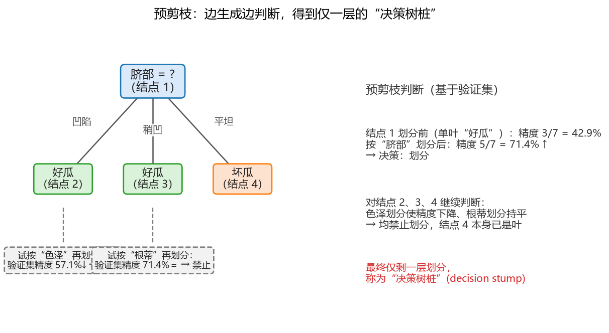

**图 8-10 预剪枝：边生成边判断，得到仅一层的"决策树桩"**

预剪枝的优缺点：

- **优点**：降低了过拟合的风险；很多分支没有展开，显著减少了训练时间和测试时间开销；
- **缺点**：有**欠拟合风险**。预剪枝基于"贪心"本质——有些分支的当前划分虽然不能提升泛化性能，但在其基础上继续划分却可能带来性能的显著提高，而预剪枝把这些分支"扼杀在摇篮里"，导致树偏向过于简单。

### 8.8.3 后剪枝

后剪枝的做法：**先从训练集生成一棵完整的决策树，然后自底向上地对非叶节点逐个考察——若将该节点对应的子树替换为叶节点能使决策树泛化性能提升，则完成替换**。

在训练集上充分生长得到的未剪枝树共有 6 个编号节点，其中 5 个为内部节点（图 8-11 中含虚线子树的完整结构）：根节点 1 为脐部，其下凹陷分支经节点 2（色泽）划分，稍凹分支经节点 3（根蒂）、节点 5（色泽）、节点 6（纹理）逐层划分，平坦分支为叶节点 4。这棵完整的树在验证集上的精度为 **42.9%**——比一棵树桩还差，过拟合的恶果立竿见影。

后剪枝从最深的节点开始，自底向上逐个考察（图 8-11）：

- **结点 6（纹理）**：若替换为叶节点，其上训练样本为 {7,15}（一好一坏，按多数记"好瓜"），验证集精度提高到 4/7 = **57.1%**——精度上升，**剪枝**；
- **结点 5（色泽，稍蜷下）**：替换为叶节点后精度仍为 57.1%，未再提升——**不剪**；
- **结点 3（根蒂）**：替换后精度不升——**不剪**；
- **结点 2（色泽，凹陷下）**：替换为叶节点（标记"好瓜"）后，验证集中样例 5 被判对，精度升至 5/7 = **71.4%**——精度上升，**剪枝**；
- **结点 1（根节点脐部）**：替换后整树成单叶，精度跌回 42.9%——**不剪**。

最终得到的后剪枝决策树如图 8-11 中实线部分所示，验证集精度 **71.4%**。

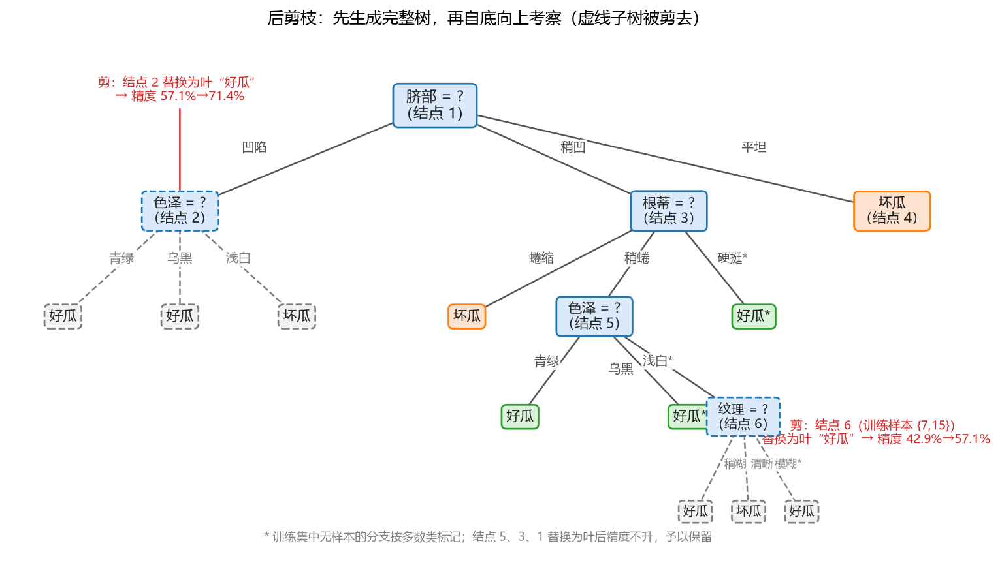

**图 8-11 后剪枝：先生成完整树，再自底向上考察（虚线子树被剪去）**

后剪枝的优缺点：

- **优点**：比预剪枝**保留了更多的分支**，欠拟合风险小，泛化性能往往优于预剪枝决策树；
- **缺点**：**训练时间开销大**——先要生成完整的树，再自底向上逐一考察每个非叶节点。

### 8.8.4 预剪枝与后剪枝的比较

两种剪枝策略的对比见表 8-6。

**表 8-6 预剪枝与后剪枝的比较**

| 项目 | 预剪枝 | 后剪枝 |
|------|--------|--------|
| 时机 | 训练中（树生长过程中） | 训练后（完整树生成之后） |
| 做法 | 每个节点划分前先估计，不能提升验证集精度则不划分 | 自底向上考察非叶节点，替换为叶节点能提升精度则剪 |
| 保留分支 | 少（树偏小，易欠拟合） | 多（欠拟合风险小） |
| 泛化性能 | 一般 | 往往优于预剪枝 |
| 训练开销 | 小（很多分支提前终止） | 大（需生成完整树再逐一考察） |
| 判断依据 | 验证集精度（留出法） | 验证集精度（留出法） |

两者如何选？**对中小规模的数据问题，训练开销一般不构成瓶颈，通常推荐后剪枝**——它换来的泛化性能提升值得多花一点时间；数据特别大、训练成本敏感时，可考虑预剪枝或两者结合。

## 8.9 决策树的改进

### 8.9.1 多变量决策树

8.5.3 节指出，标准决策树每个节点只用**单个**属性判断，划分边界全部与坐标轴平行，这样的树称为**单变量决策树**。图 8-12 左图是一个二维二分类问题：单变量决策树的边界是一串"横平竖直"的台阶，要用多段才能勉强围出一条斜向的分界。

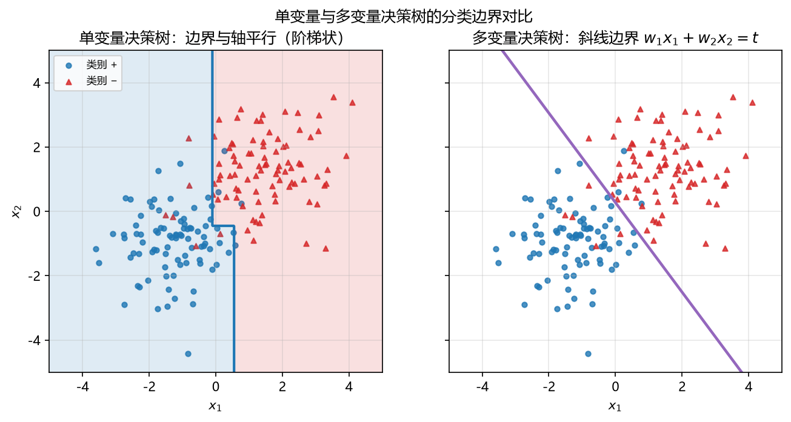

**图 8-12 单变量与多变量决策树的分类边界对比**

**多变量决策树**的改进直截了当：让**非叶节点不再是仅对某个属性测试，而是对属性的线性组合测试**。每个非叶节点是一个形如

$$\sum_{i=1}^{d} w_i a_i = t \tag{8-8}$$

的线性分类器，其中 $a_i$ 是属性，$w_i$ 是其权值，$w_i$ 与 $t$ 都可在该节点所含的样本集和属性集上学得。几何上，式（8-8）是一条**斜的**超平面——回忆第 6 章的线性模型，斜线其实就是多个 X 的加权和再配一个阈值。对图 8-12 右图这类问题，一条斜线就能干净利落地把两类分开，树的结构也简单得多。

### 8.9.2 从一棵树到一片森林：随机森林

单棵树的性能总是有限的——树和人都一样，个体的能力有限，集体的力量则大得多。既然如此，能不能**把一棵树变成多棵树，让多棵树共同处理同一个问题**？这个朴素的想法造就了一个如雷贯耳的模型：**随机森林**（random forest）——用多棵树组成"森林"来预测。

它好用的道理用现实类比一目了然：只听一位专家的意见难免片面，哪怕这位专家很权威；请多位专家各自独立判断、再把意见综合起来，通常能得到更稳妥的结论——有的专家判断得好一些、有的差一些，综合之后往往优于任何单个人。随机森林正是"决策树版的专家委员会"：多棵树各自的预测（分类投票或回归平均）综合起来，大多数情况下都能比单棵树取得一定的性能提升。

随机森林的具体构造（如何保证多棵树"各有专长"而不是彼此雷同）超出本章范围，读者此时只需建立这个方向性的认识：**决策树的两大改进方向，一是节点内用上多变量（斜线），二是单树变多树（森林）**。

## 8.10 决策树的 MATLAB 实现

### 8.10.1 构建决策树模型的基本步骤

MATLAB 把决策树的训练与预测封装成了少数几个大函数，整体流程与其他模型一致，见表 8-7。

**表 8-7 构建决策树模型的基本步骤与命令**

| 步骤 | 基本命令 | 功能 |
|------|----------|------|
| 数据预处理 | — | 数据标准化；将原始数据分割成训练集 P 和验证集 Q（剪枝需要验证集） |
| 训练模型 | `fitrtree` / `fitctree` | 制定特定训练参数，训练决策树（回归树 / 分类树） |
| 修剪模型 | `prune` | 修剪（剪枝）决策树 |
| 预测 | `predict` | 训练集预测、验证集预测 |
| 性能评估与数据后处理 | `view` | 查看决策树模型（树形结构可视化） |
| | `loss` | 训练集和验证集的预测性能评估 |

其中 `view` 与 `prune` 是决策树特有的两个命令：树是"看得见"的模型，训练完应当用 `view` 把结构展示出来检查；树是需要修剪的模型，用 `prune` 把规模压下来。其余步骤（预处理、predict、loss）与前面各章的分类回归模型用法完全统一——这也是 MATLAB 把各类模型接口做成一致的好处。

### 8.10.2 主要函数的调用格式

**（1）fitrtree 与 fitctree。**`fitrtree` 训练回归树，`fitctree` 训练分类树，调用格式完全类似，以 fitrtree 为例（表 8-8）。

**表 8-8 fitrtree（fitctree）的调用格式**

| 格式 | 用途 |
|------|------|
| `tree = fitrtree(Tbl,ResVarName)` | 根据表 Tbl 中的输入变量（预测变量、特征、属性）和包含在 Tbl.ResVarName 中的输出（响应）返回回归树；是二叉树，每个分支节点都根据 Tbl 列的值进行拆分 |
| `tree = fitrtree(Tbl,formula)` | 返回基于表 Tbl 中包含的输入变量的回归树；formula 是响应变量和 Tbl 中用于拟合的预测变量子集的解释模型 |
| `tree = fitrtree(Tbl,Y)` | 根据表 Tbl 中包含的输入变量和向量 Y 中的输出返回回归树 |
| `tree = fitrtree(X,Y)` | 返回基于输入变量 X 和输出 Y 的回归树；二叉树每个节点都基于 X 列的值进行拆分 |
| `tree = fitrtree(___,Name,Value)` | 使用一个或多个名称-值对参数指定选项，例如观测权重或训练交叉验证模型 |

最经典、最常用的就是 `fitrtree(X,Y)` / `fitctree(X,Y)` 这种"X 矩阵 + Y 向量"的形式。较新版本的 MATLAB 引入了 **table 数据类型**——把各变量的名称与数据组织成一张表，前三种格式便可以用了：X、Y 都放进 table，再用 `ResVarName` 或 `formula` 告诉函数哪一列（或哪个表达式）是响应变量 Y。这是与旧写法并存的现代写法，读者两者都应认识。

**（2）prune。**剪枝命令（表 8-9）。

**表 8-9 prune 的调用格式**

| 格式 | 用途 |
|------|------|
| `tree1 = prune(tree)` | 创建回归树或分类树 tree 的副本，并填充其最佳修剪序列（tree 由 fitrtree 或 fitctree 生成） |
| `tree1 = prune(tree,Name,Value)` | 使用 Name,Value 对参数指定的附加选项创建修剪过的树，例如指定修剪层级（'Level'）或代价复杂度（'Alpha'）；可以按任意顺序指定多个名称-值参数 |

不管做不做剪枝，最终用于预测的都是一个树形模型对象；`prune` 的输出（修剪过的树）同样是树对象，直接交给 `predict` 即可。

**（3）predict。**分类树与回归树的 predict 见表 8-10。

**表 8-10 predict 的调用格式**

| 函数 | 格式 | 用途 |
|------|------|------|
| 分类树 | `label = predict(Mdl,X)` | 根据训练好的完整或紧凑分类树 Mdl，返回表或矩阵 X 中预测变量数据的预测类别标签向量 |
| | `label = predict(Mdl,X,Name,Value)` | 用名称-值参数指定附加选项，例如预测前将 Mdl 修剪到特定级别 |
| | `[label,score,node,cnum] = predict(___)` | 另外返回：score——分类分数矩阵（分类树的后验概率）；node——预测节点编号向量；cnum——预测类编号向量 |
| 回归树 | `Yfit = predict(Mdl,X)` | 根据完整或紧凑的回归树 Mdl，返回 X 中预测变量数据的预测响应向量 Yfit |
| | `Yfit = predict(Mdl,X,Name,Value)` | 用名称-值参数指定附加选项 |
| | `[Yfit,node] = predict(___)` | 另外返回响应的预测节点编号向量 node |

这一"先由 fit 系列函数求模型、再统一用 predict(model, X) 预测"的接口风格，与第 7 章 `fitcknn` + `predict` 完全一致——MATLAB 有意让所有分类、回归模型在预测环节统一起来，学会一次处处能用。

## 8.11 案例研究

### 8.11.1 案例一：鸢尾花的决策树分类

**数据**仍用读者熟悉的 Fisher 鸢尾花数据集（MATLAB 中为 `fisheriris`）：150 个标本、三个品种各 50 个，4 个连续型自变量（萼片长、萼片宽、花瓣长、花瓣宽），因变量为品种名。这次把全部 4 个属性、全部 150 个标本都用来训练一棵分类树（代码文件：`DecisionTree_exp01.m`）：

```matlab
%% 案例1：鸢尾花的决策树分类（fitctree）
clear; clc;

load fisheriris                 % meas：150×4 测量值；species：150×1 品种名
X = meas;                       % 4 个自变量
Y = species;                    % 因变量：三种类别

% ---- 训练分类树 ----
Mdl = fitctree(X, Y);           % CART 分类树（基尼指数准则）

% ---- 查看树结构：决策树特有的操作 ----
view(Mdl)                       % 文本方式：每个叶节点列出一条 if-then 规则
view(Mdl, 'Mode', 'graph')      % 图形方式：画出树状图

% ---- 训练集回代预测与性能评估 ----
Ypred = predict(Mdl, X);        % 150×1 的预测类别
err = loss(Mdl, X, Y)           % 回代误差率，本例约 0.020（错分 3 个）

% ---- 可视化：实际类别 vs 预测类别 ----
s = unique(Y);                  % 三个品种名
cols = {[1 0 0], [0 0.6 0], [0 0 1]};
figure; hold on;
for c = 1:3
    m = strcmp(Y, s{c});
    plot(find(m), c*ones(sum(m),1), '.', ...
         'Color', cols{c}, 'MarkerSize', 14);
end
bad = find(~strcmp(Ypred, Y));  % 错分样本的编号
plot(bad, 2*ones(size(bad)), 'rx', 'LineWidth', 2);
set(gca, 'YTick', 1:3, 'YTickLabel', s); ylim([0.5 3.5]);
xlabel('样本编号'); title('鸢尾花分类树：训练集回代'); hold off;

% ---- 混淆矩阵（confusionchart 需 R2018b 及以后版本）----
confusionchart(Y, Ypred)
```

程序要点与结果：

- `fitctree(X, Y)` 一步完成训练，得到分类树模型 Mdl；
- **`view(Mdl)` 是决策树特有的命令**：不带参数时以**文本**方式列出树的所有分支，每条从根到叶的路径就是一条 if-then 判别规则；带 `'Mode','graph'` 参数时以**图形**画出树状结构。树是可解释的模型，训练完一定要"看一眼树"；
- 回代预测只有 3 个样本被错分（均为 versicolor 与 virginica 的交界样本），`loss` 返回的回代误差率约为 **0.020**——150 × 0.020 = 3，与图上数出的红叉个数一致（图 8-13、图 8-14）。注意这是训练集上的回代误差，泛化性能应另用验证集/测试集或交叉验证考察；
- 树的前两层结构与植物学常识吻合：第一个判断是**花瓣长 ≤ 2.45**（一举分出 setosa，该叶 50/0/0 全纯），第二个判断是**花瓣宽 ≤ 1.75**（区分 versicolor 与 virginica 的主界线），更深的节点处理两类的交界样本；
- `confusionchart` 是较新的函数：课堂上旧版 MATLAB 会报"函数未定义"，安装 2020a/2021 以后版本的读者可以直接运行。

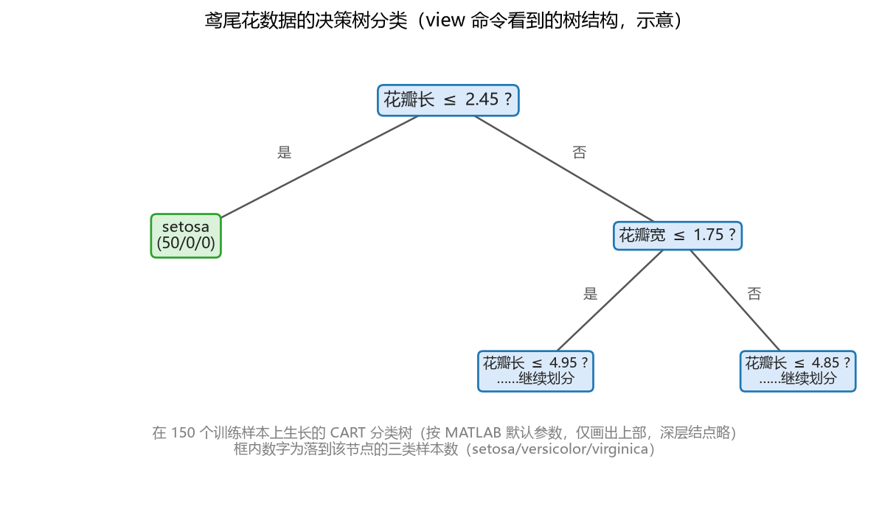

**图 8-13 鸢尾花数据的决策树分类（view 命令看到的树结构，示意）**

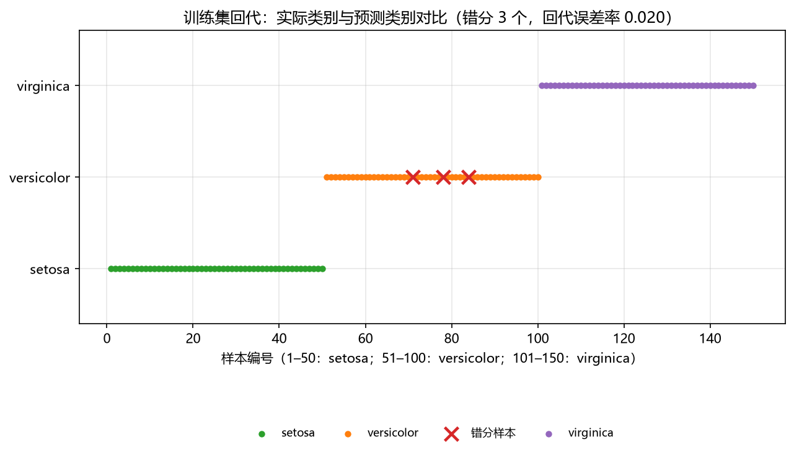

**图 8-14 鸢尾花案例：训练集回代的实际类别与预测类别对比（错分 3 个）**

### 8.11.2 案例二：汽车油耗的决策树回归

**数据**换成 MATLAB 内置的 `carsmall` 汽车数据集，做回归：以**加速度（Acceleration）、马力（Horsepower）、重量（Weight）**等自变量预测**每加仑英里数 MPG**（衡量油耗水平的指标，连续值）。carsmall 中有缺失值（NaN），先用逻辑索引剔除，再训练回归树并做交叉验证（代码文件：`DecisionTree_exp02.m`）：

```matlab
%% 案例2：汽车数据的决策树回归（fitrtree）
clear; clc;

load carsmall                            % MATLAB 内置汽车数据（含缺失值）
X = [Acceleration Horsepower Weight];    % 自变量：加速度、马力、重量
Y = MPG;                                 % 因变量：油耗指标（每加仑英里数）

v = ~isnan(Y) & all(~isnan(X), 2);       % 剔除含缺失值的样本
X = X(v, :);   Y = Y(v);

% ---- 训练回归树并剪枝 ----
tree = fitrtree(X, Y);                   % CART 回归树（误差平方准则）
tree1 = prune(tree, 'Level', 4);         % 剪枝：保留 4 层，控制树的规模
view(tree1, 'Mode', 'graph')             % 图形方式查看回归树

% ---- 训练集回代：实际值 vs 预测值 ----
Yfit = predict(tree1, X);
figure;
plot(Y, Yfit, 'o'); hold on;
plot([10 45], [10 45], 'r--');           % 1:1 参考线
xlabel('实际 MPG'); ylabel('预测 MPG');
title('汽车油耗回归树：训练集回代'); hold off;

% ---- 交叉验证 ----
cvMdl  = crossval(tree1);                % 10 折交叉验证
cvLoss = kfoldLoss(cvMdl)                % 交叉验证均方误差
```

结果解读：回归树的预测值与实际 MPG 在 1:1 线附近分布，比较准确；`kfoldLoss` 给出的交叉验证均方误差则比回代误差更客观地反映泛化能力。读者可以调整 `prune` 的修剪层级（或干脆比较剪枝前后的回代与交叉验证误差），直观体会 8.8 节的结论——**剪枝后的树规模更小、泛化能力通常更强**。建议读者装一个 2020a 以后的 MATLAB 自己跑一遍这两个案例，并换成自己的数据试一试，才能真正理解每个变量与函数的含义。

## 8.12 本章小结

决策树是一个**经典、直观、好用**的模型。本章要点归纳如下：

1. **定位与结构**：决策树按功能分为回归树与分类树，属于有监督学习、急切学习；由根节点（唯一起点）、内部节点（各挂一个测试属性，别名甚多）、有向边（测试结果）和叶子节点（判断终止的结论）组成；层次从根计 1，最大层次为树的深度。
2. **训练三步与纯度**：自顶向下、分而治之——遍历所有特征与切分点，取子节点（加权）纯度之和最高者划分；满足停止条件（叶子样本数、树深、空叶、纯叶、属性测试完）则停，否则对子节点递归。一切的关键是**纯度的定义**。
3. **三种纯度度量与三棵经典树**：信息熵 $\mathrm{Ent}(D)=-\sum p_k\log_2 p_k$ 越小越纯，信息增益（ID3，1986）偏好取值多的属性；增益率 = 信息增益 / 固有值 IV(a)（C4.5，1993）纠偏却又偏好取值少的属性，实用中"先筛高增益、再选高增益率"；基尼指数 $\mathrm{Gini}(D)=1-\sum p_k^2$（随机两样本类别不一致的概率）选最小（CART，1984），二叉树、可分类可回归（回归用误差平方 + 叶取均值），软件中最常用。
4. **预测**：待测样本从根节点沿分支下行落到叶节点；分类叶投票（少数服从多数）、回归叶取平均——与 kNN 的决策思想一致；比较次数不超过树深，预测效率高。
5. **特点**：假设 X 与 Y 相关；优点——可解释性强（可转 if-then 规则）、自带一定的自变量选择能力、离散连续自变量通吃、训练预测都快、对异常点较鲁棒；缺点——对划分方法敏感、类别多或不对树加以控制时容易疯长过拟合、回归叶区分度不够、边界只能与轴平行、单棵树能力有限。
6. **剪枝**：对付过拟合的特殊操作，判断依据是留出法预留的验证集。预剪枝边生成边判断（省时但易欠拟合，结果是决策树桩）；后剪枝先生成完整树再自底向上考察（保留分支更多、泛化往往更好，训练开销大）；中小规模数据推荐后剪枝。西瓜书例：完整树验证精度 42.9% → 剪结点 6 后 57.1% → 再剪结点 2 后 71.4%。
7. **改进方向**：多变量决策树（节点用属性线性组合 $\sum w_i a_i=t$，边界为斜线）；一棵树变多棵树——随机森林（专家委员会式的综合决策）。
8. **MATLAB 实现**：`fitctree`（分类树）/ `fitrtree`（回归树）训练，`prune` 剪枝，`view` 查看（文本/图形），`predict` 预测，`loss` 评估——与其他模型的 fit + predict 接口完全统一；支持 table + ResponseVarName/formula 的现代写法。鸢尾花案例回代误差约 0.020（3 个错分），汽车案例演示了回归树与交叉验证。

## 8.13 思考题

1. 什么是决策树模型？它为什么叫"决策"树？
2. 决策树能实现哪些功能？回归树与分类树在节点判断、叶节点输出上有何区别？
3. 怎么评估一个决策树模型？分类树与回归树分别用什么指标？
4. 决策树的求解算法包含哪两大部分？三种纯度度量（信息增益、增益率、基尼指数）各自有什么偏好？分别对应哪个经典算法？
5. 预剪枝与后剪枝是怎样操作的？各有什么优缺点？为什么判断剪枝要预留验证集？
6. 单变量决策树与多变量决策树有什么区别？
7. 若叶子节点里所有样本的 X 完全相同而 Y 不同，树还能继续划分吗？这说明了什么问题？
8. 回归树中多个待测样本落进同一片叶子时预测值会怎样？有什么改进思路？
9. 每种类型的决策树用 MATLAB 如何实现？`view` 与 `prune` 两个命令的作用是什么？

## 8.14 延伸阅读

1. 周志华《机器学习》（第 2 版）第 4 章"决策树"，本章西瓜数据集与剪枝示例的出处：
   <https://cs.nju.edu.cn/zhouzh/zhouzh.files/publication/MLbook2019.htm>
2. MATLAB 官网关于回归树 `fitrtree` 的介绍：
   <https://ww2.mathworks.cn/help/stats/fitrtree.html>
3. MATLAB 官网关于分类树 `fitctree` 的介绍：
   <https://ww2.mathworks.cn/help/stats/fitctree.html>
4. MATLAB 官网关于决策树剪枝 `prune` 的介绍：
   <https://ww2.mathworks.cn/help/stats/classificationtree.prune.html>
5. MATLAB 官网关于决策树预测 `predict` 的介绍：
   <https://ww2.mathworks.cn/help/stats/compactclassificationtree.predict.html>
6. MATLAB 官网关于决策树可视化 `view` 的介绍：
   <https://ww2.mathworks.cn/help/stats/compactclassificationtree.view.html>
7. MATLAB 官网关于决策树性能 `loss` 的介绍：
   <https://ww2.mathworks.cn/help/stats/compactclassificationtree.loss.html>

> 本章插图取自本讲课件《机器学习与地学应用·第八讲 决策树》。


