# 第9章 人工神经网络

> **本章导读**：本书前面各章介绍的方法，无论是线性模型还是 k 最近邻，多数都在"写公式"或"找邻居"的框架内解决问题。本章介绍一类模仿生物神经系统的通用方法——人工神经网络（Artificial Neural Network，ANN）。它既能做回归也能做分类，稍加变形（如自组织映射 SOM）还能做聚类，是机器学习中功能最全面的方法家族之一。本章先从生物神经元和图像识别实例出发建立直观认识，回顾 ANN 三起两落的发展史；然后自底向上介绍三种经典结构——M-P 神经元模型、感知机模型和多层前馈神经网络（多层感知机）；重点讲解训练多层网络的误差反向传播（BP）算法，包括损失函数、链式法则、梯度下降、标准 BP 与累计 BP、过拟合的缓解策略以及跳出局部极小的策略；最后给出用 MATLAB 构建 ANN 的完整流程（七步骤、常用命令、训练算法选择）与两个案例。

## 9.1 方法体系中的 ANN

### 9.1.1 方法总表中的位置

按照本书的惯例，先回到"数据挖掘/机器学习的典型方法"总表，看看本章方法所处的位置（表 9-1 中加粗部分）。

**表 9-1 数据挖掘/机器学习的典型方法**

| 类别 | 聚类 | 降维 | 回归 | 分类 |
|------|------|------|------|------|
| 线性方法 | — | 相关性分析、主成分分析、因子分析 | 多元线性回归 | Logistic 回归、判别分析 |
| 最近邻 | k 均值聚类 | — | kNN | kNN |
| 树型 | 层次聚类 | — | 决策树 | 决策树 |
| 密度 | DBSCAN | — | — | — |
| 神经网络 | **自组织映射（SOM）** | — | **ANN** | **ANN** |
| 核函数 | — | — | SVR | SVC |
| 图论 | 谱聚类 | — | 概率图模型 | 概率图模型 |
| 随机变量 | 高斯混合模型 | — | — | 贝叶斯分类 |
| 模糊数 | 模糊 C 均值聚类 | — | 模糊逻辑模型、ANFIS | 模糊逻辑模型 |
| 深度学习 | — | 自动编码器 | CNN、LSTM、Transformer | CNN |

从表中可以看到，神经网络横跨聚类、回归、分类三种功能：它的主体 ANN 完全可以做回归和分类；其变形——自组织映射网络（Self-Organizing Map，SOM）还可以做聚类。因此，神经网络是一个**非常通用、功能很多的机器学习方法**。本章先讲清最基本的 ANN 原理与用法，深度学习（CNN、LSTM 等）将在支持向量机之后再展开。

### 9.1.2 生物神经网络

ANN 的名字已经点明了它的来历：**人工**神经网络借鉴的是真实生物的神经网络。如果不加"人工"二字，"神经网络"指的应该是生物体内由神经元组成的网络——正是对它的模仿，才有了我们这一章要研究的方法。

**生物神经网络**（biological neural network）是多个神经元组成的网络；每个神经元与其他神经元相连，当某神经元"兴奋"时，向相连的神经元发送化学物质（神经递质），从而改变这些神经元内的电位；如果某神经元的电位超过**阈值**，就会被激活（"兴奋"起来），向其他神经元发送化学物质。

图 9-1 画出了一个生物神经元接收、整合与传递信息的过程，从中可以提炼出三个可供借鉴的要点：

1. **多路输入**：神经元通过树突与其他许多神经元相连，不同的信号经突触传进来；
2. **信号有强弱、有正负**：突触对传递的信号有放大或缩小、增强或抑制的作用，不同来源的信号贡献不同；
3. **达到阈值才激活**：所有输入信号综合起来对神经元形成刺激，只有刺激总量达到一定程度（超过阈值），神经元才被激活，把信号变换后再传给下一个神经元。

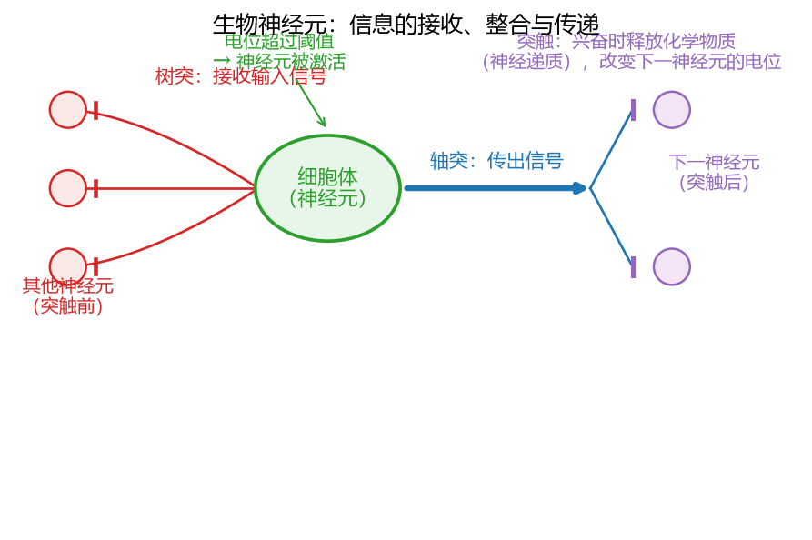

**图 9-1 生物神经元：信息的接收、整合与传递**

这三个要点分别对应人工神经元中的"多输入加权求和""连接权重（可正可负）"与"偏置（阈值）+ 激活函数"，9.2.3 节将给出其数学形式。

### 9.1.3 人工神经网络的定义

有了生物神经网络作参照，可以给出人工神经网络的定义（Kohonen，1988）：

> **定义（人工神经网络）** "人工神经网络"是由具有适应性的**简单单元**组成的广泛**并行互连**的网络，它的组织能够模拟生物神经系统对真实世界物体所作出的反应。

其中"简单单元"即**神经元模型**（neuron model），是神经网络的基本成分。机器学习中的神经网络通常指"神经网络学习"，即**机器学习与神经网络两个学科的交叉部分**：一方面模仿生物神经网络的结构与机理，另一方面结合机器学习的原理（用数据训练参数）来构建模型。这才是本章的研究对象——人工神经网络模型。

## 9.2 ANN 的结构与实例

### 9.2.1 从图像识别实例看网络

先看一个模式识别（分类）的实例，直观感受一下"网络"在做什么（图 9-2）：输入是一幅图像，把它展开为像素值组成的输入向量；经过一个多层的网络之后，输出层给出它属于各个类别的概率——"狗"0.05、"猫"0.95——哪个类别的概率高，就判定图像属于哪个类别。这是一个非常典型的神经网络分类问题，图中可以明显看到输入层、隐含层、输出层的网状结构：信息从左边的输入层进入，逐层向右传递，最后从输出层给出结果。

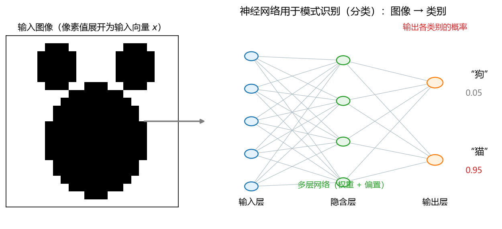

**图 9-2 神经网络用于模式识别（分类）：图像 → 类别概率**

### 9.2.2 多层全连接网络的结构

把典型的网络结构抽象出来，如图 9-3 所示：它有 4 个输入节点、第一隐含层 5 个节点、第二隐含层 7 个节点、输出层 3 个节点。围绕这张图，需要掌握以下几点。

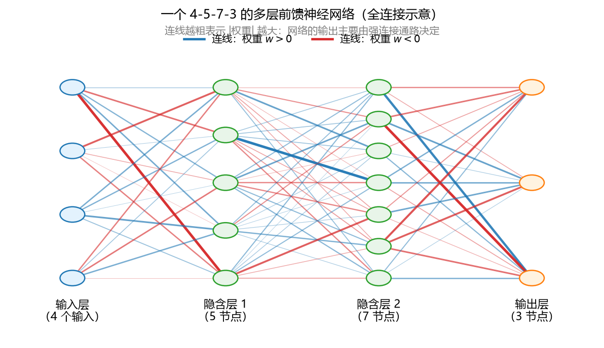

**图 9-3 一个 4-5-7-3 的多层前馈神经网络（连线粗细与 |权重| 成正比）**

**（1）层的划分与叫法。**网络由**输入层**、**隐含层**（隐藏层）和**输出层**组成。图 9-3 有两个隐含层，连同输入层、输出层一共四层，但**输入层通常不算一层**——输入层的节点只是把外部信号原样送入网络，不做任何加工。所以这个网络既可以叫"四层网络"，也可以按多数人的习惯叫"三层网络"（两个隐含层 + 一个输出层）。看到不同教材"两层""三层"说法不一不要奇怪，记住这一约定即可。

**（2）全连接与权重个数。**相邻两层节点之间**全部相连**（全连接），每条连线都带一个**权重**。图 9-3 中输入层到第一隐含层有 4×5=20 条连线，第一隐含层到第二隐含层有 5×7=35 条，第二隐含层到输出层有 7×3=21 条，共 76 个连接权重。权重的物理含义是信号的强弱：权重大的连接传出的信号贡献大，权重为负则起抑制作用。图 9-3 用连线粗细表示权重大小，可以直观看到：网络最终的输出，实际是**由某些强连接的通路在起主要作用**。

**（3）各层节点数怎么定。**

- **输入层节点数**由输入（自变量 X）本身的性质决定：有几个 X 就有几个输入节点；
- **输出层节点数**由问题（因变量 Y）决定：有几个 Y 就有几个输出节点。输出层一般只有一层，大部分问题只有一个 Y、即一个输出节点；
- **隐含层节点数**需要用户来选择：最少 1 个，理论上可以非常多。一个实用的约束是**网络参数总数（权重 + 偏置）应小于样本数**——由此可以大致推算出隐含层节点数的上限，然后在"1 到上限"的范围内用试错法选择（见 9.6.3 节）。

**（4）结构定则参数定。**网络的拓扑结构一旦确定，需要多少个权重、多少个偏置也就随之确定了——这一点在 9.6.2 节会给出具体的参数计数公式。还要说明的是，图 9-3 是最规整、最常用的形式；实际中网络结构可以非常复杂，例如允许跨层连接、自反馈连接等（生物网络就不那么规整），但中小规模问题最常用的仍是本章讲的这种标准多层前馈网络。

### 9.2.3 单个神经元：M-P 模型

网络再复杂，其基本单元也是单个神经元。把图 9-3 隐含层中的一个节点拿出来放大（图 9-4），它正是 1943 年 McCulloch 和 Pitts 提出的**M-P 神经元模型**——最简单、最经典的神经元数学模型，其工作过程分为三步：

- **输入**：接收来自其他 n 个神经元传递过来的输入信号 $x_1, x_2, \dots, x_d$；
- **处理**：输入信号通过带权重的连接传递，神经元接收到的**总输入值**（加权和）将与神经元的**阈值**进行比较；
- **输出**：比较结果通过**激活函数**处理，得到输出。

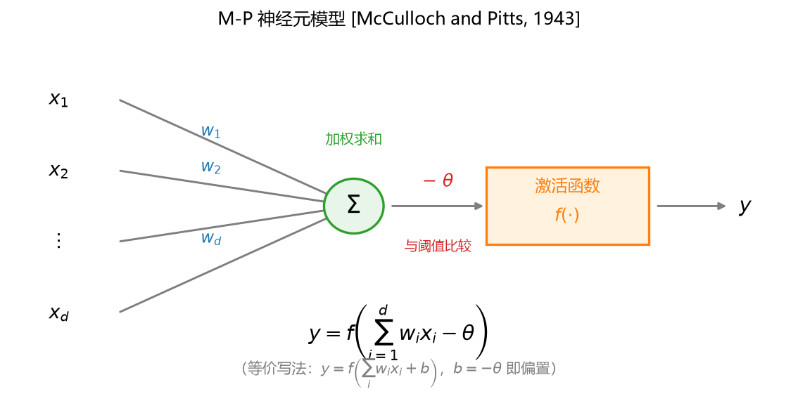

**图 9-4 M-P 神经元模型 [McCulloch and Pitts, 1943]**

用公式表达即

$$y=f\left(\sum_{i=1}^{d} w_i x_i-\theta\right) \tag{9-1}$$

其中 $w_i$ 是第 i 个输入的连接权重，$\theta$ 是阈值，$f(\cdot)$ 是激活函数。若令 $b=-\theta$，则式（9-1）可写成 $y=f\left(\sum_i w_i x_i+b\right)$，其中 $b$ 称为**偏置**（bias）——加减号只是记法问题，两者可以互相换算；写成"减阈值"更贴近生物含义：所有信号进来、加权求和之后，超过了阈值 $\theta$ 神经元才被激活。

注意式（9-1）的一个特点：它**没有指定 f 的具体形式**。这正是与第 6 章"广义线性模型"的连接点——回想 Logistic 回归：若 $y=f(z)$ 的逆函数 $f^{-1}(y)$ 是线性的（如对数几率函数），模型就是广义线性模型。M-P 神经元中的激活函数 f，扮演的正是广义线性模型中联系函数（的逆）的角色。f 的选择留有很大空间，9.4 节将专门讨论。

### 9.2.4 偏置的两种画法

在网络结构图里，偏置有两种等价的画法（图 9-5）：

- **画法一**：偏置 $b$ 直接写在节点内部，作为加权和之后再补上的一个常数；
- **画法二**：在输入端**增加一个恒为 1 的输入节点**，它到该神经元的连接权重恰好等于 $b$。这样 $\sum_i w_i x_i + b \times 1$ 与画法一完全等价。

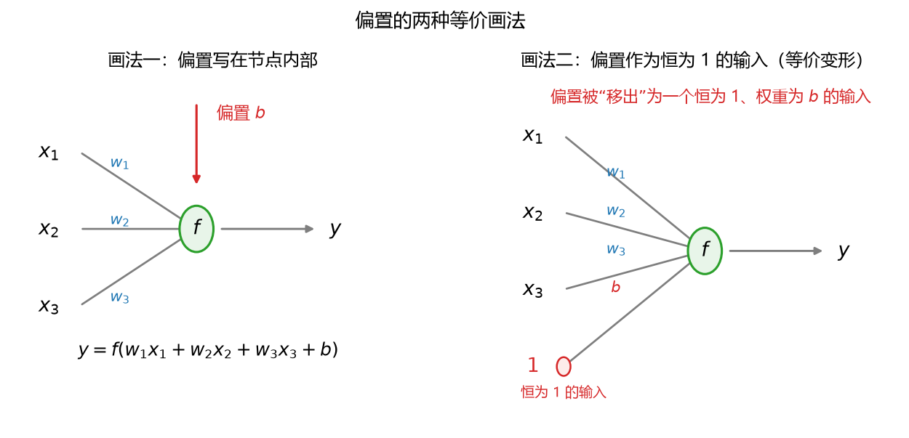

**图 9-5 偏置的两种等价画法**

有些教材或课件的网络图里会"凭空"多出一个恒为 1 的节点，现在读者应该明白：那只是把偏置移出来当作输入画了，与把偏置写在节点内部是一回事。

## 9.3 ANN 发展史

人工神经网络的发展历经三起两落，了解这段历史不仅能记住关键人物与模型，更能理解"为什么是 BP 算法让神经网络起死回生""为什么深度学习直到 2012 年后才爆发"。表 9-2 按三个阶段整理了大事记。

**表 9-2 人工神经网络发展史大事记**

| 阶段 | 年份 | 事件 |
|------|------|------|
| 第一阶段（初创与第一次低谷） | 1943 | McCulloch 和 Pitts 提出第一个神经元数学模型（M-P 模型），并从原理上证明了人工神经网络能够计算任何算术和逻辑函数 |
| | 1949 | Hebb 发表《The Organization of Behavior》，提出生物神经元学习的机理（Hebb 学习规则）：学习发生在神经元之间的突触部位，突触联结强度随突触前后神经元的活动而变化 |
| | 1958 | Rosenblatt 提出感知机（Perceptron）网络模型及其学习规则 |
| | 1960 | Widrow 和 Hoff 提出自适应线性神经元（Adaline）模型和最小均方（LMS）学习算法 |
| | 1969 | Minsky 和 Papert 发表《Perceptrons》一书，指出单层神经网络不能解决非线性问题、多层网络的训练算法尚无希望，神经网络进入**第一次低谷** |
| 第二阶段（复兴与第二次低谷） | 1982 | 物理学家 Hopfield 提出具有联想记忆、优化计算能力的递归网络模型（Hopfield 网络） |
| | 1986 | Rumelhart 等在著作《Parallel Distributed Processing》中报告了**反向传播（BP）算法**，解决了多层网络的训练问题 |
| | 1987 | IEEE 在美国加州圣地亚哥召开第一届神经网络国际会议（ICNN）；随后国内也召开了专门的神经网络学术会议 |
| | 1990 年代初 | 统计学习理论与 SVM 兴起：SVM 有更强的统计理论基础、可证明全局最优，神经网络相形之下理论不清楚、试错性强、难以训练，进入**第二次低谷** |
| 第三阶段（深度学习时代） | 2006 | Hinton 提出深度信念网络（DBN），用"预训练 + 微调"使深度模型的最优化变得相对容易 |
| | 2012 | Hinton 组参加 ImageNet 竞赛，用 CNN 模型以超过第二名 10 个百分点的成绩夺得冠军，深度学习引起轰动 |
| | 之后 | 伴随云计算、大数据时代的到来，计算能力大幅提升，深度学习在计算机视觉、自然语言处理、语音识别、自动驾驶等领域取得突破性进展 |

第三阶段的爆发与一个大故事分不开。华裔计算机视觉学者**李飞飞**在研究图像分类问题时注意到：孩子之所以能逐渐认出万事万物，靠的是每天不断的大量视觉刺激；而当时的图像分类模型普遍只用几百、几千张图片训练——**数据量不够多**可能才是效果不好的主因。于是她推动建设了一个数百万张、带人工标注的图像数据库（ImageNet），并组织年度竞赛让各家模型同台比试。2012 年，Hinton 组的 CNN 模型以领先第二名超过 10 个百分点的优势夺冠，一下子让大家认识到深度神经网络的威力，随后的围棋程序、语音识别、自动驾驶等突破接踵而至。这个故事的启示是：**模型、数据、算力**三者共同造就了深度学习时代。

关于本章内容在课程中的位置：现在讲的是基本的 ANN——把网络层数拉长、深度加深，再加上一些特殊的特征处理方法，就得到深度学习网络；其最基本的计算单元与训练原理和本章一致。深度学习将在支持向量机（SVM）之后再讲。

## 9.4 激活函数

式（9-1）中的 $f(\cdot)$ 称为**激活函数**（activation function），也叫传递函数（transfer function）。理想的激活函数是**阶跃函数**，但阶跃不连续、不光滑，不方便求导；实际最常用的是 Sigmoid 函数一族。逐一介绍如下（图 9-6）。

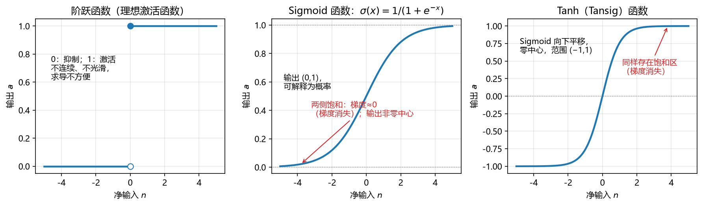

**图 9-6 三种经典激活函数：阶跃、Sigmoid 与 Tanh**

**（1）阶跃函数。**$f(n)=1$ 若 $n\ge 0$，否则 $f(n)=0$。它把输入映射为 0/1，对应神经元的"抑制/激活"两种状态，与生物神经元的"兴奋—不兴奋"机制最接近。但它**不连续、不光滑**——在 $n=0$ 处不可导，而神经网络训练需要反复求导（见 9.7 节），因此并不好用。

**（2）Sigmoid 函数。**$\sigma(n)=1/(1+e^{-n})$，把输入压缩到 (0,1) 区间。它单调可微、任意阶可导，输出可直接解释为概率——这正是第 6 章 Logistic 回归使用的函数。缺点有二：一是**饱和使梯度消失**——当输入接近极大值或极小值时函数几乎水平，这些区域梯度近似为 0，训练缓慢；二是输出**不是零中心**的（输出恒为正），会影响梯度下降的运作。

**（3）Tanh（Tansig）函数。**$\tanh(n)$，可视为 Sigmoid 向下平移缩放的结果，输出范围 (−1,1)、**零中心**，性能通常比 Sigmoid 好；缺点是同样存在饱和区（梯度消失），且计算相对缓慢。

MATLAB 中常用的三个传递函数如图 9-7 与表 9-3 所示。

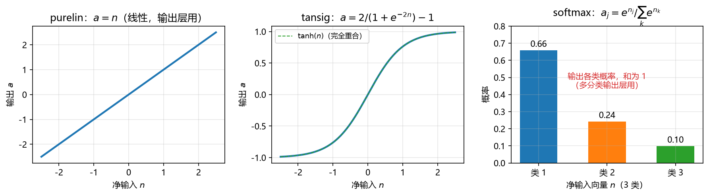

**图 9-7 MATLAB 中的激活（传递）函数：purelin、tansig 与 softmax**

**表 9-3 常用激活（传递）函数及其特点**

| 函数 | 表达式 | 输出范围 | 特点与用途 |
|------|--------|----------|------------|
| 阶跃函数 | $f(n)=1,\ n\ge 0$；否则 0 | {0,1} | 理想激活函数（0 抑制、1 激活）；不连续不光滑，求导不便 |
| Sigmoid | $\sigma(n)=1/(1+e^{-n})$ | (0,1) | 有较好解释性（可作概率）；饱和区梯度消失、输出非零中心 |
| Tanh / Tansig | $2/(1+e^{-2n})-1$（即 $\tanh n$） | (−1,1) | Sigmoid 的平移，零中心；同样饱和梯度消失、计算较慢 |
| purelin | $a=n$ | (−∞,∞) | 线性"直接输出"函数，回归网络的输出层用 |
| softmax | $a_j=e^{n_j}\big/\sum_k e^{n_k}$ | 各类概率，和为 1 | 输出各类别概率，多分类网络的输出层用 |

激活函数怎么选？建议：**隐含层和输出层先都用软件默认**——MATLAB 中做回归的神经网络默认隐含层用 tansig、输出层用 purelin（$y=x$，直接输出浮点数）；做分类的神经网络默认隐含层用 tansig、输出层用 softmax（输出每类概率，哪个类概率高就判哪类）。也就是说，**同一个多层前馈网络，只要把输出层的激活函数变一下，就能在回归与分类之间切换**。如果想自己更换，可以通过网络属性修改（9.8.3 节），甚至自定义函数——没有一般性的规定，关键是保证输出符合任务要求（回归必须输出浮点数，分类输出类别或概率），不确定时用默认即可。

## 9.5 感知机模型

### 9.5.1 单层感知机的结构与功能

1958 年 Rosenblatt 提出的**感知机**（Perceptron）由两层神经元组成——输入层接收外界输入信号并传递给输出层，输出层的神经元就是 M-P 神经元（阈值逻辑单元）。由于输入层只是"转发"不算一层，感知机也被称为**单层感知机**。它的结构比 M-P 模型复杂不了多少：本质上是把 M-P 神经元"网络化"，输入权重显式地画在了图上（图 9-8 上方即一个两输入的感知机对平面的划分）。

感知机虽简单，却被证明能够容易地实现**逻辑与、或、非**运算。以两输入感知机 $y=f(w_1x_1+w_2x_2-\theta)$ 为例，只要恰当设置权重和阈值，就能让它输出"与""或"的真值表（表 9-4、图 9-8）：

**表 9-4 感知机实现"与、或、非"运算的参数设定**

| 运算 | 参数设定 | 真值表 |
|------|----------|--------|
| 与 $x_1 \wedge x_2$ | $w_1=w_2=1,\ \theta=2$（分界线亦可取 $x_1+x_2=1.5$） | 仅 $x_1=x_2=1$ 时输出 1，其余输出 0 |
| 或 $x_1 \vee x_2$ | $w_1=w_2=1,\ \theta=0.5$ | 仅 $x_1=x_2=0$ 时输出 0，其余输出 1 |
| 非 $\neg x_1$ | $w_1=-0.6,\ \theta=-0.5$，即 $y=f(-0.6x_1+0.5)$ | $x_1=0$ 时输出 1；$x_1=1$ 时输出 0 |

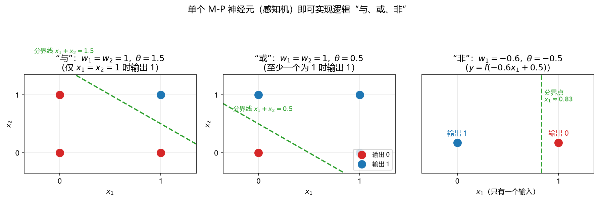

**图 9-8 单个 M-P 神经元（感知机）实现逻辑"与、或、非"运算**

图 9-8 中，"与""或"的四个样本点画在由 $x_1$、$x_2$ 张成的平面里，激活函数取阶跃，直线 $w_1x_1+w_2x_2=\theta$ 就是感知机的**决策边界**：直线上方（加权和超过阈值）输出 1，下方输出 0。"非"只有一维输入，决策边界退化为一个分界点。

### 9.5.2 感知机学习规则

表 9-4 中的权重与阈值是手工设置的；感知机的贡献在于给出了**从数据中学习这些参数**的规则。给定训练样例 $(x, y)$，若当前感知机的输出为 $\hat{y}$，则权重这样调整：

$$w_i \leftarrow w_i+\Delta w_i,\qquad \Delta w_i=\eta\,(y-\hat{y})\,x_i;\qquad \theta \leftarrow \theta+\Delta\theta,\qquad \Delta\theta=-\eta\,(y-\hat{y}) \tag{9-2}$$

其中 $\eta\in(0,1)$ 称为**学习率**。规则的含义非常直观：

- 若感知机对该训练样例**预测正确**（$y=\hat{y}$），则 $\Delta w_i=0$，参数不发生变化；
- 若预测**错误**，则根据错误程度（$y-\hat{y}$ 的大小与方向）对权重进行调整。

从推导上看，这一规则来自让损失随权重下降的梯度思想：对权重求偏导、乘上学习率、叠加到原有权重上，不断迭代即可收敛到误差较小处——它正是 9.7.3 节梯度下降的雏形（BP 算法采用的"广义感知机学习规则"即由此而来）。

关于感知机的学习能力，有如下结论 [Minsky and Papert, 1969]：**若两类模式线性可分，则感知机的学习过程一定会收敛**（求得适当的权值向量）；否则学习过程将会发生震荡、不能求得合适解。"与、或、非"问题都是线性可分的，因此感知机能够解决。

### 9.5.3 能力局限：线性可分与异或问题

单层感知机的表达能力非常有限：它只能表示线性决策边界，**只能解决线性可分问题**。看图 9-9 右侧的**异或（XOR）**问题：四个样本中，(0,0) 与 (1,1) 输出 0，(0,1) 与 (1,0) 输出 1——同类点位于对角线上，无论直线怎么摆，都无法把"输出 1"的两个点和"输出 0"的两个点分开（需要至少两条直线）。因此单层感知机**不能解决异或问题**，一切非线性可分问题对它都是无解的。

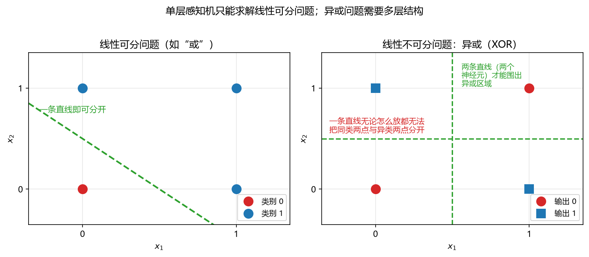

**图 9-9 线性可分问题与线性不可分的异或（XOR）问题**

1969 年 Minsky 与 Papert 在《Perceptrons》一书中正是抓住了这一点：单层网络只能解决线性问题；而多层网络理论上能解决非线性问题，**怎么训练**却没有希望——这一论断使神经网络研究跌入第一次低谷。

### 9.5.4 两层感知机解决异或问题

解决非线性可分问题的出路是**给感知机加一层隐含层**。输出层与输入层之间的那层神经元称为**隐层（隐含层）**；隐含层和输出层的神经元都是具有激活函数的**功能神经元**。图 9-10 给出了一个解决异或问题的两层感知机：

- 隐含层节点 $h_1$ 实现"或"（$w_1=w_2=1,\ \theta=0.5$）：输入中至少有一个 1 时输出 1；
- 隐含层节点 $h_2$ 实现"与"（$w_1=w_2=1,\ \theta=1.5$）：仅当输入全为 1 时输出 1；
- 输出层 $y=f(h_1-h_2-0.5)$：当 $h_1=1, h_2=0$（即"恰有一个输入为 1"）时输出 1，其余输出 0——正是异或。

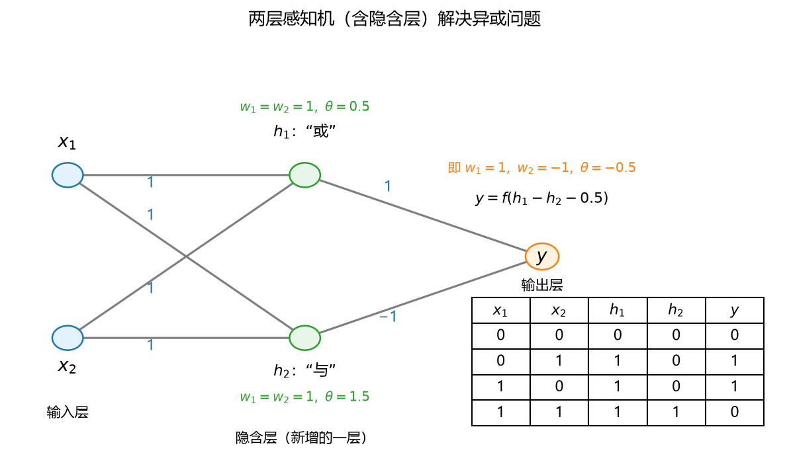

**图 9-10 两层感知机（含隐含层）解决异或问题**

对照真值表（图 9-10 右下）可逐一验证四个输入的输出。这个例子给出的启示是：**加隐含层可以把非线性问题拆成若干线性问题来解决**——每个隐节点学一条线性边界，输出层再把它们组合起来。这也预告了本章的主角：多层前馈神经网络。

## 9.6 多层前馈神经网络

### 9.6.1 定义与别名

**多层前馈神经网络**有很多名字：中文叫多层前馈神经网络、多层前向神经网络、**多层感知机**（Multilayer Perceptron，MLP），又常被称为 **BP 神经网络**（Back Propagation neural network）——四个名字指的是同一种网络。最后一个名字来自它的求解算法：BP（误差反向传播）算法名气太大，以至于人们干脆用算法的名字来称呼这个网络（9.7 节会看到，这个叫法其实并不严格）。

**定义**：多层前馈神经网络中，**每层神经元与下一层神经元全互联，神经元之间不存在同层连接，也不存在跨层连接**。

- **前馈**：输入层接受外界输入，隐含层与输出层神经元对信号进行加工，最终结果由输出层神经元输出——信号单向地"从前往后"流动；
- **学习**：根据训练数据来调整神经元之间的**"连接权"**，以及每个功能神经元的**"阈值"**（偏置）。也就是说，网络中有**两大类参数**：每条连线的**权重**，以及每个功能节点的**偏置**。

"每条连线都有一个权重"很好理解；"每个节点还有一个偏置"请务必记住——9.2.3 节已经讲过，节点把收到的信号求和之后，还要与偏置（阈值）比较才激活，因此隐含层、输出层的每个节点都自带一个偏置参数。

### 9.6.2 网络结构与参数个数

给定一个拥有 $d$ 个输入神经元、$q$ 个隐层神经元、$l$ 个输出神经元的多层前馈网络（以单隐层为例），符号约定如下：

- $v_{ih}$：输入层第 i 个神经元与隐层第 h 个神经元之间的**连接权重**（共 $d\times q$ 个）；
- $w_{hj}$：隐层第 h 个神经元与输出层第 j 个神经元之间的**连接权重**（共 $q\times l$ 个）；
- $\gamma_h$：隐层第 h 个神经元的**阈值**（共 $q$ 个）；
- $\theta_j$：输出层第 j 个神经元的**阈值**（共 $l$ 个）。

四类参数加起来，网络中需要优化的参数总个数为

$$(d\times q)+(q\times l)+q+l=(d+l+1)\,q+l \tag{9-3}$$

例如 $d=4$、$q=5$、$l=1$ 的网络，参数共 $(4+1+1)\times5+1=31$ 个：20 个输入—隐层权重、5 个隐—输出层权重、5 个隐层偏置、1 个输出层偏置。**网络结构一定，参数个数随之确定**；训练要做的就是把这两大类参数求出来。定义中并没有限定隐含层的层数与节点数，但**对中小规模问题，隐含层通常取一层**即可（9.6.3 节给出理论依据）。

### 9.6.3 万能逼近与局限

多层前馈网络有一条非常强的表示能力定理：

> **万能逼近定理 [Hornik et al., 1989]** 只需要一个包含**足够多神经元**的隐层，多层前馈神经网络就能以任意精度逼近任意复杂度的连续函数。

这条定理对中小规模数据是成立的。它的意义在于：此后面对中小规模的任意函数——不管是回归还是分类——都可以放心地用一个（单隐层）多层前馈网络去逼近，不必再为"该选什么模型形式"发愁。

但万能逼近定理也有两点局限，使用时必须清楚：

1. **容易过拟合**。网络表示能力太强，会把训练样本的特殊波动也学下来。典型表现是：**训练误差持续降低，而验证/测试误差却可能上升**。缓解策略见 9.7.7 节；
2. **"足够多"到底是多少没有说清**。定理只保证存在，不给出隐层神经元个数的计算方法。实际应用中通常在"参数总数小于样本数"约束出的上限内用**试错法**调整（9.9.1 节的案例会直观展示隐节点数从 1 到 10 的拟合变化）。

## 9.7 误差反向传播（BP）算法

### 9.7.1 算法框架：先算输出，再传误差

网络结构定了、参数个数定了，剩下最关键的问题就是：**这些参数怎么求出来？** 这就要请出神经网络历史上最著名的算法——**误差反向传播算法**（中文又称误差逆传播算法；英文 Error BackPropagation，简称 **BP**）。它是第一个能成功训练多层前馈神经网络的学习算法——1986 年这一算法发表后，1969 年"多层网络没法训练"的论断被打破，神经网络研究全面复兴。也正因为这个算法名气太大，多层前馈网络常被直接叫作"BP 神经网络"。

BP 是一个**迭代优化算法**，可以按优化问题的三要素来把握：

1. **优化目标**：损失函数最小（回归常用误差平方和/均方误差，分类用错误率）；
2. **决策变量**：待求的全部参数（连接权重与偏置两大类）；
3. **迭代策略**：在每一轮迭代中，采用**广义的感知机学习规则**更新参数——任意的参数 $v$ 的更新估计式为 $v \leftarrow v+\Delta v$。

它的计算流程是"**一前一后**"两趟（图 9-11）：

- **前向传播（从前往后算）**：先随机给定一组初始参数；有了参数，输入信号进入网络后就可以逐层算出每个节点的输出，最终得到网络输出 $\hat{y}$；
- **反向传播（从后往前算）**：把网络输出 $\hat{y}$ 与实际观测 $y$ 比较，算出误差；误差从输出层出发**逐层往回推**，沿途算出每个隐节点的"责任"，进而得到**误差对每个参数的偏导数**（变化率/斜率）；
- **参数更新**：用偏导乘上学习率，按负梯度方向修正参数；再进行下一轮迭代，直到误差足够小或达到最大轮数。

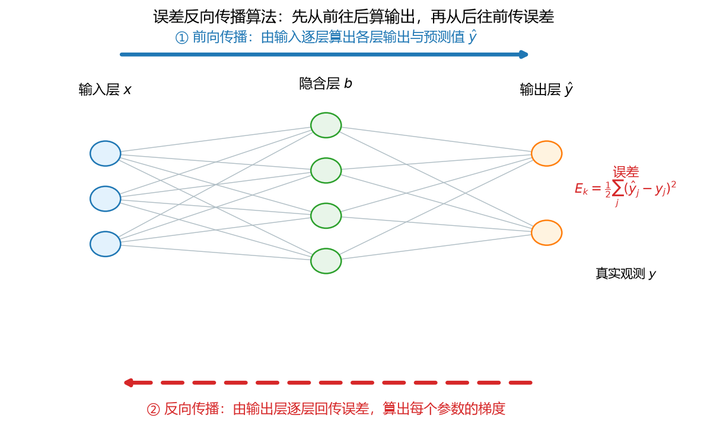

**图 9-11 误差反向传播算法：先从前往后算输出，再从后往前传误差**

"反向传播"的名字即来源于第二趟：**误差**（而不是输入信号）在网络中反向逐层传播，每传一层就得到该层参数的梯度信息。

### 9.7.2 前向计算与损失函数

把 9.6.2 节的记号用起来，前向传播可写成两步。隐含层第 h 个神经元：接收输入的加权和 $\alpha_h=\sum_{i=1}^{d} v_{ih}x_i$，与阈值比较并激活，得到隐层输出

$$b_h=f(\alpha_h-\gamma_h),\qquad h=1,2,\dots,q$$

输出层第 j 个神经元：把隐层输出再加权求和 $\beta_j=\sum_{h=1}^{q} w_{hj}b_h$，同样与阈值比较并激活，得到网络输出

$$\hat{y}_j=f(\beta_j-\theta_j)=f\left(\sum_{h=1}^{q} w_{hj}\,f\Big(\sum_{i=1}^{d} v_{ih}x_i-\gamma_h\Big)-\theta_j\right) \tag{9-4}$$

对第 k 个训练样本 $(\boldsymbol{x}_k,\boldsymbol{y}_k)$，网络输出与真实观测的差异用**损失函数**度量。回归问题常用误差平方和（与第 6 章的残差平方和一脉相承；MATLAB 中默认性能函数取其均方形式 mse）：

$$E_k=\frac{1}{2}\sum_{j=1}^{l}\left(\hat{y}_j^{k}-y_j^{k}\right)^{2} \tag{9-5}$$

分类问题则可取总错误率最小作为目标。要理解 BP 算法，读者不妨带着下面几个问题检查自己（本节依次回答）：损失函数怎么计算、对应的决策变量（参数）有哪几类多少个？参数求解怎么通过迭代获得——初始值怎么来、新的参数怎么由旧的参数迭代出来？损失函数对参数的偏导与迭代方向有什么关系？参数解是唯一的吗、是全局最优的吗？

### 9.7.3 梯度下降与参数更新

**参数更新的总原则**是：任一参数 $v$（某个权重或偏置）都在原值上加一个增量，

$$v \leftarrow v+\Delta v,\qquad \Delta v=-\eta\,\frac{\partial E_k}{\partial v} \tag{9-6}$$

其中 $\eta\in(0,1)$ 是**学习率**，$\partial E_k/\partial v$ 是损失函数对该参数的偏导数（当前点处误差曲面的斜率）。式（9-6）就是**梯度下降**策略：沿误差函数的负梯度方向修正参数。

用单参数的误差曲线看最直观（图 9-12）。设横轴是某个参数 $v$、纵轴是误差 $E(v)$：

- 若当前点落在**左坡**（斜率 $\partial E/\partial v<0$），则 $-\eta\,\partial E/\partial v>0$，参数**右移**，向谷底靠近；
- 若当前点落在**右坡**（斜率 $>0$），则参数**左移**，同样向谷底靠近；
- 每一步移动的距离由偏导的绝对值与学习率共同决定。学习率是人为加上的控制系数：偏导本身给出的步长有时"不过瘾"（太小收敛慢）、有时太大（容易震荡跨过谷底），$\eta\in(0,1)$ 可以把步长整体调大或调小。

如此一步一步迭代，参数沿误差曲面"下坡"，误差越来越小，最终停在梯度为零处。

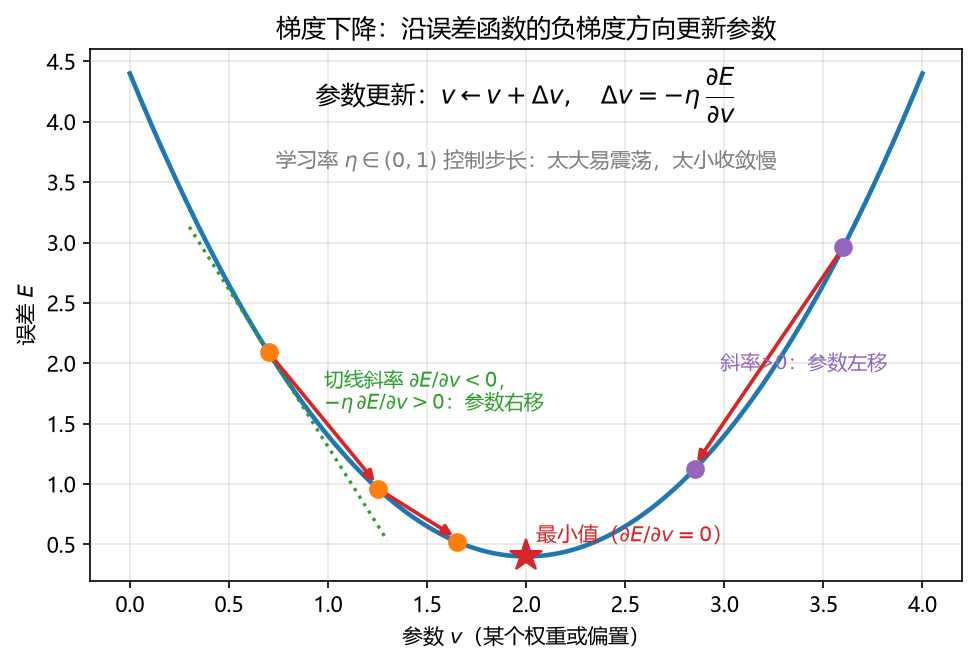

**图 9-12 梯度下降：沿误差函数的负梯度方向更新参数**

### 9.7.4 链式法则与梯度计算

式（9-6）中的偏导 $\partial E_k/\partial v$ 怎么算？网络的参数有几十上百个，若每个参数都从式（9-4）、式（9-5）从头硬算一遍偏导，计算量难以接受。BP 算法的关键是利用**链式法则**：复合函数对变量的偏导可以展开成若干个偏导的**乘积链**，因此**各参数的偏导数之间不是彼此独立的，而是存在层层递推的关系**——算出输出层的梯度，就能顺势推出隐层的梯度，大幅节省计算。

以激活函数取 Sigmoid 为例，推导的最终结果如下（过程从略，感兴趣的读者可据式（9-4）～（9-6）自行验证）。对输出层，先算**输出层梯度项**

$$g_j=(y_j-\hat{y}_j)\,\hat{y}_j\,(1-\hat{y}_j) \tag{9-7}$$

（$\hat{y}_j(1-\hat{y}_j)$ 正是 Sigmoid 的导数），于是隐层到输出层的权重与输出层偏置的更新量为

$$\Delta w_{hj}=\eta\, g_j\, b_h,\qquad \Delta\theta_j=-\eta\, g_j$$

对隐含层，**隐层梯度项**由输出层的梯度"分摊"回来得到——每个隐节点按其连向各输出节点的权重，把误差责任加权求和：

$$e_h=b_h\,(1-b_h)\sum_{j=1}^{l} w_{hj}\, g_j \tag{9-8}$$

于是输入层到隐层的权重与隐层偏置的更新量为

$$\Delta v_{ih}=\eta\, e_h\, x_i,\qquad \Delta\gamma_h=-\eta\, e_h$$

请注意观察式（9-7）、式（9-8）的**结构**：$g_j$ 由输出层的误差直接算出；$e_h$ 里含有 $w_{hj} g_j$——**误差从输出层沿权重反传到隐层**；更新量则都是"梯度项 × 该连接的输入端输出"（$\Delta w_{hj}$ 是 $g_j$ 乘隐层输出 $b_h$，$\Delta v_{ih}$ 是 $e_h$ 乘输入 $x_i$）。看懂这个结构，就理解了"误差反向传播"四个字：**先算输出层的责任，再逐层把责任往回推，责任乘上学习率就是各参数的修正量**。

### 9.7.5 BP 算法的步骤

综上，标准 BP 算法每一轮迭代包含以下步骤：

1. **初始化**：在网络中随机初始化所有连接权重与偏置（取较小的随机值）；
2. **前向计算**：取一个训练样本，依次计算各隐层输出 $b_h$ 与网络输出 $\hat{y}_j$；
3. **计算梯度项**：由输出层误差算出输出层梯度项 $g_j$（式 9-7），再反推出隐层梯度项 $e_h$（式 9-8）；
4. **更新参数**：按式（9-6）～（9-8）更新 $w_{hj},\ \theta_j,\ v_{ih},\ \gamma_h$ 四类参数；
5. **判断终止**：若误差降至设定目标以下、或达到最大迭代轮数则停止；否则回到第 2 步处理下一个样本，继续迭代。

### 9.7.6 标准 BP 与累计 BP

按"每轮更新读多少样本"分，BP 有两个常用版本（表 9-5）：

**表 9-5 标准 BP 算法与累计 BP 算法的对比**

| 版本 | 更新方式 | 特点 |
|------|----------|------|
| 标准 BP 算法 | **每次针对单个训练样例**更新权值与阈值 | 参数更新非常频繁，不同样例的更新可能相互抵消，需要多次迭代 |
| 累计 BP 算法 | 其优化目标是最小化**整个训练集上的累计误差**，读取整个训练集一遍才对参数更新一次 | 参数更新频率较低、更平稳 |

实际应用中，累计误差下降到一定程度后，进一步下降会非常缓慢，这时标准 BP 往往能获得较好的解——尤其当训练集非常大时效果更明显。折中的做法是**小批量（mini-batch）更新**：每次读取一小批（比如 10～20 个）样本，先算出每个样本对应的更新量、**取平均**再加到参数上——既比逐样本平稳，又不必等全数据集读完，是实践中提高效率的常用手段。

### 9.7.7 过拟合问题与缓解策略

BP 算法（连同其网络）有一个众所周知的毛病：**容易过拟合**——9.6.3 节已描述过其表现：训练误差持续降低，但验证/测试误差却可能上升。常用的缓解策略有二：

**（1）早停。**把数据分成训练集与验证集，训练过程中**盯着验证集**：若训练误差还在降低、而验证误差开始升高，说明网络开始"死记"训练样本的特殊性了，此时就停止训练——即使训练误差还没到最小。用曲线表达即图 9-13：验证误差的最低点就是最佳停止点。早停思路简单、代价小，几乎所有软件（包括 MATLAB 的 `train`）都内置了这种机制。

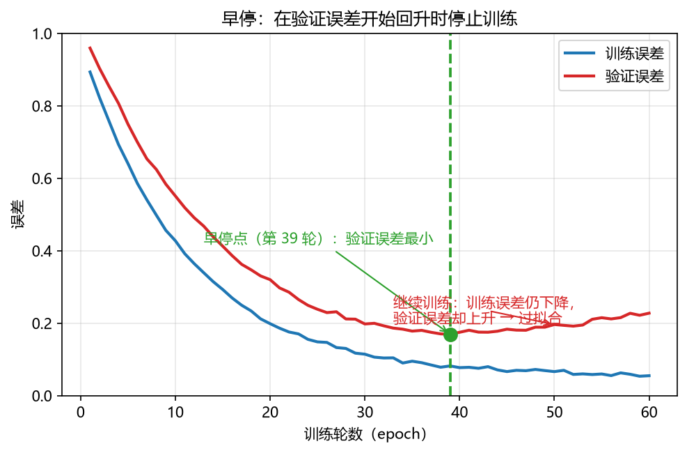

**图 9-13 早停：在验证误差开始回升时停止训练**

**（2）正则化。**误差目标函数只描述了"拟合得好不好"，不能很好地把**模型复杂度**表达进来。正则化的做法是在目标函数中**再增加一项描述网络复杂程度的部分**，例如全部连接权与阈值的平方和：

$$E_{\lambda}=E+\lambda\left(\sum_{i,h} v_{ih}^{2}+\sum_{h,j} w_{hj}^{2}+\cdots\right) \tag{9-9}$$

其中 $E$ 是原来的误差项，$\lambda\in(0,1)$ 权衡"拟合误差"与"网络复杂度"：参数越大、网络越复杂，惩罚越重，从而倾向选择较小的权重、更平滑的解。MATLAB 的 `trainbr`（贝叶斯正则化）算法即属此类（见 9.8.5 节）。

### 9.7.8 局部极小与全局最小

基于梯度的搜索是使用最广泛的参数寻优方法，但它有一个先天局限：**只有当误差函数仅有一个极小点时，找到的局部极小才是全局最小**。真实神经网络的误差函数（关于几十上百个参数）是典型的**多峰曲面**（图 9-14）：梯度为零、且函数值小于邻点的点都是**局部极小**（可能存在多个），而**全局最小只有一个**。梯度下降"顺着坡往下跑"，跑到一个四面都更高的洼地就停了——它可能只是局部洼地，未必是全局最低点。

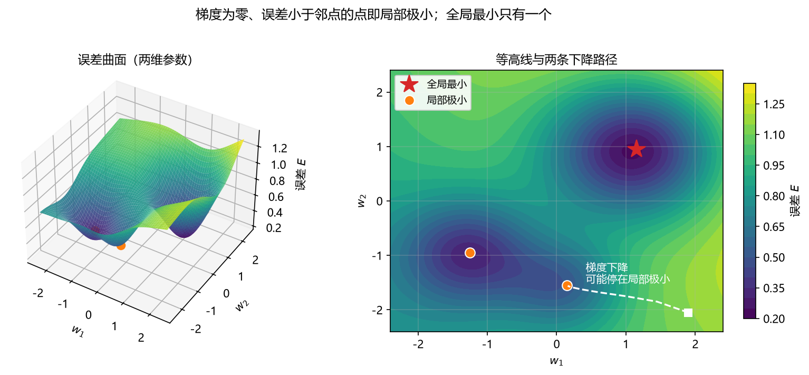

**图 9-14 多峰误差曲面上的局部极小（橙点）与全局最小（红星）**

这就引出一个很实际的问题：**参数求解不唯一，也不能保证全局最优**——同一网络每次训练（初始参数不同）可能收敛到不同的局部极小，这正是"MATLAB 中每次 ANN 的训练结果都不一样"的原因。

### 9.7.9 跳出局部极小的策略

现实任务中通常采用以下策略"跳出"局部极小、尽可能接近全局最小（表 9-6）：

**表 9-6 跳出局部极小的常用策略**

| 策略 | 做法 | 说明 |
|------|------|------|
| 多组不同初始参数 | 用多组随机初始参数分别训练网络，取误差最小的解作为最终参数 | 最朴素也最有效。可进一步做成"格点"式：把参数空间规则地划分为若干份，每份内随机取一个初始点，比纯随机撒点更有覆盖性。MATLAB 每次训练结果不同，多跑几次比较即可 |
| 模拟退火 [Aarts and Korst, 1989] | 每一步都以**一定的概率接受比当前解更差**的结果 | 借助"退火"的物理直觉，允许暂时上坡，从而有助于跳出局部极小 |
| 随机梯度下降 | 与标准梯度下降精确计算梯度不同，在梯度计算中**加入随机因素** | 每步的步长带随机性，可能一步跨出局部洼地（图 9-14 中的大幅跳动），较大概率找到全局最优 |
| 遗传算法 [Goldberg, 1989] | 把参数编码成"染色体"，通过选择、**交叉、变异**等操作直接搜索 | 属不依赖梯度的全局搜索方法，常用来训练神经网络以更好地逼近全局极小 |

这些方法的共同点是：**不（只）依赖梯度，用另一套模拟现实优化过程的策略直接搜索参数空间**。"多算几次、多试几个点"听起来并不高深，但正如上一章所说——不知道的时候**试一试（试错法）**，在实际当中是非常有效的策略。

## 9.8 用 MATLAB 构建 ANN

### 9.8.1 ANN 建模的七个主要步骤

在 MATLAB 中构建一个 ANN 模型，整体流程可分为七个步骤（表 9-7）。其中前两步"收集数据、创建网络"没有太大问题，**比较关键的是中间的三个选择**：根据问题选择**网络类型**（什么样的问题配什么样的网络，9.8.3 节给对照表）、选择**网络结构**（隐含层层数与节点数）、选择**训练算法**（9.8.5 节给建议）。

**表 9-7 ANN 建模的七个主要步骤**

| 步骤 | 内容 |
|------|------|
| 1 收集数据 | 准备输入 X 与输出 Y，并做预处理（标准化、分割训练/验证集） |
| 2 创建网络 | 根据问题和网络功能选择网络类型，生成初始结构 |
| 3 配置网络 | 选择网络结构：隐含层层数、隐节点数、各层激活函数 |
| 4 初始化权重和偏置 | 随机初始化两大类参数（软件自动完成，也可自定义） |
| 5 训练网络 | 选定训练算法（trainFcn），用训练数据求出全部参数 |
| 6 验证网络（训练后的分析） | 检查训练集与验证集的效果，必要时回到第 3 步调整结构——确定最优网络结构 |
| 7 使用网络 | 用训练好的网络对新数据进行预测（sim），解决问题 |

### 9.8.2 基本命令流程

七个步骤落到具体命令上，形成"预处理 → 初始化 → 训练 → 预测 → 评估"五段式（表 9-8）。

**表 9-8 构建 ANN 模型的基本步骤与命令**

| 步骤 | 基本命令 | 功能 |
|------|----------|------|
| 数据预处理 | `mapminmax`（数据标准化） | 将各变量标准化到 [0,1] 或 [−1,1] |
| 数据分割 | `P=data(1:80,:)`；`Q=data(81:100,:)` | 将原始数据分割成训练集 P 和验证集 Q |
| 初始化模型 | `net=newlin`；`newp`；`newlvq`；`newff`；`newc` 或者 `fitnet` | 初始化不同 ANN 的结构 |
| 设置训练参数 | `net.trainParam.* = ...` | 指定特定训练参数（算法、最大轮数、误差目标等） |
| 训练模型 | `[net,tr]=train(net,P,T)` | 训练网络，求出权重与偏置两大类参数 |
| 预测 | `y_train=sim(net,P)`；`y_valid=sim(net,Q)` | 训练集预测、验证集预测 |
| 性能评估 | `corr`、`mse` 以及自定义性能指数 | 训练集和验证集预测性能的评估（含数据后处理） |

两点重要说明：

**（1）数据标准化非常必要。**BP 训练要反复计算"误差对参数的偏导"，而偏导的计算与 X 的取值直接相关——X 的数量级太大会对梯度产生支配性影响，训练不稳定。因此建议**自己动手把数据标准化到 [0,1]（或 [−1,1]）**。如果不做，MATLAB 会在网络内部**强制**做标准化；但自己做、自己心里有数，网络的行为更透明可控。

**（2）数据分割没有太大问题。**与前面各章一致：大部分样本做训练、少部分做验证；网络训练函数内部还会再按比例自动划分训练/验证/测试子集，并用验证误差实施早停（9.7.7 节）。

### 9.8.3 生成不同类型的 ANN

MATLAB 为不同功能的 ANN 各提供了生成命令，且随版本更新做了替换（表 9-9）。

**表 9-9 MATLAB 中生成不同类型 ANN 的命令**

| ANN 模型 | 旧命令 | 新命令 | 功能 |
|----------|--------|--------|------|
| 简单线性模型 | `newlin` | `linearlayer` | 线性预测（一元或多元线性回归） |
| 感知器模型 | `newp` | `perceptron` | 二分类、三分类判别 |
| 学习向量量化（LVQ）模型 | `newlvq` | `lvqnet` | 二分类、三分类判别 |
| 多层 BP ANN | `newff` | `feedforwardnet`、`fitnet`、`fitcnet`、`fitrnet` | 非线性预测（回归）；多分类判别 |
| 竞争型网络 | `newc` | `competlayer` | 聚类（竞争学习；SOM 同属此类，见 `selforgmap`）※ |

※ 课件原表中此行记作"分类判别"；竞争型网络与自组织映射同属竞争学习结构，实际用于聚类，故此处按其功能改为"聚类"。

旧命令中 `newlin`、`newp`、`newff` 的常用调用格式为：

- `net = newlin(P,S,ID,LR)`：线性层。P 为 R×Q 输入矩阵，S 为输出元素个数，ID 为输入延迟（默认 [0]），LR 为学习率（默认 0.01）；
- `net = newp(P,T,TF,LF)`：感知器。P 为输入矩阵，T 为目标矩阵，TF 为传递函数（默认 'hardlim'，即阶跃），LF 为学习函数（默认 'learnp'）；
- `net = newff(P,T,S)`：N 层前馈 BP 网络。P 为输入矩阵，T 为目标矩阵，S 为各隐含层的节点数向量（输出层规模由 T 自动确定）。

**最常用的是多层 BP ANN**，即本章的多层前馈神经网络。新命令按用途细分（表 9-10）。

**表 9-10 多层前馈网络的生成命令与默认激活函数**

| 新命令 | 所属工具箱 | 功能与默认激活函数 |
|--------|------------|--------------------|
| `nftool` | 深度学习 | 使用 GUI 生成用于**回归**的网络 |
| `nprtool` | 深度学习 | 使用 GUI 生成用于**分类**的网络 |
| `nctool` | 深度学习 | 使用 GUI 生成用于**聚类**的网络 |
| `feedforwardnet` | 深度学习 | 回归（隐含层 tansig；输出层 purelin：y=x 函数） |
| `patternnet` | 深度学习 | 分类（隐含层 tansig；输出层 softmax） |
| `selforgmap` | 深度学习 | 聚类（自组织映射） |
| `fitnet` | 深度学习 | 非线性回归；多分类判别 |
| `fitcnet` | 统计与机器学习 | 多分类判别 |
| `fitrnet` | 统计与机器学习 | 非线性回归 |

对比表中回归与分类两类命令可以发现：**两者只有输出层激活函数不同**——回归输出层 purelin（直接输出浮点数），分类输出层 softmax（输出各类概率，哪个类别概率高就属于哪个）。也就是说，多层前馈网络做回归和做分类的"底子"完全一样，主把输出函数变一下就完成了切换。为方便不熟悉命令行的用户，MATLAB 还提供了三个 GUI 工具（`nftool`、`nprtool`、`nctool`），从界面里选选参数即可完成神经网络建模。

关于激活函数与预处理的自动处理：大多数网络创建函数会**自动分配激活函数**，并自动完成归一化等预处理与反归一化等后处理。创建网络之后，可以通过修改网络属性覆盖默认值，例如 `net.inputs{1}.processFcns`（输入预处理函数）、`net.outputs{2}.processFcns`（输出处理函数），以及对应的 `net.inputs{1}.processParams{i}` 参数；部分处理函数还允许自定义运算。激活函数本身同理——默认的"回归 tansig+purelin、分类 tansig+softmax"三件套已经足够好，想更换时先试、看效果再定（9.4 节）。

### 9.8.4 train 与 sim 函数

网络结构定义好之后，训练用 `train`，预测用 `sim`（表 9-11、表 9-12）。

**表 9-11 train 函数的调用形式**

| 调用形式 | 含义 |
|----------|------|
| `trainedNet = train(net,X,T,Xi,Ai,EW)` | 训练网络（net），根据 `net.trainFcn` 和 `net.trainParam` 指定的算法与参数 |
| `[trainedNet,tr] = train(net,X,T,Xi,Ai,EW)` | 返回训练后的网络和训练记录 tr（各轮误差等信息） |
| `[trainedNet,tr] = train(net,X,T,Xi,Ai,EW,Name,Value)` | 由一个或多个 Name,Value 成对参数指定附加选项 |

输入变量中：**net** 为网络结构体；**X** 为网络输入（训练集自变量）；**T** 为网络目标（训练集因变量）；Xi、Ai 分别为初始输入/层延迟条件（默认全零）；EW 为误差权重。注意：`train` 用来训练**浅层**神经网络（本章的 ANN）；`trainNetwork` 则用于训练 LSTM、CNN 等深度学习网络（深度学习章节再讲）。

**表 9-12 sim 函数的用法**

| 项目 | 内容 |
|------|------|
| 功能 | 模拟（仿真）神经网络：给定输入，计算网络输出 |
| 形式 | `[Y,Xf,Af] = sim(net,X,Xi,Ai,T)` |
| net | 已训练好的网络 |
| X | 输入变量（待测样本的自变量；如 Q） |
| Y | 网络输出（待测样本的预测值） |
| Xf、Af | 最终输入/层延迟条件 |
| T | 目标（可选） |

训练与预测组合成最常用的三行代码：`net = fitnet(...)` 建网络 → `[net,tr] = train(net,P,T)` 训练 → `Y = sim(net,Q)` 预测。

### 9.8.5 训练算法及其选择

`train` 函数按 `net.trainFcn` 指定的算法训练网络。先澄清一个叫法问题：**"反向传播"常被特指为梯度下降算法，这个说法并不严格**——MATLAB 中**所有** ANN 训练函数都要在网络中"反向执行计算"来求出梯度和 Jacobian 矩阵（这正是微积分链式法则的运用），"反向传播"只是这一共性步骤的名称。因此，与其笼统地说"用 BP 算法训练"，不如**指明具体优化算法的名称**（如 trainlm、trainscg）。类似地，"多层网络称为 BP 网络"也不严格——反向传播计算可用于多种网络结构，任何具有可微传递函数的网络都能这样求梯度。

MATLAB 提供的训练算法函数见表 9-13。其中最经典的是 `traingd`（梯度下降）——它就是 9.7.3 节的算法本身：$x_{k+1}=x_k-\alpha_k g_k$，其中 $x_k$ 是当前权重和偏置构成的向量，$g_k$ 是当前梯度（损失函数对参数的偏导），$\alpha_k$ 是学习率，一直迭代直到网络收敛。这也是 BP 最初的形式。

**表 9-13 MATLAB 的 ANN 训练算法函数**

| 函数 | 算法 |
|------|------|
| `trainlm` | Levenberg-Marquardt |
| `trainbr` | 贝叶斯正则化 |
| `trainbfg` | BFGS 拟牛顿 |
| `trainrp` | 弹性反向传播 |
| `trainscg` | 量化共轭梯度（scaled conjugate gradient） |
| `traincgb` | 带 Powell/Beale 重启的共轭梯度 |
| `traincgf` | Fletcher-Powell 共轭梯度 |
| `traincgp` | Polak-Ribiére 共轭梯度 |
| `trainoss` | 单步正割 |
| `traingdx` | 可变学习率梯度下降 |
| `traingdm` | 带动量的梯度下降 |
| `traingd` | 梯度下降 |

这么多算法怎么选？对于给定的问题，很难先验地知道哪种训练算法最快——**算法选择取决于许多因素**：问题复杂性、训练集中数据点的数量、网络中权重和偏置的数量、误差目标，以及功能（模式识别/分类，还是函数逼近/回归）。这些算法都在"标准数值优化"框架下最小化性能函数（前馈网络默认损失函数为**均方误差 mse**——网络输出 a 与目标输出 t 之间的平均平方误差），或使用性能关于权重的**梯度**，或使用误差关于权重的 **Jacobian 矩阵**。结合 MATLAB 官方建议与使用经验，给出如下推荐（表 9-14）。

**表 9-14 多层前馈网络训练算法的选择建议**

| 问题类型 | 推荐算法 | 理由与特点 |
|----------|----------|------------|
| 中小规模回归 | `trainlm` 或 `trainbr` | LM 通常是最快的训练函数，也是多层前馈网络的**默认**算法；函数拟合（非线性回归）性能优于模式识别，常能获得比其他算法更低的均方误差，需要高精度训练时优势尤其明显。贝叶斯正则化 `trainbr` 结合了正则化思想（9.7.7 节），回归问题值得一试（作者经验：效果常常不错） |
| 中小规模分类 | `trainrp` | 弹性反向传播是模式识别问题上最快的算法；误差目标降低时性能有所下降；内存要求相对较小 |
| 大规模回归/分类 | `trainscg` | 共轭梯度在各种问题上都表现良好，特别是权重数量多的网络；函数逼近上几乎与 LM 一样快（大型网络更快），分类上几乎与 trainrp 一样快；内存要求适中、误差减小时性能稳定 |
| 需要慢训练（配合早停） | `traingdx` | 可变学习率梯度下降通常慢得多，但收敛慢有时反而好：使用早停法时，收敛过快的算法可能错过验证集误差最小的点，得到不一致的结果 |

两点补充：其一，`trainlm` 与 `trainbfg` 对**大型网络**（数千个权重）往往效率较低——LM 需要更多内存与计算时间，BFGS 虽比 LM 省内存，但每次迭代要计算等效逆矩阵、计算量随网络规模几何增长；其二，"默认的算法不一定是对特定问题最优的算法"——特定问题常存在某个收敛更快、解更逼近最优的改进算法，鼓励读者针对自己的问题多试几种。

## 9.9 案例研究

课件中的示例程序均取自 MATLAB 官网与数理统计教材，课堂上不再逐一演示，请读者课后自行运行体会。这里给出两个最小案例（配套脚本 `ANN_exp01_regression.m`、`ANN_exp02_iris_patternnet.m`），分别演示回归与分类的完整流程。

### 9.9.1 案例一：一元非线性函数的 BP 网络回归

**问题**：用 1-8-1 的多层前馈网络（1 个输入节点、8 个 tansig 隐节点、1 个 purelin 输出节点）拟合非线性关系 $y=\sin x+0.16x$，数据含噪声。图 9-15 左图为拟合效果；右图把隐节点数 q 分别取 1、3、10 作对比——q=1 时网络只能做一次弯曲，明显**欠拟合**；q=3 时基本贴合；q=10 时充分逼近真实关系。这组图直观展示了万能逼近定理（"足够多神经元即可逼近连续函数"）与"隐节点数用试错法确定"（9.6.3 节）的含义。

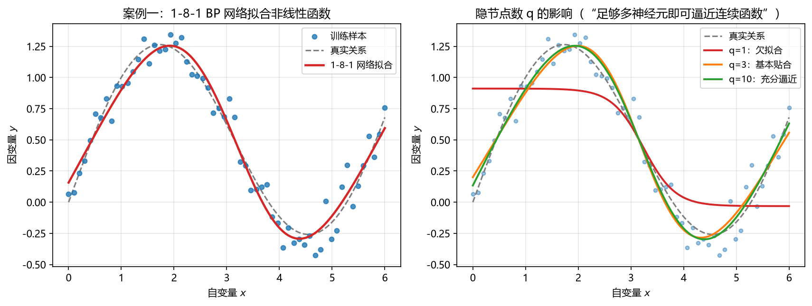

**图 9-15 案例一：1-q-1 BP 网络拟合非线性函数（左：q=8 拟合效果；右：q=1、3、10 对比）**

MATLAB 实现（`fitnet` + `trainlm` + `train` + `sim`）：

```matlab
%% 案例1：一元非线性函数的 BP 网络回归（fitnet + trainlm + train + sim）
clear; clc;

% 1) 生成模拟数据：y = sin(x) + 0.16x + 噪声（与图 9-15 一致，种子 42）
rng(42);
x = linspace(0, 6, 60)';                       % 60×1 自变量
y = sin(x) + 0.16*x + 0.10*randn(size(x));     % 60×1 因变量

% 2) 数据分割：前 48 个训练，后 12 个验证（行向量 = 样本）
P = x(1:48)';      T = y(1:48)';               % 训练集
Q = x(49:60)';     V = y(49:60)';              % 验证集

% 3) 创建 1-8-1 多层前馈网络：隐层 tansig，输出层 purelin
net = fitnet(8);                    % 隐含层 8 个节点
net.trainFcn = 'trainlm';           % 中小规模回归：推荐 trainlm / trainbr
net.trainParam.epochs = 500;        % 最大训练轮数
net.trainParam.goal   = 1e-4;       % 误差目标（均方误差）

% 4) 训练（BP 类算法自动完成前向计算与误差反向传播）
[net, tr] = train(net, P, T);

% 5) 预测与性能评估
y_fit_train = sim(net, P);          % 训练集预测
y_fit_valid = sim(net, Q);          % 验证集预测
fprintf('训练集 MSE = %.4f，R = %.4f\n', ...
        mse(y_fit_train - T), corr(y_fit_train, T));
fprintf('验证集 MSE = %.4f，R = %.4f\n', ...
        mse(y_fit_valid - V), corr(y_fit_valid, V));

% 6) 可视化
figure; hold on;
xx = linspace(0, 6, 200)';
plot(x, y, 'k.', 'MarkerSize', 10);                      % 全部样本
plot(xx, sin(xx) + 0.16*xx, 'k--', 'LineWidth', 1.2);    % 真实关系
plot(xx, sim(net, xx'), 'r-', 'LineWidth', 1.8);         % 网络拟合
xlabel('自变量 x'); ylabel('因变量 y');
legend('样本', '真实关系', '1-8-1 网络拟合', 'Location', 'northwest');
```

运行说明：训练/验证的 MSE 与相关系数会随运行略有不同——`rng(42)` 固定了数据，但**网络的初始权重仍是随机的**，每次训练可能收敛到不同的局部极小（9.7.8 节）。若效果不满意，可多训练几次、或改用 `trainbr`、或调整隐节点数（`fitnet([8])` 中改数字）后对比验证集表现。

### 9.9.2 案例二：鸢尾花的 BP 网络多分类

**问题**：对第 7 章使用过的 Fisher 鸢尾花数据集（150 个标本、4 个属性、3 个品种）做 BP 网络分类。分类网络的关键准备工作是把品种标签转为 **one-hot 目标向量**（`ind2vec`）：3 类对应 3 个输出节点，第 c 类的目标向量在第 c 行为 1、其余为 0；训练后 `sim` 输出三类的概率（每列和为 1），`vec2ind` 取最大者即为预测类别。

```matlab
%% 案例2：Fisher 鸢尾花的 BP 网络多分类（patternnet + trainscg + train + sim）
clear; clc;

% 1) 载入内置数据集
load fisheriris                        % meas: 150×4 测量值；species: 150×1 品种名

% 2) 整理为网络输入/目标：列向量 = 样本；目标为 one-hot 编码
X = meas';                             % 4×150
labels = grp2idx(species);             % 品种名 → 1/2/3
T = ind2vec(labels');                  % 3×150 目标向量

% 3) 创建分类网络：隐层 tansig（10 节点），输出层 softmax
net = patternnet(10);                  % 中小规模分类建议 'trainrp'，
net.trainFcn = 'trainscg';             % 大规模分类/回归建议 'trainscg'

% 4) 训练（内部按比例随机划分训练/验证/测试，并自动应用早停）
[net, tr] = train(net, X, T);

% 5) 预测：sim 输出各类概率（每列和为 1），取最大者为类别
Y    = sim(net, X);                    % 3×150
pred = vec2ind(Y);                     % 概率最大的类别编号

fprintf('第 1 个样本的类概率：setosa=%.3f，versicolor=%.3f，virginica=%.3f\n', ...
        Y(1,1), Y(2,1), Y(3,1));

% 6) 性能评估：回代正确率与混淆矩阵
accuracy = mean(pred == labels);
fprintf('回代正确率 = %.2f%%\n', 100*accuracy);
figure; plotconfusion(T, Y);           % 三类混淆矩阵
```

运行后可看到：`Y` 的每一列是三个接近 0/1 的概率值，softmax 保证了三列概率之和为 1——例如某样本可能输出 setosa 0.98、versicolor 0.01、virginica 0.01，即判为 setosa。全数据回代的正确率一般在 97%～99% 之间（少数 versicolor 与 virginica 边界样本会互相错分，与第 7 章 kNN 的结果可以对照看）。程序需要 Deep Learning Toolbox（`patternnet`、`plotconfusion`）；`grp2idx` 来自统计与机器学习工具箱。

## 9.10 本章小结

人工神经网络名字很响，本章把它拆解为"结构 + 算法"两件事来学。要点归纳如下：

1. **定位与定义**：ANN 借鉴生物神经网络（多路输入、突触强弱、阈值激活）构造，是机器学习与神经网络两学科的交叉；由适应性简单单元广泛并行互连而成（Kohonen 定义）。功能上横跨回归、分类，变形（SOM）可做聚类，是极通用的方法家族。
2. **发展史**：三起两落——1943 M-P 模型 → 1969《Perceptrons》指出单层不能解非线性、多层无法训练（第一次低谷）→ 1986 BP 算法解决多层网络训练 → 1990s SVM 兴起（第二次低谷）→ 2006 DBN"预训练+微调"、2012 ImageNet 夺冠开启深度学习时代。模型、数据、算力三者缺一不可。
3. **三种经典结构**：M-P 神经元（$y=f(\sum w_ix_i-\theta)$，激活函数对应广义线性模型的联系函数）→ 感知机（可实现与/或/非，学习规则 $\Delta w_i=\eta(y-\hat{y})x_i$，只能解线性可分问题）→ 多层前馈神经网络（全连接、无同层无跨层连接；隐节点数用户选择；参数总数 $(d+l+1)q+l$，两大类：权重与偏置）。
4. **万能逼近与局限**：单隐层足够多神经元即可任意精度逼近连续函数 [Hornik et al., 1989]；代价是易过拟合（训练误差降、测试误差升），隐节点数无公式、靠试错。
5. **激活函数**：阶跃（理想但不可导）、Sigmoid（可作概率、饱和梯度消失、非零中心）、tansig（零中心）、purelin（回归输出层）、softmax（分类输出层，输出各类概率）。回归默认 tansig+purelin，分类默认 tansig+softmax——只差输出层。
6. **BP 算法**：先**前向**算出各层输出与预测值，再**反向**回传误差、用链式法则递推各参数梯度（$g_j$、$e_h$），按负梯度加学习率更新（$\Delta v=-\eta\,\partial E/\partial v$）。学习率控制步长，太大震荡、太小过慢。标准 BP 逐样本更新、累计 BP 全集更新，折中用 mini-batch。
7. **两个经典问题的对策**：过拟合——早停（验证误差回升即停）与正则化（目标函数加权重平方和惩罚）；局部极小——多组初始参数（含格点式撒点）、模拟退火、随机梯度下降、遗传算法。"多试几次"朴素而有效。
8. **MATLAB 实现**：七步骤（收集数据→创建→配置→初始化→训练→验证→使用）；五段命令（`mapminmax` 预处理、`fitnet`/`patternnet` 等建网、`net.trainParam.*` 设参、`[net,tr]=train(net,P,T)` 训练、`sim(net,Q)` 预测、`corr`/`mse` 评估）；训练算法按问题选——中小规模回归 `trainlm`/`trainbr`、中小规模分类 `trainrp`、大规模 `trainscg`、配合早停的慢训练 `traingdx`。注意"反向传播"是所有训练函数共用的梯度计算过程，指明具体算法名更准确。
9. **案例**：1-q-1 网络拟合非线性函数（q=1 欠拟合、q=10 充分逼近）；鸢尾花多分类（`ind2vec` one-hot 目标 + softmax 输出概率 + `vec2ind` 判类）。

本章的神经网络还是"两层或三层"的浅层结构。最近十几年把隐含层层数加深、加上特殊的特征处理方法，就得到了深度学习网络——其最基本的单元与训练原理与本章完全一致，学完 SVM 之后我们将正式进入深度学习。

## 9.11 思考题

1. 人工神经网络是怎样发展起来的？三个阶段各以什么事件为标志？两次低谷分别是什么原因？
2. 什么是人工神经网络？它与生物神经网络的对应关系体现在哪些方面？
3. 人工神经网络有哪几种常用类型？各适合解决什么类型的问题？
4. M-P 神经元模型、感知机与多层前馈神经网络的结构和功能有何联系与区别？多层前馈网络为什么能解决异或这样的非线性问题？
5. 常用激活函数有哪些？各自的优缺点与适用场合（尤其是回归与分类网络的输出层）是什么？
6. BP 算法为什么必须"先前向、再反向"两个方向各算一遍？链式法则在其中起什么作用？
7. 标准 BP 算法与累计 BP 算法有什么区别？各适合什么场景？mini-batch 是怎样折中的？
8. 神经网络为什么容易过拟合？早停与正则化分别是怎样缓解过拟合的？
9. 梯度下降为什么会陷入局部极小？有哪些跳出局部极小、逼近全局最小的策略？
10. 怎么用 MATLAB 构建 ANN 模型（七个步骤、主要命令）？怎么评估一个 ANN 模型？怎么才能训练出一个好的 ANN 模型？

## 9.12 延伸阅读

1. 具有其他结构和功能的人工神经网络还有哪些？ANN 处理时序数据（如水文时间序列）有什么特殊性（RNN、LSTM）？ANN 处理图像（CNN）与大数据、与并行计算的关系是怎样的？——这些问题将在深度学习一章展开，读者可先行检索。
2. MATLAB 官网：选择神经网络输入输出处理函数
   <https://ww2.mathworks.cn/help/deeplearning/ug/choose-neural-network-input-output-processing-functions.html>
3. MATLAB 官网：多层神经网络架构
   <https://ww2.mathworks.cn/help/deeplearning/ug/multilayer-neural-network-architecture.html>
4. MATLAB 官网：选择多层神经网络训练函数
   <https://ww2.mathworks.cn/help/deeplearning/ug/choose-a-multilayer-neural-network-training-function.html>
5. 推荐慕课：
   浙江大学《机器学习》 <https://www.icourse163.org/learn/ZJU-1206573810>；
   浙江大学《机器学习与人工智能》 <https://www.icourse163.org/learn/ZJU-1206689820>；
   中国地质大学《机器学习》 <https://www.icourse163.org/learn/CUG-1003556007>
6. 周志华《机器学习》（清华大学出版社）第 5 章"神经网络"——本章公式与推导的经典参考。

> 本章插图依据本讲课件《机器学习与地学应用·第九讲 人工神经网络》的内容重绘。


