# 第10章 支持向量机

> **本章导读**：本书第 9 章末尾提到，神经网络在 20 世纪 90 年代陷入第二次低谷，正是在那段时间，支持向量机（Support Vector Machine，SVM）兴起并成为 2000 年前后最流行的机器学习方法。SVM 最有特色之处在于"映射函数"：通过把样本映射到更高维的特征空间，让原本线性不可分的问题变得线性可分。它既能做分类（SVC），也能做回归（SVR），线性和非线性问题都可处理。本章先从"哪条分割线最好"的实例讨论出发，引出最大间隔超平面与支持向量这两个核心概念；随后回顾 SVM 从广义肖像算法到软边距非线性 SVM 的发展史；再按"线性可分 → 凸二次优化 → 对偶问题 → 核函数 → 软间隔 → 支持向量回归"的顺序讲清求解思路的层层改进；最后给出用 MATLAB 构建 SVM 的完整流程与两个案例。

## 10.1 方法体系中的 SVM

### 10.1.1 方法总表中的位置

按照本书的惯例，先回到"数据挖掘/机器学习的典型方法"总表，看看本章方法所处的位置（表 10-1 中加粗部分）。

**表 10-1 数据挖掘/机器学习的典型方法**

| 类别 | 聚类 | 降维 | 回归 | 分类 |
|------|------|------|------|------|
| 线性方法 | — | 相关性分析、主成分分析、因子分析 | 多元线性回归 | Logistic 回归、判别分析 |
| 最近邻 | k 均值聚类 | — | kNN | kNN |
| 树型 | 层次聚类 | — | 决策树 | 决策树 |
| 密度 | DBSCAN | — | — | — |
| 神经网络 | 自组织映射（SOM） | — | ANN | ANN |
| 核函数 | — | — | **SVR** | **SVC** |
| 图论 | 谱聚类 | — | 概率图模型 | 概率图模型 |
| 随机变量 | 高斯混合模型 | — | — | 贝叶斯分类 |
| 模糊数 | 模糊 C 均值聚类 | — | 模糊逻辑模型、ANFIS | 模糊逻辑模型 |
| 深度学习 | — | — | CNN、LSTM | CNN |

从表中可以看到，SVM 在总表里独占"核函数"一行：它横跨回归与分类两种功能——做分类时称为支持向量分类（SVC），做回归时称为支持向量回归（SVR）。核函数正是本章的主角之一：很多教材、很多课程讲 SVM 时主要讲它做分类，本章会讲清楚它同样可以做回归，是一个相当通用的方法。

### 10.1.2 SVM 的定义与功能

**支持向量机**（Support Vector Machine，SVM）是一类按监督学习方式对数据进行二元分类的广义线性分类器，其决策边界是对学习样本求解的**最大间隔超平面**（maximum-margin hyperplane）。

这个定义有几点值得展开：

- **按监督学习方式**：训练样本带有类别标签 $y$，属于本书"回归—分类"这一类有监督问题；
- **二元分类**：SVM 最初、也是最经常被使用的场合是二元分类（$y$ 取两个值）。多类分类需要在此基础上做推广（见 10.5.1 节）；
- **广义线性分类器**：形式上决策边界仍是线性的（超平面），但通过映射函数可以把非线性问题转化为高维空间中的线性问题（见 10.2.5 节与 10.5.3 节），"广义"二字正是由此而来；
- **最大间隔超平面**：决策边界不是随便一条能分开两类的线，而是让"间隔"最大的那条，这是 SVM 最核心、最有特色的概念，10.2 节将从实例讲起。

与决策树的命名方式完全类似（决策树做分类叫分类树、做回归叫回归树），SVM 做分类与做回归各有简称：

- **支持向量分类** SVC = Support Vector Classification；
- **支持向量回归** SVR = Support Vector Regression。

SVC 与 SVR 本质上是同一套思想在两类问题上的细化，学完本章读者会发现，从分类推广到回归所借助的，正是 SVM 里两个最有特色的概念——软间隔与核函数。

## 10.2 从实例看 SVM

### 10.2.1 哪条分割线最好？

先看一个最简单的二维二分类例子（图 10-1）：平面上有两类点（圆点与方块），现在要找一条直线把两类分开。支持向量机的出发点，就是要在二维平面里"做一条直线"把两个类别分开。

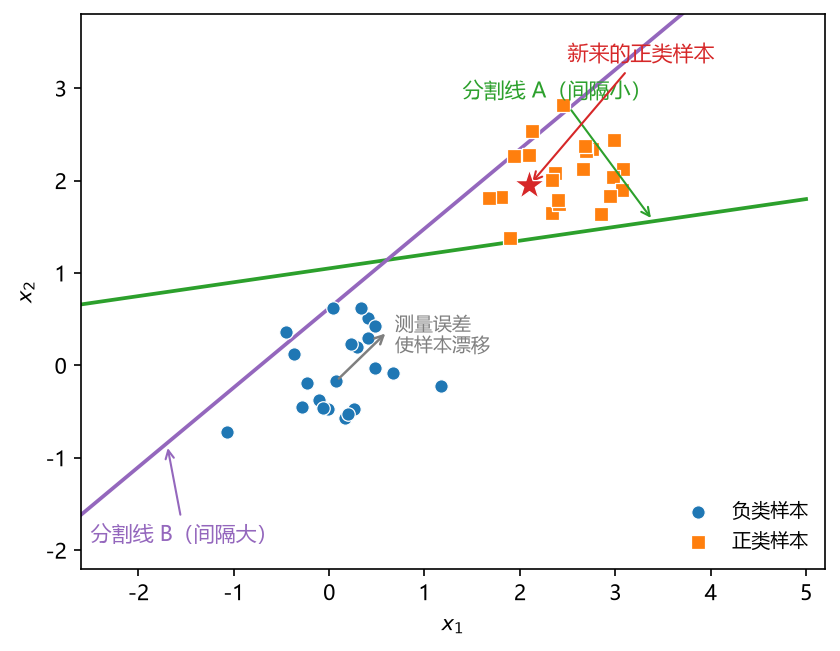

**图 10-1 同样的两类样本，哪条分割线更好？**

课堂上把这个问题抛给大家时，有同学认为分割线 A 更好，也有同学认为 B 更好。如果**数据就只有眼前这些、以后不再变化**，那么 A、B 两条线都能把两类完全分开，效果没有太大差别。但现实问题中还有两个题目没有明说、却必然存在的隐含假设：

1. **坐标有测量误差**。这些点的 $x$ 坐标（特征值）是测出来的，你看到的坐标与真实坐标之间是有偏差的。如果分割线贴某个点太近，该点稍有偏差就可能"掉到线的另一边"，被分错。
2. **将来会有新数据**。分类模型不是只给现有样本用，还要对未知数据进行分类。新样本会继续出现在这片二维区域上，而且可能出现在类别边界附近。

把这两个假设考虑进来，答案就清楚了：**分割线 B 更好**。B 这条线如果数据点有一点点偏差，仍然能分开；而 A 贴得太近，样本稍有漂移就可能落到 A 的另一侧。对新样本同理：新点稍微"越界"一点，B 仍然分得对，A 就可能分错。

看似只要"在两类之间画一条线"这么简单的事情，加上现实假设之后，这条线其实很有讲究——它不再唯一，需要精挑细选，找一条比较理想的。**怎么挑？** 有人提出了一种划分方法：让这条线两侧的"空白带"尽可能宽。这正是 SVM 的核心思想：**最大化间隔**。

### 10.2.2 最大间隔超平面与支持向量

把上一节的直觉变成数学形式。设要求解的分割线（决策边界）用向量形式表达为

$$\omega^{T}x+b=0 \tag{10-1}$$

其中 $x$ 是样本的特征向量，$\omega$ 是参数向量（法向量，垂直于该超平面的方向），$b$ 是截距。让这条线向两侧数据点平行移动，移动到**第一次接触到数据点**时各停一条，得到两条边界线，称为**间隔边界**：

- 上（右）间隔边界：$\omega^{T}x+b=+1$；
- 下（左）间隔边界：$\omega^{T}x+b=-1$。

要求解的决策边界最终取的是这两条间隔边界**正中间**的平行线，即式（10-1）。

有两个细节值得说清楚，它们在初学时容易让人困惑。

**第一，为什么恰好取 $+1$ 和 $-1$？** 这只是一个"不失一般性"的约定：$+1$ 与 $-1$ 本来可以是任意常数 $c$ 与 $-c$，把方程两边同除以 $c$（$\omega$ 与 $b$ 相应缩放），就化成了 $+1$ 与 $-1$ 的形式。取 1 完全是为了表达式简洁，同时不失一般性；后面的推导也会看到，这个约定能让间隔的计算非常干净。至于上边界取 $+1$ 还是 $-1$，两类样本谁为正谁为负，都可以互换，只是记号问题。

**第二，间隔等于多少？** 两条间隔边界之间的距离（间隔，margin）已经有人证明了，它等于

$$\gamma=\frac{2}{\left\| \omega \right\|} \tag{10-2}$$

其中 $\left\| \omega \right\|=\sqrt{\omega_1^{2}+\omega_2^{2}+\cdots+\omega_p^{2}}$ 是 $\omega$ 的模（向量长度，即向量到原点的距离），$p$ 是特征个数。

式（10-2）的证明用到的只是"点到直线的距离"这个初中公式。以二维为例，点 $(x_1^{\*},x_2^{\*})$ 到直线 $\omega_1 x_1+\omega_2 x_2+b=0$ 的距离为

$$r=\frac{\left| \omega_1 x_1^{\*}+\omega_2 x_2^{\*}+b \right|}{\sqrt{\omega_1^{2}+\omega_2^{2}}}=\frac{\left| \omega^{T}x^{\*}+b \right|}{\left\| \omega \right\|} \tag{10-3}$$

现在把一个**落在间隔边界上的样本点**代入式（10-3）：因为它落在 $\omega^{T}x+b=\pm 1$ 的边界上，分子 $\left| \omega^{T}x+b \right|=1$，于是它到决策边界的距离是 $1/\left\| \omega \right\|$。两条间隔边界各贡献一侧的 $1/\left\| \omega \right\|$，加起来就是式（10-2）的 $2/\left\| \omega \right\|$。这个推导同时也说明：**决策边界处于间隔的正中间，到两侧支持向量的距离相等**——因为它本来就是两条间隔边界正中间的那条平行线。

图 10-2 画出了完整的几何图景：红色实线是决策边界（式 10-1），两条灰色虚线是间隔边界（$\pm 1$），红色双箭头标出间隔 $\gamma=2/\left\| \omega \right\|$，绿色箭头则标出一个支持向量到决策边界的垂直距离 $r=1/\left\| \omega \right\|$。

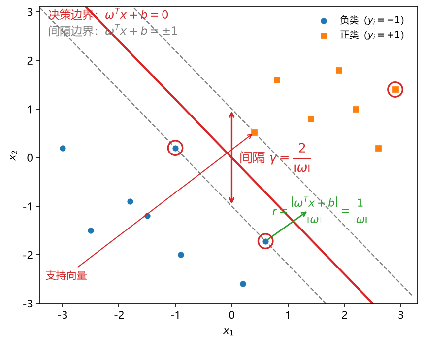

**图 10-2 最大间隔超平面：决策边界、间隔边界、间隔与支持向量**

**支持向量**（support vector）的定义随之而来：**位于间隔边界上的样本点称为支持向量**。上间隔边界上方的样本属于正类，下间隔边界下方的样本属于负类（正负的指派同样只是方便起见，可以互换）。可以这么理解：间隔边界是从决策边界向两边移动、**第一次接触到数据点**时停下来的，所以每条间隔边界上至少落着一个样本点——正是这些点"支撑"起了间隔边界与决策边界，故称支持向量。SVM 的"机"则是 machine（机器）的音译，这个方法的名字里，最重要的角色就是支持向量。

margin 一词有很多种译法：有人译成"边缘"，也有人译成"间隔"或"空白"。考虑到它指的是两条间隔边界之间的空白带的宽度，"间隔"（或"空白"）更贴近本义；译成"边缘"也能说通——两条虚线描述的正是数据点的分界边缘。本书统一采用"间隔"。

SVM 的全部目标由此可以一句话概括：**在能分开两类的前提下，找一条让间隔 $\gamma$ 最大的决策边界**。为什么这样找？因为具有较大间隔的决策边界，比具有较小间隔的决策边界具有更好的泛化能力：特征 $x$ 有测量误差、未来有新数据，一个更宽的"空白带"能容纳这些扰动，超平面仍然是成立的。

### 10.2.3 数据标准化的必要性

实际计算时有一点要特别注意：SVM 求解参数的过程中会用到求偏导（10.4 节），**如果数据不标准化，出来的结果会有很大差异**。这一点和 kNN（算距离）以及上一章的神经网络（求偏导）完全一样：$x$ 的数量级会对求导产生很大影响，得到的解不一定是最优的。所以使用 SVM 前，最好一定要先做标准化（如把各特征变换到 $[-1,1]$ 或 $[0,1]$ 区间），标准化以后做出来的结果才比较理想。

图 10-3 用一个两特征量级悬殊的例子说明这件事：特征 1 的量级是 $10^{2}$，特征 2 的量级只有 $10^{-1}$。未标准化时（左图），分割边界几乎被大量纲的特征"压扁"；标准化之后（右图），边界方向恢复正常，两类的划分也才合理。

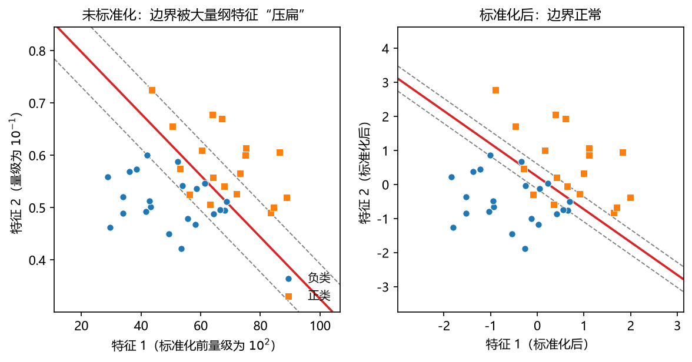

**图 10-3 SVM 使用前务必标准化：量纲悬殊时未标准化的边界被大量纲特征"压扁"**

### 10.2.4 从低维到高维：超平面的维数规律

前面的例子都是二维的。扩展到三维（图 10-4 右）：两类点分别位于空间的上部和下部，中间用一个**平面**对数据进行分割——概念与二维完全一样。再往下看一维（图 10-4 左）：数轴上两簇点，用一个**点**就能把它们分开。

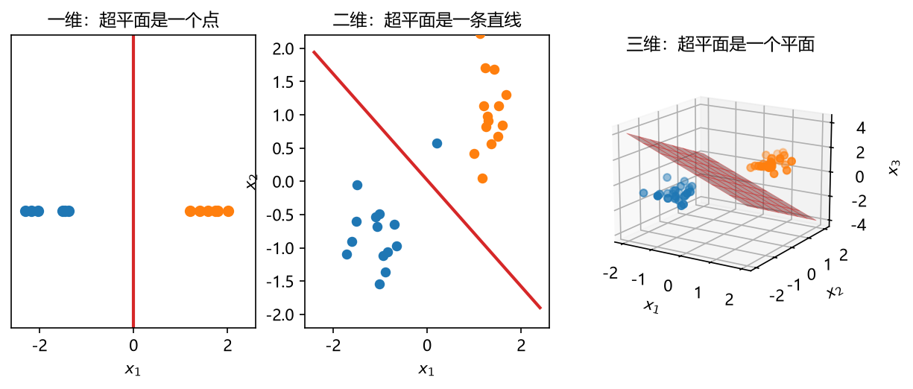

**图 10-4 一维用点、二维用线、三维用面：超平面维数 = 空间维数 − 1**

由此可以总结出一条规律：

> **$p$ 维空间中的超平面是 $p-1$ 维的**：一维空间（数轴）里是一个点（0 维），二维空间里是一条直线（1 维），三维空间里是一个平面（2 维）。特征个数 $p$ 更大时，虽然画不出来，但仍然存在一个 $p-1$ 维的超平面把 $p$ 维空间中的数据点进行分割。

"超平面"这个称呼本身就是这么来的——它是"平面"在高维空间中的推广。

### 10.2.5 高维映射：解决线性不可分

前面讲的所有例子，都是能画一条线（一个面）把两类干净分开的。现实当中还存在另一种情况：**非线性可分**。看图 10-5 左图：原始特征 $x_1$、$x_2$ 构成的二维空间里有两类点，此时无论怎么画一条直线，都不可能把两类分开；勉强画一条也会错分若干个点。对这类特定的非线性二分类问题，必须用**非线性的分割边界**（曲线）才能更好处理。

SVM 对这个问题做了一个非常巧妙的抽象：**非线性问题在原始空间里是非线性的，那就换一个空间来表达它**。具体做法是引入一个映射函数 $\phi(\cdot)$：把原来的特征 $x=(x_1,x_2)$ 用一个函数变换成新的坐标轴，所有数据点在映射函数形成的**新空间**（特征空间）里重新投影；投影之后，又可以找到一个**线性**的超平面把这些数据点分开。

这个结论第一次听到会觉得"有这么巧吗"？严格的证明这里不展开，但可以看一个直观的例子（图 10-5）：左图二维空间里内圈（正类）与外圈（负类）线性不可分。取映射

$$z=\phi(x)=x_1^{2}+x_2^{2} \tag{10-4}$$

即用"到原点的距离平方"作为第三根轴。映射之后（右图）：内圈的点聚在"山丘"的顶端（$z$ 小，位于丘底），外圈的点分布在山丘周围更高的"山坡"上（$z$ 大）。此时在山丘的腰部画一个水平的线性平面，就把两类干干净净地分开了。可以看到，原来二维平面里线性不能分割的数据点，通过更高维的映射，在高位空间里用一个线性超平面即可分开。

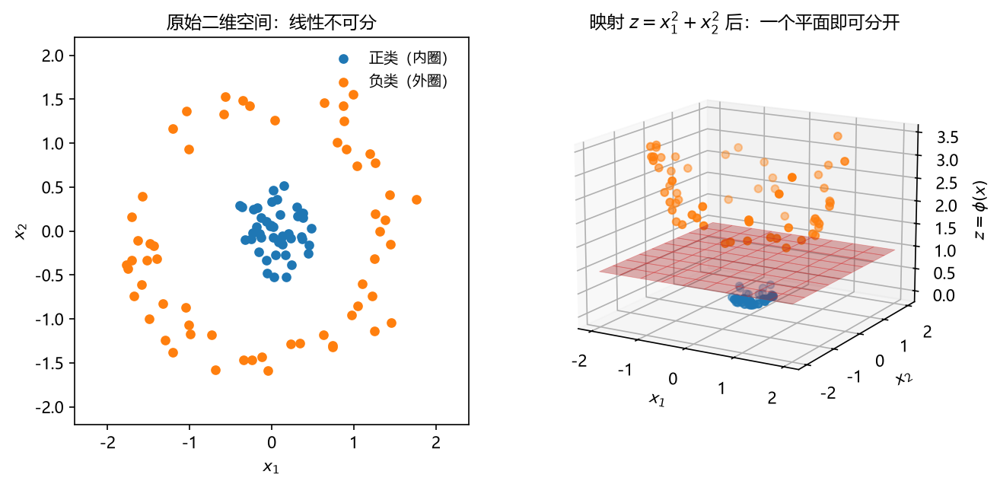

**图 10-5 高维映射：二维线性不可分 → 映射 $z=x_1^{2}+x_2^{2}$ 后一个平面即可分开**

换了不同的映射函数 $\phi$，得到的分类界面形状也不同。图 10-6 展示了同一份"双月牙"数据在三种常用映射下的分类效果：线性核仍用直线（对这类数据效果差），多项式核与高斯核都能给出弯曲的、贴合数据形状的分类界面。这些"核"的确切含义将在 10.5.3 节讲清楚。

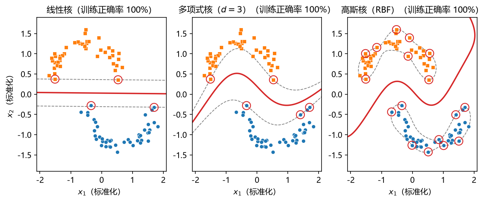

**图 10-6 不同映射（核）函数得到的分类界面（红圈为支持向量）**

SVM 同样可以推广到回归。设想原始空间里要拟合一条曲线：若通过映射的方法把样本送入更高维的空间，这条曲线在高维空间里就"变直"了——原来的非线性回归就变成了高维空间中的线性回归。把这套想法用于传统的回归问题，就是**支持向量回归**（SVR）。图 10-7 给出了用不同映射函数（线性、多项式、高斯）做 SVR 拟合正弦曲线的效果：线性核只能给出直线，多项式核与高斯核都能很好地贴合正弦趋势。

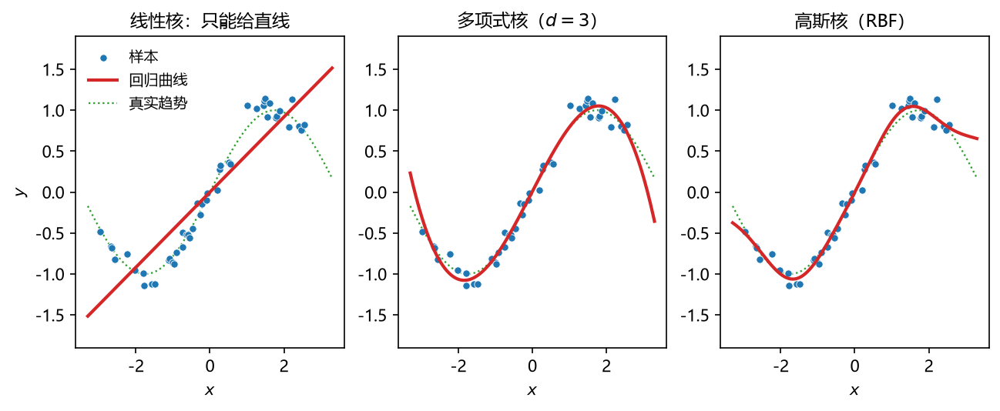

**图 10-7 不同映射（核）函数下 SVR 的回归曲线**

## 10.3 SVM 发展史

SVM 的提出有一定的历史，了解它不仅能记住关键人物，也能明白为什么这个方法在 20 世纪 90 年代神经网络的低谷期脱颖而出（图 10-8）。

- **1963—1964 年：硬边距线性 SVM 诞生**。SVM 由模式识别中的**广义肖像算法**发展而来。1963 年，前苏联（俄罗斯）数学家 Vladimir N. Vapnik 与 Alexander Y. Lerner 发表了相关研究；1964 年，Vapnik 与 Alexey Y. Chervonenkis 对广义肖像算法进行讨论，建立了**硬边距的线性 SVM**。所谓"硬边距"，就是 10.2.2 节讲的严格版本：数据点必须落在两条间隔边界线之外，间隔内不允许有样本点，是严格分类的方法。这项工作 1964 年就已提出，但因为发表在俄语杂志上，没有受到广泛关注。
- **20 世纪 70—80 年代：理论化**。这一时期出现了模式识别中**最大边距决策边界**的理论研究、基于**松弛变量的规划问题求解技术**，并提出 **VC 维**（Vapnik-Chervonenkis dimension）概念。SVM 被逐步理论化，成为**统计学习理论**的一部分——这也是常说 SVM"理论基础好"的来源。
- **1992 年：非线性 SVM（核方法）**。美国的 Bernhard E. Boser、Isabelle M. Guyon 与 Vapnik 通过**核方法**得到了非线性 SVM——即 10.2.5 节提到的用核函数计算映射函数内积的思路（详见 10.5.3 节）。
- **1995 年：软边距非线性 SVM**。Corinna Cortes（Vapnik 的博士后）与 Vapnik 联合提出了**软边距的非线性 SVM**：在非线性 SVM 的基础上，增加了对落在间隔边界以内样本点的容忍程度（详见 10.5.4 节），并应用于**手写字符识别**，效果很好，得到了关注和引用，为 SVM 在各领域的应用提供了参考。

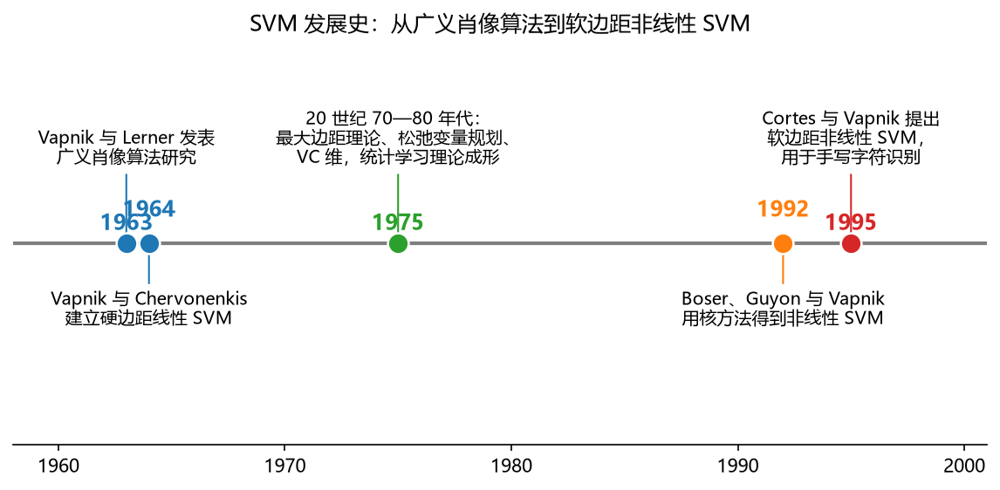

**图 10-8 SVM 发展史：从广义肖像算法到软边距非线性 SVM**

此后 SVM 在 2000 年前后成为非常流行的机器学习方法，特别是在神经网络第二次低谷期间，几乎是中小规模分类问题的首选。它与神经网络的"此消彼长"在第 9 章的发展史中已经提到；而最近十几年深度学习兴起后，也有工作把深度网络的最后一层换成 SVM 来输出，可见这套思想至今仍有生命力。

## 10.4 线性可分的 SVM

### 10.4.1 假设：线性可分性

用于线性分类的 SVM 有一个前提假设：**训练样本是线性可分的**。

- **线性可分**（linearly separable）：存在一个线性的决策边界，能将所有的训练样本正确分类；
- **线性不可分**（非线性可分，nonlinearly separable）：不存在一个线性的决策边界（只存在非线性的决策边界）能将所有的训练样本正确分类。

本节先处理线性可分的问题；线性不可分的情形，通过 10.2.5 节的映射函数把样本映射到高维空间后，又变回线性分类问题，同样可以用本节的框架求解。

### 10.4.2 SVM 的基本形式

把两类样本分别记为 $y_i=+1$（正类）与 $y_i=-1$（负类）。输入数据所在的特征空间中存在作为决策边界的超平面 $\omega^{T}x+b=0$，它把学习目标按正类和负类分开。超平面两侧的判别可以写成两种等价结构：

**结构 1**（分开写）：

$$\begin{cases}\omega^{T}x_i+b\geq +1, & y_i=+1 \\[2pt] \omega^{T}x_i+b\leq -1, & y_i=-1\end{cases} \tag{10-5}$$

**结构 2**（统一写）：把 $y_i$ 乘到不等式两边，两个式子合并为一个：

$$y_i\left( \omega^{T}x_i+b \right)\geq 1,\quad i=1,2,\cdots,m \tag{10-6}$$

验证一下等价性：$y_i=+1$ 时式（10-6）就是 $\omega^{T}x_i+b\geq 1$；$y_i=-1$ 时两边同乘 $-1$，正是 $\omega^{T}x_i+b\leq -1$。结构 2 是结构 1 的简写（联立）形式，看上去更简洁，而且求解时很容易放进约束里：$y_i$ 与 $x_i$ 都是已知的样本值（常数），对决策变量 $\omega$、$b$ 而言约束是线性的。

式（10-6）中每个样本点对应一个约束式子——有多少个样本点（$i=1,\dots,m$），就有多少个这样的式子，因为所有样本点要么在间隔边界的外侧，要么（作为支持向量）恰好落在边界上。其中 $\omega$ 是超平面的**法向量**（垂直于超平面的方向），$b$ 是**截距**，两者是待求解的参数。

### 10.4.3 间隔最大化：一个凸二次优化问题

SVM 的学习策略是**间隔最大化**：在满足式（10-6）所有约束的前提下，求使间隔 $\gamma=2/\left\| \omega \right\|$ 最大的参数 $\omega$ 和 $b$。决策边界的求解由此转化为一个优化问题：

$$\max_{\omega,\,b}\ \frac{2}{\left\| \omega \right\|}\quad \text{s.t.}\quad y_i\left( \omega^{T}x_i+b \right)\geq 1,\ i=1,\dots,m \tag{10-7}$$

式（10-7）不大好求：目标函数的分母里有根号（$\left\| \omega \right\|=\sqrt{\omega_1^{2}+\cdots+\omega_p^{2}}$），求导运算麻烦。做一个等价变形：把分子分母颠倒、再加个平方，最大化变成最小化，根号也去掉了：

$$\min_{\omega,\,b}\ \frac{1}{2}\left\| \omega \right\|^{2}\quad \text{s.t.}\quad y_i\left( \omega^{T}x_i+b \right)\geq 1,\ i=1,\dots,m \tag{10-8}$$

这个变形完全是为了求解方便：$\left\| \omega \right\|$ 越小间隔越大（图 10-9 左），二者单调对应，目标等价；取平方消掉了根号。展开来写，目标就是 $\frac{1}{2}\left( \omega_1^{2}+\omega_2^{2}+\cdots+\omega_p^{2} \right)$。前面的系数 $\frac{1}{2}$ 加不加都行——加上是为了后面求偏导时能把平方项产生的 2 抵消掉，让式子更整洁。

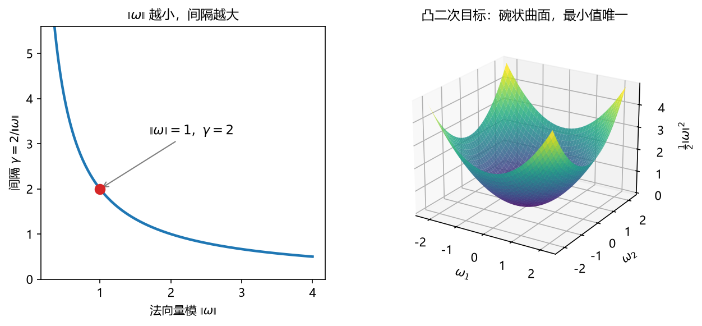

**图 10-9 间隔最大化与凸二次目标：$\left\| \omega \right\|$ 越小间隔越大（左）；目标 $\frac{1}{2}\left\| \omega \right\|^{2}$ 是碗状凸函数，最小值唯一（右）**

观察式（10-8）的结构：**目标函数是二次的**（决策变量带平方项），**约束条件是线性的**（$y_i$、$x_i$ 都是常数，$\omega$、$b$ 都是一次项）。目标函数为二次、约束为线性的优化问题称为**凸二次优化问题**（convex quadratic programming）——目标函数的曲面像一只向外凸的碗（图 10-9 右），有且只有一个全局最小值，不存在神经网络里"局部极小"的困扰。

凸二次优化问题**可以直接用现成的优化计算包求解**，全局最优解是可以保证求到的（至于效率高不高是另一个问题）。不过，为了求解更高效、也为了后面能顺利推广到非线性，SVM 实际采用一种更专门的解法——拉格朗日乘子法与对偶问题，见 10.5.2 节。

### 10.4.4 SVM 的优点与缺点

在进入求解细节之前，先对这个方法做个整体评价。

**SVM 的优点：**

1. **理论基础好**：属于统计学习方法，把线性二元分类转化成形式非常简洁的凸二次优化问题，目标和约束都很清晰；
2. **功能强大**：线性与非线性、分类与回归四类问题都可以做——线性推广到非线性只需更换核函数，分类推广到回归只需引入 $\varepsilon$ 间隔带（10.6 节）；
3. **在高维空间中有效**：特征 $x$ 很多的时候，理论上仍然适用；
4. **内存占用小、具有稀疏性**：决策函数只使用训练点的子集（支持向量），训练完成后大部分训练样本都不需保留，最终模型仅与支持向量有关——求解时也只需找到这些支持向量，内存占用小，训练好的模型做预测的计算也比较简单；
5. **通用性好**：线性推广成非线性，只需为决策函数指定（更换）不同的核函数，模型结构不用改动，可以选用通用核函数，也可以自定义。

**SVM 的缺点：**

1. **特征数远大于样本数时容易过拟合**：如果 $x$ 特别多（比如有几十个特征而样本只有十几个，二维表格显得非常"宽"），即使使用核函数做高维映射，SVM 仍容易过拟合。SVM 基于**小样本统计理论**，做中小规模数据的分类和回归效果很好，对大样本（大数据集）求解有一定困难；
2. **对参数和核函数的选择敏感**：模型里有若干超参数，选择不当对性能影响较大；核函数与映射函数一一对应，选不同的核函数相当于把数据映射到不同的高维空间，选择不当会影响模型性能——怎么选核函数成为一个关键问题（10.5.3 节）；
3. **经典 SVM 只用于二元分类**：推广到多元分类需要额外策略。不过这不算 SVM 独有的缺点——大部分分类方法都先把问题简化为二类求解，再用通用的办法组合（见 10.5.1 节）；
4. **不直接提供概率估计**：分类输出直接是 $-1$ 和 $+1$ 两个类，不像 Logistic 回归那样给出一个 0 到 1 之间的概率值。这同样只是一个特点，不算严重缺点。

## 10.5 SVM 的改进

### 10.5.1 改进方向总览

10.4 节处理的是最基础的版本：线性可分、硬间隔、直接求解。实际使用中会在各个环节遇到"效果不好"或"求解不便"，SVM 的发展正是对这些问题的逐个回应。改进方向可以整理成表 10-2。

**表 10-2 SVM 的改进方向总览**

| 遇到的问题 | 改进方向 | 核心手段 |
|------------|----------|----------|
| 凸二次优化直接求解不够高效、不便推广 | 转化为对偶问题 | 拉格朗日乘子法 + KKT 条件 |
| 线性分类效果不好（有误差点、间隔内混入样本） | 硬间隔 → 软间隔 | 约束缩放（松弛变量）+ 目标正则化（超参数 $C$） |
| 问题本身线性不可分 | 非线性分类 | 高维映射函数，以内积（核函数）形式计算 |
| 非线性分类效果仍不好 | 核函数 + 软间隔 | 高维空间中再放松约束 |
| 二元分类 → 多元分类 | 通用的多类拆分策略 | 一对其余、逐层二分等 |
| 分类 → 回归 | 软间隔 + 核函数引入回归 | $\varepsilon$ 间隔带（支持向量回归 SVR，见 10.6 节） |

其中"二元推广到多元"是所有二类分类器共通的问题，思路也不复杂：比如 $K$ 类可以拆成"一类 vs 其余 $K-1$ 类"的二元问题；或者每次挑出一类与其余类二分，分完后在剩余类中继续逐层二分下去。解决了二类问题，多类就有很多常规的组合办法，因此本书与多数教材一样，把重点放在二元分类上。

### 10.5.2 对偶问题与拉格朗日乘子法

式（10-8）的凸二次优化虽然"可解"，但直接调用通用优化包并不是最优的：一是效率不高，二是这个形式不方便推广到非线性。SVM 的做法是把它**转化成对偶问题**：与原优化问题等价的另一个优化问题。转化的工具是**拉格朗日乘子法**——引入以拉格朗日（Lagrange）命名的乘子 $\alpha_i$。

**第一步：引入拉格朗日乘子，构造拉格朗日函数。**对每个约束配上一个乘子 $\alpha_i\geq 0$，把约束"吸收"进目标函数：

$$L(\omega,b,\alpha)=\frac{1}{2}\left\| \omega \right\|^{2}+\sum_{i=1}^{m}\alpha_i\left[ 1-y_i\left( \omega^{T}x_i+b \right) \right] \tag{10-9}$$

**第二步：令偏导为零。**对决策变量 $\omega$ 和 $b$ 分别求偏导并令其为零，得到两个关系式：

$$\omega=\sum_{i=1}^{m}\alpha_i y_i x_i,\qquad \sum_{i=1}^{m}\alpha_i y_i=0 \tag{10-10}$$

**第三步：回代。**把式（10-10）代回拉格朗日函数，$\omega$ 和 $b$ 都被消掉了，剩下只含 $\alpha$ 的目标函数，得到**对偶问题**：

$$\max_{\alpha}\ \sum_{i=1}^{m}\alpha_i-\frac{1}{2}\sum_{i=1}^{m}\sum_{j=1}^{m}\alpha_i\alpha_j y_i y_j\, x_i^{T}x_j\qquad \text{s.t.}\ \sum_{i=1}^{m}\alpha_i y_i=0,\ \alpha_i\geq 0 \tag{10-11}$$

对比式（10-8）与式（10-11）：原问题的决策变量是 $\omega$（$p$ 维）和 $b$，对偶问题的决策变量只有 $\alpha_i$（每个样本一个）。对偶问题还附带一组**KKT 条件**（以三位提出者姓氏首字母命名），其中最重要的一条是**互补松弛条件**：

$$\alpha_i\geq 0,\quad 1-y_i\left( \omega^{T}x_i+b \right)\leq 0,\quad \alpha_i\left[ 1-y_i\left( \omega^{T}x_i+b \right) \right]=0 \tag{10-12}$$

由式（10-12）可以读出 SVM 解的**稀疏性**：若某样本严格满足约束（落在间隔边界之外），则必有 $\alpha_i=0$；只有**支持向量**（恰好落在间隔边界上、约束取等号的样本）才可能有 $\alpha_i>0$。训练完成后，大部分训练样本都不需保留，最终模型仅与支持向量有关——这正是 10.4.4 节所说"内存占用小"的来源。

对偶问题解出 $\alpha$ 后，用式（10-10）得到 $\omega$，再由 KKT 条件可解出 $b$。最终的判别函数（预测函数）形如：

$$f(x)=\omega^{T}x+b=\sum_{i=1}^{m}\alpha_i y_i\, x_i^{T}x+b \tag{10-13}$$

做预测时只需对支持向量（$\alpha_i>0$ 的样本）求和。式（10-13）里反复出现 $x_i^{T}x$ 这样的**内积**形式——这个观察正是下一节核函数方法的突破口。

### 10.5.3 核函数：用内积代替映射

现在正式处理非线性分类。做法（10.2.5 节已直观展示）是：把样本 $x$ 映射到更高维的特征空间，映射后的向量为 $\phi(x)$，划分超平面变为

$$f(x)=\omega^{T}\phi(x)+b \tag{10-14}$$

在特征空间中求解，原始问题与对偶问题的形式与 10.5.2 节完全平行，只是把 $x_i$ 换成了 $\phi(x_i)$。这条路线有一个现实困难：映射函数 $\phi(\cdot)$ 通常是**不知道的，有时候也很难求解出来**——一般情形下它甚至映射到无穷维空间。幸运的是，观察对偶问题（10-11）与判别函数（10-13）可以发现一个关键事实：

> **$\phi$ 从来不单独出现，永远以两个样本映射后的内积 $\phi(x_i)^{T}\phi(x_j)$ 的形式出现。**

也就是说，不需要显式地知道映射函数是什么，只需要知道映射函数的**内积**算出来是个什么值。把这个内积定义成一个函数：

$$K(x_i,x_j)=\phi(x_i)^{T}\phi(x_j) \tag{10-15}$$

称为**核函数**（kernel function）。用核函数直接计算内积、避开映射函数的具体计算，这一技巧称为**核技巧**（kernel trick）。于是核化后的对偶问题为

$$\max_{\alpha}\ \sum_{i=1}^{m}\alpha_i-\frac{1}{2}\sum_{i=1}^{m}\sum_{j=1}^{m}\alpha_i\alpha_j y_i y_j\, K(x_i,x_j)\qquad \text{s.t.}\ \sum_{i=1}^{m}\alpha_i y_i=0,\ 0\leq\alpha_i\leq C \tag{10-16}$$

判别函数相应变为 $f(x)=\sum_i \alpha_i y_i K(x_i,x)+b$。整个求解流程只需要挑选并计算核函数，不需要显式的 $\phi$。

那么，什么样的函数能当核函数？**Mercer 定理**（充分非必要）给出了判据：**只要一个对称函数所对应的核矩阵（Gram 矩阵）半正定，它就能作为核函数使用**。核矩阵即 $K=(K(x_i,x_j))_{m\times m}$——把 $m$ 个样本两两做核运算得到的矩阵；"半正定"的含义读者可回顾线性代数相关知识。满足该定理的函数背后总存在一个映射函数 $\phi$，与之对应。

有了这一定理，就不必从映射函数反推，而是直接挑选或设计核函数。表 10-3 列出了常用核函数，图 10-10 画出了它们在一维情形下的形状（固定 $x_j$，观察 $K$ 随 $x_i$ 的变化）。

**表 10-3 常用核函数**

| 名称 | 表达式 | 主要超参数 |
|------|--------|-----------|
| 线性核 | $K(x_i,x_j)=x_i^{T}x_j$ | — |
| 多项式核 | $K(x_i,x_j)=(\gamma\, x_i^{T}x_j+r)^{d}$ | 次数 $d$、系数 $r$、$\gamma$ |
| 高斯核（RBF 核） | $K(x_i,x_j)=\exp\left( -\gamma \left\| x_i-x_j \right\|^{2} \right)$ | 带宽 $\gamma$ |
| 拉普拉斯核 | $K(x_i,x_j)=\exp\left( -\gamma \left\| x_i-x_j \right\| \right)$ | $\gamma$ |
| Sigmoid 核 | $K(x_i,x_j)=\tanh\left( \gamma\, x_i^{T}x_j+r \right)$ | $\gamma$、$r$ |

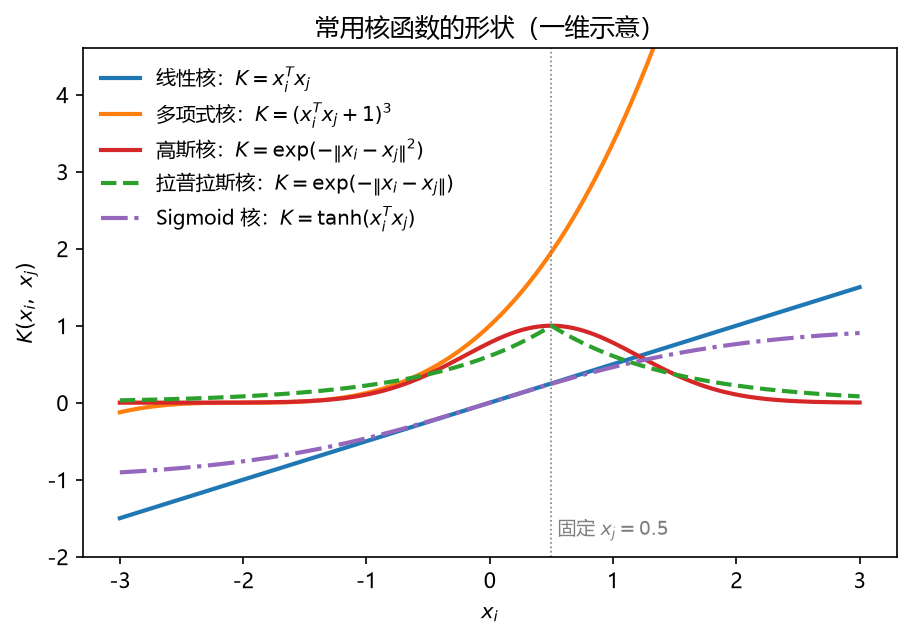

**图 10-10 常用核函数的形状（一维示意）**

核函数怎么选？通常的做法是**试错**：拿候选核函数分别训练、比较验证效果。实践中绝大部分情况下，**高斯核或多项式核都能取得理想的结果**。当然，只要满足 Mercer 定理，也可以自行设计特殊的核函数。

核技巧的价值还不止于非线性分类：通过核函数，SVM 可以很容易地求解**非线性回归**（10.6 节），这也是"核函数"在方法总表里独占一行、并成为 SVM 家族代名词的原因。

### 10.5.4 软间隔：约束缩放与目标正则化

现实中还有一类"效果不好"：问题大体线性可分，但存在少数**误差点**——它们会掉到两条间隔边界（虚线）的中间，甚至落到决策边界的另一侧。严格按硬间隔的要求，这些点必须被"挪出去"，分割面就会被个别点带偏（图 10-11 左）。

**软间隔**（soft margin）的思路是：**允许 SVM 在一些样本上不满足约束**。具体而言，落在两条虚线中间、但还没越过决策边界的点，仍按原来那一类处理——对它们的分类保持一定的容忍性。与之相对，原先严格版本称为**硬间隔**（hard margin）。

软间隔反映到优化问题上，是两处修改（图 10-11 右）：

1. **约束缩放**：给每个样本引入**松弛变量** $\xi_i\geq 0$，约束由 $y_i(\omega^{T}x_i+b)\geq 1$ 放宽为 $y_i(\omega^{T}x_i+b)\geq 1-\xi_i$。$\xi_i$ 度量了第 $i$ 个样本"越界"的程度：$\xi_i$ 取到 1 时该点落到决策边界上，更大时甚至跨过边界；
2. **目标正则化**：不能让约束无限放松，于是把松弛量也放进目标函数里惩罚，并引入**超参数** $C$ 平衡两项：

$$\min_{\omega,b,\xi}\ \frac{1}{2}\left\| \omega \right\|^{2}+C\sum_{i=1}^{m}\xi_i^{2}\qquad \text{s.t.}\ y_i\left( \omega^{T}x_i+b \right)\geq 1-\xi_i,\ \ \xi_i\geq 0 \tag{10-17}$$

$C$ 是人为设定的超参数，用来平衡"原来的间隔最大化目标"与"新加的松弛惩罚项"之间的大小关系。松弛变量的惩罚可以取 $\xi_i$ 的平方（如式 10-17，也是 MATLAB `fitcsvm` 的默认形式之一），也可以取一次形式，后者等价于采用 **hinge 损失**（合页损失）的写法：

$$\min_{\omega,b}\ \frac{1}{2}\left\| \omega \right\|^{2}+C\sum_{i=1}^{m}\max\left( 0,\ 1-y_i\left( \omega^{T}x_i+b \right) \right) \tag{10-18}$$

无论哪种形式，根据 KKT 条件都可推得：**最终模型仍仅与支持向量有关**，hinge 损失依然保持了 SVM 解的稀疏性。软间隔 SVM 的对偶问题与式（10-16）几乎一样，只是 $\alpha_i$ 多了一个上界约束 $0\leq\alpha_i\leq C$——即使加了软间隔、推广到非线性，对偶问题的形式仍然非常稳定、彼此相似，这再次说明转成对偶问题求解确实便于推广。

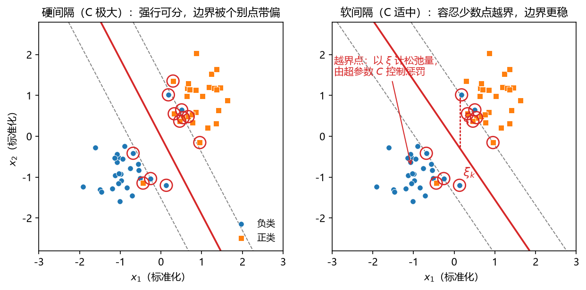

**图 10-11 硬间隔与软间隔对比：软间隔以松弛变量 $\xi$ 容忍少数越界点，边界更稳**

把软间隔与核函数结合起来，就得到完整的**软间隔非线性 SVM**——实践中最常用的 SVM 形态：先通过核函数把样本映射到高维特征空间（在那里线性可分或近似线性可分），再允许个别样本越界放松约束。即使高维空间里效果仍不理想，还可以把软间隔的概念再引进来，让分类界面对误差和新数据有更强的容忍性（泛化能力更强）。

式（10-17）还可以写成更一般的形式，帮助读者理解它的"正则化"本质：

$$\min_{f}\ \Omega(f)+C\sum_{i=1}^{m}L\left( f(x_i),\,y_i \right) \tag{10-19}$$

其中 $L$ 是**经验风险**项（描述模型与训练数据的契合程度，即误差大小），$\Omega(f)$ 是**结构风险**项（描述模型的某些结构性质，如复杂度），$C$ 平衡两者。系数 $C$ 放在哪一项上只是习惯问题（本质是两项数量级的平衡）。这套"结构风险 + 经验风险"的正则化框架，与第 9 章神经网络缓解过拟合的正则化策略一脉相承。图 10-12 展示了 $C$ 大小的影响：$C$ 过小，惩罚太轻，模型欠拟合、间隔过宽；$C$ 过大，惩罚太重，模型趋向硬间隔、容易过拟合。

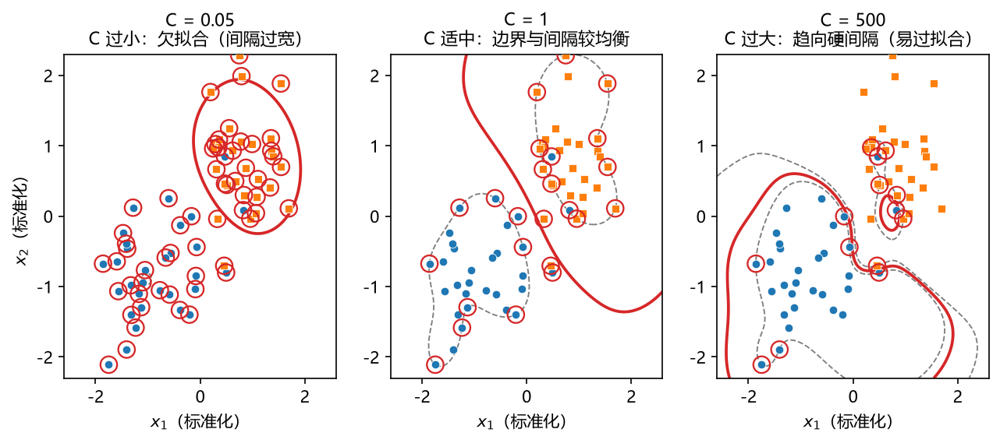

**图 10-12 超参数 $C$ 平衡结构风险与经验风险：过小欠拟合，过大易过拟合**

## 10.6 支持向量回归（SVR）

### 10.6.1 从分类到回归的思想

SVM 是从分类问题发展起来的，但可以很容易地推广到回归问题。回归里同样是在找一个界面（超平面）来**逼近**数据点，而在逼近的过程中，可以把分类里那两个有特色的概念借用过来：

- **软间隔 → $\varepsilon$ 间隔带**：传统回归（如最小二乘）求一条线，让它与每个数据点都尽可能接近；引入分类中"容忍"的思想后，把这条线变成一条**带**——落在带内的数据点都认为它们的误差为零。相当于对回归误差有了一定的容忍性，提高了模型的鲁棒性；
- **核函数 → 非线性回归**：要求的回归曲线在原始空间可能是弯曲的，通过高维映射，在高维空间里它就变成一个线性（超平面）回归问题，同样只需用核函数计算内积即可求解。

### 10.6.2 $\varepsilon$-不敏感损失与 SVR 的求解

SVR 的基本思想是**允许模型输出与实际输出之间存在偏差**：以 $f(x)$ 为中心，向上下各留出宽度 $\varepsilon$ 的**间隔带**，落入 $2\varepsilon$ 间隔带内的样本**不计算损失**（图 10-13 左），只有落在带外的样本才计入损失，并按其超出带的程度计量松弛量（带上方记 $\xi_i$，带下方记 $\xi_i^{\*}$）。这种损失函数称为 **$\varepsilon$-不敏感损失**（$\varepsilon$-insensitive loss）：

$$L_{\varepsilon}\left( f(x),y \right)=\max\left( 0,\ \left| y-f(x) \right|-\varepsilon \right) \tag{10-20}$$

它与最小二乘损失的对比如图 10-13 右：最小二乘损失 $e^{2}$ 对任何误差都计损；$\varepsilon$-不敏感损失在 $|e|\leq\varepsilon$ 内为零、带外线性增长。正因为带内样本不计损失，SVR 的解同样具有**稀疏性**——最终模型仅由带边界上的样本（支持向量）决定。

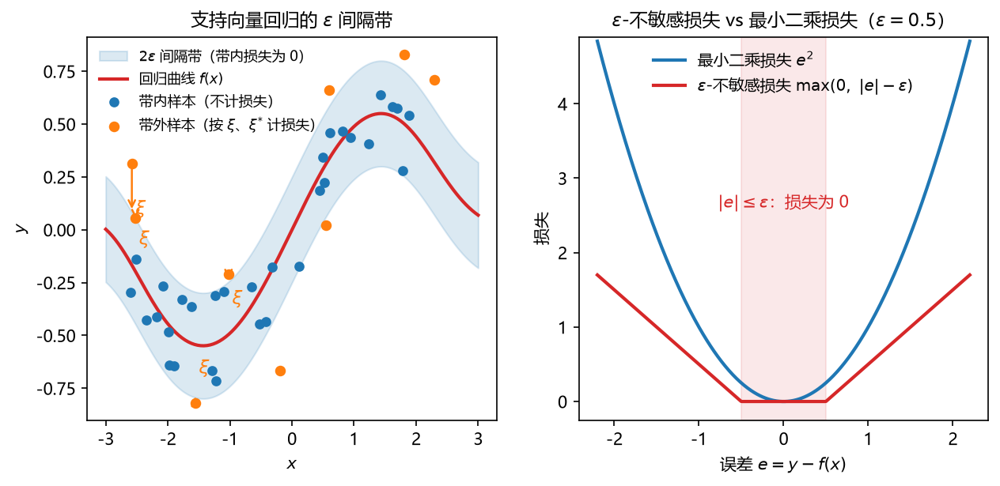

**图 10-13 支持向量回归的 $\varepsilon$ 间隔带（左）与 $\varepsilon$-不敏感损失（右）**

SVR 的原始优化问题为

$$\min_{\omega,b,\xi,\xi^{\*}}\ \frac{1}{2}\left\| \omega \right\|^{2}+C\sum_{i=1}^{m}\left( \xi_i+\xi_i^{\*} \right)\qquad \text{s.t.}\ \begin{cases} f(x_i)-y_i\leq \varepsilon+\xi_i \\ y_i-f(x_i)\leq \varepsilon+\xi_i^{\*} \\ \xi_i,\ \xi_i^{\*}\geq 0 \end{cases} \tag{10-21}$$

与式（10-17）的结构非常相似：目标仍是"间隔（结构）项 + $C\times$ 损失项"，只是损失换成了 $\varepsilon$-不敏感形式，且上下两侧各有一组松弛变量。两侧的间隔与松弛变量**可以不一样**——高于回归面的数据点与低于回归面的数据点分别计量。转到对偶问题后同样只以核函数内积出现，解出 $\alpha_i$ 与 $\alpha_i^{\*}$，最终的回归方程为

$$f(x)=\sum_{i=1}^{m}\left( \alpha_i-\alpha_i^{\*} \right)K(x_i,x)+b \tag{10-22}$$

至此可以完整回答"为什么要转化成对偶问题"：一是**求解更高效**，二是**形式稳定、便于推广**——从线性到非线性（核函数）、从硬间隔到软间隔、从分类到回归，对偶问题的形状都非常相似，只需增改个别约束与核函数即可。这一优雅的性质，正是 SVM 在理论上有口皆碑的原因。

## 10.7 用 MATLAB 构建 SVM

### 10.7.1 基本步骤

与其他方法一样，用 MATLAB 构建 SVM 也遵循"预处理 → 训练 → 预测 → 评估"的套路，主要命令见表 10-4。

**表 10-4 构建 SVM 模型的基本步骤**

| 步骤 | 基本命令 | 功能 |
|------|----------|------|
| 数据预处理 | 数据标准化 | 特征量纲不同会严重影响求解（SVM 求解用到偏导数），务必先把 $x$ 变换到 $[-1,1]$ 或 $[0,1]$ |
| | 数据集分割 | 将原始数据分割成训练集 $P$ 与验证集 $Q$（大头做训练、小部分做验证，或交叉验证） |
| 训练模型 | `fitcsvm` | 训练 SVM 分类（SVC）模型 |
| | `fitrsvm` | 训练 SVM 回归（SVR）模型 |
| 预测 | `predict` | 训练集预测、验证集预测 |
| 性能评估 | 数据后处理 + 性能评估 | 预测值反标准化后，再计算性能指标 |

其中数据预处理值得再强调一次：SVM 的求解最终会用到求偏导，若各特征数量级差别很大，会对偏导产生很大影响，得到的解不一定最优——与 kNN（算距离）、神经网络（求偏导）一样，**强烈建议先做标准化**。另外一定要养成分割训练集与验证集的习惯：最基本的做法是 70%～80% 做训练、对应的 30%～20% 做验证；更好的做法是交叉检验甚至留一法。

**数据后处理**是 SVM（以及一切标准化建模）流程中容易忽视的一环：训练时 $y$ 也做了标准化，预测出来的 $y$ 就是标准化尺度上的值。为了让预测与实际的对比更直观，评估性能之前要先把 $y$ **反标准化**，还原成原来的数量级——例如降雨原本在 0～500 毫米之间，就应转换回这个范围，再拿预测值与实际值计算性能指标，对效果的理解才会更直观。

### 10.7.2 fitcsvm：训练 SVM 分类模型

`fitcsvm` 返回训练好的支持向量机分类器（SVC）模型 `Mdl`（一个结构体，包含支持向量、系数等丰富信息），常用调用格式见表 10-5。因为 MATLAB 现在把表格数据（table）作为主打数据类型，表格形式被排在第一种；传统上更常用的其实是矩阵形式 `fitcsvm(X,Y)`。

**表 10-5 fitcsvm 函数的调用格式**

| 格式 | 用途 |
|------|------|
| `Mdl = fitcsvm(Tbl,ResponseVarName)` | 使用表 `Tbl` 中的样本数据训练，`ResponseVarName` 是 `Tbl` 中含类标签（一或二类）的变量名 |
| `Mdl = fitcsvm(Tbl,formula)` | 使用表 `Tbl` 训练，`formula` 是响应变量与一部分预测变量构成的解释模型 |
| `Mdl = fitcsvm(Tbl,Y)` | 使用表 `Tbl` 中的预测变量和向量 `Y` 中的类标签训练 |
| `Mdl = fitcsvm(X,Y)` | 使用矩阵 `X` 中的预测变量和向量 `Y` 中的一或二类类标签训练 |
| `Mdl = fitcsvm(___,Name,Value)` | 用一个或多个名称-值参数指定选项，如交叉验证类型、误分类代价、核函数（`'KernelFunction'`）等 |

### 10.7.3 fitrsvm：训练 SVM 回归模型

做回归时如法炮制，把命令换成 `fitrsvm` 即可（表 10-6），输出的 `Mdl` 是训练好的 SVR 模型结构体。

**表 10-6 fitrsvm 函数的调用格式**

| 格式 | 用途 |
|------|------|
| `Mdl = fitrsvm(Tbl,ResponseVarName)` | 使用表 `Tbl` 中的预测变量（X）与 `Tbl.ResponseVarName` 中的响应值（Y）训练 SVR 模型 |
| `Mdl = fitrsvm(Tbl,formula)` | 使用表 `Tbl` 训练，`formula` 是响应变量与预测变量的解释模型 |
| `Mdl = fitrsvm(Tbl,Y)` | 使用表 `Tbl` 中的预测变量和向量 `Y` 中的响应值训练 |
| `Mdl = fitrsvm(X,y)` | 使用矩阵 `X` 与向量 `y` 训练 SVR 模型 |
| `Mdl = fitrsvm(___,Name,Value)` | 用名称-值参数指定选项，如核函数、核尺度、-boxconstraint（即超参数 $C$）等 |

### 10.7.4 预测与完整流程

两个命令的输出都是训练好的模型结构体，预测与其他方法完全一样，把结构体与待预测样本交给 `predict`：

```matlab
Mdl = fitcsvm(X, y);            % 训练 SVC（回归用 fitrsvm）
yp = predict(Mdl, Xnew);        % 对新样本 Xnew 做预测
```

## 10.8 案例研究

### 10.8.1 案例一：鸢尾花的 SVC 二分类

第一个案例用 MATLAB 自带的鸢尾花数据做二元分类：三类花中去掉一类（setosa），剩下 versicolor 与 virginica 两类，取花瓣长度、花瓣宽度两个特征。这个二分类问题两类在二维特征平面上有部分交叠，正适合展示 SVM 的边界与支持向量（图 10-14）。

```matlab
% SVM_exp01_iris_svc.m  鸢尾花二分类：fitcsvm + predict
load fisheriris                       % MATLAB 自带数据：meas(150x4), species
idx = ~strcmp(species, 'setosa');     % 去掉 setosa，保留两类做二元分类
X = meas(idx, 3:4);                   % 取花瓣长度(x1)、花瓣宽度(x2)
y = species(idx);
X = (X - mean(X)) ./ std(X);          % 标准化（SVM 求解用到偏导，务必做）

Mdl = fitcsvm(X, y, 'KernelFunction', 'rbf', ...
              'KernelScale', 'auto'); % 训练 RBF 核 SVC 模型
sv  = Mdl.IsSupportVector;            % 支持向量的行下标
yp  = predict(Mdl, X);                % 回代预测
acc = mean(strcmp(yp, y));            % 回代正确率
fprintf('支持向量 %d 个，回代正确率 = %.2f%%\n', sum(sv), 100*acc);

% 可视化决策边界与支持向量
d = 0.02;
[x1g, x2g] = meshgrid(min(X(:,1))-0.3:d:max(X(:,1))+0.3, ...
                      min(X(:,2))-0.3:d:max(X(:,2))+0.3);
Xgrid  = [x1g(:) x2g(:)];
labels = predict(Mdl, Xgrid);         % 网格点类别，用于画分类区
figure; hold on
gscatter(Xgrid(:,1), Xgrid(:,2), cellstr(labels), ...
         [0.85 0.92 0.98]);           % 分类区背景
gscatter(X(:,1), X(:,2), y);          % 训练样本
plot(X(sv,1), X(sv,2), 'ko', 'MarkerSize', 11);   % 圈出支持向量
xlabel('花瓣长度（标准化）'); ylabel('花瓣宽度（标准化）');
```

运行后可看到（图 10-14）：两类样本大体分布在左下与右上，SVM 给出一条弯曲的非线性决策边界，把两类分开；黑色圈出的点就是支持向量——它们**支撑**起了这条边界与两侧的间隔带，其余大量样本即使删去，模型也不会改变。这正是 10.5.2 节"解的稀疏性"的直接体现。回代正确率一般在 95% 左右（两类交叠区的少数样本会错分），与第 7 章 kNN、第 9 章 ANN 的结果可以对照。

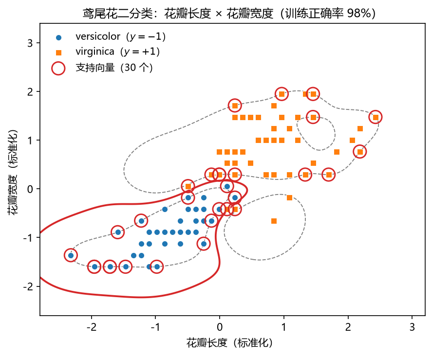

**图 10-14 鸢尾花二分类：花瓣长度 × 花瓣宽度（黑圈为支持向量）**

### 10.8.2 案例二：一元非线性函数的 SVR 回归

第二个案例用 SVR 拟合带噪声的正弦曲线，展示核函数的选择与"预测后反标准化"的完整流程。

```matlab
% SVM_exp02_svr_sine.m  一元非线性回归：fitrsvm + predict
rng(42)
x = linspace(-3, 3, 60)';
y = sin(0.9*x) + 0.12*randn(size(x));   % 正弦 + 噪声
xs = (x - mean(x)) / std(x);            % 标准化
ys = (y - mean(y)) / std(y);

Mdl = fitrsvm(xs, ys, 'KernelFunction', 'gaussian', ...
              'KernelScale', 0.9);      % 高斯核 SVR
yb  = predict(Mdl, xs);                 % 标准化尺度上的预测

yhat = yb * std(y) + mean(y);           % 反标准化，还原原始数量级
fprintf('相关系数 r = %.3f，RMSE = %.3f\n', corr(y, yhat), ...
        sqrt(mean((y - yhat).^2)));

figure; plot(x, y, 'bo'); hold on;
plot(x, yhat, 'r-', 'LineWidth', 1.8);  % SVR 回归曲线
legend('样本', 'SVR 预测'); xlabel('x'); ylabel('y');
```

运行后相关系数一般在 0.98 以上：高斯核 SVR 的红色曲线平滑地穿过样本带，既贴合正弦趋势、又不追逐个别噪声点——$\varepsilon$ 间隔带的存在使带内噪声完全不参与损失。读者可以把 `'KernelFunction'` 换成 `'linear'` 与 `'polynomial'` 对比：线性核只能给出直线（欠拟合），效果对应图 10-7 的三种情形；也可以调整核尺度与 `BoxConstraint`（超参数 $C$），观察图 10-12 所示的欠拟合—过拟合变化。

## 10.9 本章小结

本章围绕"最大间隔"这一主线，把 SVM 从线性推广到非线性、从分类推广到回归。要点归纳如下：

1. **定位与定义**：SVM 是按监督学习方式对数据进行二元分类的广义线性分类器，决策边界是对学习样本求解的最大间隔超平面；做分类称 SVC，做回归称 SVR（命名方式与分类树/回归树相同），在方法总表中独占"核函数"一行。
2. **核心概念**：决策边界 $\omega^{T}x+b=0$ 两侧首次触及样本时停下的两条间隔边界（$\pm 1$，取 1 只是不失一般性的缩放约定）；间隔 $\gamma=2/\left\| \omega \right\|$（由点到直线的距离公式推得，决策边界居于间隔正中）；落在间隔边界上的样本即支持向量，最终模型仅与支持向量有关（稀疏性）。
3. **维数规律**：$p$ 维空间中的超平面是 $p-1$ 维的（一维点、二维线、三维面）；数据标准化后再训练（求解用到偏导，与 kNN、ANN 同理）。
4. **发展史**：1964 年 Vapnik 与 Chervonenkis 建立硬边距线性 SVM（源于广义肖像算法）→ 20 世纪 70—80 年代统计学习理论成形（VC 维）→ 1992 年 Boser、Guyon、Vapnik 用核方法得非线性 SVM → 1995 年 Cortes 与 Vapnik 提出软边距非线性 SVM 并成功用于手写字符识别。
5. **求解路线**：间隔最大化 → 等价化为 $\min\frac{1}{2}\left\| \omega \right\|^{2}$ 的凸二次优化（目标二次、约束线性，可用现成优化包）→ 引入拉格朗日乘子化为对偶问题（高效且便于推广，KKT 条件保证稀疏性）。
6. **两大特色技巧**：**核技巧**——映射函数 $\phi$ 不必显式知道，一切计算只以内积 $\phi(x_i)^{T}\phi(x_j)$ 出现，把它定义为核函数 $K$，满足 Mercer 定理（对称、核矩阵半正定）即可用；常用线性核、多项式核、高斯核（RBF）、拉普拉斯核、Sigmoid 核，通常试错选取，高斯核与多项式核多数情况下效果理想。**软间隔**——引入松弛变量 $\xi$ 放松约束、目标加惩罚项并用超参数 $C$ 平衡（结构风险 + $C\times$经验风险的正则化框架），容忍误差点、提高鲁棒性。
7. **SVR**：把软间隔改造成 $2\varepsilon$ 间隔带（带内损失为零的 $\varepsilon$-不敏感损失），配合核函数实现非线性回归；上下两侧松弛变量可以不同。
8. **优缺点**：理论好、功能全（线性/非线性 × 分类/回归）、高维有效、稀疏省内存、换核即推广；但特征远多于样本时易过拟合、对超参数与核函数选择敏感、经典形式只做二类、不直接给概率输出。
9. **MATLAB 实现**：`fitcsvm`/`fitrsvm` 训练，`predict` 预测；流程为标准化 → 分割训练/验证集 → 训练 → 预测 → **反标准化** → 性能评估。

SVM 的基本类型按"数据可分性 × 功能"归纳为表 10-7。

**表 10-7 SVM 模型基本类型**

| 类型 | 功能 | 备注 |
|------|------|------|
| 硬间隔线性分类 | 训练数据线性可分时，通过硬间隔最大化得到 | 处理线性二元可分问题 |
| 软间隔线性分类 | 训练数据近似线性可分时，通过软间隔最大化得到 | 弱化了硬间隔 SVM 的条件 |
| 非线性分类 | 训练数据线性不可分时，通过核函数及软间隔最大化得到 | 处理非线性二元可分问题 |
| 线性回归 | 软间隔（$\varepsilon$ 带）引入回归 | SVR |
| 非线性回归 | 核函数 + 软间隔引入回归 | SVR |

总的来说，SVM 理论基础好、求解可转化为简洁的优化问题，是解决**中小规模**分类与回归问题的理想模型，值得好好使用。它与神经网络各擅胜场：SVM 精于小样本、结构风险可控；神经网络与深度学习精于大数据、特征自动提取。本章之后，我们将正式进入深度学习。

## 10.10 思考题

1. 什么是支持向量机？它的决策边界是什么？"间隔"为什么译作"间隔"（或"空白"）比"边缘"更贴切？
2. 什么样的决策边界才是最优的？结合"坐标有测量误差、将来有新数据"两个隐含假设，说明为什么较大间隔的决策边界具有更好的泛化能力。
3. 间隔边界为什么可以取 $\omega^{T}x+b=\pm 1$？为什么间隔等于 $2/\left\| \omega \right\|$？请用点到直线的距离公式推导。
4. 什么是支持向量？为什么说"训练完成后大部分训练样本都不需保留"？这一性质与 KKT 条件有什么关系？
5. SVM 的求解如何一步步转化：最大间隔 → 凸二次优化 → 拉格朗日乘子法 → 对偶问题？每一步转化的动机是什么？
6. 什么是核技巧？为什么不需要知道映射函数 $\phi$ 的具体形式？什么样的函数可以作为核函数（Mercer 定理）？常用核函数有哪些、各有什么超参数、怎么选择？
7. 软间隔解决了什么问题？松弛变量 $\xi$ 与超参数 $C$ 各起什么作用？$C$ 过大或过小分别会怎样？"结构风险 + 经验风险"的正则化框架与第 9 章神经网络的正则化有何联系？
8. SVR 与最小二乘回归在损失函数上有什么区别？$\varepsilon$ 间隔带内的样本为什么不计损失，这带来了什么性质？
9. 使用 SVM 前为什么必须做标准化？预测之后为什么又要做反标准化？
10. 怎么用 MATLAB 构建 SVM 模型（基本步骤、`fitcsvm`/`fitrsvm`/`predict` 的调用格式）？怎么评估一个 SVM 模型？
11. （实践）参考本章及前面各章的案例代码，用五种方法（如线性模型、kNN、决策树、ANN、SVM）分别完成：① UNDP 人类发展报告 174 国三分类（自变量为联合国调查指标，注意划分训练集与验证集，比较混淆矩阵与错误率）；② 降雨—径流回归（考虑把径流的 $t-1$、$t-2$ 等前期值作为自变量引入）。比较各方法效果并分析原因，注意数据预处理对所有方法保持一致以保证公平。

## 10.11 延伸阅读

1. scikit-learn 官方示例（本章图 10-6、图 10-7 即参考其重绘）：
   SVM 核函数比较 <https://scikit-learn.org/stable/auto_examples/svm/plot_svm_kernels.html>；
   鸢尾花 SVC 不同核的决策界面 <https://scikit-learn.org/stable/auto_examples/svm/plot_iris_svc.html>；
   SVM 回归 <https://scikit-learn.org/stable/auto_examples/svm/plot_svm_regression.html>。
2. MATLAB 官网：`fitcsvm` <https://ww2.mathworks.cn/help/stats/fitcsvm.html>；
   `fitrsvm` <https://ww2.mathworks.cn/help/stats/fitrsvm.html>；
   支持向量机入门 <https://ww2.mathworks.cn/help/stats/support-vector-machines-for-binary-classification.html>。
3. 周志华《机器学习》（清华大学出版社）第 6 章"支持向量机"——本章公式与推导的经典参考（间隔、对偶、核方法、软间隔与正则化）。
4. 推荐慕课：
   浙江大学《机器学习》 <https://www.icourse163.org/learn/ZJU-1206573810>；
   浙江大学《机器学习与人工智能》 <https://www.icourse163.org/learn/ZJU-1206689820>；
   中国地质大学《机器学习》 <https://www.icourse163.org/learn/CUG-1003556007>。
5. VC 维与统计学习理论：Vapnik《统计学习理论》（The Nature of Statistical Learning Theory）。

> 本章插图依据本讲课件《机器学习与地学应用·第十讲 支持向量机》的内容重绘。


