# 第11章 深度学习
> **本章导读**：本书第 9 章介绍了人工神经网络（ANN）：一个隐层加一个输出层的多层感知机，已经可以解决中小规模二维表格数据的回归与分类问题。本章把网络"做深"——从三四层加深到几十层、上百层甚至上千层，这就是近十几年发展最迅猛的机器学习分支：**深度学习**（Deep Learning）。层数加深带来了普通 BP 网络难以训练的新问题，也催生了两类代表性模型：处理**序列/时序**输入的循环神经网络（RNN）及其成功变种长短期记忆网络（LSTM），与处理**图像**输入的卷积神经网络（CNN）。对地学而言，时间序列预报、时空预测可以用 LSTM 一类模型，遥感图像的分类与检测大量使用 CNN 一类模型。本章先回顾从神经网络到深度学习的发展史，再依次讲解 RNN、LSTM 与 CNN 的结构和原理，最后给出用 MATLAB（含预训练网络与迁移学习）构建深度学习模型的完整流程与案例。

## 11.1 方法体系中的深度学习

### 11.1.1 方法总表中的位置

按照本书的惯例，先回到"数据挖掘/机器学习的典型方法"总表，看看本章方法所处的位置（表 11-1 中加粗部分）。

**表 11-1 数据挖掘/机器学习的典型方法**

| 类别 | 聚类 | 降维 | 回归 | 分类 |
|------|------|------|------|------|
| 线性方法 | — | 相关性分析、主成分分析、因子分析 | 多元线性回归 | Logistic 回归、判别分析 |
| 最近邻 | k 均值聚类 | — | kNN | kNN |
| 树型 | 层次聚类 | — | 决策树 | 决策树 |
| 密度 | DBSCAN | — | — | — |
| 神经网络 | 自组织映射（SOM） | — | ANN | ANN |
| 映射函数 | — | — | SVR | SVC |
| 图论 | 谱聚类 | — | 概率图模型 | 概率图模型 |
| 随机变量 | 高斯混合模型 | — | — | 贝叶斯分类 |
| 模糊数 | 模糊 C 均值聚类 | — | 模糊逻辑模型、ANFIS | 模糊逻辑模型 |
| 深度学习 | — | **自动编码器** | **CNN、LSTM、Transformer** | **CNN** |

可以看到，深度学习是总表中最"年轻"的一行：它的主体 CNN、LSTM 横跨回归与分类两大功能；其成员**自动编码器**（autoencoder）通过"压缩—重构"学习数据的低维表示，可以用来做降维。除了表中列出的模型之外，深度学习还在向其他类别渗透：**生成对抗网络**（GAN）可以做图像生成，**图神经网络**（GNN）把深度学习推广到图结构数据，**深度森林**则是用树模型做深层组合的尝试，处理多模态输入、驱动大语言模型的 **Transformer** 更是当前最受关注的方向。这些模型多数不在本书范围内，有兴趣的读者可以自行检索。

本章重点讲清两类最经典的深度学习模型：**卷积神经网络**（Convolutional Neural Network，CNN）和**长短期记忆网络**（Long Short-Term Memory，LSTM）。做深度学习相关研究时，这两个名字会经常听到。

### 11.1.2 深度学习的概念

> **定义（深度学习）** 深度学习是机器学习的一个分支，通过多层处理，逐渐将初始的"低层"特征表示转化为"高层"特征表示后，用"简单模型"即可完成复杂的分类、回归等问题。

这个定义强调三个特点：

1. **强调模型结构的深度**。"深度"就深在隐含层：普通多层感知机一般只有一个隐层（算上输出层共两层），而深度学习通常有五六个、十个以上，如今甚至有成百上千个隐层。
2. **明确特征学习的重要性**。传统流程中，输入特征主要靠用户选取（必要时辅以特征选择、降维等预处理）；深度学习则通过逐层特征变换（最典型的就是卷积操作），把样本在原空间的特征表示变换到一个新特征空间，把最重要的特征**自动地、层层地**抽象出来，使分类或预测更容易。与人工规则构造特征相比，深度学习更能够刻画数据丰富的内在信息。
3. **在语音和图像识别方面取得远超先前技术的效果**。这正是深度学习引起广泛关注的原因。

需要说明的是，深度学习并不与"深层神经网络"完全画等号——也有学者研究深度森林等非神经网络的深层模型——但通常情况下，大家所说的深度学习就是指最近十几年发展出来的深层人工神经网络模型。

### 11.1.3 深度学习的典型模型

深度学习模型众多，按输入数据的形态可以分成几大类（表 11-2）。

**表 11-2 深度学习的典型模型**

| 输入 | 代表模型 | 典型应用 | 输出 |
|------|----------|----------|------|
| 序列、时序 | RNN、LSTM | 语音识别、翻译、时序预测、文本生成 | 数值、类别、序列 |
| 图像 | CNN | 人脸识别、运动检测和许多高级驾驶员辅助技术（自动驾驶、车道检测、行人检测和自动泊车等） | 数值、类别、图像 |
| 多模态 | Transformer | 大语言模型（文本生成、图像识别等） | 多模态 |
| 数值（序列） | BP ANN | 基于中小规模二维表格数据的回归和分类 | 数值、类别 |

对这张表要有清晰的认识：**深度学习模型的输入输出与普通 BP 网络有明显差别**。BP 网络处理的是数值——某一次进入模型的是某个时刻的一个数值（或一组数值），因此适合中小规模二维表格数据；RNN/LSTM 把一整段序列直接作为输入，CNN 把一幅图像（甚至视频）作为输入。地学中大量问题恰好属于这两类：水文、气象要素的时间序列预报是典型的时序问题，可用 LSTM 一类模型；遥感图像的分类、变化检测是典型的图像问题，大量使用 CNN 及其变种。当然，两类模型也可以结合使用，CNN 同样可以处理序列，只是各自"主场"不同。正是实际应用中存在大量的序列数据和图像数据，推动了人工神经网络向这两个方向纵深发展。

## 11.2 从神经网络到深度学习的发展史

### 11.2.1 发展脉络总览

深度学习的历史非常有意思，也非常有必要了解——它对理解这些模型、开展研究都很有启发。图 11-1 把几十年的发展脉络画在一条时间线上：一条主干从第 9 章讲过的 M-P 模型、感知机、多层感知机一路延伸，20 世纪 80 年代 BP 算法解决了多层网络的训练问题；与此同时，研究沿两个方向分岔——一支面向**时间序列**，从 Jordan、Elman 的简单循环网络发展出 LSTM，再催生了自然语言处理的一系列模型；另一支面向**图像**，从 LeNet-5 到三剑客的深层网络、AlexNet、GoogLeNet、ResNet。整个发展过程曲折向上。

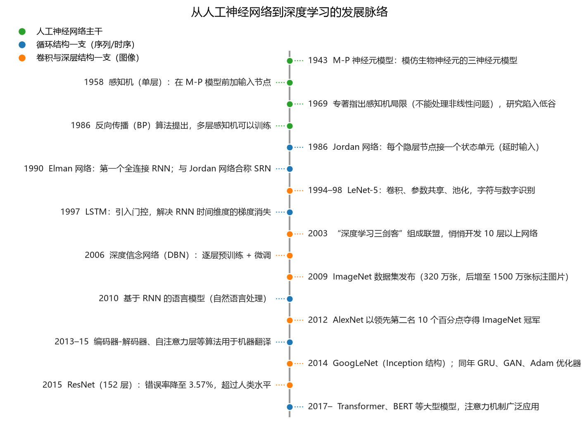

**图 11-1 从人工神经网络到深度学习的发展脉络**

### 11.2.2 循环结构一支：从简单循环网络到 LSTM

第 9 章讲过，多层感知机（BP 网络）的连接是"规整"的：层与层之间全连接、不跨层连接、同层节点之间也不连接。可是在 1986 年前后，就在大家普遍使用 BP 网络的同时，有一些研究者开始改变网络结构：

- **1986 年**，Michael I. Jordan 提出了 **Jordan 网络**，其结构上最大的特点是**每个隐含层节点都与一个状态单元相连**，用来实现延时输入；
- **1990 年**，Jeffrey Elman 提出了第一个全连接的循环网络，即 **Elman 网络**，同样是在隐含层节点之间（跨时刻）建立连接。

这两种网络都是从单层前馈网络出发构建递归连接的，合称**简单循环网络**（Simple Recurrent Network，SRN），已经可以处理延时输入等时间序列问题。它们与 BP 网络是同时代平行发展的产物。

- **1997 年**，Sepp Hochreiter 和 Jürgen Schmidhuber 提出了包含**门控**的**长短期记忆网络**（LSTM），解决标准 RNN 在时间维度上的梯度消失问题。所谓门控，就像电路里的闸门：闸门合上电就通过，拉开就不通过——用一个输出 0 到 1 的数来控制信息"传不传下去"。这是本章 11.4 节的主角。
- **2010 年**，Tomáš Mikolov 及其合作者提出了基于 RNN 的**语言模型**，把循环网络用于自然语言处理——语言序列本质上也是"字符带字符"的时间序列。
- **2013—2015 年**，Y. Bengio、D. Bahdanau 等提出了**编码器—解码器、自注意力层**等一系列 RNN 算法，并应用于机器翻译。
- **2014 年**，K. Cho 提出了**门控循环单元网络**（GRU），是 LSTM 的一个简化版本，也是 LSTM 之后另一个受到关注的门控构架。

为语言模型设计的这些 RNN 算法在随后的研究中启发了包括 **Transformer、XLNet、ELMo、BERT** 在内的大型模型——如今大家常用的大语言模型正源于这一脉络。

### 11.2.3 卷积结构一支：LeNet-5 与三大设计思想

另一大分支面向图像。用神经网络处理图像的需求非常实际：例如当年信封上邮政编码的识别——编码由数字（有的国家还有字母）组成，如果机器能自动识别字符，信件就能自动分拣。1998 年，Yann LeCun 发表了 LeNet 的经典论文《Gradient-Based Learning Applied to Document Recognition》（基于梯度的学习方法在文档识别中的应用）；其模型 **LeNet-5** 早在 1994 年就已开发出来，被认为是最早的卷积神经网络之一，利用**卷积、参数共享、池化**等操作提取特征，避免了大量的计算成本，最后再用全连接 ANN 完成字符和数字的分类识别。

LeNet-5 蕴含的三个设计思想，是 CNN 全部技巧的起点（图 11-2）：

1. **从全连接到局部连接**。用普通 BP 网络处理图像，隐层每个节点要与全部像素相连：一幅 100×100 的图像有一万个像素，隐层一个节点就要一万个权重，十个节点就是十万个，参数爆炸。改进的办法是让每个节点只连接图像的一个**局部窗口**（感受野），权重立刻大幅减少。
2. **参数（权值）共享**。局部连接之后权重还是有点多，于是进一步让扫过全图的窗口**共用同一组权重**——一个小小的卷积核从左上扫到右下，就用这极少的一组权重处理了整幅图像。
3. **池化（特征降维）**。把特征图分成一个个"池子"，每个池子取最大值（最大池化）或平均值（平均池化），用一个数代表一块区域，把多维信息降成更少维的信息。这也是一种降维的映射。

卷积本身就是"局部窗口与卷积核做哈达马积（逐元素相乘）再求和"，本质上与第 9 章神经元的 $wx+b$ 没有太大区别，只是作用在图像的局部窗口上；它的具体计算在 11.5.3 节展开。

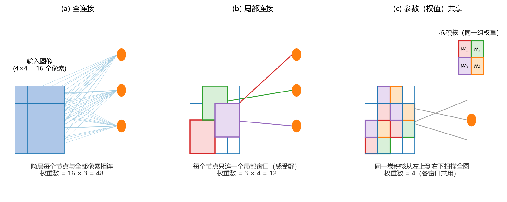

**图 11-2 从全连接到局部连接、参数共享（以 4×4 输入图像为例）**

### 11.2.4 深度学习三剑客与逐层预训练

时间来到 2003 年。当时神经网络研究正处于低谷——大家普遍在用三四层的 BP 网络，没人想到把层数加深会有好效果。在加拿大多伦多大学，Hinton（此前已在美国难觅神经网络研究的教职而北上多大）身边先后聚集了两位同道：曾在多大做博士后的 Yann LeCun，以及志同道合的 Yoshua Bengio。这三个人从 2003 年起组成"Deep Learning Conspiracy"（conspiracy 意为"联盟"，中文译作**深度学习三剑客**），悄悄开发了 10 层以上的人工神经网络。他们有两句很有代表性的话：

> LeCun："这种算法很有价值，不知为什么要放弃它。"
>
> Hinton："智能产生于人脑，所以从长远来说，人工智能应该像大脑系统一样工作。"

人脑有数百亿个神经元，而大家平常用的 BP 网络只有三四层，是不是网络太小了？但把层数拉长会带来严重问题——当时主要就是没想到怎么解决训练困难，大家才认为这条路走不通。

突破出现在 2006 年：Hinton 在《Science》上发表论文，提出**深度信念网络**（Deep Belief Network，DBN），其中最重要的贡献是**逐层预训练 + 微调**的训练策略，使训练深度模型变得相对容易。其思路是把深层网络看作多个小网络的嵌套（图 11-3）：

1. 把输入层和第一个隐层当成一个受限玻尔兹曼机（RBM），用原始数据训练它；
2. 把第一个隐层的输出当作新输入，与第二个隐层组成第二个 RBM 继续训练；
3. 如此逐层训练，直到最后一个隐层；
4. 最后再对整个网络用 BP 算法整体微调。

这样做的好处在于：传统 BP 训练要从**随机初始化**的参数出发反复迭代，层数一深就很难收敛；逐层预训练让每一层都先得到一个"不那么差"的初始值，最后的全局微调等于在一个较好的起点上做全局搜索，通常能取到比较好的参数。这一策略在一定程度上解决了用 BP 算法求解深层网络的困难。

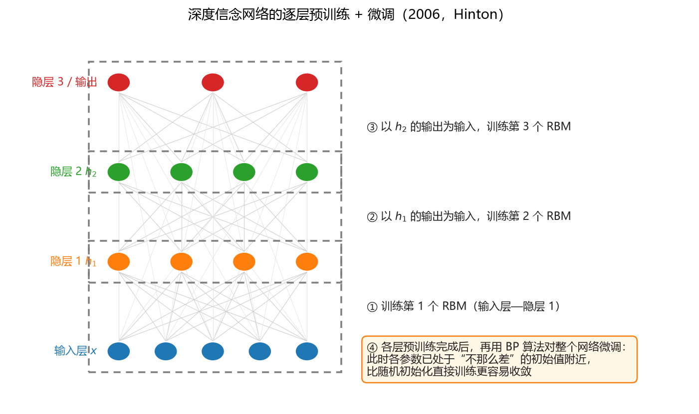

**图 11-3 深度信念网络的逐层预训练 + 微调**

### 11.2.5 ImageNet 数据集与 AlexNet

深层网络的训练方法有了，还差一把火——数据。2000 年前后，计算机视觉领域进展缓慢，华裔学者李飞飞（她研究计算机视觉，观察儿童认识周围事物的过程后）敏锐地指出：**问题不在于模型，而在于数据**——训练图像太少。2009 年，李飞飞团队用 Amazon 众包平台、花不多的钱收集了 320 万张（后增至 1500 万张）带标注的图片，发布了 **ImageNet** 数据库，并以它作为大规模视觉识别挑战赛（ILSVRC）的官方数据集。图片都标注了类别（最终达 1000 个对象类别），为大规模训练提供了基础。

2012 年，Hinton 组的学生 Alex Krizhevsky 带着以自己名字命名的网络 **AlexNet** 参加第三届 ILSVRC 竞赛，以超过第二名 10 个百分点的压倒性优势夺冠——要知道第二名、第三名分别是谷歌、Facebook 这样的大公司，彼此只差一两个百分点，而一个研究组里的学生超过了他们两大巨头 30 个百分点，立即引起广泛关注。AlexNet 的特点包括：

- 是**首个被广泛关注的 CNN 模型**（LeNet 虽更早，但直到这场比赛大家才认识到 CNN 处理大规模图像的威力）；
- 首次采用 **ReLU 激活函数**（见 11.5.6 节）；
- 用**最大池化**代替平均池化；
- 添加 **Dropout 层**，随机丢弃一部分参数以减小过拟合；
- 采用**数据扩增**技术：对已有图像做裁剪、旋转等变换，"凭空"扩充数据集，使数据规模与模型复杂度匹配；
- 使用 **2 块 GPU** 加速训练。

AlexNet 的结构如图 11-4 所示：输入为 227×227×3（RGB 三个颜色通道各一幅 227×227 的单色图），第一层卷积核 11×11、步幅 4，输出 55×55×96 的特征图，随后经最大池化、多轮卷积，最后展平为 4096 维特征向量，经两个全连接层和 Softmax 输出 1000 个类别的概率。

这里补充一下 **GPU**（Graphics Processing Unit，图形处理器，即显卡）：它是专门在个人电脑、工作站、游戏机和移动设备上做图像和图形相关运算的微处理器。显卡最初只负责图形的存储与传递，帮助 CPU 显示图像；后来它能够完成大部分图形处理计算，把这些并行线性计算从 CPU 分流出来。人们进而发现，GPU 擅长的并行线性计算恰好与 ANN 反向传播中的梯度更新类似，于是显卡被引入深度学习——AlexNet 用两块 GPU 加速训练正是其在硬件层面的关键。

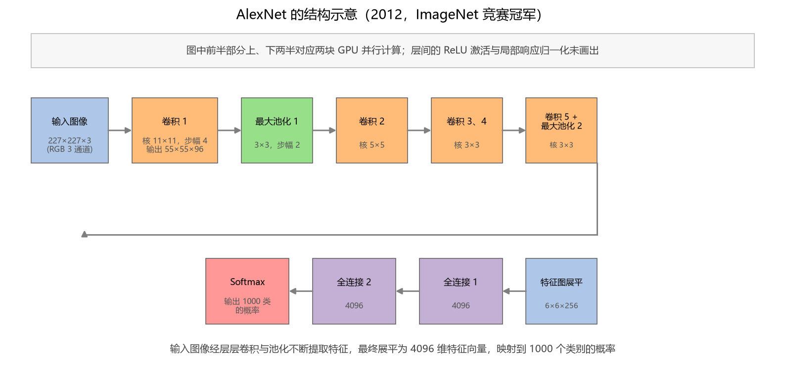

**图 11-4 AlexNet 的结构示意（2012）**

### 11.2.6 更深的网络：GoogLeNet 与 ResNet

2014 年，谷歌受 AlexNet 启发提出 **GoogLeNet**（注意不是 GoogleNet），获得当年 ImageNet 第一名。其最大特点是采用模块化的 **Inception 结构**：把几个卷积层串联再并联起来（"卷积串联 + 并联"），方便增添和修改；同时使用平均池化加全连接层，依然使用 Dropout；为避免梯度消失还增加了 2 个辅助分类器（Softmax）用于向前传导梯度。

2015 年，微软亚洲研究院的何恺明与同事开发了 **ResNet**（深度残差网络），在 ILSVRC2015 竞赛中夺得第一，网络深达 152 层，把错误率降到 3.57%——已经低于人类约 5% 的识别错误率。何恺明是地道的广州人，毕业于广州执信中学，保送清华后进入位于北京的微软亚洲研究院工作。他们开发的 ResNet 论文如今是计算机学科历史上引用量最高的论文之一。

ResNet 解决的是什么问题？当时存在一个自相矛盾的现象：理论上已经证明，网络加深性能应当更好；可实际观察中，普通网络变深后反而**难以训练收敛**——20 层网络的训练误差甚至比 56 层的更好。原因还是梯度：仍以 Sigmoid 为例，信号为 1 时每向后传递一层，梯度就衰减为 0.25，层数越多衰减越厉害（图 11-5(b)），梯度乘上学习率后加到参数上几乎等于没加，参数"停"在原地不动，无法有效调整。何恺明的办法是在网络中引入**捷径连接**（shortcut，跨层连接，见图 11-5(a)）：输入 $x$ 跨过中间两层卷积直接加到输出上，把学习目标从 $H(x)$ 改变为残差

$$F(x) = H(x) - x，\quad \text{即} \quad H(x) = F(x) + x$$

第 9 章讲多层感知机时强调过"没有跨层连接"，ResNet 恰恰反其道而行之。有了这条恒等映射的捷径，梯度可以"直达"前面的层，不再那么容易消失，网络加深后梯度照样可以计算，参数可以继续优化，准确率随深度提升——层数于是可以达到上百层甚至上千层。图 11-5(b) 直观对比了 Sigmoid 与 ReLU 两种激活函数下梯度随层数的衰减情况。

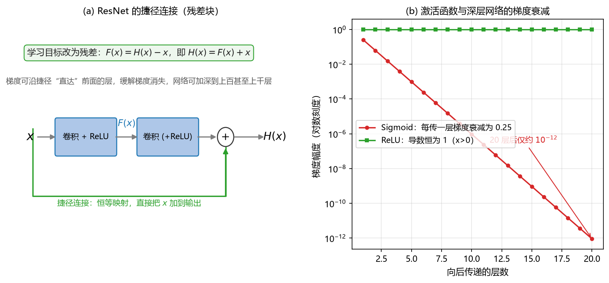

**图 11-5 ResNet 的捷径连接（残差块）与梯度随层数的衰减**

回顾这段历史会发现一条规律：研究从三个神经元起步，遇到解决不了的问题就陷入低谷，出现新算法（BP、门控、逐层预训练、ReLU、残差）后再爬升一个台阶；数据（ImageNet）与硬件（GPU）的推动，最终把深度学习推到今天的高度。

## 11.3 循环神经网络（RNN）模型

### 11.3.1 RNN 的概念

> **定义（循环神经网络）** 循环神经网络（Recurrent Neural Network，RNN）是隐含层的节点之间有连接、主要用于对序列数据进行分类、预测等处理的神经网络。

这个定义的前半句讲结构、后半句讲功能。结构上，它与 BP 网络（多层感知机）最大的区别就是**隐含层的节点之间（跨时刻）有连接**：BP 网络中某一层的节点只跟下一层连接——输入层连隐层、隐层连输出层，层内节点互不相连；RNN 却让隐层节点"自己连自己"（跨时刻）。功能上，它主要用于处理**输入是序列或时序**的问题。

RNN 的基本公式可以写成

$$h_t = f_W\left(h_{t-1},\, x_t\right) \tag{11-1}$$

即隐含层 $t$ 时刻的状态，与 $t-1$ 时刻的状态和 $t$ 时刻的输入有关。其中 $h_t$ 为 $t$ 时刻的隐含层状态，$x_t$ 为 $t$ 时刻的输入，$f_W$ 为带参数 $W$ 的激活函数（通常与 $t$ 无关）。对比 BP 网络：普通隐层只与当前输入 $x$ 相关；RNN 显式地把时间 $t$ 标记了出来，并多了一项 $h_{t-1}$。这个公式并不复杂——相当于把原来的 $wx+b$ 加上了"上一时刻的状态"这一路输入。

### 11.3.2 RNN 的结构

图 11-6 给出 RNN 结构的两种画法。折叠形式（图 11-6(a)）画一个节点，节点上有一个自循环的弧线，表示 $h_t$ 依赖上一时刻的 $h_{t-1}$；按时间展开形式（图 11-6(b)）把 $t-1$、$t$、$t+1$ 各时刻的单元依次画出来，就看得非常清楚：每个时刻的隐层节点接收两路输入——当前输入 $x_t$（权重 $U$）与上一时刻的隐层状态 $h_{t-1}$（权重 $W$），产生输出 $o_t$（权重 $V$）。

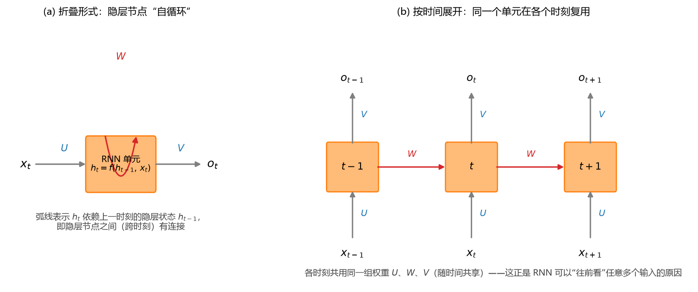

**图 11-6 RNN 的结构：折叠形式与按时间展开形式**

有一个重要细节：由于序列可以很长（几十、上百个时刻），为了减少参数，**各时刻共用同一组权重 $U$、$W$、$V$**——输入权重、状态递推权重、输出权重都随时间共享（保持一致）。这纯粹是为了简化计算、让参数少一点，也可以理解为假设"信号在不同时刻的增强效果是一样的"；实际中也可以不共享。权重随时间共享正是 11.3.6 节将总结的 RNN 优点之一。

### 11.3.3 RNN 的计算公式与"往前看"

写成具体的计算公式，RNN 每个时刻做两件事：

$$o_t = g\left(V h_t\right) \tag{11-2}$$

$$h_t = f\left(U x_t + W h_{t-1}\right) \tag{11-3}$$

其中 $f$、$g$ 为激活函数，$U$、$W$、$V$ 为权重（偏置可加可不加，也可以并入激活函数的参数里，这里从简）。

式（11-3）是迭代式：把 $h_{t-1}$ 再按式（11-3）展开，$h_{t-1} = f(Ux_{t-1} + Wh_{t-2})$，如此一层层往前代入，最终得到

$$o_t = V\, f\!\left(U x_t + W f\!\left(U x_{t-1} + W\, f\!\left(\,\cdots\, f\!\left(U x_1 + W h_0\right)\right)\right)\right) \tag{11-4}$$

这个展开式说明了一件重要的事：**当前时刻的输出 $o_t$ 与当前及之前任意多个时刻的输入 $x_t, x_{t-1}, x_{t-2}, \ldots, x_1$ 都有关**——这就是"RNN 为什么可以往前看任意多个输入值"的原因。BP 网络某次只吃进一个时刻的数值；RNN 却把整段历史串在了一起。

### 11.3.4 RNN 的三种输入输出结构

RNN 的结构非常灵活，按输入、输出的对应关系可以组织成三种典型形态（图 11-7）：

1. **多对多**（序列到序列）：输入 $x_1, x_2, \ldots, x_T$，各时刻分别输出 $y_1, y_2, \ldots, y_T$。典型应用是大词汇连续语音识别、机器翻译——输入一段语音序列或一种语言的文字序列，输出另一段序列。
2. **多对一**：输入是一段序列，只取最后一个时刻的输出作为一个 $y$。典型应用是动作识别、行为识别、单词量有限的语音识别。比如很多人戴的智能手环/智能手表：把一天的动作序列输进去，就能识别出你在走路、跑步还是做其他运动——这正是"多输入、单输出"的 RNN 结构。
3. **一对多**：输入是一个 $x$（往往是一个较复杂的多媒体对象，如图像或一段文本），输出是一个序列 $y_1, y_2, \ldots, y_T$。典型应用是文本生成（见下节"古诗接龙"）和看图说话（输入一幅图像，输出一句描述它的文字）。

无论哪种形态，"隐层节点依赖上一时刻状态"的骨架不变，输入输出则完全根据所处理的问题来设定。

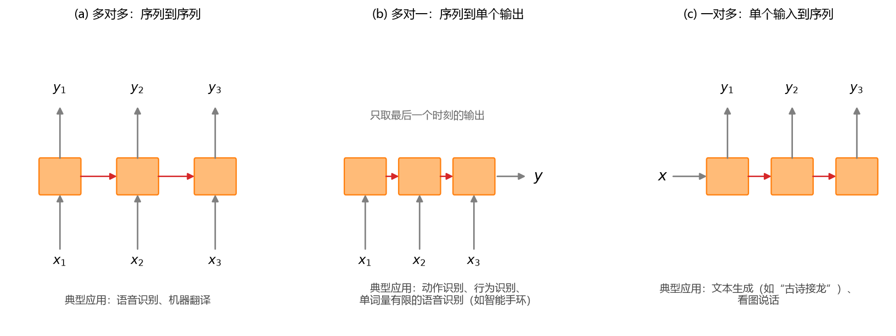

**图 11-7 RNN 的三种输入输出结构**

### 11.3.5 RNN 的训练方式

RNN 的训练仍然是 BP 类算法，特点是先**沿时间轴展开**再求导，具体有两种方式：

1. **全展开训练**：把所有时刻的输入、隐层、输出都展开，前向计算后，将每一个时刻 $t$ 的损失函数（LOSS）相加作为总的目标函数，逐级求导、逐层反传。对大数据而言这种方式有时不太理想。
2. **截断训练**：结构照样展开，但训练时把 RNN **截断有限步**，只对有限步求导（只取一部分时刻的损失函数参与计算）。这样求导更高效，是实际中常用的折中。

### 11.3.6 RNN 的典型应用：文本生成与翻译

RNN（及其变种）最典型的应用是自然语言处理中的**文本生成**。可以先用中国古诗集训练网络：输入一首诗的前面几个字或一句诗，输出后面的字句；训练好之后，随机给几个字开头，模型就能"接龙"续写出整首诗（课程演示中，网络在训练若干首古诗之后，能以前文生成新的诗句）。**机器翻译**则是多对多结构的成功商业应用：德译英、中译英如今已被广泛使用，虽然复杂段落仍不完美，但较传统方法提高非常多——其背后的模型正是循环神经网络及其变种。

### 11.3.7 RNN 的优点与缺点

**RNN 的优点**：

1. 可以处理**任意长度**的输入（不管序列多长都能处理）；
2. **模型形状不随输入长度增加**——可以人为限定一次进入模型的时间步数（如固定窗口为 10 或 20 个字符），模型结构固定；
3. 计算考虑了**历史信息**（前面有限长度的历史信息被考虑进来）；
4. **权重随时间共享**（随时间不变），参数量不随序列长度增长。

**RNN 的缺点**：

1. 一起算的话**计算速度慢**，训练尤其费时；
2. **难以获取很久以前的信息**，很难捕捉长期的依赖关系——因为模型只截取了一段输入进来；
3. 求解时梯度随层数（时间步数）**呈指数递减或递增**，会经常遇到**梯度消失和梯度爆炸**现象：梯度太小，参数更新就"没有进展"；太大就"蹦来蹦去"不收敛（这两种现象正是 11.2.6 节 ResNet 一节反复提到的）；
4. **无法考虑当前状态的任何未来输入**——它只"往后看"。

任何模型都是有一定优点、也有一定缺点的，大家要记得这一点。RNN 的梯度问题，正是下一节 LSTM 出场的原因。

## 11.4 长短期记忆网络（LSTM）模型

### 11.4.1 LSTM 的概念

**长短期记忆网络**（Long Short-Term Memory Network，LSTM）是 RNN 中一种非常成功、最经典的变种：**输入仍然是序列或时序问题，输出同样可以是数值、类别或序列，训练也照旧**——变化全在单元内部。其特点如下：

- **增加 RNN 单元的复杂程度**，使模型更复杂、增强系统的表现力；
- 误差反向传播更方便和直接，**梯度更新避免了 RNN 长期依赖导致的爆炸或消失现象**；
- 实践中建议：凡涉及 RNN 的应用，都直接用 LSTM 或 LSTM 的相关变种——如今做时序问题的应用，基本上不再选普通 RNN，而选 LSTM 这类网络。

### 11.4.2 细胞状态与三道门

与 RNN 相比，LSTM 最大的结构变化是引入了**细胞状态**（cell state）的概念。RNN 只有一个隐层节点代表状态、只考虑最近的状态；LSTM 则在隐层之外多加了一路"细胞状态"，让它来决定**哪些状态应该被留下来、哪些状态应该被遗忘**，从而把长期的依赖关系表达出来。可以把细胞状态想象成一条"传送带"：长期信息沿它直通下游，中途由几道"闸门"控制留多少、写多少、放多少。

具体地，LSTM 的单元分成四个部分：

1. **哪些细胞长期状态应该被遗忘**——由**遗忘门**控制；
2. **哪些当前即时状态应该被输入**——由**输入门**控制；
3. **当前长期状态 = 过去长期状态 + 当前即时状态**——这一步**不控制**（前两步已分别把关）；
4. **哪些当前长期状态应该被输出给隐含层**——由**输出门**控制。

图 11-8 画出了完整的 LSTM 单元结构。图中上一时刻的长期状态 $C_{t-1}$ 从左上沿细胞状态主线进入，先经 $\otimes$（乘法门，逐点相乘——信息**选择**通过）与遗忘门 $f_t$ 相乘，再经 $\oplus$（加法门，逐点相加——信息**合并**通过）与"输入门调制后的即时状态"相加，得到当前长期状态 $C_t$ 输出；下方 $h_{t-1}$ 与 $x_t$ 两路输入汇成一条横线，向上分送给各道门。每道门都是一个 $\sigma$（Sigmoid）层——输出 0 到 1 之间的数，像电路的闸门：0 相当于"拦住"（乘以 0 就丢掉），1 相当于"放行"（乘以 1 就保留），0 与 1 之间则部分通过。

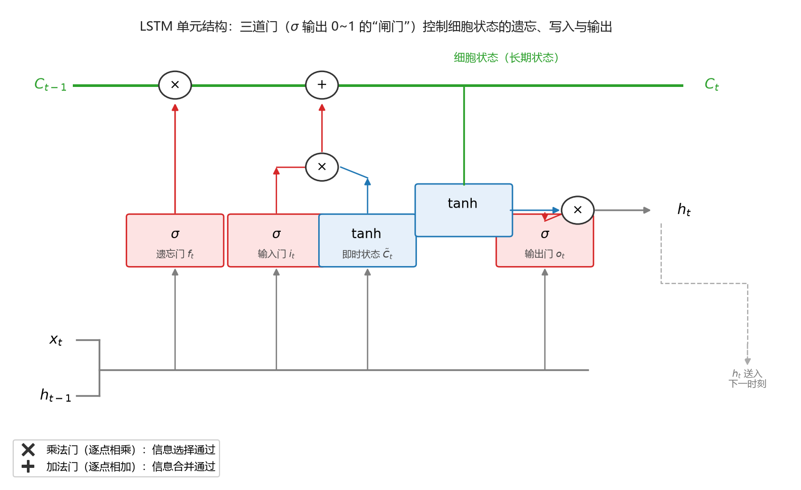

**图 11-8 LSTM 单元结构（三道门控制细胞状态的遗忘、写入与输出）**

### 11.4.3 LSTM 的计算公式

把图 11-8 的结构写成公式，共六步。三道门与即时状态都由上一时刻的隐层状态 $h_{t-1}$ 和当前输入 $x_t$ 决定（$[\,h_{t-1}, x_t\,]$ 表示两路输入的拼接，$\sigma$ 为 Sigmoid 函数，$\odot$ 为逐点相乘）：

**遗忘门**：控制过去的长期状态被"忘掉"多少，

$$f_t = \sigma\left(W_f \cdot [\,h_{t-1}, x_t\,] + b_f\right) \tag{11-5}$$

**输入门**：控制当前的即时状态被"写入"多少，

$$i_t = \sigma\left(W_i \cdot [\,h_{t-1}, x_t\,] + b_i\right) \tag{11-6}$$

**当前即时状态**（候选状态）：描述当下这一步"想写入"的新内容。因为它的取值可正可负，所以用值域为 $[-1, 1]$ 的 $\tanh$，而不是值域 $[0, 1]$ 的 $\sigma$——回忆第 9 章，$\tanh$ 相当于把 Sigmoid 向下平移，使其关于 0 对称：

$$\tilde{C}_t = \tanh\left(W_C \cdot [\,h_{t-1}, x_t\,] + b_C\right) \tag{11-7}$$

**当前长期状态**：过去长期状态乘遗忘门，加上即时状态乘输入门——对应"四个部分"里的第 3 条，此处不再另设门：

$$C_t = f_t \odot C_{t-1} + i_t \odot \tilde{C}_t \tag{11-8}$$

**输出门**：控制当前长期状态输出给隐含层多少，

$$o_t = \sigma\left(W_o \cdot [\,h_{t-1}, x_t\,] + b_o\right) \tag{11-9}$$

**当前隐含层状态**：长期状态先经 $\tanh$ 压到 $[-1, 1]$，再与输出门逐点相乘，得到 $h_t$——它一路送给输出，也送入下一时刻的单元：

$$h_t = o_t \odot \tanh\left(C_t\right) \tag{11-10}$$

这套公式看上去有点复杂，但对照"四个部分"逐条读，就会发现它不过是把"传送带上装三个闸门"这句话翻译成了数学。

### 11.4.4 LSTM 与 RNN 的比较

图 11-9 把两种单元放在一起对比。RNN 单元是**两个输入、一个输出**：$h_{t-1}$ 与 $x_t$ 连环到一起，经一个 $\tanh$ 变换直接输出 $h_t$，只考虑最近时刻的状态。LSTM 为了记住长期状态，在 RNN 基础上**增加了一路输入和一路输出**——增加的就是细胞状态 $C_{t-1} \to C_t$；加上三道门的控制，长期信息不再"过一层就被压缩一次"，爆炸或消失现象得到有效缓解。

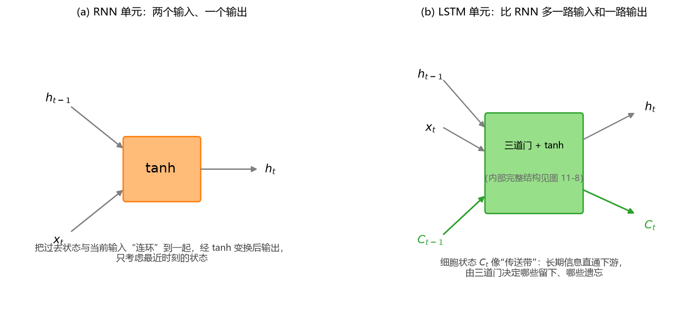

**图 11-9 LSTM 单元与 RNN 单元的比较**

### 11.4.5 LSTM 的结构特点与变体

总结 LSTM 的结构特点：

1. **门结构**：在节点之间增加了选择性的连接，用 Sigmoid 型函数输出 0 到 1 之间的数来控制；
2. **增加深度**：除了原有的隐层状态 $h_t$，又加了"细胞状态"这一层（长期状态、即时状态），并把 $t, t-1, \ldots, t-i$ 各时刻的状态显式表达出来——本质上还是把网络的深度增加了，符合深度学习"特征学习 + 增加深度"的普遍规律，模型的表达能力更强；
3. **长期依赖**：通过细胞状态，把比较长远的依赖关系表达了出来。

LSTM 本身也是一大类模型，变种非常多。常用的 **GRU**（门控循环单元）就是它的简化版本——三道门简化为一到两道。事实上，门的数量也未必非得是三道：最开始提出三道门、效果不错，大家就普遍认可了这一基本结构；后来发现对某些特殊问题，两道门甚至一道门反而更好。只要是类似的结构，都能起到比普通 RNN 更好的时序处理效果。

## 11.5 卷积神经网络（CNN）模型

### 11.5.1 CNN 的概念

> **定义（卷积神经网络）** 卷积神经网络（Convolutional Neural Networks，CNN）是一类包含卷积计算且具有深度结构的前馈神经网络，是深度学习的代表算法之一（与 LSTM 并列）。

CNN 主要用于处理**输入是图像数据**的问题（也能处理视频，甚至序列）。它的"由来"很有意思：据说是仿造生物的**视知觉机制**构建的——生物学家研究猫的视网膜时发现，视觉信号是一层一层（分层）处理的，研究者受此启发提出了卷积操作，再叠加多层，形成了卷积神经网络。CNN 能够进行**平移不变分类**（目标在图像中挪个位置照样认得）。历史上对 CNN 的研究始于 20 世纪 80 至 90 年代，11.2.3 节讲过的 LeNet-5 是较早出现的卷积神经网络，直到 AlexNet 在 2012 年夺冠，大家才真正认识到它的威力。

### 11.5.2 CNN 的结构特点

CNN 与 BP 网络最大的区别有两点：**有卷积计算**、**层数加深**。其余技巧基本都是围绕这两点、为"便于求解"而加的。表 11-3 把常见构件按目的归类：左边两列（减少参数、便于求解）服务于深层网络的**可训练性**，右边一列（特征学习、增加深度）才是 CNN 的立身之本——层数越多，学到的特征越全局化；这些构件合在一起，把"低级特征组合成高级特征表示"。

**表 11-3 CNN 的结构特点及其作用**

| 目的 | 构件 | 说明 |
|------|------|------|
| 减少参数 | 局部卷积 | 卷积只作用于局部窗口，不是全图 |
| 减少参数 | 参数共享 | 扫描全图的卷积核共用同一组权重 |
| 减少参数 | 多卷积核 | 多个卷积核并行提取多种特征 |
| 减少参数 | 池化操作 | 降采样，进一步压缩特征图 |
| 减少参数 | 丢弃（Dropout） | 训练时随机置零一部分连接 |
| 特征学习、增加深度 | 多层处理 | "卷积 + 池化"反复堆叠，层层提取特征 |
| 便于求解 | ReLU 激活函数 | 新型激活函数，缓解梯度消失 |
| 便于求解 | Softmax 层 | 多分类输出层 |
| 便于求解 | 交叉熵损失函数 | 分类问题的损失函数 |
| 便于求解 | 训练策略 | 改进的 BP 类求解算法与训练技巧 |

### 11.5.3 卷积的具体实现

图 11-10 用一个数值例子讲清卷积操作，这个例子值得反复回看。

- **原始图像与矩阵**：一幅图像（图为示意，左块取值 2、右块取值 9）按像素值写成二维矩阵；必要时在**外围补一圈 0**（填充，padding），让边缘的数据也能被充分利用。补零完全是为了计算方便，没有特别高深的含义。
- **局部窗口（感受野）与卷积核**：从矩阵左上角取一个 3×3 的**局部窗口**；再准备一个同样大小的**卷积核**（也叫滤波器），图 11-10(b) 中为边缘检测核——四周都是 $-1$、中间是 $8$。
- **卷积计算**：窗口与卷积核做**哈达马积**（Hadamard product，逐元素相乘）再求和，得到一个数，作为输出特征图的第一个值。这与第 9 章的 $wx+b$ 本质相同，只是作用在局部窗口上。
- **扫描**：窗口按一定**步幅**从左上到右下依次滑动，每滑一处算一个数，扫完一遍就得到新的二维矩阵——**特征图**（feature map）。

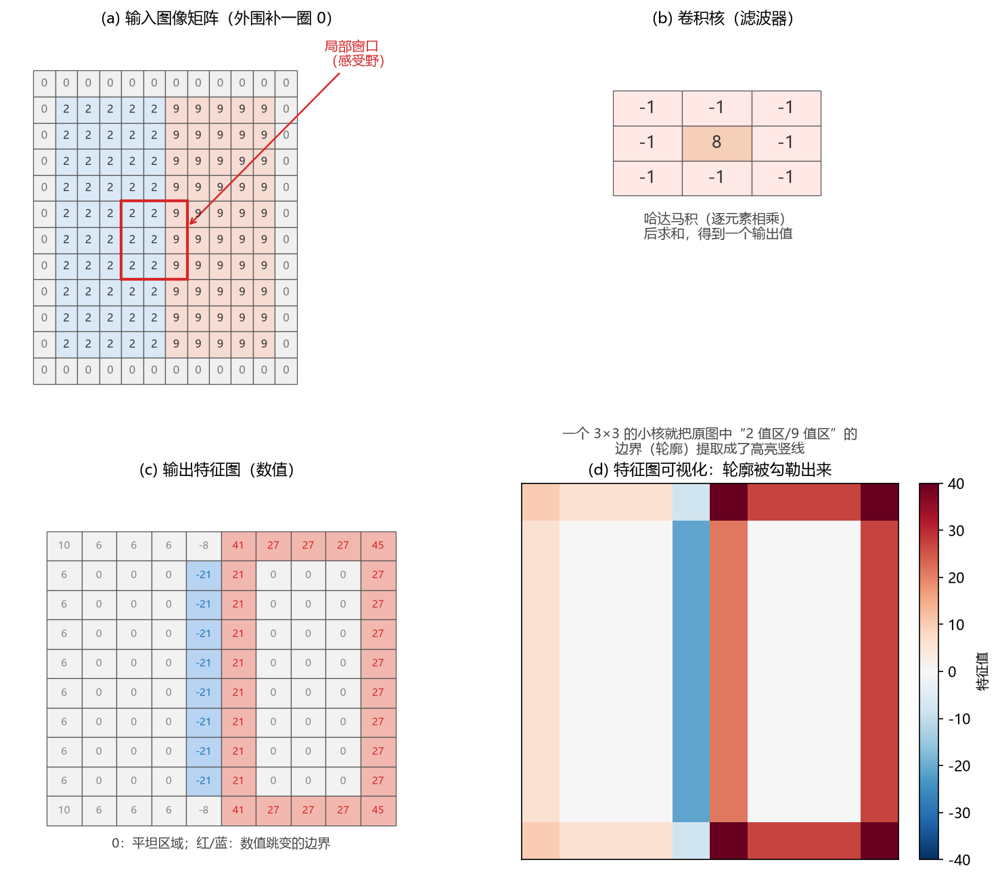

**图 11-10 卷积的具体实现：3×3 卷积核扫描图像得到特征图**

令人惊讶的是结果（图 11-10(c)、(d)）：输入左半是 2、右半是 9 的图像，经这个小小卷积核一扫，**0（平坦区域）处仍是 0，而"2/9 交界处"出现了 −21 与 21 的高亮竖线——原图的轮廓（边缘）被勾勒出来了**！如此简单的操作、如此少的权重（9 个），就把图像的一类特征提取了出来。可以想见，后面再接卷积、池化等操作，就能在此基础上一层一层把更高维的特征提取出来。

若输入大小为 $N\times N$、卷积核 $K\times K$、步幅为 $S$、填充圈数为 $P$，则输出特征图的大小为

$$O = \left\lfloor \frac{N + 2P - K}{S} \right\rfloor + 1 \tag{11-11}$$

例如 5×5 输入、3×3 核、步幅 1、不填充：$O=(5-3)/1+1=3$。这个公式很容易自行推导验证。

### 11.5.4 步幅、填充与扩张卷积

卷积还有几种常用的变形（图 11-11）：

- **步幅（stride）**：滤波器一次移动的格数。步幅 1 是逐格扫描；步幅 2 则跳着扫，输出更小（图 11-11(a)、(b)）。
- **填充（padding）**：给输入边界补 0 以增大其大小。好处一是可以让输出与输入一样大（如 5×5 补一圈 0 后经 3×3 核仍是 5×5），二是把边缘像素更好地利用起来——不补零时，边缘数据从一开始就"吃亏"（图 11-11(c)）。
- **扩张卷积（dilated convolution）**：在滤波器元素之间插入"空洞"来扩展滤波器。图 11-11(d) 中扩张系数为 2 的 3×3 核，等效于一个 5×5 核，**感受野**（层可以看到的输入区域）扩大了，而参数个数与计算量并不增加。

此外，滤波器中的权重数为 $h \times w \times c$（$h$ 高度、$w$ 宽度、$c$ 输入通道数）——彩色图像有 RGB 三个通道，卷积核也要相应有三份。

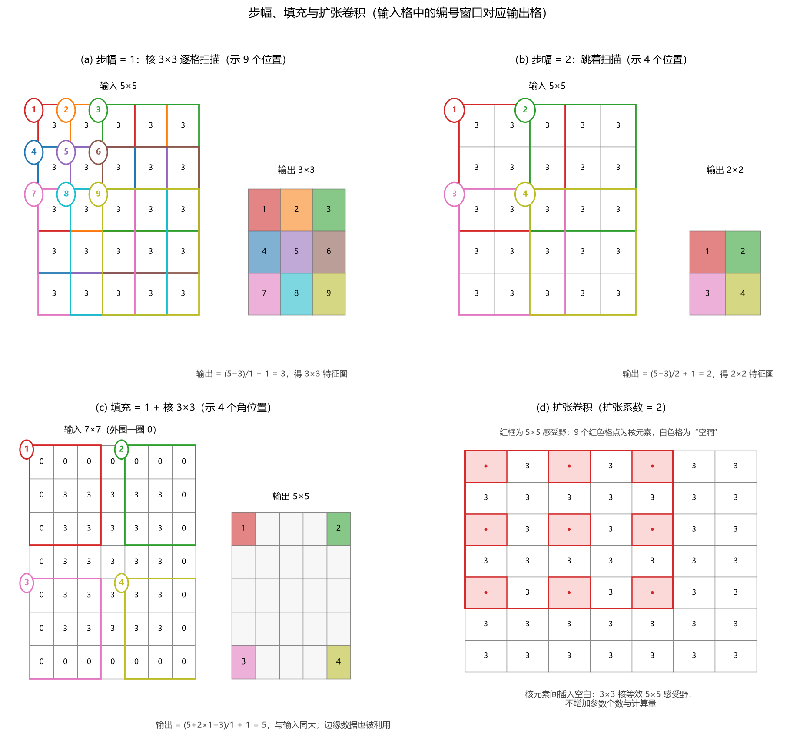

**图 11-11 步幅、填充与扩张卷积（编号窗口与输出格对应）**

### 11.5.5 池化处理

卷积得到的特征图往往还是太大（实际中可能是几百乘几百），需要进一步压缩，这就是**池化**（pooling，也叫降采样，down-sampling）：对特征图分窗，在窗口（"池子"）内**取最大值**（最大池化）或**取平均值**（平均池化）来代表整个窗口（图 11-12）。比如 20×20 的图分成四个 10×10 的池子，每池取一个数，就得到 2×2——一个格子代表了原来的 100 个格子。

池化的优点有三：

1. **降维**（最主要的好处）：特征图变小，后续连接的参数减少，模型结构精简；
2. **克服过拟合**：参数少了，过拟合风险随之降低；
3. 在图像识别领域，池化还能提供**平移和旋转不变性**。

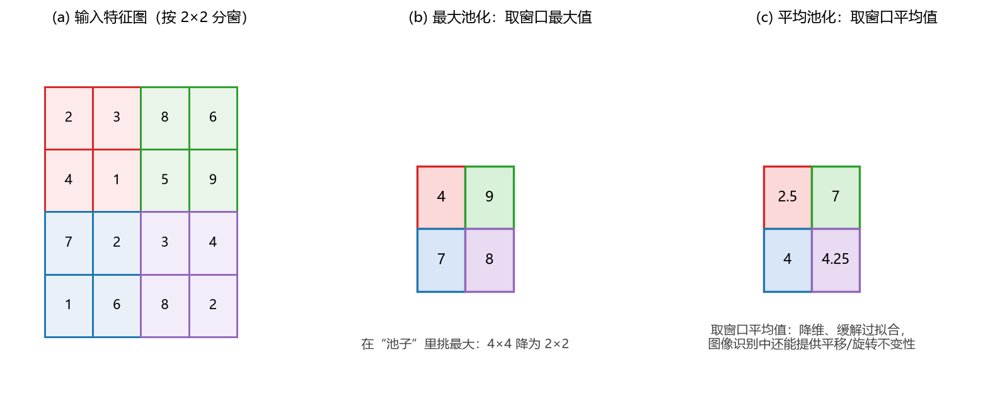

**图 11-12 最大池化与平均池化（2×2 窗口）**

### 11.5.6 新型激活函数与训练策略

深层网络沿用第 9 章的 Sigmoid、tanh 激活函数会出问题：它们的导数在大部分区间很小（Sigmoid 导数峰值只有 0.25），层层连乘之后梯度迅速消失，参数练不动。于是 CNN 引入了一批"层化"的新构件——在深度学习框架里，激活函数、损失函数等常常被直接当作网络的一层来搭建。

**（1）ReLU 激活函数层。** ReLU（修正线性单元）的定义是

$$f(x) = \max(0,\, x)$$

即 $x \geq 0$ 时原样输出、$x < 0$ 时输出 0（图 11-13(a) 红线）。它的导数只有两个取值：$x>0$ 时为 **1**，$x<0$ 时为 **0**（图 11-13(b)）。这带来三个好处：

- **计算速度快**：不用算指数，一个判断即可；
- **收敛速度快**：导数为 1 时梯度原样反传、不衰减，**比较好地解决了梯度消失问题**；
- **相当于简化网络结构**：输入为负的神经元输出 0，对网络不起作用、无需更新，等于临时"剪掉"了一部分节点，减小了过拟合风险。

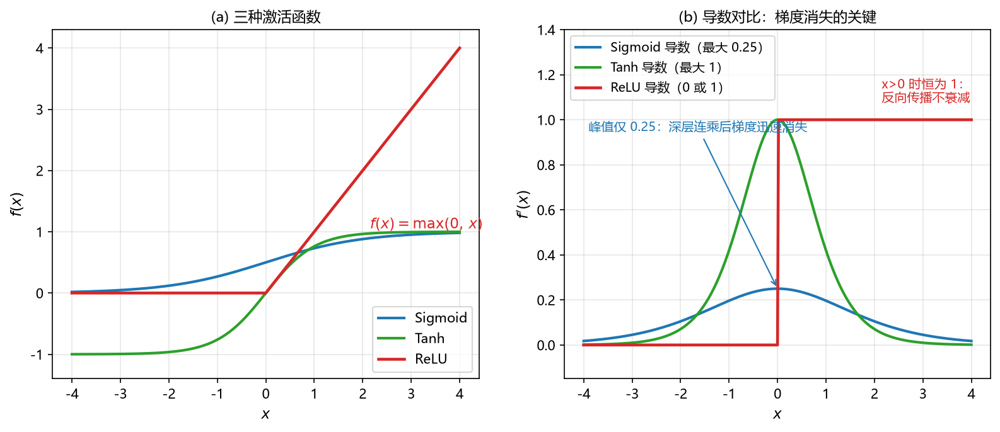

**图 11-13 Sigmoid、tanh 与 ReLU 激活函数及其导数**

后来还出现了泄漏 ReLU（Leaky ReLU，$x<0$ 时乘一个小系数而非置 0）等变形，此处不展开。

**（2）Dropout（丢弃）层。** 训练时**每一批都随机把一部分输入元素置零**（按给定概率 $p$ 丢弃），相当于每批训练的都是一个"瘦身"后的子网络；下一批重新随机丢弃。这既减少了训练参数、降低了过拟合风险，也提高了训练效率。**测试时所有神经元都用上**，但权重要乘上 $(1-p)$ 以保持量级一致。很多学者把 Dropout 看作一种**集成学习**：每次采样出一个子网络，最终的模型近似于不同子网络的组合。

**（3）批标准化（Batch Normalization，BN）层。** 对上一层网络的输出做标准化处理（一般归一化到标准正态分布），减少分布偏移。BN 一般加在每一层的非线性激活函数之前，让后续求偏导在一个比较好的数值范围内进行，加快训练收敛、降低对初始化的敏感度。

**（4）Softmax 多分类层。** 普通二分类问题可以用 Sigmoid；深度学习直接内置了多分类层。设上一隐层输出为 $z_1, z_2, \ldots, z_m$（$m$ 为类别数），Softmax 把它们变换为

$$\mathrm{softmax}(z_i) = \frac{e^{z_i}}{\sum_{j=1}^{m} e^{z_j}} \tag{11-12}$$

每类一个节点，输出 0 到 1 之间、且全组之和为 1，可视为各类别的概率。举个例子：某样本上一层输出 $z = (3,\ 2,\ -2)$，则

$$e^z = (20.1,\ 7.4,\ 0.14),\quad \sum e^{z_j} = 27.6,\quad \mathrm{softmax}(z) \approx (0.73,\ 0.27,\ 0.005)$$

第一个分量概率最高，就预测为第一类。

**（5）交叉熵损失函数层。** 分类训练时通常接交叉熵损失：设真实类别的独热（one-hot）向量 $p=(1,0,0)$（"1"的位置即真实类别），预测分布 $q=\mathrm{softmax}(z)$，则

$$L = -\sum_{i=1}^{m} p_i \log q_i \tag{11-13}$$

以上例代入：$L = -\log 0.73 \approx 0.31$。**交叉熵越小，真实分类与预测分类的两个分布越接近**——网络训练的目标就是把它降下来。

### 11.5.7 多层处理：从局部特征到高层特征

把前面各构件组装起来，就得到一个典型的 CNN（图 11-14）：**输入图像 →（卷积 → ReLU → 池化）×若干轮 → 展平 → 全连接层 → Softmax 分类**。一层卷积及降采样往往只学到局部的特征（边缘、纹理）；层数越多，学到的特征越全局化（从部件到整体）——低级的特征逐层组合成更高级的特征表示。最终送入全连接层的已是高度抽象的特征，用"简单模型"即可完成分类。

这里可以与第 10 章的 SVM 呼应一下：很多在原始空间线性不可分的问题，映射到高维空间后变得线性可分。CNN 的多层处理正是把原始特征逐层变换到更高维的特征空间——在高维空间里再做（线性）分类，往往就能得到很好的结果。虽然看起来结构复杂，但基本构件就是"卷积、激活、池化"这几样，反复堆叠而已。

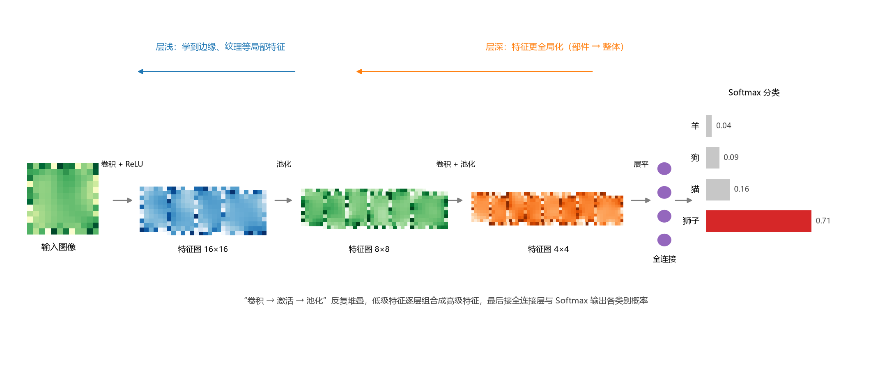

**图 11-14 多层处理：卷积与池化逐层提取特征，最后接全连接层与 Softmax 分类**

## 11.6 用 MATLAB 构建深度学习模型

### 11.6.1 深度学习的主要框架

实现深度学习的框架非常多，各有优劣（表 11-4）。擅用 Python 的读者可能更熟悉 TensorFlow、PyTorch；本书课程口径仍以 MATLAB 为主——它天生支持矩阵运算，深度学习工具箱日益完善，**代码简洁规范、容易入门、文档规范**，还能与主流框架互相导入导出模型，是一般应用非常方便的选择。有了 MATLAB 深度学习的基础，再转 TensorFlow、PyTorch 等其他框架并不困难。

**表 11-4 深度学习的主要框架**

| 框架 | 优点 | 缺点 |
|------|------|------|
| TensorFlow（谷歌，底层 C++，前台支持 Python 等多语言） | 最流行、社区强大，适合部署生产环境 | 系统设计过于复杂，接口频繁变动、晦涩难懂，文档混乱，相对底层 |
| Keras（纯 Python 编写，后端可为 TensorFlow 等） | 入门最简单，把底层函数都封装好 | 构建于第三方框架之上，不够灵活、使用受限 |
| Caffe/Caffe2（后由 Facebook 维护） | 性能优异，几乎全平台支持，配置文件设置模型，适合生产环境 | 文档不够完善，主要支持卷积模型，新层需要自编程 |
| PyTorch（Facebook 维护） | 简洁、面向对象设计优雅，文档完整、有渐进指南 | 没有 Keras 简洁，一些功能不易实现 |
| CNTK（微软） | 性能据称比上述主流框架都强 | 最初在微软内部开发，文档难懂、推广不给力 |
| MATLAB | 代码简洁规范、易用性好、容易入门，文档规范；可导入导出主流框架模型；性能与灵活性不断提高 | 起步较晚，早期性能与灵活性有限（均在持续改进） |

### 11.6.2 三种情景与两大方式

在 MATLAB 里构建深度学习模型，可以先问两个问题：模型从哪来？用什么方式搭？

**模型来源**上大体有三种情景、三种对策（表 11-5）。情景一：MATLAB 里还没有、其他框架已有的预训练模型——对策是**导入**（三种途径：用 `importKerasNetwork` 等函数直接导入；与 Python 混合编程调用；或经 **ONNX**（开放式神经网络交换格式）这个"中间格式"中转，各家框架都能导出/导入，网络结构与训练好的参数随之一并转移）。情景二：MATLAB 已经收录的预训练模型（工具箱自带，或在其官网上以附加包形式提供）——对策是**迁移学习**：直接使用，或替换、微调最后几层（最后几层与本问题最相关，比如把 1000 类的分类头改成自己需要的类别数）后再训练。情景三：问题规模不大、想自己构建——对策是**从头构建新模型**，建议先模仿 MATLAB 文档中的典型例子代码（表 11-9），再改成自己的网络。

**表 11-5 MATLAB 构建深度学习模型的三种情景与对策**

| 情景 | 对策 | 编程 | GUI |
|------|------|------|-----|
| 其他框架已有预训练模型，MATLAB 没有 | 直接导入 / 混合编程调用 / 经 ONNX 格式导入导出 | √ | √ |
| MATLAB 已收录该预训练模型 | 迁移学习：直接使用 / 改最后几层后微调 | √ | √ |
| 问题较简单或无现成模型 | 从头构建：模仿典型例子代码 | √ | √ |

**搭建方式**上则有两类：一是像其他机器学习方法一样**编程**调用函数；二是用 MATLAB 专门的 GUI 应用——**深度网络设计器**（Deep Network Designer），以"搭积木"的方式点选、拖拽各层，把网络结构画出来，还可以随时**分析**网络（自动检查各层维度是否衔接、统计参数个数），建好后再导出到工作区或导出为代码。两种方式可以结合使用，对初学者非常友好。

### 11.6.3 预训练网络与迁移学习

为什么要用预训练网络？因为从头训练一个深层网络代价很高（表 11-6）：需要数千到数百万张已标注图像，计算量大到必须借助 GPU，训练真实问题要几天到几周。而**迁移学习**只需数百到数千张（小数据集）新标注图像，在预训练网络基础上再训练（微调），普通 GPU 甚至 CPU 数秒到数分钟即可完成，精度通常也不错——往往比自己从头建一个模型还好。预训练网络的初始结构和参数已经"离理想值比较近"，新数据只需把它拉近到你的问题上即可。

**表 11-6 创建新网络与使用预训练网络迁移学习的比较**

| 考虑因素 | 创建新的深度网络 | 使用预训练网络进行迁移学习 |
|----------|------------------|----------------------------|
| 训练数据 | 数千到数百万张已标注图像 | 数百到数千张已标注图像（小） |
| 计算量 | 大（需要 GPU 提速） | 中等（可选择使用 GPU） |
| 训练时间 | 解决真实问题需几天到几周 | 数秒到数分钟 |
| 模型准确度 | 高，但较小数据集可能过拟合 | 好，取决于预训练模型 |

大多数预训练网络基于 **ImageNet** 数据库的子集训练，用于 ImageNet 大规模视觉识别挑战赛（ILSVRC）：这些网络已在超过一百万张图像上训练过，能区分 1000 个对象类别（键盘、咖啡杯、铅笔、多种动物等）。表 11-7、表 11-8 列出 MATLAB 中可直接导入的常见预训练网络及其结构参数。使用时要注意：**每个网络的图像输入尺寸（如 227×227、224×224）是固定的**——输入层尺寸决定了其后各层特征图的大小，因此你的新图像必须先缩放到与预训练网络要求相同的尺寸，否则维度对不上会直接报错。

**表 11-7 MATLAB 中常见的预训练网络（一）**

| 网络 | 深度 | 大小 | 参数（百万） | 图像输入 |
|------|------|------|--------------|----------|
| squeezenet | 18 | 5.2 MB | 1.24 | 227×227 |
| googlenet | 22 | 27 MB | 7.0 | 224×224 |
| inceptionv3 | 48 | 89 MB | 23.9 | 299×299 |
| densenet201 | 201 | 77 MB | 20.0 | 224×224 |
| mobilenetv2 | 53 | 13 MB | 3.5 | 224×224 |
| resnet18 | 18 | 44 MB | 11.7 | 224×224 |
| resnet50 | 50 | 96 MB | 25.6 | 224×224 |
| resnet101 | 101 | 167 MB | 44.6 | 224×224 |
| xception | 71 | 85 MB | 22.9 | 299×299 |
| inceptionresnetv2 | 164 | 209 MB | 55.9 | 299×299 |

**表 11-8 MATLAB 中常见的预训练网络（二）**

| 网络 | 深度 | 大小 | 参数（百万） | 图像输入 |
|------|------|------|--------------|----------|
| shufflenet | 50 | 5.4 MB | 1.4 | 224×224 |
| nasnetmobile | — | 20 MB | 5.3 | 224×224 |
| nasnetlarge | — | 332 MB | 88.9 | 331×331 |
| darknet19 | 19 | 78 MB | 20.8 | 256×256 |
| darknet53 | 53 | 155 MB | 41.6 | 256×256 |
| efficientnetb0 | 82 | 20 MB | 5.3 | 224×224 |
| alexnet | 8 | 227 MB | 61.0 | 227×227 |
| vgg16 | 16 | 515 MB | 138 | 224×224 |
| vgg19 | 19 | 535 MB | 144 | 224×224 |

（除表中所列外，MATLAB 可导入的网络还有数十种；表中参数以百万计，如 1.24 即约 124 万个参数。）

### 11.6.4 网络的导入与导出

MATLAB 可以从 TensorFlow-Keras、Caffe 和 ONNX 模型格式导入网络与网络架构，也能把训练好的网络导出为 ONNX 格式再导入其他框架：

- **从 Keras 导入**：`importKerasNetwork` 导入预训练网络；`importKerasLayers` 导入网络架构（带或不带权重均可）；
- **从 Caffe 导入**：`importCaffeNet` 导入预训练网络（Caffe Model Zoo 提供许多现成网络），`importCaffeLayers` 导入网络层；
- **ONNX 导入导出**：`exportONNXNetwork` 把训练好的 MATLAB 网络导出为 ONNX 格式；`importONNXNetwork` 从 ONNX 导入预训练网络，`importONNXLayers` 导入带或不带权重的网络架构。

### 11.6.5 构建深度学习模型的基本步骤

抛开数据预处理（与其他机器学习方法一致），从头构建深度学习模型的核心是"**定义结构 → 设定选项 → 训练 → 预测**"四步（表 11-9）。

**表 11-9 构建深度学习模型的基本步骤与命令**

| 步骤 | 基本命令 | 功能 |
|------|----------|------|
| 1. 定义网络结构 | `layers = [imageInputLayer([28 28 1]) convolution2dLayer(5,20) reluLayer fullyConnectedLayer(10) softmaxLayer classificationLayer]` | 从输入层到输出层逐层列出各层 |
| 2. 定义训练选项 | `options = trainingOptions('adam')` | 设定求解器等超参数 |
| 3. 训练网络 | `trainedNet = trainNetwork(data, layers, options)` | 训练得到含结构与权重的网络 |
| 4. 预测 | `predict`（回归）/ `classify`（分类） | 用训练好的网络对新样本预测 |

可以看到，MATLAB 把深度学习做得与其他机器学习方法**接口统一**：训练好的模型放进 `predict`/`classify`，第一个参数是模型、第二个参数是新样本，与前面各章的用法完全一致。

在动手从头构建之前，建议先看表 11-10，按"输入 + 功能"找到 MATLAB 文档中对应的典型例子代码，读懂、修改后用于自己的问题——尤其要认清每个例子的输入输出形态（图像分类、图像回归、序列分类、时序预测、音频、文本……），因为输出是类别还是数值直接决定了网络的最后几层。

**表 11-10 MATLAB 构建深度学习的典型例子代码**

| 任务（输入数据 + 功能） | 例子代码 |
|--------------------------|----------|
| 图像分类 | 创建简单的深度学习网络以用于分类；训练残差网络进行图像分类 |
| 图像回归 | 针对回归训练卷积神经网络 |
| 序列分类、时序回归 | 使用深度学习进行序列分类；使用深度学习进行时序预测 |
| 音频数据 | 使用深度学习进行语音命令识别 |
| 文本数据 | 使用深度学习对文本数据进行分类；使用深度学习生成文本 |

### 11.6.6 常用的层函数

深度学习的层非常多，MATLAB 把它们都做成了"层函数"。按用途归类如下（表 11-11 至表 11-17，仅列常用者，完整列表见延伸阅读的官方链接）。

**表 11-11 输入层的层函数**

| 层 | 说明 |
|----|------|
| `imageInputLayer` | 向网络输入二维图像，并应用数据归一化 |
| `image3dInputLayer` | 向网络输入三维图像或三维体，并应用数据归一化 |
| `sequenceInputLayer` | 向网络输入序列数据 |
| `featureInputLayer` | 将特征数据输入网络并应用数据归一化（数据没有空间和时间维度时使用） |

**表 11-12 卷积层与全连接层的层函数**

| 层 | 说明 |
|----|------|
| `convolution2dLayer` | 二维卷积层，对输入应用滑动卷积滤波器 |
| `convolution3dLayer` | 三维卷积层，将滑动立方体卷积滤波器应用于三维输入 |
| `groupedConvolution2dLayer` | 二维分组卷积层（按通道可分离/按深度可分离卷积） |
| `transposedConv2dLayer` | 转置的二维卷积层，对特征图进行上采样 |
| `fullyConnectedLayer` | 全连接层，输入乘以权重矩阵后加偏置向量 |

（全连接层与卷积层可以统一理解：卷积是"局部连接的加权求和"，全连接则是对上一层所有节点一起做加权求和，可看作"覆盖整个输入的卷积"。）

**表 11-13 序列层的层函数**

| 层 | 说明 |
|----|------|
| `sequenceInputLayer` | 向网络输入序列数据 |
| `lstmLayer` | LSTM 层，学习时序和序列数据中时间步之间的长期相关性 |
| `bilstmLayer` | 双向 LSTM 层，学习时间步之间的双向长期相关性（普通 LSTM 只往后看，双向层还考虑 $t+1, t+2$ 等未来时刻的影响） |
| `gruLayer` | GRU 层，学习时间步之间的相关性（LSTM 的简化版本） |
| `sequenceFoldingLayer` / `sequenceUnfoldingLayer` | 序列折叠层/展开层，配合对图像序列执行卷积运算 |
| `flattenLayer` | 扁平化层，把输入的空间维度折叠成通道维度 |
| `wordEmbeddingLayer` | 单词嵌入层，将单词索引映射到向量（文本分析工具箱） |

**表 11-14 激活层的层函数**

| 层 | 说明 |
|----|------|
| `reluLayer` | ReLU 层，小于零的输入值置零 |
| `leakyReluLayer` | 泄漏 ReLU 层，小于零的输入值乘固定标量 |
| `clippedReluLayer` | 裁剪 ReLU 层，上限以上的值裁剪到上限 |
| `eluLayer` | ELU 层，正输入单位运算、负输入指数非线性 |
| `tanhLayer` | 双曲正切激活层 |
| `swishLayer` | swish 激活层 |
| `preluLayer` | PReLU 层，负输入乘以训练中学到的标量 |

**表 11-15 归一化与丢弃层的层函数**

| 层 | 说明 |
|----|------|
| `batchNormalizationLayer` | 批量归一化层，对每个通道的小批量数据归一化（加在卷积层与 ReLU 等非线性层之间，加快训练、降低初始化敏感度） |
| `groupNormalizationLayer` / `instanceNormalizationLayer` / `layerNormalizationLayer` | 组归一化/实例归一化/层归一化层（按不同分组方式归一化） |
| `dropoutLayer` | 丢弃层，以给定概率将输入元素随机置零 |

**表 11-16 池化层的层函数**

| 层 | 说明 |
|----|------|
| `averagePooling2dLayer` | 平均池化层（矩形区域取均值下采样） |
| `maxPooling2dLayer` | 最大池化层（矩形区域取最大值下采样） |
| `globalAveragePooling2dLayer` / `globalMaxPooling2dLayer` | 全局平均/最大池化层（整幅特征图取一个值） |
| `maxUnpooling2dLayer` | 最大去池化层，对最大池化的输出进行反操作 |

**表 11-17 组合层与输出层的层函数**

| 层 | 说明 |
|----|------|
| `additionLayer` / `multiplicationLayer` | 相加层/相乘层，按元素合并多路输入（ResNet 的捷径连接就要用相加层） |
| `depthConcatenationLayer` / `concatenationLayer` | 深度串联层/串联层，沿指定维度拼接输入 |
| `softmaxLayer` | softmax 层，多分类输出 |
| `sigmoidLayer` | sigmoid 层，输出有界于 (0, 1) |
| `classificationLayer` | 分类层，计算分类任务的交叉熵损失 |
| `regressionLayer` | 回归层，计算回归任务的半均方误差损失 |

### 11.6.7 训练选项与求解器

`trainingOptions` 函数负责设定超参数（求解器、学习率、最大轮数、小批量大小、验证方式、训练进度图等），返回的选项作为 `trainNetwork` 的输入。一个典型的调用：

```matlab
options = trainingOptions('sgdm', ...           % 求解器：带动量的随机梯度下降
    'LearnRateSchedule','piecewise', ...        % 学习率按计划分段
    'LearnRateDropFactor',0.2, ...              % 每到设定周期学习率降为 0.2 倍
    'LearnRateDropPeriod',5, ...
    'MaxEpochs',20, ...                         % 最大训练轮数
    'MiniBatchSize',64, ...                     % 每次迭代用 64 个样本的小批量
    'Plots','training-progress')                % 打开训练进度图
```

第一个参数是求解器名（表 11-18）。三者本质上都是 BP 类（梯度下降类）算法面向深度学习的改进：**sgdm** 在梯度更新中带上"动量"（含之前梯度的加权信息），加速收敛、减少振荡；**rmsprop** 用平方梯度的移动平均消除下降中的摆动，允许更大的学习率；**adam** 结合前两者的思想，自适应地估计梯度的一阶、二阶矩。经验上**绝大多数问题直接选 adam 即可**，对求解器有细致了解时再选另外两种。

**表 11-18 trainingOptions 的三种求解器**

| 求解器 | 方法 | 特点 |
|--------|------|------|
| `sgdm` | 带动量的随机梯度下降法 | 梯度加权平均后更新，含之前梯度的信息（动量），加速收敛、减少振荡 |
| `rmsprop` | 均方根传播法 | 消除梯度下降中的摆动，可用更大学习率，加快收敛 |
| `adam` | 自适应矩估计法 | 结合上面两种方法（推荐默认选用） |

`trainNetwork` 的调用格式随数据形态而变，输入数据与响应可以合在一起给、也可以分开给：

- `trainNetwork(images, layers, options)`：图像（含响应）；
- `trainNetwork(images, responses, layers, options)`：图像 + 响应；
- `trainNetwork(sequences, layers, options)` / `trainNetwork(sequences, responses, layers, options)`：序列（LSTM、GRU 等时序网络）；
- `trainNetwork(features, layers, options)` / `trainNetwork(features, responses, layers, options)`：一般特征（无空间/时间维度的数值数据）；
- `[net, info] = trainNetwork(___)`：同时返回训练过程信息。

返回的 `net` 是训练好的网络结构体，包含各层定义与训练好的权重、偏置，之后交给 `predict`（回归，如 `YPred = predict(net, X)`）或 `classify`（分类，如 `[label, score] = classify(net, X)`）即可；`X` 支持数组、表、数据存储、序列等多种格式。评估则与前文各章一致——回归看误差指标，分类看混淆矩阵与正确率。

## 11.7 案例研究

### 11.7.1 案例一：预训练网络 + 摄像头的实时图像分类

第一个案例体会"预训练模型 + 迁移学习"的威力：用 MATLAB 读入摄像头画面，交给 AlexNet 实时分类，只需几行代码：

```matlab
%% 摄像头 + AlexNet 预训练网络的实时图像分类
net = alexnet;          % 导入预训练的 AlexNet（首次使用按提示安装支持包）
cam = webcam;           % 创建摄像头对象（首次使用同样按提示安装）

while true
    im = snapshot(cam);               % 抓取当前一帧图像
    im = imresize(im, [227 227]);     % 缩放到 AlexNet 输入层要求的 227×227
    label = classify(net, im);        % 用预训练网络直接分类
    image(im); title(char(label));    % 显示图像并标注识别出的类别名
end
```

课堂上演示时，把手机、遥控器等物品对准摄像头，界面实时标出 "cellular telephone""remote control" 等类别——效果来自 ImageNet 上百万张图像的预训练，我们一行训练代码都没写。第一次运行 `alexnet`、`webcam` 会分别提示安装预训练网络支持包和摄像头支持包，点开提示中的链接按流程安装即可；没有 GPU 也不要紧，普通笔记本 CPU 就能流畅运行。

把网络换成 GoogLeNet 并稍作扩展，还能把**得分最高的前 5 个类别**画成条形图（`classify` 的第二个返回值 `score` 是各类得分，用 `sort` 降序排列取前 5，再以横向条形图显示各类概率），左侧实时画面、右侧 Top-5 概率，是一个很直观的演示程序（完整代码见本章配套脚本 `demo_googlenet_top5.m`）。

### 11.7.2 案例二：从头构建 CNN 识别手写数字

第二个案例从头构建一个小型 CNN，识别手写数字（0—9 共 10 类、1000 张 28×28 灰度图像，随机抽取 750 张训练、250 张验证）：

```matlab
%% 从头构建 CNN 识别手写数字（28×28×1，750 训练 / 250 验证）
clear; clc;

% 1) 读入数字图像数据集（按子文件夹名作为类别标签）
imds  = imageDatastore('DigitDataset', 'IncludeSubfolders', true, ...
                       'LabelSource', 'foldernames');
[imdsTrain, imdsValid] = splitEachLabel(imds, 750, 'randomized');  % 随机划分

% 2) 定义网络结构：输入层→卷积→批标准化→ReLU→最大池化→全连接→softmax→分类层
layers = [
    imageInputLayer([28 28 1])                    % 单通道 28×28 图像输入
    convolution2dLayer(3, 16, 'Padding','same')   % 3×3 卷积核，16 个特征图
    batchNormalizationLayer                       % 批标准化
    reluLayer                                     % ReLU 激活
    maxPooling2dLayer(2, 'Stride', 2)             % 2×2 最大池化
    fullyConnectedLayer(10)                       % 全连接到 10 个类别
    softmaxLayer                                  % 输出类别概率
    classificationLayer];                         % 交叉熵损失

% 3) 设定训练选项（求解器、轮数、验证数据、进度图）
options = trainingOptions('sgdm', ...
    'MaxEpochs', 10, ...
    'ValidationData', imdsValid, ...
    'ValidationFrequency', 30, ...
    'Plots', 'training-progress');

% 4) 训练并评估
net = trainNetwork(imdsTrain, layers, options);
YPred = classify(net, imdsValid);
accuracy = mean(YPred == imdsValid.Labels);
fprintf('验证集正确率 = %.2f%%\n', accuracy * 100);
```

训练过程中，进度图会开出两个窗口：损失函数迅速下降、正确率不断攀升，单 CPU 几十秒即可收敛，验证集正确率通常在 98% 以上。把 11.5 节的各构件对照着读这段代码——`imageInputLayer`、`convolution2dLayer`、`batchNormalizationLayer`、`reluLayer`、`maxPooling2dLayer`、`fullyConnectedLayer`、`softmaxLayer`、`classificationLayer` 一一对应，"层层摆积木"的感觉就出来了。注意层与层的维度必须衔接（卷积、池化会逐层改变特征图大小），这也是自己构建网络时最常遇到的问题；拿不准时可在深度网络设计器里用"分析"功能自动检查。

配套资料中还有一个 LSTM 序列分类的例子（`sequenceInputLayer` → `lstmLayer` → `fullyConnectedLayer` → `softmaxLayer` → `classificationLayer` 的骨架，用 `trainNetwork(sequences, ...)` 训练），供处理时序问题时参考。

## 11.8 本章小结

深度学习是机器学习中近十几年发展最快的分支，它的"深"体现在隐层层数（五六个、十几个乃至成百上千层），它的"根"仍是第 9 章的人工神经网络与 BP 算法。围绕**两大类输入**形成了两大类代表模型：

- **RNN/LSTM 处理序列与时序**：RNN 让隐层节点跨时刻连接、权重随时间共享，能"往前看"任意多个输入，但存在梯度消失/爆炸、难以捕捉长期依赖的缺点；LSTM 引入**细胞状态**与**遗忘门、输入门、输出门**三道 0~1 的"闸门"，让长期信息沿"传送带"直通下游，从根本上缓解了梯度问题——做时序应用建议直接用 LSTM 或其变种（如 GRU）。地理学中的时间序列预报、时空预测属于此类。
- **CNN 处理图像**：以**卷积**（局部连接、参数共享、多卷积核）自动提取特征，以**池化**降维，以 ReLU、Dropout、批标准化、Softmax 与交叉熵等新构件保证深层网络可训练；"卷积—激活—池化"多层堆叠把低层特征逐层组合成高层特征，最后接全连接层与 Softmax 分类。遥感图像的分类与检测大量使用此类模型。

用 MATLAB 构建深度学习模型，掌握"**三种情景（导入 / 迁移学习 / 从头构建）× 两大方式（编程 / 深度网络设计器）**"的思路，以及 `layers` → `trainingOptions` → `trainNetwork` → `predict`/`classify` 四步命令即可；`adam` 求解器是默认的好选择。深度学习发展非常快，新模型、新框架层出不穷，本章只是入门；有了这些基础，再结合自己的钻研和网上丰富的慕课资源，就能继续深入。

## 11.9 思考题

1. 什么是深度学习？它与第 9 章的人工神经网络是什么关系？"深度"体现在哪里？
2. 深度学习的两类代表性模型各处理什么形态的输入数据？各自的典型应用有哪些？与 BP 网络处理的"数值（序列）"输入有何区别？
3. 简述从 M-P 模型到 ResNet 的发展史。神经网络研究的两次低谷分别因何而起、又因何走出？ImageNet 数据集与 GPU 在其中起了什么作用？
4. LeNet-5 确立的三大设计思想（局部连接、参数共享、池化）分别解决了什么问题？请用"权重个数"粗略比较全连接与局部连接的差别。
5. RNN 为什么可以"往前看"任意多个输入？请结合式（11-4）的展开式说明。它的三种输入输出结构分别适合什么应用？
6. RNN 的梯度消失与梯度爆炸是怎么产生的？LSTM 通过什么结构缓解了这一问题？遗忘门、输入门、输出门各自的输出范围与作用是什么？
7. 结合图 11-10 的数值例子，说明卷积、感受野、卷积核、步幅、填充、哈达马积的概念，并推导式（11-11）。
8. 最大池化与平均池化是怎样计算的？池化有哪些作用？
9. 为什么深层网络常用 ReLU 而不是 Sigmoid 激活函数？Dropout 在训练和测试时的行为有何不同？批标准化层一般加在什么位置？
10. Softmax 函数怎样把一组输出变成类别概率？交叉熵损失为什么能衡量"两个分布的接近程度"？
11. 怎么设计一个深度学习的结构？怎么优化它（减少参数、缓解过拟合与梯度消失）？深度学习如何求解（训练方式与求解器）？
12. 实现深度学习的常用框架有哪些？各有什么优缺点？怎么用 MATLAB 实现深度学习（三种情景与对策、基本步骤与主要命令）？使用预训练网络做迁移学习要注意什么（提示：输入尺寸）？

## 11.10 延伸阅读

1. MATLAB 官网：深度学习层列表
   <https://ww2.mathworks.cn/help/deeplearning/ug/list-of-deep-learning-layers.html>
2. MATLAB 官网：`trainingOptions` 函数
   <https://ww2.mathworks.cn/help/deeplearning/ref/trainingoptions.html>
3. 推荐慕课：
   浙江大学《机器学习》 <https://www.icourse163.org/learn/ZJU-1206573810>；
   哈尔滨工业大学《深度学习基础》 <https://www.icourse163.org/learn/HIT-1206320802>；
   《深度学习应用开发—TensorFlow 实践》 <https://www.icourse163.org/learn/ZUCC-1206146808>
4. 想深入了解发展史的读者，可检索 LeNet-5（1998）、深度信念网络（2006）、AlexNet（2012）、GoogLeNet（2014）、ResNet（2015）的原始论文——其中 ResNet 论文是计算机学科历史上引用量最高的论文之一；自然语言处理方向可进一步了解编码器—解码器、注意力机制与 Transformer、BERT。

> 本章插图依据本讲课件《机器学习与地学应用·第十一讲 深度学习》的内容重绘。


