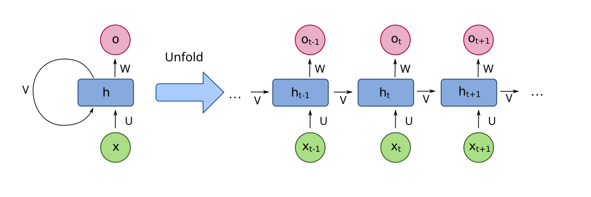
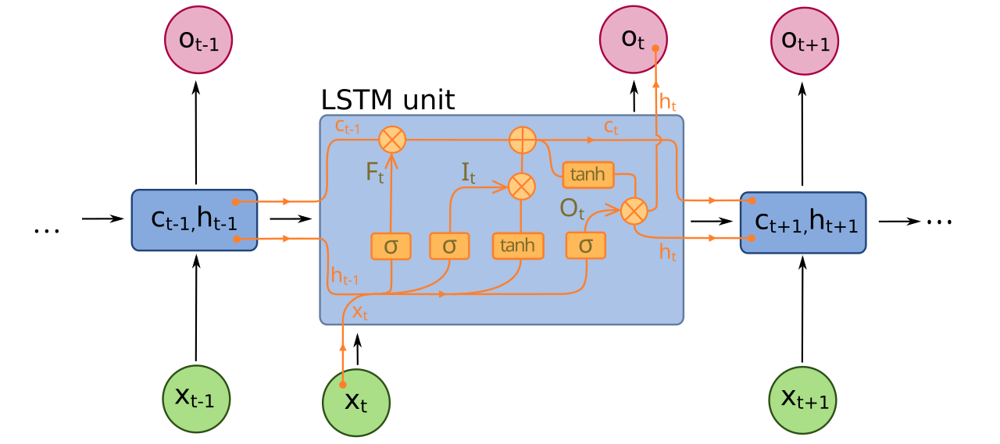
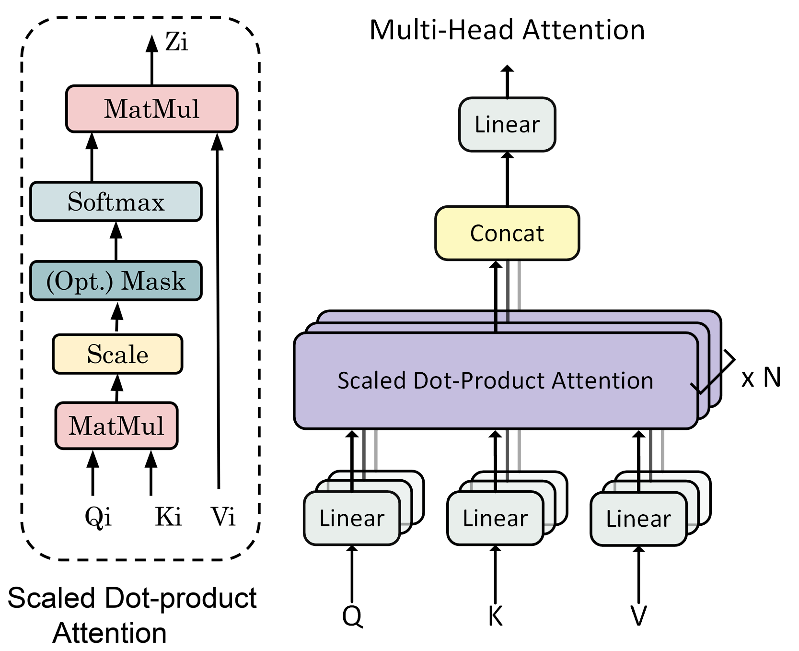
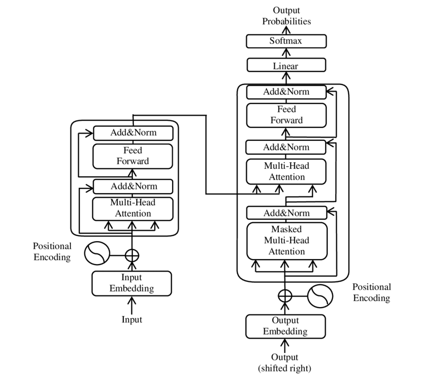
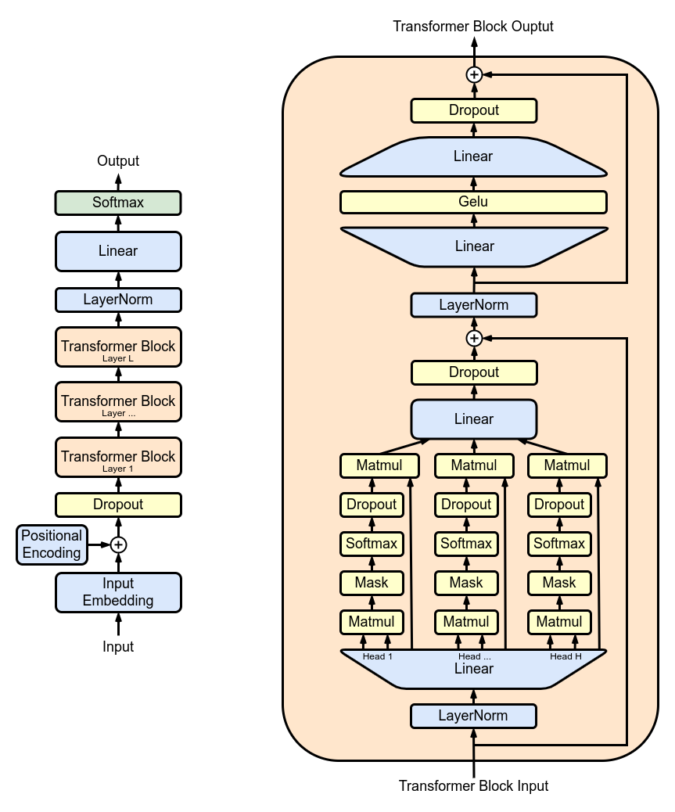
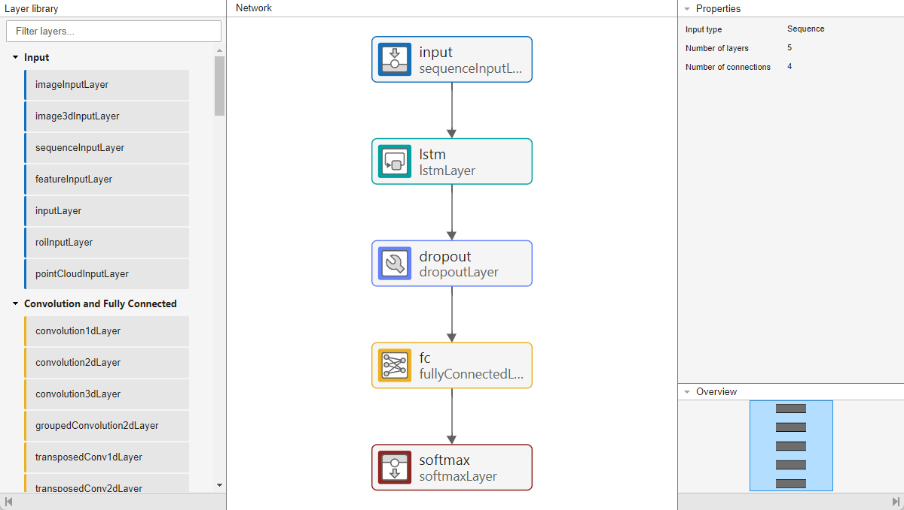
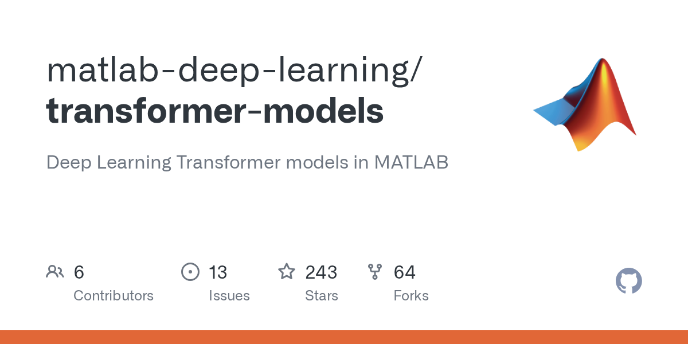

# 第12章 深度学习扩展：Transformer与MATLAB模型库

> **本章导读**：第 11 章介绍了深度学习的两大经典模型——处理序列的 RNN/LSTM 与处理图像的 CNN，它们构成了深度学习的"基本盘"。本章在此基础上做两件事：其一，补上通往大语言模型的那块基石——**Transformer**。它以自注意力机制取代循环结构，让序列中任意两个位置直接交互，同时拿到了 CNN 的"可并行"与超越 RNN 的"长记忆"；2017 年提出的这个模型，是今天所有主流大语言模型的共同起点。其二，解决"原理懂了，模型从哪来"的问题——MATLAB 深度学习工具箱从 R2023a 起内置了自注意力等 Transformer 相关层，可以纯 MATLAB 从零搭起一个迷你 Transformer；MathWorks 官方还在 GitHub 维护了把 BERT、FinBERT、GPT-2 等经典模型转化成纯 MATLAB 代码的模型仓库，配合 ONNX 导入，PyTorch/TensorFlow 生态的模型也能为我所用。学完本章，读者应能说清 Transformer 的原理与结构，并在 MATLAB 中直接调用、微调这些预训练模型。

## 12.1 深度学习扩展概述

### 12.1.1 已有基础与本次扩展

第 9 章与第 11 章为我们打下了深度学习的基础，其中已经反复打过交道的三种经典网络是：

- **RNN**（循环神经网络）：处理序列数据，隐层节点跨时刻连接，具有时间步依赖；
- **LSTM**（长短期记忆网络）：通过遗忘门、输入门、输出门的门控机制，缓解了 RNN 的长程依赖问题；
- **CNN**（卷积神经网络）：通过卷积核提取局部空间特征，擅长图像与序列模式。

回顾它们的工作方式有助于看清本章的出发点。RNN 按时间步展开后（图 12-1）是一条顺序依赖的链条：$t$ 时刻的隐状态必须等 $t-1$ 时刻算完才能开始算，前一步是后一步的前提。这种"接力"结构天然适合流式处理，却让训练无法在时间维度上并行。LSTM 用三道门把重要的信息沿"传送带"直通下游，记住了更久远的信息，但顺序计算的本质并没有改变。CNN（图略，见第 11 章）靠卷积核在图像上滑动提取局部特征，各窗口之间倒是可以并行的，可惜一层的感受野有限，想"看到"相距很远的两个位置，只能把层堆得很深。



**图 12-1 RNN 按时间步展开：顺序依赖，难以并行**



**图 12-2 LSTM 单元：门控机制缓解长程依赖**

在 RNN、LSTM、CNN 的基础上，本章新增两方面内容。第一是 **Transformer 模型的基本原理和结构**：它用自注意力机制让序列中任意两个位置直接建立联系，既解决了 RNN 无法并行的问题，又解决了 CNN 感受野受限的问题；其编码器-解码器架构经过几年演化，已经成为大语言模型的基石。第二是 **GitHub 上已经转化成 MATLAB 的深度学习模型**：MathWorks 官方把 BERT、GPT-2 等经典预训练模型用纯 MATLAB 代码重写并维护在公开仓库里，读者可以直接在 MATLAB 中使用、理解乃至逐行精读和微调这些模型，不必从零搭起、也不必绕道 Python。

一句话概括本章的主线：**Transformer 是通往大语言模型的必经之路，MATLAB 模型库让你不必从零搭起**。

### 12.1.2 三类网络的特征对比

把三类网络放在一起比较（表 12-1），就能看清 Transformer 的位置与价值。

**表 12-1 RNN/LSTM、CNN 与 Transformer 的特征对比**

| 网络 | 计算方式 | 并行性 | 长程依赖 | 典型应用 |
|------|----------|--------|----------|----------|
| RNN/LSTM | 按时间步循环 | 差（顺序依赖） | 较弱 | 语音、时间序列 |
| CNN | 局部卷积滑动 | 好 | 受限于感受野 | 图像、文本分类 |
| **Transformer** | **全局自注意力** | **好（序列并行）** | **强** | **机器翻译、大语言模型** |

表里两个关键列是"并行性"与"长程依赖"，它们分别决定了模型"能不能做大"和"能不能做深"。并行性好，训练才能堆得上海量数据和海量算力——这一点 CNN 做到了，RNN 没做到；长程依赖强，序列两端的远距离关系才不必经过几十层的接力传递——这一点 RNN 努力过（LSTM），但始终不够彻底。Transformer 用全局自注意力同时拿下这两项：它既有 CNN 式的"可并行"，又有超越 RNN 的"长记忆"。这正是它能把模型做得"大"的根本原因，也是大语言模型时代从它开始的原因——后文第 14 章讲的缩放定律与涌现能力，都建立在"可以放心把模型做大"这个前提之上。

## 12.2 从 RNN/LSTM/CNN 到 Transformer

### 12.2.1 为什么要引入 Transformer

Transformer 不是凭空出现的，它是对既有模型两处"先天不足"的直接回应。

第一处不足是 RNN 的**顺序计算**。由第 11 章的式（11-3）可知，RNN 的隐状态 $h_t$ 依赖 $h_{t-1}$，$h_{t-1}$ 又依赖 $h_{t-2}$，整条链一环扣一环：训练时必须逐时间步推进，硬件再强也并行不起来；梯度还要沿这条链一步步回传，序列一长就会出现第 11 章讲过的梯度消失/爆炸，"记不住"远处的信息。第二处不足是 CNN 的**感受野有限**。一个 $3\times3$ 的卷积核一次只能看到 $3\times3$ 的窗口，相距 100 个位置的依赖要经过几十层卷积才能建立起来——层级一深，参数和计算量都吃不消。

Transformer 的应对办法是**自注意力**（self-attention）：让序列中的每个位置都直接"看一遍"所有位置，并按相关程度加权取用信息。这样做带来三点根本性的改善。其一，任意两个位置之间的信息传递路径长度为 $O(1)$——一步直达，不再层层接力，学习远距离依赖变得容易；其二，没有循环结构，序列内所有词元的计算互不依赖，可以**同时训练**，硬件并行度打满，效率远高于 RNN；其三，"打乱顺序结果不变"的副作用由**位置编码**显式补上（见 12.3.3 节），顺序信息并没有丢。

### 12.2.2 注意力就是你所需要的

2017 年，Google 的 Vaswani 等人在论文《Attention Is All You Need》（注意力就是你所需要的）中提出了 Transformer。论文标题颇为"狂傲"——抛弃循环、抛弃卷积，**仅用注意力机制**建模序列依赖——结果却无可辩驳：Transformer 是一种基于自注意力机制的编码器-解码器（seq2seq）神经网络，在机器翻译任务上取得了当时最先进（SOTA）的效果，而且训练速度比以往的 RNN 方案快得多。

> Vaswani A, Shazeer N, Parmar N, et al. Attention is all you need. NeurIPS 2017: 5998-6008

2017 年的这篇论文，是今日所有主流大语言模型的**共同起点**。它之后的几年里，研究者沿着"保留一半、扔掉一半"的思路迅速分化：BERT 只留编码器，用双向注意力做"理解"，以预训练加微调的范式横扫 11 项自然语言处理任务；GPT 只留解码器，用因果掩蔽注意力做"生成"，一路从 GPT-1 走到 GPT-2/3/4 与 ChatGPT，开启了大语言模型时代（表 12-2）。第 14 章将沿着这条线索继续讲大语言模型本身。

**表 12-2 Transformer 的深远影响**

| 年份 | 模型 | 结构 | 意义 |
|------|------|------|------|
| 2017 | Transformer | 编码器-解码器 | 提出自注意力编解码架构 |
| 2018 | BERT | 仅编码器 | 预训练+微调，11 项 NLP 任务 SOTA |
| 2018 | GPT | 仅解码器 | 生成式预训练 |
| 2018— | GPT-2/3/4、ChatGPT | 仅解码器 | 大语言模型时代的开始 |

对地学读者而言，这条发展脉络并不遥远：水文、气象要素的时间序列预报用得上注意力的"长记忆"，文献综述、报告撰写用得上语言模型的"生成"；而理解这一切的前提，是把 Transformer 的几个核心构件——自注意力、多头注意力、位置编码、编码器-解码器结构——真正弄懂。这正是下一节的内容。

## 12.3 Transformer 的基本原理和结构

### 12.3.1 自注意力机制

理解 Transformer，从理解一次"查询"开始。想象在图书馆检索资料：你带着一个**查询**（Query，想查什么），与每本书的**键**（Key，书名标签）比对相关程度，再按相关程度把相应书籍的**值**（Value，书的内容）按比例取用。自注意力中的 $Q$、$K$、$V$ 正是这三个角色：对输入序列的每个词元，分别用三组可学习的权重把它映射成查询向量 $Q$、键向量 $K$、值向量 $V$。缩放点积注意力（scaled dot-product attention）定义为

$$\text{Attention}(Q, K, V) = \text{softmax}\left(\frac{QK^{T}}{\sqrt{d_k}}\right)V \tag{12-1}$$

其中 $d_k$ 为键向量的维度。这个公式可以拆成三句话来读。第一句，$QK^{T}$：每个查询与所有键做点积，得到一组"相关程度"原始得分；除以 $\sqrt{d_k}$ 是为了防止维度较大时点积值过大，把 softmax 推到饱和区、梯度过于集中。第二句，softmax：把得分归一化成一组和为 1 的**注意力权重**——每个权重回答"我该分多少注意力给那个位置"。第三句，对 $V$ 加权求和：按注意力权重把各个位置的值混合起来，作为这个位置的输出。

那"自"注意力"自"在哪里？关键在于 $Q$、$K$、$V$ 全部来自**同一组输入词元**——序列自己"关注"自己，而不是像传统注意力那样用一个序列去关注另一个序列。于是每个词元的输出，都是全序列信息的加权混合；每个词元都同时扮演"发问者"（Q）、"被检索者"（K）与"信息提供者"（V）三个角色。

对比第 11 章的 RNN 可以更清楚地看到这个设计的妙处：RNN 中两个远距离位置的信息要沿时间步一步步传递，路径长度与距离成正比；而式（12-1）中任意两个位置通过一次矩阵乘法直接建立联系，与距离无关。这就是"最大路径长度为 $O(1)$"的含义。

### 12.3.2 多头注意力

只做一次注意力还不够。式（12-1）的输出本质上是全序列信息的一次加权平均，单个"头"看问题的角度单一，容易把不同类型的依赖混在一起平均掉。**多头注意力**（multi-head attention）的思路是：用 $h$ 组相互独立、各自学习的线性投影，把 $Q$、$K$、$V$ 分别变换 $h$ 次，得到 $h$ 个"头"：

- $h$ 组变换并行送入注意力汇聚（各自做一次式 12-1），捕获**不同子空间**的依赖；
- 拼接 $h$ 个头的输出，再经一次线性投影得到最终输出；
- 不同的头可以关注输入的不同部分——有的头盯紧句法关系，有的头捕捉远距离指代——从而表达比简单加权平均更复杂的函数。

可以把它类比为一个评审小组：每位评审（头）用自己的标准（线性投影）独立阅读全文并做批注（注意力权重），最后把所有批注汇总（拼接 + 投影）。图 12-3 给出缩放点积注意力（左）与多头注意力（右）的结构示意。



**图 12-3 缩放点积注意力（左）与多头注意力（右）**

### 12.3.3 位置编码

自注意力还有一个必须解决的问题：它**并行计算，本身不含任何顺序信息**。把输入词元的顺序打乱，$Q$、$K$、$V$ 的集合不变，式（12-1）算出的注意力权重也不变——在自注意力眼里，"我打你"和"你打我"没有区别。而语言的顺序显然承载着语义，地学语句亦然："上游来水增加导致水位上涨"与"水位上涨导致上游来水增加"意思完全不同。

解决办法是把位置信息显式"注入"模型：在输入嵌入中添加**位置编码**（positional encoding）。经典公式采用不同频率的正弦/余弦函数：

$$PE(pos, 2i) = \sin\left(pos / 10000^{2i/d_{\text{model}}}\right) \tag{12-2}$$

$$PE(pos, 2i+1) = \cos\left(pos / 10000^{2i/d_{\text{model}}}\right) \tag{12-3}$$

其中 $pos$ 为词元在序列中的位置，$i$ 为维度索引，$d_{\text{model}}$ 为模型嵌入维度。可以这样理解这组公式：嵌入向量的每一维是一根以不同周期摆动的"指针"，偶数维用正弦、奇数维用余弦；位置 $pos$ 变化时，各维指针以从快到慢的不同节奏转动，任何一个位置因此获得一组独一无二的"时钟读数"。正弦/余弦的周期性与相位特性，还使得任意两个位置的编码可以通过简单的线性关系相互表示，从而捕捉**相对位置**信息——"相距 3 个词元"这种关系，对任意位置是一致的。

没有位置编码，Transformer 就是一堆"无序词袋"——顺序信息全靠它。

### 12.3.4 Transformer 宏观结构

把以上构件组装起来，就得到 Transformer 的宏观结构（图 12-4）。它采用**编码器-解码器架构**：编码器负责"读懂"输入，解码器负责"写出"输出。

- 编码器的输入是模型总输入 $X$（词元序列 $1$ 到 $T$），先经嵌入层与位置编码，再经多层编码器处理成一系列蕴含上下文信息的隐藏表示；
- 解码器的输入有两路：编码器输出的隐藏层信息，以及已生成的输出序列——生成每个新词元时，既要"参考原文"，又要"参考自己已经写了什么"；
- 经典配置为 **6 个编码器 + 6 个解码器**堆叠，每层结构相同但权重独立。



**图 12-4 Transformer 的宏观结构：编码器-解码器架构**

以机器翻译为例走一遍数据流：源语言句子先编码成一组上下文表示；解码器从特殊起始符开始，每步根据"编码结果 + 已生成的目标序列"预测下一个词元，新生成的词元再拼回输入，如此自回归地滚动，直到产出结束符。

### 12.3.5 编码器与解码器的内部结构

展开图 12-4 中的一层编码器，它包含两个子层：**多头注意力机制**（自注意力）与**前馈神经网络**（Feed Forward，对每个位置独立施加的两层全连接网络）。每个子层都不直接"裸用"，而是套上同一件外衣——残差连接（Add）与层归一化（LayerNorm）：

$$\text{sublayer\_output} = \text{LayerNorm}\bigl(x + \text{SubLayer}(x)\bigr) \tag{12-4}$$

也就是"注意力/前馈 + 残差 + 归一化"。残差连接的思路与第 11 章讲过的 ResNet 捷径连接一脉相承：把子层的输入 $x$ 原样加到子层的输出上，让梯度可以"直达"浅层，几十层堆叠也能稳定训练；层归一化则把每层的激活值拉回稳定的分布，进一步降低训练的波动。深度网络训练的两大法宝，在这里又一次同时出场。

解码器比编码器多一层**掩蔽多头注意力**（masked multi-head attention）。它"掩蔽"的是什么？解码器是自回归生成的：训练时为了并行效率，整个目标序列一次性喂入，但生成第 $t$ 个词元时，模型只应该看到位置 $1$ 到 $t$——未来的词元还没生成，不能"偷看"。掩蔽的实现很直接：在注意力得分矩阵上，把所有"未来位置"的得分置为 $-\infty$，softmax 之后这些位置的权重严格为零。掩蔽保证了模型可以按自回归方式逐词生成，也正是 GPT 一类解码器-only 模型（第 14 章）能够"接龙写作"的机制基础。

图 12-5 对比了 BERT（仅编码器）与 GPT（仅解码器）两种取舍：BERT 双向看全文、擅长理解，GPT 因果掩蔽、擅长生成。理解这张图，第 13 章讲 BERT 微调、第 14 章讲大语言模型架构时都会轻松许多。



**图 12-5 仅编码器（BERT）与仅解码器（GPT）的结构对比**

## 12.4 MATLAB 深度学习工具箱的内置支持

### 12.4.1 内置 Transformer 相关层

原理讲完，自然要问：MATLAB 能不能搭？答案是肯定的。从 R2023a/R2023b 起，MATLAB 深度学习工具箱内置了可以直接搭建 Transformer 的层：

- **selfAttentionLayer**：自注意力层；
- **attentionLayer**：通用注意力层；
- **positionEmbeddingLayer**：位置嵌入层；
- **indexing1dLayer**：一维索引层；
- **patchEmbeddingLayer**（R2023b）：补丁嵌入层，用于视觉 Transformer（ViT）；
- **embeddingConcatenationLayer**：嵌入拼接层。

这份清单与 12.3 节的原理一一对应：selfAttentionLayer 实现式（12-1）的自注意力，positionEmbeddingLayer 实现式（12-2）、式（12-3）的位置编码，embeddingConcatenationLayer 负责把词元嵌入与位置嵌入拼在一起。不用写一行 Python，纯 MATLAB 即可**从零搭建 Transformer**。这与本书一贯的口径一致：第 9 章的 BP 网络、第 11 章的 LSTM/CNN 都是"内置层组合"搭出来的，Transformer 只是又多了一排新积木。

### 12.4.2 组合示例：一维序列的迷你 Transformer

时间序列预测、文本分类等任务，可以直接用内置层组合：

```matlab
numHeads = 4; dim = 64;
layers = [
    sequenceInputLayer(1,"Normalization","zscore")
    positionEmbeddingLayer(128,dim)     % 位置嵌入：128 个位置
    embeddingConcatenationLayer         % 拼接序列嵌入与位置嵌入
    selfAttentionLayer(numHeads,dim)    % 4 头自注意力
    fullyConnectedLayer(1)
    regressionLayer];
net = trainNetwork(XTrain, YTrain, layers, options);
```

逐行读一遍这段网络：输入是单变量序列（`sequenceInputLayer(1)`，做 zscore 标准化——预处理惯例与第 3 章一致）；`positionEmbeddingLayer(128,dim)` 为最多 128 个位置各生成一个 $dim$ 维位置嵌入；`embeddingConcatenationLayer` 把位置嵌入拼接到序列嵌入上，相当于手工完成式（12-2）、式（12-3）要干的事；`selfAttentionLayer(4,64)` 是 4 个头、64 维的自注意力，对应式（12-1）；最后的全连接层与回归层把注意力汇聚出的特征映射成预测值。训练命令仍是熟悉的 `trainNetwork`——第 11 章"layers → trainingOptions → trainNetwork → predict"的四步流程原封不动地沿用。

上述层也可以在 **Deep Network Designer** 中可视化拖拽组合（图 12-6），支持自定义一维序列数据的 Transformer 网络，适用于时间序列预测、文本分类等任务。习惯拖拽搭网的读者（见第 2、11 章）可以无缝上手。



**图 12-6 在 Deep Network Designer 中可视化搭建 Transformer**（图片来源：MathWorks 官方文档《Get Started with Deep Network Designer》）

### 12.4.3 R2025a 起：导入 Hugging Face Transformer 层

自己搭积木之外，还有一条"借力"的路。R2025a 引入的 **importNetworkFromPyTorch** 可以直接导入 PyTorch 模型，并且能够识别、映射 Hugging Face 模型库中的 Transformer 层——BertAttention、RobertaSelfAttention、DistilBERT 的 MultiheadSelfAttention 等都会被转成对应的 MATLAB 层；导入后的网络同样可以放进 Deep Network Designer 查看、编辑。Hugging Face 上的海量模型，从此有了**直通 MATLAB** 的入口。

## 12.5 GitHub 上已转化成 MATLAB 的深度学习模型

### 12.5.1 MathWorks 官方 Transformer 模型库

预训练模型是现代深度学习的"基础设施"——自己从零训练一个 BERT 级别的模型既不现实也无必要（这一判断的经济学原理，第 14 章讲训练成本时还会展开）。MathWorks 在 GitHub 上维护了 **Transformer Models for MATLAB** 仓库，把经典预训练 Transformer 模型用**纯 MATLAB 代码**实现：

- GitHub 仓库：matlab-deep-learning/transformer-models；
- 也可以在 File Exchange 或 Add-On Explorer 中搜索安装；
- 支持 **"Open in MATLAB Online"**，无需本地配置即可在线运行（MATLAB Online 的使用见第 2 章）。



**图 12-7 MathWorks 官方 transformer-models 仓库**

这个仓库对教学有特殊价值：模型是**纯 MATLAB**写的，意味着每一个注意力头、每一次残差连接都是可读的 .m 代码，而不是封装在黑盒里的二进制权重。原理（12.3 节）与实现从此可以逐行对照。

### 12.5.2 仓库包含的模型

该仓库目前包含三个核心模型家族（表 12-3）。

**表 12-3 transformer-models 仓库包含的模型**

| 模型 | 结构 | 典型任务 |
|------|------|----------|
| **BERT** | 双向编码器 | 文本理解与分类 |
| **FinBERT** | 金融领域 BERT | 金融情感分析 |
| **GPT-2** | 解码器 | 文本生成与摘要 |

三个模型恰好对应 12.3.5 节结构图的两种取舍：BERT 与 FinBERT 走"仅编码器"的理解路线，GPT-2 走"仅解码器"的生成路线。注意：仓库不含 T5 等编码器-解码器的文本到文本模型，此类模型需要通过 **ONNX 导入**（见 12.6 节）或 Python 接口调用。

### 12.5.3 BERT 在 MATLAB 中的使用

BERT（Bidirectional Encoder Representations from Transformers）是双编码器路线的代表，第 13 章将把它用于文本分类，这里先看基本用法：

- `mdl = bert`：加载预训练 BERT（自动下载权重）；
- 指定变体：`mdl = bert("Model",modelName)`，可选 base、**multilingual-cased**（多语言，含中文）、medium、small、mini、tiny、japanese-base 等；
- 推理：`Z = mdl.model(X, parameters)`，输出词元级的 BERT 嵌入；
- 仓库配套示例：ClassifyTextDataUsingBERT.m、FineTuneBERT.m、PredictMaskedTokensUsingBERT.m。

```matlab
mdl = bert("Model","multilingual-cased");   % 多语言模型，支持中文
Z = mdl.model(X, mdl.Parameters);           % X 为 token 索引序列，Z 为 token 级嵌入
```

变体的选择是一个"精度 vs 开销"的权衡：base 最大、效果最好，tiny/mini 轻量、适合快速实验；做中文任务时选 multilingual-cased 即可。

### 12.5.4 FinBERT 在 MATLAB 中的使用

FinBERT 是专门面向**金融文本**再训练的 BERT 变体——同样的双向编码器结构，只是"读过的书"换成了金融语料。用法：

- `finbert.sentimentModel(X, parameters)` 输出情感分类：类别为 **positive / neutral / negative**，分值在 $[-1, 1]$ 区间，正值偏乐观、负值偏悲观；
- 仓库配套示例：SentimentAnalysisWithFinBERT.m、PredictMaskedTokensUsingFinBERT.m。

金融新闻、财报、舆情文本的情感分析，FinBERT 是开箱即用的入门首选——不用标注数据、不用训练，加载即用。它也是第 13 章迁移学习讨论的一个现成案例：领域适配靠"再预训练"完成，下游任务只需微调。

### 12.5.5 GPT-2 在 MATLAB 中的使用

GPT-2 是解码器路线的代表，具备自回归的文本生成能力：

- `mdl = gpt2`：加载预训练 GPT-2 模型；
- 文本摘要：`summary = generateSummary(mdl, text)`——自动在输入后追加 **"TL;DR"**（"太长不看"）提示，诱使 GPT-2"接着写"出一段凝练的摘要，这是利用生成式模型做摘要的经典技巧；
- 可调参数：MaxSummaryLength（默认 50）、TopK（默认 2）、Temperature（默认 1）、StopCharacter（默认 "."）。Temperature 控制生成的随机性——越大越发散，越小越保守；TopK 限制每步只在概率最高的 k 个候选词中挑选，防止跑偏；
- 仓库含 **+sampling 包**，支持 top-k、temperature 等采样策略；
- 配套示例：SummarizeTextUsingTransformersExample.m。

需要说明的是，GPT-2 是 2019 年的 15 亿参数模型，MATLAB 中它主要用于**摘要生成**这类受控任务，不是第 14 章所说的通用对话模型——不要期待与它"聊天"。

### 12.5.6 仓库中的 Transformer 自定义层

仓库的 **+transformer/+layer** 子包提供了可在自定义网络中复用的层：多头注意力层、位置嵌入与前馈层、层归一化与残差结构等。这个子包是最值得精读的部分：把 12.3 节的每个公式在代码里找到对应实现——式（12-1）藏在多头注意力层里，式（12-4）的"残差 + 归一化"外衣看得见摸得着——是理解 Transformer 最直接的方式。**读源码学原理**：每个 Transformer 组件的 MATLAB 实现都摆在眼前，适合教学精读。

## 12.6 通过 ONNX 导入深度学习模型

### 12.6.1 为什么需要 ONNX

官方仓库再全，也覆盖不了整个深度学习生态：大量模型分散在 PyTorch、TensorFlow 两大社区的模型库里，框架之间互不兼容——PyTorch 的模型文件，TensorFlow 打不开，MATLAB 也不认识。**ONNX**（Open Neural Network Exchange，开放神经网络交换）就是为解决这种碎片化而设计的跨框架模型交换格式，相当于模型世界的"通用语"：任何框架训练的模型都可以导出为 .onnx 文件，任何支持 ONNX 的框架都可以导入使用。数据流向可以概括为：

> PyTorch / TensorFlow（训练社区的主力）→ **ONNX 文件（.onnx）**（跨框架"通用语"）→ MATLAB（推理 / 微调 / 部署）

训练发生在生态最繁荣的地方，应用发生在最适合的地方——ONNX 把这两件事解耦了。对 MATLAB 用户而言，这意味着 12.5 节仓库之外的广阔模型库都可以"为我所用"。

### 12.6.2 MATLAB 导入 ONNX 的函数

- **importNetworkFromONNX**（R2023b 引入，推荐）：导入为 dlnetwork 对象，支持代码生成；
- importONNXNetwork（旧函数，逐步弃用）：导入为 DAGNetwork 或 dlnetwork；
- 前提：安装 **Deep Learning Toolbox Converter for ONNX Model Format** 支持包；
- 遇到无法映射的算子时，自动生成**自定义层**（保存于 +modelfile 命名空间）——导入不是"全有或全无"，个别新算子会以自定义层的形式落地，网络照样能用；
- 反方向也有 **exportONNXNetwork**，可将 MATLAB 网络导出为 ONNX，供其他框架使用。

### 12.6.3 ONNX 导入流程示例

完整流程分五步：

1. 在 PyTorch/TF 中训练或获取模型，导出为 .onnx 文件；
2. MATLAB 中安装 ONNX 转换支持包；
3. `net = importNetworkFromONNX("model.onnx")` 导入为 dlnetwork；
4. 用 `predict(net, X)` 或 `trainnet` 进行推理/微调；
5. 必要时在 Deep Network Designer 中检查并修改网络结构。

```matlab
net = importNetworkFromONNX("gpt2.onnx", OutputNames="logits");
scores = predict(net, tokenIndices);   % 推理
```

### 12.6.4 MATLAB 深度学习模型选型

工具箱内置层、官方仓库、ONNX 导入三条路都通了，最后回到"选哪个"的问题。MathWorks 汇总了官方可用的预训练 Transformer 模型（表 12-4）。

**表 12-4 MATLAB 深度学习模型中心：任务选型**

| 任务类型 | 推荐模型 | 来源 |
|----------|----------|------|
| 文本理解 / 分类 | BERT | transformer-models 仓库 |
| 金融情感分析 | FinBERT | transformer-models 仓库 |
| 文本生成 / 摘要 | GPT-2 | transformer-models 仓库 |
| 句子/文档嵌入 | all-MiniLM-L6-v2 / L12-v2 | 文档嵌入支持包 |
| 图像任务 | 视觉 Transformer | Computer Vision Toolbox Model |

选型口诀：**理解分类找 BERT、金融情感用 FinBERT、生成摘要用 GPT-2、语义检索用 MiniLM、图像任务找 ViT**。口诀背后的逻辑仍是第 11 章的"输入形态—模型结构"匹配原则：理解类任务选双向编码器，生成类任务选解码器，检索类任务选专为相似度训练的嵌入模型。第 13 章将把其中文本相关的模型逐一用起来。

## 12.7 本章小结

- 在 RNN/LSTM/CNN 基础上，**Transformer 通过自注意力**实现了并行计算与长程依赖建模（式 12-1）：任意两个位置一步直达、全序列并行训练，这是它能"做大"的根本原因；
- Transformer 的关键构件：多头注意力（$h$ 组投影捕获不同子空间的依赖）、位置编码（式 12-2、式 12-3，用不同频率的正弦/余弦注入顺序信息）、编码器-解码器结构（经典配置 6+6）、"注意力/前馈 + 残差 + 归一化"子层（式 12-4）与解码器的掩蔽注意力（防"偷看"未来）；
- MATLAB 深度学习工具箱自 **R2023a/b** 起内置 selfAttentionLayer、positionEmbeddingLayer 等层，组合即可搭建一维序列的迷你 Transformer；R2025a 起还可经 importNetworkFromPyTorch 导入 Hugging Face Transformer 层；
- MathWorks 官方 **transformer-models 仓库**提供 BERT、FinBERT、GPT-2 的纯 MATLAB 实现，配套分类、微调、摘要等示例；其 +transformer/+layer 子包是"读源码学原理"的好教材；
- 借助 **importNetworkFromONNX**，可导入更广泛的 PyTorch/TF 模型；T5 等仓库之外的模型走这条路；
- 选型口诀：理解分类找 BERT、金融情感用 FinBERT、生成摘要用 GPT-2、语义检索用 MiniLM、图像任务找 ViT。

## 12.8 思考题

1. 相比 RNN/LSTM，Transformer 为什么能更好地处理长程依赖？请从最大路径长度与并行性两个角度说明，并解释这两点为什么是"把模型做大"的前提。
2. 写出自注意力的缩放点积公式（式 12-1），解释其中 $\sqrt{d_k}$ 缩放与 softmax 各起什么作用。"自"注意力"自"在哪里？请用"图书馆检索"的类比说明 $Q$、$K$、$V$ 各扮演什么角色。
3. 自注意力为什么必须配合位置编码？式（12-2）、式（12-3）的正弦/余弦位置编码靠什么特性捕捉相对位置？
4. 编码器与解码器的子层各由什么组成？"注意力/前馈 + 残差 + 归一化"与第 11 章 ResNet 的捷径连接有什么联系？解码器的掩蔽多头注意力"掩蔽"的是什么？为什么不掩蔽就无法自回归生成？
5. MATLAB 内置的 selfAttentionLayer 与 transformer-models 仓库中的实现，分别适合什么场景？
6. 何时应选择 ONNX 导入，而非直接使用官方仓库的模型？T5 为什么走不了 transformer-models 仓库这条路？
7. 如何在 MATLAB 中用 BERT 完成一个中文文本分类任务？写出主要步骤与所用函数，并说明应选择哪个模型变体。

## 12.9 延伸阅读

1. Vaswani A, et al. *Attention Is All You Need*. NeurIPS 2017——Transformer 的原始论文
2. MathWorks. Transformer Models for MATLAB
   <https://github.com/matlab-deep-learning/transformer-models>
3. MathWorks. importNetworkFromONNX 函数文档
   <https://www.mathworks.com/help/deeplearning/ref/importnetworkfromonnx.html>
4. MathWorks. 深度学习工具箱预训练网络
   <https://www.mathworks.com/help/deeplearning/ug/pretrained-convolutional-neural-networks.html>

> 本章插图取自本讲课件《数据挖掘·第十二讲 深度学习扩展》；图 12-6 来自 MathWorks 官方文档。
