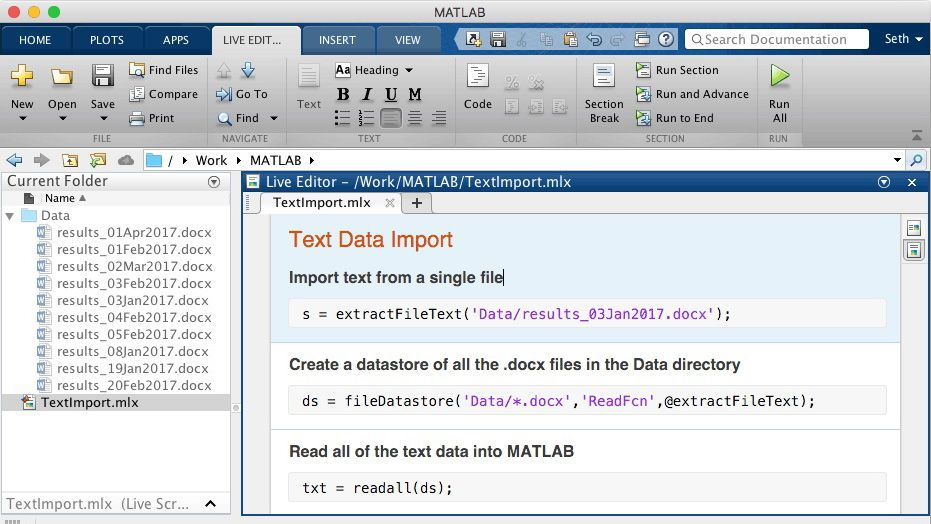
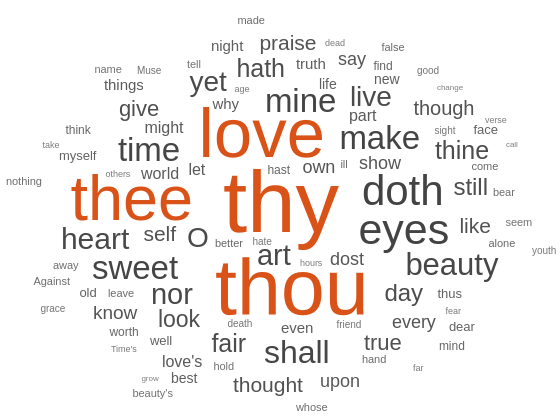
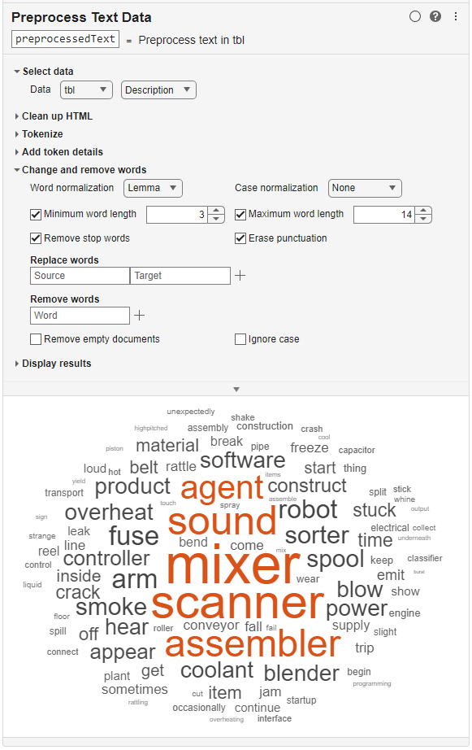
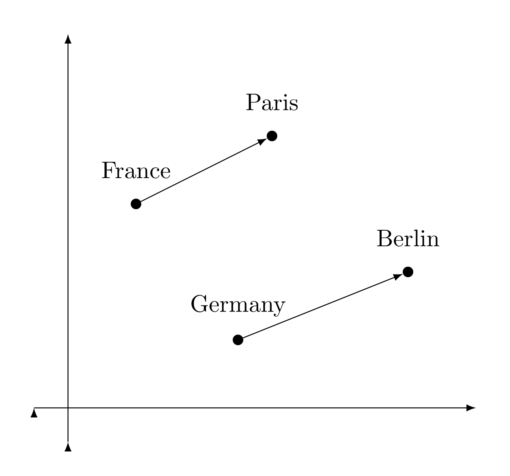
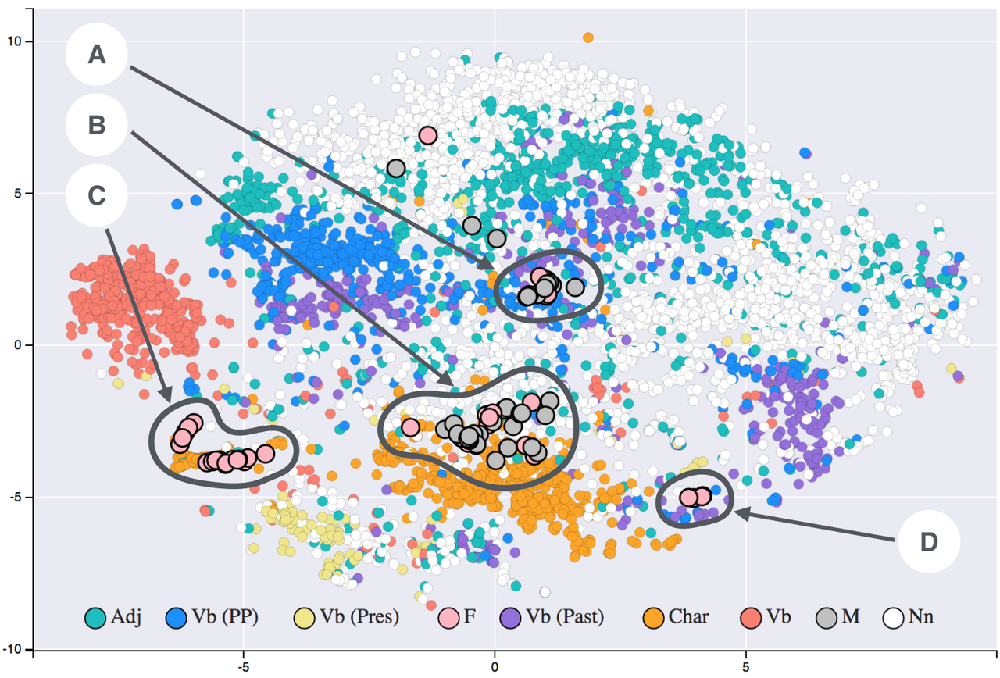
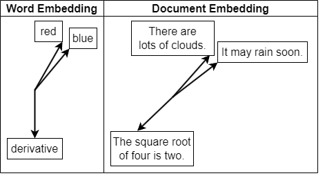
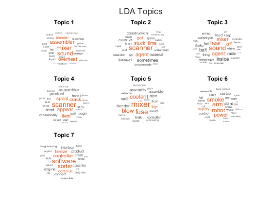
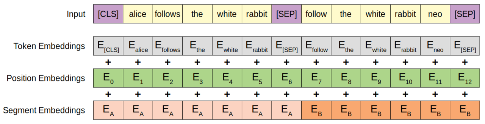

# 第13章 文本分析扩展：NLP模型在MATLAB中的实现

> **本章导读**：本书前十二章处理的数据大多是"结构化"的——表格里一列列排好队的数值；而地学科研中同样大量的数据是文本：观测记录、研究报告、文献、新闻、社交媒体。文本是**非结构化数据**的大头，它没有固定的列，不能直接塞进本书前几章的任何模型——会"算"文本，才能挖掘它的价值。本章沿"**导入 → 可视化 → 预处理 → 数值化 → 机器学习 → 深度学习**"的完整流程走一遍文本分析，重点讲清文本如何变成数值：词袋/tf-idf、词嵌入、文档嵌入三条路线各有取舍。在此基础上，介绍经典开源 NLP 模型（BERT、FinBERT、GPT-2）如何在 MATLAB 中直接使用与微调——核心思想是**不重复造轮子**：站在预训练模型的肩膀上做文本挖掘。本章的文档向量化也为第 15 章的检索增强生成（RAG）打好基础。

## 13.1 文本分析扩展概述

在第 12 章学会 Transformer 的原理、见到现成的 MATLAB 模型库之后，本章回答一个更贴近应用的问题：拿到一箱文本资料，从读入到建模，完整的工作流长什么样？

在 MATLAB 文本分析和报告生成工具箱的基础上，本章扩展两方面内容。其一，**系统讲解文本分析完整流程**：文本数据导入和可视化、预处理、转换为数值格式、机器学习、深度学习——五个环节环环相扣，缺一不可。其二，**介绍经典开源 NLP 模型在 MATLAB 中的落地**：GitHub 上已转化成 MATLAB 的 BERT、GPT-2 等模型，方便直接使用和理解，避免从零搭建。

学完本章，读者应能：走通文本分析五步流程并说出每步的关键 MATLAB 函数；在词袋/tf-idf、词嵌入、文档嵌入之间为具体任务做出合适的数值化选型；用 LDA 做主题建模、用 wordcloud 做文本可视化；加载并微调 BERT 完成文本分类、用 GPT-2 生成摘要；说清 BERT 与 GPT-2 的结构差异与各自适用的任务。

## 13.2 MATLAB 文本分析工具箱

**文本分析工具箱**（Text Analytics Toolbox）是 MathWorks 提供的文本分析专用产品，覆盖从原始文本到模型的完整流程（官网：<https://ww2.mathworks.cn/products/text-analytics.html>）。按流程环节归拢，它的能力清单如下：

- **提取**：从 PDF、HTML、Word、Excel 文件提取文本；
- **预处理**：分词、停用词、词干化/词形还原；
- **数值化**：词频、tf-idf、词/文档嵌入；
- **建模**：LDA/LSA 主题模型、情感分析；
- **深度学习**：LSTM/CNN/BERT/GPT-2。



**图 13-1 用实时编辑器任务交互式导入文本数据**

与本书用过的统计与机器学习工具箱（第 2 章）相比，文本分析工具箱的特点是"两头都管"：一头管着最脏最累的活——把五花八门的文件变成干净的词元序列；另一头接着最新的模型——预训练 BERT、GPT-2 一应俱全。中间的数值化环节（13.5 节）则是全流程的枢纽，也是理解文本挖掘的关键。

## 13.3 文本数据导入与可视化

### 13.3.1 提取文本数据

文本的来源很杂：社交媒体、新闻提要、设备日志、报告和调查等。与整齐的数值表格不同，这些内容藏在各种格式的文件里，第一步是把它"请出来"：

- 从 **PDF、HTML、Microsoft Word、Excel** 文件提取文本；
- 解析 HTML 并提取文本内容；
- 分析包含**表情符号**的文本数据；
- 关键函数：**extractFileText**、readtable、htmlTree；批量导入整个目录用 fileDatastore。

extractFileText 可以直接读取 .docx/.pdf 报告——地学单位的观测记录、考察报告多为 Word/PDF 格式，这一步就是它们的入口；单文件读取之后，用 fileDatastore 批量导入整个目录，几百份报告一次请进内存。这是文本分析的第一步。

### 13.3.2 文本可视化

文本导入后不要急着建模，先看一眼。探查阶段最直观的两个工具：

- **wordcloud**：词云，通过字体大小和颜色显示单词的相对频率——词频越高字号越大，语料的"主旋律"一眼可见；
- **tsne / textscatter**：文本散点图，对词嵌入降维可视化，可在探查阶段快速发现数据中的主题簇与异常。

```matlab
documents = tokenizedDocument(sonnets);   % 分词
figure
wordcloud(documents);                     % 一行代码生成词云
title("莎翁十四行诗词云")
```



**图 13-2 莎士比亚十四行诗的词云**

词云之于文本，近似于散点图之于数值数据（第 3 章）：花不了一行代码，就能对语料的主题构成、用词风格建立直觉，还能暴露数据质量问题——比如不该出现的高频噪声词。

### 13.3.3 语言支持

工具箱对英语、日语、德语、韩语等提供专用预处理功能，大多数函数也适用于其他语言的文本。**中文处理**需要特别注意：MATLAB 自带的分词以西方语言为主——英文靠空格切词，而中文的词与词之间没有空格，"地学数据挖掘"是一个字符串还是四个词，机器自己判断不了。因此中文文本建议先用分词工具（如第三方分词器）切好词，再构造 tokenizedDocument。分词质量直接决定后续所有环节的质量，做中文文本挖掘时这一步值得多花心思。

## 13.4 文本数据预处理

### 13.4.1 清理文本数据

预处理的第一个目标是**删除无关内容、纠正拼写**。原始文本里混着大量对建模无用的"杂质"：

- 删除标点符号、HTML 标记——从网页抓来的语料尤其需要；
- 删除 HTTP/HTTPS URL——链接几乎没有语义贡献；
- 纠正文档中的拼写——错别字会造成同一个词被拆成多个词条；
- 关键函数：**erasePunctuation、removeHTMLTags、eraseURLs、correctSpelling**；
- 也可以用实时编辑器任务 **Preprocess Text Data** 交互式完成，所见即所得。



**图 13-3 用实时编辑器任务交互式完成文本预处理**

### 13.4.2 过滤停用词与词形归一化

第二个目标是**优先分析有意义的文本数据、减少词汇量**：

- 删除停用词：**removeStopWords**。停用词是 the、is、of 这类出现极频繁却几乎不带语义的虚词，留着它们只会稀释有意义的词的权重；
- 删除出现频率过高/过低、过长/过短的单词——过高者多为噪声，过低者缺乏统计价值；
- 词干提取（stemming）：tokenizedDocument + **stemWords**，把词截取为词根，如 studies、studying 归并为 studi；
- 词形还原（lemmatization）：把单词转化为**原形**（lemma），如 studies、studying 都还原为 study——比词干提取更"讲道理"，结果仍是真词。

词形归一化的价值在于**合并同义形态**：一份语料里"run、runs、ran、running"本质是一个词的四种写法，不归并则词频被稀释、词表被撑大。但要记住，预处理没有万能配方：停用词表、词长阈值都应结合语料特点调整——地质报告里"断层、岩性"是核心词，绝不能当停用词误删。预处理前后各画一张词云对比效果，是最直观的验收方式。

### 13.4.3 提取语言特征

第三个目标是**用标记化算法拆分文本并添加上下文信息**：

- **tokenizedDocument**：将原始文本拆分为单词（词元）集合——这是后续一切处理的载体；
- **addPartOfSpeechDetails**：添加词性标签（名词、动词、形容词……）；
- **addEntityDetails**：命名实体识别，标出人名、地名、机构名——地学文本里的地名恰恰是空间分析的重要线索；
- **addDependencyDetails**：语法依存关系解析，标出"谁对谁做了什么"。

这些"语言学特征"可以直接作为机器学习的附加特征列：例如词性本身就是一个类别特征，命名实体可以构成"是否提及某流域"的指示变量。传统机器学习（第 8、10 章）与这些特征的组合，常能以很低的成本换来可观的提升。

## 13.5 将文本转换为数值格式

机器学习模型吃的是数值，文本必须先"数值化"。本节是全章的枢纽：数值化方案决定了后面能用什么模型、能挖出什么语义。三条路线按"由浅入深"排列。

### 13.5.1 词频与 n-gram 计数

最朴素的数值化是**数词**：

- **bagOfWords / bagOfNgrams**：构建词袋与 n-gram 模型。词袋把每篇文档表示成"词表中每个词出现几次"的向量；n-gram 进一步把相邻 n 个词的组合计入，稍微补救词袋"不管语序"的缺陷；
- **tfidf**：词频-逆文档频率矩阵。tf（词频）衡量一个词在本文档中出现多频繁，idf（逆文档频率）压低那些"到处都出现"的词的权重——两者相乘，留下的正是"本文档特有的、有辨识度的词"；
- 关键函数：encode、tfidf、topkwords；
- 适合传统机器学习方法（SVM、随机森林等——见第 8、10 章）。

词袋路线与嵌入路线的对比见表 13-1。

**表 13-1 词袋/tf-idf 与词嵌入的对比**

| 方法 | 优点 | 缺点 |
|------|------|------|
| 词袋 / tf-idf | 简单快速、可解释 | 忽略语序、维度高、稀疏 |
| 词嵌入 | 语义相似度、低维稠密 | 训练成本、一词多义处理弱 |

这张表值得多看两眼。词袋的优点是**可解释**——每个维度对应一个真词，权重高低看得懂；代价是向量维度等于词表大小（动辄数万维），且几乎全是 0（稀疏）。词嵌入则把每个词压进几十到几百维的稠密向量，语义相近的词自动靠近，但每个维度不再对应任何可读的概念。选哪条路，取决于任务要"可解释"还是要"语义"。

### 13.5.2 词嵌入

词嵌入（word embedding）把每个词映射为低维实数向量，使**语义相似的词在向量空间中距离接近**。这个性质从哪里来？从"词的用法"中来：训练时模型阅读海量文本，出现在相似上下文里的词（"河流"与"水系"总与"流量、汇入"同现）被推向相近的位置——词义由上下文定义，这正是语言学的分布假说。方法分两类：

- **训练词嵌入模型**：word2vec，含 CBOW（用上下文词预测中心词）与 skip-gram（用中心词预测上下文词）两种结构，训练目标相反，得到的嵌入各有所长；
- **导入预训练模型**：fastText、GloVe——别人在海量语料上训好的嵌入直接拿来用，与"不重复造轮子"的思路一脉相承；
- 关键函数：fastTextWordEmbedding、word2vec、wordEmbeddingLayer。

词向量最著名的性质是"语义可以 arithmetic"：king − man + woman ≈ queen 这类向量类比（图 13-4）——"性别"的方向、"王室"的方向都成了向量空间里真实的方向。把全部词向量用 t-SNE 降到二维（t-SNE 见第 5 章），可以看到语义相近的词聚成一簇簇（图 13-5）：动物一簇、地名一簇、动词一簇，嵌入空间自己"长"出了语义分类。



**图 13-4 词向量的类比关系：语义运算**



**图 13-5 词嵌入的 t-SNE 可视化：语义相近的词聚簇**

### 13.5.3 文档嵌入（R2024a 新增）

词嵌入是"词级"的，一篇文档有几十上百个词，怎么得到一个整体的表示？**文档嵌入**（document embedding）把整篇文档直接映射为一个向量：

- **documentEmbedding**：加载文档嵌入模型，默认 **all-MiniLM-L6-v2**（Sentence-BERT 家族，1×384 维）——它本身就是第 12 章 Transformer 的后代，先用编码器读完全文，再提炼成句向量；
- `embed(emb, documents)`：把文档映射为向量；
- **cosineSimilarity**：计算向量余弦相似度，用于相似度检索与聚类；需要支持包 all-MiniLM-L6-v2 Network。

```matlab
emb = documentEmbedding;                 % all-MiniLM-L6-v2
vec = embed(emb, documents);             % 文档向量化
s = cosineSimilarity(vec(1,:), vec(2,:)); % 文档相似度
```

文档一旦变成向量，本书前几章的本领就全部用上了：第 4 章的聚类可以给文献分组，第 5 章的降维可以把语料画成地图，cosineSimilarity 可以做相似检索——第 15 章的 RAG 问答，检索环节用的正是这套函数（图 13-6）。



**图 13-6 文档嵌入：相似文档在向量空间中相邻**

## 13.6 文本数据机器学习

### 13.6.1 主题建模

文本变成数值后的第一类任务是**主题建模**：语料里都在谈些什么？

- 使用 **LDA**（隐含狄利克雷分布）与 **LSA**（隐含语义分析）发现文本集中的潜在主题；
- 关键函数：**fitlda、fitlsa、decode**；
- 可以可视化主题词、选择主题数、比较不同求解器。

以 LDA 为例，它的世界观是"文档是主题的混合，主题是词的概率分布"：一篇报修记录可能 70% 属于"设备故障"主题、30% 属于"安全隐患"主题；而"设备故障"这个主题下，"泵、泄漏、维修"这些词的出现概率最高。模型反过来从海量文档中把主题"猜"出来。图 13-7 是对工厂报修记录做 LDA 的结果，自动发现了 7 个主题，每个主题由一组高概率词刻画——不用人工标注一个标签，主题结构自己浮现出来。



**图 13-7 LDA 发现的 7 个主题（工厂报修记录示例）**

对地学应用而言，主题建模可以用来给数千篇文献"自动分栏"、从多年观测日志中归纳主要事件类型，其结果常常反过来指导标注工作——先粗分主题，再在主题内精标类别。

### 13.6.2 文档摘要与关键字提取

第二类任务是**从文本中提炼**：

- 从文档中提取摘要：**extractSummary**；
- **TextRank** 关键字提取与文档评分——思想类似第 4 章的图论方法：把"词共现"当作图，重要的词是图中的"枢纽节点"；
- **BM25** 算法计算文档相似度——tf-idf 的改进版，是经典检索系统的标配。

这些"无训练"方法拿来即用，不需要标注数据、不需要训练过程，适合作为文本挖掘项目的**第一版基线**——先把最简单的方案跑通，再看深度学习能带来多少提升。

### 13.6.3 情感分析

第三类任务是**识别文本的态度倾向**：正面、中立、负面。三条路线的对比见表 13-2。

**表 13-2 三种情感分析路线的对比**

| 方法 | 优点 | 局限 |
|------|------|------|
| 情感词典 | 无需标注、速度快 | 无法处理否定/语境 |
| 机器学习分类器 | 领域自适应 | 需要标注数据 |
| 预训练模型（FinBERT） | 精度高、语境敏感 | 计算资源要求高 |

词典法查表打分，快而不准——"不难用"里的"不"字足以把它带偏；机器学习分类器（第 8、10 章的模型都能胜任）需要人工标注，但能适配领域；预训练模型（13.8 节的 FinBERT 等）两头兼顾，精度最高，代价是计算资源。实践中可以从词典法起步，逐步升级——这条"由浅入深"的路线与本书各方法章节的编排逻辑一致。

## 13.7 文本数据深度学习

### 13.7.1 LSTM 文本分类

进入深度学习环节。官方示例 "Classify Text Data Using Deep Learning" 用 LSTM 给文本分类，流程与第 11 章的序列建模一脉相承：

1. tokenizedDocument 预处理 → **wordEncoding** 建立词表（每个词编号）→ **doc2sequence** 把文档转成等长数值序列；
2. 构建 **wordEmbeddingLayer + lstmLayer + 全连接层**的网络——词嵌入层把编号变成可学习的稠密向量，LSTM 自左向右读完一句，取最后时刻的隐状态作为"整句理解"；
3. 用 **trainnet** 训练，对工厂报告等文本分类。

```matlab
layers = [
    wordEmbeddingLayer(50,enc.NumWords)
    lstmLayer(80,"OutputMode","last")
    fullyConnectedLayer(numClasses)
    softmaxLayer];
net = trainnet(docsTrain, YTrain, layers, "crossentropy", options);
```

与词袋方法相比，LSTM 按"阅读"的顺序处理文本，天然保留了语序信息——这正是表 13-1 里词袋路线的短板。

### 13.7.2 CNN 文本分类

官方示例 "Classify Text Data Using Convolutional Neural Network" 换用**一维卷积**：卷积核在词序列上滑动，捕获局部的 n-gram 模式（连续几个词的组合），池化后分类。训练效率高，适合短文本分类——标题、摘要、微博这类"几句话"的任务，CNN 往往够用且快得多。

### 13.7.3 文本生成

官方示例 "Generate Text Using Deep Learning" 展示**生成**：基于**字符级 LSTM** 的序列预测——每步预测下一个字符，把预测结果拼回输入继续预测，文本便一个字符一个字符"长"出来。这与第 11 章讲的序列预测同源，也是第 12 章 GPT-2 自回归生成的微缩版。

从 LSTM/CNN 到 BERT/GPT-2，趋势很清楚：**模型越强，需要自己训练的部分越少**。LSTM 时代要从词嵌入一路训到分类头；BERT 时代只训"最后一层判断"；到第 15 章 LLM 时代，连"训"都可以省了，写好提示词即可。下一节把这条升级路线走完。

## 13.8 经典开源 NLP 模型在 MATLAB 中的使用

### 13.8.1 转化为 MATLAB 的 NLP 模型现状

第 12 章介绍过的 MathWorks 官方仓库 **transformer-models**，正是文本挖掘可用的模型库：

- 仓库：<https://github.com/matlab-deep-learning/transformer-models>；
- File Exchange：<https://ww2.mathworks.cn/matlabcentral/fileexchange/107375-transformer-models>；
- 三大模型：**BERT、FinBERT、GPT-2**；
- 文档嵌入：**all-MiniLM-L6-v2 / L12-v2**（documentEmbedding）。

与第 12 章呼应：Transformer 原理 + 这些纯 MATLAB 实现，构成了"可读、可改、可用"的完整学习闭环——原理课上推导式（12-1），实验课上打开 .m 文件看它如何落地。

### 13.8.2 BERT：双向编码器表示

BERT（Bidirectional Encoder Representations from Transformers，Devlin et al., 2018）是仅编码器路线的代表，**双向注意力**让每个词同时看到左右全文，因此特别"懂"上下文，适合文本理解任务。MATLAB 用法：

- `mdl = bert`：加载预训练 BERT；
- `bert("Model","multilingual-cased")`：多语言模型，支持中文；
- `Z = mdl.model(X, parameters)`：提取词元（token）嵌入；
- 典型任务：分类、掩码预测、句对推理。

BERT 的输入表示由词元嵌入、位置嵌入与段嵌入三部分相加而成（图 13-8）：词元嵌入说"是什么词"，位置嵌入说"在第几位"（对应第 12 章的位置编码），段嵌入说"属于哪个句子"——三股信息叠加，进入 12 层双向注意力。



**图 13-8 BERT 的输入表示（Devlin et al., 2018）**

### 13.8.3 在 MATLAB 中微调 BERT

BERT 的正确用法不是从头训练，而是**微调**（fine-tuning）。官方示例 FineTuneBERT.m 的要点：

- 加载预训练 BERT 作为**特征提取器**（冻结主干，只训练后接的分类头），或做**端到端微调**（全部参数小学习率继续训练）；
- 在小规模标注数据上做**迁移学习**（迁移学习的一般方法见第 11 章）；
- 效果显著优于从零训练的 LSTM/CNN；
- 日文版示例 FineTuneBERTJapanese.m（需 R2023a 及以上）。

迁移学习的直觉值得一再重复：BERT 已经"读过"数十亿词，语言的语法、常识、语义距离它早已烂熟于心；我们只需教它"最后一层判断"——这个领域里"报修""投诉""咨询"怎么分。**小数据也能达到高精度**，这正是预训练+微调范式改变 NLP 的方式。

BERT 文本分类的完整流程：

1. 用 **mdl.Tokenizer** 对文本分词并编码；
2. **bert.model** 提取句向量或词元嵌入；
3. 接**全连接层与 softmax** 构建分类头；
4. 用 **trainnet** 在标注数据上微调；
5. 评估分类性能（confusionchart 等——混淆矩阵见第 11 章）。

中文任务的路线：tokenizedDocument 分词 → bert("Model","multilingual-cased") 提特征 → 全连接层微调。

### 13.8.4 FinBERT：金融情感分析

FinBERT 是面向**金融领域**再预训练的 BERT 变体，用法：

- `finbert.sentimentModel(X, parameters)`；
- 输出：**positive / neutral / negative** 类别与 $[-1,1]$ 分值；
- 适合金融新闻、财报、舆情文本的情感分析；
- 入门门槛低，适合作为**迁移学习教学案例**——它示范了"通用模型 + 领域语料再预训练 = 领域模型"的标准流程。地学文本完全可以照方抓药：用地学语料再预训练，便得到"GeoBERT"式的领域模型。

### 13.8.5 GPT-2：生成式预训练

GPT-2 是解码器路线的代表，**自回归生成**文本——与 12.3.5 节的掩蔽注意力机制一一对应：看过前文，预测下一个词。MATLAB 用法：

- `mdl = gpt2`：加载预训练 GPT-2；
- `summary = generateSummary(mdl, text)`：基于 "TL;DR" 技巧生成摘要——在原文后接上"TL;DR"，让模型自己"续写"出摘要；
- 参数：MaxSummaryLength、TopK、Temperature、StopCharacter；
- 仓库 +sampling 包支持 top-k、temperature 采样；
- 注意：MATLAB 中 GPT-2 主要用于**摘要生成**，不是通用对话模型。

### 13.8.6 文档嵌入与语义检索

documentEmbedding 基于 **Sentence-BERT**，输出文档级向量，可用于语义搜索、聚类、去重与 **RAG 检索**（第 15 章实战）。它与 BERT 的词元嵌入是互补关系（表 13-3）：BERT 输出的是"每个词元"的上下文表示，供进一步加工；documentEmbedding 输出的是"整篇文档"的一个向量，供比较检索。一句话记住分工：**BERT 管"理解"，documentEmbedding 管"查找"**。

**表 13-3 词元级与文档级表示的分工**

| 表示层级 | 代表模型 | 适合任务 |
|----------|----------|----------|
| 词元（token）级 | BERT | 分类、序列标注 |
| 文档级 | documentEmbedding（MiniLM） | 检索、相似度、聚类 |

### 13.8.7 NLP 模型在 MATLAB 中的可用性总结

把本章涉及的模型汇总成一张"家底清单"（表 13-4）。

**表 13-4 经典 NLP 模型在 MATLAB 中的可用性**

| 模型 | MATLAB 可用性 | 用途 |
|------|---------------|------|
| BERT | 官方支持 | 文本理解、分类、微调 |
| FinBERT | 官方支持 | 金融情感分析 |
| GPT-2 | 官方支持 | 文本生成、摘要 |
| Sentence-BERT / MiniLM | 官方支持 | 文档嵌入、语义检索 |
| T5 | 无原生支持 | 需 ONNX/Python 接口 |
| 现代大模型 | 通过 API | 见第 15 章 LLM 工具箱 |

## 13.9 本章小结

- MATLAB 文本分析工具箱覆盖**导入、预处理、数值化、机器学习、深度学习**全流程：extractFileText/fileDatastore 请进文本，wordcloud 先看一眼，erasePunctuation/removeStopWords 等完成清理，tokenizedDocument 是贯穿始终的载体；
- 数值化有三条路线：词袋/tf-idf（简单可解释、维度高）、词嵌入（word2vec/fastText，词级语义、低维稠密）、文档嵌入（R2024a 新增 **documentEmbedding**，整篇一向量，支撑检索与相似度计算）；
- 机器学习侧有 LDA/LSA 主题建模、TextRank 摘要、情感分析等"拿来即用"的方法，适合做项目第一版基线；深度学习侧有 LSTM/CNN 文本分类与文本生成；
- 经典开源 NLP 模型（**BERT、FinBERT、GPT-2**）已由 MathWorks 转化为纯 MATLAB 代码，可直接使用与微调；中文场景可用 **multilingual-cased** 模型；预训练+微调范式让小数据也能达到高精度；
- T5 等模型暂无原生支持，可通过 **ONNX 导入**（第 12 章）或 Python 接口扩展；
- 记住这组互补关系：**BERT 管"理解"，documentEmbedding 管"查找"**——第 15 章的 RAG 检索正是后者的用武之地。

## 13.10 思考题

1. 文本分析五步流程中，每一步的关键 MATLAB 函数有哪些？为什么说预处理没有"万能配方"？处理中文语料时哪一步要特别小心？
2. 词袋/tf-idf、词嵌入、文档嵌入各有何优劣？各适合搭配哪类下游模型？请为"给三千份地质报告按主题分组"与"判断某条新闻的情绪倾向"各选一条路线并说明理由。
3. LDA 主题建模输出的"主题"是什么？如何选择主题数、评价主题质量？
4. BERT 的词元嵌入与 documentEmbedding 的文档嵌入分别适合什么任务？"BERT 管'理解'、documentEmbedding 管'查找'"是什么意思？
5. 如何用 FinBERT 完成一批金融新闻的情感分析？与词典法相比它好在哪？"领域模型"是怎么得到的，地学领域能否照此办理？
6. 在 MATLAB 中如何对中文文本使用 BERT 进行分类？写出技术路线与关键函数，并解释为什么微调比从零训练更适合小标注数据。

## 13.11 延伸阅读

1. MathWorks. Text Analytics Toolbox 产品页
   <https://ww2.mathworks.cn/products/text-analytics.html>
2. MathWorks. Transformer Models for MATLAB
   <https://github.com/matlab-deep-learning/transformer-models>
3. MathWorks. documentEmbedding 函数文档
   <https://www.mathworks.com/help/textanalytics/ref/documentembedding.html>
4. MathWorks. Classify Text Data Using Deep Learning 官方示例
   <https://www.mathworks.com/help/textanalytics/ug/classify-text-data-using-deep-learning.html>
5. Devlin J, et al. *BERT: Pre-training of Deep Bidirectional Transformers for Language Understanding*. 2018. <https://arxiv.org/abs/1810.04805>
6. Radford A, et al. *Language Models are Unsupervised Multitask Learners*（GPT-2 技术报告）. 2019

> 本章插图取自本讲课件《数据挖掘·第十三讲 文本分析扩展》；图 13-8 依 BERT 原论文（Devlin et al., 2018）绘制。
