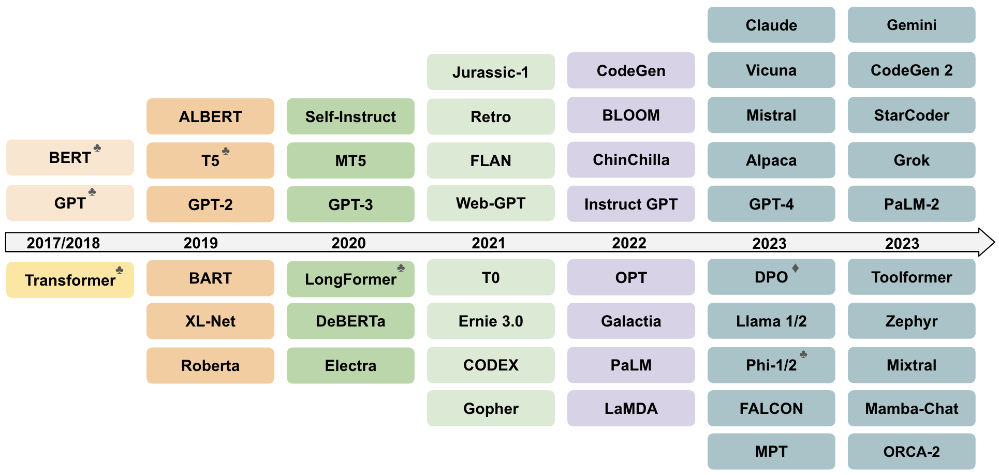
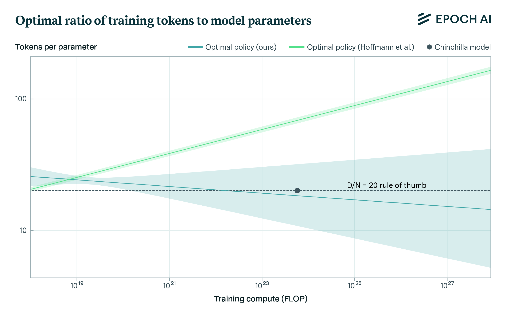
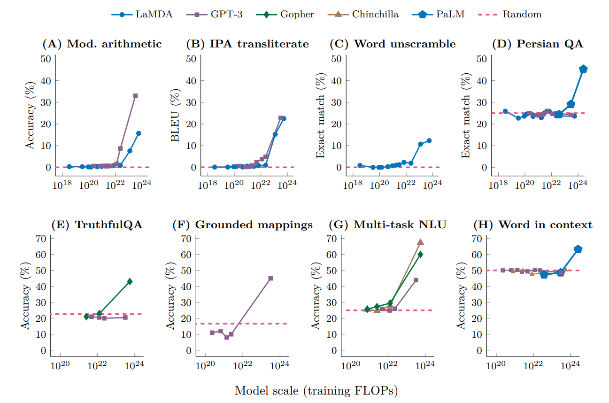
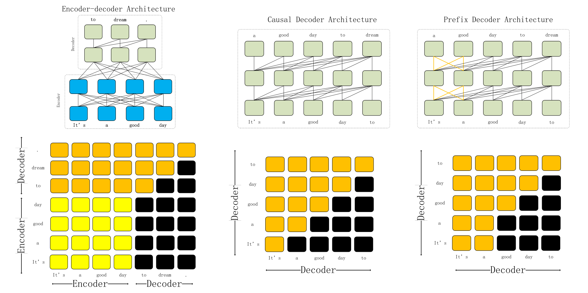
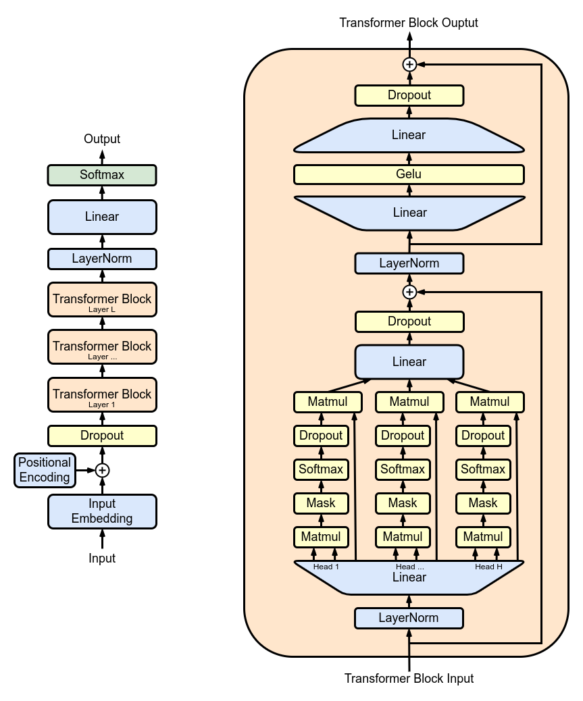
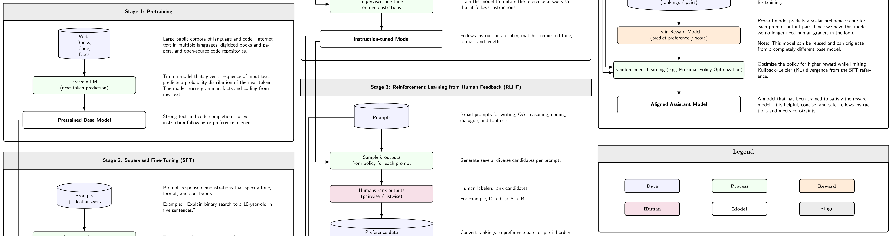
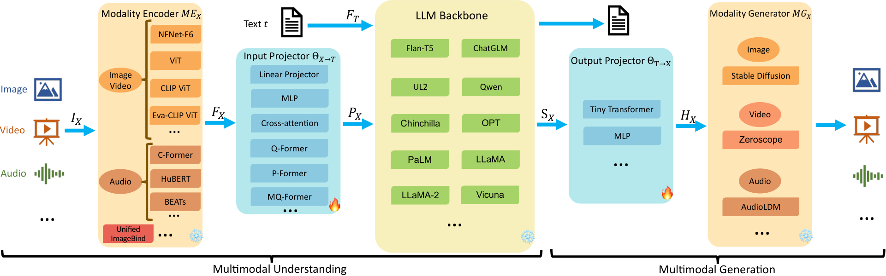

# 第14章 大语言模型

> **本章导读**：第 12 章讲清了 Transformer 的原理——自注意力、位置编码、编码器-解码器；本章的主角**大语言模型**（Large Language Model，LLM）就是"Transformer + 海量数据 + 超大规模"逼出来的通用能力机器：模型性能随参数量、数据量、算力的增加按幂律提升（缩放定律），规模越过某个阈值后还会"涌现"出小模型完全不具备的能力。本章依次讲四件事：LLM 的三种主流架构与关键技术组件；训练数据与"预训练 → 监督微调 → 对齐"三阶段训练过程；如何评估 LLM、如何用微调、迁移学习、正则化、RAG 与工具调用改进效果；以及模型尺寸、算力、隐私、幻觉、安全五大挑战与地学领域的应用展望。理解 LLM 的"能"与"不能"，才能在数据挖掘项目中把它用对、用好。

## 14.1 大语言模型概述

### 14.1.1 什么是大语言模型

> **定义（大语言模型）** 大语言模型（Large Language Model，LLM）是基于 Transformer 架构、进行下一个（或多个）词元预测，参数规模巨大（数十亿至万亿级）、在海量文本上预训练的概率语言模型。

这个定义里有三个关键词，缺一不可。一是**基于 Transformer**——架构上的出身，第 12 章的自注意力与掩蔽注意力就是它的全部骨架；二是**下一个词元预测**——任务上出奇地朴素：给前文，猜下一个词，仅此而已，第 11 章的序列预测思想被推到了极致；三是**参数规模巨大、海量文本预训练**——规模上与前代语言模型拉开几个数量级，数十亿乃至万亿级参数、数千亿乃至万亿级 token 的语料。

它的核心能力正是从这三个关键词的乘积中"涌现"出来的：理解、生成、推理、翻译、代码等通用能力，一个模型全部具备。典型代表：国外的 GPT 系列（OpenAI）、BERT、LLaMA、PaLM/Gemini、Claude；国内的 DeepSeek、GLM、Kimi、Qwen、豆包、文心、混元等。名目繁多，但底座都是 Transformer。

### 14.1.2 从语言模型到大语言模型，再到智能体

LLM 不是一夜之间出现的，把它放回语言模型的发展长河里，每一代解决了什么问题便一目了然（表 14-1）。

**表 14-1 从语言模型到大语言模型的发展脉络**

| 阶段 | 代表 | 关键变化 |
|------|------|----------|
| 统计语言模型 | n-gram | 自由参数多、数据稀疏 |
| 神经网络语言模型 | NNLM | 神经网络替代指数级自由参数 |
| 预训练语言模型 | BERT / GPT-1~2 | Transformer + 预训练-微调范式 |
| **大语言模型** | GPT、Claude、DeepSeek、Kimi | **规模扩展带来能力涌现** |
| **编程智能体** | Codex、Claude Code | **以编程为突破口** |
| **助理智能体** | OpenClaw、Hermess、Grok Bot | **个人助理机器人** |

这条脉络的内在逻辑是"表示方式的升级"：n-gram 用查表计数表示词的搭配，自由参数随词表指数膨胀，数据稍有稀疏便无从估计；神经网络语言模型（NNLM）改用向量与网络表示词，参数量从指数级降到可控；预训练语言模型引入 Transformer 与"先预训练、再微调"的两段式范式，让一份语言知识可以服务大量下游任务；大语言模型则证明：当模型与数据大到一定程度，连"微调"都常常可以省略，任务说明写在提示词里就行。如今故事还在往下讲：先是以编程为突破口出现编程智能体——模型直接写代码、运行代码；进而走向能规划多步任务的个人助理智能体。第 15 章的智能体工作流正是这一前沿的 MATLAB 落地。

**图 14-1 大语言模型发展时间线（2017—2023）**

### 14.1.3 缩放定律

"把模型做大"为什么值得做？**缩放定律**（Scaling Laws）给出了定量回答，它是 LLM 规模化发展的理论依据：

- 模型性能随**参数量、数据量、算力**的增加呈幂律提升；
- Kaplan 等人（2020）提出缩放定律：损失随这三个因素可预测地下降——注意是"可预测"，投入翻倍、损失按可算出的幅度下降，规模化于是从赌博变成了工程；
- **Chinchilla**（2022）进一步指出：在固定算力下，数据与参数应按比例增长（约 20 token/参数）——只堆参数不堆数据，模型会"吃不饱"；这个配比纠正了此前"参数越大越好"的偏差，"大"要大得均衡。

**图 14-2 Chinchilla 缩放定律：固定算力下最优的 token/参数配比**（图片来源：Epoch AI，CC BY）

对非头部机构的启示很实际：既然损失可以按幂律"买"下来，那么在预算内先算清最优的参数-数据配比，再决定训练或选型，比盲目追新更有意义；而绝大多数应用场景，直接站在已按最优配比训好的开源模型上（见 14.2.4 与第 15 章）即可。

### 14.1.4 涌现能力

缩放定律描述的是量的渐变，**涌现能力**（emergent abilities）则是质的跳跃：当模型规模超过某一阈值后，会出现**小模型完全不具备的能力**——再怎么从小模型外推，也外推不出这条能力曲线。

典型的涌现能力包括：

- **少样本/零样本学习**：不给或只给几个示例，模型就能照猫画虎完成新任务；
- **思维链推理**：提示"一步一步想"，模型便能把多步问题拆开求解；
- **指令遵循**：像听懂人话一样执行复杂的复合指令。

涌现能力难以从小模型外推得到，这是 LLM 区别于传统模型的关键（图 14-3）——横轴是训练算力（对数尺度），多项基准的性能在小模型区间长期趴在底部，越过阈值后陡然跳升。它同时提醒我们两件事：评估小模型的表现不能代表大模型；反过来，大模型的某些能力也并非"设计"出来的，而是"出现"的——这也意味着它的边界不那么容易预判，后文 14.5 节的挑战多与此有关。

**图 14-3 涌现能力：多项基准性能随训练算力突变跳升**（图片来源：Wikimedia Commons，Wei et al. 2022 风格涌现曲线）

## 14.2 常用 LLM 模型结构

### 14.2.1 三种主流架构

第 12 章的 Transformer 原版是"编码器 + 解码器"全家桶，后来的模型按任务需要各取一半，形成三种主流架构（表 14-2、图 14-4）。

**表 14-2 三种主流 Transformer 架构**

| 架构 | 注意力 | 代表模型 | 适合任务 |
|------|--------|----------|----------|
| 编码器-only | 双向 | BERT 及变体 | 理解任务（分类、检索） |
| **解码器-only** | 因果掩蔽 | **GPT 系列、LLaMA** | **生成任务** |
| 编码器-解码器 | 编码双向+解码因果 | T5、BART | 序列到序列（翻译、摘要） |

当前主流大语言模型（GPT、Claude、LLaMA 等）多采用**解码器-only** 架构。原因可以从训练目标理解：解码器-only 配上因果掩蔽，天然做的就是"给前文预测下一个词"，训练目标与海量的无标注文本严丝合缝——互联网上每一篇文档本身就是现成的训练样本；而编码器的双向理解、编码器-解码器的序列到序列，都需要专门设计的训练任务。目标越简单，可用的数据越多，这与 14.3 节的规模化一拍即合。

**图 14-4 三种 Transformer 架构的连接方式与注意力掩码**

### 14.2.2 解码器-only 架构要点

解码器-only 的 LLM，其结构要点可以在第 12 章的基础上逐条对上：

- **因果（掩蔽）自注意力**：每个位置只能看到自身及之前的位置，保证自回归生成——机制见 12.3.5 节，这里换了个名字叫"因果"，含义相同；
- 多头注意力 + 前馈网络 + 残差连接 + 层归一化——"注意力/前馈 + 残差 + 归一化"的子层外衣原样保留；
- **Pre-Norm 与 Post-Norm**：归一化放在子层之前（Pre-Norm）还是之后（Post-Norm）。现代 LLM 多采用 Pre-Norm：梯度经由残差通路可以"无损"直达浅层，深层网络训练更稳定；
- 位置编码：绝对位置编码、相对位置编码、**RoPE 旋转位置编码**——RoPE 把"两个位置的相对距离"编织进注意力计算本身，外推到训练时没见过的更长序列也较稳健，是当前的主流选择。

**图 14-5 GPT 的解码器-only 堆叠结构**

### 14.2.3 关键技术组件

若把 LLM 拆开看零件，现代 LLM 的"零件清单"见表 14-3。

**表 14-3 现代 LLM 的关键技术组件**

| 组件 | 常用方案 |
|------|----------|
| 注意力优化 | Flash Attention、Multi-Query Attention、Grouped-Query Attention |
| 激活函数 | GELU、SwiGLU |
| 归一化 | LayerNorm、RMSNorm |
| 位置编码 | RoPE、ALiBi |
| 分词词表 | BPE、SentencePiece |

这张表的实用价值在于**看懂开源模型的"身份证"**：从 Hugging Face 下载一个开源模型，配置文件 config.json 里写的就是这些组件名——attention 是 GQA、激活是 SwiGLU、归一化是 RMSNorm、位置编码是 RoPE。认识这些名字，就能读懂一个模型的出身与性格，判断它与手头任务是否合拍，也为第 15 章在 MATLAB 中调用它们扫清障碍。

### 14.2.4 代表性 LLM 一览

**表 14-4 代表性大语言模型**

| 模型 | 机构 | 架构 | 特点 |
|------|------|------|------|
| GPT-4 / GPT-4o | OpenAI | 解码器 | 通用能力强，多模态 |
| Claude | Anthropic | 解码器 | 长上下文、安全对齐 |
| LLaMA | Meta | 解码器 | 开源、可本地部署 |
| DeepSeek | 深度求索 | 解码器（MoE） | 高性价比、开源权重 |
| BERT | Google | 编码器 | 文本理解基准 |
| T5 | Google | 编码器-解码器 | 文本到文本统一框架 |

选型时值得留意"开源权重"这一档：LLaMA、DeepSeek 等模型权重公开、可以本地部署，数据不出域——对涉密地学数据而言，这一档往往不是"可选项"而是"必选项"（14.5.2 节与第 15 章还会回到这个话题）。MoE（混合专家）指模型内含多组"专家"子网络，每个词元只激活其中一小部分，用有限的计算量撑起更大的总参数量。

## 14.3 训练数据集与模型训练过程

### 14.3.1 训练数据集

LLM 预训练数据来源广泛、规模巨大：

- **网页**：Common Crawl、WebText——体量最大的一路；
- **书籍**：Books3、Gutenberg——长文本与系统性知识；
- **代码**：GitHub——代码不仅教编程，还"教推理"；
- **学术**：arXiv、Wikipedia——专业性与事实性知识的重镇；
- **对话与指令**：ShareGPT、开源指令数据集——主要用于后面的 SFT 阶段。

数据规模从数百 GB 到数十 TB，token 数从**数千亿到万亿级**。作为对照，一个人一生阅读量折算不过数亿词——LLM 的"读书量"是人类的三四个数量级以上，它的语言能力正是从这份"阅读量"里来的。

### 14.3.2 数据预处理流程

原始网页不能直接喂给模型，要先过四道工序：

- **采集**：从多来源抓取原始文本；
- **清洗**：去重、去噪、过滤低质内容、隐私脱敏——重复文本会让模型"背书"，低质文本污染语感，隐私信息则埋下泄露隐患（14.5.2 节）；
- **分词**：用 BPE/SentencePiece 切分为 token——BPE 从高频字符对出发逐步合并出词表，新词、生僻词都能拆成熟悉的碎片；
- **配比**：按比例混合不同来源的数据，平衡领域分布。

数据质量直接决定模型上限——"垃圾进，垃圾出"在 LLM 时代依然成立，而且因为训练动辄耗资千万级，"垃圾"的代价也被放大了千万级。这也是第 3 章反复强调的数据清洗，在 LLM 时代的放大重演。

### 14.3.3 三阶段训练过程

LLM 训练通常分为三个阶段（表 14-5）。一句话概括分工：**预训练最贵（算力），SFT 与对齐最"巧"（数据质量）**。

**表 14-5 LLM 训练的三个阶段**

| 阶段 | 名称 | 数据 | 教会模型什么 |
|------|------|------|--------------|
| 1 | 预训练 Pre-training | 海量无标注文本 | 语言规律与世界知识 |
| 2 | 监督微调 SFT | 高质量指令-回答对 | 听懂并遵循指令 |
| 3 | 对齐 Alignment | 人类偏好比较数据 | 有用、诚实、无害 |

**阶段一：预训练。** 目标是最大化对数似然

$$\mathcal{L} = \sum_i \log P\left(u_i \mid u_{i-k}, \cdots, u_{i-1}; \theta\right)$$

即给定前 $k$ 个词元时，让下一个词元 $u_i$ 的预测概率尽可能大——这就是"下一个词元预测"的数学表达。数据为海量无标注文本，属自监督学习：不需要任何人工标注，文本本身就是答案。算力上需要千卡/万卡 GPU 集群训练数周至数月，是三阶段中最烧钱的一步。产物是**基座模型**（base model）——具备语言能力但**不擅长对话**：基座模型会"续写"，你问它问题，它可能继续"写问题"，因为它从没学过"听指令"，它只是个复读机式的世界知识压缩体。

**阶段二：监督微调（SFT）。** Supervised Fine-Tuning 的数据是人工编写的高质量指令-回答对，例如：

> 指令："克罗地亚首都是什么？"
>
> 目标回答："萨格勒布（Zagreb）……"

目标让模型学会按指令格式输出——看到问句就回答，而不是续写更多问句；方法是在预训练模型上继续做有监督训练，规模不大（通常几万到几十万对），但质量要求极高；产物是**指令模型**（instruct model），能遵循指令完成任务。日常使用的 ChatGPT 类产品，底层就是这样的指令模型。

**阶段三：对齐（RLHF / DPO）。** 指令模型会"答"了，但答得好不好、稳不稳、有没有害，还要靠对齐来把关：

- **RLHF**（Reinforcement Learning from Human Feedback，基于人类反馈的强化学习）：先让人类对模型的多个回答两两比较、排出好坏，据此训练一个**奖励模型**建模人类偏好，再用 PPO 等强化学习算法让 LLM 的输出朝着高奖励方向优化；
- **DPO**（Direct Preference Optimization，直接偏好优化）：跳过奖励模型，直接用偏好数据对优化——更简单稳定，近年逐渐流行；
- 目标：使模型输出更有用（Helpful）、诚实（Honest）、无害（Harmless），简称 HHH。

**图 14-6 预训练 → SFT → RLHF 三阶段训练工作流**

把三个阶段连起来看（图 14-6），可以发现一条分工规律：预训练灌进去的是"知识"，SFT 矫正的是"格式"，对齐塑造的是"品性"。三层缺一不可——只有知识不会对话，只会对话可能胡说，会说话还要说得得体。

### 14.3.4 分布式训练与并行策略

万亿参数模型显然放不进任何一块显卡，训练离不开系统工程。几类并行策略各有形象的理解方式：

- **数据并行**：切分数据到多卡——"多人读不同书"，每人手里一份完整模型副本，读完交换学习心得（梯度）；
- **张量并行**：切分单个层到多卡——"多人合抬一根梁"，一层的大矩阵拆到多卡同时乘；
- **流水线并行**：按层切分到多卡——"多人接力加工序"，第 1 卡算完前几层传给第 2 卡，流水不歇；
- **混合精度训练**：FP16/BF16 降低显存与加速——数值精度适度放低，训练照样收敛；
- **ZeRO 优化**：分片优化器状态、梯度与参数——人人都用的冗余备份拆开分放，显存省下一大截。

工程细节超出本书范围，但这组类比有助于读懂文献里的并行术语：大模型训练是一场"算力的合唱"，唱好的关键在于分工与协调。

## 14.4 模型评估与改进

### 14.4.1 如何评估 LLM 性能

训练完要"考试"。LLM 评估是多维度、开放性的难题，主要基准见表 14-6。

**表 14-6 LLM 的主要评估基准**

| 维度 | 代表基准 |
|------|----------|
| 知识与推理 | MMLU、GSM8K、MATH |
| 语言理解 | GLUE、SuperGLUE |
| 代码 | HumanEval、MBPP |
| 对话与指令 | AlpacaEval、MT-Bench |
| 综合基准 | HELM、LMSYS Chatbot Arena（人类盲评） |

评估方法本身也面临四个挑战：

- **数据污染**：测试集可能已混入预训练数据——模型"背过题"，分数虚高；
- **开放生成难评分**：翻译有标准答案，写一篇地学科普文没有；只能依赖人工评分或 LLM-as-judge（用一个 LLM 给另一个 LLM 打分，又引入新的偏差）；
- **评价指标**：BLEU/ROUGE 适合翻译/摘要这类有参照文本的任务，不适合开放对话；
- **复现性**：模型推理有随机性、对提示措辞敏感——换个说法，分数就变。

看榜单要"祛魅"：榜单分数 ≠ 你的任务上的真实表现。**用自己的数据实测**才靠谱——这也是第 15 章把 LLM 请进 MATLAB 的动因之一：在自己的数据管线上测，才算数。

### 14.4.2 改进方法一：微调

拿现成模型改成自己的领域模型，首选微调：

- **全参数微调**：更新所有参数，效果最好但成本高——数千亿参数全部更新，显存与数据量都不友好；
- **参数高效微调**（PEFT，Parameter-Efficient Fine-Tuning）：
  - **LoRA**：低秩适配——冻结原模型，在注意力权重旁挂一个低秩的小增量矩阵，只训练这部分附加参数（常 <1%）。数学直觉是：领域适配所需的"改动"往往是低秩的，用小矩阵近似即可；
  - **QLoRA**：量化 + LoRA——先把基座模型量化到 4 比特再挂 LoRA，进一步降显存，单卡也能微调相当规模的模型；
  - Adapter、Prefix Tuning 等——同一思想的不同挂载方式；
- 在垂直领域（如地学、金融）的小数据上有效。

### 14.4.3 改进方法二：迁移学习

- 利用预训练模型已学到的**通用语言知识**，在目标任务上继续训练，迁移已有表示；
- 在 MATLAB 中的体现：用预训练 BERT 提取特征再训练分类头，FineTuneBERT.m 示例展示端到端迁移学习——与第 13 章呼应：BERT 微调就是"预训练+迁移学习"范式的 MATLAB 实操。

从第 11 章的 CNN 迁移学习、第 13 章的 BERT 微调，到本章的 LoRA，"预训练 → 迁移"的范式贯穿全书：骨架别人搭，血肉自己填。

### 14.4.4 改进方法三：正则化

- **Dropout**：随机丢弃神经元，防止过拟合；
- **权重衰减**（L2 正则）：约束参数规模；
- **层归一化与残差连接**：稳定深层网络训练；
- **早停**（Early Stopping）：在验证集性能下降时停止；
- **标签平滑**：缓解过自信，提升泛化。

这些"经典武器"在 LLM 时代依然有效——第 9~11 章讲过的正则化思想并没有过时，只是藏进了训练框架的默认配置里。深度学习的地基从未改变。

### 14.4.5 其他改进技术

除了改模型本身，还可以改"用法"：

- **提示工程**（Prompt Engineering）：设计更好的指令——同一个问题，换一种问法，效果天差地别；
- **思维链**（Chain-of-Thought）：提示"一步一步想"，引导模型分步推理——多步问题先拆解再求解；
- **检索增强生成**（RAG）：生成前先从外部知识库检索相关资料，引入最新/专有知识，减少幻觉；
- **工具调用**（Tool Calling）：让模型使用计算器、数据库等外部工具——算数值这种事不必靠"心算"；
- **模型量化与蒸馏**：压缩模型，降低部署成本。

其中 RAG 与工具调用将在第 15 章"MATLAB LLM 工具箱指南与地学应用"中动手实践——它们恰好也是缓解幻觉（见下节）的主力手段。

## 14.5 挑战与未来发展

### 14.5.1 挑战一：模型尺寸与计算资源

- 模型参数从数十亿到万亿，**训练与推理成本巨大**；
- 需要专用 GPU/TPU 集群，能耗与碳排放显著；
- 中小机构难以独立训练大模型，依赖 **API 或开源模型**；
- 推理延迟与显存仍是部署瓶颈。

不同规模模型的门槛差异巨大（表 14-7）。

**表 14-7 模型规模与训练门槛**

| 规模 | 量级 | 训练门槛 |
|------|------|----------|
| 十亿级（7B） | 单卡可推理 | 实验室可微调 |
| 千亿级（100B+） | 多卡集群 | 大厂主导 |
| 万亿级（1T+） | 专用集群 | 极少数机构 |

这张表给出的定位很清醒：对高校实验室而言，"训大模型"不现实，"用好大模型"与"微调中小模型"才是正路——前者是第 15 章的主题，后者靠 14.4.2 节的 PEFT。

### 14.5.2 挑战二：数据与隐私

- 高质量公开数据趋于耗尽，**"数据墙"问题**显现——互联网文本的增量赶不上模型的胃口；
- 训练数据可能包含个人隐私信息；
- 用户交互数据的使用需符合法规（如 **GDPR**）；
- 模型可能**记忆并泄露**训练数据——研究者已能从大模型中"钓出"训练语料里的原文。

教学红线：涉及保密、个人信息的**敏感数据不要发给云端模型**——用本地部署（第 15 章 Ollama）。观测台站数据、涉密图件、学生个人信息，一律不进云端 API。

### 14.5.3 挑战三：幻觉与可靠性

- **幻觉**（Hallucination）：模型生成看似合理但错误的内容——流利、自信、一本正经地胡说八道；
- 缺乏事实核查能力，难以自我纠正；
- 在医疗、法律、**地学**等高风险领域影响显著；
- 缓解手段：**RAG、工具调用、事实校验、对齐训练**。

对数据挖掘的警示值得单独强调：让 LLM"心算"统计量或编造文献引用，都是幻觉高发区——数值与事实应交给 MATLAB 与数据库。幻觉的根源在于模型的生成机制：它在预测"下一个最像的词"，而不是"下一个正确的词"。这与第 12 章讲的生成机制一脉相承——机制如此，对策才有针对性：数值交给工具（第 15 章工具调用），事实交给检索（第 15 章 RAG）。

### 14.5.4 挑战四：安全与对齐；挑战五：可解释性与公平性

**挑战四（安全与对齐）**：

- 有害内容生成：偏见、歧视、暴力、违法信息；
- **越狱攻击**：诱导模型绕过安全限制——对齐防线并非牢不可破；
- 滥用风险：深度伪造、自动化攻击、虚假信息；
- 对齐难题：不同文化、价值观难以统一，"无害"本身没有全球统一的标准答案。

**挑战五（可解释性与公平性）**：

- LLM 是**黑箱**，决策过程难以解释——千亿参数的注意力权重无法像第 8 章决策树那样讲出"为什么"；
- 内部机制的理解仍不充分（机制可解释性研究进行中）；
- 可能放大数据中的社会偏见——训练语料里的偏见会被模型放大并输出；
- 评估公平性缺乏统一标准。

这两类挑战对科研用户的启示：把 LLM 当作"需要审核的助手"，而不是"可托付的专家"——它的输出要经过人工核验才能进入正式成果。

### 14.5.5 未来发展方向

- **多模态**：统一处理文本、图像、音视频。通用架构是"编码器 → 投影器 → LLM → 生成器"（图 14-7）：各种模态先各自编码，投影到语言空间，由 LLM 统一"思考"，再投影回去生成——语言成为多模态的"中枢神经"；
- **长上下文**：百万级 token 上下文窗口——一次"读完"一座小型文献库；
- **智能体与具身智能**：自主规划调用工具、与物理世界交互；
- **小模型高效化**：蒸馏量化、能力下沉端侧——大模型当老师，小模型当学生；
- **科学发现**：辅助生物、材料、地学科研。

**图 14-7 多模态大模型通用架构：编码器 → 投影器 → LLM → 生成器**

### 14.5.6 地学领域的 LLM 应用展望

具体到地学，五个方向已经可以看到落地路径：

- 地学文献检索与知识抽取——海量文献的自动阅读与综述；
- 时空数据的自然语言交互分析——"问数据"代替"写代码查数据"；
- 地质灾害、气象、水文事件的智能问答与报告生成；
- 多模态遥感图像与文本的联合理解；
- 地学 Agent 自动编排数据处理工作流。

以上每个方向都对应一个可动手的 MATLAB 实验——文献 RAG、工具调用、可视化 Agent、报告生成、工作流编排，正是第 15 章的内容。

## 14.6 本章小结

- LLM 基于 Transformer，以"下一个词元预测"为目标，经**预训练-SFT-对齐**三阶段训练：预训练灌知识、SFT 矫格式、对齐塑品性；规模扩展带来涌现能力；
- 缩放定律（Kaplan、Chinchilla）为规模化提供了理论依据：损失随参数、数据、算力幂律下降，固定算力下数据与参数按约 20 token/参数配比；
- 主流架构为**解码器-only**，配合 RoPE、SwiGLU、RMSNorm 等技术组件；认识这些组件就能读懂开源模型的 config.json；
- 评估是多维度难题（MMLU、HumanEval、Chatbot Arena 等），面临数据污染、开放生成难评分等挑战，需结合自动基准与人类评估，看榜单要"祛魅"；
- 改进手段包括**微调（LoRA 等 PEFT）、迁移学习、正则化、RAG、工具调用**等；
- 面临模型尺寸、算力、隐私、幻觉、安全等多重挑战；对科研用户的核心守则：敏感数据不上云、数值交给工具、输出经过核验；
- 未来向多模态、长上下文、智能体、具身智能与科学发现方向发展。

## 14.7 思考题

1. 为什么解码器-only 架构成为主流大语言模型的选择？请从训练目标与数据可得性的关系说明；它与第 12 章 BERT 的仅编码器架构各擅长什么？
2. 缩放定律与涌现能力分别说了什么？"规模扩展带来能力涌现"对模型选型有什么启发？
3. 预训练-SFT-对齐三阶段各自解决什么问题？为什么说"预训练最贵、SFT 与对齐最巧"？基座模型与指令模型的行为差异是什么？
4. LoRA 等参数高效微调为何在小数据场景下有优势？与全参数微调相比牺牲了什么？QLoRA 为什么能让单卡微调成为可能？
5. 在地学领域，RAG 与工具调用分别能解决什么问题？它们与幻觉的关系是什么？
6. 如何缓解大语言模型的幻觉？为什么"让 LLM 心算统计量"是幻觉高发区？请结合生成机制说明。

## 14.8 延伸阅读

1. Vaswani A, et al. *Attention Is All You Need*. NeurIPS 2017
2. Kaplan J, et al. *Scaling Laws for Neural Language Models*. 2020
3. Hoffmann J, et al. *Training Compute-Optimal Large Language Models*（Chinchilla）. 2022
4. Ouyang L, et al. *Training language models to follow instructions with human feedback*（InstructGPT）. 2022
5. Hu E J, et al. *LoRA: Low-Rank Adaptation of Large Language Models*. 2021
6. Wei J, et al. *Chain-of-Thought Prompting Elicits Reasoning in Large Language Models*. 2022
7. Zhao W X, et al. *A Survey of Large Language Models*. 2023
8. 《大语言模型》（LLM-TAP），上海交通大学出版社，第 1–2 章

> 本章插图取自本讲课件《数据挖掘·第十四讲 大语言模型》；图 14-2 来源 Epoch AI（CC BY），图 14-3 来源 Wikimedia Commons。
