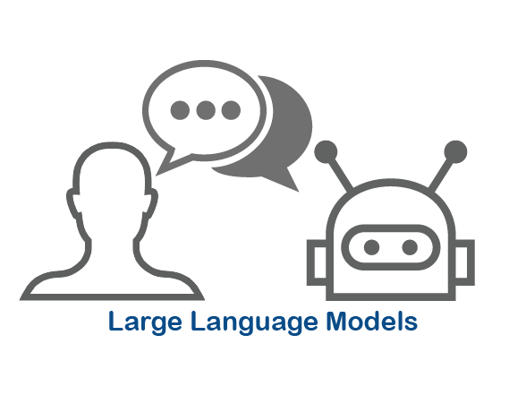
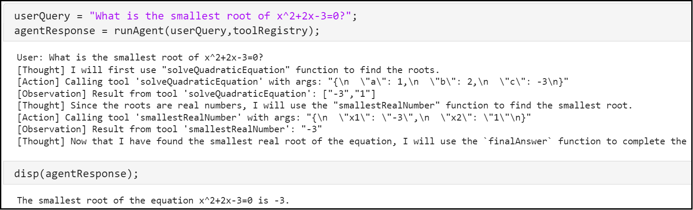
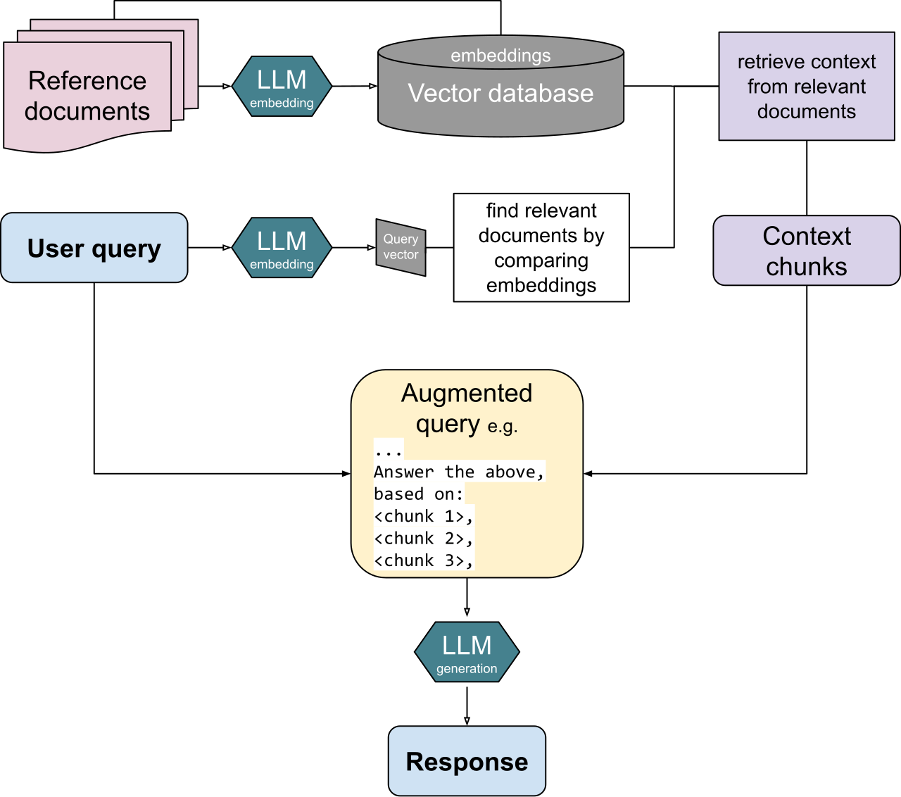
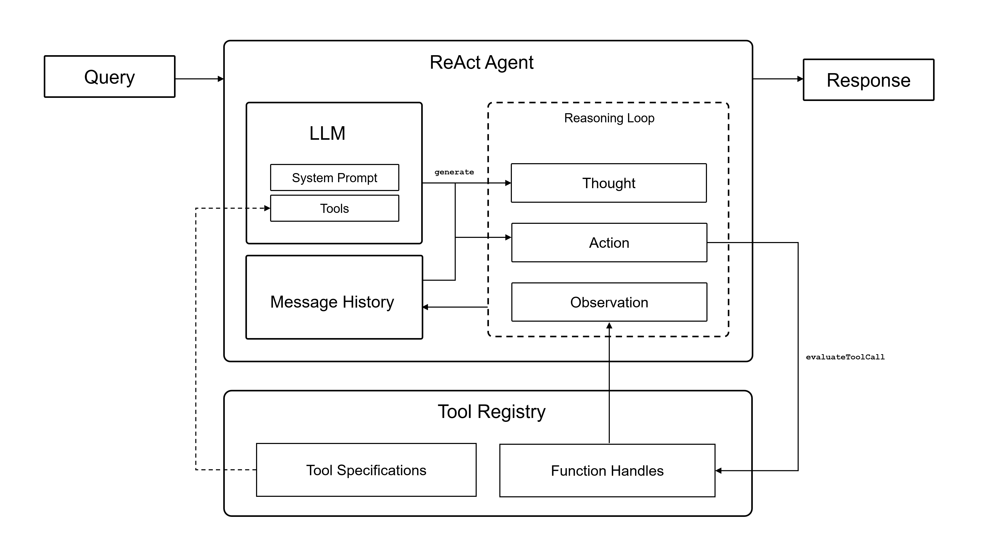
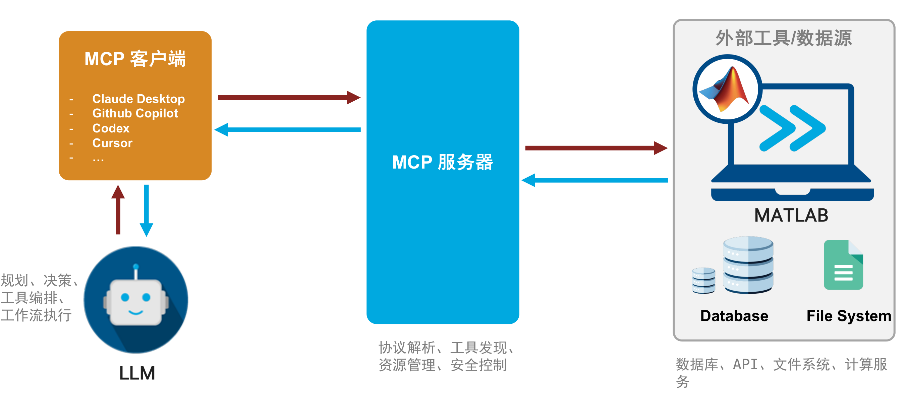
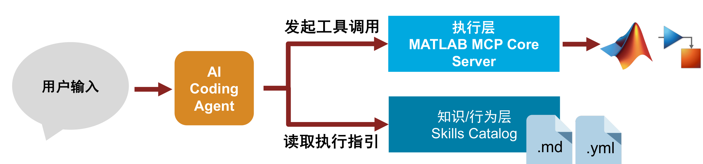
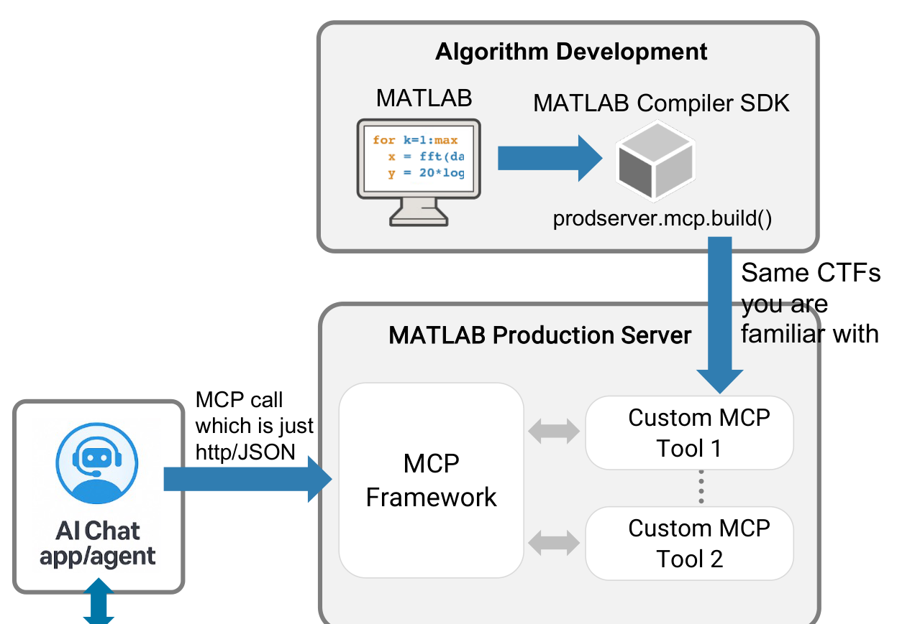
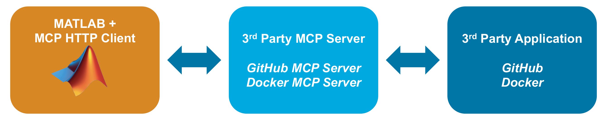
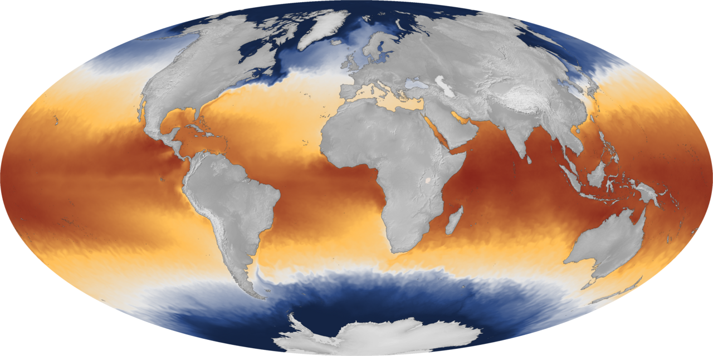

# 第15章 MATLAB LLM工具箱指南与地学应用

> **本章导读**：第 14 章回答了"大语言模型是什么、怎么训练、有何挑战"；本章回答"怎么用"——让大模型在 MATLAB 里"动起来"：不只是聊天，而是**会查数据、会算、会出图、会写报告**。主角是 MathWorks 官方附加组件 **"LLMs with MATLAB"**：它连接 ChatGPT、Azure OpenAI 与 Ollama 本地模型，并提供了三大高级能力——工具调用（Tool Calling）、检索增强生成（RAG）与智能体工作流（Agentic Workflows）；进阶生态包括 MATLAB/Simulink Agentic Toolkit 与 MCP 协议，把 LLM 接入工程工具链。本章最后结合 NetCDF、GeoTIFF/shapefile 等地学数据基础，给出五个地学综合应用：文献问答、数据分析、可视化、报告生成、工作流编排。学完本章，第 13 章的文档向量化和第 14 章的 LLM 概念将合成一套趁手的工具。

## 15.1 MATLAB LLM 工具箱概述

### 15.1.1 官方支持：LLMs with MATLAB

MATLAB 官方并没有发布名为 "LLM Toolbox" 的独立产品；官方形态是附加组件 **"Large Language Models (LLMs) with MATLAB"**（下文按习惯简称"LLM 工具箱"）：

- File Exchange：<https://www.mathworks.com/matlabcentral/fileexchange/163796-large-language-models-llms-with-matlab>
- GitHub：<https://github.com/matlab-deep-learning/llms-with-matlab>
- 最低版本：**MATLAB R2024a**（部分新函数需 R2026a）；
- 版本持续更新（截至 2026 年 4 月已发布至 v4.9.0）。



**图 15-1 LLMs with MATLAB 附加组件**

它的定位是 MATLAB 与大模型世界之间的一座桥：桥的这一头是 MATLAB 的数据、函数与工具箱，那一头是 OpenAI、Azure、Ollama 等形形色色的大模型服务。本章三大主题——**Tool Calling、RAG、Agentic Workflows**——都建立在这座桥上。

### 15.1.2 支持的后端

该附加组件可连接多种 LLM 后端（表 15-1），各客户端共享 generate、messageHistory 接口——后端换了，代码骨架不变。

**表 15-1 LLMs with MATLAB 支持的后端**

| 后端 | 客户端 | 场景 |
|------|--------|------|
| OpenAI Chat Completions API | openAIChat | 效果最强的通用选择 |
| Azure OpenAI Services | azureChat | 企业合规场景 |
| Ollama 本地大模型 | ollamaChat | 数据不出门 |
| 任意 OpenAI 兼容 API | openAIChat + 自定义端点 | 国产模型/自建服务 |

这张表里最有战略价值的是最后一行：国内外大量模型服务（DeepSeek、Qwen、GLM 等）都提供 OpenAI 兼容接口，意味着换模型通常只是换一个端点地址——生态锁定的风险因此小得多。而 ollamaChat 一行则对应 14.5.2 节的红线：涉密数据不出门。

## 15.2 安装与配置

### 15.2.1 安装方式

三条路任选其一：

**方式一：Add-On Explorer**。在 MATLAB 中打开"主页 → 附加功能 → 获取附加功能"，搜索 "Large Language Models (LLMs) with MATLAB"，点击安装——最省事，适合个人电脑。

**方式二：从 GitHub 克隆**。`git clone https://github.com/matlab-deep-learning/llms-with-matlab`，然后把仓库加入 MATLAB 路径——适合想读源码、跟进最新版本的用户，examples/ 目录的示例也只有这里有全套。

**方式三**：从 File Exchange 下载 **.mlpkginstall** 文件安装——适合离线或受管环境。

### 15.2.2 配置 OpenAI API Key

用云端 API 需要先解决"身份"问题：

- 将 API key 写入项目根目录的 **.env** 文件，变量名：**OPEN_AI_KEY**；
- 在 MATLAB 中用 loadenv 加载：`loadenv(".env")`；
- .env 文件需在 MATLAB 搜索路径上；也可设置系统环境变量替代。

安全红线：.env 文件含敏感信息，应加入 **.gitignore**，切勿提交版本库！API key 一旦泄露，别人花的是你的钱；推到公开仓库的 key 通常几分钟内就会被扫描程序捕获。这与第 2 章讲过的代码管理习惯一脉相承：密码、密钥永远不进版本库。

### 15.2.3 配置本地 Ollama

涉密场景的后端选 **Ollama**——一个在本机运行开源大模型的服务：

- 先安装并运行 **Ollama** 服务；
- `ollama pull` 拉取模型（llama3、qwen 等）——模型下载到本机，几 GB 到几十 GB 不等；
- `ollamaChat("llama3")` 从 MATLAB 连接——接口用法与 openAIChat 几乎一致；
- 注意：**MATLAB Online 不支持 Ollama**——云端沙箱访问不到你本机的服务，需用本地 MATLAB。

两条路线的取舍可以浓缩成一句话：**云端 API** 能力强、但数据出本机；**本地部署** 数据不出域、但需要本地 GPU，且开源模型的能力通常弱于顶级闭源模型。涉及敏感数据时选后者——能力降一档可以接受，数据出域不可接受。

## 15.3 基础使用：对话与消息历史

### 15.3.1 创建客户端与基本调用

一切从创建客户端开始：

- 创建客户端：`chat = openAIChat("gpt-4.1-mini")`，可用名值参数 **SystemPrompt、Tools、ResponseFormat**；
- 基本调用：`response = generate(chat, prompt)`；
- **流式输出**：支持 streaming 模式，逐 token 实时处理——长回答不必干等；
- **结构化输出**：ResponseFormat 可设为 JSON Schema，自动解析为结构体——让"自由文本"变成"规矩字段"，方便程序接着处理。

```matlab
chat = openAIChat("gpt-4.1-mini", ...
        SystemPrompt="你是地学数据分析助手，用中文简洁回答");
response = generate(chat, "用一句话解释什么是厄尔尼诺现象")
```

SystemPrompt（系统提示）值得专门说说：它是给模型的"岗位说明书"，设定角色、风格与边界——"你是地学数据分析助手，用中文简洁回答"这一句，会贯穿此后这个客户端的每一次回答。写好 SystemPrompt 是提示工程（14.4.5 节）性价比最高的一笔投资。

### 15.3.2 消息历史管理

单轮问答用 generate 即可；多轮对话要靠**消息历史**让模型"记住"前文。用 **messageHistory** 对象管理：`history = messageHistory()` 创建后逐条追加消息（表 15-2）。

**表 15-2 messageHistory 的常用方法**

| 方法 | 作用 |
|------|------|
| addSystemMessage | 系统提示 |
| addUserMessage | 用户消息 |
| addUserMessageWithImages | 带图消息 |
| addToolMessage | 工具返回结果 |
| addResponseMessage | 模型回复 |
| removeMessage | 删除指定消息 |

本质上是把对话逐条记入一个列表，每次 generate 时整份递给模型——模型没有记忆，"记忆"就是每次都把历史带上。addToolMessage 一行在下一节会反复出现：工具调用的结果就是靠它回填进对话的。

## 15.4 Tool Calling（工具调用）

### 15.4.1 什么是工具调用

工具调用让 LLM 在回答时**调用外部函数**，获取模型本身不具备的能力。典型场景：数学计算、数据库查询、数据可视化、调用 MATLAB 算法——恰恰都是 14.5.3 节说的幻觉高发区。

关键在于分工：LLM **不实际执行工具**，而是返回"调用哪个工具 + 参数"，由 MATLAB 执行后回填结果。**LLM 负责"决定调用什么"，MATLAB 负责"真正算出来"**——数值交给工具，幻觉少一半。这个分工与数据挖掘的经典原则一致：让专业的环节干专业的事，模型做决策，引擎做计算。

### 15.4.2 定义工具：openAIFunction

用 **openAIFunction** 对象封装一个 MATLAB 函数：

- `fcn = openAIFunction("getTemperature", @myGetTemp)`——第一个参数是模型看到的工具名，第二个是实际执行的函数句柄；
- `addParameter(fcn, "lat", "number", "纬度")`、`addParameter(fcn, "lon", "number", "经度")`；
- 用 **addParameter** 逐个声明输入参数的名称、类型与描述。

```matlab
fcn = openAIFunction("readNetCDFVar", @readNetCDFVar);
addParameter(fcn, "file", "string", "NetCDF 文件路径")
addParameter(fcn, "var",  "string", "变量名，如 temperature")
```

请注意参数的**描述会传给 LLM，直接影响其调用决策**——模型看不见函数体，只看得见名字、类型和这几句描述；它"选对工具、传对参数"的全部依据就在这里。定义工具时的关键：给每个参数写清楚"类型 + 中文描述"，把描述当成写给模型看的函数文档来写。

### 15.4.3 传入工具与控制调用

创建带工具的客户端：`chat = openAIChat("gpt-4.1-mini", Tools=tools)`。调用时用 **ToolChoice** 参数控制行为（表 15-3）。

**表 15-3 ToolChoice 的取值与用途**

| ToolChoice | 行为 | 用途 |
|------------|------|------|
| "auto"（默认） | 模型自行决定是否调用 | 常规对话 |
| "none" | 只输出文本，不调用 | 规划/思考步 |
| "required" | 强制必须调用某个工具 | 行动步 |
| 指定函数名 | 强制调用指定工具 | 精确执行 |

初看"none/required"似乎多余——让模型自己决定不好吗？经验恰恰相反：把"想"与"做"分开控制，工作流才稳定可控。模型"自由发挥"的每一步都是潜在的不确定性；用 ToolChoice 把每一步钉死在"只思考"或"必行动"上，是工程化 LLM 应用的基本功。15.6 节的 ReAct 循环正是把这三档用到极致的例子。

### 15.4.4 工具调用循环

一次完整的工具调用是一个闭环：

1. `generate(chat, history)` → 模型返回**工具调用**（工具名 + 参数 JSON）；
2. 解析 completeOutput，提取工具调用；
3. 在 **MATLAB 中执行**对应函数；
4. `addToolMessage(history, result)` 把结果**回填**消息历史；
5. 再次 `generate(chat, history)` → 模型基于工具结果继续；
6. 重复直至模型给出**最终文本答案**。

"模型决策 → MATLAB 执行 → 结果回填"的循环，就是 15.6 节**智能体工作流**的发动机——智能体并没有什么神秘引擎，就是这个循环加上自主规划。

官方仓库提供了多个工具调用示例：Analyze Scientific Papers Using ChatGPT Function Calls、Analyze Text Data Using Parallel Function Calls（ChatGPT / Ollama 版）、**Solve Simple Math Problem Using AI Agent**、Fit Polynomial to Data Using AI Agent（需 Curve Fitting Toolbox）。图 15-2 是 Thought → Action → Observation 循环的实录：模型先写"Thought"（我要算什么），再发"Action"（调用哪个函数、什么参数），拿到"Observation"（计算结果）后继续推理——这份实录值得逐行精读。



**图 15-2 官方示例：Thought → Action → Observation 循环实录**

## 15.5 RAG（检索增强生成）

### 15.5.1 什么是 RAG

模型的知识停留在训练那一刻，而且对你的本地资料一无所知。**检索增强生成**（Retrieval-Augmented Generation，RAG）补上这一环：在生成答案前，先从**外部知识库检索**相关文档，把检索到的文档**拼接到提示**中，再让 LLM 生成（图 15-3）。

$$\text{RAG} = \text{Retrieve（检索）} + \text{Augment（增强）} + \text{Generate（生成）}$$

优点：引入最新/专有知识、**减少幻觉**、可溯源、无需重训模型。与 14.4 节的改进手段对照：微调改的是模型本身，成本高、更新慢；RAG 改的是输入，知识库一换模型就"博学"了，而且每个答案都能给出处——对科研写作，"可溯源"这一条尤其珍贵。



**图 15-3 RAG：检索 → 增强 → 生成**

### 15.5.2 RAG 流程

RAG 分为两个阶段。**离线建库**（做一次）：

1. 将知识库文档**分块**（chunking）——检索的基本单位不是整篇文档而是"块"，块太大则检索不精准，太小则上下文残缺；
2. 逐块**嵌入**成向量——用的正是 13.5.3 节的 documentEmbedding；
3. 存入**向量索引**。

**在线问答**（每次提问）：

1. 用户提问 → 查询嵌入；
2. 向量检索 **top-k** 相关块；
3. 将检索块**拼入提示** → LLM 生成答案；
4. 可选：返回**来源引用**。

也就是说，模型回答的不是"它记得什么"，而是"检索到的资料说了什么"——幻觉的生存空间被大大压缩。

### 15.5.3 MATLAB 中的 RAG 核心函数

整套流程只用四个函数：

- **documentEmbedding**：加载文档嵌入模型（默认 all-MiniLM-L6-v2，R2024a；原理见 13.5.3 节）；
- **embed(emb, documents)**：生成文档/查询向量；
- **cosineSimilarity**：向量相似度检索（注意不是 pdist——余弦相似度只看方向不看长短，对语义检索更合适）；
- **generate**：拼入检索上下文后调用 LLM 生成。

```matlab
emb = documentEmbedding;
vec = embed(emb, chunks);                       % 知识库向量化
q   = embed(emb, tokenizedDocument(question));  % 查询向量化
[~, idx] = maxk(cosineSimilarity(q, vec), 3);   % 检索 top-3
```

### 15.5.4 文本分块：splitTextChunks（R2026a）

分块是 RAG 效果的第一道闸门，R2026a 提供了成套工具：

- `chunkTable = splitTextChunks(str)`：递归地将文档切成目标长度内的块——"递归"意味着先按大结构（章节）切，切不动的再按段落、句子细切，尽量保留语义单元；
- 配套函数族（同为 R2026a）：
  - splitHTMLSections、splitMarkdownSections、splitCustomSections——按各自格式切分；
  - **joinSimilarTextChunks**：合并相似块——过碎的块合起来；
  - **addTextChunkOverlap**：添加块间重叠，避免切断语义——上一块的结尾接在下一块的开头，边界处的句子在至少一块里是完整的；
  - findTextChunkContext：取相邻上下文；
  - formatTextChunks：格式化为 Markdown。

注：R2026a 之前的版本需自行用 split / tokenizedDocument 实现分块。

### 15.5.5 混合检索

纯向量检索并非万能：它懂"意思"，却可能漏掉**字面精确匹配**——地学专业术语（"ENSO"、"NDVI"、站点编号）恰恰是字面精确性要求最高的。补强的办法是混合检索：

- **语义检索**：documentEmbedding + cosineSimilarity，懂"意思"；
- **关键词检索**：bm25Similarity、tfidf（13.6.2 节），精"字面"；
- **混合检索**（Hybrid Search）：融合两者结果；
- **倒数排名融合**（Reciprocal Rank Fusion）：合并不同检索器的排名——一个文档在两路检索里都靠前，融合后更靠前；
- 效果：提升**召回率与准确性**——专业术语多的地学文献，混合检索效果最好。

### 15.5.6 官方 RAG 示例

LLMs with MATLAB 仓库 examples/ 目录提供：

- **Retrieval-Augmented Generation Using ChatGPT and MATLAB**（需 Text Analytics Toolbox）；
- **Retrieval-Augmented Generation Using Ollama and MATLAB**（需 Text Analytics Toolbox）；
- Text Analytics Toolbox 文档：Information Retrieval with Document Embeddings。

动手建议：先跑通 Ollama 版（免 API key，零成本试错），再切换 ChatGPT 版对比效果——两个版本代码差异极小，正好体会表 15-1 里"接口共享"的好处。

## 15.6 Agentic Workflows（智能体工作流）

### 15.6.1 从聊天到行动：为何选择 Agentic AI

工具调用再往前一步，就是智能体。按"AI 参与深度"分三段演进（图 15-4）：

- **生成式 AI**：提问、获取文本回答，复制粘贴生成内容——人在做，AI 在说；
- **AI Agent**：聊天 + 工具，AI 生成代码，用户自行运行和调试——AI 写，人在跑；
- **Agentic AI**：AI 编写、运行并修复错误，用户只做审查——AI 跑，人在审。

生成式 AI 的效果取决于模型智能程度，复杂任务上**可能出错**；Agentic AI 让"出错—发现—修复"的循环由 AI 自己完成，速度优势由此而来。工程师的价值并未缩水，反而前移：把时间花在**判断、验证与决策**上，把机械的"运行—报错—再试"交给机器。

> 参考：袁航《连接 Agentic AI 与 MATLAB & Simulink》，MATLAB 中国教育大会 2026


**图 15-4 从生成式 AI、AI Agent 到 Agentic AI 的演进**

### 15.6.2 什么是智能体工作流

让 LLM 作为"大脑"，**自主规划**并调用工具完成多步任务。核心模式是 **ReAct**（Reasoning + Acting，图 15-5）：

- **推理**（Reasoning）：思考下一步该做什么；
- **行动**（Acting）：调用工具执行；
- **观察**（Observation）：获取工具结果，继续推理；
- 循环直至任务完成或调用终止工具。

ReAct 的名字正是两种行为的拼接：与 15.2 节图 15-2 的 Thought → Action → Observation 实录对照着看，"智能体"并不神秘——它就是被授权自主运转的工具调用循环。



**图 15-5 ReAct Agent 架构（MathWorks 官方）**

### 15.6.3 MATLAB 实现 ReAct 循环

在 MATLAB 中实现 ReAct，核心是把表 15-3 的三档 ToolChoice 用到循环里：

1. 用 openAIFunction 定义工具集，含一个 **finalAnswer 终止工具**——模型调用它即表示"任务完成，答案如下"，为循环提供明确的出口；
2. `openAIChat(..., Tools=tools)` 建客户端，初始化 messageHistory；
3. 进入 while 循环（**设最大步数防止死循环**——自主运转的系统必须有刹车）；
4. 推理步：`generate(llm, history, ToolChoice="none")` 让模型输出计划——只许想，不许动；
5. 行动步：`generate(llm, history, ToolChoice="required")` 强制调用工具——必须动，不许光想；
6. 解析工具调用 → MATLAB 执行 → addToolMessage 回填 → 继续循环；
7. 模型调用 **finalAnswer** 时退出。

官方 Agentic 示例：**Solve Simple Math Problem Using AI Agent**（最完整的工具循环范式）、Fit Polynomial to Data Using AI Agent、Analyze Table Data Using ChatGPT、Visualize Table Data Using ChatGPT、Build Optimization Problem Using ChatGPT（需 Optimization Toolbox）。动手建议：从 "Solve Simple Math Problem" 跑起——它是理解 ReAct 循环**最完整的官方范式**。

### 15.6.4 更高级别框架：MathWorks Agentic 产品全景

自己写 ReAct 循环是理解原理的方式；工程落地则可以站到 MathWorks 已推出的完整 Agentic 产品家族上：

- **设计阶段**：**MATLAB Agentic Toolkit** + **Simulink Agentic Toolkit** + **MATLAB MCP Core Server**——AI 编码智能体通过 MCP 直接使用 MATLAB/Simulink 开发与构建；
- **部署阶段**：**MCP Framework for MATLAB Production Server**——通过 MCP 向非 MATLAB 用户共享已部署的 MATLAB 算法；
- **反向接入**：**MATLAB MCP HTTP Client** 让 MATLAB 作为客户端调用外部 MCP 工具生态；
- 注：目前仍无 LangGraph/AutoGen 式的完整多智能体编排框架，多 Agent 协作需基于工具循环自行实现。

一张图记住分工：设计用 **Agentic Toolkit**，部署用 **Production Server 框架**，互通靠 **MCP**——一条从聊天到行动的完整链路。

### 15.6.5 MCP：模型上下文协议

MCP 家族反复出现，这里正式介绍。**MCP**（Model Context Protocol，模型上下文协议）是开放协议，采用**客户端-服务器架构**（图 15-6）。它要解决的是 "M×N" 对接难题：M 个 AI 应用 × N 个工具系统，两两对接需要 M×N 套定制集成——3 个助手连 5 个数据源就要写 15 份胶水代码。MCP 把 M×N 降为 M+N：应用只需会说 MCP（当客户端），工具只需会说 MCP（当服务器），彼此即插即用。

- **MCP 客户端**（Claude Desktop、Copilot、Cursor 等）：规划、决策、工具编排；
- **MCP 服务器**：协议解析、工具发现、资源管理、安全控制；
- 可连接：MATLAB、数据库、API、文件系统等。



**图 15-6 MCP 的客户端-服务器架构**

### 15.6.6 MATLAB 与 Simulink Agentic Toolkit

Agentic Toolkit 的使命是让 AI 编码智能体真正"会干工程活"，采用双层架构（图 15-7）：

- **执行层 MATLAB MCP Core Server**：接受智能体发起的工具调用，真正操作 MATLAB/Simulink——跑代码、改模型、读结果；
- **知识/行为层 Skills Catalog**：每项 Skill 独立封装 **SKILL.md**（行为指引——怎么干才规范）与 **manifest.yaml**（功能、条件、调用方式——什么时候能干）；
- 主要目标：**降低 token 消耗、提高一次成功率、输出工程可用的 MATLAB 结果**；
- 一次性安装即自动完成 Skills 与 MCP 配置，并初始化校验环境。



**图 15-7 MATLAB/Simulink Agentic Toolkit 的双层架构**

Skills 这一层是设计上的点睛之笔：光有执行能力，智能体会"能干但乱干"；把领域规范写成一份份 SKILL.md 交给它，相当于发给实习生一本《操作规程》——能力之上再给章法。

两个 Toolkit 的速览见表 15-4。GitHub：matlab/matlab-agentic-toolkit、matlab/simulink-agentic-toolkit。

**表 15-4 MATLAB 与 Simulink Agentic Toolkit 速览**

| | MATLAB Agentic Toolkit | Simulink Agentic Toolkit |
|---|------------------------|--------------------------|
| 版本要求 | R2020b+ | R2023a+ |
| MCP 工具 | 5 个：detect_matlab_toolboxes、check_matlab_code、evaluate_matlab_code、run_matlab_file、run_matlab_test_file | 6 个：model_overview、model_read、model_edit、model_test、model_query_params、model_resolve_parameters |
| Agent Skills（各 7 类） | 代码编写、测试、调试、评审、创建 Live Script、构建 App、过时函数替换 | 模型构建、仿真测试、Plant 建模、需求起草、MBD 算法、Bug 报告等 MBD 最佳实践 |

### 15.6.7 部署：把 MATLAB 算法发布为 MCP 工具

反方向的集成同样有现成方案：**MCP Framework for MATLAB Production Server** 让智能体可直接调用已部署的 MATLAB 算法（图 15-8）：

- `prodserver.mcp.build()` 将 MATLAB 函数封装为 **MCP 工具**；
- 智能体以 http/JSON 直接调用，与调用 API 一样便捷；
- 核心价值：调用者**无需 MATLAB 授权许可**；支持**大量并发调用**；算法知识产权 **AES 加密**保障；
- 要求：Compiler SDK 与 Production Server **25b+**。



**图 15-8 MCP Framework for MATLAB Production Server 部署架构**（GitHub：matlab/mcp-framework-matlab-production-server）

对地学机构的含义：把多年积累的算法资产（插值方案、订正模型、预警指标）封装成 MCP 工具发布出去，业务同事的 AI 助手就能直接调用——算法作者不必懂前端，调用者不必装 MATLAB。

### 15.6.8 MATLAB MCP HTTP Client：接入外部工具生态

MATLAB 也可以反过来作为 **MCP 客户端**，调用第三方 MCP 服务器（**R2025a+**）：

- 可与 **LLMs with MATLAB** 附加组件结合：LLM 决策 + MCP 工具执行；
- 典型服务器：GitHub MCP Server、Docker MCP Server。

```matlab
endpoint = "https://mcp.io-aerospace.org/";   % MCP 服务器地址
client     = mcpHTTPClient(endpoint);         % 创建客户端
toolOutput = callTool(client, ...
    "get_celestial_body_properties", ...
    celestialBodyName="Mars");                % 调用远程工具
```



**图 15-9 MATLAB MCP HTTP Client 调用远程 MCP 工具**

至此 MATLAB 在 MCP 版图上的两个角色都齐了：当**服务器**，MATLAB 是别人调用的"工具"；当**客户端**，MATLAB 是调用别人的"大脑"——15.6.1 节的"完整链路"由此闭合。

### 15.6.9 安全与可控：权限、测试与审计

Agentic AI 极大提升效率，但必须配套安全机制——这是全章最不能省略的一节。

**优势**：

- 与 Codex / GitHub Copilot / Claude 等主流智能体协同；
- Agentic 循环实现"编写代码 → 运行与评估 → 处理结果 → 再次迭代"的闭环；
- 减少手工反复操作，加速从想法到可用结果。

**风险与注意事项**：

- 智能体具备代码生成与**执行**能力——它写的代码会在你的机器上真的运行；
- 可能访问**本地文件和系统资源**；
- 需要关注**权限控制、运行环境隔离与安全管理**。

地学科研场景尤其注意：**Agent 工具权限最小化**，敏感数据目录不进其可访问范围。给智能体的权限应当像给实习生的权限——够完成任务的最低限度，而不是整台机器。

## 15.7 地学时空数据处理应用

原理与工具都备齐了，本节把 LLM 与地学数据真正接到一起。

### 15.7.1 地学数据工具箱基础

MATLAB 处理地学时空数据的两件主力工具（表 15-5）。

**表 15-5 地学时空数据工具**

| 工具 | 职责 | 备注 |
|------|------|------|
| **Mapping Toolbox** | 地理数据读写、地图投影、坐标变换 | 附加产品 |
| **NetCDF 接口** | 气象、海洋、气候数据主力格式 | MATLAB 自带，无需额外工具箱 |

NetCDF 是气象/海洋数据的"通用语"——CRCM、ERA5、GLDAS 等再分析资料几乎都是 .nc 格式；这与本节开篇的 ONNX 形成有趣的呼应：数据有数据的通用语，模型有模型的通用语，跨生态协作靠的都是标准化。

### 15.7.2 NetCDF 读写（MATLAB 自带）

- **ncread**：读取变量；
- **ncinfo / ncdisp**：文件信息与内容——拿到 .nc 文件先 ncdisp 一遍，摸清变量名与维度；
- **ncreadatt**：读取属性；
- **ncwrite / nccreate / ncwriteatt**：写入；
- 适用：气温、降水、气压、海温等**栅格时空数据**。



**图 15-10 全球海温栅格数据（NOAA NESDIS）——典型的 NetCDF 时空数据**

### 15.7.3 GeoTIFF 与矢量数据（Mapping Toolbox）

- **readgeoraster**：读取 GeoTIFF 栅格（返回数据 + 空间参考 R）——注意 R 与数据同样重要，丢了 R 像素就没了地理坐标；
- **georasterinfo**：栅格元信息；
- **writegeoraster**：写入 GeoTIFF；
- **shaperead / shapewrite**：读取/写入 shapefile 矢量（'UseGeoCoords' 指定经纬度）；
- **geoshow / mapshow**：地理数据显示。


**图 15-11 NASA Blue Marble 全球影像——GeoTIFF 的教科书式示例**

### 15.7.4 应用一：地学文献 RAG 问答

场景：让 LLM 基于本地地学文献库回答专业问题。

1. 用 **splitTextChunks** 将文献分块；
2. **documentEmbedding + embed** 生成块向量；
3. 用户提问 → embed 查询 → **cosineSimilarity** 检索 top-k 块；
4. 拼入提示，**generate** 生成带引用的答案。

这是 15.5 节 RAG 流程的照图施工，几乎不需要改动。适合气象机理、水文模型、地质资料的智能问答——**专业问题必须自带专业上下文**：大模型对"新安江模型"的理解，远不如检索来的原文可靠。

### 15.7.5 应用二：时空数据工具调用

场景：让 LLM 通过工具调用分析 NetCDF/GeoTIFF 数据。定义工具（openAIFunction）：

- `readNetCDFVar(file, var)`：读取并返回统计量；
- `plotTimeSeries(lat, lon, var)`：绘制某点时间序列；
- `computeSpatialMean(file, var)`：计算空间均值。

LLM 根据自然语言问题**选择并调用**工具；MATLAB 执行后**回填结果**，LLM 解读并生成报告。注意这套工具的分工设计：统计与绘图都由 MATLAB 算，模型只负责"听懂问题、选对工具、解读结果"——14.5.3 节"数值交给工具"的原则在这里落了地。

### 15.7.6 应用三：地学数据可视化 Agent

场景：用自然语言驱动地图绘制。

- 用户："画出 2024 年 7 月全球降水分布"；
- Agent 规划：读取 NetCDF 降水变量 → 提取 7 月切片 → 用 **geoshow** 绘制；
- 调用相应 MATLAB 工具完成，返回图像；
- 参考：官方 **Visualize Table Data Using ChatGPT** 示例。

自然语言 → 绘图代码 → 图像：Agent 把"会画图的人"变成了"会说需求就能出图"。绘图门槛的降低改变的是探索效率——数据探索阶段的"随便看看"，以前要写十行代码，现在一句话。

### 15.7.7 应用四：气象/水文报告自动生成

场景：结合 RAG 与工具调用生成专业报告。

1. Agent 调用工具**读取**近期 NetCDF 气象数据；
2. 计算**关键指标**（均值、极值、距平）；
3. RAG **检索**历史相似事件文献；
4. LLM 综合**数据与文献**生成分析报告。

这是前两个应用的合体：工具调用供"数"，RAG 供"据"，LLM 负责"成文"。适合气象简报、水情通报、地质灾害预警报告这类格式相对固定、数据驱动为主的文种——初稿由 Agent 生成，专家审核签发。

### 15.7.8 应用五：地学工作流编排

场景：让 Agent 自动编排完整的数据处理流程。

- 任务："对某区域降水数据做缺失值填补、空间插值、趋势分析"；
- Agent 依次调用：**ncread 读取 → fillmissing 填补 → griddata 插值 → polyfit 趋势 → geoshow 可视化**；
- 用 **ReAct 循环**自主决策每一步；
- 这正体现了 Agentic Workflow 在时空数据处理中的价值。

细看这条工具链会认出不少老朋友：fillmissing 是第 3 章的数据预处理，polyfit 是第 6 章的多项式拟合——本书前十二章的方法，都可以成为 Agent 工具箱里的一件"工具"。定义工具时的关键（15.4.2 节）：给每个参数写清楚"类型 + 中文描述"——描述会传给 LLM，直接决定它能否选对工具、传对参数。

### 15.7.9 隐私与部署考量

全章收尾回到 14.5.2 节的隐私红线，落到操作层面：

- **敏感地学数据可本地部署**：Ollama + 本地模型，数据不出域；
- API 模式适合非敏感场景，能力更强；
- 工具调用结果回填时注意**脱敏**——回填进对话的内容也会发给云端模型；
- 长期数据资产建议结合 **RAG 本地索引**——知识库在自己手里，换模型不换积累；
- 算法成果可用 **MCP Framework + Production Server** 共享，AES 加密保护知识产权。

三条原则收束全章：**涉密数据不出门；出门的数据要脱敏；能本地解决的不要上云**。

## 15.8 本章小结

- MATLAB 经 **"LLMs with MATLAB"** 附加组件连接 OpenAI、Azure、Ollama（最低 R2024a）；国产模型走 OpenAI 兼容端点，换模型基本不换代码；
- **Tool Calling**：openAIFunction 定义工具（参数描述直接决定模型调用质量）+ ToolChoice 控制"想/做"，构成"模型决策-MATLAB 执行"循环；
- **RAG**：splitTextChunks 分块、documentEmbedding + cosineSimilarity 检索、混合检索（语义 + 关键词）提升召回；答案可溯源、幻觉更少；
- **Agentic**：ReAct 循环（推理-行动-观察 + finalAnswer 终止工具 + 最大步数刹车）；设计用 Agentic Toolkit、部署用 Production Server、互通靠 MCP；
- 地学应用：NetCDF/GeoTIFF/shapefile + LLM，可做文献问答、数据问答、自然语言出图、报告生成、工作流编排——本书前十二章的方法都能封装为 Agent 的工具；
- 敏感数据可用 **Ollama 本地部署**：涉密数据不出门、出门的数据要脱敏、能本地解决的不要上云。

## 15.9 思考题

1. openAIChat 与 ollamaChat 各自适合什么部署场景？处理敏感地学数据时应如何选择？"OpenAI 兼容端点"为什么能降低生态锁定风险？
2. Tool Calling 中，ToolChoice 取 "none"/"required"/"auto" 分别用于什么目的？ReAct 循环如何利用这三档控制"想"与"做"？
3. 如何用地学文献构建一个 RAG 问答系统？分哪几步？分块的"块大小"如何影响检索质量？混合检索为什么对地学文献特别有效？
4. 如何让 Agent 自动完成"读取 NetCDF → 计算 → 绘图 → 生成报告"的工作流？定义工具时最关键的是什么？为什么要在循环里设最大步数？
5. MCP 的客户端-服务器架构如何化解 "M×N" 对接难题？MATLAB 在其中既能当"工具"（MCP 服务器）又能当"调用方"（MCP HTTP Client），各适合什么场景？
6. 在处理敏感地学数据时，如何兼顾 LLM 能力与数据隐私？请说出三条原则并各举一个违反后果的例子。

## 15.10 延伸阅读

1. MathWorks. Large Language Models (LLMs) with MATLAB
   <https://github.com/matlab-deep-learning/llms-with-matlab>
2. MathWorks. Information Retrieval with Document Embeddings
   <https://www.mathworks.com/help/textanalytics/ug/information-retrieval-with-document-embeddings.html>
3. MathWorks. splitTextChunks 函数文档
   <https://www.mathworks.com/help/textanalytics/ref/splittextchunks.html>
4. MathWorks. MATLAB Agentic Toolkit
   <https://github.com/matlab/matlab-agentic-toolkit>
5. MathWorks. Simulink Agentic Toolkit
   <https://github.com/matlab/simulink-agentic-toolkit>
6. MathWorks. MCP Framework for MATLAB Production Server
   <https://github.com/matlab/mcp-framework-matlab-production-server>
7. MathWorks. MATLAB MCP HTTP Client
   <https://github.com/matlab-deep-learning/mcpHTTPClient>
8. MathWorks. Guide to Agentic AI with MATLAB
   <https://www.mathworks.com/campaigns/offers/next/agentic-ai-with-matlab.html>
9. 袁航.《连接 Agentic AI 与 MATLAB & Simulink》. MATLAB 中国教育大会 2026
10. Lewis P, et al. *Retrieval-Augmented Generation for Knowledge-Intensive NLP Tasks*. 2020
11. Yao S, et al. *ReAct: Synergizing Reasoning and Acting in Language Models*. 2023

> 本章插图取自本讲课件《数据挖掘·第十五讲 MATLAB LLM 工具箱指南与地学应用》；图 15-1、15-2、15-5 截自 MathWorks 官方仓库与文档，图 15-10、15-11 数据来源分别为 NOAA NESDIS 与 NASA Blue Marble。
