# 第21章 地学应用一：水文篇

> **本章导读**：从本章起进入本书的应用篇——把前面章节学习的聚类、降维、回归、分类等方法，逐一放到具体的地球科学领域中"练兵"。第一个领域是水文。做应用研究不能拿着方法乱试，而要建立一个双向的思考框架：一头是水文领域有哪些要素、要素之间的关系形成了哪些问题；另一头是机器学习有哪些功能、能解决什么问题——两个圈的交集才是真正能落地的应用。本章先解析水文的要素与问题清单，再按两篇综述梳理机器学习水文应用的两大类框架；然后以中长期水文预报为例，从径流形成过程、预报的定义与成果形式、预报因子，一直讲到具体的预报方法与集合预报。学完本章，希望读者带走的不仅是水文知识，更是"拿到一个新领域，该怎样思考机器学习应用"的通用思路——下一章我们将用同样的框架走进气象领域。

## 21.1 水文应用的要素与问题

### 21.1.1 三个基本问题与"两圈交集"框架

把机器学习用到任何一个具体领域（不止是水文）之前，都应当先回答三个基本问题：

1. **这个领域有什么问题可以用机器学习解决？** 先把研究对象——比如水文领域——有哪些要素、要素之间的关系形成了哪些问题梳理清楚，再逐个判断机器学习能不能介入、能解决其中哪一部分。
2. **这些问题原有的方法/模型是什么？** 每个领域都有自己的"看家本领"。水文领域最直接的是基于机理的物理模型（也叫机理模型、数值模拟模型，用一系列偏微分方程组描述水文过程），此外统计方法在水文预报中也有长期的应用传统。想进入一个领域，对这些原有模型要有基本了解。
3. **这些应用研究进展到什么程度？** 这要靠查综述、查文献、听报告，以及与导师和其他研究者交流来获得。做一个方向之前，必须知道它已经做到了什么程度，否则容易重复劳动。

这三个问题可以画成两个圈（图 21-1）：一个圈是**水文中的问题**——要素及其关系形成的预报、模拟、监测、归因、情景分析等问题；另一个圈是**机器学习的功能**——本书反复强调的四大主打功能：聚类、降维、回归、分类（此外还有优化等其他功能）。应用研究要做的内容，理论上就是这两个圈的**交集**。做应用时脑子里要经常在两个圈之间往返：回到水文里看问题本身是什么、原有方法怎么解决；回到机器学习里看这是什么功能、用什么方法求解。

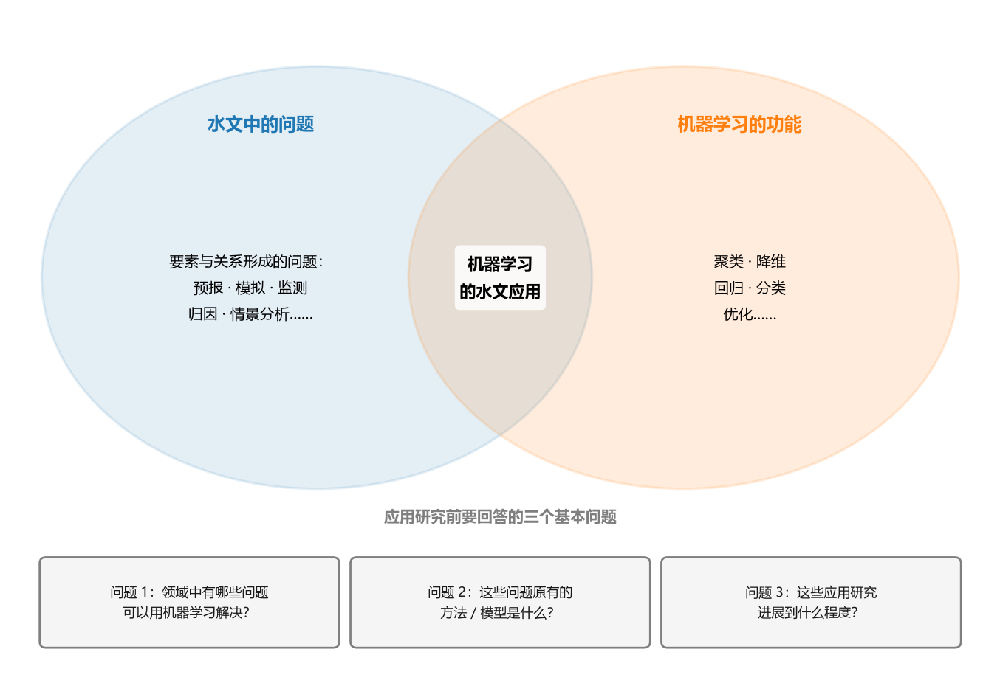

**图 21-1 应用研究的思考框架：水文问题与机器学习功能的交集**

本书的应用篇就按这套框架，以地球科学的要素分篇展开：水文/水资源、气象/天气/气候、土地/土壤、植被/生态/环境等。有些问题会横跨多个要素（例如水文与气象、生物与环境），初学阶段先从单一要素切入会容易一些。

### 21.1.2 从学科体系看水文的"邻居"

把视野再放大一点，从学科的角度看水文在科学体系中的位置（表 21-1）。水文只是自然地理中一个很小的要素，但它几乎与所有"邻居"都有联系。

**表 21-1 相关学科及其要素**

| 学科 | 要素 |
|------|------|
| 自然地理 | 水文、气候、植被、生物、土壤、地形/地貌 |
| 人文地理 | 人口（分布、迁移）、交通、城市、商业、农业、工业（经济、市场、贸易） |
| 环境科学 | 废水、废气、废渣、环境系统 |
| 资源科学 | 资源、灾害 |
| 地球科学 | 地球系统，大气圈、水圈、生物圈（地球的外部圈层）和岩石圈（地球的内部圈层） |

这些联系是具体而实在的：环境科学研究废水、废气、废渣的处理，而农田施用的肥料会随降雨从土壤进入地下水，或随径流冲刷进入河道，从而改变水质——环境问题就这样接入了水循环；资源科学把径流当作一种资源，太多酿成水灾、太少酿成旱灾，合理利用本身就是问题；地球科学把整个地球当作一个由多圈层组成的系统来研究，水文过程就发生在水圈之中，与大气圈、岩石圈、生物圈不断交换物质与能量。此外，今天的自然地理与人文地理也日益融合：考虑水的问题时，经常要把人口、城市、农业等人类活动放在一起考虑——本章 21.3.3 节讨论城市化对径流的影响就是一个典型例子。

### 21.1.3 水文要素解析：圈层、要素与问题

大家在水文与水资源课程里学过水循环，这里把水文系统按"圈层—要素—问题"解析一遍（表 21-2），作为寻找机器学习应用问题的地图。

**表 21-2 水文的要素解析**

| 圈层 | 要素 | 问题 |
|------|------|------|
| 大气 | 降雨 | 短期/中期/长期预报；遥感监测（大范围空间分布） |
| 大气 | 温度 | 气候变化/极端事件（干旱等）的影响 |
| 地表 | 蒸散发 | 生态水文过程、水循环演变；遥感监测（空间格局与趋势） |
| 地表 | 地表径流 | 产汇流模拟；流域/城市/人类活动/水利工程调度下的径流变化；均值/外洪/内涝/干旱预报 |
| 地表 | 土壤水 | 均值/洪水/干旱预测；遥感监测 |
| 地表 | 地表水质 | 污染物预测、溯源、管理 |
| 地下 | 地下径流 | 地表—地下循环 |
| 地下 | 地下水质 | 污染物预测、溯源、管理 |

逐格看过去，每个格子都能找到数据挖掘与机器学习可以介入的问题。而且从机器学习的角度看，这些问题的"题型"是熟悉的：**预报**（降雨、径流、水位随时间的预测）一般是**回归问题**；**事件判别**（发生了什么事件、属于什么类型，如洪水的成因类型）一般是**分类问题**；**遥感监测**（变量在空间上的分布与变化）则兼有分类与回归。降雨既可以归入气象要素，也可以视为水循环的重要一环，所以降雨预测既可算气象问题、也可算水文问题——要素之间的边界本来就不是截然分开的。

### 21.1.4 2018 年提出的 23 个未解决水文问题

2018 年，几十位水文学家联名发表了一篇文章，列出了 23 个未解决的水文问题（文章次年刊出，至今大部分仍未解决）。把这些问题列在这里有两个目的：一是了解水文学科前沿在关注什么；二是把它们当作**机器学习应用的需求清单**——逐条看过去，几乎每一类问题都能找到数据挖掘与机器学习可以发力的环节。

**表 21-3 2018 年提出的 23 个未解决水文问题（按主题分组）**

| 序号 | 类别 | 问题（精炼表述） |
|------|------|------|
| 1 | 时间 | 气候与环境变化下水文循环是否在区域尺度上加速/减速？是否存在临界点（不可逆变化）？ |
| 2 | 时间 | 气候变暖（冰川消融、永久冻土融化）背景下，寒冷地区的径流与地下水将如何变化？ |
| 3 | 时间 | 气候变化与用水如何改变（半）干旱区的间歇性河流与地下水？机制是什么？ |
| 4 | 时间 | 土地覆被变化与土壤扰动对地表水、能量通量及地下水补给有什么影响？ |
| 5 | 空间 | 径流、蒸发、地下水与物质通量（碳及其他养分、泥沙）的空间异质性/均匀性由什么控制？它们对控制因素（降雪状况、干旱程度、反应系数等）的敏感性为何不同？ |
| 6 | 空间 | 流域尺度上的水文规律是什么？如何随尺度变化？ |
| 7 | 空间 | 为什么径流在多个尺度上都呈优先流？这种行为如何与关键带共同演化？ |
| 8 | 空间 | 暴雨径流的"年龄"很老，为什么溪流对降水输入的响应却如此之快？水在陆地水循环中的滞留时间如何分布？ |
| 9 | 极端 | 洪水多发期与干旱多发期是如何形成的？它们是否在变化？为什么？ |
| 10 | 极端 | 为什么某些流域的极端径流对土地利用/覆被与地貌变化比其他流域更敏感？ |
| 11 | 极端 | 雨夹雪（降雨叠加融雪）事件为何、何时、如何产生异常径流？ |
| 12 | 界面 | 控制山坡—河岸—溪流—地下水相互作用的过程是什么？各水文单元之间何时连通？ |
| 13 | 界面 | 控制地下水跨界通量（地下水补给、流域间通量、向海洋排泄）的过程有哪些？ |
| 14 | 界面 | 哪些因素导致水质恶化的污染源长期存在？ |
| 15 | 界面 | 新兴污染物（如微塑料、药品及个人护理品）的范围、去向与影响如何？微生物病原体在地下如何被去除或灭活？ |
| 16 | 测量 | 如何利用创新技术在一系列时空尺度上测量地表与地下的属性、状态和通量？ |
| 17 | 测量 | 传统水文观测与"软数据"（非专业人员的定性观测、数据挖掘结果等）的相对价值如何？什么条件下可以用空间换时间？ |
| 18 | 测量 | 如何从人类—水系统的既有数据中提取信息，支撑社会水文模型的构建？ |
| 19 | 建模 | 如何调整水文模型，使其能够外推到不断变化的条件（包括植被动态变化）？ |
| 20 | 建模 | 如何分辨并降低水文预报中模型结构/参数/输入的不确定性？ |
| 21 | 社会 | 如何把水文预测的（不）确定性传达给决策者和公众？ |
| 22 | 社会 | 与水管理相关的各社会目标（水—环境—能源—粮食—健康）之间的协同与权衡如何？ |
| 23 | 社会 | 水在移民、城市化与人类文明动态中扮演什么角色？对当代水资源管理有何启示？ |

按类别略作点评。**时间类（1~4）** 实质是气候变化、人类活动等情景下的水文循环模拟——在给定情景下模拟径流与地下水的响应，本质上是回归/模拟问题；**空间类（5~8）** 关心变量的空间格局、尺度规律与时空联合变化，时空预测正是机器学习的用武之地；**极端类（9~11）** 是洪水、干旱等极值的模拟与预报；**界面类（12~15）** 涉及水文单元之间的耦合模拟与水质溯源——其中新兴污染物、微生物降解等内容更偏环境，但同样可以用数据驱动方法介入；**测量与数据类（16~18）** 几乎就是数据挖掘的主场，大尺度遥感测量、从数据中提取信息，都是机器学习擅长的事情；**建模类（19~20）** 对应水文模型的适应性与不确定性量化，本章 21.2.3 节与 21.4.8 节会给出机器学习的应对方案；**社会接口类（21~23）** 中，预报信息的传达、多目标权衡，通常把机器学习作为管理模型的一个组件嵌套进去——凡是涉及时空预测的管理问题（例如规划若干年后的水量情势），都可以交给机器学习来完成。

## 21.2 机器学习的水文应用总览

### 21.2.1 两篇综述与总体框架

换一个角度：不从水文要素出发，而是**从机器学习的功能出发**看水文应用——我们学了那么多方法，每一类方法在水文里能解决什么问题？这个视角与 21.1 节正好互补。本节的梳理主要参考两篇综述：Xu 与 Liang 的《Machine learning for hydrologic sciences: An introductory overview》（*Wiley Interdisciplinary Reviews: Water*, 2021），以及 Mosavi 等的《Flood Prediction Using Machine Learning Models: Literature Review》（*Water*, 2018）。

第一篇综述给出了一个总体框架图（图 21-2）：图的中心是**机器学习**（画了一个代表机器学习的多层感知机），箭头表示信息流，把它与六个对象连接起来——**遥感和其它数据**（机器学习的输入来源之一）、**水文事件和变量**（预测与分类的对象）、**水文过程**（全过程的模拟）、**预测**（建模的最终目的之一）、**物理模型**（水文领域已有的数值模拟模型）、**参数化**（物理模型中难以直接描述的过程参数）。这张图偏重"从水文过程出发"的画法，与 21.1 节的思路一脉相承。

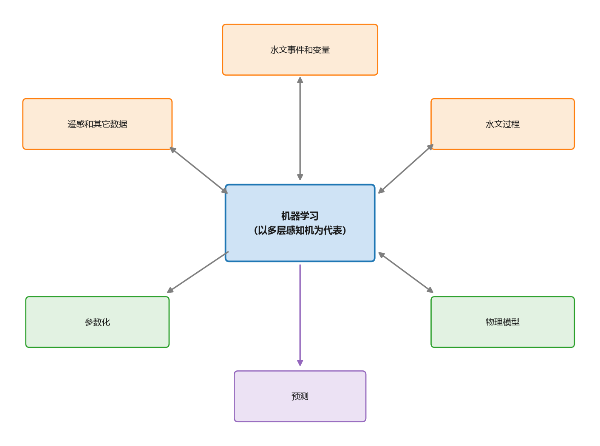

**图 21-2 机器学习的水文应用总览（箭头表示信息流）**

而在具体分类时，综述采用了与之互补的思路——以机器学习为中心，先分成**两大类**：

- **机器学习作为独立模型**：处理多类型数据以识别水文事件和估计变量、近似水文过程、生成有关过程的新知识，方法上只使用机器学习；
- **机器学习与物理模型的集成**：帮助基于过程的模型参数化、开发快速代理并纠正物理模型的偏差，以及把物理知识与机器学习结合起来提高预测准确性与可解释性。

两大类并不对立：水文领域已经存在大量基于机理的物理模型，机器学习同样可以实现类似的预测功能，只是思路、效果与成本不同；两者可以相互支持——集成类的前三个子类是机器学习帮助物理模型，第四个子类则是物理知识反哺机器学习。

### 21.2.2 机器学习作为独立模型

#### （1）从遥感数据中检测模式和事件（分类）

遥感以前所未有的空间覆盖能力，提供与水循环直接或间接相关的测量，特别适合弥补**原位监测网络稀少或缺失**的地区——布设和维护地面监测设备要耗费人力物力财力，而遥感能在大范围内开展观测。典型任务包括：从遥感数据中识别土地覆盖变化与地表特征；检测热带气旋、大气河流和天气锋等极端天气事件。这些模式与事件的时空分布、类别信息，可以进一步用于水循环本身的模拟。

#### （2）估算水文变量

降水、雪水当量（SWE）、蒸散发（ET）、土壤湿度等水文变量具有很高的时空变异性，而地面站点总是有限且分布不均的。在地面站不存在或稀少的情况下，遥感产品能提供这些变量变化的宝贵信息。要注意的是，这些变量**并不是**卫星或无人机载荷直接测量的，传统做法是根据"变量与载荷信号及协变量之间的假定关系"来估计；而机器学习可以轻松地融合各种类型的输入数据，**无需求助于假定的关系**。以降水估算为例：基于遥感的降水估计、基于雷达数据的降水临近预报、统计降尺度（把大尺度气候模式输出校正到局地尺度）、以及星载、地面与雨量计降水测量的合并，都有机器学习的用武之地。

土壤水分的遥感反演是其中的一个代表性问题（图 21-3）。**输入**有两类：一是**影响因素**——土壤特征（质地、粗糙度等）、植被特征（覆盖、冠层等）、气象特征（降雨、风速、蒸散等），既包括影响土壤水分的变量，也包括受土壤水分影响的变量；二是**电磁波谱特征**——光学反射率、热红外、微波后向散射系数、微波亮度温度等。**模型**是机器学习的回归方法（反演模型），**输出**则是不同时空分辨率下的土壤水分。反演得到的土壤水分又会反过来影响植被与气象过程，参与产汇流（见表 21-2 的土壤水一行）。

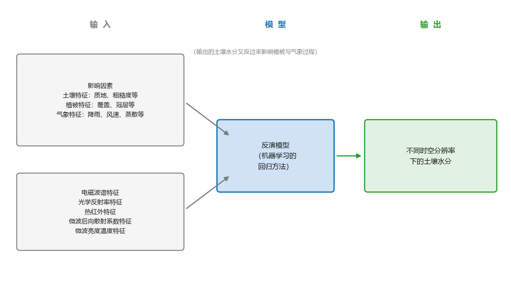

**图 21-3 土壤水分的遥感反演问题框图**

#### （3）近似水文过程：从降雨—径流到洪水预报

用机器学习模拟水文过程（径流生成、降雨—径流建模、流量预测）已经研究了几十年，这是水文应用中最经典、最基本的问题。传统机器学习算法（kNN、决策树、多层感知机、支持向量机等）的一个不足是**没有明确表示水文过程时间演化的机制**，需要解决特征选择和时间依赖性问题。近年来，循环神经网络（RNN）、尤其是长短期记忆网络（LSTM）在降雨—径流建模和流量预测中的应用越来越多——原因正是第 9 章讲过的：LSTM 的**门结构**恰好可以刻画滞后的气象水文变量（时间序列）之间的长期依赖关系。雨落下来，要经过一段时间才能形成出口断面的径流，这种滞后性用门结构来"记忆"再合适不过（图 21-4）。

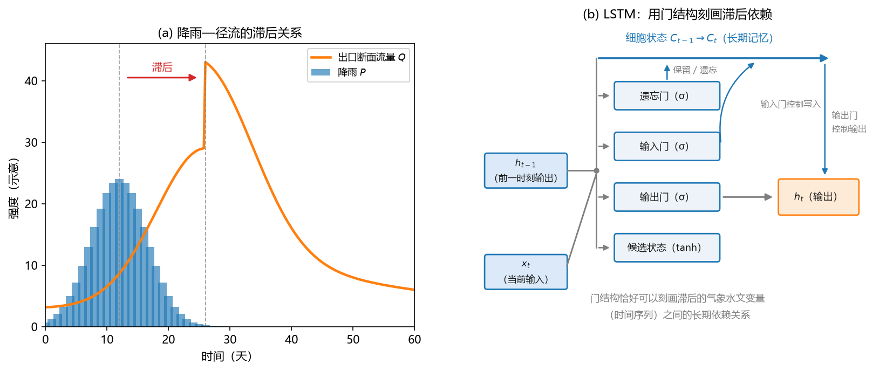

**图 21-4 降雨—径流的滞后关系与 LSTM 的门结构**

在应用的时间尺度上有这样的分工：**浅层机器学习**用于短、中、长期的洪水预报；**LSTM 及其变种**则更多用于提前数小时到数天的短期洪水预报（数据量足够大时深度学习的优势才能发挥出来）。

把洪水预报的问题再具体化。对**暴雨洪水的中长期预报**，输入包括**直接因素**（降水、蒸发）与**间接因素**（大气环流、太阳活动、海气相互作用），也可以纳入预报员经验；输出（即预报对象）可以从三个维度刻画：**程度**（如年度最高水位/流量）、**位置**（重点断面）、**时机**（最高水位出现的日期、入汛期等）。不同位置、不同时机、不同变量、不同尺度，对应不同的 $X$ 与 $Y$ 组合——这些量对实际生产和水利工程调度都非常重要，既可以用机器学习做，也可以用数值模拟做，甚至可以把预报员的经验作为一系列模型之一参与预测。

我国北方地区的冬天还有一类特殊问题——**河冰与凌汛的中长期预报**。冬季气温过低时，河道水的上层会封冻（水流很小、水很浅时才可能全冻，一般情况下冰盖之下仍有水流）。秋末冬初结冰、冬末春初开河这两个时段都可能引发凌汛：破碎的冰块在特定河段堵塞河道，上游来水受阻，水位会在很短时间内急剧升高，冰体还会推倒周边的建筑物与树木，危害很大。因此需要预报：**程度**（年度最高水位）、**位置**（特定河段/河湖交界处）、**时机**（开河日期）、**类型**（文开——冰盖逐渐消融、平稳开河；武开——冰凌强行破冰开河，更易形成冰塞冰坝）。天气情况、水流与河冰情势作为输入，预报模型视输出类型选用回归（最高水位、开河日期）或分类（文开/武开）方法。

#### （4）水文变量间关系挖掘

除了模拟与预测，机器学习作为独立模型还可以**挖掘变量之间的关系**，生成新知识。一是解开多个变量之间的相互作用——这对理解水系统的动态行为很重要；越来越多的观测使得不依赖物理知识、纯用数据驱动技术识别水文变量关系成为可能，例如用**通量塔的高频数据**解开生态水文系统中的强迫与反馈关系。二是挖掘**无法从物理过程角度建模**的关系，例如人类与水系统之间的双向反馈。这类任务宜用**可解释的机器学习算法**（如基于树的方法和 Lasso），因为学到的模型可以解释为导出的规则或功能关系，便于水文工作者理解与使用。

### 21.2.3 机器学习与物理模型的集成

物理模型（水文领域的数值模拟模型）已有几十年积累，机器学习与它的集成有四种典型方式：前三种是机器学习帮助物理模型，第四种是物理知识反哺机器学习。

#### （1）参数化

大多数基于过程的模型都需要指定参数，而参数往往**不对应直接可测量的量**，或者无法以模型所需的空间分辨率和尺度去测量。这时可以用机器学习把参数"算"出来，再放回物理模型。在地表水文学中，机器学习已被用于**降雨—径流模型参数的区域化**，这是实现未测量流域径流预测的重要一步。近年来，深度学习还被用于直接**从多孔介质的显微 CT 图像估计地质介质的属性**。此外，生成式深度学习架构（如生成对抗网络 GAN 与变分自编码器）能够生成保留某些所需属性的数据，非常适用于地质介质的重建，通常是为后续的地下水文随机模拟生成实现——其基本原理是通过原始数据生成新数据，让新数据与真实数据难辨真假。

#### （2）代理建模

许多基于过程的模型（如地下水流与溶质运移模型）**计算量很大**，这使得需要多次运行模型的分析（不同情景、参数不确定性等）很有挑战性。解决办法是**代理模型**：用代理模型模拟基于过程的模型的输入—输出关系（以物理模型的输入和/或参数为自变量，仿真结果为因变量），但运行速度要快得多；机器学习是表示非线性函数的强大工具，天然适合代理建模。

一个典型例子是用支持向量机（SVM）为流域模拟模型 SWAT 开发快速代理（图 21-5）。SWAT 是一个半分布式的流域水文与面源污染模拟模型，要考虑不同气候情景与灌溉方案下农作物产量、地表水、地下水与灌溉用水的变化。直接做法是把各种情景逐一输入 SWAT 模拟，大流域上反复运行的计算开销很大；代理建模的思路是：先选取**代表性的气候情景与灌溉方案**输入 SWAT 得到输出，积累几百至几千组**输入—输出样本对**，据此训练 SVM 代理模型；此后遇到**新的、未模拟过的情景**，直接输入代理模型就能快速预测，不再需要运行 SWAT。代理模型还可以与决策支持框架内的**随机优化模型**结合，评估战略措施与战术措施在不同气候预测下对**抗旱准备与缓解**的作用。

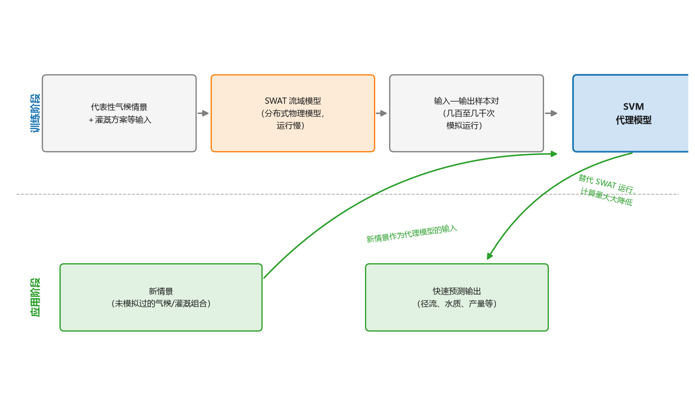

**图 21-5 用 SVM 构建 SWAT 的快速代理模型**

#### （3）偏差修正

不管机理多么完备，物理模型终究是对真实水文系统的简化：可能由于**强迫数据的错误、不正确的参数、简化或不正确的物理过程概念**而产生有偏差的模拟结果。机器学习的优势在于能从观测数据中学习，恢复基于过程的模型未表示的信息——两者优势互补，结合起来可以产生更准确的预测。做法是把**物理模型的输出**作为机器学习的输入之一（再结合其他输入），以观测值为目标训练，输出一个修正后的结果。传统机器学习已被证明可以有效纠正地表偏差；深度学习用于偏差校正是近年新兴的方向。

一个 LSTM 偏差校正的例子如图 21-6 所示，文章比较了三种输入组合：情形 1 只用大气强迫与流域属性做**径流模拟**（纯数据驱动）；情形 2 用 NWM（美国国家水模型，一个基于过程的物理模型）的输出与流域属性，相当于**校正 NWM 的径流预报偏差**；情形 3 把大气强迫、NWM 输出与流域属性全部纳入——组合的信息最多，通常效果最好。总体思路就是把水文模型的输出作为 LSTM 的输入，再结合流域属性、气候情况等，最终输出经过偏差校正的径流预报。

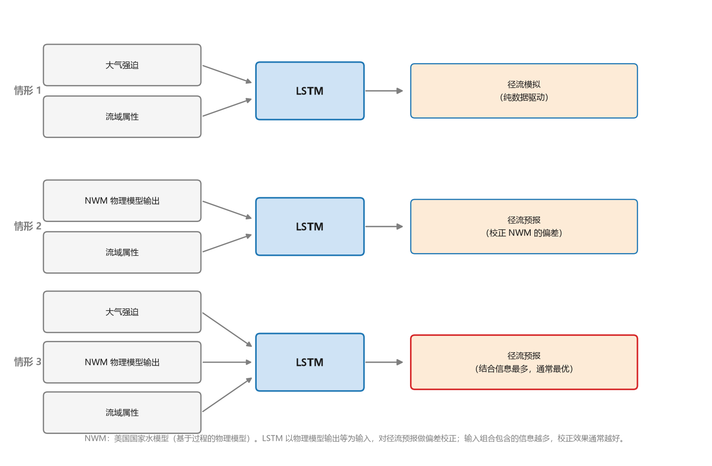

**图 21-6 用 LSTM 做水文模型的偏差校正：三种输入组合的比较**

#### （4）物理知识结合机器学习

前三种方式都是机器学习帮助物理模型；第四种方向相反——物理模型蕴含着规律与知识，把这些知识抽象出来，作为机器学习模型的一个层，或者用其他方式与之协调结合，就得到一个"带物理知识的机器学习模型"，从而提高预测的准确性、可解释性与效率。至此可以看到，机器学习与物理模型是**相互促进**的关系：机器学习可以替代物理模型，也可以从整体或局部帮助物理模型；反过来，物理知识也能嵌入机器学习。两类模型最终联合起来，可以把预测提升到更高的水平。

## 21.3 径流形成与中长期水文预报

介绍完总览，本节挑选一个相对具体的问题——**中长期水文预报**——展开，看看机器学习在其中到底是怎么做的。这要从径流的形成讲起。

### 21.3.1 径流的形成过程

从输入—输出的角度看水循环（图 21-7）：降雨 $P$ 降落下来，一部分被**植物截留**（$I_s$），停留在植物表面并直接蒸发；落到地面的部分，有的从地表汇集形成**地表径流** $Q_s$；有的**下渗**进入土壤（包气带），补给**浅层地下水**并在潜水面流出，形成**浅层地下径流** $Q_{g1}$；还有的通过透水层进入**深层地下水**，形成**深层地下径流** $Q_{g2}$。地表与地下径流最终都汇入河道，从支流汇入干流，经出口断面流向下游，最终注入海洋。海洋与地表水蒸发（$E$）进入大气，经大气环流输送回到陆地上空，再以降雨形式降落——如此构成循环。

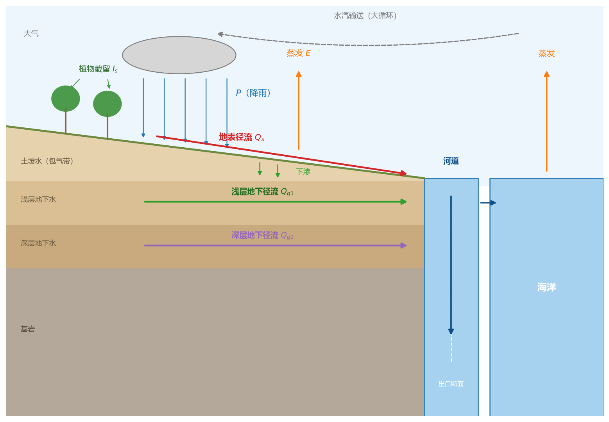

**图 21-7 径流形成过程示意**

这里插一个几百年前的趣事：住在海边的人观察到大江大河日夜不停地把水送进海洋，不禁思考——**海洋为什么不会被填满？**在没有现代科学的时代能提出这个问题，说明对现实观察已经相当深刻。今天我们知道，答案就是水循环：海洋的水不断蒸发进入大气，又被输送到陆地上空降落回来，循环是闭合的。水循环还是挺有意思的，没有学过的读者值得去了解一下。

### 21.3.2 产流与汇流

径流的形成有两大过程：**产流**与**汇流**。

**产流**是降雨量扣除损失（植物截留、下渗、填洼与蒸发）形成净雨、产生径流的过程。一个简单的水量平衡式为：

$$R = P - I_s - F - V - E \tag{21-1}$$

式中 $R$ 为净雨深，$P$ 为降雨量，$I_s$ 为植物截留量，$F$ 为下渗量，$V$ 为填洼量，$E$ 为蒸发量。产流机制在我国不同区域不尽相同（图 21-8）：

- **蓄满产流**：发生在土壤缺水量不大的**湿润地区**（如我国南方）。降雨先补足土壤缺水量，土壤蓄满之后再降雨才形成净雨——净雨是"攒够"了才产生的。
- **超渗产流**：发生在**干旱地区**。土壤缺水量大、下渗能力强，但降雨强度大，当**雨强大于下渗能力**时，超出下渗能力的部分直接形成地面径流。

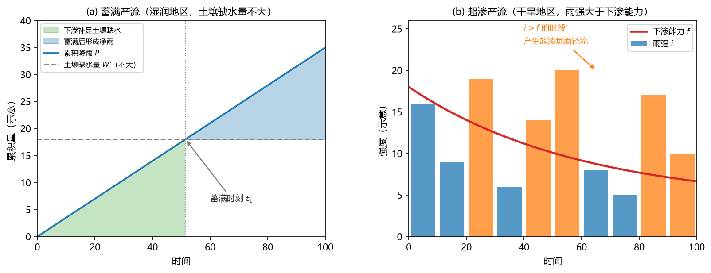

**图 21-8 两种产流机制：(a) 蓄满产流（湿润地区）与 (b) 超渗产流（干旱地区）**

**汇流**是降水形成的水流、从产生地点向流域出口断面汇集的过程，包括**坡面（地）汇流**与**河网（道）汇流**两个环节：净雨先在坡面上汇集，进入河网后从支流汇入干流，最终到达流域出口断面。

### 21.3.3 影响径流形成的因素

影响径流形成的因素有两大类。

**第一类是自然地理特征**：① 气象条件——直接影响因素是降水、蒸发，间接影响因素是气温、湿度、风等（气温与风主要通过影响蒸散发起作用）；② 流域的地理位置——东南沿海与西北内陆受水循环影响的程度明显不同；③ 流域的地形特征；④ 流域的形状和面积；⑤ 流域的植被；⑥ 流域内的土壤及地质构造；⑦ 湖泊和沼泽（对径流起调蓄作用）。

**第二类是人类活动**。人类活动改变了流域的自然地理面貌（下垫面），影响内陆水循环与径流量及其时程分配，从而影响径流的形成与变化过程。具体措施包括：水土保持、植树造林、兴修水利、跨流域调水、城市化等。

其中**城市化**的影响尤其值得展开（图 21-9），可以从两条线索理解。其一是**气候线索**：人口与高层建筑增加，使城市地区温度升高——所谓**热岛效应**；局部小循环加快、降水次数增加、降水量加大——所谓**雨岛效应**；两者都使径流量加大。其二是**下垫面线索**：不透水地面增加、雨水排水系统完善，使**入渗率下降**，地下径流与枯水径流减小；同时雨水更快汇集到河道，**洪峰流量增加、洪水位增高、径流过程陡急**。两条线索合起来：城市化流域的洪水来得更快、更猛——这正是城市内涝问题日益突出的水文原因，也是"人地"方向的同学特别关心的问题。

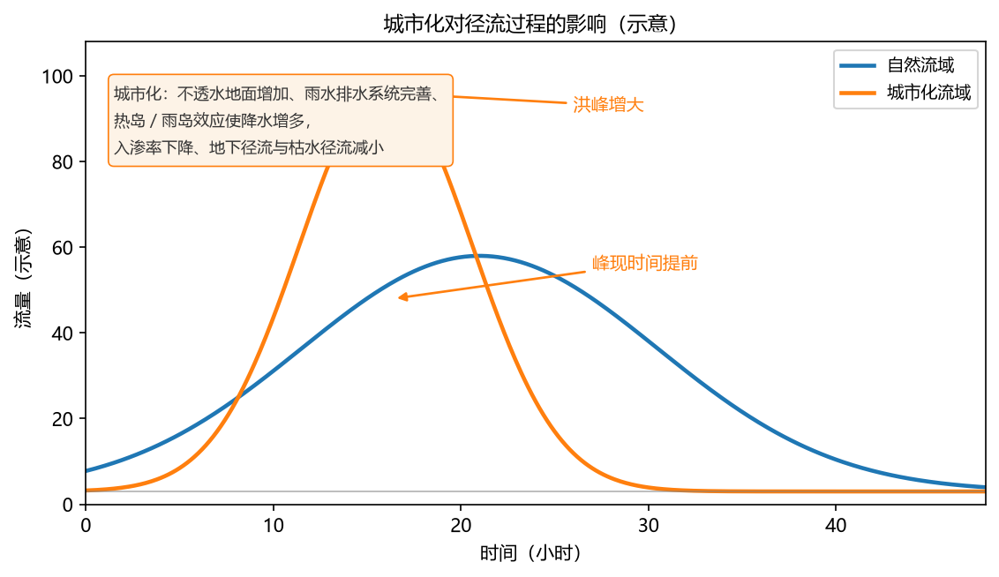

**图 21-9 自然流域与城市化流域的径流过程线对比（示意）**

### 21.3.4 什么是中长期水文预报

有了径流形成的背景，就可以给出中长期水文预报的定义了。

**定义 1**：根据前期水文气象要素，用**成因分析与数理统计**的方法，对未来长时期（一旬至一年）的水文要素进行科学的预测。

**定义 2**：中长期水文预报通常泛指**预见期超过流域最大汇流时间**、且在 **3 天以上、1 年以内**的水文预报。（预见期不超过流域汇流时间的预报属于短期水文预报，用前后期的降雨径流资料即可完成；中长期预报则必须借助更"远"的因子。）

**预报内容**（即输出 $Y$）：径流量、断面（河口）的水位、冰情、河道冲淤变化、旱涝趋势等。**主要影响因素**（即输入 $X$）：大气环流、太阳活动、下垫面情况、其他天文地球物理因素（如地球自转速度的变化、火山爆发、行星相对位置等）、人类活动。影响不大的因素通常可以忽略——这就牵涉到**输入变量的选择问题**（见 21.3.6 节）。

做中长期预报还要注意**两个时间点**（图 21-10）：第一是**发布时刻 $T$**——预报模型在什么时候运行、把结果输出出来；第二是**预报对象的发生时刻**——预报的量 $Y$ 什么时候发生。例如站在 12 月 31 日做预报，可以对未来一年各旬、各月、各季乃至全年的水文变量分别预报；每个时间尺度上，既可以预报**均值**（如明年 7 月某断面的月平均水位），也可以预报**极值**（如明年 7 月内最大的日水位、年度最高水位），干旱地区还可以预报极小值。

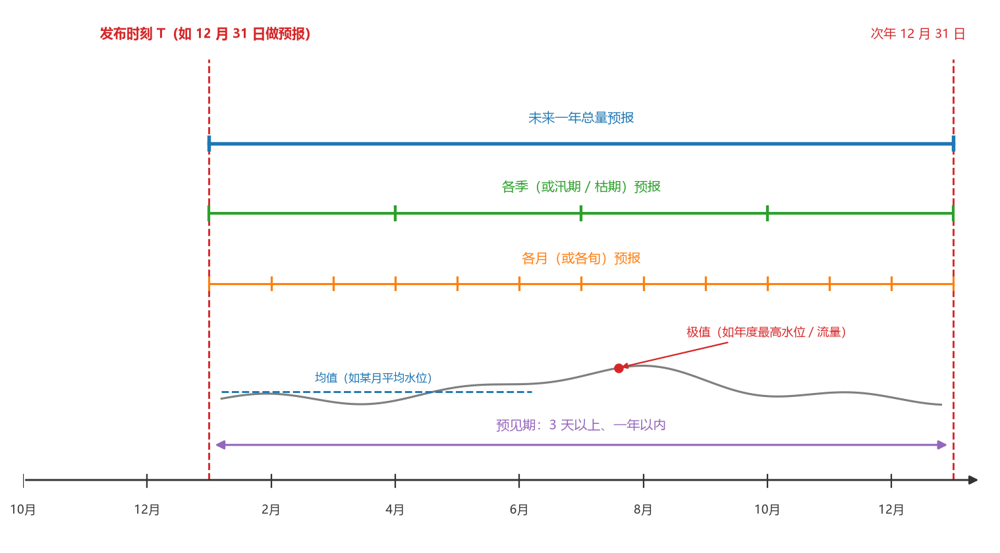

**图 21-10 中长期预报的两个时间点与预报时间尺度**

### 21.3.5 预报成果的形式：定量与定性

预报成果至少有两种形式，并且恰好对应机器学习的两大任务（表 21-4）。

**表 21-4 预报成果的形式与机器学习任务的对应**

| 成果形式 | 含义 | 机器学习任务 |
|------|------|------|
| 定量预报 | 提供具体（连续）数值；可在年初预报未来一年（旬、月、季、年），也可滚动预报（如 3 月报 4 月） | 回归问题 |
| 定性预报 | 提供预报量的定性评价，如偏枯、偏丰，或等级预报（如 Ⅰ～Ⅴ 级） | 分类问题 |

$Y$ 是连续的具体数值，就是**回归**问题；$Y$ 是类别或不连续的等级，就是**分类**问题。机器学习最典型的两种任务，在水文预报里正好各有一类成果与之对应——这种"领域问题 ↔ 方法功能"的一一对应，正是 21.1.1 节"两圈交集"框架的具体体现。

### 21.3.6 预报因子：遥相关因子与本地相关因子

中长期预报的输入因子（图 21-11）分为两大类。

**第一类是遥相关因子**——空间上距离较远、但对本地水文变量有影响的**大尺度信号**：

- **大气环流特征**：逐月环流指数。我国国家气候中心提供 **74 项环流指数**供下载（不同国家气象部门给出的指数并不相同）；
- **高空气压场**：北半球 100 hPa、500 hPa 逐月平均高度场。美国环境预报中心（NCEP）与美国国家大气研究中心（NCAR）提供 1956 年以来的资料，范围 0°N~80°N、自 0°E 向东至 10°W，网格距为经度 10°×纬度 10°；
- **海表温度**：北太平洋逐月海温场（SST）。美国国家海洋和大气局（NOAA）提供 1956 年以来的资料，范围 50°N~10°S、120°E~80°W，网格距 5°×5°。

**第二类是本地相关因子**——预报地点附近的观测资料：

- 前期多年日、月**降雨、气温、蒸发、日照**资料；
- 前期多年日、月**径流、水位**资料。径流与水位自身具有**自相关**性，可以用 $T-1, T-2, \ldots, T-i$ 时刻的 $Y$ 预报 $T$ 或 $T+i$ 时刻的 $Y$，即以前期的 $Y$ 作为本期的 $X$；
- **自然地理、地形**资料（多年不变、人类活动干扰小的区域可以不作输入）；
- **水利工程特征参数及调度运行资料**——上游水库的蓄水放水对下游断面影响很大，有水利工程的流域必须考虑。

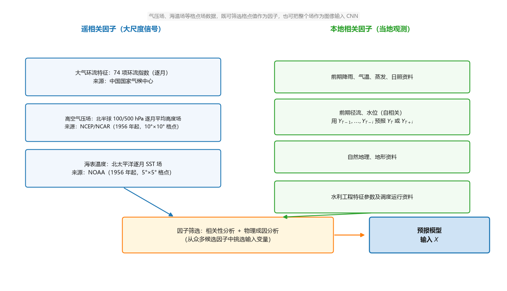

**图 21-11 中长期水文预报的因子体系**

候选因子非常多：仅环流指数就有 74 项，气压场、海温场更是逐格点的数据，全部塞进模型既不现实也不必要。因此需要做**因子筛选**——通过相关性分析与物理成因分析，从中挑选出一部分作为模型输入 $X$（这正是本书第 3 章讲过的输入变量选择问题）。另外，学了深度学习之后还有第三种选择：**把整个气压场或海温场当作一幅图像**输入卷积神经网络（CNN）处理，或裁剪出相关区域作为图像输入——这样连筛选格点的步骤都可以省去。

## 21.4 预报方法与集合预报

### 21.4.1 预报方法的三大途径

中长期水文预报的方法可以归纳为三大途径：

1. **机器学习或统计学方法**：直接寻找预报变量与预报因子（$X$ 与 $Y$）之间的关系，以数据驱动的方式实现预报；
2. **水文/大气物理模型**：大气物理模型在给定初始场与边界条件下求解大气运动方程组，得到数值天气预报产品（预报气象要素）；水文模型则由降雨算出径流与水位（预报水文要素）；
3. **两类模型耦合**：机器学习/统计模型与物理模型相互支持、联合预报。耦合的典型工作环节包括率定确定性水文模型、确定预报时刻的系统初始状态、构建模型输入集、集合预报及统计分析等；典型形式有两种——一是用机器学习/统计模型**预报水文模型的输入要素**（如降水），水文模型再由降水预报径流；二是水文模型先算，再用统计/机器学习方法**校正水文模型的输出**。上节 21.2.3 介绍的参数化、代理建模、偏差修正，都可以放到预报业务里来。

### 21.4.2 传统方法与现代方法

只看第一途径（机器学习/统计学方法），方法谱系又分传统与现代两代（表 21-5、表 21-6）。

**表 21-5 中长期水文预报的传统方法**

| 方法类 | 代表方法 |
|------|------|
| 回归分析 | 多元回归、逐步回归、门限回归等 |
| 时间序列分析 | 自回归滑动平均类、马尔科夫转移、周期分析等 |
| 聚类/判别分析 | 逐步聚类、系统聚类等；距离判别、贝叶斯判别等 |

**表 21-6 中长期水文预报的现代方法**

| 类别 | 方法 |
|------|------|
| 不确定性类 | 模糊方法、灰色方法、混沌方法等（把输入与参数的不确定性表达出来） |
| 数据驱动类 | 投影寻踪、神经网络、小波分析、随机森林、贝叶斯预报、支持向量机、深度学习等 |

现代方法中有相当一部分（神经网络、随机森林、支持向量机、深度学习）正是本书前文的"老朋友"；模糊、灰色等方法则着眼于把输入与参数的不确定性显式表达出来。下面挑四个有代表性的模型看它们在水文预报中的用法。

### 21.4.3 多元线性回归

**基本思想**：通过成因分析找出影响预报对象的影响因素（预报因子），应用数理统计中的**多元线性回归**建立预报方案。预报方程为：

$$\hat{y} = b_0 + b_1 x_1 + b_2 x_2 + \cdots + b_m x_m \tag{21-2}$$

式中 $x_1, x_2, \ldots, x_m$ 为**预报因子**，按相关性分析与物理成因分析挑选（21.3.6 节）；$b_0, b_1, \ldots, b_m$ 为**回归系数**，根据历史资料用最小二乘法确定（见 6.3 节）；$\hat{y}$ 即预报量（特定断面或站点的水位、流量等）。短期预报的因子主要是降雨与径流，中长期预报则用遥相关因子与本地因子。

### 21.4.4 多层前馈网络

即第 9 章的**误差反向传播（BP）神经网络**——数据流前向计算、误差信号反向传播的多层前馈网络，可以解决中小规模的任意函数逼近问题。用于水文预报时：**输入层**接收大气环流特征、高空气压场、海表温度、降雨径流资料等因子；中间是**隐含层**；**输出层**输出预报的降雨、径流量。工作流程为：选择传递函数、初始化权重和阈值 → 利用训练样本（通过误差反向传播）修正权重和阈值 → 完成机器学习、确定网络 → 预报降雨径流量。

### 21.4.5 决策树与随机森林

**决策树**（第 8 章）：训练集是预报因子的观测样本，预报因子的属性值在**内部节点**上进行比较；自顶向下，根据不同属性的判断决定从该节点向下的分支走向，最后在树的末端（叶节点）得到分类或预测结果。图 21-12 给出一个用气温、气压判别天气（晴/阴/雨）的示意例子：节点 1 先看气温——气温 ≥ 20 ℃ 直接判为雨；气温 < 20 ℃ 再看节点 2 的气压——气压 < 500 hPa 判为晴、≥ 500 hPa 判为阴（图中数值仅作示意）。

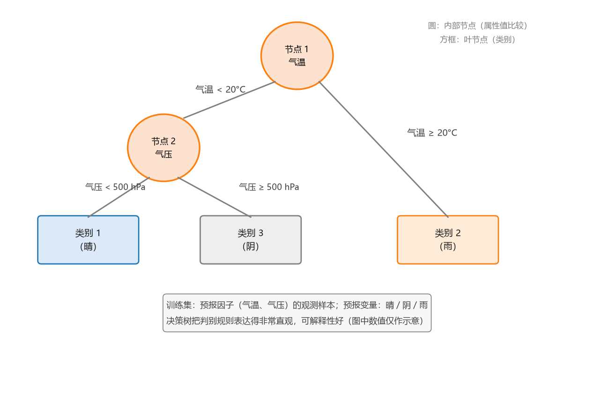

**图 21-12 天气分类决策树示例（仅作示意）**

决策树最大的好处是**把判别规则非常直观地表达出来**：每个节点比较哪个因子、临界值是多少、沿哪条分支走，都清清楚楚地写在树上——在常用模型中，决策树的**可解释性是最好的**。

**随机森林**：一棵决策树只能得到一个预测结果；改进的思路是**构建树群、集成多个结果**，以提高预测精度。关键是**通过 Bootstrap 随机（有放回）抽样**从原数据集抽出多个训练集，分别训练出多棵决策树，形成"随机森林"；预报时每棵树各出一个结果，再做（等权或加权）平均或投票得到最终结果。有了决策树的基础，随机森林是很容易理解和实现的。

### 21.4.6 水文气象耦合与集合预报

在 21.3.6 节的因子体系里，我们一直把预报因子当作现成的输入直接拿来用。但细想一下：中长期预报用的大气环流、海温等因子，以及短期预报用的未来降雨，本身也是"未来的量"——它们也可以先由**数值天气预报/气候模式**预报出来。把**天气预报模型的输出作为水文模型的输入**，两个模型嵌套起来，就是**水文气象耦合模型**。用一句时髦的话来记忆：**"我预判了你的预判"**——气象模型先做了预判（预报未来的气象要素），水文模型再拿它的预判作为输入、做自己的预判。这种嵌套结构在实际预报业务中用得很多。

更完整的框架是**水文集合预报**（图 21-13）。为什么要"集合"？因为大气系统不稳定，数值天气预报的输出本身就不确定（这也是气象领域单点预报被认为是不可避免有误差的原因），不确定的气象输入进入水文模型，预报结果必然带着很大的不确定性。于是让**多个模型**（每个模型可以是纯机器学习模型、机器学习与水文模型的耦合，或单纯的水文模型）分别预报，把多个结果集合起来得到综合结果，这就是集合预报。HEPEX（水文集合预报系统）的流程为：**实测值**（地面/遥感观测）→ **地面资料同化器**（融合观测与模型信息，得到可靠的水文输入与集合初始条件）→ **天气与气候预报**（数值天气预报产品）→ **天气集合预处理器**（生成气象集合预报）→ **水文集合（预报）处理器**（驱动水文模型）→ **输出生产器**（单值或集合预报）→ **成果与服务**（可靠的水文成果）。其核心思想一句话：**应用未来数值天气预报产品，作为水文模型的输入**。

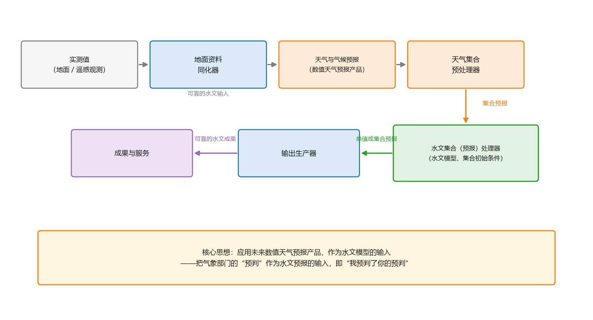

**图 21-13 水文集合预报系统流程图（HEPEX）**

### 21.4.7 多预报成果的综合

集合预报带来了一个新问题：不管用什么模型、也不管前面是否嵌套了气象预报，系统的输出都是**多个预报结果**。多个输出怎么选？——很多人会犯"选择恐惧症"。不必恐惧，处理办法由浅入深有两种（图 21-14）。

**等权平均**：最简单的处理，直接把 $K$ 个模型的预报结果取平均作为综合结果。

**贝叶斯加权（BMA）**：更合理的做法是基于贝叶斯理论（Bayesian Model Averaging），对**预报信息与实测信息的似然程度**进行分析，据此为每个模型自动赋予权重，再做加权平均：

$$\hat{Q}_t = \sum_{k=1}^{K} w_k\, Q_t^{(k)}, \qquad \sum_{k=1}^{K} w_k = 1 \tag{21-3}$$

式中 $Q_t^{(k)}$ 为第 $k$ 个模型在 $t$ 时刻的预报值，$w_k$ 为其权重。等权平均就是 $w_k = 1/K$ 的特例；BMA 让历史表现更好的模型获得更大的权重，得到的综合结果一般优于等权平均。

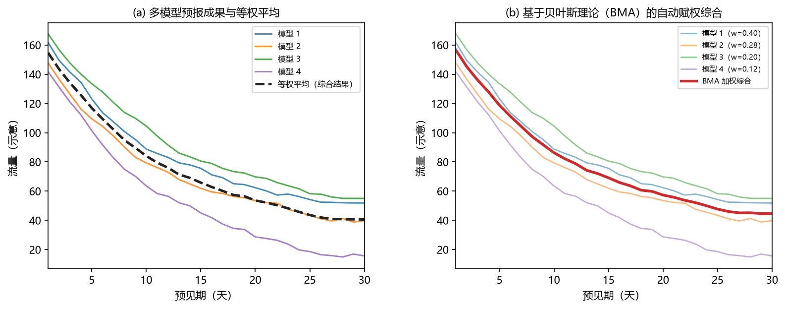

**图 21-14 多预报成果的综合：(a) 等权平均与 (b) BMA 自动赋权加权**

### 21.4.8 预报的不确定性与置信区间

还有一种更"细"的思路：干脆**不做平均**，把每个时刻的多个模型输出当作一个**随机变量**。预报的不确定性有两个来源：一是**未来输入的不确定性**（如未来的降雨、大气环流本身不确定）；二是**水文不确定性**——包括模型结构的不确定性与模型参数的不确定性。两者经过综合不确定性处理，得到**总不确定性评估**，进而给出预报结果及其**预报置信区间**。

具体做法是：把某一时刻断面（站点）的水位/流量的多个预报值视为一个样本，考察其概率分布；该随机变量随时间变化，其分布也在不断变化。于是预报不再是一条线，而是一条带——例如给出 **95% 置信区间**：有 95% 的可能性实测值落在该区间内。相比简单取（加权）均值，概率预报充分利用了多个模型输出的全部信息，是处理预报不确定性、也是回应表 21-3 中第 20 个问题（如何量化和降低水文预报的不确定性）的基本思路。

## 21.5 小结

本章是应用篇的第一章，要点如下。

**思考框架。** 做任何领域的机器学习应用，先回答三个基本问题：领域有什么问题可解、原有方法是什么、进展到什么程度；再建立"两圈交集"的思维方式——应用产生于领域问题与机器学习功能（聚类、降维、回归、分类等）的交集。

**水文的要素与问题。** 相关学科要素涵盖自然地理、人文地理、环境科学、资源科学与地球科学；水文自身可按"大气—地表—地下"的圈层解析为降雨、温度、蒸散发、地表径流、土壤水、水质等要素及对应问题，预报多为回归、事件判别多为分类、遥感监测兼而有之；2018 年提出的 23 个未解决水文问题，可以当作机器学习应用的需求清单。

**应用的两大类。** 以两篇综述为纲：机器学习作为独立模型（遥感模式与事件检测、水文变量估算、近似水文过程、变量关系挖掘）与机器学习和物理模型的集成（参数化、代理建模、偏差修正、物理知识结合机器学习）。前三者为机器学习帮助物理模型，后者是物理知识反哺机器学习，两者相互促进。

**中长期水文预报。** 预见期超过流域最大汇流时间（3 天以上、1 年以内）；成果分定量（回归）与定性（分类）两种；因子分遥相关（环流指数、高空气压场、海表温度）与本地相关（前期降雨蒸发、前期径流水位、地形与水利工程资料）两大类，使用前需筛选，格点场也可以整场作为图像输入 CNN。方法有三大途径（ML/统计、物理模型、两者耦合），传统与现代方法各有谱系；多模型预报要综合（等权平均或 BMA 自动赋权），并可用随机变量与置信区间刻画预报的不确定性。"我预判了你的预判"——水文气象耦合与集合预报，是理解现代水文预报业务的一把钥匙。

## 思考题

1. 机器学习在水文/水资源有哪些应用？请按"独立模型"与"与物理模型集成"两大类各举数例。
2. 机器学习怎么实现水文预报？中长期水文预报的预报因子、预报内容与成果形式分别是什么？
3. 机器学习与物理模型如何结合？参数化、代理建模、偏差修正各解决物理模型的什么问题？
4. 这些应用的发展程度如何？请以降雨—径流建模为例，说明传统机器学习与 LSTM 各自的定位。
5. 影响径流形成有哪些自然地理与人类活动因素？城市化通过哪两条线索改变流域的径流过程？
6. 集合预报为什么会产生多个预报结果？等权平均与 BMA 加权综合各有什么优缺点？把预报结果视为随机变量、给出置信区间，比单一均值预报多了什么信息？
