# 第22章 地学应用二：气象篇

> **本章导读**：应用篇的第二站是气象。与第 21 章一样，动手之前先回答三个基本问题：气象中什么问题可以用机器学习解决？这些问题用原有模型怎么求解？这些应用研究进展到什么程度？气象领域有一个非常强大的"看家本领"——数值天气预报（Numerical Weather Prediction，NWP）：它是气象领域基于机理的数值模拟模型，历经百余年发展，已经形成全球性业务体系。因此本章的编排与水文篇略有不同：先概述气象的概念、研究对象与机器学习应用的两条路径（22.1），再用三个表格盘点可应用的气象问题（22.2）；然后花一节篇幅把数值天气预报"拆开看"——定义、模式方程、数值方法、发展史、现状与业务流程，并把它与机器学习做系统比较（22.3）；在此基础上展开机器学习应用的两大类——作为独立模型（22.4：常规应用、精细化预报、可解释性与不确定性）和与数值模式的集成（22.5：前处理、耦合、后处理）。学完本章，读者应当能回答本章思考题中的那三个问题，也应当理解贯穿应用篇的那句话：机器学习与领域原有模型不是对立关系，而是殊途同归、相互成就的两套方法。

## 22.1 机器学习的气象应用概述

### 22.1.1 大气、气象、天气与气候：先分清四个概念

做气象应用，先把四个最基本的概念分清楚——它们决定了问题的**时间尺度**，也就决定了适合用什么方法去求解。

- **大气**：地球上覆盖着很厚的空气层，它是气象研究的物质载体；
- **气象**：大气中的阴、晴、冷、暖、干、湿、雨、雪、雾、风、雷等各种物理、化学**状态和现象**；
- **天气**：一个地区**较短时间**的大气状况。广播和电视中收听收看到的 24 小时、48 小时天气预报，报的就是天气；
- **气候**：一个地区**多年平均的天气状况及其变化特征**。世界气象组织（WMO）规定，**30 年**记录是得出气候特征的最短年限——几年的资料固然也能统计，但要得到有意义的气候特征，通常要 30 年起步。

"气候"这个词本身还藏着一段中国文化源流：我国古代以**五日为候、三候为气**，一年有**二十四节气、七十二候**，各有气象、物候特征，合称为"气候"。可见古人早已在做"多年平均"意义上的气候概括——把时间尺度拉长来认识大气，正是天气与气候的分水岭。

### 22.1.2 从气象的研究对象和问题看应用

按照第 21 章的"两圈交集"框架，第一个圈是领域问题。把气象的研究对象与问题列成一张表（图 22-1），自上而下恰好按时间尺度与复杂程度递进。

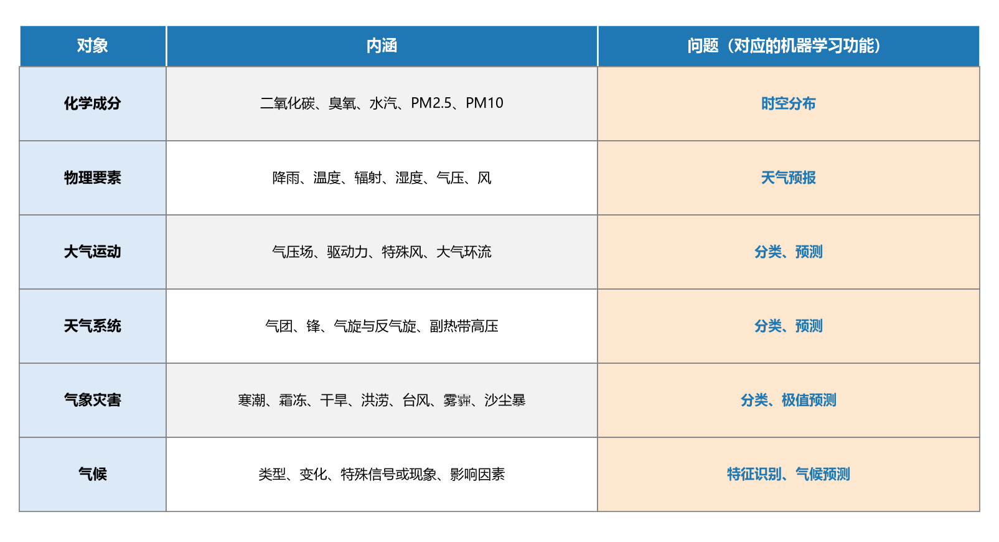

**图 22-1 气象的研究对象、内涵与对应的机器学习问题**

逐行看过去，每一行都能找到机器学习可以发力的环节，而且"题型"都是熟悉的：

- **化学成分**：二氧化碳、臭氧、水汽、PM2.5、PM10 等成分的**时空分布**——典型回归/估计问题；
- **物理要素**：降雨、温度、辐射、湿度、气压、风——这些就是**天气预报**报的要素。大家平时在手机上看到的天气预报，通常就是数值模拟模式跑出来的结果；既然可以预报，用机器学习同样可以做；
- **大气运动**：气压场及其驱动力、特殊风、大气环流等特定的大气运动——可以**分类**（归为哪种环流型），也可以**预测**；
- **天气系统**：气团、锋、气旋与反气旋、副热带高压等更复杂的系统——同样可分类、可预测，比如细分到底是哪种气团；
- **气象灾害**：寒潮、霜冻、干旱、洪涝、台风、雾霾、沙尘暴等——对某种具体灾害可做**分类**（如沙尘暴、雾霾的等级），还可做**极值预测**（如 PM2.5 最大浓度能到多少）；
- **气候**：气候类型、气候变化、特殊信号或现象（如厄尔尼诺与南方涛动）、影响因素——可做**特征识别**（分类），也可做**气候预测**（包括不同情景下如人类经济发展排放路径的未来气候预估）。

### 22.1.3 从机器学习的角度看应用

第二个圈是机器学习的功能。与水文篇一样，从机器学习的角度可以把气象应用分成两大类（图 22-2）。

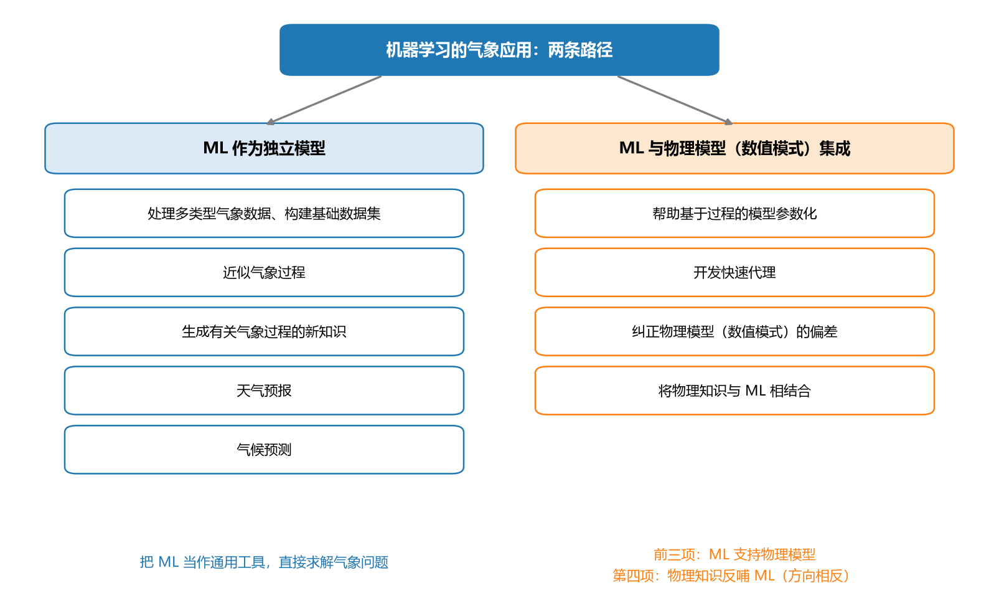

**图 22-2 从机器学习角度看气象应用的两条路径**

**第一类：机器学习作为独立模型**——把机器学习当作通用工具，直接求解气象问题，包括：处理多类型气象数据、构建基础数据集；近似气象过程；生成有关气象过程的新知识；以及天气预报与气候预测本身。

**第二类：机器学习与物理模型集成**——气象领域的物理模型就是数值天气模式（数值模拟模型），集成方式有四种：帮助基于过程的模型**参数化**（模式里有些过程模拟得不好，用机器学习做完再放回大模型）；开发**快速代理**（数值天气预报计算速度太慢，做不确定性分析、多情景模拟时尤其如此，可用机器学习做整个模式的代理）；**纠正**物理模型的偏差（数值模拟总不可能把实际物理机制描述得非常好，结果有偏差有误差，用机器学习纠正后再作为总输出）；以及**将物理知识与机器学习相结合**（把物理模型建模时积累的知识借鉴过来，帮助机器学习提高预测水平）。前三种是机器学习支持物理模型，第四种方向相反、是物理知识反哺机器学习——这套思路与第 21 章水文应用的框架完全一致。

## 22.2 机器学习可应用的气象问题举例

两大圈交叉，具体问题非常多，本节按"数据集—监测诊断—预测"三个层次各举一组例子（表 22-1、表 22-2、表 22-3），不求全、只求让大家对问题的"长相"有个感觉。

**表 22-1 机器学习可应用的气象问题举例：数据集类**

| 问题 | 主要技术和解释 |
|------|------|
| 地面：我国百年温度降水均一化气候序列集建立 | 通过**质量控制和均一化订正**技术，建立一套国际开放、中国区域资料质量显著改进的高质量百年温度降水气候资料集。其中有些年份、某些月份的资料缺测，可以用机器学习**预测填补** |
| 高空：亚洲区域高空观测资料质量控制技术和均一化数据集建立 | 基于**统计学和天气动力学原理**的高空气象要素综合质量控制算法，研发中国和亚洲区域高空主要要素气候数据集产品——统计学方法本就可以用机器学习实现 |
| 我国降水温度精细化格点气候数据集建立（5 km、h 级） | 气象站总是有限的，早期格点资料的空间分辨率只有几百公里；利用常规观测、高密度区域自动气象站、卫星、雷达等资料研发**多源融合**技术，把降水、温度等基本要素做**空间预测**，精细到 5 km、小时级格点 |
| 亚洲区域高分辨率陆面再分析资料集 | 充分利用各种地面观测、自动气象站以及卫星遥感等资料，研究**基于完善的陆面模式和多源观测资料的陆面资料再分析技术**，把时空上缺测的部分补全 |

数据集类问题的共同点是：**填补、修复与质量控制**——缺测的年份、月份、格点要补上，错误的观测要订正，这些都可以交给机器学习。数据是一切应用的地基，这类工作看似"幕后"，价值却很大。

**表 22-2 机器学习可应用的气象问题举例：气候监测诊断类**

| 问题 | 主要技术和解释 |
|------|------|
| 不同类型 ENSO 的动力学监测诊断 | 赤道东太平洋（**冷舌型**）和赤道中太平洋（**暖池型**）两种不同类型 ENSO 的特征不同。想知道今年是哪一种"年型"，这就是一个**二分类问题** |
| 大气环流区域模态和 ENSO 不同配置对中国冬季异常气候的影响 | 以**北极涛动、欧亚遥相关**等大气环流区域模态指数和 ENSO 指数为输入 X，以我国冬季季平均温度、最高/最低温度等为输出 Y，建立关系（统计与机器学习方法皆可） |
| 不同年代际背景下积雪异常对中国夏季降水的影响 | 以**欧亚大陆中高纬度积雪和青藏高原积雪**为前兆信号，预测亚洲季风和我国夏季降水异常——上一年的积雪作为 X，下一年的季风与降水作为 Y |
| 东亚季风的多尺度变率及其对我国气候的影响 | 研究东亚季风多时间尺度变率的主要特征，特别是**热带与热带外地区海气系统**的调制作用、**南北半球环流异常**对东亚和我国季风降水的共同作用；把海气系统与环流异常指数作为 X、季风降水作为 Y 建模，预报之后还可以反过来推算这些影响关系是否紧密 |

**表 22-3 机器学习可应用的气象问题举例：气候预测与气候变化类**

| 问题 | 主要技术和解释 |
|------|------|
| 区域极端气候事件的预测 | 通过统计诊断，分析区域极端气候事件（**强降水、冷空气/降温、高温热浪**等）与关键影响因子（**青藏高原加热、热带太平洋/印度洋等热带关键区海温、中纬度关键区海温、高纬度积雪、环流异常演变**等）的关系。高温热浪的 Y 值就是典型的极端值，例如 35 ℃ 以上连续 N 天记为一次热浪 |
| 旱涝急转的成因及其气候预测 | 建立反映我国典型区域旱涝急转气候异常的**监测指标**，诊断分析其主要影响因子和**前兆信号**，进而提出和构建"旱涝急转"预测方法和技术。今年暴雨成涝、明年突然转旱，对当地灾害管理影响很大，这类预测非常有价值 |
| 热带气旋延伸期—月—季节集合预测 | 利用多源资料，分析在**西北太平洋和南海**生成的、影响我国的热带气旋的年际和年代际变化特征，揭示其关键影响因子与机理，实现延伸期、月和季节尺度上**生成个数和路径、登陆个数和路径**的客观预测。前期的年际/年代际大气环流特征都可以作为 X |
| 青藏高原冰雪化学特征变化及其气候效应 | 分析青藏高原各地区冰雪中主要吸光性气溶胶沉降物（**黑碳、矿物粉尘、硫酸盐**等）的时空变化特征，研究各种沉降物的变化与**大气环流**之间的关系 |
| 全球变化背景下东亚区域水汽特征及其与气候变化的联系 | 分析东亚区域大气水汽的时空分布特征与长期变化趋势，揭示**大气水汽长期变化**与**全球气候增暖、区域土地利用变化**之间的关系——水汽连着降雨、降雨连着径流，这条链条把气象与水文串了起来 |
| 气候变化的影响 | 利用模式模拟数据的**降尺度**分析结果，分析不同排放情景（RCPs）下区域气候变化对我国**农业、水资源、自然生态**等方面的影响，给出不同程度、不同时间尺度下的定量结果。思路是先用机器学习把粗分辨率的模式数据降尺度，再做影响分析 |

把三张表连起来看：数据集类问题对应"构建基础数据集"的功能，监测诊断类问题对应"生成新知识"与特征识别，预测类问题对应回归与分类这两大主打功能——22.1 节的两圈框架在这里逐一落地。问题太多不必都记住，抓住"X 是什么、Y 是什么、属于回归还是分类"这个要领即可。

## 22.3 数值天气预报：气象领域的原有模型

接下来的问题是：气象领域"原有的模型"是什么？答案就是数值天气预报。平常在中央电视台和手机应用里看到的天气预报，绝大多数都是数值模拟（现在也结合了机器学习）做出来的。要做气象领域的机器学习应用，必须先了解这个领域的看家本领。

### 22.3.1 观测与预报：短临预报已相当精细

先建立直观印象。观测方面，地面局地站点用气象站观测；空间范围稍大就要用雷达（对一个区域可以做时间频度很高的观测）；更大范围则靠卫星遥感。以降雨为例：把**雷达回波观测**与某模式**1 km 分辨率的实时试验预报**放在一起对比，两者已经非常接近——这说明短时临近预报（短临预报）的精度已经相当高。大家也能切身感受到：预报明后两三天的天气，大部分情况下是比较准的，当然也有不准的时候。前景是美好的，但精度再高也仍有提高空间——这正是后面讨论"如何提高预报质量"的原因。

### 22.3.2 定义与三要素

**数值天气预报的定义**：给定**初始条件**和**边界条件**，通过**数值方法**求解**大气运动方程组**，从而由已知初始时刻的大气状态预报未来时刻的大气状态。

初始条件是时间上的条件——最开始时刻的大气状态；边界条件是空间上的条件——模拟区域边界上的大气状态。把定义拆开，数值天气预报至少有三要素：

1. **模式方程**：描述大气运动规律的一整套方程组（模式方程组）；
2. **数值求解方法**：模式方程组是大规模、非线性的复杂方程组，必须有一套数值方法来求解；
3. **预报方法**：模型和求解方法如何实际使用——从输入数据的准备、运算到最终生成产品，还有很多工作要做。

再从机器学习的视角打量一下这个"原有模型"（图 22-3）：输入是什么、输出是什么？——已知初始时刻的大气状态是输入 X，未来时刻的大气状态是输出 Y，输入输出非常清晰；它也有训练/验证/预测的环节划分。但要注意一个关键差别：**数值天气预报通常不做训练**。它方程组里的参数大多不是通过数据率定出来的，而是**按照物理意义、由观测试验直接给定**——因为方程组太庞大，若用训练的办法确定参数，计算量大到不现实，很长一段时间都无法实施。现在也开始有一些把模式参数做微调的尝试，但主流仍是"参数带物理意义"这条路线。这与机器学习靠数据求参数的做法形成鲜明对比，是两套模型最基本的分野。

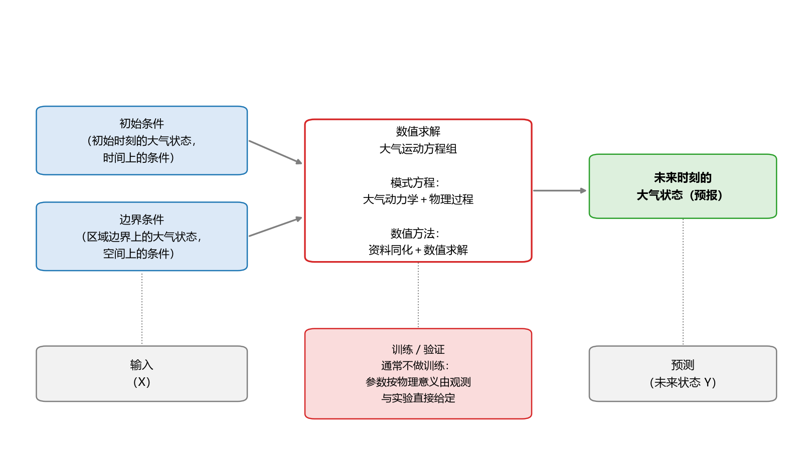

**图 22-3 数值天气预报的定义：从机器学习视角看输入、训练与预测**

### 22.3.3 模式方程的组成：大气动力学与物理过程参数化

三要素之一是模式方程，它由两大部分组成（图 22-4）。

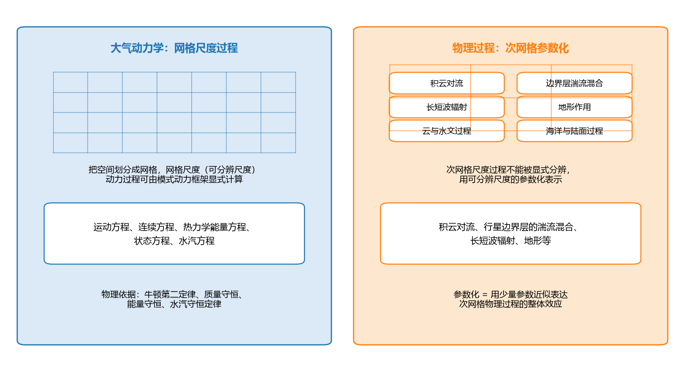

**图 22-4 模式方程的组成：网格尺度显式计算与次网格参数化**

**第一部分是大气动力学**。把模拟空间划分成很多网格，在网格尺度（可分辨尺度）上，动力过程可以由模式动力框架**显式计算**。它包括运动方程、连续方程、热力学能量方程、状态方程、水汽方程等一整套大气运动方程组，描述大气运动动力、热力状态的变化规律，物理依据分别是牛顿第二定律、质量守恒、能量守恒、气体实验状态方程与水汽守恒定律。

**第二部分是物理过程**。大气过程还要与许多其他过程相互作用：水文过程、云过程、边界层过程、辐射和化学过程、海洋和陆面过程等。这些相互作用过于复杂，在网格尺度上没法显式描述，只能在**次网格**尺度下考虑——既然显式算不了，就"退而求其次"，用**参数化**的方法把它们描述成一些参数，放进最终的大模型里。参数化描述的典型现象有积云对流、行星边界层的湍流混合、长短波辐射、地形作用等。

看到这里就能想到：既然有一部分过程只能做参数化的近似处理，最终的预报结果肯定会有不准确的地方——这为后面"机器学习帮助数值模式"埋下了伏笔。

### 22.3.4 数值方法的组成：资料同化与数值求解

三要素之二是数值求解方法，它同样由两大部分组成。

**第一部分是资料同化（data assimilation）**。它最早是**为解决模式积分对初值的需要**而提出的——求解数值预报模式中的**反问题**。模式积分（求解）需要初值，而且初值非常关键，于是"怎么准备初值"就成了一个问题。资料同化的基本想法：用现有的**所有信息**——观测资料和模式预测值（背景场）——来定义一个**最大可能精确的大气（或海洋）运动状态**，作为模式下一阶段积分的初值（图 22-5）。用概率语言表述，就是在观测 $y$ 与背景场 $x^b$ 给定的条件下，寻找使后验概率最大的状态作为分析场 $x_a$：

$$x_a = \arg\max_{x}\; p\left(x \mid y, x^b\right) \tag{22-1}$$

发展至今的同化方法包括：函数拟合、逐步订正（SC）、最优插值（OI）、三维变分、四维变分/增量四维变分、卡尔曼滤波等。

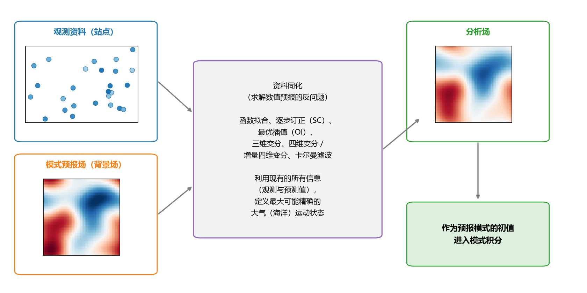

**图 22-5 资料同化：融合观测与模式预报信息生成初值**

**第二部分是数值求解**。模式方程组中的方程大多是非线性的，迄今还没有解析求解方法——所谓解析解，就是把解直接表达成显式公式，这对如此复杂的方程组做不到。常用的办法是**数值求解**：用差分法、谱方法等对模式方程做近似求解，通过迭代把解"算"出来。这与神经网络训练中的误差反向传播算法是同一类思想——都是迭代求解，而迭代自然要用到初始值，这也再次呼应了资料同化的重要性。

### 22.3.5 基础理论与发展历程

数值天气预报这座大厦靠四根支柱支撑（图 22-6 上方的时间线与之呼应）：

1. **动力气象学理论**——描述大气运动规律（没有方程组一切免谈）；
2. **大气探测技术**——提供更丰富、更准确的资料（探测得越好，建模的输入就越好）；
3. **数值计算的发展**——提供计算算法（算法越高效，求解越快越准）；
4. **计算机技术**——提供硬件实施（计算量巨大，离不开大型计算机与超算）。

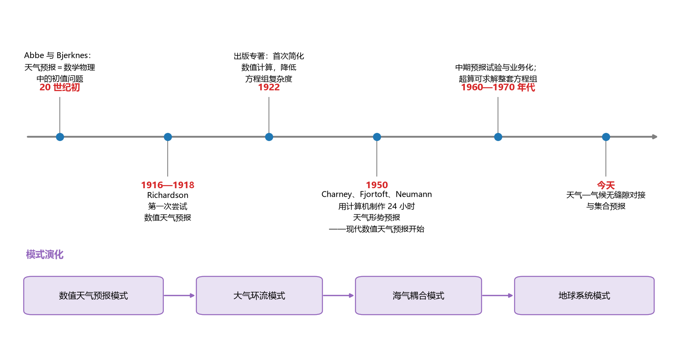

**图 22-6 数值天气预报的发展时间线与模式演化**

发展历程值得细看，因为它展示了一个机理模型如何"生长"：

- **20 世纪初**：美国的 Cleveland Abbe（美国国家气象局之父）与挪威的 Vilhelm Bjerknes（挪威气象学、现代天气学之父）开始尝试**将天气预报看作数学物理学中的初值问题**，用非线性偏微分方程组的形式描述旋转地球大气运动中的已知物理规律。1907 年前后人们就已经看清楚"数值模拟做天气预报是什么问题"，这是非常开创性的思想。
- **1916—1918 年**：英国数学家 Lewis Fry Richardson 第一次尝试数值天气预报；**1922 年**他出版专著，首次对数值计算过程进行简化、降低方程组的复杂度——此后人们把计算任务交给了计算机。
- **1950 年**：Charney、Fjortoft 与 Neumann 利用计算机成功制作了**24 小时天气形势预报**——高度场都能算出来了，这标志着**现代数值天气预报的开始**。计算机刚刚问世就能用于天气预报，是非常了不起的成就。
- **20 世纪 70 年代**：超级计算机已有能力求解整套方程组，**高性能计算开始成为数值天气预报不可分割的一部分**；1960—1970 年代国际上开展了数值预报、特别是中期天气预报的**试验和业务化**。

模式本身也在不断"扩容"：从最初的**数值天气预报模式**，到 20 世纪 60 年代的**大气环流模式**，再到 90 年代把海洋、海冰乃至温室气体碳循环加进来的**海气耦合模式**，随后又纳入植被动态、大气化学（硫化与非硫化气溶胶等），发展为今天更为复杂的**地球系统模式**——从一开始只研究天气，到把地表、海洋、生态、化学过程都考虑进来。关于地球系统模式与机器学习的结合，本书第 24 章再展开。

### 22.3.6 发表现状与提高质量的两大抓手

数值预报是基础民生服务，各国的气象局大都有自己的主打模式，目前大致分三个阵营：**第一阵营**是欧洲中期天气预报中心（ECMWF），其形势场、降水场预报都居于世界前茅；**第二阵营**包括英国气象局（UKMO）、美国国家环境预报中心（NCEP）、日本气象厅（JMA）、加拿大环境署（CMC）、法国气象局（MeteoFrance）、德国气象局（DWD）等发达国家的预报中心；**第三阵营**有中国气象局（CMA）、巴西、澳大利亚（CAWCR）、韩国（KMA）、俄罗斯等。以**北半球地表气压预报误差**的比较为例，ECMWF 主打模式的误差最低，第二阵营居中，其余在后面追赶——当然，大家都在发展，排位也在变化。

怎么提高数值天气预报的质量？除了不断**改进预报模式**和**利用卫星资料**，当前最受关注的是两个抓手：**资料同化**与**集合预报**。

**资料同化**解决初值问题。初值中的微小扰动会使天气预测结果产生巨大变化（这正是大气混沌特性的体现），因此**减小初值误差**成为提高预报准确性的关键问题之一；资料同化分析处理随空间和时间分布的观测资料、为数值预报提供初始场，已被越来越多地用于获取更精确的初值——初值做准了，后面的模拟才会更好。

**集合预报**解决"单一预报必然不准"的问题。大气系统本身具有混沌特性，加之数值预报中的初值误差、模式计算误差和物理参数化方案等带来的不确定性（不少过程只能做参数化的近似描述），**单一模式预报结果不可避免地存在误差与不确定性**。既然承认不准，索性把不确定性表达出来——基于**概率预报**思想的集合预报应运而生：对**同一有效预报时间给出一组不同的预报结果**（不同模式、同一模式不同初始扰动或不同物理方案），各预报之间的差异提供了有关被预报量的**概率分布**信息。最简单的后处理是求集合均值（等权或加权）；更进一步，可以把每个时空点的预报量当成一个随机变量、分析其概率分布——这套思想在水文篇的集合预报（21.4.6 节）中已经出现过，这里补充了它在气象上的由来。

### 22.3.7 未来发展方向与预报分类

数值预报的未来：向**"两端"**发展——一端是更短更精细的临近预报，另一端是更长期的气候预测——同时大力发展**集合预报**，实现**天气—气候无缝隙对接**。以往预报做得好的是两头：未来几天的天气预报和上百年千年的气候模拟，而**临近预报与长期气候之间的中间尺度**（延伸期—次季节—季节—年）相对薄弱，正是当前的发展重点；方法上则是数值模拟与统计方法（机器学习也包括在内）相结合，共同提高预报效果。

按预报时效分类，是经常使用的分类方式（表 22-4、图 22-7）。

**表 22-4 天气预报与气候预测的分类（按预报时效）**

| 大类 | 小类 | 预报时效 |
|------|------|------|
| 天气预报 | 临近预报 | 0~2 h |
| 天气预报 | 短时预报 | 0~12 h |
| 天气预报 | 短期天气预报 | 0~3 d |
| 天气预报 | 中期天气预报 | 3~10 d |
| 天气预报 | 延伸期预报 | 10~30 d |
| 气候预测 | 气候预测（次季节/季节/年度/气候变化预测） | 30 d 以上 |

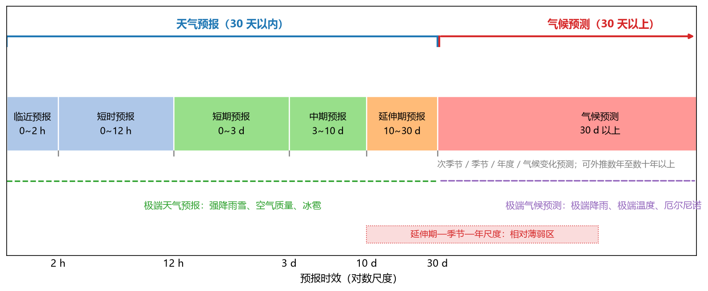

**图 22-7 天气预报与气候预测的时间尺度谱**

以 30 天为界：30 天以内是**天气预报**（临近、短时、短期、中期、延伸期），30 天以上是**气候预测**——次季节（三个月以内）、季节、年度，一直到数年、数十年、数百年甚至千年的超长期预报（气候预测既可以往未来预测，也可以分析过去）。通常说的预报指温度、降雨等要素的**均值预报**；此外还有**极端天气预报**（强降雨雪、空气质量、冰雹等特殊现象）与**极端气候预测**（极端降雨、极端温度、厄尔尼诺等特殊信号的预测）——极值问题恰恰是机器学习应用的热点。

### 22.3.8 数值天气预报的业务流程

把前面所有要素串起来，就是数值天气预报的业务流程：**观测**（多源观测资料）→ **资料预处理与资料同化**（初值生成）→ **预报模式积分**（考虑不同情景、不同边界与初始条件）→ **集合预报** → **预报产品** → **目标用户**（大众、政府部门）。观测、资料预处理、资料同化、预报模式、集合预报和高性能计算等一起，形成了高效、综合的**数值天气预报业务系统**。这套系统里，实际上或多或少已经用到了机器学习与数据挖掘方法的支持——下面两节就来系统梳理机器学习能在这条流水线的哪些环节发力。

### 22.3.9 机器学习与数值天气预报的比较

机器学习能不能做与数值天气预报同样的事？两者是什么关系？先比相似之处，再比不同之处（图 22-8）。

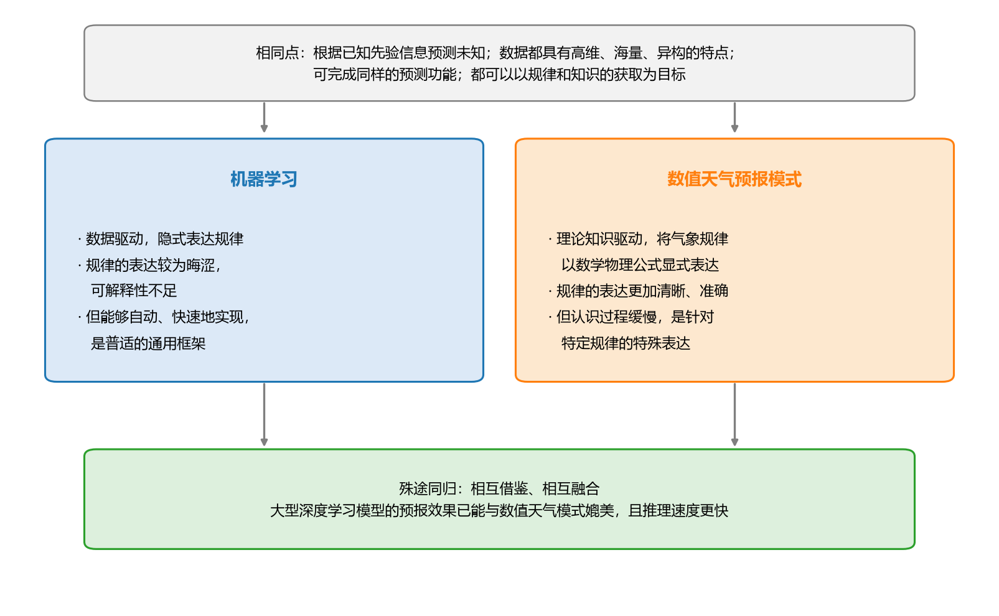

**图 22-8 机器学习与数值天气预报的比较**

**四点相似**：都根据已知的先验信息预测未知（从过去的信息预测未来的气象信息）；使用的数据都具有高维、海量、异构的特点；可完成同样的预测功能；也都可以以规律和知识的获取为目标。

**不同之处**在于规律的表达方式。**机器学习是数据驱动、隐式表达规律**：直接关心输入是什么、输出是什么，用一般性的模型去拟合数据中的规律；规律的表达较为晦涩、可解释性不足，但它能够自动、快速地实现，而且**普适**——像一个"万能方子"，拿到哪个领域都能试。**数值天气预报是理论知识（机理）驱动、显式表达规律**：把气象规律用数学物理公式（偏微分方程组）显式地表达出来，规律表达更清晰、更准确，可解释性高；但把规律认识清楚并表达成公式是一个非常缓慢的过程（很多现象还没认识到、很多过程只能参数化），而且它**不具普适性**——是对特殊规律的特殊表达。不过，数值预报的**起步点是正确的**：它建立在理论知识不断积累的基础上，朝着机理更清晰的方向前进，规律理解得越好，公式表达得越好，模型自然越好。

一句话总结：两者**殊途同归、各有特色**。做气象的人长期认为数值预报最好，对机器学习有一个慢慢接受的过程（毕竟它的可解释性与机理表达有距离）；而发展趋势是两者**相互借鉴、相互融合**——气象学家正逐渐接受机器学习特别是深度学习，如今一些大型深度学习模型的预报效果已经能与数值天气模式**媲美**，且推理**速度更快**，有时效果甚至更好。

### 22.3.10 机器学习融入数值天气预报的总览

具体到业务流水线，机器学习能融入数值天气预报的哪些功能模块？本节内容主要参考孙健等《人工智能技术在数值天气预报中的应用》（《应用气象学报》2021 年第 32 卷第 1 期），按"初值生成—预报模式积分—产品应用"三大模块归纳为表 22-5，22.5 节将对其中各环节展开。

**表 22-5 机器学习融入数值天气预报的模式角度总览**

| 功能模块 | 主要技术 | 目标 | 效果 |
|------|------|------|------|
| 初值生成：观测资料处理及质量控制 | 贝叶斯方案、CNN、ELM 等 | 观测偏差纠正、雷达及卫星图像资料预处理等 | 提高观测质量，优化图像、资料分割、资料填补 |
| 初值生成：资料同化 | RF、DNN、SVM 等 | 同化算法参数优化、部分替代资料同化方法、聚焦观测区域等 | 提高同化质量、提高同化速度，更好利用高分辨率资料 |
| 预报模式积分 | DNN、CNN、RF 等 | 模式代理、替代物理过程参数化方案、参数校正 | 提高模式计算速度，优化次网格物理过程的表示，提高参数校正效果与速度 |
| 产品应用：后处理 | RF、DNN、CNN 等 | 确定性及集合预报结果后处理、替代集合预报等 | 后处理偏差订正，质量更好、效率更高 |

这张表可以先整体记住：**前处理管初值，模式积分管计算，后处理管产品**；每一格都对应机器学习的一个或几个"老朋友"（CNN、RF、SVM、ELM、DNN、贝叶斯方法）。

## 22.4 机器学习作为独立模型

换到机器学习自身的角度，气象预报应用可以分成两大类：**机器学习作为独立模型**（本节）与**机器学习和数值模式的集成**（22.5 节）。独立模型一类又包括四个专题：常规应用、高时空分辨率精细化预报、可解释性、不确定性。

### 22.4.1 发展三要素：算法、算力与数据

机器学习应用到气象（以及任何领域），都绕不开发展的三要素——**算法、算力、数据**（图 22-9）。

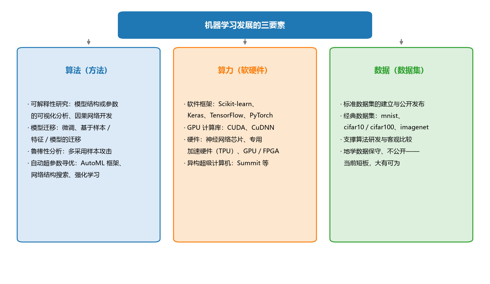

**图 22-9 机器学习发展的三要素**

**算法**层面，当前重点研究的是几类共性问题：**可解释性研究**（模型结构或参数的可视化分析、因果网络开发等）；**模型迁移**（微调、基于样本迁移、基于特征迁移和基于模型迁移——用大数据集训练好的大模型，在小数据集的问题上稍加训练就能取得好效果）；**鲁棒性分析**（多采用样本攻击的方法）；**自动超参数寻优**（自动机器学习框架、神经网络结构搜索、强化学习等）。

**算力**层面，人工智能软硬件朝更便捷、更高效的专用架构方向发展。**软件**上，软件框架的引入大大降低了 AI 应用门槛：Python 中的机器学习框架（Scikit-learn 等）与深度学习框架（Keras、TensorFlow、PyTorch 等），以及 CUDA、CuDNN 等 GPU 高性能计算软件库。**硬件**上，包括神经网络芯片、专用加速硬件（TPU 等）、通用加速器（GPU/FPGA）以及基于图形加速器的异构超级计算机（Summit 等）。高性能专用硬件有效提升了训练和推理的计算速度，为超大规模人工神经网络（ANN）的采用和实时训练与推理等严苛场景应用奠定了基础。

**数据**层面，主要内容是**标准数据集的建立与公开发布**——有了标准数据集，新算法的研发更快，模型之间的比较才客观，否则比较结果可能只是数据集本身的差异。计算机视觉领域做得最好：手写数字数据集（mnist）、微小图像数据集（cifar10/cifar100）、大规模视觉识别图像数据集（imagenet）等经典数据集支撑了整个领域的发展。相形之下，**地学数据相对保守**：气象、水文的数据往往宝贵而不公开，目前只有个别竞赛数据集开放出来——这是地学机器学习应用的短板，反过来也意味着标准数据集建设大有可为。

### 22.4.2 常规应用的步骤与特点

机器学习在气象预报中的常规应用步骤与一般机器学习项目一致（图 22-10）：输入二维/三维、多元的时空观测资料 → 预处理（质量控制、缺测填补、时空配准等）→ 选用机器学习模型（大样本用 CNN、LSTM 等深度学习模型，小数据集用全连接网络/多层感知机即可）→ 输出空间网格化的**类别、数值或概率**。

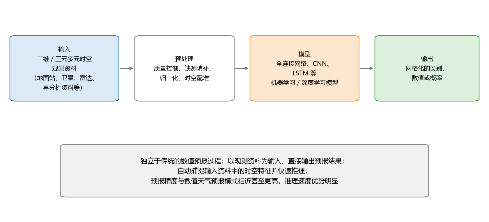

**图 22-10 机器学习在气象预报中的常规应用步骤**

常规应用的基本想法非常"大胆"：**完全抛开数值模拟，直接用机器学习做天气预报**——独立于传统的数值预报过程，以观测资料为输入、直接输出预报结果，自动捕捉输入资料中的时间和空间特征并做出快速推理。到目前为止，这类模型的**预报精度已与数值天气预报模式相近甚至更高**，而实际预测（推理过程）的**计算速度优势明显**。当然，要记住 22.3.9 节的结论：效果好不等于机理清楚，两套模型各有所长。

### 22.4.3 三个典型案例

**案例一：ENSO 预测（长期气候信号）。** Ham 等采用卷积神经网络（CNN）对 ENSO 事件进行**长达一年半的提前预测**，预测效果远高于当时最先进的热带气候变化动态预报系统（SINTEX-F 等数值模式），证明 CNN 是预测 ENSO 事件的有力工具（发表于 *Nature*，2019）。这个模型并不算复杂，但它率先把 CNN 与 ENSO 预报结合起来并与数值模式结果做了严格比较，影响深远——ENSO 信号预报好了，后续很多大气、水文、气象事件也能跟着预报得更好。

**案例二：降水预报（短时预报）。** Google 公司的 Sonderby 等提出了 **MetNet** 神经天气模型，实现 **1 km 空间分辨率、2 min 时间分辨率下全美范围提前 7~8 小时的降水预报**，超过 NOAA 的结果，而计算时间从几十分钟或几小时**缩减至几秒**。把模型与观测对比，很多区域已非常相似。MetNet 系列此后持续演进（表 22-6），从降水预报扩展到露点、风、温度等多要素，时效延长到 0~24 h。

**表 22-6 Google MetNet 系列模型的演进**

| 模型 | 任务 | 空间分辨率（范围/输出） | 时效/更新 | 论文（年份） |
|------|------|------|------|------|
| MetNet | 降水预报 | 1024 km² / 1 km² | 0~8 h / 2 min | MetNet: A Neural Weather Model for Precipitation Forecasting（2020） |
| MetNet v2 | 降水预报 | 2048 km² / 1 km² | 0~12 h / 2 min | Deep Learning for Twelve Hour Precipitation Forecasts（2022） |
| MetNet v3 | 露点/降水/风/温度 | 2048 km² / 1 km²；2048 km² / 4 km² | 0~24 h / 2 min；0~24 h / 5 min | Deep Learning for Day Forecasts from Sparse Observations（2023） |

**案例三：短时气象灾害（强对流天气）。** Zhou 等提出一种**短时暴雨、冰雹、对流阵风和雷暴等强对流天气的深度学习预报方法**：以温度、气压、湿度、风以及**数十个对流物理参数**作为预报因子（X），建立 **6 层 CNN** 预测模型，结果优于传统方法，目前已在**中国气象局国家气象中心**业务应用——这是深度学习进入我国气象业务体系的代表性案例。

### 22.4.4 常规应用的适用边界

把三个案例放在一起，能看出 AI 独立预报目前"打得准"的两类问题：

1. **特征变化显著的短时天气预报**——X 变了 Y 也跟着明显变，短时强对流、临近降水等；
2. **特征变化缓慢的长期气候信号预测**——如 ENSO 这类数年尺度的缓变信号。

而对**物理现象复杂且特征多变的天气过程**，人工智能模型还没有出现较好的应用案例；它在解决**高维非线性天气问题**中的表现还需要进一步验证。换句话说，"中间那一段"（22.3.7 节说的延伸期—季节尺度、以及复杂天气过程）仍是硬骨头，读者选择研究方向时可以此为参照：已验证的区域竞争激烈，未验证的区域机会与风险并存。

### 22.4.5 高时空分辨率精细化预报

第二类应用是**高时空分辨率精细化预报**：借助深度学习（如大规模神经网络）或其他机器学习方法，从多源观测大数据中学习知识，实现高维、复杂和多变量天气过程的**特征识别与状态预测**。经验表明，在高时空分辨率条件下的强非线性问题中，使用**纯数据驱动**的人工智能预报模型，可以取得与数值模拟相当的结果。

**案例一：极端天气的识别与分割。** Kurth 等在超级计算机 Piz-Daint 和 Summit 上，使用 Tiramisu 和 DeepLab v3+ 模型进行高时空分辨率下**极端天气的模式识别与分割**——不仅识别极端天气的位置，还同时对其**边界进行划分**。所用的 DeepLab 是语义分割领域的系列经典模型（表 22-7），这也再次印证第 11 章的观点：地学的"图像"问题可以直接借力计算机视觉的成熟模型。

**表 22-7 DeepLab 系列语义分割模型的演进**

| 模型 | 论文题目 | 收录 | 骨干网络 |
|------|------|------|------|
| V1 | Semantic image segmentation with deep convolutional nets and fully connected CRFs | ICLR 2015 | VGG16 |
| V2 | DeepLab: Semantic Image Segmentation with Deep Convolutional Nets, Atrous Convolution, and Fully Connected CRFs | TPAMI 2017 | ResNet-101 |
| V3 | Rethinking Atrous Convolution for Semantic Image Segmentation | — | ResNet-101 |
| V3+ | Encoder-Decoder with Atrous Separable Convolution for Semantic Image Segmentation | — | Xception |

**案例二：混合精度加速。** Rojek 针对改进的随机森林方法提出一种**混合精度算法**，在基于 GPU 的超算中心进行天气预报模拟时，该算法能提供与双精度相当的计算精度，且**计算能耗降低 36%**——用"算得省"支撑"算得细"。

高时空分辨率精细化预报也面临挑战：一是**可行性仍需验证**；二是**超大规模神经网络的构建**——针对性的研究或能满足精细化预报的需求，而高斯随机过程收敛性理论与实践的突破，可有效支撑高度非线性模式的同化与集合设计；三是**训练过程中计算量和数据访问量大幅提升**，需要大规模高性能计算软硬件平台、人工智能分布式学习框架的应用以及人工智能超算的发展。

### 22.4.6 可解释性：为什么需要，难在哪里

机器学习做预报被人批评最多的一点就是可解释性。**为什么需要可解释性？** 因为只有具有可解释性的模型，才有利于**知识的提取、积累与重复利用**；才能**进一步改进预报模型、提高模型性能**——预报精度与可解释性并不矛盾，解释清楚机理得到的知识可以反过来帮助改进模型；才能**使深度学习摆脱"黑盒"的标签**，不再是毫无意义的暴力判定工具。反过来，**不可解释的模型面临稳定性、安全性等问题**——即使预测得准，也总会有人质疑"为什么这么准"。

可解释性面临两大挑战：

1. **弱解释性问题。** 传统数值天气预报一直十分注重理论知识的积累，而人工智能多以统计为基础，规律表示较晦涩、解释性不足，基于人工智能的知识发现也较困难，这在一定程度上限制了它在行业内的广泛认可和广泛应用。
2. **理论知识指导下的人工智能模型设计。** 数值天气预报领域至今已积累大量数学和物理理论，这些理论应当被人工智能模型有效利用——具体可以有两条路：把深度学习的**某些层**换成用物理模型来描述；或把已经比较成熟的气象理论放进深度学习的**目标函数**，让理论在训练中发挥约束作用。

### 22.4.7 可解释性研究的五类方法

围绕"打开黑盒"，已有一批代表性研究，可以归纳为五类方法（图 22-11）。

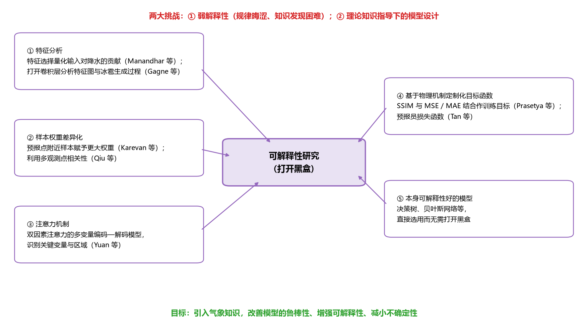

**图 22-11 可解释性研究的五类方法与两大挑战**

**（1）特征分析。** 通过分析输入特征来理解模型的推理过程，便于优化预报模型。Manandhar 等通过**特征选择**找到对降水具有较大影响的特征，基于这些特征用机器学习方法预测降水量，在获得较高准确率的同时有效**降低了虚警率**。Gagne 等使用 CNN 基于**上层空气动力场和热力场**预测严重冰雹发生概率，通过对 CNN **特征重要性**的解释与分析，发现该网络综合了对冰雹生成过程的理解，预测结果也优于其他模型——相当于把训练好的网络"拆开"，把卷积层画成特征图，分析这些浓缩的高维特征蕴含的机理。

**（2）样本权重差异化。** 推理天气情况时会用到大量时间或空间相关的数据，给这些数据**赋予不同权重**即可表示其对预报点影响的大小——有点像敏感性分析。Karevan 等利用 LSTM 建立数据驱动的天气预报模型，考虑**样本与预报点距离**的影响，把预报点附近的样本赋予更大权重，所提出的传导 LSTM 在预测任务中表现较好。Qiu 等提出**多任务 CNN** 用于降水量短期预测，考虑到观测的不完整性以及临近点的影响，通过多任务处理观测点的时间序列数据、并利用多个观测点间的相关性进行预测，优于包括欧洲中期天气预报中心（ECMWF）模型在内的一系列基线模型。

**（3）注意力机制。** 输入变量对模型的影响不一样，通过注意力机制让模型"关注"特定的自变量或区域。Yuan 等提出基于**双因素注意力机制**的多变量编码—解码预报模型，从**时间信息**与**先验知识推断**两方面学习注意力权重，在公共天气预报数据集上预报精度得到很大提高。

**（4）基于物理机制定制化目标函数。** 目标函数的确定对人工神经网络的质量至关重要。Prasetya 等从计算机视觉角度考虑降水预报中的**雷达回波外推**任务，将图像质量评估中的**结构相似性指标（SSIM）**与均方误差（MSE）、平均绝对误差（MAE）结合作为神经网络的训练目标，使雷达图像预测质量得到有效提高——相当于把物理机制放进了深度学习的训练过程。Tan 等提出基于**分层卷积长短期记忆网络**的深度学习模型，并设计了一种新的**"预报员损失函数"**来预报未来的卫星云图：预报员的经验也是知识，把它写进损失函数，模型不但性能更好，还能更好地保留实际大气状况的不确定性。

**（5）直接选用本身可解释性好的模型。** 除了费时费劲地"打开黑盒"，还有一条捷径：有些机器学习模型**本身**的可解释性就比较好——决策树的树形结构把 X 与 Y 的关系显式表达出来（第 8 章），贝叶斯网络、图神经网络、因果网络等也都能较直接地把知识表达出来。对特定问题直接选用这类模型求解，同样是增强可解释性的可行之路。

**展望**：目标是**引入气象知识，改善人工智能模型的鲁棒性，增强模型的可解释性，减小不确定性**。可能的路径包括：用数学或物理理论知识**分割**气象问题，并把理论知识**用于 AI 模型构建**（神经网络结构设计、定制损失函数、控制模型输出等）；采用能支持理论知识发现与知识积累的模型——贝叶斯网络、图神经网络和因果网络有助于建立更全面深刻的特征工程，在线学习与迁移学习支持预报模型的积累与增量开发、提高历史资料与模型利用率，自动网络结构与超参数寻优则能加快人工智能应用开发。

### 22.4.8 不确定性：不可避免，但可以表达

**天气预报的不确定性是不可避免的**。原因有二：一是大气系统的混沌特性——初值中微小的扰动会使预测结果产生巨大变化；二是任何数值模拟都不可能把所有规律描述得完全正确（总有一些过程只能参数化近似）。数值天气预报十分注重不确定性分析（集合预报就是它的答案）；用机器学习做预报同样有不确定性，同样需要考虑**如何用 AI 有效表述、设计初值及模式的不确定性**。机器学习模型输入 X 之后，在某一时空点上输出的可以不是一个具体的值，而是一个**带有概率的结果**——把每个时空点的预报量当成一个**随机变量**，考察其分布随时间的变化与**置信区间**，概率预报便自然产生了（图 22-12）。

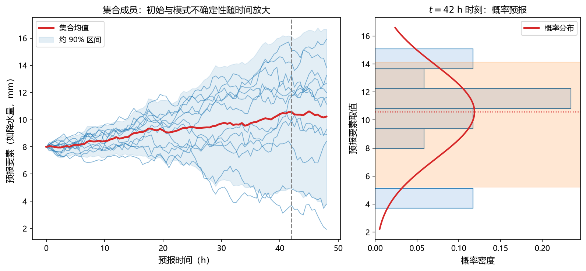

**图 22-12 集合预报与概率预报：不确定性随时间放大**

以集合预报为例，$K$ 个成员在同一时刻 $t$ 给出一组预报值 $y_t^{(1)}, \ldots, y_t^{(K)}$，集合均值与离散度分别为：

$$\bar{y}_t = \frac{1}{K}\sum_{k=1}^{K} y_t^{(k)}, \qquad s_t^2 = \frac{1}{K-1}\sum_{k=1}^{K}\left(y_t^{(k)} - \bar{y}_t\right)^2 \tag{22-2}$$

均值提供确定性预报，离散度刻画不确定性；随着预报时效的推移，成员逐渐散开，预报由"一条线"变成"一条带"——与图 22-12 中初始与模式不确定性随时间放大的形态一致。

处理不确定性的思路可以归纳为四个方向：**更全面、更高效的不确定性量化**（如采用贝叶斯推断生成当前气象状态的分布特征）；**特征抽取和机理发现**（如基于贝叶斯网络嵌入隐藏变量的特征学习）；**基于注意力机制识别气象要素间的长程依赖关系**；以及**从数学层面找到与传统分析方法的联系**，建立综合的不确定性分析方法。此外还有两条互补的总体思路：一是**显式地表达不确定性**（选用贝叶斯网络这类本身就能描述不确定性的模型）；二是**反过来提高模型的确定性**——模型精度提高了、预测更准了，不确定性也就反向减少了。两条路都通，可以并行。

## 22.5 机器学习与数值模式的集成

最后一大类：机器学习不单干，与数值模式集成。前面 22.3.10 节的表 22-5 已从模式角度给出总览，本节按**前处理—耦合—后处理**三个环节展开（图 22-13）。

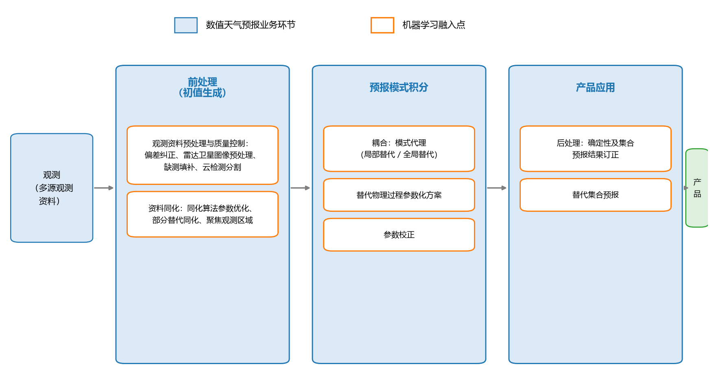

**图 22-13 机器学习与数值模式的集成：前处理、耦合、后处理**

### 22.5.1 集成的三个环节

**前处理**：在数值天气预报业务中，**初值生成**过程（特别是资料同化方法）对预报质量影响尤为重要，而受计算压力限制，难以有效利用海量、高时空分辨率的气象资料——这或许是目前**人工智能最为有效的着力点之一**。

**后处理**：合理使用代理模型、构建端到端的数据驱动模型，能够在不失准确性的同时显著提高预报时效，为大规模计算任务提供高效方案。

**耦合**：机器学习与预报模式积分环节的深度融合，包括模式代理、物理参数化方案替代与参数校正，详见 22.5.3~22.5.5 节。

### 22.5.2 前处理：观测资料预处理与资料同化

观测资料预处理和资料同化共同影响初始条件的质量，而初始条件中的微小扰动会使模式结果产生较大差异，因此**提高观测资料质量**与**改善资料同化方法**尤为重要；大量观测资料要凭资料同化有效融入预测过程，也使得人工智能在资料同化中的应用更具机遇。目前人工智能已有效改善了观测资料质量，并开始有机融入主流资料同化方法，但不确定性的量化与分析还需要更深入的理论支持。

**提高观测资料质量**的代表性工作：Berry 等提出一种**非参数贝叶斯方案**，对观测中的误差分布进行学习并纠正偏差，与同化系统联合使用能有效增强同化效果；Chang 等使用**极限学习机（ELM）**填补中分辨率成像光谱仪（MODIS）反射资料中由于云量造成的空白；安捷等使用**全卷积网络**对气象卫星遥感图像中的云进行检测，实现了高分辨率、大尺度、多通道遥感图像资料的云分割——这些都属于表 22-5 中"观测偏差纠正、图像资料预处理、资料填补"的具体实现。

**改善资料同化方法**的代表性工作：Moosavi 等使用**随机森林**，在时间和时空两种情境下对集合卡尔曼滤波同化方法中局部化函数的定位半径进行自适应调整，进一步提高同化质量；Cintra 等使用**神经网络**替代局部化集合转换卡尔曼滤波同化方法，在试验中得到相似的同化结果且计算效率更高；Lee 等使用**支持向量机**等机器学习方法预先寻找预报中更感兴趣的资料区域，将高分辨率卫星资料聚焦到感兴趣区域，使资料同化产生更好的结果——分别对应"同化参数优化、部分替代同化方法、聚焦观测区域"三个目标。

### 22.5.3 耦合：三种模式与两大挑战

现有人工智能应用表现出多种**耦合模式**：**局部优化**（帮数值模式调好某个环节）、**局部替代**（把模式里描述得不太好的局部过程换掉，结果再放回模式）、**全局替代**（整个模式的代理，用于不确定性分析等反复运算的场景）。

耦合面临两大挑战。其一，**耦合系统长期稳定运行还缺乏深刻的理论分析和保障**——要靠长期试验来积累信心。其二，如何**结合两者优点**：AI 擅长对样本分布的估计，传统数值预报技术擅长确定性规律下的精确计算，两者本可以互补。此外还有一个现实问题：数值天气预报与人工智能在**代码、软硬件环境方面的需求存在差异**——一边是 Fortran、MPI、NetCDF、NCL，一边是 PyTorch、TensorFlow，**标准工作流和框架的开发**将两类语言和工具有效连接起来，才能便于代码耦合与继承。

### 22.5.4 模式代理：用 DNN 替代气候模式

数值天气预报模式涉及动力框架与物理过程参数化方案，其中**模式数值积分过程最耗时**，而人工智能技术推理具有高效性——用 AI 模型替代模式（或部分模式）能够显著提高计算效率，已成为重要的研究方向。由于神经网络的"黑盒"特性，模式替代可以认为是**代理模型**（输入—输出响应模型）的构建：给什么输入、出什么输出，内部机理不必打开。

一个经典例子来自 Scher：用**深度神经网络（DNN）**学习一个简单气候模式（GCM）的输出，试验证明训练后的 DNN 能够成功预测模式的状态变化，大大提高计算速度，展示了**纯数据驱动天气预报的可能性**。图 22-14 对比了 DNN 与 GCM 输出的标准化 500 hPa 位势高度场：从**均值**看两者几乎看不出差别，**方差**的差别也不大，只有在**30 天方差**上才有比较明显的差异。这意味着：如果只是想考察某个气压场物理量、再做些不确定性分析或扰动试验，完全可以用训练好的 DNN 代替 GCM 来跑——快得多，代价是尾部的精细统计特征有差别。

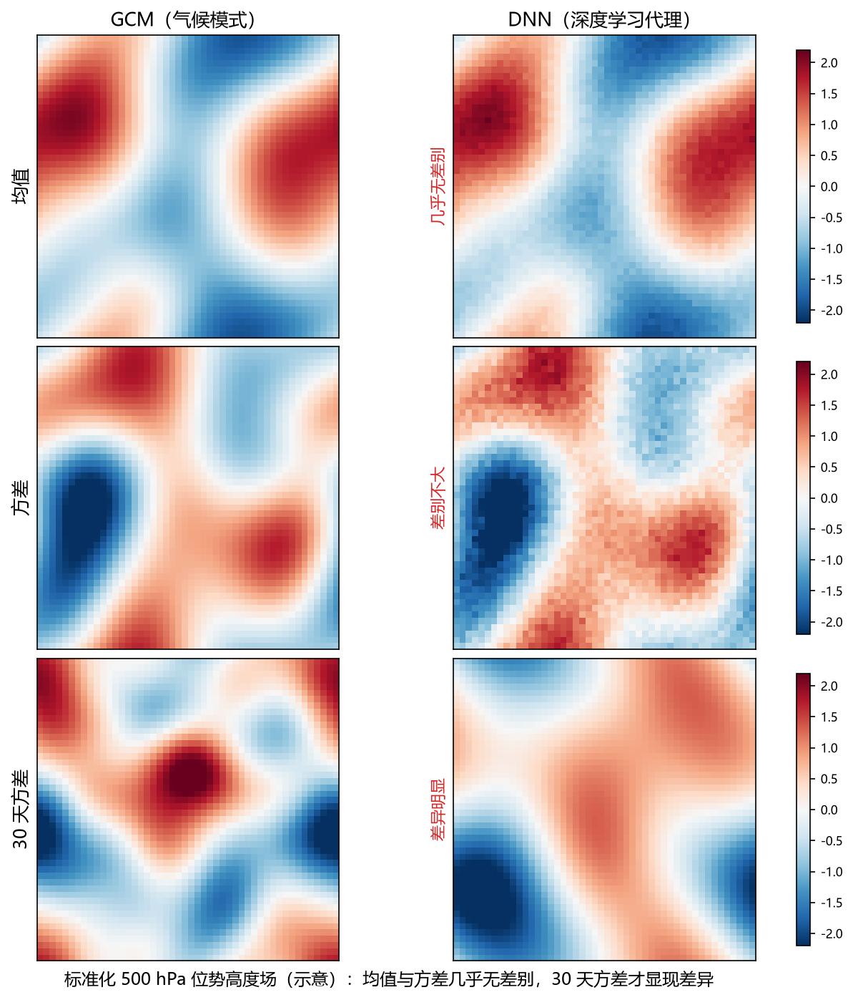

**图 22-14 DNN 代理 GCM 的效果对比（标准化 500 hPa 位势高度场，示意）**

### 22.5.5 替代物理过程参数化方案

22.3.3 节说过，物理过程只能参数化——而**物理参数化方案是当前模式中发展最为迅速的部分，也是不确定性最大的部分**。目前物理参数化方案仍多以单柱模型方式表示；随着模式分辨率的快速提升，次网格过程的影响日益显著，而三维物理方案的高计算量限制了其在模式中的应用——**人工神经网络的高效拟合能力**恰好为同时降低计算开销、提升计算精度创造了条件。用 ANN 替代与优化物理参数化方案的相关工作持续涌现：

- **Brenowitz 等**探索全球高空间分辨率资料下的神经网络参数化方法，使用 4 km 分辨率的 NG-Aqua（near-global Aqua-planet）仿真数据，对 **160 km 网格的视热源与视水汽汇**进行预测；
- **Pan 等**将卷积神经网络作为**统计降尺度**方法替代现有降水参数化方案，取得较理想的效果，并能通过可视化分析对模型及结果进行合理解释——替代了参数化，还顺便回答了"为什么"；
- **O'Gorman 等**使用**随机森林**对湿对流自动参数化建模，仍能保证**能量守恒和非负降水量**，带有机器学习湿对流参数化的大气环流模式能够稳定运行，并准确捕获**极端降水**等特征；
- **Rasp 等**使用深度学习模型表示模式中的**大气次网格过程**，计算成本很小、突破了传统方法的计算限制，且多年预报模拟结果表现稳定，能够替代全球环流中传统的次网格参数化方法。

不过问题还没有完全解决：ANN 是否有能力表述**包含复杂相变的云、雨、雪、气溶胶过程与边界层湍流过程**，以及能否与动力框架**可靠耦合**，仍值得深入探究。

### 22.5.6 参数校正

传统数值模拟通常不做参数校正（22.3.2 节），机器学习恰好补上了这块。**Xu 等**提出一种基于**代理优化技术**的碳循环模型参数校正方法，相比传统方法在计算准确度和计算效率两方面均得到提升；**Wu 等**针对大气环流模式 CAM5 提出一种**自动参数估计**方法并能对辐射平衡进行约束，结果显示其参数优化效果更好，且有效降低了辐射不平衡。参数校正后的结果带回模式，整体预报效果进一步提高——这正是表 22-5 中"提高参数校正效果与速度"的含义。

### 22.5.7 后处理：集合预报结果的订正与提效

**集合预报**是解决单一数值预报结果不确定问题的有效途径：从统计学角度给出概率预报结果，并对预报的可信度进行量化。集合预报中的问题主要体现在两个方面——**集合预报结果后处理**与**集合预报效率**。AI 是拟合高维非线性样本空间概率分布、量化不确定性的有效手段，帮助乃至替代传统集合预报都非常有潜力；此外还可以通过学习初始场开展集合方案的设计，并把资料同化与集合预报结合起来。

**集合预报结果后处理**的代表性工作：Burke 使用**随机森林**对高分辨率集合预报结果进行订正、改善冰雹预报效果，订正后的预报具有更高可靠性和更小的模型偏差，且由于不需要复杂的物理假设，计算效率也更高；Taillardat 使用**分位数回归森林**做后处理，其中分位数通过集合成员之外的其他预测因子估计得到，**消除了人为假设订正变量的局限性**，提高了订正效果；Rasp 等提出基于**神经网络**的集合预报后处理方案，通过数据驱动方式自动学习任意预测变量与**预测分布参数**之间的非线性关系，避免了预先指定关系函数的局限性——不直接输出预报值本身，而是输出这个"随机变量"分布的参数，方法在计算上更经济，也更容易推广到其他统计后处理与预测问题中。

**集合预报效率**方面：Scher 等尝试使用 **CNN 替代集合预报**方法，并能对给定初始状态下模式预报结果的不确定性进行估计，相比传统集合方法计算代价更小；其预报性能的限制在于**可用的训练样本较少**——这与 22.4.1 节说的数据短板遥相呼应。

至此可以看到一幅完整的图景：数值模式的**前处理、模式积分、后处理**三个环节，机器学习都能深度参与；反过来，数值模式积累的物理知识也能嵌入机器学习（22.4.6 节）。深度学习在气象中的应用大有可为，在今后很长时间内都是很有前途的方向。

## 22.6 小结

本章是应用篇的第二章，要点如下。

**思考框架与概念。** 沿用第 21 章的"两圈交集"框架，先厘清大气、气象、天气、气候四个概念——天气是较短时间内的大气状况，气候是多年平均的天气状况（WMO 以 30 年为最短年限，我国古代五日为候、三候为气）；气象的研究对象从化学成分、物理要素、大气运动、天气系统、气象灾害到气候，对应时空分布、天气预报、分类预测、极值预测与特征识别等题型。

**可应用的问题。** 数据集类（质量控制、均一化订正、缺测填补、多源融合格点化、再分析）、气候监测诊断类（ENSO 年型判别、环流模态与 ENSO 配置对冬季气候的影响、积雪前兆信号、东亚季风多尺度变率）、气候预测与气候变化类（极端气候事件、旱涝急转、热带气旋集合预测、冰雪化学、大气水汽变化、RCPs 情景降尺度与影响评估）——每一类都能写成"X 是什么、Y 是什么、回归还是分类"。

**数值天气预报。** 气象领域的原有模型：给定初始与边界条件，数值求解大气运动方程组；三要素是模式方程、数值求解方法与预报方法；参数按物理意义给定、通常不做训练。模式方程 = 网格尺度显式的大气动力学 + 次网格参数化的物理过程；数值方法 = 资料同化（求反问题、准备初值）+ 数值求解（差分法、谱方法近似求解）。四支柱是动力气象学、大气探测、数值计算与计算机技术；百年发展史从 Abbe、Bjerknes 的初值问题思想，经 Richardson 的首次尝试、1950 年 Charney 等的 24 小时预报，到今天天气—气候无缝隙对接与地球系统模式。提高质量的两大抓手是资料同化与集合预报；机器学习与数值预报殊途同归——一个数据驱动、隐式表达、普适而快速，一个理论驱动、显式表达、清晰而缓慢，正在相互借鉴融合。

**两大类应用。** 机器学习作为独立模型：三要素（算法、算力、数据）支撑下的常规应用（ENSO 的 CNN 预测、MetNet 降水预报、强对流 CNN 业务应用）、高时空分辨率精细化预报（极端天气分割、混合精度加速）、可解释性（两大挑战、五类方法：特征分析、样本权重差异化、注意力机制、物理机制定制化目标函数、本身可解释性好的模型）与不确定性（随机变量与置信区间、显式表达与反向减少两条思路）。机器学习与数值模式集成：前处理（观测资料质量控制与资料同化增强）、耦合（模式代理如 DNN 替代 GCM、替代物理参数化方案、参数校正）、后处理（集合预报结果订正与集合预报提效）。机器学习与数值模式不是对立的两套方法，而是可以相互提高的整体。

## 思考题

1. 基于机器学习的气象预报有哪些具体形式？（提示：从"作为独立模型"与"与数值模式集成"两大类分别列举。）
2. 机器学习能替代数值天气预报模型吗？结合两者的四点相似与规律表达方式的差异，谈谈"替代"与"融合"的边界。
3. 机器学习在气象学中还有哪些应用？请从表 22-1~表 22-3 中任选一个问题，写出它的 X、Y 与任务类型（回归/分类）。
4. 数值天气预报通常"不做训练"，它的参数从哪里来？资料同化解决什么问题、为什么说它是在求解数值预报的反问题？
5. 为什么天气预报的不确定性不可避免？比较"显式表达不确定性"（如集合预报、贝叶斯方法）与"提高模型精度反向减少不确定性"两条思路的适用场景。
6. 可解释性研究的五类方法各自"打开黑盒"的方式有什么不同？为什么说选用决策树、贝叶斯网络等模型也是增强可解释性的一条捷径？
