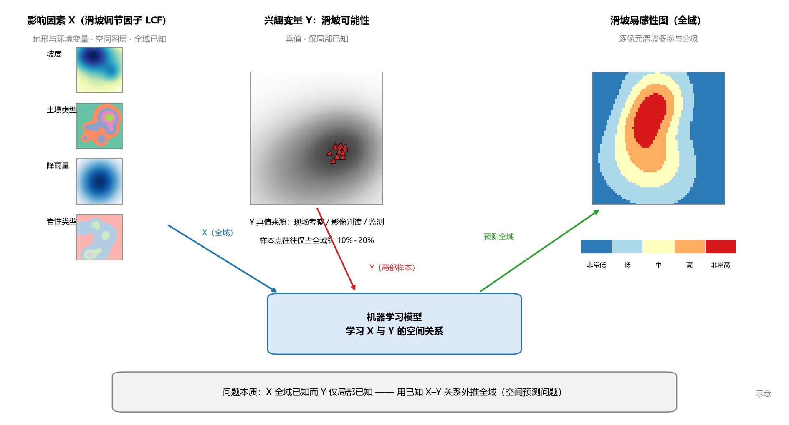
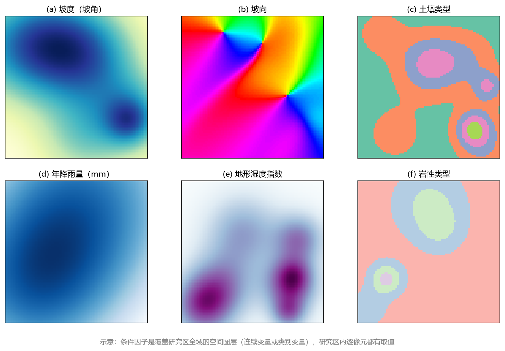
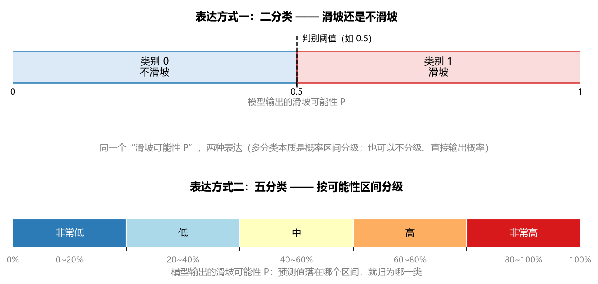
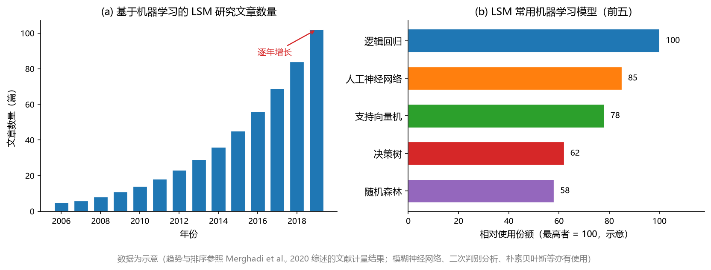
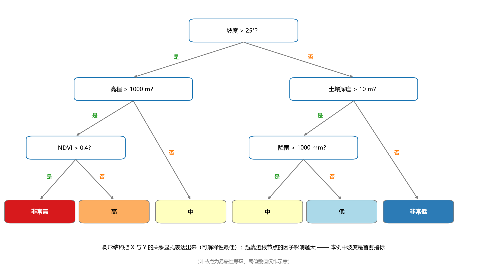
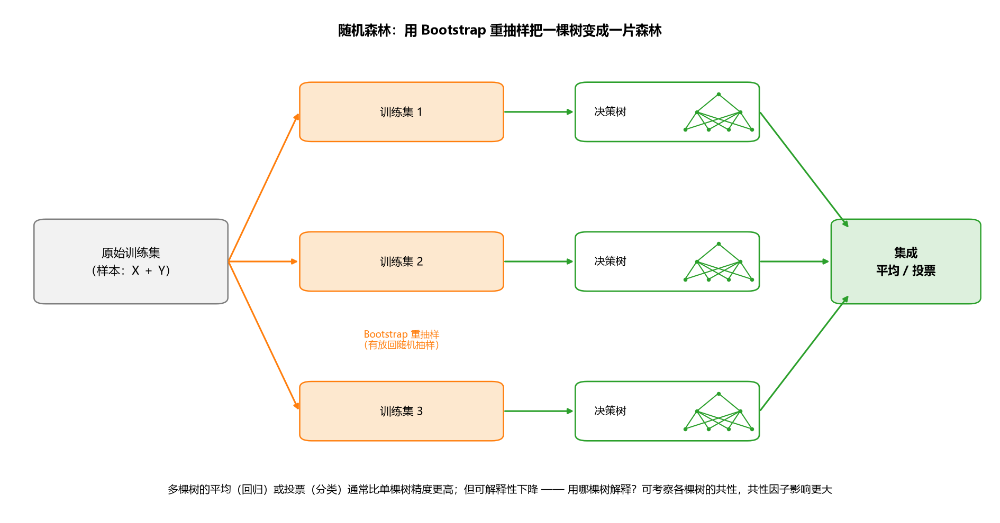
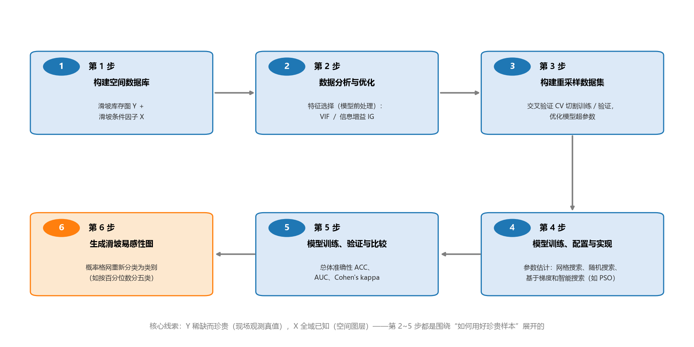
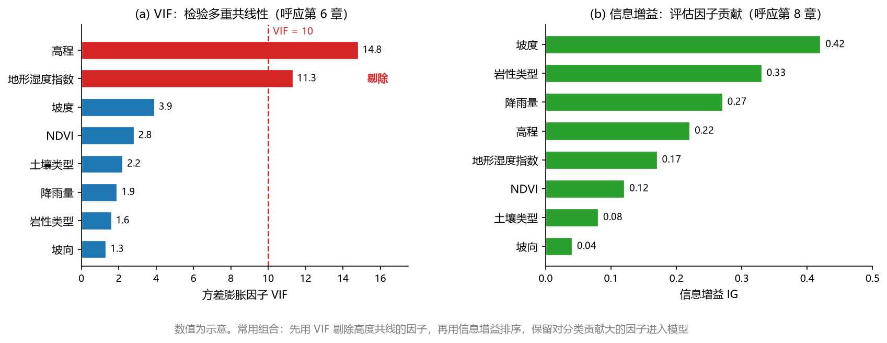
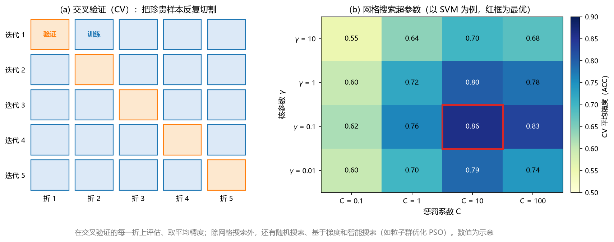
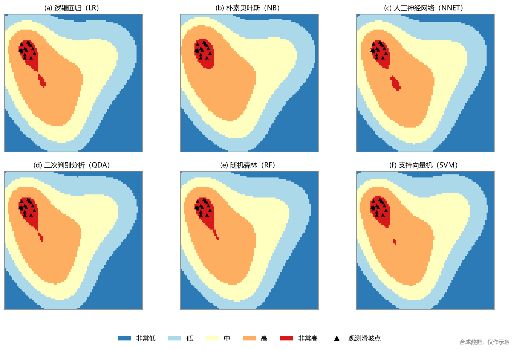

# 第23章 地学应用三：土地篇

> **本章导读**：应用篇的第三站是土地。土地/土壤/地质/地貌是一个范围很广的领域——土地利用与土地覆被变化检测、土壤水分反演、干旱监测、地质体识别……可以做的事情非常多，本章不铺开学面，而是仿照前两章"两圈交集"的思路，从中选一个典型且完整的问题作为主线，从头到尾做一遍——**滑坡敏感性映射**（landslide susceptibility mapping，LSM）。23.1 节定义问题：影响因素 X 是什么、兴趣变量 Y 是什么、它在机器学习看来是什么类型的问题；23.2 节用两篇综述与文献计量交代研究现状；23.3 节讲两个代表性模型（决策树与随机森林）；23.4 节是本章核心——基于机器学习的 LSM 六步建模流程；23.5 节比较多模型的制图结果并讨论应用意义。本章是应用篇中篇幅最聚焦的一章：一个问题贯穿始终，正好完整示范"如何把一个地学问题翻译成机器学习问题，再一步一步落地成一张图"。

## 23.1 从土地到滑坡敏感性映射

### 23.1.1 广阔的土地/土壤领域

与水文、气象一样，土地也是一个非常大的门类。往上分，土地/地貌/地质/土壤各自都是一个方向：土地利用与土地覆被变化检测（land use / land cover change）是遥感与地理信息领域的经典课题——利用多时相遥感影像识别耕地、林地、建设用地的扩张与转换；土壤本身就是一个大学科——土壤水分、土壤类型、土壤侵蚀、土壤肥力，有不少学者终身专注于土壤领域的研究；再往外还有干旱监测、滑坡与泥石流等地质灾害、地质体与断裂构造识别等等。事实上，第 21 章图 21-3 的土壤水分遥感反演，就可以看作土地/土壤方向的一个机器学习问题。

问题太多，本章不追求面面俱到，而是选择其中**一个典型且完整的问题**展开——滑坡敏感性映射。选它有三个理由：一是问题典型，它是一个标准的"分类 + 空间预测"问题，把分类方法（第 6、8、9、10 章）与地学的空间数据结构结合得非常紧密；二是数据结构标准，X 是一组覆盖全域的空间图层、Y 是少量实地样本点，是地学里最常见的"X 多 Y 少"格局；三是应用价值高，制图成果可以直接支撑地质灾害管理。把这个问题做完整，比泛泛了解十个问题收获更大。

### 23.1.2 问题的定义

**研究问题**：中文称**滑坡敏感性映射**（制图），英文为 landslide susceptibility mapping（LSM），也常译作滑坡易发性制图；它的成果图件习惯上称滑坡敏感性图或滑坡易感性图，本章混用这两种叫法。把问题按"输入—输出"拆开（图 23-1）：

**图 23-1 滑坡敏感性映射问题的概念框图**

- **影响因素（X）——滑坡调节因子**（landslide conditioning factor，LCF）：可能影响潜在边坡稳定性的、滑坡位置的地理空间属性，即各种地形和环境变量，如坡度（坡角）、坡向、土壤类型、降雨、地形湿度、岩性类型等。每个因子都是一张覆盖研究区全域的空间图层，研究区内逐像元都有取值（图 23-2）。

**图 23-2 常用滑坡条件因子示例（示意）**

- **兴趣变量（Y）——滑坡可能性**：给定地区发生山体滑坡的可能性。
- **山体滑坡风险分区**：使用 LSM 的概率评估，将地表划分为具有不同程度稳定性和不稳定性的区域——也就是最终那张按易感性高低分级的地图。

常用的滑坡条件因子可以按数据来源归成几类（表 23-1），实际研究中候选因子往往有十几个甚至更多。

**表 23-1 常用的滑坡条件因子（示例）**

| 类别 | 因子示例 | 主要数据来源 |
|------|------|------|
| 地形地貌 | 坡度（坡角）、坡向、高程、地形曲率 | 数字高程模型（DEM） |
| 水文气象 | 降雨量/降雨强度、地形湿度指数（TWI）、水系距离 | 降雨观测与再分析资料、DEM |
| 地质 | 岩性类型、断层距离、构造 | 地质图 |
| 土壤与覆被 | 土壤类型、土壤深度、植被指数（NDVI） | 土壤图、遥感影像 |

### 23.1.3 机器学习的问题本质：X 多、Y 少的空间外推

从机器学习的角度看，滑坡敏感性映射是什么问题？关键在 X 与 Y 的**可得性不对称**（图 23-1）：

- **X 全域已知**。坡度、坡向可以由 DEM 逐像元推算，土壤类型、岩性有现成的图件，降雨有观测与再分析资料，NDVI 可以从遥感影像计算——条件因子大多是**空间连续（或类别）图层**，覆盖研究区的每一个像元，获取成本低。
- **Y 只有局部真值**。"这个点到底滑没滑坡"没法从图上直接读出来，Y 的真值只能通过**现场考察与观测、影像判读（如在谷歌地球上识别旧滑坡悬崖）、监测**获得。要跑野外、要人工判读，一个区域能收集到**几十到上百个**样本点已经非常不容易，往往仅占全域像元的 **10%~20%**。

于是问题的结构就清楚了：在已知 X–Y 关系的少数样本点上训练模型，对 X 已知而 Y 未知的其余像元，用模型把滑坡可能性"算"出来——**用已知的 X–Y 关系把 Y 外推到全域**。这是一个典型的**空间预测问题**，与第 22 章气象应用里"把站点观测外推成格点数据"是同一类逻辑，只是那里 Y 是温度、降雨等连续量，这里 Y 是类别或概率。

Y 的表达方式有三种（图 23-3）：最简单的是**二分类**——滑坡还是不滑坡，用 0 和 1 两个类别表示，问题就变成一个二分类任务；稍微扩展一步是**多分类**——不想只知"滑/不滑"，还想知道滑坡可能性大概落在哪个区间，比如把 0~20%、20%~40%、……、80%~100% 分成五类，模型输出的预测值（一个概率）落在哪个区间就归为哪一类——本质是**概率区间分级**；当然也可以不分级，让模型直接输出连续的概率值。后面的六步流程与多模型对比，用的都是五分类的口径。

**图 23-3 同一滑坡可能性的两种表达：二分类与五分类**

### 23.1.4 研究价值

滑坡的危害性很大。以广东为例，粤北等山区山高坡陡、降雨充沛，很多区域都存在滑坡风险；滑坡一旦发生，若周围建有房屋，会直接威胁房屋与居民的生命财产安全。全世界类似的高风险山区还有很多。滑坡敏感性图把"哪里容易滑坡"画在一张图上，可以大大帮助当地政府部门开展地质灾害管理与防灾减灾——这就是这类研究应用广泛、发文持续增长的根本原因。

## 23.2 研究现状：综述与文献计量

### 23.2.1 两篇代表性综述

进入一个领域，先读综述。滑坡敏感性映射领域有两篇被广泛引用的综述：

- **Merghadi 等（2020）**，发表于 *Earth-Science Reviews*："Machine learning methods for landslide susceptibility studies: A comparative overview of algorithm performance"——系统比较了用于 LSM 的各种机器学习算法的性能；
- **Reichenbach 等（2018）**，同样发表于 *Earth-Science Reviews*："A review of statistically-based landslide susceptibility models"——对基于统计的滑坡敏感性模型做了系统梳理。

两篇综述分别代表"机器学习方法"与"统计模型"两条脉络。对读者更有直接用处的是综述里的**文献计量**部分：统计用什么方法、哪些人在做、发文量怎么变化——这正是下一小节的内容。

### 23.2.2 从文献计量看热度与格局

把基于机器学习的 LSM 研究文章按年份统计，数量**逐年增长**（图 23-4a）；把文章所用模型按使用频次排序，最常用的前五类依次是**逻辑回归、人工神经网络、支持向量机（SVM）、决策树、随机森林**（图 23-4b）。其中逻辑回归用得最多——它本来解决二分类问题，也可以扩展成多分类；此外模糊神经网络、二次判别分析、朴素贝叶斯等模型也有大量应用。

**图 23-4 基于机器学习的 LSM 研究热度（示意）**

综述里还有一张很有意思的"方法 × 作者"环圈图：画了**五个同心环**，每个环代表一类常用模型（内环是逻辑回归，向外依次是其他模型），**每种颜色代表发文最多的前十位作者之一**，某位作者在某类模型上发过文章，他的颜色就在对应的环上占一段弧。读图的发现是：**排名靠前的高产作者，几乎在五大类模型上都发过文章**——把一个领域的常用方法挨个用一遍、比较一遍，正是这个领域的常见做法。

这张图对初学者还有一个重要的启示。刚进入一个领域时，很容易觉得"想做的都被做过了，想用的方法也都用过了"，于是无从下手。但环圈图告诉我们两件事：其一，旧方法在**特定区域、特定问题**上的新应用仍然是有效的研究——换个数据条件更完备的研究区、把方法用到前人没覆盖的灾种或尺度上，都是有价值的工作；其二，**方法的比较与组合**（同样的数据下系统比较多个模型、把两个模型的优点接起来）本身就构成研究。所以机会并不缺，缺的是**把问题找准**——这也是贯穿应用篇的一句话。

## 23.3 两个代表性模型

五类常用模型中，逻辑回归、神经网络、SVM 已分别在第 6、9、10 章学过，决策树与随机森林在第 8 章也打过交道（水文中还见过它们的应用，见 21.4.5 节）。这里选**决策树**与**随机森林**这对"单模型 vs 集成模型"做重点介绍，因为它们恰好展示了机器学习应用中一对经典的权衡：**精度与可解释性**。

### 23.3.1 决策树：把 X–Y 关系画成一棵树

我们经常批评大部分机器学习模型可解释性差，**决策树是个例外**（第 8 章）。它的结果是一棵树形结构，把 X 与 Y 之间的关系很大程度**显式地表达**了出来。图 23-5 是一个用决策树做滑坡预测的示例：根节点问"坡度 > 25°？"，回答"是"再问"高程 > 1000 m？"、"NDVI > 0.4？"；回答"否"则问"土壤深度 > 10 m？"、"降雨 > 1000 mm？"……走到叶节点，就得到该像元的易感性等级。

**图 23-5 山体滑坡预测的决策树模型示例（阈值数值仅作示意）**

从这棵树上能直接读出两条重要的信息：

1. **可解释性**。树形结构把"哪些因子的什么取值组合对应什么易感性等级"表达得一目了然，决策树的可解释性在常用机器学习模型中是最好的。
2. **因子重要性**。**越靠近根节点的因子，对划分与判断的影响越大**——因为每一次决策都从根出发，靠近根节点的因子先起作用、决定了一大半样本的走向。示例中坡度占据根节点，说明它是首要指标，其次才是高程、土壤深度、降雨等因子。

这种"顺便读出因子重要性"的能力，正是滑坡研究中偏爱决策树的原因：研究者不仅想知道"哪里易滑"，还想知道"为什么"。

### 23.3.2 随机森林：把一棵树变成一片森林

**随机森林**的思路非常直接（图 23-6）：用 **Bootstrap 重抽样**（有放回随机抽样）从原始训练集抽出多个不同的训练集，在每个训练集上分别建一棵决策树，最后把多棵树的结果做**平均**（回归）或**投票**（分类），得到最终输出。这就是"把单模型通过抽样方法变成多模型集成"的最经典做法（第 8 章）。

**图 23-6 LSM 的随机森林模型流程**

随机森林是单模型集成化的代表，它与单棵决策树的对比见表 23-2，核心是一对权衡：

- **精度**：多棵树的集成通常比单棵树**精度更好**、更稳健——单棵树对样本扰动敏感，集成把这种随机性平均掉了；
- **可解释性**：集成之后可解释性**下降**——森林里有几十上百棵树，**用哪棵树来解释**？一棵树一个说法。

**表 23-2 决策树与随机森林的对比**

| 维度 | 决策树 | 随机森林 |
|------|------|------|
| 模型结构 | 单棵树 | 多棵树的 Bootstrap 集成（平均/投票） |
| 预测精度 | 一般 | 通常更高、更稳健 |
| 可解释性 | 最佳（树形结构显式表达 X–Y 关系） | 下降（树多，用哪棵解释成了问题） |
| 因子重要性 | 越靠近根节点的因子影响越大 | 多棵树共同选中的因子影响更大 |
| 适用倾向 | 需要向非专业人员解释规则时 | 追求精度、允许"黑箱"程度高一些时 |

面对"用哪棵树解释"的困惑，一个实际可行的办法是**考察各棵树的共性**：如果大多数树都选中了坡度、岩性这几类因子，那么这些**共性因子**的可信度就更高、说服力更强，可以认为它们对结果的影响更大。这相当于把"单棵树的根节点"换成了"整片森林的投票"，在精度与可解释性之间取得折中。

## 23.4 基于机器学习的 LSM 六步建模流程

有了问题定义和候选模型，怎么把一次完整的 LSM 研究组织起来？综述把基于机器学习的 LSM 建模归纳为**六个步骤**（图 23-7）：构建空间数据库 → 数据分析与优化 → 构建重采样数据集 → 模型训练、配置与实现 → 模型训练、验证与比较 → 生成滑坡易感性图。这六步是本章的核心，下面逐步展开。

**图 23-7 基于机器学习的 LSM 六步建模流程**

### 23.4.1 第 1 步：构建空间数据库

第一步根据**滑坡库存图**（landslide inventory，即 Y）和**滑坡条件因子**（X）构建空间数据库，说白了就是把 X 和 Y 都准备好、按统一的空间格网组织到一起。

**Y 从哪里来？** 判断一个点是不是滑坡、属于什么等级，不能"拍脑袋"，刚开始建模时 Y 的真值就要通过**现场考察、甚至专门监测**得到——到实地去看那些特殊的地形形迹，确认是不是滑坡。现场观测到的滑坡有多种类型，综述里展示的例子包括：（a、d、f）**深旋转滑坡**、（b）**浅平面失效**、（c）**深平面失效**，以及（e）在谷歌地球上判读的**旧滑坡悬崖**影像。野外回来后，再按滑坡领域的方法把风险评价整理成 Y：最简单是 0/1（滑/不滑）二分类，也可以划分成五类或多类。

**X 从哪里来？** 条件因子取自 DEM（坡度、坡向、高程等）、地质图（岩性等）、遥感影像（NDVI 等）与降雨资料等，多为覆盖全域的空间图层（图 23-2）。

要注意这一步埋下的整个问题的基调：**Y 是少数点的真值，贵而少；X 是全域的图层，全而便宜**。第 2~5 步的所有技术安排，几乎都是围绕"如何用好这几十上百个珍贵样本"展开的。

### 23.4.2 第 2 步：数据分析与优化——特征选择

候选条件因子往往偏多，全部塞进模型未必更好——有的因子互相重复，有的与滑坡关系不大。因此第二步要做**数据分析与优化**，即模型的**前处理**：对 X 进行特征选择（呼应第 3 章数据预处理的思想，但这里有两件 LSM 领域的"标准动作"）。

**一是用方差膨胀因子（VIF）检验多重共线性**（呼应第 6 章 6.3.4 节）。第 $j$ 个因子的方差膨胀因子定义为

$$\mathrm{VIF}_j = \frac{1}{1 - R_j^2} \tag{23-1}$$

其中 $R_j^2$ 是把第 $j$ 个因子当作因变量、用其余因子回归它所得的可决系数。VIF 越大，说明该因子越能被其他因子的线性组合解释——与其他因子高度共线。常用 VIF > 10 作为阈值，超过者剔除或合并（图 23-8a）。

**二是用基于熵的信息增益（IG）评估因子贡献**（呼应第 8 章决策树）。信息增益的定义是

$$\mathrm{IG}(X_j) = H(Y) - H(Y \mid X_j), \qquad H(Y) = -\sum_{i=1}^{m} p_i \log_2 p_i \tag{23-2}$$

即引入因子 $X_j$ 前后类别纯度（熵）的改善量——这正是决策树选节点用的量。IG 越大，该因子对分类的贡献越大（图 23-8b）。

**图 23-8 特征选择：VIF 检验共线性与信息增益评估贡献（数值示意）**

两个工具的分工很清楚：VIF 管"因子之间别重复"，IG 管"因子本身要有用"。常用的组合是先用 VIF 剔除共线因子，再用 IG 排序，保留贡献大的因子进入模型。

### 23.4.3 第 3 步：构建重采样数据集

第三步为训练集构建**重采样数据**。为什么要重采样？还是那个基调——**样本少而珍贵**：跑一个区域的滑坡风险观测，受人力物力限制，能跑几十个点已经不容易，能跑到上百个已属难得。数据集这么小，如果只做一次简单的训练/验证切分，评估结果就很偶然；而且每一份样本都舍不得浪费。于是采用**交叉检验（CV）**反复切割数据集（图 23-9a）：把数据分成 k 折，每次留一折做验证、其余做训练，轮换 k 次，让每一条样本既当过训练数据又当过验证数据（k 折 CV 的思路在第 6 章评估与各章建模中反复出现）。CV 同时还服务于下一步的**超参数优化**——每一组超参数的"好坏"，正是在这些重复切分上评估的。

### 23.4.4 第 4 步：模型训练、配置与实现

第四步是模型本身的训练、配置与实现。以支持向量机（SVM，第 10 章）为例：惩罚系数 C、核参数 $\gamma$ 等超参数并不是默认值就最优，需要估计与调整。常用的**参数估计**途径有四类（图 23-9b）：**网格搜索**（把每个超参数划出候选值、逐组合试）、**随机搜索**（在参数范围内随机采样组合）、**基于梯度的搜索**，以及**智能搜索**（如粒子群优化 PSO 等启发式算法）——思路都是先划定参数范围，再在其中高效地搜索最优组合。

**图 23-9 交叉验证切割与网格搜索超参数（数值示意）**

### 23.4.5 第 5 步：模型训练、验证与比较

第五步对训练好的模型做**验证与比较**。因为是分类问题，评估指标沿用第 6 章 6.7 节的分类评估体系，LSM 研究中最常用三个：

- **总体准确性（ACC）**：被正确分类的样本比例；
- **ROC 曲线下面积（AUC）**：在不同判别阈值下综合考察真阳率与假阳率的曲线下面积，越大越好；
- **Cohen's kappa 指数**：在扣除"碰巧猜对"的成分后度量分类一致性，

$$\kappa = \frac{p_o - p_e}{1 - p_e} \tag{23-3}$$

其中 $p_o$ 是观测一致率（总体准确性），$p_e$ 是随机情况下期望的一致率。

在同一套 CV 划分下用这三个指标比较多个候选模型，选出综合表现最好的一个进入第 6 步。

### 23.4.6 第 6 步：生成滑坡易感性图

最后一步，把选定模型应用到全域：对研究区**每一个像元**代入其条件因子 X，算出滑坡可能性，得到一张**概率格网**。概率是连续的，直接看图并不方便，因此需要**重新分类**为易感性类别：如按 2.5、25、50、75、97.5 百分位数把概率分成**非常低、低、中、高、非常高**五类，逐类填色，就得到了最终的滑坡易感性图/滑坡敏感性图（参见 23.5 节图 23-10 的样式）。

## 23.5 多模型制图结果对比与应用意义

六步流程走完，一个自然的问题是：**换一个模型，图会不一样吗？** 图 23-10 给出了六种模型——逻辑回归（LR）、朴素贝叶斯（NB）、人工神经网络（NNET）、二次判别分析（QDA）、随机森林（RF）、支持向量机（SVM）——在同一个研究区上的五级易感性图（合成数据示意）。

**图 23-10 多模型滑坡敏感性图对比（合成数据示意）**

两个观察值得注意。其一，**不同模型的结果存在差异**：等级边界的形状、非常高区域的范围都不完全相同——毕竟六个模型的假设与决策逻辑各不相同。其二，**大体上看还是差不太多**：高风险区的大格局（哪里高、哪里低）在六张图上是一致的。这不奇怪：五级分类本身就是很粗糙的结果，每级覆盖约 20 个百分点的概率区间，模型之间在概率上的分歧，经过分级后被大大压缩了——差异看起来不大，属于正常现象。

实用中怎么处理这种差异？可以按第 5 步的 ACC/AUC/κ 挑选综合表现最好的模型出图；也可以把多张图放在一起对照，把"所有模型都判高"的区域作为最可信的高风险区、把模型间分歧大的过渡带作为结果不确定性较大的区域加以标注——这本身就是向使用者传达不确定性的朴素办法。

最后回到应用价值。滑坡敏感性图把"哪里易滑、有多易滑"落到空间上，可以直接为政府部门提供**地质灾害管理**的空间决策依据：非常高与高等级的区域可以优先安排排查、监测与避让工程，国土规划与村镇建设也可以参考分区结果控制风险。一张图连接着野外观察、机器学习建模与公共管理决策——这正是应用篇想让大家看到的地学数据挖掘的完整模样。

## 23.6 小结

本章是应用篇的第三章，以滑坡敏感性映射为主线，要点如下。

**问题定义。** 土地/土壤/地质/地貌领域问题很多（土地利用变化检测、土壤水分反演、干旱、地质灾害等），本章聚焦滑坡敏感性映射（LSM）：影响因素 X 是滑坡调节因子（坡度、坡向、土壤类型、降雨、地形湿度、岩性等条件因子图层，全域已知），兴趣变量 Y 是滑坡可能性（真值只能靠现场考察、影像判读与监测获得，往往只有几十到上百个点、占全域 10%~20%）。按 Y 的表达可分为二分类（滑/不滑）、多分类（如按可能性区间分五类，本质是概率区间分级），也可直接输出概率。它本质上是一个"X 全域已知、Y 局部已知"的**空间预测问题**；成果可支撑粤北山区等地的地质灾害管理。

**研究现状。** 两篇综述（Merghadi et al., 2020；Reichenbach et al., 2018）与文献计量显示：基于机器学习的 LSM 文章逐年增长，常用模型为逻辑回归（用得最多，二分类可扩展多分类）、神经网络、SVM、决策树、随机森林等；"方法 × 作者"环圈图上高产作者几乎五大模型都做过——刚入行觉得"都被做过了"，但旧方法的新应用、方法比较与组合仍有大量机会，不缺机会，缺的是把问题找准。

**两个代表性模型。** 决策树把 X–Y 关系显式画成树形结构，可解释性最佳，且越靠近根节点的因子影响越大（如坡度常是首要指标）；随机森林用 Bootstrap 重抽样把一棵树变成多棵树的集成，精度通常更好，但可解释性下降——可用"多棵树的共性因子"来弥补。

**六步建模流程。** ①构建空间数据库（滑坡库存图 Y + 条件因子 X）；②数据分析与优化（VIF 检验共线性、信息增益评估贡献，特征选择）；③构建重采样数据集（CV 反复切割珍贵样本、优化超参数）；④模型训练、配置与实现（网格搜索、随机搜索、基于梯度和智能搜索如 PSO）；⑤模型训练、验证与比较（ACC、AUC、Cohen's kappa）；⑥生成滑坡易感性图（概率格网按 2.5/25/50/75/97.5 百分位重新分类为五级）。

**多模型对比。** LR、NB、NNET、QDA、RF、SVM 六种模型的五级易感性图存在差异但大体相近——五级分类较粗糙，分歧被分级压缩属正常；实用中可按评估指标选模型，也可用多模型对照传达不确定性，最终为防灾减灾提供空间决策依据。

## 思考题

1. 机器学习方法在土地/地质/土壤中还有哪些应用？（提示：土地利用/土地覆被变化检测、土壤水分遥感反演（见 21.2 节）、干旱监测、土壤分类制图、地质体与断裂识别……任选一个，写出它的 X、Y 与任务类型。）
2. 为什么说滑坡敏感性映射本质上是一个"X 全域已知、Y 局部已知"的空间预测问题？如果 Y 的观测点只占全域的 5% 甚至更少，建模时应当特别注意什么？
3. 六步建模流程中，你认为哪一步对最终的易感性图影响最大？请说明理由（可从 Y 真值的获取质量、特征选择、采样与验证方式、模型选择与超参数等角度展开）。
4. 不同模型得到的五级易感性图大体相近但又存在差异。如果要把成图交给国土与地质灾害管理部门使用，你会如何向管理者传达模型之间的差异与结果的不确定性？
