# 第24章 地学应用四：地球系统篇

> **本章导读**：应用篇的最后一站是地球系统。地球科学的一个重要发展趋势，是把整个地球表层的各个圈层当作**一个大的系统**来模拟和研究——这正是第 22 章讲过的数值模式演进路线的终点：从数值天气预报模式，到大气环流模式、海气耦合模式，最终发展为描述地球表层所有过程的**地球系统模式**（22.3.5 节）。本章的任务，是回答"机器学习如何进入这个最大的系统"。24.1 节从地学大数据的特点讲起，给出关键挑战、典型问题与解决途径；24.2 节用三张表比较地学典型问题的传统方法与新兴方法，是本章核心素材之一；24.3 节评述传统机器学习的现状与深度学习的兴起；24.4 节从相似性与差异性两方面论证"为什么深度学习适用于地球科学"；24.5 节给出成功应用深度学习的五大挑战与途径；24.6 节是本章第二核心——耦合物理模型与机器学习的 5 种方式；24.7 节作为延伸阅读，介绍与日常生活结合最紧密的自然语言处理与文本分析；24.8 节小结。学完本章，应用篇的四站（水文、气象、土地、地球系统）就全部走完，读者不妨回头对照：四个领域的"两圈交集"框架、两大类应用、"机器学习与物理模型相互成就"的基调，是不是一以贯之？

## 24.1 地球系统科学与地学大数据

### 24.1.1 地球科学的发展趋势：把地球当成一个大系统

地球科学正在发生一个深刻的变化：从分要素、分圈层的单科研究，走向**把整个地球表层当成一个大系统来模拟研究**。大气圈、水圈、岩石圈、生物圈……各圈层之间不断交换物质与能量，单独研究任何一个圈层都难以回答"地球将如何变化"这类全局问题，于是科学家把可以建立的各圈层过程模型逐步耦合起来，对整个地球系统进行模拟。

读者对这条路线其实并不陌生：第 22 章梳理数值天气预报发展史时已经看到，模式从最初只描述天气的**数值天气预报模式**，到 20 世纪 60 年代的**大气环流模式**，再到 90 年代把海洋、海冰与温室气体碳循环加进来的**海气耦合模式**，随后又纳入植被动态、大气化学等过程，最终"生长"为今天更为复杂的**地球系统模式**——描述地球表层所有这些过程（22.3.5 节）。水文篇、气象篇反复出现的"物理建模（数值模式）"这条主线，在地球系统篇走到了它的最大形态：**地球系统模式**，一大套描述各圈层相互作用的偏微分方程组与参数化方案的集合。

于是问题与气象篇、水文篇如出一辙：面对地球系统，机器学习能做什么？一条路是**单独用机器学习**（特别是深度学习）直接求解地球系统科学中的分类、回归等问题；另一条路是**把机器学习与地球系统模式这类物理建模结合起来**，相互帮助、相互提高。这两条路，就是本章反复出现的两大类应用。

### 24.1.2 地学大数据的特点

地球系统科学之所以今天能谈"大系统模拟"，底气来自数据。**遥感 + 实地观测 + 观察**三种手段并用，使地球系统数据激增：存储量已经远远超过几十 PB，并且传输速率迅速增加。地学大数据的特点可以概括为（图 24-1）：

- **大数据四大特征（4V）**：volume（体积）、velocity（速度）、variety（多样性）与 veracity（准确性）——体积越来越大、获取速度越来越快、类型越来越多样，同时数据质量与可信度参差不齐；
- **数据源从一维到四维、空间集成**：可以是点上的一维序列，也可以是二维格网、三维体、加上时间维的四维时空体，并且不同来源的数据可以在空间上集成起来；
- **从器官层次到全球层次**：小到一片叶子（器官层次）的光合观测，大到全球尺度的卫星产品，多元、多尺度、不同性质的数据源并存。

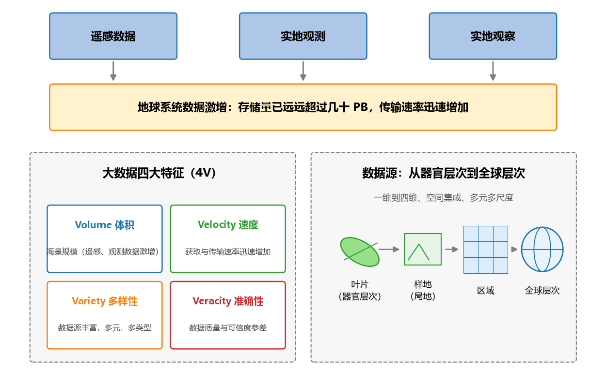

**图 24-1 地学大数据的特点：4V 与从叶片到全球的多尺度**

"从叶片到全球"这六个字值得细品：它意味着同一个研究领域内部，数据的层次与尺度就横跨了好几个数量级——这与计算机视觉里"图像就是图像"的相对均质形成了鲜明对照（这个对照在 24.4 节还会再见到）。

### 24.1.3 关键挑战、典型问题与解决途径

拿着这些数据想做什么？**关键的挑战**是：从可能实时的、或需要在不同学科之间整合的大数据中，**提取可解释的信息和知识**。读者应该觉得眼熟——这正是本书第 1 章给出的数据挖掘（KDD）的本义：从数据到知识。只不过现在，我们的对象变成了整个地球系统：把地球当成一个系统，把可以获得的不同学科之间的知识挖掘出来，采用的工具就是机器学习再结合一些人工智能的方法。

落到具体问题上，地球系统科学的典型问题仍然是熟悉的三类（图 24-2）：**分类/异常检测**（如查找极端天气模式、土地利用变化检测）、**回归/状态预测**（如预测通量、植被属性、径流）、**动态建模**——动态建模只是把 $X$–$Y$ 之间的关系表达出来，与预测很相近，本质还是以分类和回归为主。

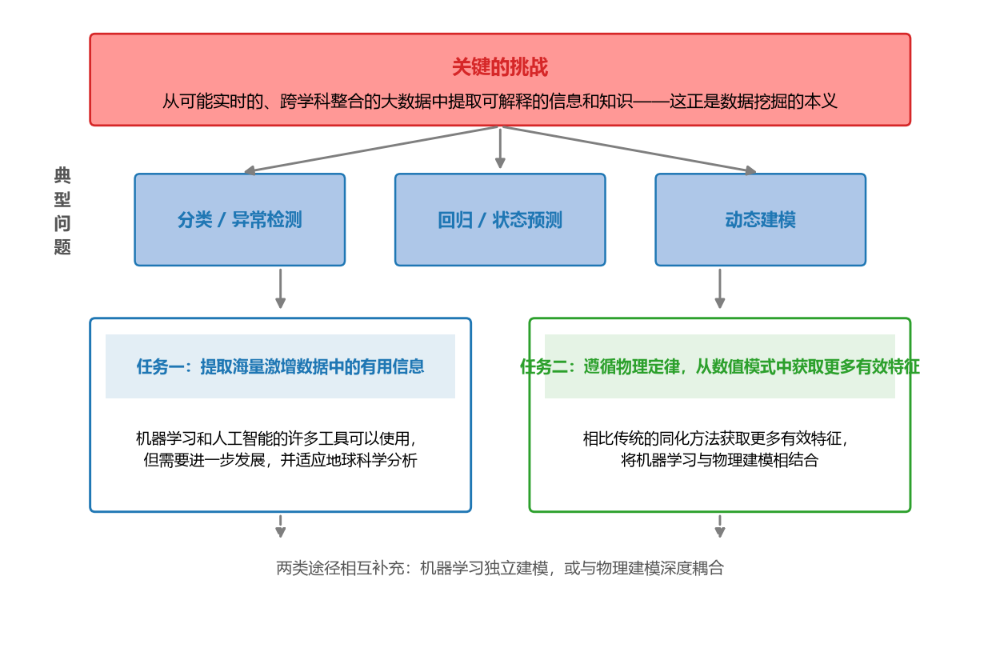

**图 24-2 关键挑战、典型问题与两大任务**

面对挑战与典型问题，解决途径可以归纳为两大任务：**任务一，提取海量激增数据中的有用信息**——机器学习和人工智能的许多工具可以使用，但需要进一步发展，并适应地球科学分析的特殊性；**任务二，在遵循相关物理定律的前提下，相比于传统的同化方法，从数值模式中获取更多有效特征**——也就是把机器学习与物理建模相结合。任务一是"机器学习单干"，任务二是"机器学习与物理模式联姻"，两条途径相互补充——这也正是 24.6 节五种耦合方式的伏笔。

## 24.2 地学典型问题的方法比较

两大任务怎么落到具体问题上？最直观的办法是"领域 × 任务"列表格：每个格子里写上**科学任务、传统方法、传统方法的局限性、新兴或潜在方法**。本节给出三张表，分别对应分类/异常检测、回归与地球系统状态预测——它们是本章的核心素材，读者可以先浏览表格再读解读。

### 24.2.1 分类与异常检测

**表 24-1 地学常见分类和异常检测问题的方法比较**

| 领域 | 科学任务 | 传统方法 | 传统方法的局限性 | 新兴或潜在方法 |
|------|------|------|------|------|
| 气象 | 查找极端天气模式 | 基于阈值的多变量检测 | 启发式方法，使用的临时标准 | 监督和半监督卷积神经网络 |
| 土地 | 土地利用和变化检测 | 逐像素光谱分类 | 使用浅层空间背景，或不使用 | 卷积神经网络 |

两个格子的共同点是：传统方法只用了数据的**浅层信息**。基于阈值的多变量检测是启发式的、临时的标准——阈值怎么定，往往说不清道理；逐像素光谱分类则只看单个像素的光谱，不用（或只浅层地用）像素之间的空间背景。而卷积神经网络（第 11 章）天然擅长从图像中提取**多层次的空间特征**，又有监督、半监督等训练范式可以缓解样本不足——于是成为这两个问题共同的"新兴答案"。

### 24.2.2 回归问题

**表 24-2 地学常见回归问题的方法比较**

| 领域 | 科学任务 | 传统方法 | 传统方法的局限性 | 新兴或潜在方法 |
|------|------|------|------|------|
| 气象 | 根据大气条件预测通量 | 随机森林、核方法、前馈神经网络 | 不考虑内存和滞后效应 | 循环神经网络，长短期记忆（LSTM） |
| 植被 | 根据大气条件预测植被属性 | 半经验算法（温度总和、缺水） | 功能形式和动态假设方面的规定性 | 递归神经网络，可能具有空间上下文 |
| 水文 | 预测未计量集水区的河流径流 | 具有人工选择地形特征的过程模型或统计模型 | 空间环境的考虑仅限于人工选择的特征 | 卷积神经网络与循环网络的组合 |

这一张表把"为什么要用循环结构"讲得非常清楚：大气—植被—水文的过程都有**记忆和滞后**——今天的通量不仅取决于今天的大气条件，还取决于之前一段时间的状态。随机森林、核方法、前馈神经网络（第 6~10 章的"老朋友"）都是静态模型，不考虑内存与滞后效应；RNN/LSTM（第 11 章）的门结构恰好用来刻画这种长期依赖（21.2.2 节在水文中已经见过同样的逻辑）。植被一行则说明经验公式的问题：温度总和、缺水这类半经验算法，其**功能形式和动态假设都是人为规定的**——规定得合不合理，数据说了不算；递归神经网络把"规定"交还给数据。水文一行更有意思：过程模型或统计模型的地形特征靠人工选择，空间环境的考虑仅限于此，于是新兴方法用 CNN 提取空间背景、用循环网络刻画时间演化，两者组合各取所长。

### 24.2.3 地球系统状态预测

**表 24-3 地球系统状态预测的方法比较**

| 时段 | 科学任务 | 传统方法 | 传统方法的局限性 | 新兴或潜在方法 |
|------|------|------|------|------|
| 短期 | 降水临近预报 | 具有数据同化的物理建模 | 分辨率导致的计算限制，数据仅用于更新状态 | 卷积–LSTM 网络（短期空间背景） |
| 长期 | 降尺度和偏差校正预测 | 动态建模和统计方法 | 计算极限，主观特征选择 | 卷积网络、条件生成对抗网络（cGAN） |
| 中长期 | 季节性预测 | 根据数据进行初始条件的物理建模 | 完全依赖物理模型，目前技能相对较弱 | 具有远程空间背景的卷积–LSTM 网络 |
| 机理 | 传输模型 | 传输的物理建模 | 完全依赖物理模型，计算限制 | 混合物理卷积网络模型 |

按时间尺度从短到长排下来，可以看到传统方法的局限在"演化"：短期靠数据同化的物理建模，受**分辨率导致的计算限制**，观测数据只用来更新状态、没能发挥更多作用；长期预测的计算极限与主观特征选择，催生了卷积网络与条件生成对抗网络（cGAN，第 11 章提过 GAN 的生成思想）这类能"生成"精细尺度场的方法；中长期的季节性预测完全依赖物理模型、目前技巧相对较弱，新兴方法用**具有远程空间背景的卷积–LSTM 网络**同时抓住空间上的遥相关与时间上的记忆；机理层面的传输模型（如辐射传输）同样受制于完全依赖物理模型与计算限制，出路是**混合物理卷积网络模型**——这句话正是 24.6 节"耦合物理模型与机器学习"的引子。

三张表连起来读，有一条清晰的共同脉络：**这些问题原来用的都是经验方程或浅层模型，现在都慢慢过渡到用深度学习来做**。传统方法的"局限性"一栏几乎都在说同一件事——浅层模型用不好地学数据的空间结构和时间结构；而新兴方法的"新"，新就新在深度学习恰好擅长这两件事。

## 24.3 传统机器学习的现状与深度学习的兴起

在谈"为什么深度学习适用"之前，先客观评价传统机器学习在地球系统科学中的现状——它并非被全盘否定，恰恰相反。

### 24.3.1 优点

- **应用广泛**：多种有影响力的机器学习方法，已经应用于地球系统科学**所有主要子领域**；
- **进入业务**：越来越多地被集成到操作（业务）方案中，不再是论文里的"演示"；
- **助力机理**：被用于**发现模式**，以提高机理理解和评估综合物理模型——机器学习不仅做预测，还反过来帮助人们理解物理模型本身。

### 24.3.2 缺点

传统机器学习的缺点，按"数据—特征—结构"三个层面归纳：

1. **统计推断层面的根本缺陷**：天真的外推风险、抽样或其他数据偏差、忽视混淆因素、将统计关联解释为因果关系，以及多重假设检验的根本缺陷。这一条与领域无关，是统计学习的通病。
2. **极端/罕见情景下的外推困难**（地球系统特有的放大版）：机器学习靠训练数据找关系、再拿去做预测，而气候变化使历史上出现了**"没有先例"的时段**——地球系统中很多变化已经发生突变、与外界环境的关系发生了大的改变，已有规律不再完全适用。此时对一些极端、罕见情景，传统机器学习的处理就没有那么好，外推效果大打折扣。
3. **特征依赖人工选择**：传统机器学习受益于特定领域的、人工选定的特性（特征），而大数据之下候选变量太多，到底选哪些 $X$ 并不容易选对。
4. **忽视隐藏的系统状态**：没有很好地反映**先前时间步长和邻近网格单元**所蕴含的隐藏系统状态信息——地学数据的空间邻接与时间延续里藏着系统状态，浅层模型把它们丢掉了。

### 24.3.3 趋势

正是这些缺点，指明了趋势：**在过去的几年里，地球科学已经开始使用深度学习，来更好地利用数据中的空间和时间结构**——而这些结构特征，对传统机器学习来说是通常难以提取的。下一节就从"相似性"与"差异性"两个方面，把这个"为什么"讲透。

## 24.4 深度学习为什么适用于地球科学：相似性与差异性

### 24.4.1 相似性：地学问题与计算机视觉惊人地像

深度学习最成熟的主场是计算机视觉与自然语言处理，而地球科学的问题与它们**惊人地相似**（图 24-3）：

- **图像 ↔ 二维数据矩阵**：计算机视觉处理的照片是二维像素矩阵（RGB 三通道），地球科学处理的也常常是二维数据矩阵——包含特定变量的栅格数据，多个变量叠在一起，就像照片里的三个颜色通道一样"分层叠放"；
- **视频 ↔ 随时间演变的二维矩阵序列**：视频是一系列图像联系在一起，即随时间演变的二维矩阵；而地球系统中许多全球尺度的变化过程（海冰消长、植被物候、大气环流演变）恰好就是"随时间演变的二维矩阵"——**视频与运动预测问题，与许多动态地球科学问题惊人地相似**，都是时间演变的多维结构；
- **语言/语音 ↔ 动态时间序列**：自然语言信号和语音信号具有多分辨率特征，与地球系统变量的动态时间序列在这一点上是共通的——都是"多层节奏叠加的时间序列"；
- **任务同构**：分类、回归、异常检测和动态建模，本来就是计算机视觉和地球科学**共同的典型问题**——任务相同，解法自然可以迁移。

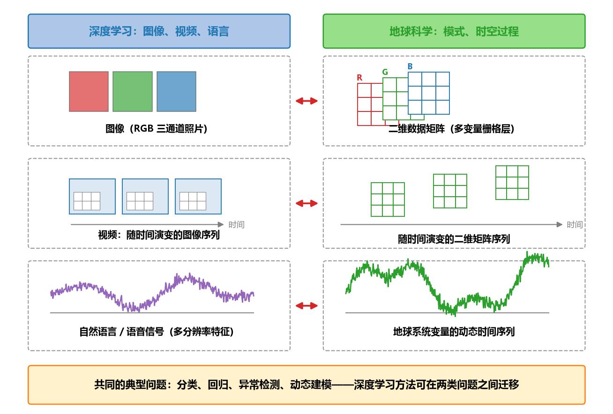

**图 24-3 深度学习与地球科学的相似性映射**

一句话：**相似性使深度学习的方法与模型可以迁移到地球科学**——图像分类的卷积网络可以拿来看地学的"图"，视频理解的结构可以拿来看地学的"时空过程"，语言模型的思想可以拿来看地学的"时间序列"。

### 24.4.2 差异性：直接照搬行不通

相似之外，差异同样明显，而且正是差异决定了"照搬不行、必须改造"（表 24-4、图 24-4）。

**表 24-4 计算机视觉与地球科学的差异性举例**

| 差异 | 计算机视觉 | 地球科学 |
|------|------|------|
| 不同的统计特性 | 处理的照片有三个通道（红、绿、蓝） | 数百个光谱通道（高光谱）；变量有空间依赖性和相互依赖性，违背独立同分布的重要假设；集成多传感器数据表现出不同的几何、时空统计特征；卫星观测序列还有不同的噪声源、不确定性水平与数据缺失差距 |
| 数量级 | 图像大小为 512×512 像素等 | 等分辨率（约 1 公里）的全球域大小约为 40000×20000 像素 |
| 标签 | ImageNet 带有标签的大量数据集 | 带有标签的训练集有限；系统太复杂、现象难以打标签；情况与数据超出有效范围偏离很大（外推问题） |

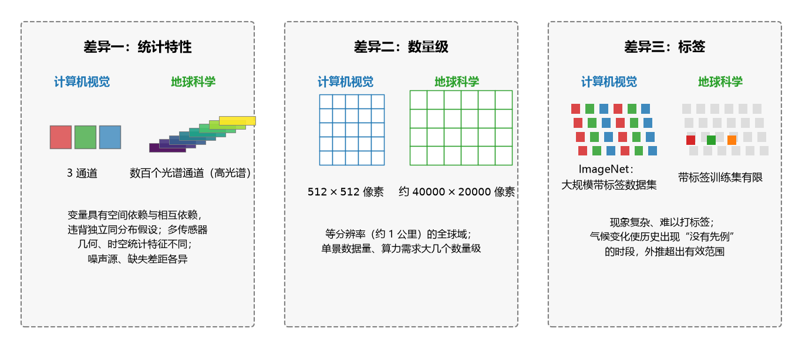

**图 24-4 计算机视觉与地球科学的三方面差异**

三方面差异逐条看：

1. **统计特性不同**。计算机视觉的照片是 RGB 三个通道；地球科学常见**高光谱**数据，通道多达数百个。更麻烦的是变量的统计性质：地学变量有**空间依赖性和相互依赖性**，违背了独立同分布这一许多统计方法的重要假设；集成多传感器数据时，不同传感器的几何与时空统计特征不同；卫星观测序列还带有不同的噪声源、不确定性水平和数据缺失（缺测差距）。
2. **数量级不同**。计算机视觉的图像通常是 512×512 像素量级；地球科学中，等分辨率（约 1 公里）的全球域约有 40000×20000 像素——单景数据的规模大了几个数量级，对算法与算力都是考验。
3. **标签不同**。计算机视觉有 ImageNet 这样带标签的海量数据集撑腰；地球科学的带标签训练集非常有限——地球系统太复杂，看到的气候现象或地球系统现象到底是什么，常常说不清楚，标签本身难以获得；而且情况和数据会**超出有效范围**、偏离很大，这就是外推问题。

把相似性与差异性合起来，结论就自然了：**相似性使深度学习可以迁移过来，差异性要求我们对它加以改造与适配**——适配什么？下一节的五大挑战给出清单。

## 24.5 地学中成功应用深度学习的五大挑战与途径

深度学习要在地球科学中真正成功落地，要过五道关。先总览（图 24-5），再逐条展开，每条都从"挑战是什么"讲到"途径在哪里"。

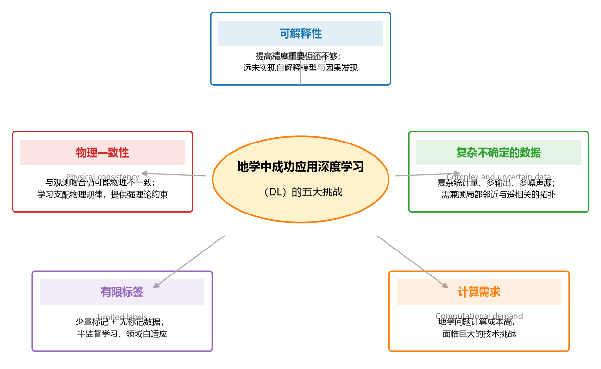

**图 24-5 地学中成功应用深度学习的五大挑战**

**表 24-5 五大挑战与应对途径一览**

| 挑战 | 英文 | 核心困难 | 途径 |
|------|------|------|------|
| 可解释性 | Interpretability | 深度神经网络的潜在弱点 | 发展自解释模型与因果发现 |
| 物理一致性 | Physical consistency | 与观测吻合仍可能物理不一致 | 学习支配物理规律，提供强理论约束 |
| 复杂不确定的数据 | Complex and uncertain data | 复杂统计量、多输出、多噪声源、高维 | 新的网络拓扑：局部邻近 + 遥相关 |
| 有限标签 | Limited labels | 少量有标记样本、大量无标记数据 | 无监督密度建模、特征提取、半监督学习与领域自适应 |
| 计算需求 | Computational demand | 地学问题计算成本高 | 高性能计算等重大技术挑战 |

1. **可解释性（Interpretability）**。提高预测精度很重要，但**还不够**——可解释性和理解是至关重要的。可解释性已被确定为深度神经网络的一个潜在弱点；而这个领域还远未实现自解释的模型，也远未从观测数据中发现因果关系。气象篇 22.4.6 节讨论过"为什么需要可解释性"（知识的提取、积累与重复利用），那里的回答在这里同样成立。
2. **物理一致性（Physical consistency）**。深度学习模型可以很好地与观测结果吻合，但由于外推或观测偏差等原因，预测结果**可能在物理上不一致或不可信**。应对途径是：通过**学习地球系统支配物理规律的模型**来整合领域知识、实现物理一致性——在观测的基础上，提供非常强的理论约束。这正是"物理知识反哺机器学习"的思路（21.2.3 节第四种集成方式）。
3. **复杂不确定的数据（Complex and uncertain data）**。深度学习需要处理复杂的统计量、多种输出、不同的噪声源和高维空间。地学迫切需要**新的网络拓扑结构**：不仅利用局部邻近关系（在不同的尺度上），而且利用**遥相关**关系——但变量之间确切因果关系并不清楚，需要去发现；此外，地学还缺少一部分全球性的"常识"来帮助选择特征。
4. **有限标签（Limited labels）**。需要从少数有标记的例子中学习，同时利用相关**无标记数据**的丰富信息。途径包括无监督密度建模、特征提取、半监督学习和领域自适应等——这与 24.2 节表中"半监督卷积神经网络"的思路一脉相承。
5. **计算需求（Computational demand）**。地学问题的高计算成本面临着巨大的技术挑战——几千乘几千的全球格网、多变量、多情景的反复模拟，没有高效算力支撑，再好的模型也只能停在纸面上。

五道关里，前两道（可解释性、物理一致性）关乎模型"可信"，中间两道（复杂不确定的数据、有限标签）关乎数据"可用"，最后一道关乎算力"可承受"。跨过它们的方式之一，就是把物理模型请回来——这就是下一节的主题。

## 24.6 耦合物理模型与机器学习的五种方式

气象篇按"前处理—耦合—后处理"讲过机器学习与数值模式的集成，本节换一个更系统的视角：**耦合物理模型和机器学习的 5 种方式**（图 24-6）。5 种方式构成一个"物理与机器学习相互嵌入程度逐渐加深"的序列：从给物理模式**学参数**（方式 1），到**替换**物理模式中描述不好的子模型（方式 2），到用机器学习**分析并修正**物理模式与观测的不匹配（方式 3），到用机器学习的输出**驱动**物理模式的子模型（方式 4），最后到**整体替代**物理模式（方式 5）。图中蓝色代表物理建模（物理模式），橙色代表机器学习/深度学习——请留意每种方式里，两者各自"站"在什么位置。

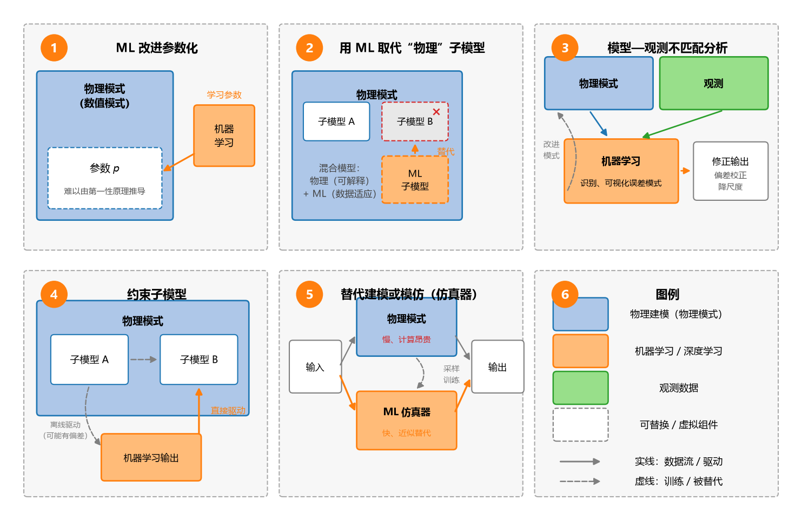

**图 24-6 耦合物理模型与机器学习的五种方式总览**

### 24.6.1 方式 1：机器学习改进参数化

物理模型需要参数，但**许多参数不能简单地从第一性原理推导出来**。机器学习可以**学习参数化**（圈 1），以最佳地描述真实值——真值可以通过观测得到，也可以依据第一性原理、从详细的高分辨率模型中生成（图 24-7）。

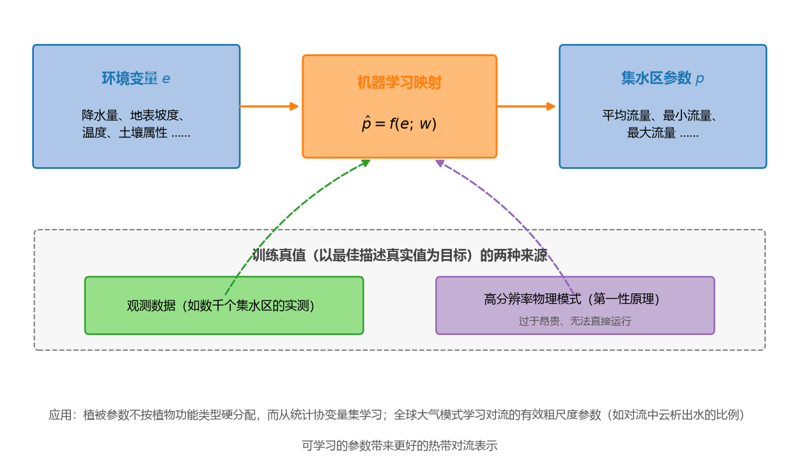

**图 24-7 方式 1：机器学习学习参数化示意**

三个例子：

- **地球系统模型中的植被参数**。多数全球陆面模式有一个共同的临时决定：把植被参数按**植物功能类型**"一刀切"地分配。更好的做法是不再硬性分配，而是允许从适当的**统计协变量集**中学习这些参数，使它们更具动态性、相互依存性和背景关系——参数跟着环境走，而不是跟着"类型标签"走。
- **水文学的集水区参数映射**。从几千个集水区中学习**环境变量**（如降水量、地表坡度）到**集水区参数**（如平均流量、最小流量、最大流量）的映射，再把学到的映射应用于全球水文模型——未计量集水区的参数也就有了着落（呼应表 24-2 的"预测未计量集水区的河流径流"）。
- **全球大气模式的对流参数**。从数据或高分辨率模式中，学习降水对流的**有效粗尺度物理参数**（例如对流过程中从云中析出水的比例）。高分辨率模式太昂贵、不能直接运行——这恰恰是需要粗尺度参数化的原因；而这些**可学习的参数**可以带来更好的热带对流表示。

### 24.6.2 方式 2：用机器学习取代"物理"子模型

看圈 2：如果一个子模型的公式是**半经验性质**的，其函数形式几乎没有理论基础（典型的如生物过程），并且有足够数量的观测数据，那么这个子模型就可以用机器学习模型来替代。这样产生的是一个**混合模型**：它结合了物理建模（理论基础、可解释的部分）与机器学习（数据适应性）的优势（图 24-8）。

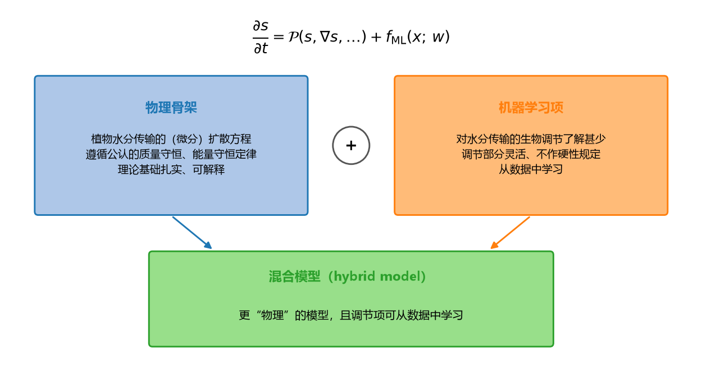

**图 24-8 方式 2：物理骨架与机器学习调节项组成的混合模型**

以植被水分传输为例：水分在植物中传输的物理（微分）扩散方程已经建立得比较成熟，而方程中**对水分传输的生物调节**部分则了解甚少——把它写成混合模型的形式：

$$\frac{\partial s}{\partial t} = \underbrace{\mathcal{P}(s, \nabla s, \ldots)}_{\text{物理骨架}} + \underbrace{f_{\mathrm{ML}}(x;\, w)}_{\text{机器学习调节项}} \tag{24-1}$$

式中 $s$ 为状态变量，$\mathcal{P}$ 为遵循公认质量守恒、能量守恒定律的物理（微分扩散）项，$f_{\mathrm{ML}}$ 为从数据中学到的调节项。这样得到的是一个**更为"物理"的模型**（守恒律被严格遵循），但它的调节（生物学的部分）是灵活的，可以从数据中学习——物理管"骨架"，机器学习管"调节"。

在化学领域，这种方法已用于**校准练习**：描述未知动力学速率的变化，同时在生化反应堆模拟中保持质量平衡——这类模拟不太复杂，与水文和生物地球化学模拟有许多相似之处。但要注意一个提醒：如果**同时估计**物理模型和机器学习的参数、并且若干子模型都被机器学习替代，那么**保持可解释性会变得更有挑战**——替换的部件越多，"拆开解释"就越难。

### 24.6.3 方式 3：模型—观测不匹配分析

看圈 3：假设没有观测偏差，那么**物理模型与观测值的偏差**，就可以认为是由不完善的知识导致的**模型误差**。机器学习可以帮助**识别、可视化和理解模型错误的模式**，使我们也可以相应地修正模型输出（图 24-9）。

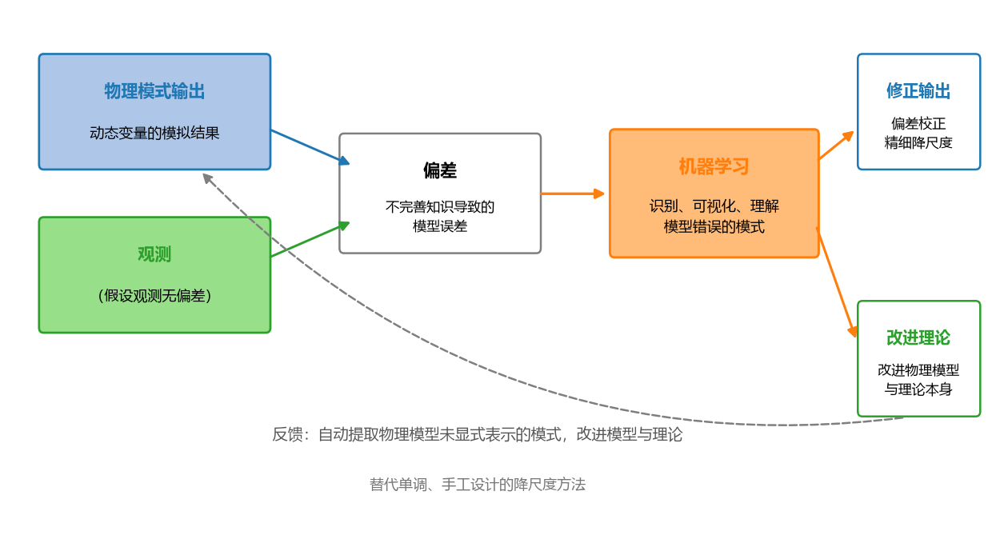

**图 24-9 方式 3：模型—观测不匹配分析示意**

例如，机器学习可以**从数据中自动提取模式**，并识别出那些在物理模型中没有明确表示的模式——这种方法有助于**改进物理模型和理论本身**，而不只是打补丁。在实践中，它还可以用来**纠正动态变量的模型偏差**，或者促进向更精细空间尺度的**降尺度**改进——取代那些单调的、特别手工设计的降尺度方法。

### 24.6.4 方式 4：约束子模型

看圈 4：用**机器学习算法的输出**去驱动一个子模型，而不是在离线模拟中用另一个（可能存在偏差的）子模型去驱动它。这样做的好处有两层：一是**减少模型由耦合子模块引起的误差**——既然耦合处最容易出错，就把耦合处的输入换成更可靠的机器学习输出；二是**简化和减少模型参数校正或观测系统状态变量同化中的偏差和不确定性**。这与气象篇 22.5 节"前处理（资料同化）—耦合—后处理"中的前处理环节遥相呼应：观测数据先经机器学习做质量控制与整理，再进入模式。

### 24.6.5 方式 5：替代建模或模仿

最后看圈 5：对物理模型的**完整（或特定部分）的模拟**，对计算效率和可处理性是有用的。机器学习**仿真器**（emulator）一旦经过训练，可以比原始物理模型**更快地实现仿真，而不牺牲太多的准确率**（图 24-10）：

$$\hat{y} = f_{\mathrm{ML}}(x;\, w^{*}) \approx y = \mathcal{M}_{\mathrm{phys}}(x) \tag{24-2}$$

式中 $\mathcal{M}_{\mathrm{phys}}$ 为昂贵的物理模型，$f_{\mathrm{ML}}$ 为训练好的机器学习仿真器。有了快速仿真器，就可以支持**快速的敏感性分析、模型参数校准和估计置信区间的推导**——这些分析动辄要成千上万次地运行物理模型，用原模型跑不起，用仿真器跑得起。

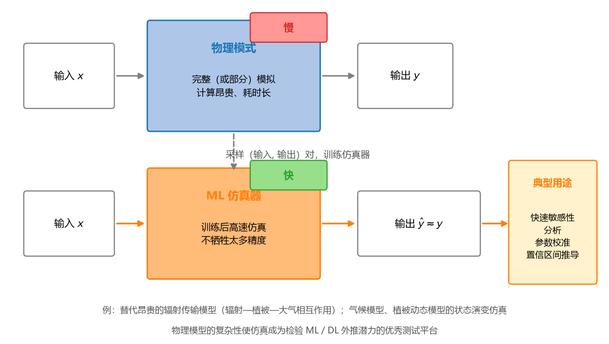

**图 24-10 方式 5：机器学习仿真器替代物理模型示意**

例如，机器学习仿真器被用来取代昂贵的、基于物理的**辐射传输模型**——它描述辐射、植被和大气之间的相互作用，对模式中陆面遥感的解释和同化至关重要。仿真器也用于**状态演变的动态建模**，例如在气候模型和最近探索的植被动态模型中。还有一层深意：鉴于物理模型的复杂性，**仿真挑战是非常好的测试平台**——用它来探索机器学习和深度学习方法**外推训练条件之外范围**的潜力（还记得 24.3.2 节"天真的外推风险"吗？外推恰恰是数据驱动方法的软肋，而物理模型的复杂性恰好提供了一个严格的考场）。

## 24.7 延伸阅读：自然语言处理与文本分析

本书的应用篇到上一节就讲完了。课程最后一课的末尾，教师补充了一段"计划外"的内容——自然语言处理（NLP）。把它写成延伸阅读放在本章末尾，有三个理由：其一，地学文献、新闻、社交媒体中存在海量的**文本**数据，"从文本中挖掘知识"同样是数据挖掘；其二，近两年 GPT 等大模型火爆出圈，读者迟早要与它们打交道，至少应当知道它们属于哪个领域、在做什么；其三，NLP 与本书主线的衔接方式极具启发性——它示范了"把一种新的数据（语言）变成向量"之后，一切照旧。本节只求让读者对这个领域有一点了解，不展开技术细节。

### 24.7.1 NLP 是什么：与文本分析画等号

**自然语言处理**（Natural Language Processing，NLP）是计算机科学领域、人工智能的一个重要方向，研究实现**人与计算机之间用自然语言进行有效通信**的各种理论和方法。这个定义比较抽象，实践中不妨把 NLP 与**文本分析**基本画上等号：处理的对象是**用自然语言描述的文本**，做的是**从非结构化文本中提取和挖掘信息和知识**的过程。文本的来源很广：你写的一段话、从社交媒体中抓取的只言片语、特定领域论文的正文，都可以算。

从输入输出看：**输入**是文本（当然也可以再结合一些数量化的特征一起输入）；**输出**可以是文本，也可以是数值或其他形式。对照全书："输入非结构化数据 → 提取特征 → 挖掘信息与知识"，NLP 与数据挖掘的框架没有本质区别，只是"把语言变成数据"这一步更考验功夫。

### 24.7.2 典型问题

**表 24-6 NLP/文本分析的典型问题**

| 问题 | 一句话说明 |
|------|------|
| 机器翻译 | 最经典的问题：中文译英文、英文译中文 |
| 舆情/疫情监测 | 用爬虫爬取社交媒体文本，自动分析判断舆情走向或疫情态势（变成分类问题） |
| 自动摘要 | 把几千字的文章浓缩成几百字、几十个字 |
| 关键词与观点提取 | 比摘要更浓缩，提炼出用文本描述的观点 |
| 文本分类 | 意义最广泛：监测、观点提取本质上都是"这段文本属于什么"的分类 |
| 问答系统 | 对大模型提问"是什么、怎么做"，直接给出答案；输入语言、输出语言或多媒体 |
| 文本语义对比 | 分析两段语言在语义上的异同 |
| 语音识别 | 把语音转成文字 |
| OCR | 图像中的文字识别，识别生成文字 |

其中机器翻译最为经典；问答系统则是当下大模型的"门面"——输入是语言，输出也是语言，还可以附上多媒体。

### 24.7.3 MATLAB 文本分析工具箱

课程口径是 MATLAB。MATLAB 提供了**文本分析工具箱**（Text Analytics Toolbox），可以做文本数据的**预处理、分析和建模**：它能处理不同来源的原始文本——设备日志、新闻提要、调查报告、社交媒体，以及大家最常看的**论文**；可以把 PDF、HTML、Excel 等文件批量导入，连文本中的**表情符号**都能处理。文本导入后可以做**词云图、散点图**等可视化，观察词频分布。需要注意的是，**特定语言**（英语、日语、中文）的处理存在差别——中文没有天然的空格分词，处理流程与英文有所不同。课程教师自述对该工具箱的使用也不深，把它介绍给有兴趣的读者"自己去挖掘"——这正是工具箱的用法：会用一种工具之后，换一种数据再学一种工具，是很快的。

### 24.7.4 文本分析的主要步骤

文本分析的主要步骤恰好是五步（图 24-11），前四步都是本书框架的"变奏"：

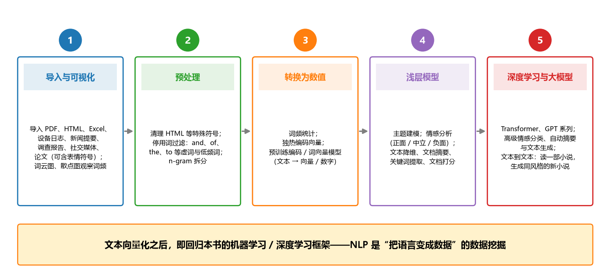

**图 24-11 文本分析五步流程**

1. **文本数据的导入与可视化**。把社交媒体、新闻、日志、报告、调查、论文等数据导入系统（PDF、HTML、Excel，含表情符号的文本都可以），再用**词云图、频率散点图**等做最基本的可视化观察；对英语、日语、中文等特定语言，还需要特定的处理。
2. **预处理**。文本鱼龙混杂，并非所有内容都值得关注：先清理 HTML 等特殊符号；再做**停用词过滤**——英文中的 and、of、the、to 等介词、冠词这类"虚词"不是我们重点关心的内容，要滤掉，只保留信息量大的实词；此外还有低频词的处理，以及把文本拆成 **n-gram**（词的集合）等特殊处理——有时以单词为对象并不方便，拆成集合更便于统计。
3. **转换成数值**。文本不便直接计算，必须转换成数值向量：最简单的是**词频统计**与**独热编码**——设词表大小为 $V$，词 $w_i$ 的独热向量只有第 $i$ 个分量为 1：

$$\mathrm{onehot}(w_i) = (0, \ldots, 0, 1, 0, \ldots, 0)^{\mathrm{T}} \in \{0, 1\}^{V} \tag{24-3}$$

   更进一步，有成熟的**编码/词向量模型**可以把词映射为稠密向量。文本一旦变成数值向量，就可以进入本书的机器学习、深度学习框架——主线重新会合。
4. **浅层机器学习应用**。向量化之后，常规的浅层模型就能做不少事情：**主题建模**（这篇论文、这个段落的主题是什么）、**情感分析**（文章的情绪是正面、中立还是负面——本质是分类）、文本降维、**文档摘要与关键词提取**（读文献时特别实用）、文档打分等。
5. **深度学习与预训练大模型**。数据量大、任务更复杂时，用深度学习：**Transformer、GPT 系列**等大模型可以做高级的情感分类、自动摘要与**文本生成**。最典型的"**文本到文本**"应用：读了一部小说（输入），生成一部与原作风格相同的新小说（输出）——输入是文本，输出是新文本。

### 24.7.5 与本书主线的关系

NLP 为什么发展得这么火热？因为它与**日常生活结合得最紧密**——我们看到的大部分信息还是以文本形式描述的。而站在本书的立场上，NLP 与数据挖掘的差别很小：把文字变成可量化的向量或数字之后，它就与传统的机器学习、深度学习模型无缝衔接，可以做很多领域的事情。自然语言处理是把语言"变成数据"的数据挖掘，是**非常有前途的方向**——读者完全可以在这个基础上再挖掘下去。

## 24.8 小结

本章是应用篇的最后一章，也是视野最大的一章，要点如下。

**地球系统与地学大数据。** 地球科学的发展趋势是把整个地球表层各圈层当成一个大系统来模拟研究——这正是第 22 章模式演进（数值天气预报模式→大气环流模式→海气耦合模式→地球系统模式）的终点。遥感 + 实地观测 + 观察使地球系统数据激增（存储量远超几十 PB），大数据具有 4V 特征（体积、速度、多样性、准确性），数据源从一维到四维、空间集成、从器官层次（如叶片）到全球层次。关键的挑战是：从可能实时的或跨学科整合的大数据中**提取可解释的信息和知识**——这正是数据挖掘的本义。典型问题仍是分类/异常检测、回归/状态预测与动态建模（后者只表达 $X$–$Y$ 关系，与预测相近）；解决途径是两大任务：提取海量激增数据中的有用信息，以及在遵循物理定律的前提下把机器学习与物理建模相结合、从数值模式中获取更多有效特征。

**方法比较与现状。** 三张"科学任务—传统方法—局限性—新兴方法"比较表（表 24-1~表 24-3）覆盖分类/异常检测、回归与状态预测，共同脉络是：原来都是经验方程或浅层模型，现在都慢慢过渡到深度学习——CNN 用好空间背景，RNN/LSTM 用好记忆与滞后，cGAN 用好生成，混合物理卷积网络用好机理。传统机器学习的优点（应用广、进业务、助机理）与缺点（外推风险、数据偏差、混淆因素、关联当因果；依赖人工特征选择；忽视先前时间步长与邻近网格的隐藏系统状态——气候变化带来"没有先例"的时段使其雪上加霜）共同解释了趋势：用深度学习更好地利用数据中的空间和时间结构。

**相似性、差异性与五大挑战。** 相似性：图像↔二维数据矩阵（变量类比颜色通道）、视频↔随时间演变的二维矩阵序列（与动态地学问题惊人相似）、语言/语音↔多分辨率时间序列，且分类、回归、异常检测、动态建模是两个领域共同的典型问题——相似性使深度学习可以迁移。差异性：统计特性（三通道 RGB vs 数百通道高光谱、空间依赖违背独立同分布、多传感器与多噪声源）、数量级（512×512 vs 约 40000×20000）、标签（ImageNet 海量标签 vs 地学标签有限且存在外推问题）——差异性要求改造与适配。改造的清单是五大挑战：可解释性（远未实现自解释模型与因果发现）、物理一致性（学习支配物理规律提供强理论约束）、复杂不确定的数据（需要兼顾局部邻近与遥相关的新网络拓扑）、有限标签（半监督学习与领域自适应）、计算需求。

**五种耦合方式。** 方式 1 用 ML 改进参数化（学习植被参数、集水区环境变量到参数的映射、对流的粗尺度参数）；方式 2 用 ML 取代"物理"子模型形成混合模型（物理扩散方程 + 生物调节项，守恒律保骨架、数据学调节）；方式 3 模型—观测不匹配分析（识别模型未显式表示的误差模式，改进理论、校正偏差、改进降尺度）；方式 4 约束子模型（用 ML 输出驱动子模型，减少耦合误差与同化偏差）；方式 5 替代建模或模仿（仿真器换速度，支持敏感性分析、参数校准与置信区间推导，也是检验外推潜力的测试平台）。五种方式由浅入深，与前两章的参数化、代理建模、偏差修正一脉相承。

**延伸阅读：NLP。** 自然语言处理研究人与计算机用自然语言有效通信的理论与方法，实践中与文本分析基本画等号——从非结构化文本中提取和挖掘信息与知识；典型问题有机器翻译、舆情/疫情监测、自动摘要、关键词与观点提取、文本分类、问答系统、语义对比、语音识别与 OCR。MATLAB 文本分析工具箱支持多来源原始文本的导入、预处理、分析与建模。主要步骤五步走：导入与可视化→预处理（停用词过滤、n-gram）→转换成数值（词频、独热编码、词向量）→浅层模型（主题建模、情感分析、摘要与关键词）→深度学习与大模型（Transformer、GPT、文本到文本）。文本向量化之后，一切回归本书的机器学习/深度学习框架——NLP 是"把语言变成数据"的数据挖掘。

最后，化用课程结课时的一个比喻作全书结语：机器学习与数据挖掘的领域非常广阔，每个领域的发展程度参差不齐，没有一个人能把所有模型都搞明白。这门课就像参加一场演唱会——**老师（和这本书）只唱了开头一句，就把话筒递给了大家**。愿读者以这本书为起点，保持兴趣，把机器学习、深度学习与自己的地学方向结合起来，把属于你自己的那首歌继续唱下去。

## 思考题

1. 深度学习为什么适用于地球系统科学？请从相似性（图像—二维数据矩阵、视频—时空序列、语言—时间序列）与差异性（统计特性、数量级、标签）两方面各举两例说明，并解释为什么"相似性使迁移成为可能，差异性要求改造与适配"。
2. 地学中成功应用深度学习的五大挑战是什么？各自的应对途径有哪些？请以"有限标签"为例，说明半监督学习、领域自适应等方法为什么对症。
3. 耦合物理模型与机器学习的 5 种方式分别解决物理模型的什么问题？请任选三种方式各举一例（提示：改进参数化——对流的有效粗尺度参数；取代子模型——植物水分传输的混合模型；替代建模——辐射传输模型的仿真器）。
4. 结合表 24-1~表 24-3，说明地学典型问题的传统方法有哪些共同的局限性，深度学习分别在"空间结构"与"时间结构"上弥补了什么。
5. NLP 与数据挖掘是什么关系？把文本引入地学研究（如地学文献的自动摘要、灾害舆情的监测）有哪些可能的做法？请按文本分析五步流程草拟一条技术路线。
